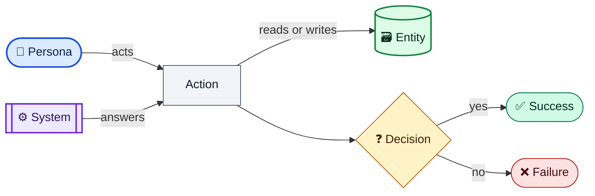

# 🏠 Swarm specifications

<!-- spec:nav-top -->
<!-- /spec:nav-top -->

> [!NOTE]
> The functional and technical specifications of Swarm. Every page is numbered: the arrows at the top and at the bottom of each page lead to the previous and the next page, and 🏠 brings you back here.

<!-- spec:summary -->
<!-- /spec:summary -->

## 📚 Pages

<!-- spec:pages -->
<!-- /spec:pages -->

## 🗺️ Legend

**Page icons**

| Icon | Page |
| --- | --- |
| 🏠 | This index |
| 📖 | The [glossary](glossary.md): the only names used for personas, entities, systems, terms and states |
| 🎨 | The [visual identity](visual-identity.md): colours, fonts, components and screen size, for screens and diagrams |
| 🧭 | The [functional overview](functional/README.md), with the traceability matrix |
| 📘 | A feature: what Swarm does for a persona |
| 🎬 | A use case: one interaction, step by step, with its flow chart and a screen for each state |
| 📏 | A business rule: a constraint every feature and use case must respect |
| 🛠️ | A [technical specification](technical/README.md) |
| 🛣️ | The [roadmap](roadmap/README.md): when each feature is delivered |

**Status**

| Status | Meaning |
| --- | --- |
| 🟡 Draft | Being written, may change at any time |
| 🔵 In review | Complete, waiting for approval |
| 🟢 Approved | Agreed, the reference for the implementation |
| 🔴 Deprecated | Kept for history, no longer applies |

**Screens**

| Source | Meaning |
| --- | --- |
| ✏️ Mock-up | Drawn with the components of the visual identity, before the application shows that state |
| 📸 Screenshot | Captured from the application |
| ➖ | No screen in this state, with the reason |

**Flow chart colours**, from the [visual identity](visual-identity.md#diagrams)

<!-- spec:nav-bottom -->
<!-- /spec:nav-bottom -->
