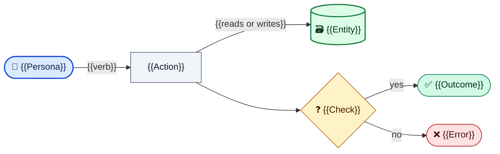

# 🎬 %ID%: %TITLE%

<!-- spec:nav-top -->
<!-- /spec:nav-top -->

**Status:** 🟡 Draft · **Updated:** %DATE%

> [!NOTE]
> {{One sentence: which persona does what, with which entity, and what they get.}}

<!-- spec:summary -->
<!-- /spec:summary -->

## 👤 Personas and entities

| Name | Kind | Role in this use case |
| --- | --- | --- |
| [👤 {{Persona}}](../../glossary.md#per-{{persona}}) | Persona | {{What they do}} |
| [🗃️ {{Entity}}](../../glossary.md#ent-{{entity}}) | Entity | {{What happens to it}} |

## 🚦 Preconditions

1. {{What is true before the use case starts.}}

## ⚡ Trigger

{{The event or the action that starts the use case.}}

## ➡️ Main flow

1. The [👤 {{Persona}}](../../glossary.md#per-{{persona}}) {{does something}}.
2. {{Swarm does something with the entity}}.
3. {{...}}

## 🔀 Flow chart

## 🖼️ Screens

One row per state of the flow chart: every action, success and failure node. Each state shows its light then its dark screen; click one to open it full size. A state with nothing to show reads `➖ No screen: <why>`.

| State | Persona | Entity | Source | Screen |
| --- | --- | --- | --- | --- |
| A1: {{Action}} | [🔄 {{Persona}}: {{State}}](../../glossary.md#st-{{persona}}-{{state}}) | [🔄 {{Entity}}: {{State}}](../../glossary.md#st-{{entity}}-{{state}}) | ✏️ Mock-up |   |
| OK: {{Outcome}} | [🔄 {{Persona}}: {{State}}](../../glossary.md#st-{{persona}}-{{state}}) | [🔄 {{Entity}}: {{State}}](../../glossary.md#st-{{entity}}-{{state}}) | ✏️ Mock-up |   |
| KO: {{Error}} | [🔄 {{Persona}}: {{State}}](../../glossary.md#st-{{persona}}-{{state}}) | [🔄 {{Entity}}: {{State}}](../../glossary.md#st-{{entity}}-{{state}}) | ✏️ Mock-up |   |

## ↪️ Alternative and error flows

| # | At step | Condition | What happens |
| --- | --- | --- | --- |
| A1 | {{2}} | {{When ...}} | {{...}} |

## 📏 Business rules applied

| Rule | Where it applies |
| --- | --- |
| [📏 BR-{{NNN}}: {{Title}}](../business-rules/BR-{{NNN}}-{{slug}}.md) | {{Step 2}} |

## 🏁 Postconditions

- ✅ **Success:** {{What is true at the end.}}
- ❌ **Failure:** {{What is true when it fails, and what the persona sees.}}

## 🔗 Referenced by

<!-- spec:referenced-by -->
<!-- /spec:referenced-by -->

<!-- spec:nav-bottom -->
<!-- /spec:nav-bottom -->
