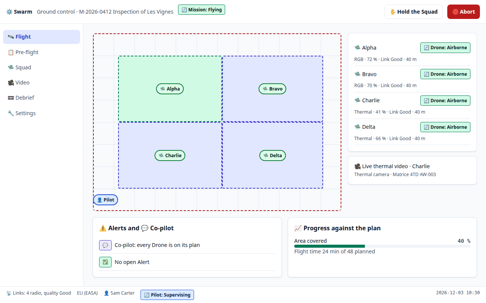
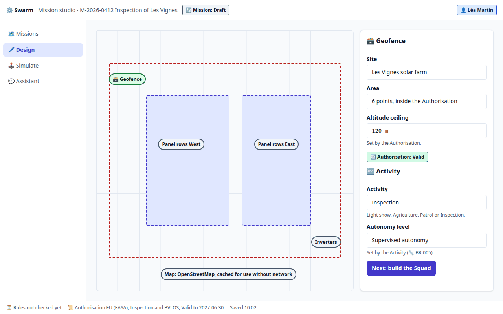
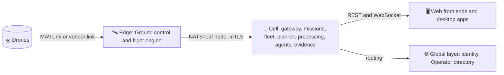

<p align="center">
  <picture>
    <source media="(prefers-color-scheme: dark)" srcset="docs/assets/logo-wordmark-dark.svg">
    
  </picture>
</p>

<p align="center">
  <b>Plan, fly and prove drone missions with a whole squad, from one seat.</b>
</p>

<p align="center">
  <a href="#-the-suite">Suite</a> ·
  <a href="#-built-for-four-activities">Activities</a> ·
  <a href="#-architecture">Architecture</a> ·
  <a href="#-roadmap">Roadmap</a> ·
  <a href="#-documentation">Documentation</a> ·
  <a href="#-getting-started">Getting started</a>
</p>

---

**Swarm** is a software suite for drone operators who fly several drones on one mission. A Mission planner designs the
mission, a Pilot launches and supervises the whole **Squad** as one, and the Client receives deliverables backed by a
signed, tamper-evident evidence record. Each drone in a Squad keeps its own model, payload and role, and Swarm flies them
together whatever their maker.

<p align="center">
  <picture>
    <source media="(prefers-color-scheme: dark)" srcset="docs/specs/screens/UC-004/a1.dark.png">
    
  </picture>
  <br>
  <sub>🛰️ Ground control: the Pilot supervises a Squad of four drones, with live Telemetry, video and the Co-pilot.</sub>
</p>

## ✨ Why Swarm

- **🧑‍✈️ The Pilot stays in command.** Swarm automates the flying, never the decision. Hold, manual control and abort
  are one action away, at every moment.
- **🛡️ Safety never waits for the network.** The flight engine and its safety loop run at the edge, next to the
  drones. A Mission keeps flying, and keeps its fail-safes, when the cloud is out of reach.
- **🧷 Hardware-agnostic.** One Squad can mix drones from several makers: MAVLink (PX4, ArduPilot), DJI, Skydio and
  Parrot, each through a Drone adapter that passes a compatibility test.
- **💬 AI agents that propose, people that decide.** The Mission assistant drafts missions, the Co-pilot explains alerts
  and proposes re-plans, the Report writer drafts reports. Nothing they propose flies without a person's approval.
- **🔏 Evidence you can prove.** Every flight log and deliverable is signed and chained, then anchored with a
  timestamping authority (eIDAS, RFC 3161) or a blockchain, as the Operator chooses.
- **🏛️ Built for the rules.** Authorisations, pilot qualifications, geofences and airspace requests follow EU (EASA,
  U-space) and US (FAA, LAANC) rules.
- **🌍 Sovereign by design.** Run it in a European cloud (OVHcloud, Scaleway), self-hosted on Kubernetes, or fully on
  premises: the same software everywhere.

## 🧩 The suite

| Part | For | What it does |
| --- | --- | --- |
| 🖊️ **Mission studio** | Mission planner | Designs a Mission: area, routes or choreography, Squad, rules. Simulates it before it flies |
| 🛰️ **Ground control** | Pilot | Runs the Pre-flight check, launches, supervises the Squad live, approves re-plans, takes control |
| 🗂️ **Back office** | Fleet maintainer, Swarm administrator | Fleet and readiness, Authorisations, people and access, flight logs and evidence records |
| 📦 **Client portal** | Client, Site agent | Order a Mission, follow it live, receive alarms, download deliverables |
| 🕹️ **Simulator** | Pilot, Instructor | Flies a virtual Squad with the real flight software of each drone model, to test and to train |

<p align="center">
  <picture>
    <source media="(prefers-color-scheme: dark)" srcset="docs/specs/screens/UC-001/a1.dark.png">
    
  </picture>
  <br>
  <sub>🖊️ Mission studio: a Mission planner designs an Inspection inside its Authorisation.</sub>
</p>

## 🎯 Built for four activities

| Activity | What Swarm brings |
| --- | --- |
| 🔎 **Inspection** | Coverage plans over solar farms, structures and sites; processing into orthomosaics and defect reports |
| 🚨 **Patrol** | Docked drones that take off on an alarm from the site's security system, with live video for the Site agent |
| 🌾 **Agriculture** | Fields and prescription maps turned into doses, with spray drones, refills and campaigns |
| ✨ **Light shows** | Choreographies of up to 5,000 drones, imported or designed, flown by a partitioned edge |

## 🏗️ Architecture

Swarm is built in two halves that never wait for each other while a Squad flies.



- **The edge** runs next to the drones: on the Ground control machine, in an operations centre or on a dock site. It
  holds the flight engine, written in Rust for the hot path, which talks to every drone and runs the safety loop.
- **The core** runs in **cells**: independent copies of the platform, each serving a set of Operators. More Operators
  mean more cells, never a bigger one.

| Layer | Technology |
| --- | --- |
| Services | Python 3.12, FastAPI, Pydantic; Rust crates through PyO3 for the hot path |
| Messaging | NATS, with leaf nodes at the edge |
| Data | PostgreSQL with PostGIS, TimescaleDB for Telemetry, object storage, Valkey |
| Front ends | React and TypeScript, with a Tauri desktop shell for Mission studio and Ground control |
| Platform | Kubernetes with KEDA, k3s at the edge and on premises, Terraform, Argo CD, OpenTelemetry |

### Designed for scale

| Dimension | Target |
| --- | --- |
| Operators | 10,000 |
| Missions in flight at once | 2,000 |
| Drones connected | 50,000 |
| Drones per Mission | up to 50, up to 5,000 in a light show |
| Telemetry | 20 Hz per drone (50 Hz in light shows), about 1,000,000 frames per second |
| People connected | 50,000, of which 5,000 watching live video |

Every hot path has a performance budget, checked by load tests that fail the build when missed. See
[🚀 Scalability and performance](docs/specs/technical/07-scalability.md).

## 🛣️ Roadmap

> [!NOTE]
> Swarm is in pre-release. The Foundations phase is under way; general availability is planned for the end of 2028.

| Phase | When | Delivers |
| --- | --- | --- |
| [P0: Foundations](docs/specs/roadmap/01-p0-foundations.md) | Jan to Feb 2027 | Mono-repo, CI/CD, shared packages, identity, the first cell, simulator, design tokens |
| [P1: First flight](docs/specs/roadmap/02-p1-first-flight.md) | Mar to Jul 2027 | Flight engine and safety loop, MAVLink adapter, Ground control, Pre-flight check, fail-safes |
| [P2: Inspection product](docs/specs/roadmap/03-p2-inspection-product.md) | Jul to Dec 2027 | Processing, deliverables, Back office, Client portal, evidence ledger, debrief |
| [P3: Patrol](docs/specs/roadmap/04-p3-patrol.md) | Dec 2027 to Apr 2028 | Docks, Parrot adapter, alarms and webhooks, Site agents, video at scale |
| [P4: Agriculture](docs/specs/roadmap/05-p4-agriculture.md) | Mar to Jun 2028 | Fields, prescription maps, dose computation, spray drones |
| [P5: AI agents](docs/specs/roadmap/06-p5-ai-agents.md) | May to Aug 2028 | Mission assistant, Co-pilot, Report writer, MCP and A2A behind the human gate |
| [P6: Light shows](docs/specs/roadmap/07-p6-light-shows.md) | Jul to Nov 2028 | Choreography designer, partitioned edge, 5,000-drone load test |
| [P7: Scale and reach](docs/specs/roadmap/08-p7-scale-and-reach.md) | Sep to Dec 2028 | Production cells, US cell, on-premises bundle, DJI and Skydio adapters, general availability |

The full plan, with the regulatory track, flight test campaigns, partners and risks, is in the
[🛣️ Roadmap](docs/specs/roadmap/README.md).

## 📚 Documentation

| Document | Holds |
| --- | --- |
| [🏠 Specifications](docs/specs/README.md) | 22 features, 30 use cases and 27 business rules, each use case with its flow chart and a screen for every state |
| [📖 Glossary](docs/specs/glossary.md) | The one name for every persona, entity, system and state |
| [🎨 Visual identity](docs/specs/visual-identity.md) | Design tokens in light and dark mode, components and screen layouts |
| [🛠️ Technical specifications](docs/specs/technical/README.md) | Architecture, data models, storage, engine, API, security, scalability, observability, deployment, front ends |
| [🔭 Landscape](docs/research/landscape.md) | The market: drone makers, multi-drone software, open autopilots, EU and US rules |
| [🗒️ Product decisions](docs/research/interview.md) | The product decisions behind the specifications |
| [⚖️ Technical decisions](docs/research/interview-technical.md) | The technical decisions and their reasons |

## 🚀 Getting started

### Prerequisites

- [uv](https://docs.astral.sh/uv/), which installs Python 3.12 for the project.
- A stable Rust toolchain, selected by [packages/rust/rust-toolchain.toml](packages/rust/rust-toolchain.toml).
- Node LTS, with [corepack](https://nodejs.org/api/corepack.html) to provide pnpm.
- [Terraform](https://developer.hashicorp.com/terraform) 1.10 or later, only to provision a cell.

### Install

```bash
uv sync
cargo fetch --manifest-path packages/rust/Cargo.toml
corepack enable && pnpm install
```

Each command installs one workspace: uv for Python (one `uv.lock`), Cargo for Rust and pnpm for TypeScript.

### Run the checks

```bash
uv run ruff check services packages tests
uv run mypy services/gateway/src
uv run pytest services/gateway/tests -n 2
uv run pytest tests/conventions
pnpm turbo run build
```

### Provision a cell

Terraform creates a cell's machines, network and k3s cluster. Follow
[deploy/terraform/README.md](deploy/terraform/README.md).

## 🗂️ Repository layout

| Path | Holds |
| --- | --- |
| [services/](services/) | The backend services, one folder and one Docker image each, starting with the [gateway](services/gateway/) |
| [packages/](packages/) | Shared code: `python/` (uv), `rust/` (Cargo and PyO3) and `ts/` (pnpm) |
| [frontends/](frontends/) | The front ends, one folder and one image each, with their Playwright tests |
| [deploy/terraform/](deploy/terraform/README.md) | One module per building block, one root per cell |
| [tests/](tests/) | The convention tests, run against every service |
| [docs/](docs/) | The specifications, the research and the tickets |

## 🤝 How we build Swarm

Swarm is specified before it is built, and every rule is checked by a tool rather than by memory.

- **Specifications first.** Each feature links to its business rules and use cases, every name comes from the glossary,
  and `python3 .claude/skills/write-specs/scripts/specs.py check` prints nothing before a change to them is done.
- **Code conventions** are in [AGENT.md](AGENT.md) and enforced by the tests of `tests/conventions/`.
- **Tickets** come from the roadmap. Each one is planned as a task graph, approved by a person, then built in parallel
  by AI coding agents in separate worktrees, verified, reviewed and merged. The rules are in
  [.claude/rules/tickets.md](.claude/rules/tickets.md), and each ticket's plan, progress and evidence are in
  [docs/tickets/](docs/tickets/).
