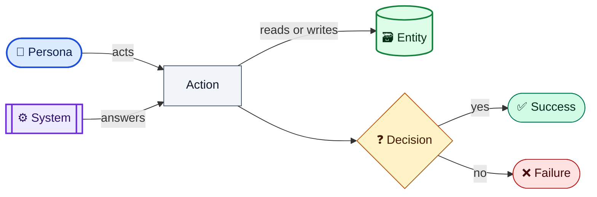

# 🏠 Swarm specifications

<!-- spec:nav-top -->
> 📄 **Page 1 / 108** · [Glossary ▶️](glossary.md)
<!-- /spec:nav-top -->

> [!NOTE]
> The functional and technical specifications of Swarm. Every page is numbered: the arrows at the top and at the bottom of each page lead to the previous and the next page, and 🏠 brings you back here.

<!-- spec:summary -->
## 📑 Summary

1. [📚 Pages](#pages)
2. [🗺️ Legend](#legend)
<!-- /spec:summary -->

## 📚 Pages

<!-- spec:pages -->
| # | Page | Kind | Status |
| ---: | --- | --- | --- |
| 1 | [🏠 Swarm specifications](README.md) | Index |  |
| 2 | [📖 Glossary](glossary.md) | Glossary |  |
| 3 | [🎨 Visual identity](visual-identity.md) | Visual identity | 🟢 Approved |
| 4 | [🧭 Functional specifications](functional/README.md) | Functional overview |  |
| 5 | [📘 FS-001: Mission design](functional/features/FS-001-mission-design.md) | 📘 Feature | 🟢 Approved |
| 6 | [📘 FS-002: Pre-flight check and launch](functional/features/FS-002-pre-flight-check-and-launch.md) | 📘 Feature | 🟢 Approved |
| 7 | [📘 FS-003: Live supervision](functional/features/FS-003-live-supervision.md) | 📘 Feature | 🟢 Approved |
| 8 | [📘 FS-004: Fail-safes and emergencies](functional/features/FS-004-fail-safes-and-emergencies.md) | 📘 Feature | 🟢 Approved |
| 9 | [📘 FS-005: Fleet and readiness](functional/features/FS-005-fleet-and-readiness.md) | 📘 Feature | 🟢 Approved |
| 10 | [📘 FS-006: Authorisations and compliance](functional/features/FS-006-authorisations-and-compliance.md) | 📘 Feature | 🟢 Approved |
| 11 | [📘 FS-007: Data processing and Deliverables](functional/features/FS-007-data-processing-and-deliverables.md) | 📘 Feature | 🟢 Approved |
| 12 | [📘 FS-008: Client portal](functional/features/FS-008-client-portal.md) | 📘 Feature | 🟢 Approved |
| 13 | [📘 FS-009: Evidence ledger and Anchoring](functional/features/FS-009-evidence-ledger-and-anchoring.md) | 📘 Feature | 🟢 Approved |
| 14 | [📘 FS-010: Simulator and training](functional/features/FS-010-simulator-and-training.md) | 📘 Feature | 🟢 Approved |
| 15 | [📘 FS-011: Drone adapters](functional/features/FS-011-drone-adapters.md) | 📘 Feature | 🟢 Approved |
| 16 | [📘 FS-012: Operators, deployment and languages](functional/features/FS-012-operators-deployment-and-languages.md) | 📘 Feature | 🟢 Approved |
| 17 | [📘 FS-013: Light shows](functional/features/FS-013-light-shows.md) | 📘 Feature | 🟢 Approved |
| 18 | [📘 FS-014: Agriculture](functional/features/FS-014-agriculture.md) | 📘 Feature | 🟢 Approved |
| 19 | [📘 FS-015: Patrol](functional/features/FS-015-patrol.md) | 📘 Feature | 🟢 Approved |
| 20 | [📘 FS-016: Inspection](functional/features/FS-016-inspection.md) | 📘 Feature | 🟢 Approved |
| 21 | [📘 FS-017: Mission assistant](functional/features/FS-017-mission-assistant.md) | 📘 Feature | 🟢 Approved |
| 22 | [📘 FS-018: Live Co-pilot](functional/features/FS-018-live-co-pilot.md) | 📘 Feature | 🟢 Approved |
| 23 | [📘 FS-019: Mission reports](functional/features/FS-019-mission-reports.md) | 📘 Feature | 🟢 Approved |
| 24 | [📘 FS-020: Ground control Workspace and configuration](functional/features/FS-020-ground-control-workspace-and-configuration.md) | 📘 Feature | 🟢 Approved |
| 25 | [📘 FS-021: Ground control monitoring](functional/features/FS-021-ground-control-monitoring.md) | 📘 Feature | 🟢 Approved |
| 26 | [📘 FS-022: Debrief and assessment](functional/features/FS-022-debrief-and-assessment.md) | 📘 Feature | 🟢 Approved |
| 27 | [🎬 UC-001: Design a Mission](functional/use-cases/UC-001-design-a-mission.md) | 🎬 Use case | 🟢 Approved |
| 28 | [🎬 UC-002: Simulate a Mission](functional/use-cases/UC-002-simulate-a-mission.md) | 🎬 Use case | 🟢 Approved |
| 29 | [🎬 UC-003: Run the Pre-flight check and launch](functional/use-cases/UC-003-run-the-pre-flight-check-and-launch.md) | 🎬 Use case | 🟢 Approved |
| 30 | [🎬 UC-004: Supervise a Squad and approve a Re-plan](functional/use-cases/UC-004-supervise-a-squad-and-approve-a-re-plan.md) | 🎬 Use case | 🟢 Approved |
| 31 | [🎬 UC-005: Lose a Drone in flight](functional/use-cases/UC-005-lose-a-drone-in-flight.md) | 🎬 Use case | 🟢 Approved |
| 32 | [🎬 UC-006: Take manual control or abort](functional/use-cases/UC-006-take-manual-control-or-abort.md) | 🎬 Use case | 🟢 Approved |
| 33 | [🎬 UC-007: Register a Drone and track its readiness](functional/use-cases/UC-007-register-a-drone-and-track-its-readiness.md) | 🎬 Use case | 🟢 Approved |
| 34 | [🎬 UC-008: Record an Authorisation](functional/use-cases/UC-008-record-an-authorisation.md) | 🎬 Use case | 🟢 Approved |
| 35 | [🎬 UC-009: Process flight data into Deliverables](functional/use-cases/UC-009-process-flight-data-into-deliverables.md) | 🎬 Use case | 🟢 Approved |
| 36 | [🎬 UC-010: Order a Mission in the Client portal](functional/use-cases/UC-010-order-a-mission-in-the-client-portal.md) | 🎬 Use case | 🟢 Approved |
| 37 | [🎬 UC-011: Follow a Mission and download its Deliverables](functional/use-cases/UC-011-follow-a-mission-and-download-its-deliverables.md) | 🎬 Use case | 🟢 Approved |
| 38 | [🎬 UC-012: Verify the Evidence record of a flight](functional/use-cases/UC-012-verify-the-evidence-record-of-a-flight.md) | 🎬 Use case | 🟢 Approved |
| 39 | [🎬 UC-013: Train on the Simulator](functional/use-cases/UC-013-train-on-the-simulator.md) | 🎬 Use case | 🟢 Approved |
| 40 | [🎬 UC-014: Connect a new Drone model](functional/use-cases/UC-014-connect-a-new-drone-model.md) | 🎬 Use case | 🟢 Approved |
| 41 | [🎬 UC-015: Invite a Client to the Client portal](functional/use-cases/UC-015-invite-a-client-to-the-client-portal.md) | 🎬 Use case | 🟢 Approved |
| 42 | [🎬 UC-016: Import and fly a Light show](functional/use-cases/UC-016-import-and-fly-a-light-show.md) | 🎬 Use case | 🟢 Approved |
| 43 | [🎬 UC-017: Spray a Field with refills](functional/use-cases/UC-017-spray-a-field-with-refills.md) | 🎬 Use case | 🟢 Approved |
| 44 | [🎬 UC-018: Respond to a Site Alarm](functional/use-cases/UC-018-respond-to-a-site-alarm.md) | 🎬 Use case | 🟢 Approved |
| 45 | [🎬 UC-019: Request a Patrol on demand](functional/use-cases/UC-019-request-a-patrol-on-demand.md) | 🎬 Use case | 🟢 Approved |
| 46 | [🎬 UC-020: Review the Defects of an Inspection](functional/use-cases/UC-020-review-the-defects-of-an-inspection.md) | 🎬 Use case | 🟢 Approved |
| 47 | [🎬 UC-021: Plan a Mission with the Mission assistant](functional/use-cases/UC-021-plan-a-mission-with-the-mission-assistant.md) | 🎬 Use case | 🟢 Approved |
| 48 | [🎬 UC-022: Receive the Mission report](functional/use-cases/UC-022-receive-the-mission-report.md) | 🎬 Use case | 🟢 Approved |
| 49 | [🎬 UC-023: Configure the Workspace of Ground control](functional/use-cases/UC-023-configure-the-workspace-of-ground-control.md) | 🎬 Use case | 🟢 Approved |
| 50 | [🎬 UC-024: Configure each Drone of the Squad on the Site](functional/use-cases/UC-024-configure-each-drone-of-the-squad-on-the-site.md) | 🎬 Use case | 🟢 Approved |
| 51 | [🎬 UC-025: Monitor a Mission in Ground control](functional/use-cases/UC-025-monitor-a-mission-in-ground-control.md) | 🎬 Use case | 🟢 Approved |
| 52 | [🎬 UC-026: Handle an Alert](functional/use-cases/UC-026-handle-an-alert.md) | 🎬 Use case | 🟢 Approved |
| 53 | [🎬 UC-027: Debrief a Mission](functional/use-cases/UC-027-debrief-a-mission.md) | 🎬 Use case | 🟢 Approved |
| 54 | [🎬 UC-028: Assess a Mission against the request](functional/use-cases/UC-028-assess-a-mission-against-the-request.md) | 🎬 Use case | 🟢 Approved |
| 55 | [🎬 UC-029: Create an Operator](functional/use-cases/UC-029-create-an-operator.md) | 🎬 Use case | 🟢 Approved |
| 56 | [🎬 UC-030: Focus on a Drone](functional/use-cases/UC-030-focus-on-a-drone.md) | 🎬 Use case | 🟢 Approved |
| 57 | [📏 BR-001: Geofence and Altitude ceiling](functional/business-rules/BR-001-geofence-and-altitude-ceiling.md) | 📏 Business rule | 🟢 Approved |
| 58 | [📏 BR-002: Separation distance](functional/business-rules/BR-002-separation-distance.md) | 📏 Business rule | 🟢 Approved |
| 59 | [📏 BR-003: Weather limits](functional/business-rules/BR-003-weather-limits.md) | 📏 Business rule | 🟢 Approved |
| 60 | [📏 BR-004: Pilot ratio](functional/business-rules/BR-004-pilot-ratio.md) | 📏 Business rule | 🟢 Approved |
| 61 | [📏 BR-005: Autonomy level per Activity](functional/business-rules/BR-005-autonomy-level-per-activity.md) | 📏 Business rule | 🟢 Approved |
| 62 | [📏 BR-006: Fail-safe per Activity](functional/business-rules/BR-006-fail-safe-per-activity.md) | 📏 Business rule | 🟢 Approved |
| 63 | [📏 BR-007: Launch only after a passed Pre-flight check](functional/business-rules/BR-007-launch-only-after-a-passed-pre-flight-check.md) | 📏 Business rule | 🟢 Approved |
| 64 | [📏 BR-008: Operator isolation](functional/business-rules/BR-008-operator-isolation.md) | 📏 Business rule | 🟢 Approved |
| 65 | [📏 BR-009: Evidence integrity](functional/business-rules/BR-009-evidence-integrity.md) | 📏 Business rule | 🟢 Approved |
| 66 | [📏 BR-010: Valid Authorisation for the Jurisdiction](functional/business-rules/BR-010-valid-authorisation-for-the-jurisdiction.md) | 📏 Business rule | 🟢 Approved |
| 67 | [📏 BR-011: Drone readiness](functional/business-rules/BR-011-drone-readiness.md) | 📏 Business rule | 🟢 Approved |
| 68 | [📏 BR-012: Pilot override always available](functional/business-rules/BR-012-pilot-override-always-available.md) | 📏 Business rule | 🟢 Approved |
| 69 | [📏 BR-013: Re-plan approval](functional/business-rules/BR-013-re-plan-approval.md) | 📏 Business rule | 🟢 Approved |
| 70 | [📏 BR-014: Simulation isolation](functional/business-rules/BR-014-simulation-isolation.md) | 📏 Business rule | 🟢 Approved |
| 71 | [📏 BR-015: Approved Drone models only](functional/business-rules/BR-015-approved-drone-models-only.md) | 📏 Business rule | 🟢 Approved |
| 72 | [📏 BR-016: Clients see only their own Missions](functional/business-rules/BR-016-clients-see-only-their-own-missions.md) | 📏 Business rule | 🟢 Approved |
| 73 | [📏 BR-017: Every screen in four languages](functional/business-rules/BR-017-every-screen-in-four-languages.md) | 📏 Business rule | 🟢 Approved |
| 74 | [📏 BR-018: Dose follows the Prescription map](functional/business-rules/BR-018-dose-follows-the-prescription-map.md) | 📏 Business rule | 🟢 Approved |
| 75 | [📏 BR-019: Site agents request, never pilot](functional/business-rules/BR-019-site-agents-request-never-pilot.md) | 📏 Business rule | 🟢 Approved |
| 76 | [📏 BR-020: Defects confirmed by a person](functional/business-rules/BR-020-defects-confirmed-by-a-person.md) | 📏 Business rule | 🟢 Approved |
| 77 | [📏 BR-021: AI agents propose, people decide](functional/business-rules/BR-021-ai-agents-propose-people-decide.md) | 📏 Business rule | 🟢 Approved |
| 78 | [📏 BR-022: Payload compatibility](functional/business-rules/BR-022-payload-compatibility.md) | 📏 Business rule | 🟢 Approved |
| 79 | [📏 BR-023: Fixed safety controls](functional/business-rules/BR-023-fixed-safety-controls.md) | 📏 Business rule | 🟢 Approved |
| 80 | [📏 BR-024: Alert thresholds within the Operator limits](functional/business-rules/BR-024-alert-thresholds-within-the-operator-limits.md) | 📏 Business rule | 🟢 Approved |
| 81 | [📏 BR-025: On-site changes are checked again](functional/business-rules/BR-025-on-site-changes-are-checked-again.md) | 📏 Business rule | 🟢 Approved |
| 82 | [📏 BR-026: Scorecard against the request](functional/business-rules/BR-026-scorecard-against-the-request.md) | 📏 Business rule | 🟢 Approved |
| 83 | [📏 BR-027: The Pilot's attention is preserved](functional/business-rules/BR-027-the-pilot-s-attention-is-preserved.md) | 📏 Business rule | 🟢 Approved |
| 84 | [🛠️ Technical specifications](technical/README.md) | Technical overview | 🟢 Approved |
| 85 | [🏗️ Architecture](technical/01-architecture.md) | 🛠️ Technical | 🟢 Approved |
| 86 | [🧱 Data models](technical/02-data-models.md) | 🛠️ Technical | 🟢 Approved |
| 87 | [🗄️ Storage](technical/03-storage.md) | 🛠️ Technical | 🟢 Approved |
| 88 | [🔩 Engine and services](technical/04-engine.md) | 🛠️ Technical | 🟢 Approved |
| 89 | [🔌 API layer](technical/05-api.md) | 🛠️ Technical | 🟢 Approved |
| 90 | [🔐 Security](technical/06-security.md) | 🛠️ Technical | 🟢 Approved |
| 91 | [🚀 Scalability and performance](technical/07-scalability.md) | 🛠️ Technical | 🟢 Approved |
| 92 | [🩺 Observability](technical/08-observability.md) | 🛠️ Technical | 🟢 Approved |
| 93 | [🚢 Deployment](technical/09-deployment.md) | 🛠️ Technical | 🟢 Approved |
| 94 | [🖥️ GUI and WebUI](technical/10-frontends.md) | 🛠️ Technical | 🟢 Approved |
| 95 | [🛣️ Roadmap](roadmap/README.md) | Roadmap overview | 🟢 Approved |
| 96 | [🛣️ P0: Foundations](roadmap/01-p0-foundations.md) | 🛣️ Roadmap | 🟢 Approved |
| 97 | [🛣️ P1: First flight](roadmap/02-p1-first-flight.md) | 🛣️ Roadmap | 🟢 Approved |
| 98 | [🛣️ P2: Inspection product](roadmap/03-p2-inspection-product.md) | 🛣️ Roadmap | 🟢 Approved |
| 99 | [🛣️ P3: Patrol](roadmap/04-p3-patrol.md) | 🛣️ Roadmap | 🟢 Approved |
| 100 | [🛣️ P4: Agriculture](roadmap/05-p4-agriculture.md) | 🛣️ Roadmap | 🟢 Approved |
| 101 | [🛣️ P5: AI agents, MCP and A2A](roadmap/06-p5-ai-agents.md) | 🛣️ Roadmap | 🟢 Approved |
| 102 | [🛣️ P6: Light shows](roadmap/07-p6-light-shows.md) | 🛣️ Roadmap | 🟢 Approved |
| 103 | [🛣️ P7: Scale and reach](roadmap/08-p7-scale-and-reach.md) | 🛣️ Roadmap | 🟢 Approved |
| 104 | [🏛️ Regulatory track](roadmap/09-regulatory-track.md) | 🛣️ Roadmap | 🟢 Approved |
| 105 | [🛫 Flight test campaigns](roadmap/10-flight-test-campaigns.md) | 🛣️ Roadmap | 🟢 Approved |
| 106 | [🤝 Hardware and partners](roadmap/11-hardware-and-partners.md) | 🛣️ Roadmap | 🟢 Approved |
| 107 | [🎲 Risks](roadmap/12-risks.md) | 🛣️ Roadmap | 🟢 Approved |
| 108 | [🧬 Traceability](roadmap/13-traceability.md) | 🛣️ Roadmap | 🟢 Approved |
<!-- /spec:pages -->

## 🗺️ Legend

**Page icons**

| Icon | Page |
| --- | --- |
| 🏠 | This index |
| 📖 | The [glossary](glossary.md): the only names used for personas, entities, systems, terms and states |
| 🎨 | The [visual identity](visual-identity.md): colours, fonts, components and screen size, for screens and diagrams |
| 🧭 | The [functional overview](functional/README.md), with the traceability matrix |
| 📘 | A feature: what Swarm does for a persona |
| 🎬 | A use case: one interaction, step by step, with its flow chart and a screen for each state |
| 📏 | A business rule: a constraint every feature and use case must respect |
| 🛠️ | A [technical specification](technical/README.md) |
| 🛣️ | The [roadmap](roadmap/README.md): when each feature is delivered |

**Status**

| Status | Meaning |
| --- | --- |
| 🟡 Draft | Being written, may change at any time |
| 🔵 In review | Complete, waiting for approval |
| 🟢 Approved | Agreed, the reference for the implementation |
| 🔴 Deprecated | Kept for history, no longer applies |

**Screens**

| Source | Meaning |
| --- | --- |
| ✏️ Mock-up | Drawn with the components of the visual identity, before the application shows that state |
| 📸 Screenshot | Captured from the application |
| ➖ | No screen in this state, with the reason |

**Flow chart colours**, from the [visual identity](visual-identity.md#diagrams)

<!-- spec:nav-bottom -->
---

> 📄 **Page 1 / 108** · [Glossary ▶️](glossary.md)
<!-- /spec:nav-bottom -->
