# 🧭 Functional specifications

<!-- spec:nav-top -->
> [🏠 Index](../README.md) · [◀️ Visual identity](../visual-identity.md) · 📄 **Page 4 / 108** · [FS-001: Mission design ▶️](features/FS-001-mission-design.md)
<!-- /spec:nav-top -->

<!-- spec:summary -->
## 📑 Summary

1. [🔭 Overview](#overview)
2. [🧬 Traceability matrix](#traceability)
<!-- /spec:summary -->

## 🔭 Overview

> [!TIP]
> **How to read these pages.** A feature (📘) states what Swarm does for a persona. It refers to the business rules (📏) that constrain it and to the use cases (🎬) that show it step by step, each with a flow chart. Every name comes from the [glossary](../glossary.md).

## 🧬 Traceability matrix

Generated from the links in each feature and use case.

<!-- spec:matrix -->
| 📘 Feature | 🎬 Use cases | 📏 Business rules |
| --- | --- | --- |
| [📘 FS-001: Mission design](features/FS-001-mission-design.md) | [🎬 UC-001: Design a Mission](use-cases/UC-001-design-a-mission.md) [🎬 UC-002: Simulate a Mission](use-cases/UC-002-simulate-a-mission.md) [🎬 UC-021: Plan a Mission with the Mission assistant](use-cases/UC-021-plan-a-mission-with-the-mission-assistant.md) | [📏 BR-001: Geofence and Altitude ceiling](business-rules/BR-001-geofence-and-altitude-ceiling.md) [📏 BR-002: Separation distance](business-rules/BR-002-separation-distance.md) [📏 BR-005: Autonomy level per Activity](business-rules/BR-005-autonomy-level-per-activity.md) [📏 BR-010: Valid Authorisation for the Jurisdiction](business-rules/BR-010-valid-authorisation-for-the-jurisdiction.md) [📏 BR-022: Payload compatibility](business-rules/BR-022-payload-compatibility.md) |
| [📘 FS-002: Pre-flight check and launch](features/FS-002-pre-flight-check-and-launch.md) | [🎬 UC-003: Run the Pre-flight check and launch](use-cases/UC-003-run-the-pre-flight-check-and-launch.md) | [📏 BR-003: Weather limits](business-rules/BR-003-weather-limits.md) [📏 BR-004: Pilot ratio](business-rules/BR-004-pilot-ratio.md) [📏 BR-007: Launch only after a passed Pre-flight check](business-rules/BR-007-launch-only-after-a-passed-pre-flight-check.md) [📏 BR-010: Valid Authorisation for the Jurisdiction](business-rules/BR-010-valid-authorisation-for-the-jurisdiction.md) [📏 BR-011: Drone readiness](business-rules/BR-011-drone-readiness.md) |
| [📘 FS-003: Live supervision](features/FS-003-live-supervision.md) | [🎬 UC-004: Supervise a Squad and approve a Re-plan](use-cases/UC-004-supervise-a-squad-and-approve-a-re-plan.md) | [📏 BR-005: Autonomy level per Activity](business-rules/BR-005-autonomy-level-per-activity.md) [📏 BR-012: Pilot override always available](business-rules/BR-012-pilot-override-always-available.md) [📏 BR-013: Re-plan approval](business-rules/BR-013-re-plan-approval.md) |
| [📘 FS-004: Fail-safes and emergencies](features/FS-004-fail-safes-and-emergencies.md) | [🎬 UC-005: Lose a Drone in flight](use-cases/UC-005-lose-a-drone-in-flight.md) [🎬 UC-006: Take manual control or abort](use-cases/UC-006-take-manual-control-or-abort.md) | [📏 BR-001: Geofence and Altitude ceiling](business-rules/BR-001-geofence-and-altitude-ceiling.md) [📏 BR-006: Fail-safe per Activity](business-rules/BR-006-fail-safe-per-activity.md) [📏 BR-012: Pilot override always available](business-rules/BR-012-pilot-override-always-available.md) |
| [📘 FS-005: Fleet and readiness](features/FS-005-fleet-and-readiness.md) | [🎬 UC-007: Register a Drone and track its readiness](use-cases/UC-007-register-a-drone-and-track-its-readiness.md) | [📏 BR-011: Drone readiness](business-rules/BR-011-drone-readiness.md) [📏 BR-015: Approved Drone models only](business-rules/BR-015-approved-drone-models-only.md) [📏 BR-022: Payload compatibility](business-rules/BR-022-payload-compatibility.md) |
| [📘 FS-006: Authorisations and compliance](features/FS-006-authorisations-and-compliance.md) | [🎬 UC-008: Record an Authorisation](use-cases/UC-008-record-an-authorisation.md) | [📏 BR-004: Pilot ratio](business-rules/BR-004-pilot-ratio.md) [📏 BR-010: Valid Authorisation for the Jurisdiction](business-rules/BR-010-valid-authorisation-for-the-jurisdiction.md) |
| [📘 FS-007: Data processing and Deliverables](features/FS-007-data-processing-and-deliverables.md) | [🎬 UC-009: Process flight data into Deliverables](use-cases/UC-009-process-flight-data-into-deliverables.md) [🎬 UC-020: Review the Defects of an Inspection](use-cases/UC-020-review-the-defects-of-an-inspection.md) | [📏 BR-008: Operator isolation](business-rules/BR-008-operator-isolation.md) [📏 BR-009: Evidence integrity](business-rules/BR-009-evidence-integrity.md) |
| [📘 FS-008: Client portal](features/FS-008-client-portal.md) | [🎬 UC-010: Order a Mission in the Client portal](use-cases/UC-010-order-a-mission-in-the-client-portal.md) [🎬 UC-011: Follow a Mission and download its Deliverables](use-cases/UC-011-follow-a-mission-and-download-its-deliverables.md) [🎬 UC-015: Invite a Client to the Client portal](use-cases/UC-015-invite-a-client-to-the-client-portal.md) | [📏 BR-008: Operator isolation](business-rules/BR-008-operator-isolation.md) [📏 BR-016: Clients see only their own Missions](business-rules/BR-016-clients-see-only-their-own-missions.md) |
| [📘 FS-009: Evidence ledger and Anchoring](features/FS-009-evidence-ledger-and-anchoring.md) | [🎬 UC-012: Verify the Evidence record of a flight](use-cases/UC-012-verify-the-evidence-record-of-a-flight.md) | [📏 BR-009: Evidence integrity](business-rules/BR-009-evidence-integrity.md) |
| [📘 FS-010: Simulator and training](features/FS-010-simulator-and-training.md) | [🎬 UC-002: Simulate a Mission](use-cases/UC-002-simulate-a-mission.md) [🎬 UC-013: Train on the Simulator](use-cases/UC-013-train-on-the-simulator.md) | [📏 BR-014: Simulation isolation](business-rules/BR-014-simulation-isolation.md) |
| [📘 FS-011: Drone adapters](features/FS-011-drone-adapters.md) | [🎬 UC-014: Connect a new Drone model](use-cases/UC-014-connect-a-new-drone-model.md) | [📏 BR-015: Approved Drone models only](business-rules/BR-015-approved-drone-models-only.md) |
| [📘 FS-012: Operators, deployment and languages](features/FS-012-operators-deployment-and-languages.md) | [🎬 UC-015: Invite a Client to the Client portal](use-cases/UC-015-invite-a-client-to-the-client-portal.md) [🎬 UC-029: Create an Operator](use-cases/UC-029-create-an-operator.md) | [📏 BR-008: Operator isolation](business-rules/BR-008-operator-isolation.md) [📏 BR-017: Every screen in four languages](business-rules/BR-017-every-screen-in-four-languages.md) |
| [📘 FS-013: Light shows](features/FS-013-light-shows.md) | [🎬 UC-016: Import and fly a Light show](use-cases/UC-016-import-and-fly-a-light-show.md) | [📏 BR-002: Separation distance](business-rules/BR-002-separation-distance.md) [📏 BR-005: Autonomy level per Activity](business-rules/BR-005-autonomy-level-per-activity.md) [📏 BR-006: Fail-safe per Activity](business-rules/BR-006-fail-safe-per-activity.md) |
| [📘 FS-014: Agriculture](features/FS-014-agriculture.md) | [🎬 UC-017: Spray a Field with refills](use-cases/UC-017-spray-a-field-with-refills.md) | [📏 BR-001: Geofence and Altitude ceiling](business-rules/BR-001-geofence-and-altitude-ceiling.md) [📏 BR-005: Autonomy level per Activity](business-rules/BR-005-autonomy-level-per-activity.md) [📏 BR-018: Dose follows the Prescription map](business-rules/BR-018-dose-follows-the-prescription-map.md) |
| [📘 FS-015: Patrol](features/FS-015-patrol.md) | [🎬 UC-018: Respond to a Site Alarm](use-cases/UC-018-respond-to-a-site-alarm.md) [🎬 UC-019: Request a Patrol on demand](use-cases/UC-019-request-a-patrol-on-demand.md) | [📏 BR-005: Autonomy level per Activity](business-rules/BR-005-autonomy-level-per-activity.md) [📏 BR-019: Site agents request, never pilot](business-rules/BR-019-site-agents-request-never-pilot.md) |
| [📘 FS-016: Inspection](features/FS-016-inspection.md) | [🎬 UC-020: Review the Defects of an Inspection](use-cases/UC-020-review-the-defects-of-an-inspection.md) | [📏 BR-020: Defects confirmed by a person](business-rules/BR-020-defects-confirmed-by-a-person.md) |
| [📘 FS-017: Mission assistant](features/FS-017-mission-assistant.md) | [🎬 UC-021: Plan a Mission with the Mission assistant](use-cases/UC-021-plan-a-mission-with-the-mission-assistant.md) | [📏 BR-021: AI agents propose, people decide](business-rules/BR-021-ai-agents-propose-people-decide.md) |
| [📘 FS-018: Live Co-pilot](features/FS-018-live-co-pilot.md) | [🎬 UC-004: Supervise a Squad and approve a Re-plan](use-cases/UC-004-supervise-a-squad-and-approve-a-re-plan.md) | [📏 BR-013: Re-plan approval](business-rules/BR-013-re-plan-approval.md) [📏 BR-021: AI agents propose, people decide](business-rules/BR-021-ai-agents-propose-people-decide.md) |
| [📘 FS-019: Mission reports](features/FS-019-mission-reports.md) | [🎬 UC-022: Receive the Mission report](use-cases/UC-022-receive-the-mission-report.md) | [📏 BR-009: Evidence integrity](business-rules/BR-009-evidence-integrity.md) [📏 BR-020: Defects confirmed by a person](business-rules/BR-020-defects-confirmed-by-a-person.md) [📏 BR-021: AI agents propose, people decide](business-rules/BR-021-ai-agents-propose-people-decide.md) |
| [📘 FS-020: Ground control Workspace and configuration](features/FS-020-ground-control-workspace-and-configuration.md) | [🎬 UC-023: Configure the Workspace of Ground control](use-cases/UC-023-configure-the-workspace-of-ground-control.md) [🎬 UC-024: Configure each Drone of the Squad on the Site](use-cases/UC-024-configure-each-drone-of-the-squad-on-the-site.md) | [📏 BR-017: Every screen in four languages](business-rules/BR-017-every-screen-in-four-languages.md) [📏 BR-023: Fixed safety controls](business-rules/BR-023-fixed-safety-controls.md) [📏 BR-024: Alert thresholds within the Operator limits](business-rules/BR-024-alert-thresholds-within-the-operator-limits.md) [📏 BR-025: On-site changes are checked again](business-rules/BR-025-on-site-changes-are-checked-again.md) |
| [📘 FS-021: Ground control monitoring](features/FS-021-ground-control-monitoring.md) | [🎬 UC-004: Supervise a Squad and approve a Re-plan](use-cases/UC-004-supervise-a-squad-and-approve-a-re-plan.md) [🎬 UC-006: Take manual control or abort](use-cases/UC-006-take-manual-control-or-abort.md) [🎬 UC-025: Monitor a Mission in Ground control](use-cases/UC-025-monitor-a-mission-in-ground-control.md) [🎬 UC-026: Handle an Alert](use-cases/UC-026-handle-an-alert.md) [🎬 UC-030: Focus on a Drone](use-cases/UC-030-focus-on-a-drone.md) | [📏 BR-012: Pilot override always available](business-rules/BR-012-pilot-override-always-available.md) [📏 BR-013: Re-plan approval](business-rules/BR-013-re-plan-approval.md) [📏 BR-023: Fixed safety controls](business-rules/BR-023-fixed-safety-controls.md) [📏 BR-027: The Pilot's attention is preserved](business-rules/BR-027-the-pilot-s-attention-is-preserved.md) |
| [📘 FS-022: Debrief and assessment](features/FS-022-debrief-and-assessment.md) | [🎬 UC-011: Follow a Mission and download its Deliverables](use-cases/UC-011-follow-a-mission-and-download-its-deliverables.md) [🎬 UC-027: Debrief a Mission](use-cases/UC-027-debrief-a-mission.md) [🎬 UC-028: Assess a Mission against the request](use-cases/UC-028-assess-a-mission-against-the-request.md) | [📏 BR-009: Evidence integrity](business-rules/BR-009-evidence-integrity.md) [📏 BR-021: AI agents propose, people decide](business-rules/BR-021-ai-agents-propose-people-decide.md) [📏 BR-026: Scorecard against the request](business-rules/BR-026-scorecard-against-the-request.md) |

<!-- /spec:matrix -->

<!-- spec:nav-bottom -->

```mermaid
flowchart LR
    FS001["📘 FS-001"]:::feature
    FS002["📘 FS-002"]:::feature
    FS003["📘 FS-003"]:::feature
    FS004["📘 FS-004"]:::feature
    FS005["📘 FS-005"]:::feature
    FS006["📘 FS-006"]:::feature
    FS007["📘 FS-007"]:::feature
    FS008["📘 FS-008"]:::feature
    FS009["📘 FS-009"]:::feature
    FS010["📘 FS-010"]:::feature
    FS011["📘 FS-011"]:::feature
    FS012["📘 FS-012"]:::feature
    FS013["📘 FS-013"]:::feature
    FS014["📘 FS-014"]:::feature
    FS015["📘 FS-015"]:::feature
    FS016["📘 FS-016"]:::feature
    FS017["📘 FS-017"]:::feature
    FS018["📘 FS-018"]:::feature
    FS019["📘 FS-019"]:::feature
    FS020["📘 FS-020"]:::feature
    FS021["📘 FS-021"]:::feature
    FS022["📘 FS-022"]:::feature
    UC001["🎬 UC-001"]:::usecase
    UC002["🎬 UC-002"]:::usecase
    UC003["🎬 UC-003"]:::usecase
    UC004["🎬 UC-004"]:::usecase
    UC005["🎬 UC-005"]:::usecase
    UC006["🎬 UC-006"]:::usecase
    UC007["🎬 UC-007"]:::usecase
    UC008["🎬 UC-008"]:::usecase
    UC009["🎬 UC-009"]:::usecase
    UC010["🎬 UC-010"]:::usecase
    UC011["🎬 UC-011"]:::usecase
    UC012["🎬 UC-012"]:::usecase
    UC013["🎬 UC-013"]:::usecase
    UC014["🎬 UC-014"]:::usecase
    UC015["🎬 UC-015"]:::usecase
    UC016["🎬 UC-016"]:::usecase
    UC017["🎬 UC-017"]:::usecase
    UC018["🎬 UC-018"]:::usecase
    UC019["🎬 UC-019"]:::usecase
    UC020["🎬 UC-020"]:::usecase
    UC021["🎬 UC-021"]:::usecase
    UC022["🎬 UC-022"]:::usecase
    UC023["🎬 UC-023"]:::usecase
    UC024["🎬 UC-024"]:::usecase
    UC025["🎬 UC-025"]:::usecase
    UC026["🎬 UC-026"]:::usecase
    UC027["🎬 UC-027"]:::usecase
    UC028["🎬 UC-028"]:::usecase
    UC029["🎬 UC-029"]:::usecase
    UC030["🎬 UC-030"]:::usecase
    BR001["📏 BR-001"]:::rule
    BR002["📏 BR-002"]:::rule
    BR003["📏 BR-003"]:::rule
    BR004["📏 BR-004"]:::rule
    BR005["📏 BR-005"]:::rule
    BR006["📏 BR-006"]:::rule
    BR007["📏 BR-007"]:::rule
    BR008["📏 BR-008"]:::rule
    BR009["📏 BR-009"]:::rule
    BR010["📏 BR-010"]:::rule
    BR011["📏 BR-011"]:::rule
    BR012["📏 BR-012"]:::rule
    BR013["📏 BR-013"]:::rule
    BR014["📏 BR-014"]:::rule
    BR015["📏 BR-015"]:::rule
    BR016["📏 BR-016"]:::rule
    BR017["📏 BR-017"]:::rule
    BR018["📏 BR-018"]:::rule
    BR019["📏 BR-019"]:::rule
    BR020["📏 BR-020"]:::rule
    BR021["📏 BR-021"]:::rule
    BR022["📏 BR-022"]:::rule
    BR023["📏 BR-023"]:::rule
    BR024["📏 BR-024"]:::rule
    BR025["📏 BR-025"]:::rule
    BR026["📏 BR-026"]:::rule
    BR027["📏 BR-027"]:::rule
    FS001 --> FS002
    FS001 --> FS003
    FS001 --> FS013
    FS001 --> UC001
    FS001 --> UC002
    FS001 --> UC021
    FS001 --> BR001
    FS001 --> BR002
    FS001 --> BR005
    FS001 --> BR010
    FS001 --> BR022
    FS002 --> FS005
    FS002 --> FS006
    FS002 --> UC003
    FS002 --> BR003
    FS002 --> BR004
    FS002 --> BR007
    FS002 --> BR010
    FS002 --> BR011
    FS003 --> FS004
    FS003 --> FS018
    FS003 --> UC004
    FS003 --> BR005
    FS003 --> BR012
    FS003 --> BR013
    FS004 --> UC005
    FS004 --> UC006
    FS004 --> BR001
    FS004 --> BR006
    FS004 --> BR012
    FS005 --> FS011
    FS005 --> UC007
    FS005 --> BR011
    FS005 --> BR015
    FS005 --> BR022
    FS006 --> UC008
    FS006 --> BR004
    FS006 --> BR010
    FS007 --> UC009
    FS007 --> UC020
    FS007 --> BR008
    FS007 --> BR009
    FS008 --> UC010
    FS008 --> UC011
    FS008 --> UC015
    FS008 --> BR008
    FS008 --> BR016
    FS009 --> UC012
    FS009 --> BR009
    FS010 --> UC002
    FS010 --> UC013
    FS010 --> BR014
    FS011 --> UC014
    FS011 --> BR015
    FS012 --> UC015
    FS012 --> UC029
    FS012 --> BR008
    FS012 --> BR017
    FS013 --> UC016
    FS013 --> BR002
    FS013 --> BR005
    FS013 --> BR006
    FS014 --> UC017
    FS014 --> BR001
    FS014 --> BR005
    FS014 --> BR018
    FS015 --> UC018
    FS015 --> UC019
    FS015 --> BR005
    FS015 --> BR019
    FS016 --> UC020
    FS016 --> BR020
    FS017 --> UC021
    FS017 --> BR021
    FS018 --> UC004
    FS018 --> BR013
    FS018 --> BR021
    FS019 --> UC022
    FS019 --> BR009
    FS019 --> BR020
    FS019 --> BR021
    FS020 --> FS001
    FS020 --> FS005
    FS020 --> UC023
    FS020 --> UC024
    FS020 --> BR017
    FS020 --> BR023
    FS020 --> BR024
    FS020 --> BR025
    FS021 --> FS007
    FS021 --> UC004
    FS021 --> UC006
    FS021 --> UC025
    FS021 --> UC026
    FS021 --> UC030
    FS021 --> BR012
    FS021 --> BR013
    FS021 --> BR023
    FS021 --> BR027
    FS022 --> UC011
    FS022 --> UC027
    FS022 --> UC028
    FS022 --> BR009
    FS022 --> BR021
    FS022 --> BR026
    UC001 --> FS006
    UC001 --> UC002
    UC001 --> BR001
    UC001 --> BR002
    UC001 --> BR005
    UC001 --> BR010
    UC001 --> BR022
    UC002 --> UC001
    UC002 --> BR002
    UC002 --> BR014
    UC003 --> UC025
    UC003 --> BR003
    UC003 --> BR004
    UC003 --> BR007
    UC003 --> BR010
    UC003 --> BR011
    UC004 --> UC006
    UC004 --> UC025
    UC004 --> UC026
    UC004 --> BR012
    UC004 --> BR013
    UC004 --> BR021
    UC005 --> UC004
    UC005 --> UC006
    UC005 --> BR006
    UC005 --> BR012
    UC006 --> BR012
    UC006 --> BR013
    UC006 --> BR023
    UC007 --> UC014
    UC007 --> BR011
    UC007 --> BR015
    UC007 --> BR022
    UC008 --> UC001
    UC008 --> UC003
    UC008 --> BR004
    UC008 --> BR010
    UC009 --> UC020
    UC009 --> UC027
    UC009 --> BR008
    UC009 --> BR009
    UC010 --> FS022
    UC010 --> UC001
    UC010 --> UC015
    UC010 --> BR016
    UC011 --> FS008
    UC011 --> UC010
    UC011 --> UC028
    UC011 --> BR016
    UC011 --> BR026
    UC012 --> UC009
    UC012 --> UC015
    UC012 --> BR009
    UC013 --> BR014
    UC014 --> UC007
    UC014 --> BR011
    UC014 --> BR015
    UC015 --> UC029
    UC015 --> BR008
    UC015 --> BR016
    UC015 --> BR017
    UC016 --> UC003
    UC016 --> BR002
    UC016 --> BR005
    UC016 --> BR006
    UC017 --> BR001
    UC017 --> BR005
    UC017 --> BR013
    UC017 --> BR018
    UC018 --> FS015
    UC018 --> UC006
    UC018 --> UC019
    UC018 --> BR005
    UC018 --> BR009
    UC018 --> BR019
    UC019 --> UC003
    UC019 --> BR019
    UC020 --> FS016
    UC020 --> UC009
    UC020 --> BR008
    UC020 --> BR009
    UC020 --> BR020
    UC021 --> UC001
    UC021 --> BR021
    UC022 --> FS019
    UC022 --> UC020
    UC022 --> UC028
    UC022 --> BR009
    UC022 --> BR017
    UC022 --> BR020
    UC022 --> BR021
    UC023 --> BR017
    UC023 --> BR023
    UC023 --> BR024
    UC023 --> BR027
    UC024 --> BR011
    UC024 --> BR022
    UC024 --> BR025
    UC025 --> UC003
    UC025 --> UC005
    UC025 --> UC023
    UC025 --> UC026
    UC025 --> UC030
    UC025 --> BR012
    UC025 --> BR023
    UC025 --> BR027
    UC026 --> UC004
    UC026 --> UC006
    UC026 --> UC025
    UC026 --> BR013
    UC026 --> BR021
    UC026 --> BR024
    UC027 --> UC028
    UC027 --> BR009
    UC027 --> BR026
    UC028 --> UC027
    UC028 --> BR021
    UC028 --> BR026
    UC029 --> UC008
    UC029 --> UC015
    UC029 --> BR008
    UC030 --> UC025
    UC030 --> BR023
    UC030 --> BR027
    classDef feature fill:#e0e7ff,stroke:#4338ca,stroke-width:2px,color:#1e1b4b
    classDef usecase fill:#cffafe,stroke:#0e7490,stroke-width:2px,color:#083344
    classDef rule fill:#ffedd5,stroke:#c2410c,stroke-width:2px,color:#431407
```

---

> [🏠 Index](../README.md) · [◀️ Visual identity](../visual-identity.md) · 📄 **Page 4 / 108** · [FS-001: Mission design ▶️](features/FS-001-mission-design.md)
<!-- /spec:nav-bottom -->
