# 🎬 UC-001: Design a Mission

<!-- spec:nav-top -->
> [🏠 Index](../../README.md) · [◀️ FS-022: Debrief and assessment](../features/FS-022-debrief-and-assessment.md) · 📄 **Page 27 / 108** · [UC-002: Simulate a Mission ▶️](UC-002-simulate-a-mission.md)
<!-- /spec:nav-top -->

**Status:** 🟢 Approved · **Updated:** 2026-11-18

> [!NOTE]
> The [👤 Mission planner](../../glossary.md#per-mission-planner) designs a [🗃️ Mission](../../glossary.md#ent-mission) in the [⚙️ Mission studio](../../glossary.md#sys-mission-studio), with its Geofence, Activity and mixed Squad, and gets a Mission that is Planned once it breaks no rule.

<!-- spec:summary -->
## 📑 Summary

1. [👤 Personas and entities](#actors)
2. [🚦 Preconditions](#preconditions)
3. [⚡ Trigger](#trigger)
4. [➡️ Main flow](#main-flow)
5. [🔀 Flow chart](#flowchart)
6. [🖼️ Screens](#screens)
7. [↪️ Alternative and error flows](#alternative-flows)
8. [📏 Business rules applied](#business-rules)
9. [🏁 Postconditions](#postconditions)
10. [🔗 Referenced by](#referenced-by)
<!-- /spec:summary -->

## 👤 Personas and entities

| Name | Kind | Role in this use case |
| --- | --- | --- |
| [👤 Mission planner](../../glossary.md#per-mission-planner) | Persona | Draws the Geofence, picks the Activity, builds the Squad, plans the routes and saves |
| [🗃️ Mission](../../glossary.md#ent-mission) | Entity | Goes from Draft to Planned, or stays Draft while it breaks a rule |
| [🗃️ Geofence](../../glossary.md#ent-geofence) | Entity | Drawn by the Mission planner, inside the Authorisation |
| [🗃️ Authorisation](../../glossary.md#ent-authorisation) | Entity | Bounds the Geofence and the Altitude ceiling, and must cover the Mission |
| [🗃️ Squad](../../glossary.md#ent-squad) | Entity | Built from Ready Drones, each with its own Drone model, Payload and task |
| [🗃️ Payload](../../glossary.md#ent-payload) | Entity | Chosen per Drone, and checked against its task and its Drone model |
| [⚙️ Mission studio](../../glossary.md#sys-mission-studio) | System | Checks every rule when the Mission is saved and shows each breach |

## 🚦 Preconditions

1. The Mission planner Léa Martin of the [🗃️ Operator](../../glossary.md#ent-operator) Aerowing Services is signed in to the Mission studio.
2. The Mission M-2026-0412 Inspection of Les Vignes exists for the Client Helio Energy at the [🗃️ Site](../../glossary.md#ent-site) Les Vignes solar farm, in the state [🔄 Mission: Draft](../../glossary.md#st-mission-draft).
3. The Operator holds an [🔄 Authorisation: Valid](../../glossary.md#st-authorisation-valid) for the EU (EASA) [🔤 Jurisdiction](../../glossary.md#term-jurisdiction) that covers [🔤 Inspection](../../glossary.md#term-inspection).
4. The [🗃️ Fleet](../../glossary.md#ent-fleet) has [🔄 Drone: Ready](../../glossary.md#st-drone-ready) Drones and Payloads for the work.

## ⚡ Trigger

The Mission planner opens the Draft Mission M-2026-0412 in **🖊️ Design**.

## ➡️ Main flow

1. The Mission planner draws the Geofence around Les Vignes solar farm, on the map of the Mission studio: open map data (OpenStreetMap) by default, or satellite imagery from a provider the Operator licenses, cached for use without network. The Mission studio keeps it inside the area of the Authorisation and shows the [🔤 Altitude ceiling](../../glossary.md#term-altitude-ceiling) the Authorisation sets.
2. The Mission planner picks the [🔤 Activity](../../glossary.md#term-activity) Inspection. The Mission studio sets the [🔤 Autonomy level](../../glossary.md#term-autonomy-level) of the Activity, Supervised autonomy ([📏 BR-005](../business-rules/BR-005-autonomy-level-per-activity.md)).
3. The Mission planner builds the Squad from Ready Drones. Each [🗃️ Drone](../../glossary.md#ent-drone) keeps its own [🗃️ Drone model](../../glossary.md#ent-drone-model), gets a Payload and a task: Alpha (Matrice 4TD) with a thermal camera on the panels, Bravo (X500) with an RGB camera for the orthomosaic, Charlie (ANAFI USA) with a zoom camera for close-ups.
4. The Mission studio checks each assignment as it is made: the Payload can do the task, fits the Drone model and keeps the Drone within its weight limit ([📏 BR-022](../business-rules/BR-022-payload-compatibility.md)).
5. The Mission planner plans the routes of each Drone, leg by leg, with their altitude, and saves the Mission.
6. The Mission studio checks every rule: every leg inside the Geofence and under the Altitude ceiling ([📏 BR-001](../business-rules/BR-001-geofence-and-altitude-ceiling.md)), the [🔤 Separation distance](../../glossary.md#term-separation-distance) between the routes ([📏 BR-002](../business-rules/BR-002-separation-distance.md)), and an Authorisation that covers the Activity, the area and the Altitude ceiling ([📏 BR-010](../business-rules/BR-010-valid-authorisation-for-the-jurisdiction.md)).
7. No rule is broken: the Mission studio marks the Mission [🔄 Mission: Planned](../../glossary.md#st-mission-planned). The Mission planner can now simulate it ([🎬 UC-002](UC-002-simulate-a-mission.md)).

## 🔀 Flow chart

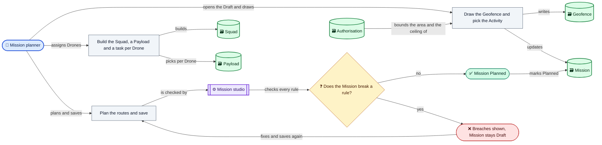

## 🖼️ Screens

One row per state of the flow chart: every action, success and failure node. Click a screen to open it full size. A state with nothing to show reads `➖ No screen: <why>`.

| State | Persona | Entity | Source | Screen |
| --- | --- | --- | --- | --- |
| A1: Draw the Geofence and pick the Activity | [👤 Mission planner](../../glossary.md#per-mission-planner) | [🔄 Mission: Draft](../../glossary.md#st-mission-draft) [🔄 Authorisation: Valid](../../glossary.md#st-authorisation-valid) | ✏️ Mock-up | [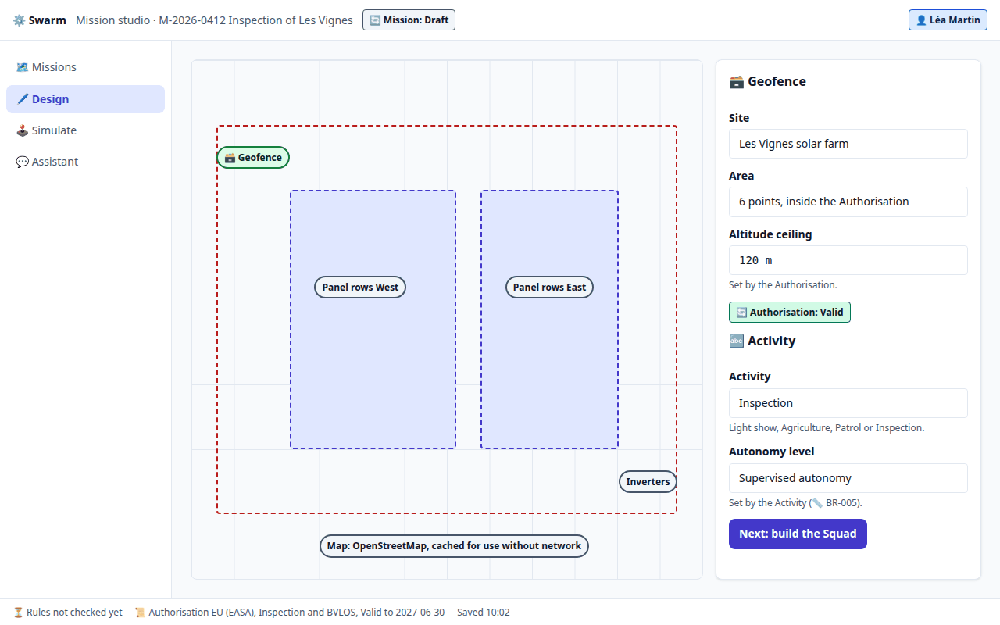](../../screens/UC-001/a1.png) [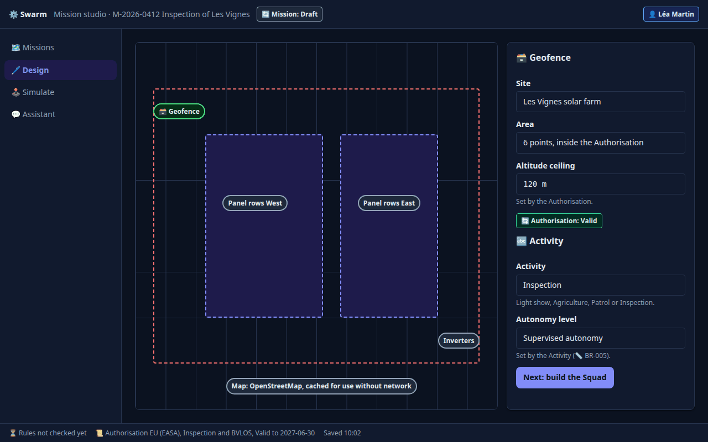](../../screens/UC-001/a1.dark.png) |
| A2: Build the Squad, a Payload and a task per Drone | [👤 Mission planner](../../glossary.md#per-mission-planner) | [🔄 Mission: Draft](../../glossary.md#st-mission-draft) [🗃️ Squad](../../glossary.md#ent-squad) | ✏️ Mock-up | [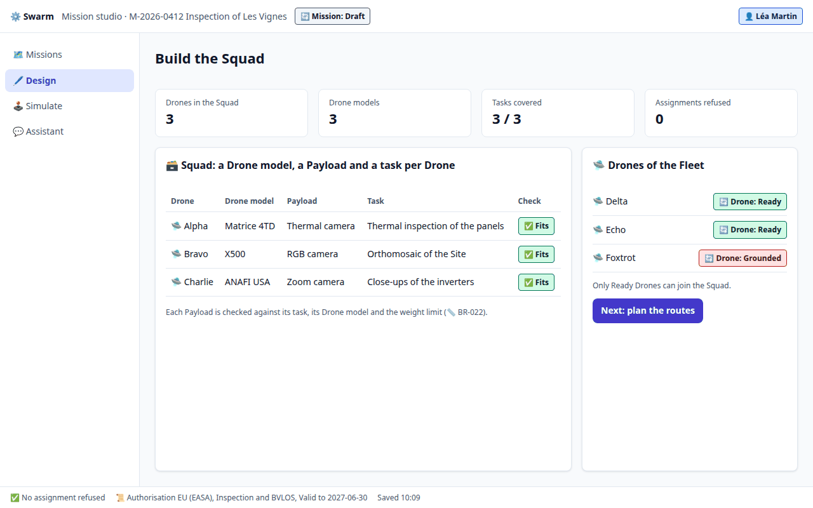](../../screens/UC-001/a2.png) [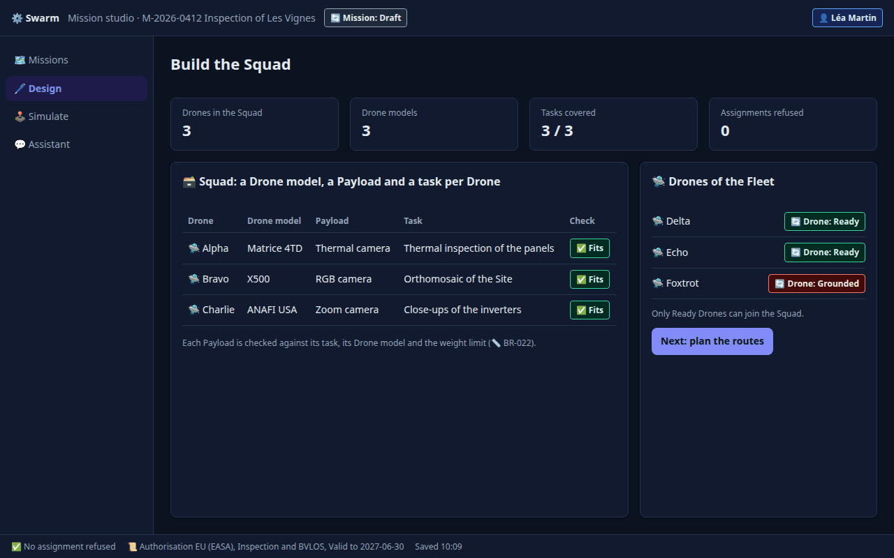](../../screens/UC-001/a2.dark.png) |
| A3: Plan the routes and save | [👤 Mission planner](../../glossary.md#per-mission-planner) | [🔄 Mission: Draft](../../glossary.md#st-mission-draft) | ✏️ Mock-up | [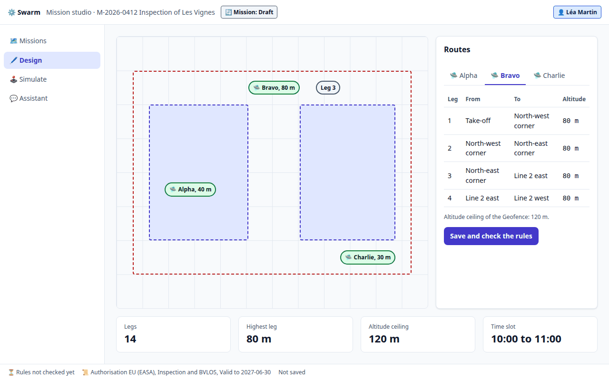](../../screens/UC-001/a3.png) [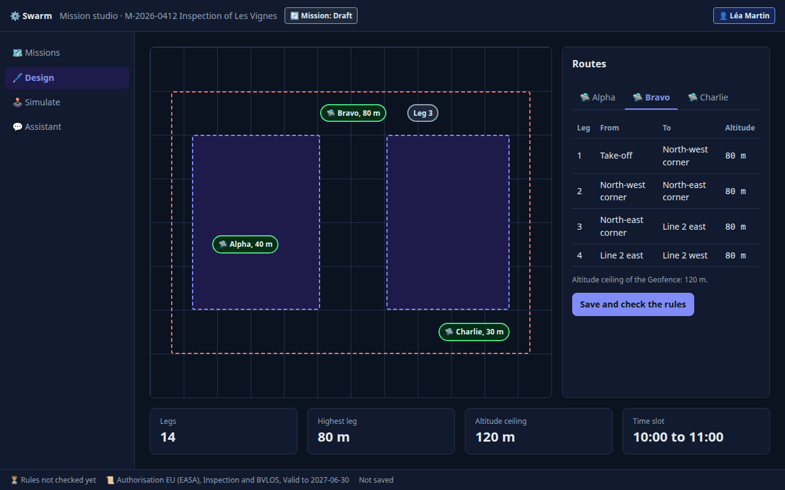](../../screens/UC-001/a3.dark.png) |
| OK: Mission Planned | [👤 Mission planner](../../glossary.md#per-mission-planner) | [🔄 Mission: Planned](../../glossary.md#st-mission-planned) | ✏️ Mock-up | [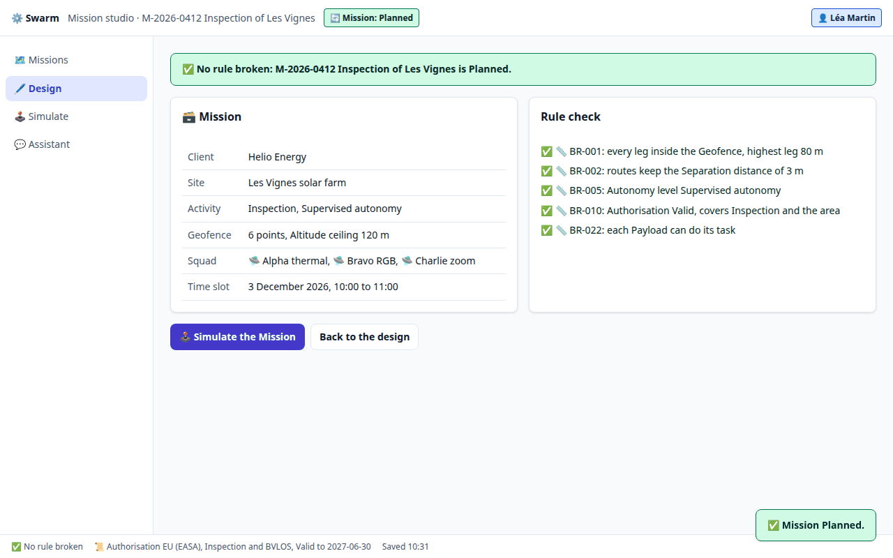](../../screens/UC-001/ok.png) [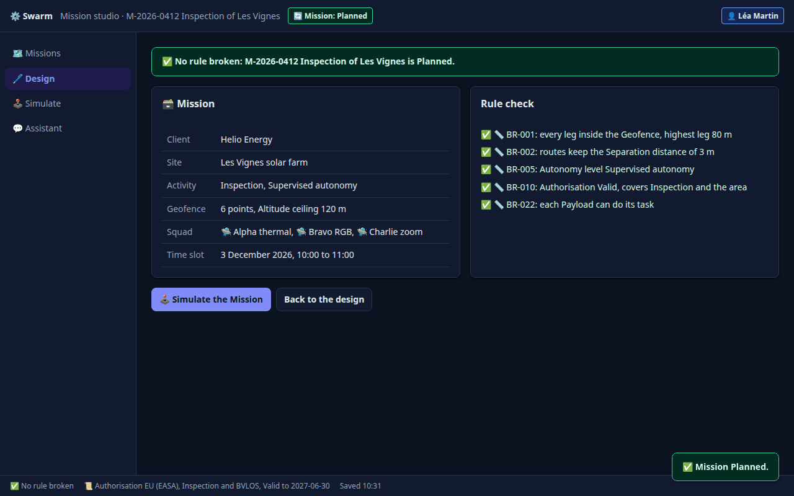](../../screens/UC-001/ok.dark.png) |
| KO: Breaches shown, Mission stays Draft | [👤 Mission planner](../../glossary.md#per-mission-planner) | [🔄 Mission: Draft](../../glossary.md#st-mission-draft) | ✏️ Mock-up | [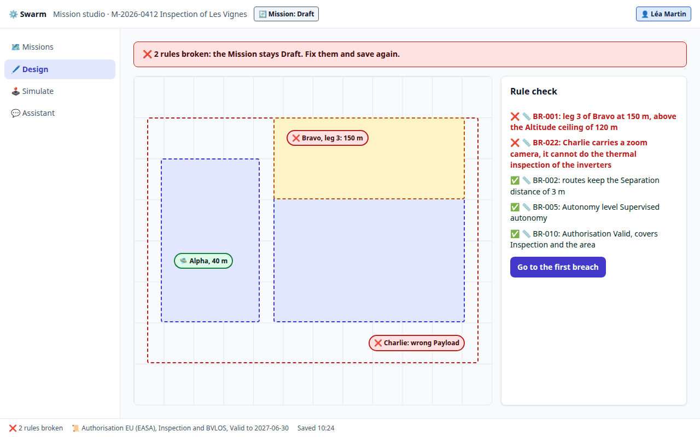](../../screens/UC-001/ko.png) [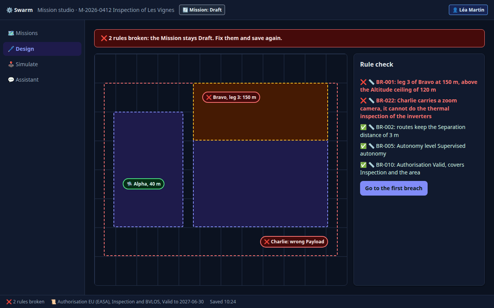](../../screens/UC-001/ko.dark.png) |

## ↪️ Alternative and error flows

| # | At step | Condition | What happens |
| --- | --- | --- | --- |
| A1 | 1 | The Mission planner draws the Geofence partly outside the area of the Authorisation | The Mission studio shows the part outside; the Mission stays Draft ([📏 BR-001](../business-rules/BR-001-geofence-and-altitude-ceiling.md), [📏 BR-010](../business-rules/BR-010-valid-authorisation-for-the-jurisdiction.md)) |
| A2 | 4 | The Mission planner gives the thermal inspection task to Charlie, which carries a zoom camera | The assignment is refused and named; the task stays without a Drone ([📏 BR-022](../business-rules/BR-022-payload-compatibility.md)) |
| A3 | 4 | A Payload is too heavy for the Drone model it is mounted on | The Mission studio names the Drone and the excess weight; the Mission cannot become Planned ([📏 BR-022](../business-rules/BR-022-payload-compatibility.md)) |
| A4 | 6 | Leg 3 of Bravo is drawn at 150 m under an Altitude ceiling of 120 m | The Mission stays Draft and the leg at fault is shown on the map and in the rule check (KO) ([📏 BR-001](../business-rules/BR-001-geofence-and-altitude-ceiling.md)) |
| A5 | 6 | Two routes come closer than the Separation distance | The Mission stays Draft and the two Drones and the place are shown (KO) ([📏 BR-002](../business-rules/BR-002-separation-distance.md)) |
| A6 | 6 | The Authorisation has expired on the date of the Mission, or does not cover the Activity, the area or BVLOS | The Mission stays Draft and the rule check names the missing condition (KO) ([📏 BR-010](../business-rules/BR-010-valid-authorisation-for-the-jurisdiction.md)) |
| A7 | KO | The Mission planner fixes each breach and saves again | The Mission studio checks every rule again, from step 6 |
| A8 | After OK | The Authorisation expires after the Mission is Planned | The Mission goes back to Draft and the Mission planner is told ([📘 FS-006](../features/FS-006-authorisations-and-compliance.md), [📏 BR-010](../business-rules/BR-010-valid-authorisation-for-the-jurisdiction.md)) |

## 📏 Business rules applied

| Rule | Where it applies |
| --- | --- |
| [📏 BR-001: Geofence and Altitude ceiling](../business-rules/BR-001-geofence-and-altitude-ceiling.md) | Steps 1 and 6, A1, A4 |
| [📏 BR-002: Separation distance](../business-rules/BR-002-separation-distance.md) | Step 6, A5 |
| [📏 BR-005: Autonomy level per Activity](../business-rules/BR-005-autonomy-level-per-activity.md) | Step 2 |
| [📏 BR-010: Valid Authorisation for the Jurisdiction](../business-rules/BR-010-valid-authorisation-for-the-jurisdiction.md) | Steps 1 and 6, A1, A6, A8 |
| [📏 BR-022: Payload compatibility](../business-rules/BR-022-payload-compatibility.md) | Step 4, A2, A3 |

## 🏁 Postconditions

- ✅ **Success:** the Mission M-2026-0412 is Planned: its Geofence, Activity, Autonomy level, Squad, Payloads, tasks and routes are saved and break no rule. It can be simulated or prepared for flight.
- ❌ **Failure:** the Mission stays Draft. The Mission planner sees every breach, with the rule, the Drone and the leg or task at fault, and can fix them and save again.

## 🔗 Referenced by

<!-- spec:referenced-by -->
- [📘 FS-001: Mission design](../features/FS-001-mission-design.md)
- [🎬 UC-002: Simulate a Mission](UC-002-simulate-a-mission.md)
- [🎬 UC-008: Record an Authorisation](UC-008-record-an-authorisation.md)
- [🎬 UC-010: Order a Mission in the Client portal](UC-010-order-a-mission-in-the-client-portal.md)
- [🎬 UC-021: Plan a Mission with the Mission assistant](UC-021-plan-a-mission-with-the-mission-assistant.md)
<!-- /spec:referenced-by -->

<!-- spec:nav-bottom -->
---

> [🏠 Index](../../README.md) · [◀️ FS-022: Debrief and assessment](../features/FS-022-debrief-and-assessment.md) · 📄 **Page 27 / 108** · [UC-002: Simulate a Mission ▶️](UC-002-simulate-a-mission.md)
<!-- /spec:nav-bottom -->
