# 🎬 UC-002: Simulate a Mission

<!-- spec:nav-top -->
> [🏠 Index](../../README.md) · [◀️ UC-001: Design a Mission](UC-001-design-a-mission.md) · 📄 **Page 28 / 109** · [UC-003: Run the Pre-flight check and launch ▶️](UC-003-run-the-pre-flight-check-and-launch.md)
<!-- /spec:nav-top -->

**Status:** 🟢 Approved · **Updated:** 2026-11-18

> [!NOTE]
> The [👤 Mission planner](../../glossary.md#per-mission-planner) runs a Planned [🗃️ Mission](../../glossary.md#ent-mission) in the [⚙️ Simulator](../../glossary.md#sys-simulator) from the [⚙️ Mission studio](../../glossary.md#sys-mission-studio), and gets its coverage, timing, battery use and conflicts, then accepts the result or sends the Mission back to Draft.

<!-- spec:summary -->
## 📑 Summary

1. [👤 Personas and entities](#actors)
2. [🚦 Preconditions](#preconditions)
3. [⚡ Trigger](#trigger)
4. [➡️ Main flow](#main-flow)
5. [🔀 Flow chart](#flowchart)
6. [🖼️ Screens](#screens)
7. [↪️ Alternative and error flows](#alternative-flows)
8. [📏 Business rules applied](#business-rules)
9. [🏁 Postconditions](#postconditions)
10. [🔗 Referenced by](#referenced-by)
<!-- /spec:summary -->

## 👤 Personas and entities

| Name | Kind | Role in this use case |
| --- | --- | --- |
| [👤 Mission planner](../../glossary.md#per-mission-planner) | Persona | Starts the simulation, reviews the results, accepts them or sends the Mission back to Draft |
| [🗃️ Mission](../../glossary.md#ent-mission) | Entity | Simulated while Planned; stays Planned, or goes back to Draft |
| [🗃️ Squad](../../glossary.md#ent-squad) | Entity | Flown as a virtual Squad, never as real Drones |
| [🗃️ Flight log](../../glossary.md#ent-flight-log) | Entity | Records the simulated flight, marked Simulated |
| [⚙️ Mission studio](../../glossary.md#sys-mission-studio) | System | Starts the simulation and shows its results |
| [⚙️ Simulator](../../glossary.md#sys-simulator) | System | Flies the virtual Squad with the real flight software of each Drone model |

## 🚦 Preconditions

1. The Mission M-2026-0412 Inspection of Les Vignes is [🔄 Mission: Planned](../../glossary.md#st-mission-planned) ([🎬 UC-001](UC-001-design-a-mission.md)).
2. The Mission planner Léa Martin of Aerowing Services has it open in the Mission studio.

## ⚡ Trigger

The Mission planner opens **🕹️ Simulate** and starts the simulation.

## ➡️ Main flow

1. The Mission planner starts the simulation of the Planned Mission for its time slot, 3 December 2026 from 10:00.
2. The Simulator flies a virtual Squad of the same [🗃️ Drones](../../glossary.md#ent-drone) (Alpha, Bravo, Charlie), each with the real flight software of its [🗃️ Drone model](../../glossary.md#ent-drone-model). No command reaches a real Drone, and the Flight log is marked Simulated ([📏 BR-014](../business-rules/BR-014-simulation-isolation.md)).
3. The Mission studio shows the virtual Squad on the map as it flies, with the area covered, the simulated time and the battery of each Drone.
4. At the end, the Mission studio shows the results: coverage, duration, battery use per Drone, and the conflicts found, such as two Drones closer than the [🔤 Separation distance](../../glossary.md#term-separation-distance) ([📏 BR-002](../business-rules/BR-002-separation-distance.md)).
5. No conflict is found: the Mission planner accepts the result. Swarm records who accepted it, and the Mission stays Planned, ready for the [🗃️ Pre-flight check](../../glossary.md#ent-pre-flight-check).

## 🔀 Flow chart

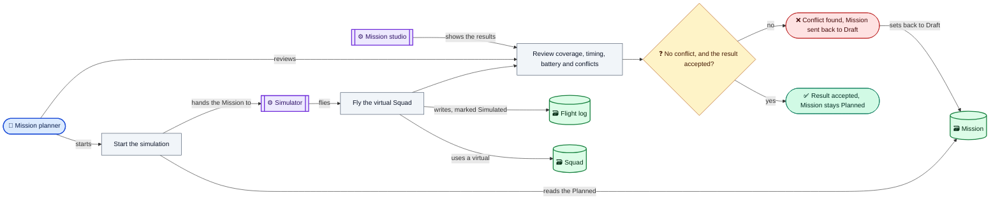

## 🖼️ Screens

One row per state of the flow chart: every action, success and failure node. Click a screen to open it full size. A state with nothing to show reads `➖ No screen: <why>`.

| State | Persona | Entity | Source | Screen |
| --- | --- | --- | --- | --- |
| A1: Start the simulation | [👤 Mission planner](../../glossary.md#per-mission-planner) | [🔄 Mission: Planned](../../glossary.md#st-mission-planned) | ✏️ Mock-up | [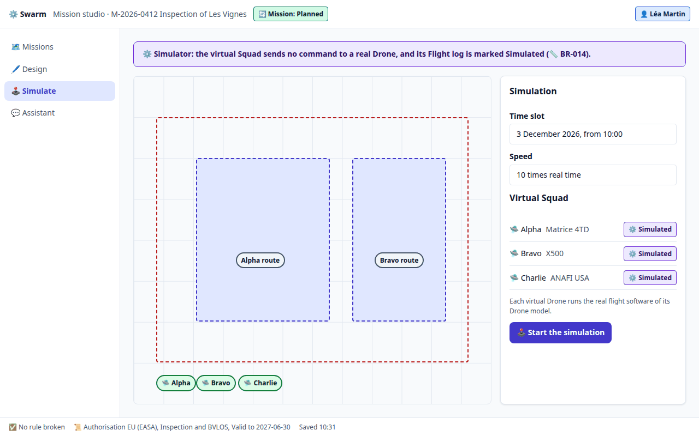](../../screens/UC-002/a1.png) [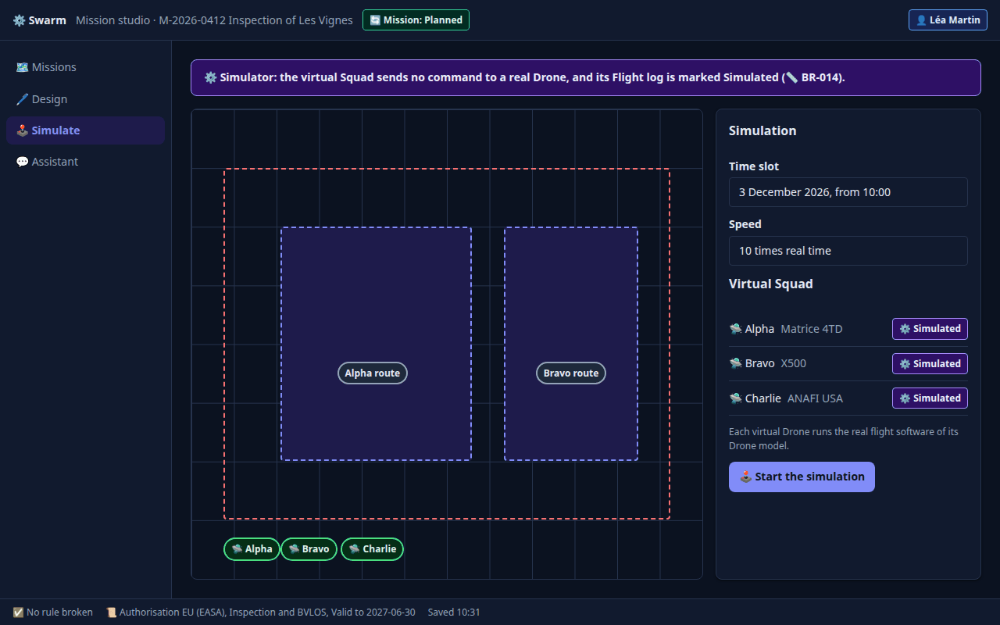](../../screens/UC-002/a1.dark.png) |
| A2: Fly the virtual Squad | [👤 Mission planner](../../glossary.md#per-mission-planner) | [🗃️ Squad](../../glossary.md#ent-squad) [🗃️ Flight log](../../glossary.md#ent-flight-log) | ✏️ Mock-up | [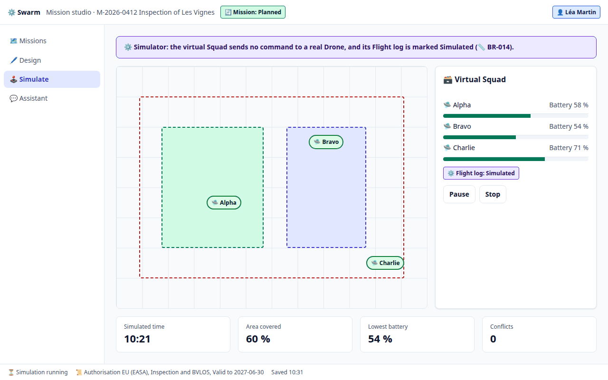](../../screens/UC-002/a2.png) [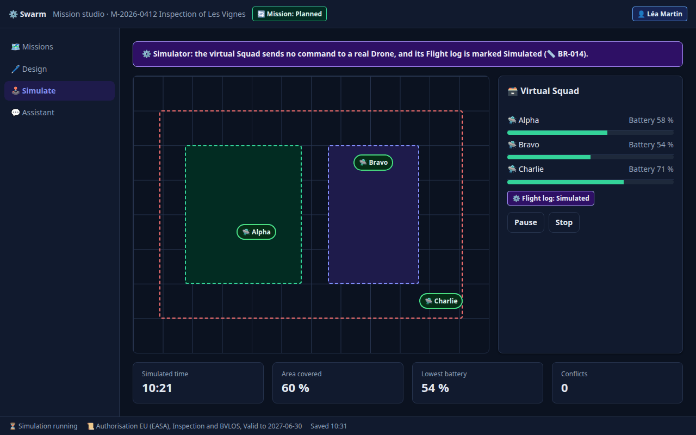](../../screens/UC-002/a2.dark.png) |
| A3: Review coverage, timing, battery and conflicts | [👤 Mission planner](../../glossary.md#per-mission-planner) | [🔄 Mission: Planned](../../glossary.md#st-mission-planned) | ✏️ Mock-up | [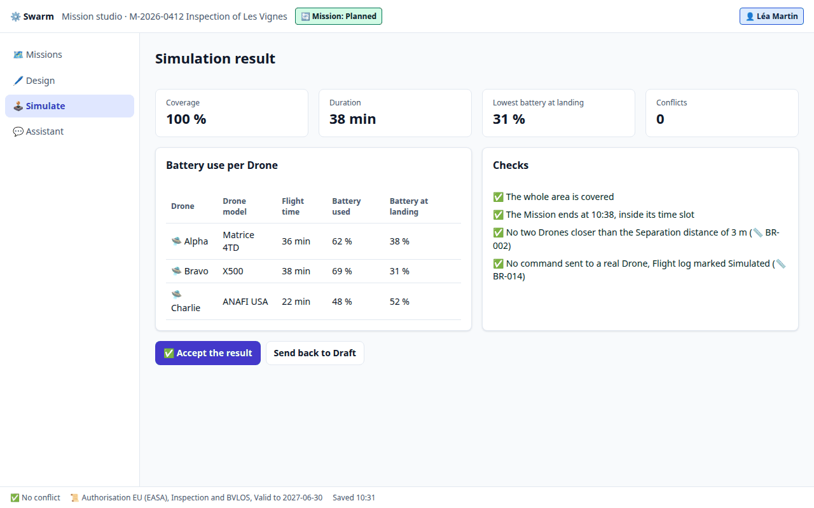](../../screens/UC-002/a3.png) [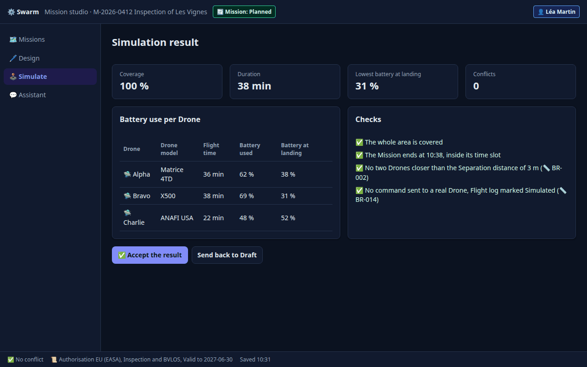](../../screens/UC-002/a3.dark.png) |
| OK: Result accepted, Mission stays Planned | [👤 Mission planner](../../glossary.md#per-mission-planner) | [🔄 Mission: Planned](../../glossary.md#st-mission-planned) | ✏️ Mock-up | [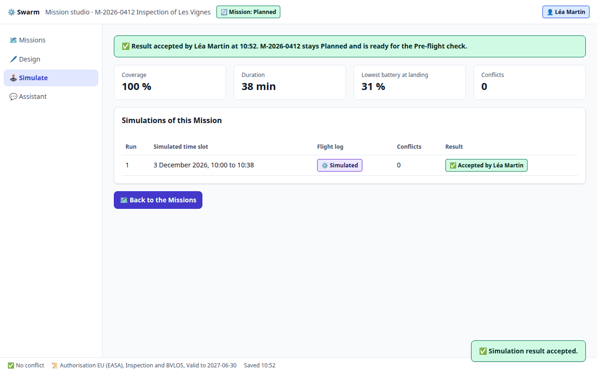](../../screens/UC-002/ok.png) [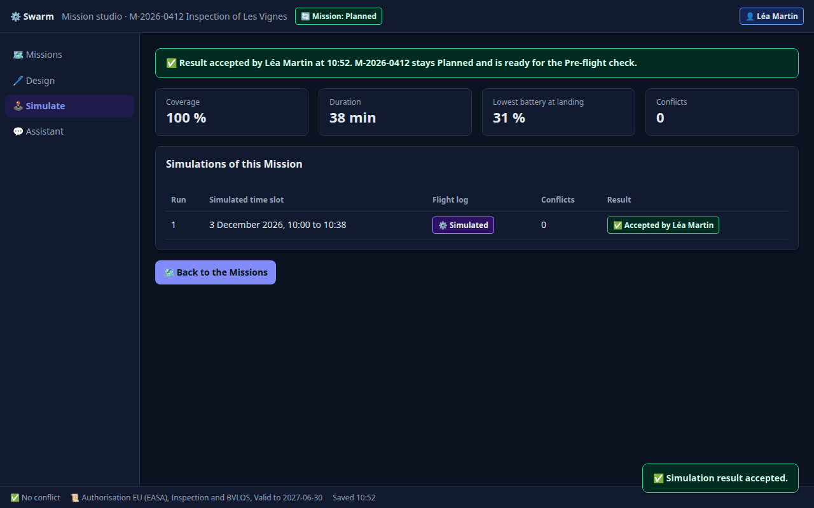](../../screens/UC-002/ok.dark.png) |
| KO: Conflict found, Mission sent back to Draft | [👤 Mission planner](../../glossary.md#per-mission-planner) | [🔄 Mission: Draft](../../glossary.md#st-mission-draft) | ✏️ Mock-up | [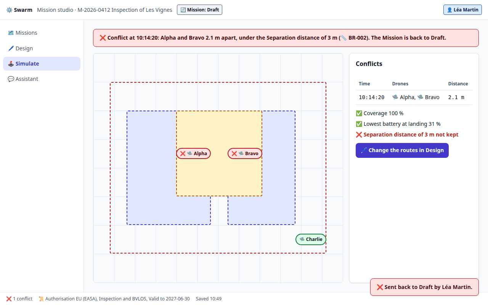](../../screens/UC-002/ko.png) [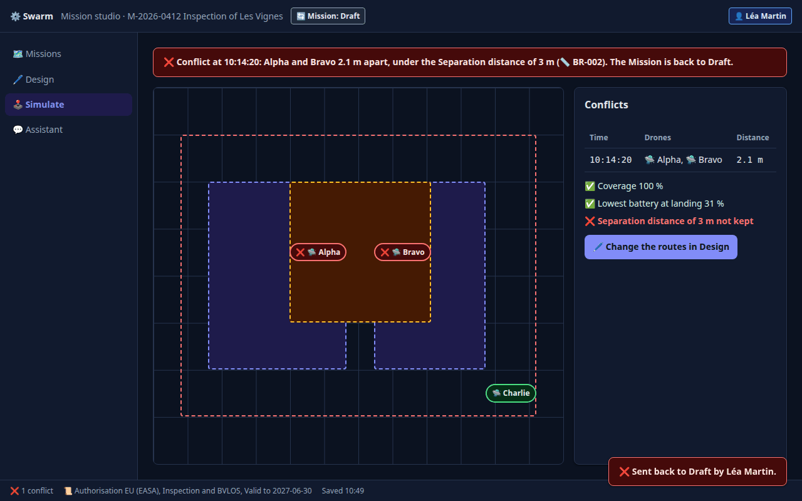](../../screens/UC-002/ko.dark.png) |

## ↪️ Alternative and error flows

| # | At step | Condition | What happens |
| --- | --- | --- | --- |
| A1 | 4 | Alpha and Bravo come 2.1 m apart at 10:14:20, under the Separation distance of 3 m of the Mission | The conflict is shown on the map and in the results; the Mission planner sends the Mission back to Draft to change the routes (KO) ([📏 BR-002](../business-rules/BR-002-separation-distance.md)) |
| A2 | 4 | A Drone would land with less than its landing reserve (20 % battery by default, an Operator setting), or the area is not fully covered | The result names the Drone or the gap; the Mission planner sends the Mission back to Draft (KO) |
| A3 | 5 | The Mission planner is not satisfied with the result, even without a conflict | The Mission planner sends the Mission back to Draft (KO) |
| A4 | 2 | The simulated Mission tries to address a real Drone | The command is refused and logged ([📏 BR-014](../business-rules/BR-014-simulation-isolation.md)) |
| A5 | KO | The Mission planner changes the routes and saves | The Mission is checked again ([🎬 UC-001](UC-001-design-a-mission.md)) and can be simulated again once Planned |

## 📏 Business rules applied

| Rule | Where it applies |
| --- | --- |
| [📏 BR-014: Simulation isolation](../business-rules/BR-014-simulation-isolation.md) | Step 2, A4 |
| [📏 BR-002: Separation distance](../business-rules/BR-002-separation-distance.md) | Step 4, A1 |

## 🏁 Postconditions

- ✅ **Success:** the Mission stays Planned with an accepted simulation result, recorded with the name of the Mission planner. The Flight log of the simulation is kept, marked Simulated. No real Drone received a command.
- ❌ **Failure:** the Mission is back to Draft. The Mission planner sees each conflict with the Drones, the time and the place, and changes the Mission in **🖊️ Design**.

## 🔗 Referenced by

<!-- spec:referenced-by -->
- [📘 FS-001: Mission design](../features/FS-001-mission-design.md)
- [📘 FS-010: Simulator and training](../features/FS-010-simulator-and-training.md)
- [🎬 UC-001: Design a Mission](UC-001-design-a-mission.md)
<!-- /spec:referenced-by -->

<!-- spec:nav-bottom -->
---

> [🏠 Index](../../README.md) · [◀️ UC-001: Design a Mission](UC-001-design-a-mission.md) · 📄 **Page 28 / 109** · [UC-003: Run the Pre-flight check and launch ▶️](UC-003-run-the-pre-flight-check-and-launch.md)
<!-- /spec:nav-bottom -->
