# 🎬 UC-003: Run the Pre-flight check and launch

<!-- spec:nav-top -->
> [🏠 Index](../../README.md) · [◀️ UC-002: Simulate a Mission](UC-002-simulate-a-mission.md) · 📄 **Page 31 / 120** · [UC-004: Supervise a Squad and approve a Re-plan ▶️](UC-004-supervise-a-squad-and-approve-a-re-plan.md)
<!-- /spec:nav-top -->

**Status:** 🟢 Approved · **Updated:** 2026-11-18

> [!NOTE]
> The [👤 Pilot](../../glossary.md#per-pilot) runs the [🗃️ Pre-flight check](../../glossary.md#ent-pre-flight-check) of a Planned [🗃️ Mission](../../glossary.md#ent-mission) in [⚙️ Ground control](../../glossary.md#sys-ground-control), signs it and launches the [🗃️ Squad](../../glossary.md#ent-squad), so that the Mission flies only once every check has passed.

<!-- spec:summary -->
## 📑 Summary

1. [👤 Personas and entities](#actors)
2. [🚦 Preconditions](#preconditions)
3. [⚡ Trigger](#trigger)
4. [➡️ Main flow](#main-flow)
5. [🔀 Flow chart](#flowchart)
6. [🖼️ Screens](#screens)
7. [↪️ Alternative and error flows](#alternative-flows)
8. [📏 Business rules applied](#business-rules)
9. [🏁 Postconditions](#postconditions)
10. [🔗 Referenced by](#referenced-by)
<!-- /spec:summary -->

## 👤 Personas and entities

| Name | Kind | Role in this use case |
| --- | --- | --- |
| [👤 Pilot](../../glossary.md#per-pilot) | Persona | Reads the checks, signs the Pre-flight check, launches the Squad |
| [🗃️ Pre-flight check](../../glossary.md#ent-pre-flight-check) | Entity | Holds the result of every automatic check, the checklist of the Operator and the Pilot's signature |
| [🗃️ Mission](../../glossary.md#ent-mission) | Entity | Goes from Planned to Verified, then Flying |
| [🗃️ Drone](../../glossary.md#ent-drone) | Entity | Each Drone of the Squad is checked Ready, then becomes Airborne |
| [⚙️ Ground control](../../glossary.md#sys-ground-control) | System | Runs the automatic checks, records the signature and launches the Squad |
| [⚙️ Weather service](../../glossary.md#sys-weather-service) | System | Gives the current and forecast weather at the Site |
| [⚙️ U-space service](../../glossary.md#sys-u-space-service) | System | Grants the airspace for the time slot of the Mission |

## 🚦 Preconditions

1. The Mission is [🔄 Mission: Planned](../../glossary.md#st-mission-planned). Sample: M-2026-0412 Inspection of Les Vignes for Helio Energy, Squad Alpha, Bravo, Charlie and Delta.
2. The Pilot is the Pilot of the Mission and is signed in to Ground control on the [🗃️ Site](../../glossary.md#ent-site).
3. The Drones of the Squad are on the Site, switched on and connected to Ground control.

## ⚡ Trigger

The Pilot opens the 📋 Pre-flight view of the Mission in Ground control.

## ➡️ Main flow

1. The Pilot opens the 📋 Pre-flight view of the Mission.
2. Ground control runs every automatic check of the Pre-flight check ([📏 BR-007](../business-rules/BR-007-launch-only-after-a-passed-pre-flight-check.md)): the [🗃️ Geofence](../../glossary.md#ent-geofence), the weather given by the Weather service ([📏 BR-003](../business-rules/BR-003-weather-limits.md)), the [🗃️ Authorisation](../../glossary.md#ent-authorisation) ([📏 BR-010](../business-rules/BR-010-valid-authorisation-for-the-jurisdiction.md)), the [🔤 Pilot ratio](../../glossary.md#term-pilot-ratio) ([📏 BR-004](../business-rules/BR-004-pilot-ratio.md)), the readiness of every Drone and [🗃️ Payload](../../glossary.md#ent-payload) ([📏 BR-011](../business-rules/BR-011-drone-readiness.md)), the [🔤 Links](../../glossary.md#term-link), and the airspace grant of the U-space service where the [🔤 Jurisdiction](../../glossary.md#term-jurisdiction) requires it.
3. Ground control shows each check as passed or failed, with its value and its limit. Every check passes and every Drone is [🔄 Drone: Ready](../../glossary.md#st-drone-ready).
4. The Pilot reads the checks, ticks every item of the checklist the [🗃️ Operator](../../glossary.md#ent-operator) set for the [🔤 Activity](../../glossary.md#term-activity) (for an Inspection: propellers checked, Payload fixed, take-off area clear), and signs the Pre-flight check with a personal PIN. Ground control records the results, the ticked items and the signature in the [🗃️ Flight log](../../glossary.md#ent-flight-log). The Mission becomes [🔄 Mission: Verified](../../glossary.md#st-mission-verified) and the launch is enabled for 30 minutes.
5. Within 30 minutes of the signature, the Pilot launches the Squad. Ground control sends the take-off to every Drone. Each Drone becomes [🔄 Drone: Airborne](../../glossary.md#st-drone-airborne) and the Mission becomes [🔄 Mission: Flying](../../glossary.md#st-mission-flying).
6. Ground control opens the 🛰️ Flight view, where the Pilot supervises the Squad ([🎬 UC-025: Monitor a Mission in Ground control](UC-025-monitor-a-mission-in-ground-control.md)).

## 🔀 Flow chart

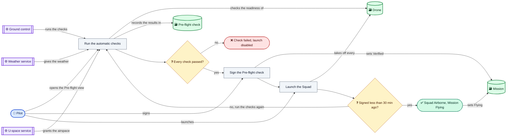

## 🖼️ Screens

One row per state of the flow chart: every action, success and failure node. Each state shows its light then its dark screen; click one to open it full size. A state with nothing to show reads `➖ No screen: <why>`.

| State | Persona | Entity | Source | Screen |
| --- | --- | --- | --- | --- |
| A1: Run the automatic checks | [👤 Pilot](../../glossary.md#per-pilot) | [🔄 Mission: Planned](../../glossary.md#st-mission-planned) [🔄 Drone: Ready](../../glossary.md#st-drone-ready) | ✏️ Mock-up | [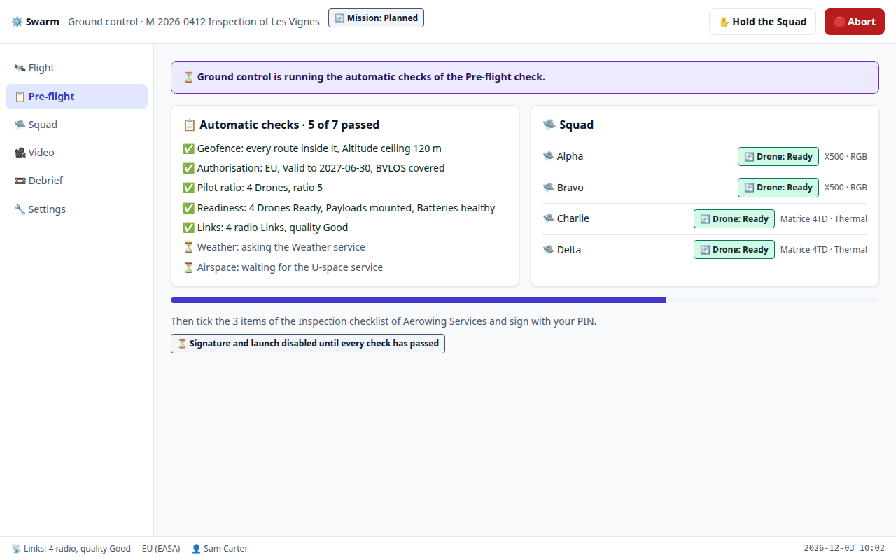](../../screens/UC-003/a1.png) [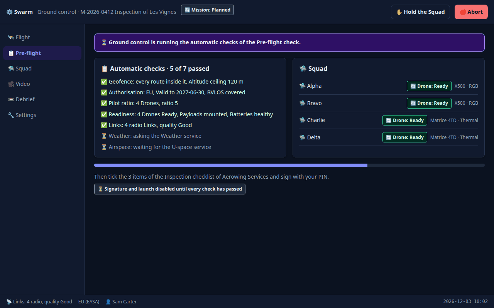](../../screens/UC-003/a1.dark.png) |
| A2: Sign the Pre-flight check | [👤 Pilot](../../glossary.md#per-pilot) | [🗃️ Pre-flight check](../../glossary.md#ent-pre-flight-check) [🔄 Drone: Ready](../../glossary.md#st-drone-ready) | ✏️ Mock-up | [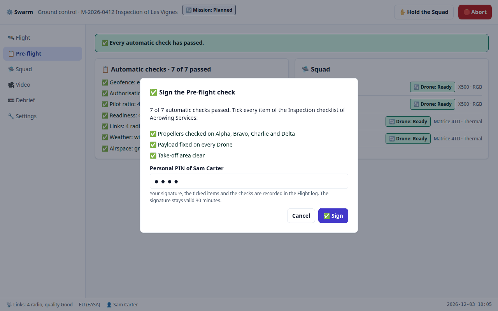](../../screens/UC-003/a2.png) [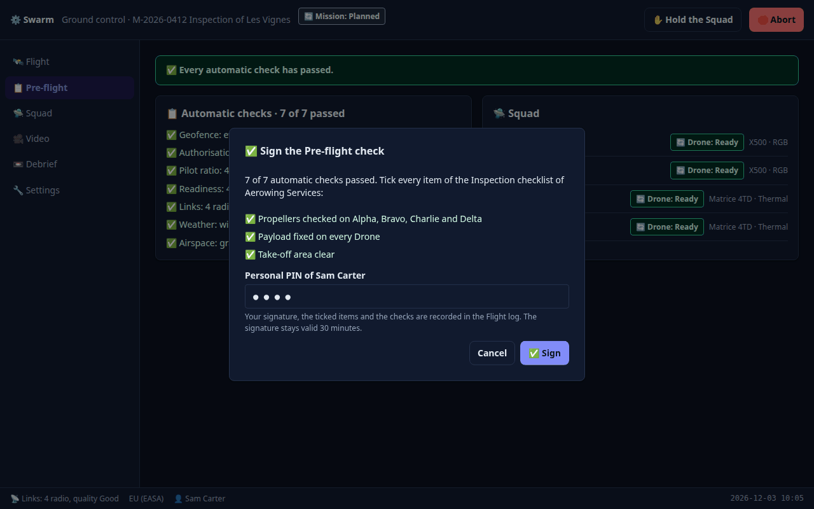](../../screens/UC-003/a2.dark.png) |
| A3: Launch the Squad | [👤 Pilot](../../glossary.md#per-pilot) | [🔄 Mission: Verified](../../glossary.md#st-mission-verified) [🔄 Drone: Ready](../../glossary.md#st-drone-ready) | ✏️ Mock-up | [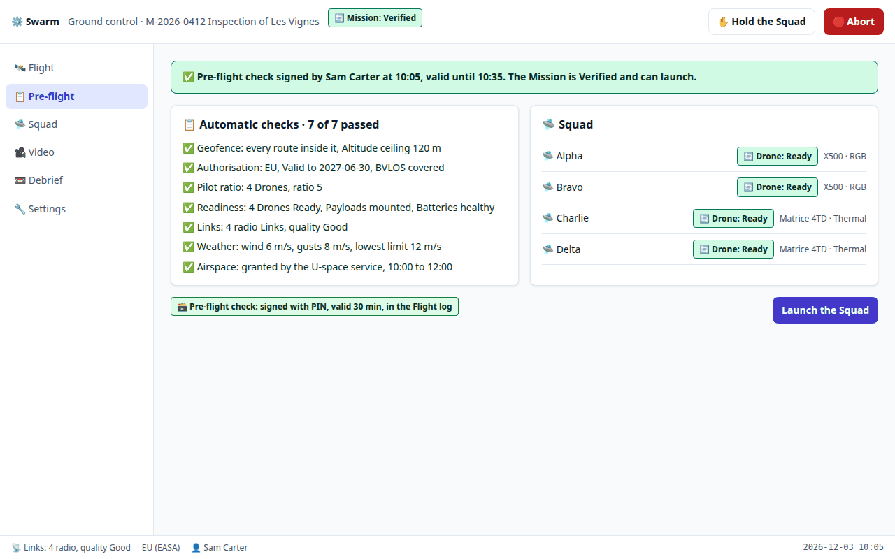](../../screens/UC-003/a3.png) [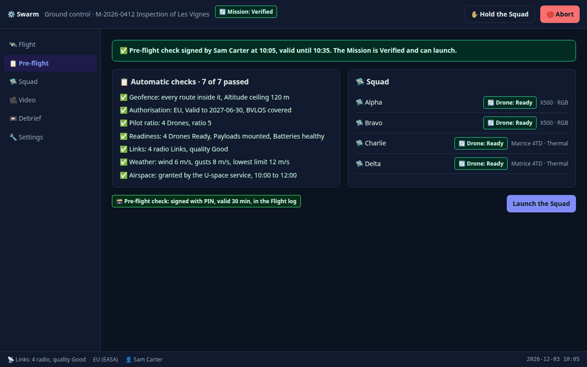](../../screens/UC-003/a3.dark.png) |
| OK: Squad Airborne, Mission Flying | [🔄 Pilot: Supervising](../../glossary.md#st-pilot-supervising) | [🔄 Mission: Flying](../../glossary.md#st-mission-flying) [🔄 Drone: Airborne](../../glossary.md#st-drone-airborne) | ✏️ Mock-up | [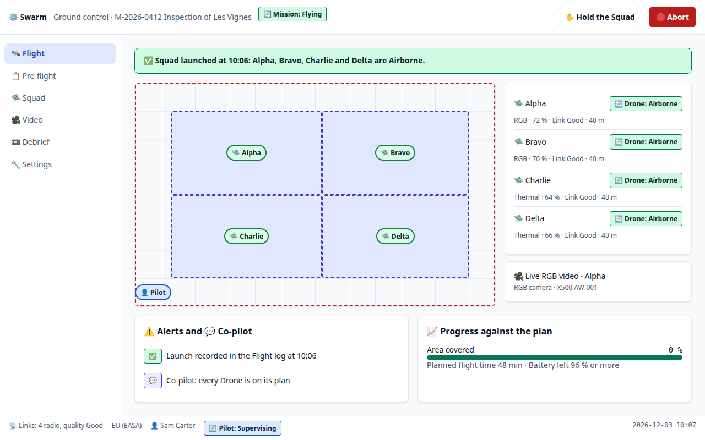](../../screens/UC-003/ok.png) [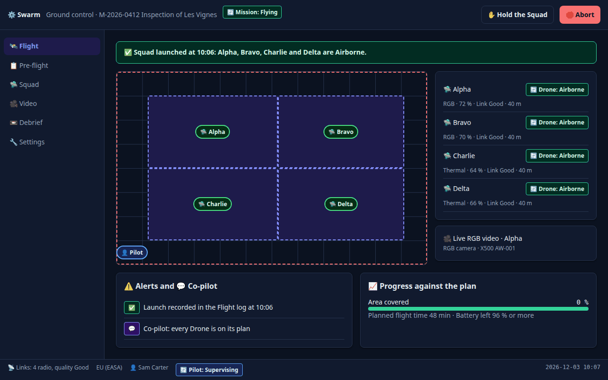](../../screens/UC-003/ok.dark.png) |
| KO: Check failed, launch disabled | [👤 Pilot](../../glossary.md#per-pilot) | [🔄 Mission: Planned](../../glossary.md#st-mission-planned) [🗃️ Pre-flight check](../../glossary.md#ent-pre-flight-check) | ✏️ Mock-up | [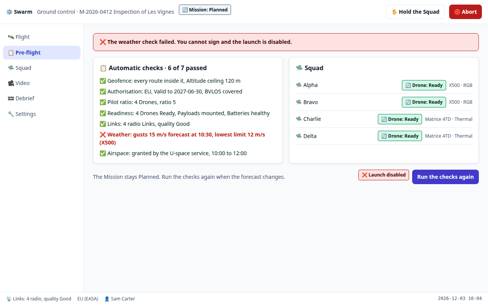](../../screens/UC-003/ko.png) [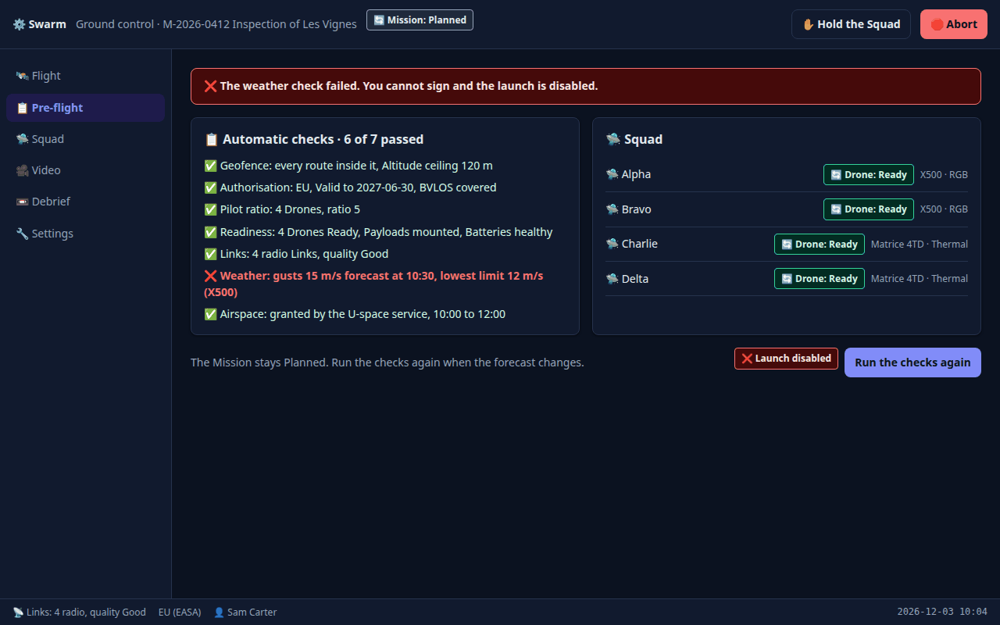](../../screens/UC-003/ko.dark.png) |

## ↪️ Alternative and error flows

| # | At step | Condition | What happens |
| --- | --- | --- | --- |
| A1 | 3 | The forecast gusts during the time slot are above the limit of a Drone model of the Squad ([📏 BR-003](../business-rules/BR-003-weather-limits.md)) | The weather check fails and shows the value and the limit. The Pilot cannot sign, the launch stays disabled and the Mission stays Planned. The Pilot can run the checks again later. |
| A2 | 3 | A Drone of the Squad is [🔄 Drone: Grounded](../../glossary.md#st-drone-grounded) ([📏 BR-011](../business-rules/BR-011-drone-readiness.md)) | The readiness check fails and names the Drone and the reason. The Pilot cannot sign and the Mission stays Planned. |
| A3 | 3 | The Authorisation is not Valid for the day, the Squad has more Drones than the Pilot ratio, or the U-space service has not granted the airspace | The matching check fails and names what is missing. The Pilot cannot sign and the Mission stays Planned. |
| A4 | 4 | An item of the Operator's checklist is not ticked | The Pilot cannot sign until every item is ticked. |
| A5 | 5 | The signature is older than 30 minutes when the Pilot launches ([📏 BR-007](../business-rules/BR-007-launch-only-after-a-passed-pre-flight-check.md)) | The Mission is no longer Verified. Ground control runs the automatic checks again, and the Pilot ticks the checklist and signs again. |

## 📏 Business rules applied

| Rule | Where it applies |
| --- | --- |
| [📏 BR-007: Launch only after a passed Pre-flight check](../business-rules/BR-007-launch-only-after-a-passed-pre-flight-check.md) | Steps 2 to 5 and alternatives A4 and A5: no signature until every check has passed and every checklist item is ticked, a personal PIN to sign, and a signature valid 30 minutes |
| [📏 BR-003: Weather limits](../business-rules/BR-003-weather-limits.md) | Step 2 and alternative A1 |
| [📏 BR-004: Pilot ratio](../business-rules/BR-004-pilot-ratio.md) | Step 2 and alternative A3 |
| [📏 BR-010: Valid Authorisation for the Jurisdiction](../business-rules/BR-010-valid-authorisation-for-the-jurisdiction.md) | Step 2 and alternative A3 |
| [📏 BR-011: Drone readiness](../business-rules/BR-011-drone-readiness.md) | Steps 2 and 3, and alternative A2 |

## 🏁 Postconditions

- ✅ **Success:** the Pre-flight check is signed and recorded in the Flight log, the Mission is Flying, every Drone of the Squad is Airborne, and the Pilot is in the 🛰️ Flight view.
- ❌ **Failure:** the Mission stays Planned, no Drone takes off, and the Pilot sees which check failed, with its value and its limit.

## 🔗 Referenced by

<!-- spec:referenced-by -->
- [📘 FS-002: Pre-flight check and launch](../features/FS-002-pre-flight-check-and-launch.md)
- [🎬 UC-008: Record an Authorisation](UC-008-record-an-authorisation.md)
- [🎬 UC-016: Import and fly a Light show](UC-016-import-and-fly-a-light-show.md)
- [🎬 UC-019: Request a Patrol on demand](UC-019-request-a-patrol-on-demand.md)
- [🎬 UC-025: Monitor a Mission in Ground control](UC-025-monitor-a-mission-in-ground-control.md)
<!-- /spec:referenced-by -->

<!-- spec:nav-bottom -->
---

> [🏠 Index](../../README.md) · [◀️ UC-002: Simulate a Mission](UC-002-simulate-a-mission.md) · 📄 **Page 31 / 120** · [UC-004: Supervise a Squad and approve a Re-plan ▶️](UC-004-supervise-a-squad-and-approve-a-re-plan.md)
<!-- /spec:nav-bottom -->
