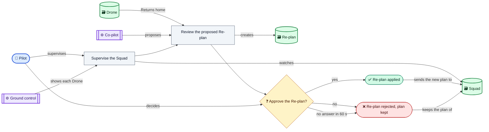
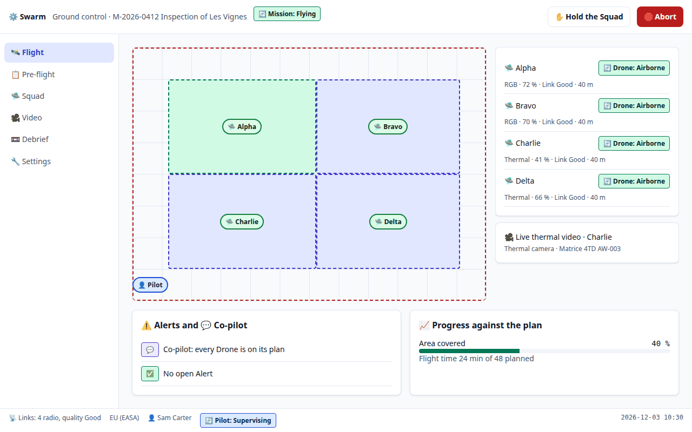
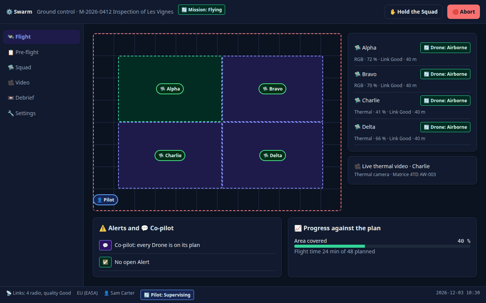
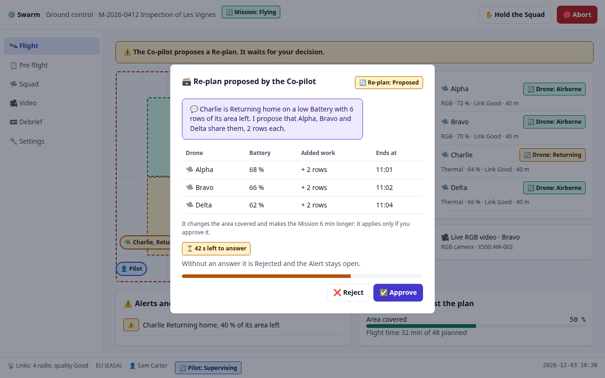
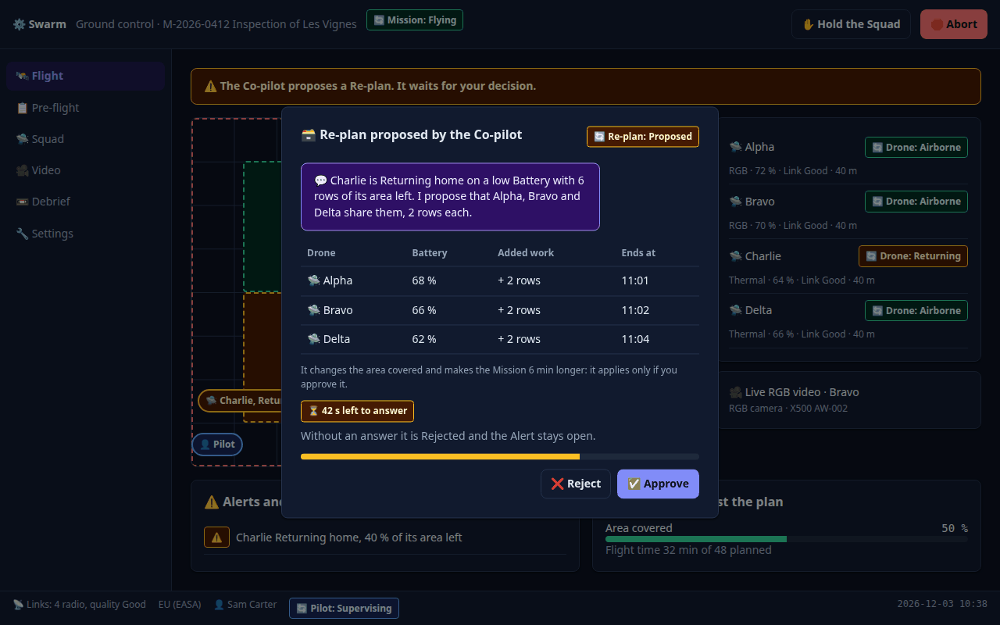
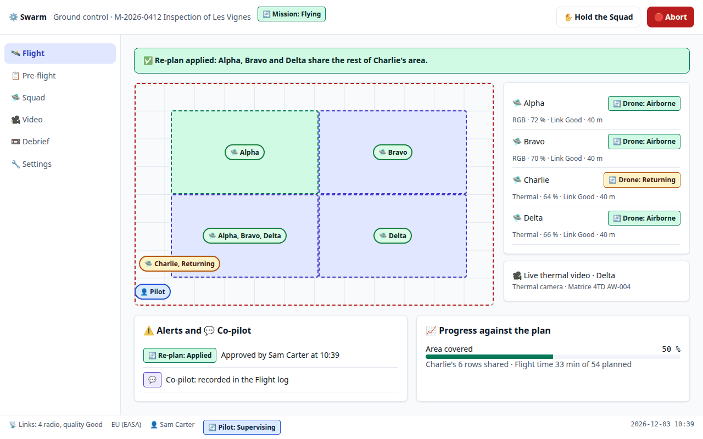
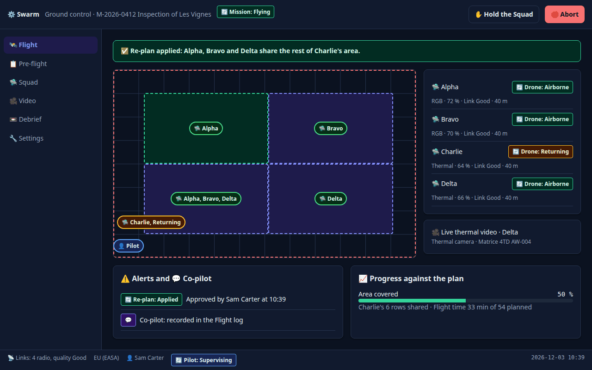
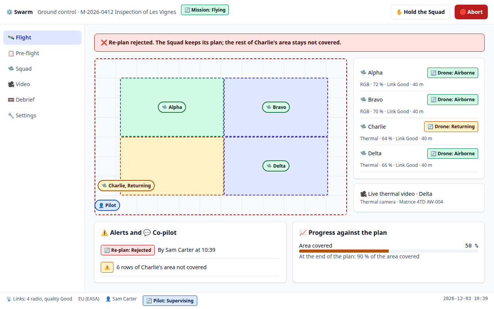
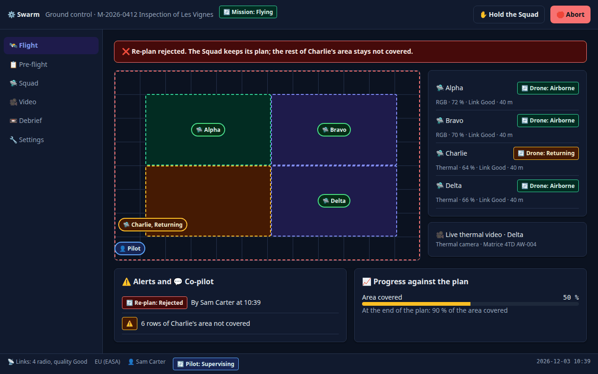

# 🎬 UC-004: Supervise a Squad and approve a Re-plan

<!-- spec:nav-top -->
> [🏠 Index](../../README.md) · [◀️ UC-003: Run the Pre-flight check and launch](UC-003-run-the-pre-flight-check-and-launch.md) · 📄 **Page 30 / 108** · [UC-005: Lose a Drone in flight ▶️](UC-005-lose-a-drone-in-flight.md)
<!-- /spec:nav-top -->

**Status:** 🟢 Approved · **Updated:** 2026-11-18

> [!NOTE]
> The [👤 Pilot](../../glossary.md#per-pilot) supervises a [🗃️ Squad](../../glossary.md#ent-squad) in [⚙️ Ground control](../../glossary.md#sys-ground-control) and approves or rejects the [🗃️ Re-plan](../../glossary.md#ent-re-plan) the [⚙️ Co-pilot](../../glossary.md#sys-co-pilot) proposes when a [🗃️ Drone](../../glossary.md#ent-drone) Returns home, so that the Squad changes its plan only with the Pilot's consent.

<!-- spec:summary -->
## 📑 Summary

1. [👤 Personas and entities](#actors)
2. [🚦 Preconditions](#preconditions)
3. [⚡ Trigger](#trigger)
4. [➡️ Main flow](#main-flow)
5. [🔀 Flow chart](#flowchart)
6. [🖼️ Screens](#screens)
7. [↪️ Alternative and error flows](#alternative-flows)
8. [📏 Business rules applied](#business-rules)
9. [🏁 Postconditions](#postconditions)
10. [🔗 Referenced by](#referenced-by)
<!-- /spec:summary -->

## 👤 Personas and entities

| Name | Kind | Role in this use case |
| --- | --- | --- |
| [👤 Pilot](../../glossary.md#per-pilot) | Persona | Supervises the Squad, approves or rejects the Re-plan |
| [🗃️ Squad](../../glossary.md#ent-squad) | Entity | Flies the Mission, then flies the Re-plan or keeps its plan |
| [🗃️ Drone](../../glossary.md#ent-drone) | Entity | One Drone Returns home before its area is done |
| [🗃️ Re-plan](../../glossary.md#ent-re-plan) | Entity | Proposed, then Applied or Rejected |
| [⚙️ Ground control](../../glossary.md#sys-ground-control) | System | Shows each Drone, the proposal and its effect, and sends the Pilot's decision |
| [⚙️ Co-pilot](../../glossary.md#sys-co-pilot) | System | Proposes the Re-plan with its reasons |

## 🚦 Preconditions

1. The [🗃️ Mission](../../glossary.md#ent-mission) is [🔄 Mission: Flying](../../glossary.md#st-mission-flying) under the Supervised autonomy [🔤 Autonomy level](../../glossary.md#term-autonomy-level). Sample: M-2026-0412 Inspection of Les Vignes, Squad Alpha, Bravo, Charlie and Delta.
2. The Pilot is in the 🛰️ Flight view of Ground control ([🎬 UC-025: Monitor a Mission in Ground control](UC-025-monitor-a-mission-in-ground-control.md)).

## ⚡ Trigger

A Drone of the Squad Returns home before its area is done, for example Charlie on a low [🗃️ Battery](../../glossary.md#ent-battery) ([🎬 UC-026: Handle an Alert](UC-026-handle-an-alert.md)).

## ➡️ Main flow

1. The Pilot supervises the Squad: Ground control shows each Drone on the map with its state, [🗃️ Payload](../../glossary.md#ent-payload) and [🔤 Telemetry](../../glossary.md#term-telemetry). The Pilot is [🔄 Pilot: Supervising](../../glossary.md#st-pilot-supervising).
2. Charlie starts its [🔤 Return home](../../glossary.md#term-return-home) with part of its area left. Ground control shows it [🔄 Drone: Returning](../../glossary.md#st-drone-returning).
3. The Co-pilot proposes a Re-plan: Alpha, Bravo and Delta share the rest of Charlie's area. Ground control shows its reason, the new area of each Drone and the effect on the duration of the Mission. The Re-plan changes the area covered, so it is [🔄 Re-plan: Proposed](../../glossary.md#st-re-plan-proposed) and waits for the Pilot, who has 60 seconds to answer, set by the Operator; Ground control shows the countdown ([📏 BR-013](../business-rules/BR-013-re-plan-approval.md)). The Co-pilot cannot apply it by itself ([📏 BR-021](../business-rules/BR-021-ai-agents-propose-people-decide.md)).
4. Within the 60 seconds, the Pilot approves the Re-plan. Ground control sends the new plan to the Squad and the Re-plan becomes [🔄 Re-plan: Applied](../../glossary.md#st-re-plan-applied). The [🗃️ Flight log](../../glossary.md#ent-flight-log) records the Re-plan and the Pilot's name.
5. The Pilot keeps supervising. The map and the progress show Charlie's area shared between the three other Drones.

## 🔀 Flow chart

## 🖼️ Screens

One row per state of the flow chart: every action, success and failure node. Each state shows its light then its dark screen; click one to open it full size. A state with nothing to show reads `➖ No screen: <why>`.

| State | Persona | Entity | Source | Screen |
| --- | --- | --- | --- | --- |
| A1: Supervise the Squad | [🔄 Pilot: Supervising](../../glossary.md#st-pilot-supervising) | [🗃️ Squad](../../glossary.md#ent-squad) [🔄 Drone: Airborne](../../glossary.md#st-drone-airborne) | ✏️ Mock-up |   |
| A2: Review the proposed Re-plan | [🔄 Pilot: Supervising](../../glossary.md#st-pilot-supervising) | [🔄 Re-plan: Proposed](../../glossary.md#st-re-plan-proposed) [🔄 Drone: Returning](../../glossary.md#st-drone-returning) | ✏️ Mock-up |   |
| OK: Re-plan applied | [🔄 Pilot: Supervising](../../glossary.md#st-pilot-supervising) | [🔄 Re-plan: Applied](../../glossary.md#st-re-plan-applied) | ✏️ Mock-up |   |
| KO: Re-plan rejected, plan kept | [🔄 Pilot: Supervising](../../glossary.md#st-pilot-supervising) | [🔄 Re-plan: Rejected](../../glossary.md#st-re-plan-rejected) | ✏️ Mock-up |   |

## ↪️ Alternative and error flows

| # | At step | Condition | What happens |
| --- | --- | --- | --- |
| A1 | 4 | The Pilot rejects the Re-plan | The Re-plan becomes [🔄 Re-plan: Rejected](../../glossary.md#st-re-plan-rejected). The Squad keeps its plan: Alpha, Bravo and Delta finish their own areas, and the rest of Charlie's area is shown as not covered. The Flight log records the rejection and the Pilot's name. |
| A2 | 4 | The Pilot does not answer within 60 seconds | The Re-plan becomes Rejected and the Squad keeps its plan, as in A1. The Alert about Charlie stays open in the Alerts area until the Pilot handles it. |

## 📏 Business rules applied

| Rule | Where it applies |
| --- | --- |
| [📏 BR-013: Re-plan approval](../business-rules/BR-013-re-plan-approval.md) | Step 3 and alternative A2: sharing an area changes the area covered, so the Re-plan waits 60 seconds for the Pilot; without an answer it is Rejected |
| [📏 BR-021: AI agents propose, people decide](../business-rules/BR-021-ai-agents-propose-people-decide.md) | Steps 3 and 4: the Co-pilot proposes, the Pilot decides, and the Flight log records who decided |
| [📏 BR-012: Pilot override always available](../business-rules/BR-012-pilot-override-always-available.md) | Steps 1 to 5: while the Re-plan waits, the Pilot can still Hold the Squad, take manual control or abort ([🎬 UC-006: Take manual control or abort](UC-006-take-manual-control-or-abort.md)) |

## 🏁 Postconditions

- ✅ **Success:** the Re-plan is Applied, Alpha, Bravo and Delta fly Charlie's remaining area, and the Flight log names the Pilot who approved it.
- ❌ **Failure:** the Re-plan is Rejected by the Pilot or after 60 seconds without an answer, the Squad keeps its plan, the rest of Charlie's area is shown as not covered, and the Flight log records the rejection. Without an answer, the Alert stays open.

## 🔗 Referenced by

<!-- spec:referenced-by -->
- [📘 FS-003: Live supervision](../features/FS-003-live-supervision.md)
- [📘 FS-018: Live Co-pilot](../features/FS-018-live-co-pilot.md)
- [📘 FS-021: Ground control monitoring](../features/FS-021-ground-control-monitoring.md)
- [🎬 UC-005: Lose a Drone in flight](UC-005-lose-a-drone-in-flight.md)
- [🎬 UC-026: Handle an Alert](UC-026-handle-an-alert.md)
<!-- /spec:referenced-by -->

<!-- spec:nav-bottom -->
---

> [🏠 Index](../../README.md) · [◀️ UC-003: Run the Pre-flight check and launch](UC-003-run-the-pre-flight-check-and-launch.md) · 📄 **Page 30 / 108** · [UC-005: Lose a Drone in flight ▶️](UC-005-lose-a-drone-in-flight.md)
<!-- /spec:nav-bottom -->
