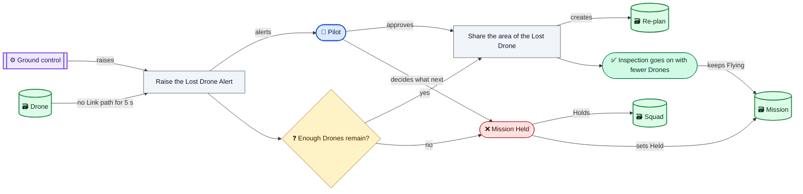
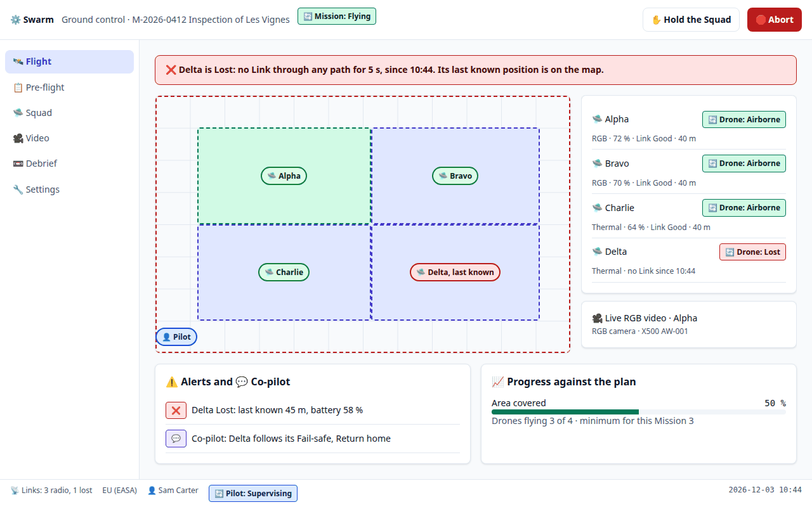
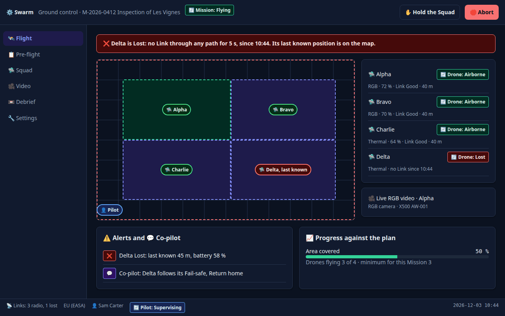
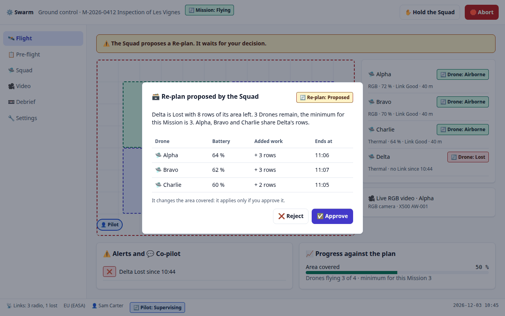
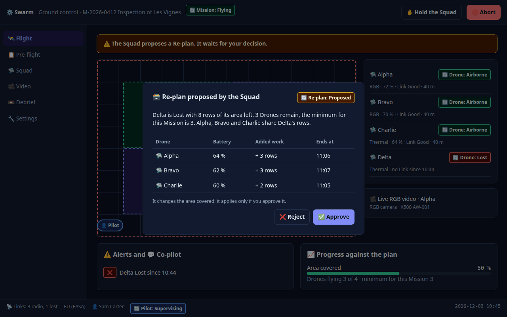
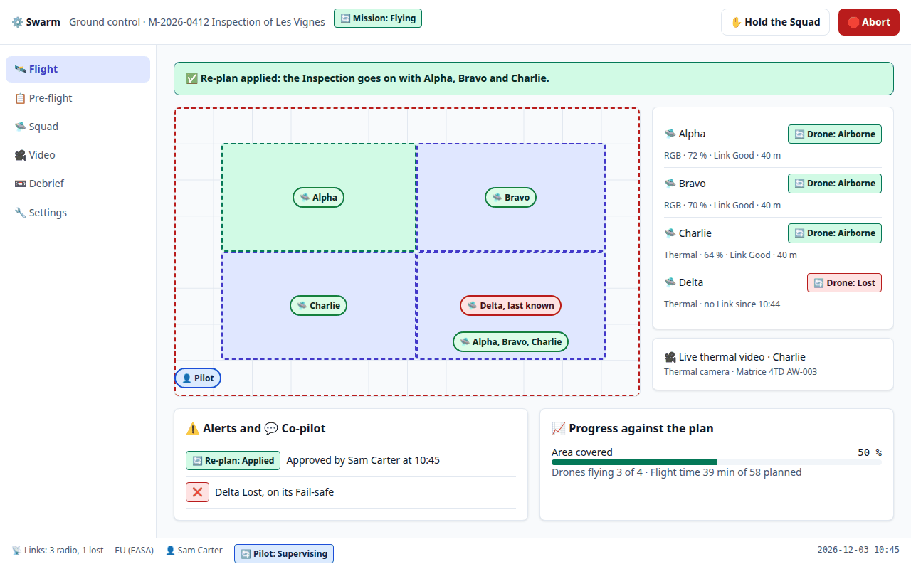
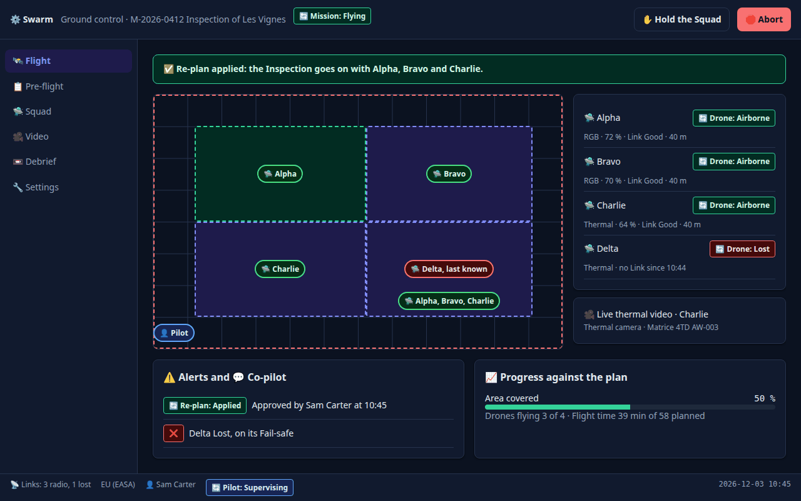
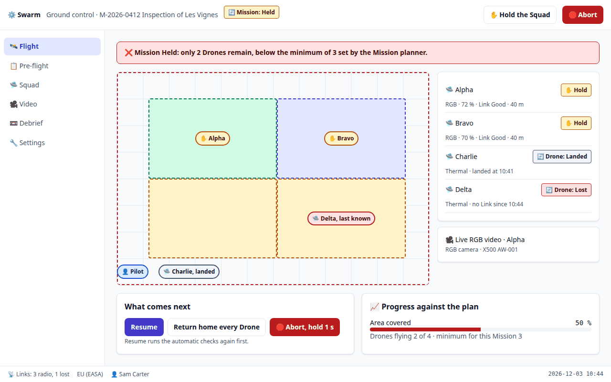
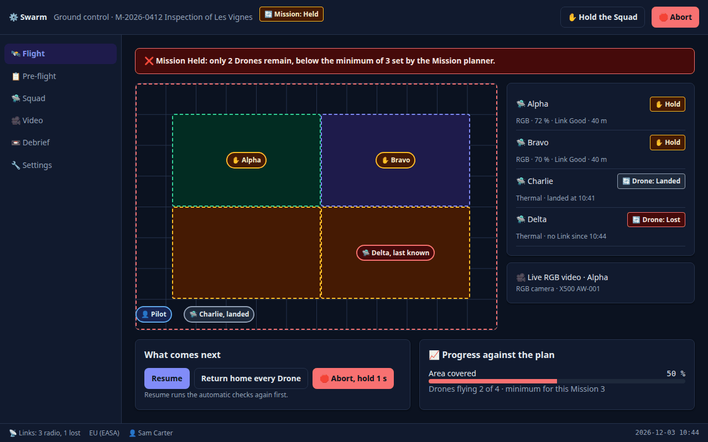

# 🎬 UC-005: Lose a Drone in flight

<!-- spec:nav-top -->
> [🏠 Index](../../README.md) · [◀️ UC-004: Supervise a Squad and approve a Re-plan](UC-004-supervise-a-squad-and-approve-a-re-plan.md) · 📄 **Page 31 / 108** · [UC-006: Take manual control or abort ▶️](UC-006-take-manual-control-or-abort.md)
<!-- /spec:nav-top -->

**Status:** 🟢 Approved · **Updated:** 2026-11-18

> [!NOTE]
> When [⚙️ Ground control](../../glossary.md#sys-ground-control) loses a [🗃️ Drone](../../glossary.md#ent-drone) in flight, the [👤 Pilot](../../glossary.md#per-pilot) sees the [🗃️ Squad](../../glossary.md#ent-squad) share its work while enough Drones remain, or the [🗃️ Mission](../../glossary.md#ent-mission) Held when too few remain.

<!-- spec:summary -->
## 📑 Summary

1. [👤 Personas and entities](#actors)
2. [🚦 Preconditions](#preconditions)
3. [⚡ Trigger](#trigger)
4. [➡️ Main flow](#main-flow)
5. [🔀 Flow chart](#flowchart)
6. [🖼️ Screens](#screens)
7. [↪️ Alternative and error flows](#alternative-flows)
8. [📏 Business rules applied](#business-rules)
9. [🏁 Postconditions](#postconditions)
10. [🔗 Referenced by](#referenced-by)
<!-- /spec:summary -->

## 👤 Personas and entities

| Name | Kind | Role in this use case |
| --- | --- | --- |
| [👤 Pilot](../../glossary.md#per-pilot) | Persona | Gets the Alert, approves the Re-plan, decides when the Mission is Held |
| [🗃️ Drone](../../glossary.md#ent-drone) | Entity | Becomes Lost and follows its on-board Fail-safe |
| [🗃️ Squad](../../glossary.md#ent-squad) | Entity | Shares the work of the Lost Drone, or Holds |
| [🗃️ Re-plan](../../glossary.md#ent-re-plan) | Entity | Shares the area of the Lost Drone between the others |
| [🗃️ Mission](../../glossary.md#ent-mission) | Entity | Stays Flying, or becomes Held |
| [⚙️ Ground control](../../glossary.md#sys-ground-control) | System | Detects the lost Link, raises the Alert, counts the Drones left, Holds the Squad |

## 🚦 Preconditions

1. The Mission is [🔄 Mission: Flying](../../glossary.md#st-mission-flying) and its [🔤 Activity](../../glossary.md#term-activity) is not a [🔤 Light show](../../glossary.md#term-light-show). Sample: M-2026-0412, an [🔤 Inspection](../../glossary.md#term-inspection) of Les Vignes, Squad Alpha, Bravo, Charlie and Delta.
2. The [👤 Mission planner](../../glossary.md#per-mission-planner) set the minimum number of Drones the Mission needs. Sample: 3.
3. Before take-off, Swarm set the on-board [🔤 Fail-safe](../../glossary.md#term-fail-safe) of every Drone to [🔤 Return home](../../glossary.md#term-return-home).
4. The Pilot is [🔄 Pilot: Supervising](../../glossary.md#st-pilot-supervising) in the 🛰️ Flight view.

## ⚡ Trigger

Ground control has had no [🔤 Link](../../glossary.md#term-link) to Delta through any path for 5 seconds.

## ➡️ Main flow

1. Ground control has no Link path to Delta for 5 seconds, the Operator's setting, never below the minimum of the [🗃️ Drone model](../../glossary.md#ent-drone-model). Delta becomes [🔄 Drone: Lost](../../glossary.md#st-drone-lost).
2. Ground control raises an [🔤 Alert](../../glossary.md#term-alert) and shows Delta's last known position, altitude and battery on the map.
3. Delta cannot receive orders: it follows its on-board Fail-safe and Returns home ([📏 BR-006](../business-rules/BR-006-fail-safe-per-activity.md), [📏 BR-012](../business-rules/BR-012-pilot-override-always-available.md)).
4. Ground control compares the Drones still flying with the minimum of the Mission: 3 remain, the minimum is 3.
5. Enough Drones remain: the Squad proposes a Re-plan to share Delta's area between Alpha, Bravo and Charlie. It waits for the Pilot, as in [🎬 UC-004: Supervise a Squad and approve a Re-plan](UC-004-supervise-a-squad-and-approve-a-re-plan.md).
6. The Pilot approves. The Re-plan is applied, the Inspection goes on with 3 Drones and the Mission stays Flying.

## 🔀 Flow chart

## 🖼️ Screens

One row per state of the flow chart: every action, success and failure node. Each state shows its light then its dark screen; click one to open it full size. A state with nothing to show reads `➖ No screen: <why>`.

| State | Persona | Entity | Source | Screen |
| --- | --- | --- | --- | --- |
| A1: Raise the Lost Drone Alert | [🔄 Pilot: Supervising](../../glossary.md#st-pilot-supervising) | [🔄 Drone: Lost](../../glossary.md#st-drone-lost) | ✏️ Mock-up |   |
| A2: Share the area of the Lost Drone | [🔄 Pilot: Supervising](../../glossary.md#st-pilot-supervising) | [🔄 Re-plan: Proposed](../../glossary.md#st-re-plan-proposed) [🔄 Drone: Lost](../../glossary.md#st-drone-lost) | ✏️ Mock-up |   |
| OK: Inspection goes on with fewer Drones | [🔄 Pilot: Supervising](../../glossary.md#st-pilot-supervising) | [🔄 Mission: Flying](../../glossary.md#st-mission-flying) [🔄 Re-plan: Applied](../../glossary.md#st-re-plan-applied) | ✏️ Mock-up |   |
| KO: Mission Held | [👤 Pilot](../../glossary.md#per-pilot) | [🔄 Mission: Held](../../glossary.md#st-mission-held) [🔄 Drone: Lost](../../glossary.md#st-drone-lost) [🔄 Drone: Landed](../../glossary.md#st-drone-landed) | ✏️ Mock-up |   |

## ↪️ Alternative and error flows

| # | At step | Condition | What happens |
| --- | --- | --- | --- |
| A1 | 4 | Fewer Drones remain than the minimum of the Mission. Sample: Charlie has already Returned home ([🎬 UC-004: Supervise a Squad and approve a Re-plan](UC-004-supervise-a-squad-and-approve-a-re-plan.md)), and is [🔄 Drone: Landed](../../glossary.md#st-drone-landed), so only Alpha and Bravo remain, below the minimum of 3 | Ground control puts every remaining Drone in [🔤 Hold](../../glossary.md#term-hold) and the Mission becomes [🔄 Mission: Held](../../glossary.md#st-mission-held) ([📏 BR-006](../business-rules/BR-006-fail-safe-per-activity.md)). The Pilot decides what comes next: Resume, after the automatic checks run again; Return home for every Drone; or abort ([🎬 UC-006: Take manual control or abort](UC-006-take-manual-control-or-abort.md)). |
| A2 | 1 | The Pilot loses the Link to the whole Squad | The Mission becomes Held ([📏 BR-006](../business-rules/BR-006-fail-safe-per-activity.md)), as in A1. |
| A3 | 6 | The Pilot rejects the Re-plan | The Squad keeps its plan and Delta's area is shown as not covered, as in [🎬 UC-004: Supervise a Squad and approve a Re-plan](UC-004-supervise-a-squad-and-approve-a-re-plan.md). |

## 📏 Business rules applied

| Rule | Where it applies |
| --- | --- |
| [📏 BR-006: Fail-safe per Activity](../business-rules/BR-006-fail-safe-per-activity.md) | Steps 3 to 6 and alternatives A1 and A2: the Lost Drone Returns home, the others share its work, and the Mission is Held below the minimum. The Light show behaviour, where the whole Squad Holds, is not part of this use case |
| [📏 BR-012: Pilot override always available](../business-rules/BR-012-pilot-override-always-available.md) | Step 3 and alternative A1: the Lost Drone cannot receive the Pilot's commands and follows its on-board Fail-safe; the Pilot keeps every command over the other Drones, including Resume, Return home and abort from Mission: Held |

## 🏁 Postconditions

- ✅ **Success:** the Lost Drone follows its on-board Fail-safe, the other Drones fly the applied Re-plan, and the Mission is still Flying.
- ❌ **Failure:** every remaining Drone Holds, the Mission is Held, and the Pilot sees why and chooses: Resume after the automatic checks run again, Return home for every Drone, or abort.

## 🔗 Referenced by

<!-- spec:referenced-by -->
- [📘 FS-004: Fail-safes and emergencies](../features/FS-004-fail-safes-and-emergencies.md)
- [🎬 UC-025: Monitor a Mission in Ground control](UC-025-monitor-a-mission-in-ground-control.md)
<!-- /spec:referenced-by -->

<!-- spec:nav-bottom -->
---

> [🏠 Index](../../README.md) · [◀️ UC-004: Supervise a Squad and approve a Re-plan](UC-004-supervise-a-squad-and-approve-a-re-plan.md) · 📄 **Page 31 / 108** · [UC-006: Take manual control or abort ▶️](UC-006-take-manual-control-or-abort.md)
<!-- /spec:nav-bottom -->
