# 🎬 UC-006: Take manual control or abort

<!-- spec:nav-top -->
> [🏠 Index](../../README.md) · [◀️ UC-005: Lose a Drone in flight](UC-005-lose-a-drone-in-flight.md) · 📄 **Page 32 / 108** · [UC-007: Register a Drone and track its readiness ▶️](UC-007-register-a-drone-and-track-its-readiness.md)
<!-- /spec:nav-top -->

**Status:** 🟢 Approved · **Updated:** 2026-11-18

> [!NOTE]
> The [👤 Pilot](../../glossary.md#per-pilot) takes manual control of a [🗃️ Drone](../../glossary.md#ent-drone) or of the [🗃️ Squad](../../glossary.md#ent-squad) in [⚙️ Ground control](../../glossary.md#sys-ground-control), or aborts the [🗃️ Mission](../../glossary.md#ent-mission), and gets the command carried out at once, whatever the Squad was doing.

<!-- spec:summary -->
## 📑 Summary

1. [👤 Personas and entities](#actors)
2. [🚦 Preconditions](#preconditions)
3. [⚡ Trigger](#trigger)
4. [➡️ Main flow](#main-flow)
5. [🔀 Flow chart](#flowchart)
6. [🖼️ Screens](#screens)
7. [↪️ Alternative and error flows](#alternative-flows)
8. [📏 Business rules applied](#business-rules)
9. [🏁 Postconditions](#postconditions)
10. [🔗 Referenced by](#referenced-by)
<!-- /spec:summary -->

## 👤 Personas and entities

| Name | Kind | Role in this use case |
| --- | --- | --- |
| [👤 Pilot](../../glossary.md#per-pilot) | Persona | Takes manual control of a Drone, or aborts the Mission |
| [🗃️ Drone](../../glossary.md#ent-drone) | Entity | Flown by hand then returned to the Squad, or Returning home then Landed after the abort |
| [🗃️ Squad](../../glossary.md#ent-squad) | Entity | Receives the abort and Returns home |
| [🗃️ Mission](../../glossary.md#ent-mission) | Entity | Becomes Aborted |
| [⚙️ Ground control](../../glossary.md#sys-ground-control) | System | Hands the Drone over to the chosen input, sends the abort, shows each Drone's answer |

## 🚦 Preconditions

1. The Mission is [🔄 Mission: Flying](../../glossary.md#st-mission-flying) or [🔄 Mission: Held](../../glossary.md#st-mission-held). Sample: M-2026-0412 Inspection of Les Vignes, Squad Alpha, Bravo, Charlie and Delta.
2. The Pilot is [🔄 Pilot: Supervising](../../glossary.md#st-pilot-supervising) in the 🛰️ Flight view.
3. For manual control, the input the Pilot wants is connected: a gamepad or joystick, the vendor remote of the [🗃️ Drone model](../../glossary.md#ent-drone-model), or the keyboard. The on-screen commands need nothing.

## ⚡ Trigger

The Pilot decides to fly a Drone by hand, or to stop the Mission.

## ➡️ Main flow

1. The Pilot selects Bravo on the map or in the Squad panel. Ground control shows its [🔤 Telemetry](../../glossary.md#term-telemetry) and the commands available: [🔤 Hold](../../glossary.md#term-hold), take manual control, [🔤 Return home](../../glossary.md#term-return-home), land ([📏 BR-012](../business-rules/BR-012-pilot-override-always-available.md)).
2. The Pilot chooses 🎮 Take manual control, then the input: gamepad or joystick, vendor remote, on-screen commands or keyboard. The inputs follow the Pilot's [🔤 Control mapping](../../glossary.md#term-control-mapping), except the fixed inputs ([📏 BR-023](../business-rules/BR-023-fixed-safety-controls.md)): Hold the Squad is the key H or both gamepad bumpers, abort is Ctrl+Shift+A or the gamepad Back and Start buttons, each held 1 second.
3. Ground control hands Bravo over to the chosen input. The Pilot is [🔄 Pilot: In manual control](../../glossary.md#st-pilot-in-manual-control): Bravo follows the gamepad and stays [🔄 Drone: Airborne](../../glossary.md#st-drone-airborne), while Alpha, Charlie and Delta keep flying their plan.
4. When done, the Pilot chooses Return to Squad. Ground control checks the [🔤 Separation distance](../../glossary.md#term-separation-distance), Bravo flies back to its planned position, and the Squad resumes its plan. The Pilot is [🔄 Pilot: Supervising](../../glossary.md#st-pilot-supervising) again.
5. At any time, from any screen, the Pilot presses and holds 🛑 Abort in the title bar for 1 second, or holds its fixed input: there is no dialog. Ground control sends Return home to every Drone. The Mission becomes [🔄 Mission: Aborted](../../glossary.md#st-mission-aborted) and each Drone becomes [🔄 Drone: Returning](../../glossary.md#st-drone-returning).
6. Ground control shows, Drone by Drone, that the command was received, then each landing at its take-off point: each Drone becomes [🔄 Drone: Landed](../../glossary.md#st-drone-landed).
7. Every Drone has Landed. The Mission stays Aborted and the [🗃️ Flight log](../../glossary.md#ent-flight-log) records the abort, its time and the Pilot's name.

## 🔀 Flow chart

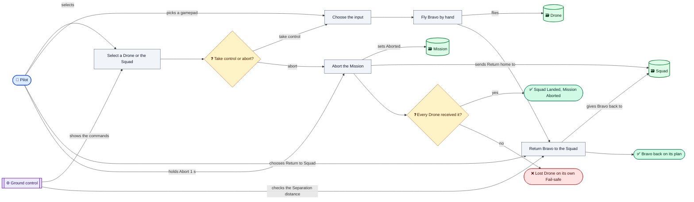

## 🖼️ Screens

One row per state of the flow chart: every action, success and failure node. Each state shows its light then its dark screen; click one to open it full size. A state with nothing to show reads `➖ No screen: <why>`.

| State | Persona | Entity | Source | Screen |
| --- | --- | --- | --- | --- |
| A1: Select a Drone or the Squad | [🔄 Pilot: Supervising](../../glossary.md#st-pilot-supervising) | [🔄 Drone: Airborne](../../glossary.md#st-drone-airborne) | ✏️ Mock-up | [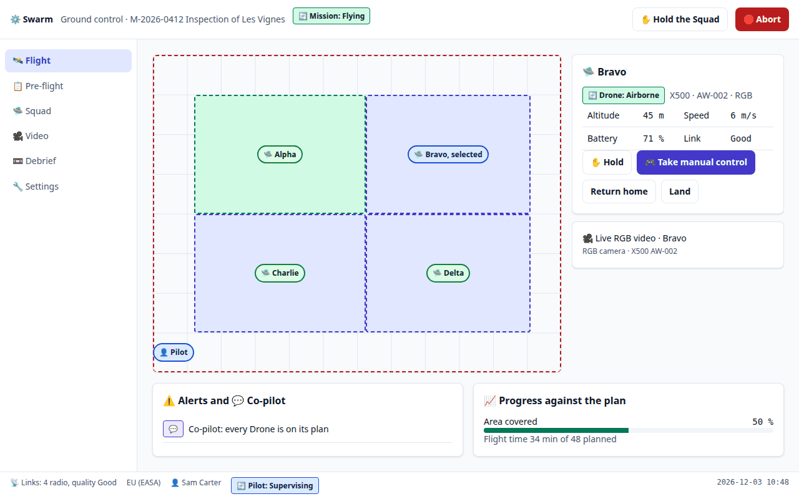](../../screens/UC-006/a1.png) [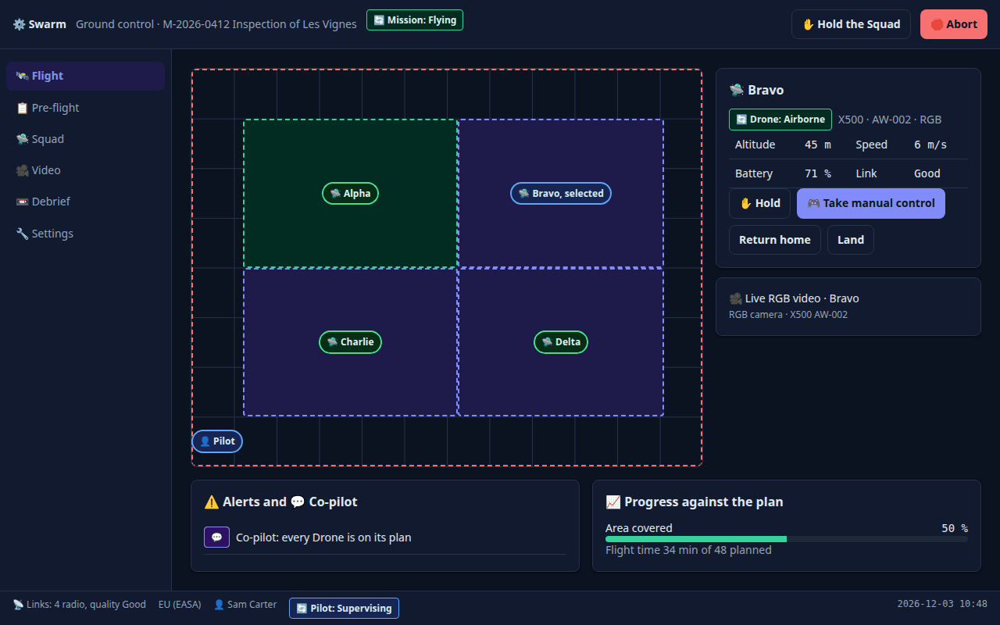](../../screens/UC-006/a1.dark.png) |
| A2: Choose the input | [🔄 Pilot: Supervising](../../glossary.md#st-pilot-supervising) | [🔄 Drone: Airborne](../../glossary.md#st-drone-airborne) | ✏️ Mock-up | [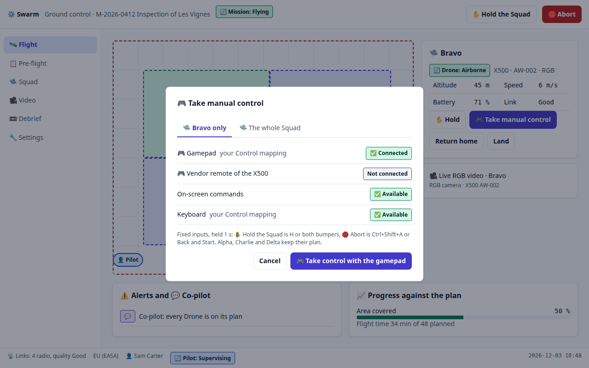](../../screens/UC-006/a2.png) [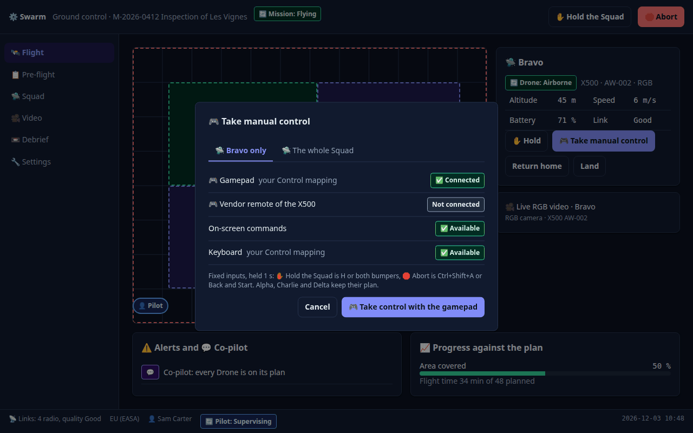](../../screens/UC-006/a2.dark.png) |
| A4: Fly Bravo by hand | [🔄 Pilot: In manual control](../../glossary.md#st-pilot-in-manual-control) | [🔄 Drone: Airborne](../../glossary.md#st-drone-airborne) | ✏️ Mock-up | [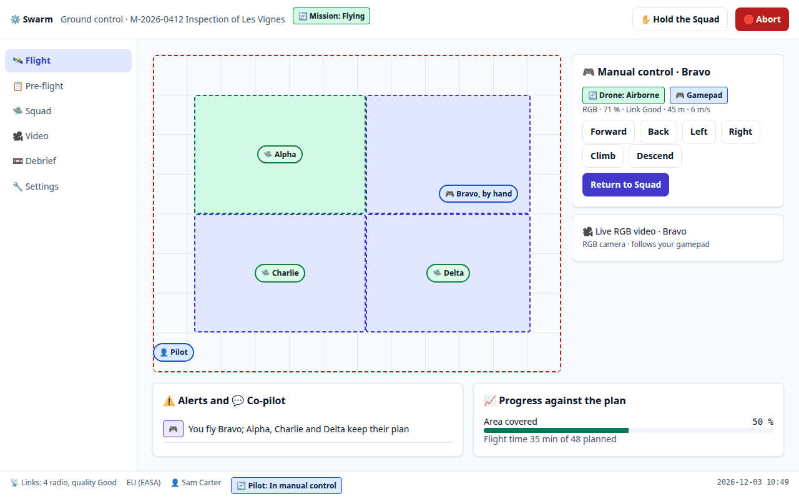](../../screens/UC-006/a4.png) [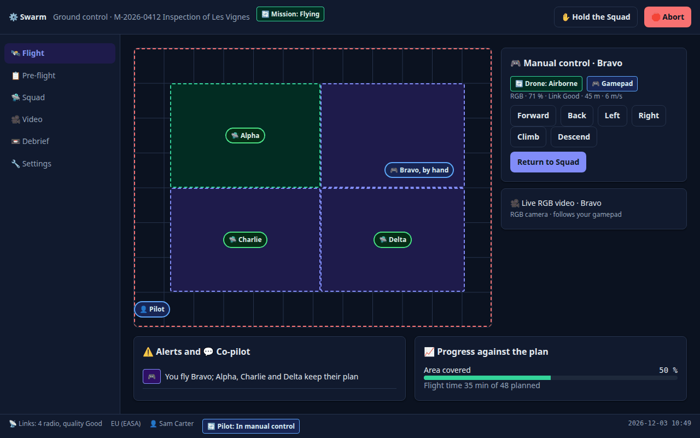](../../screens/UC-006/a4.dark.png) |
| A5: Return Bravo to the Squad | [🔄 Pilot: In manual control](../../glossary.md#st-pilot-in-manual-control) | [🔄 Drone: Airborne](../../glossary.md#st-drone-airborne) [🗃️ Squad](../../glossary.md#ent-squad) | ✏️ Mock-up | [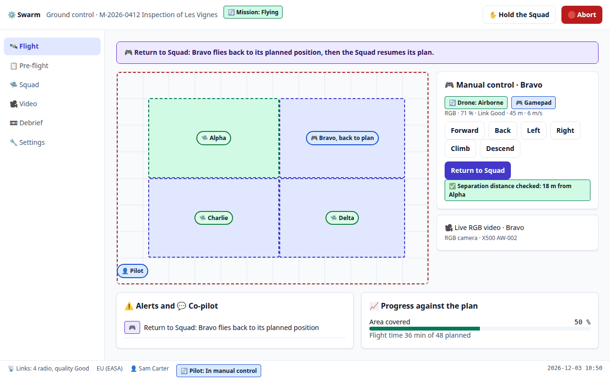](../../screens/UC-006/a5.png) [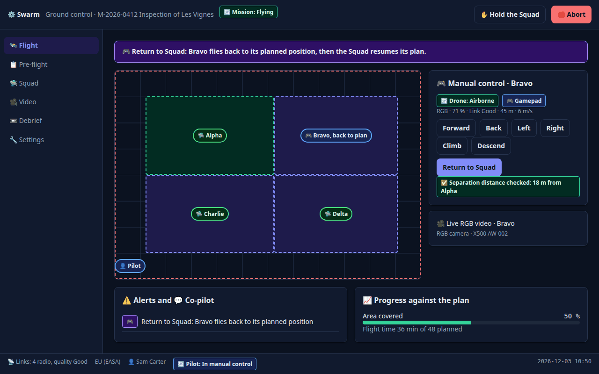](../../screens/UC-006/a5.dark.png) |
| OK1: Bravo back on its plan | [🔄 Pilot: Supervising](../../glossary.md#st-pilot-supervising) | [🔄 Drone: Airborne](../../glossary.md#st-drone-airborne) | ✏️ Mock-up | [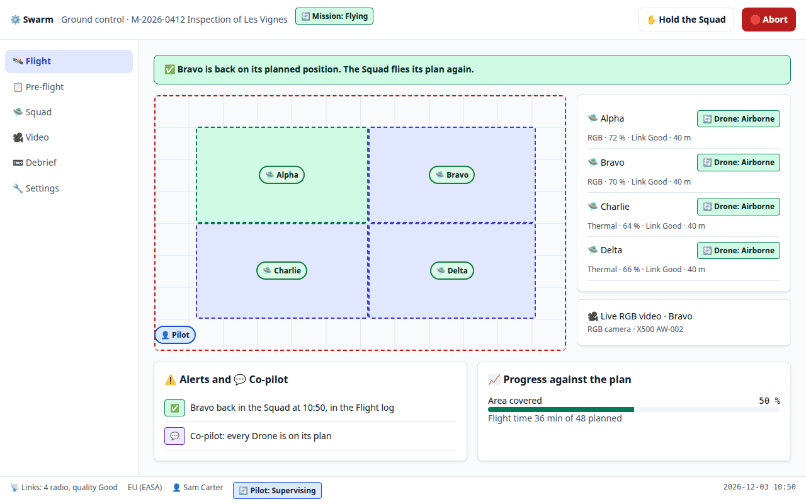](../../screens/UC-006/ok1.png) [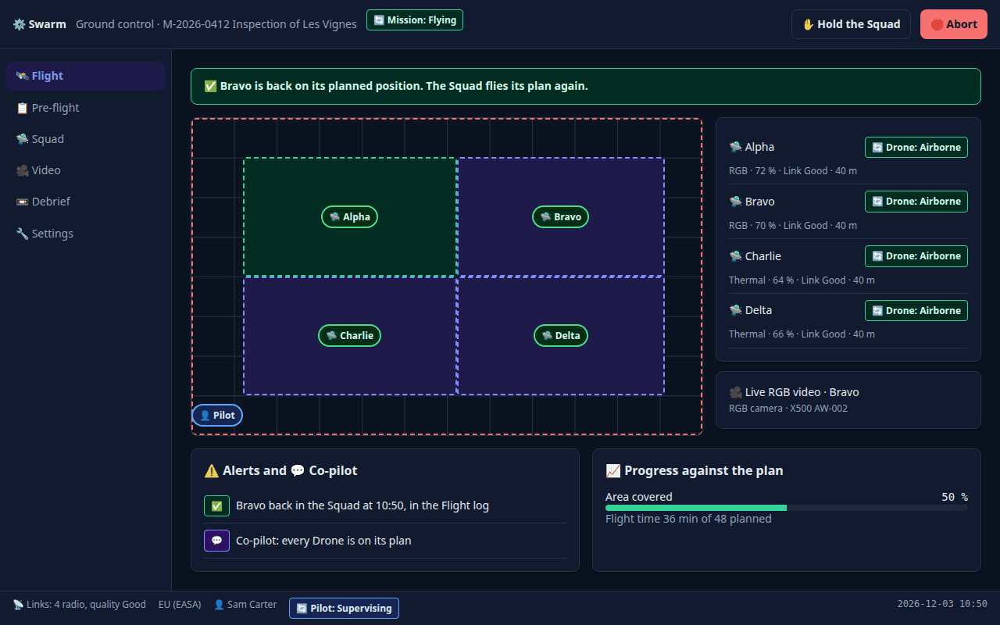](../../screens/UC-006/ok1.dark.png) |
| A3: Abort the Mission | [👤 Pilot](../../glossary.md#per-pilot) | [🔄 Mission: Aborted](../../glossary.md#st-mission-aborted) [🔄 Drone: Returning](../../glossary.md#st-drone-returning) | ✏️ Mock-up | [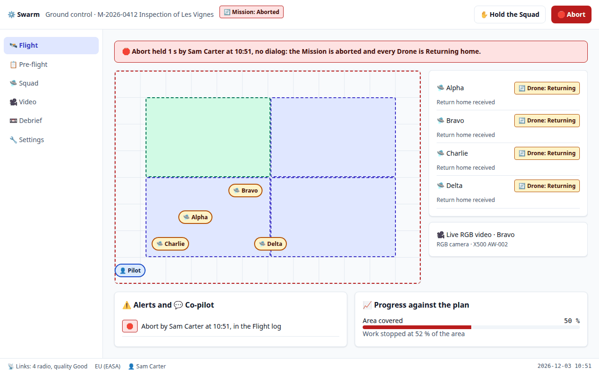](../../screens/UC-006/a3.png) [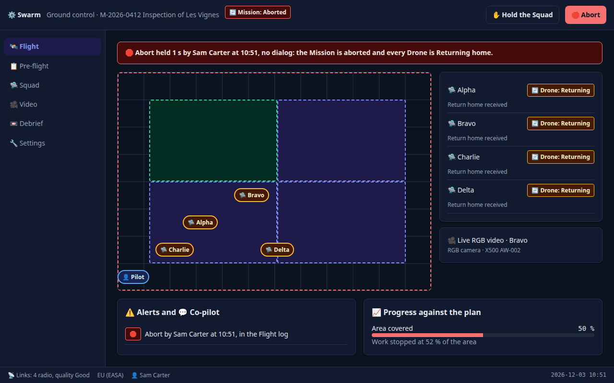](../../screens/UC-006/a3.dark.png) |
| OK2: Squad Landed, Mission Aborted | [👤 Pilot](../../glossary.md#per-pilot) | [🔄 Mission: Aborted](../../glossary.md#st-mission-aborted) [🔄 Drone: Landed](../../glossary.md#st-drone-landed) | ✏️ Mock-up | [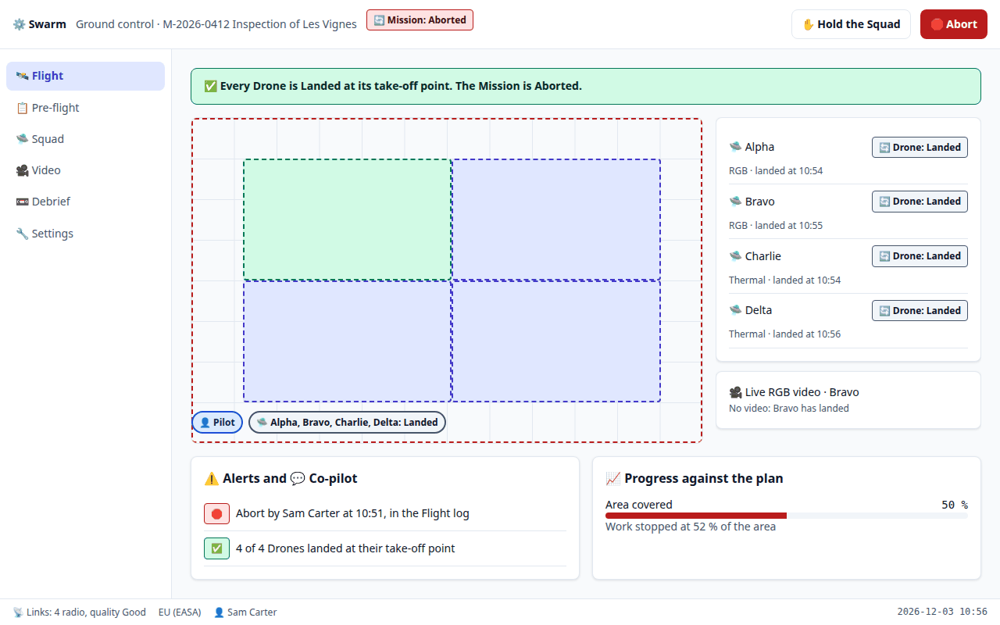](../../screens/UC-006/ok2.png) [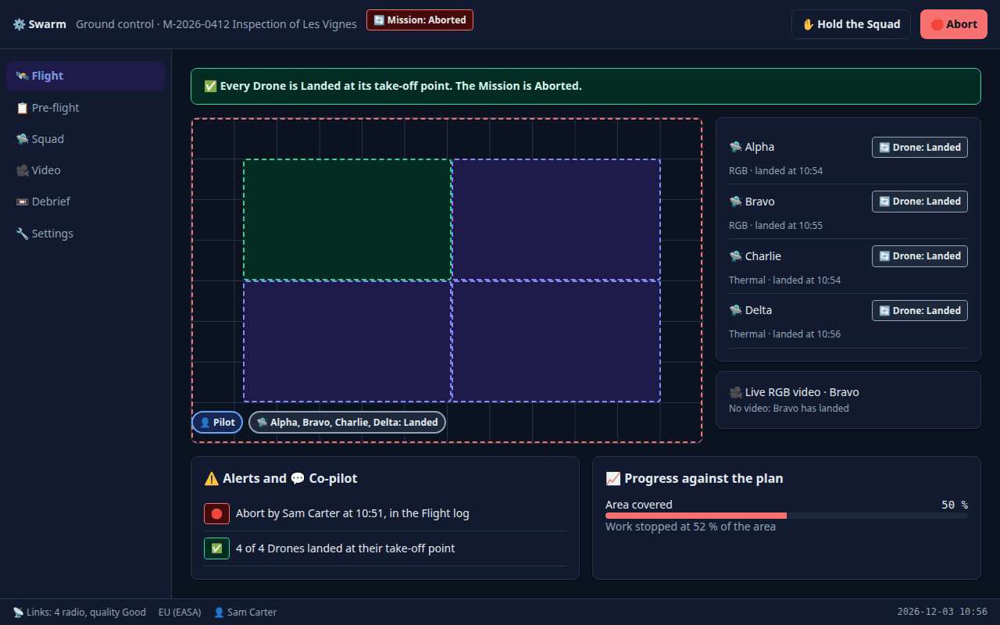](../../screens/UC-006/ok2.dark.png) |
| KO: Lost Drone on its own Fail-safe | [👤 Pilot](../../glossary.md#per-pilot) | [🔄 Mission: Aborted](../../glossary.md#st-mission-aborted) [🔄 Drone: Lost](../../glossary.md#st-drone-lost) | ✏️ Mock-up | [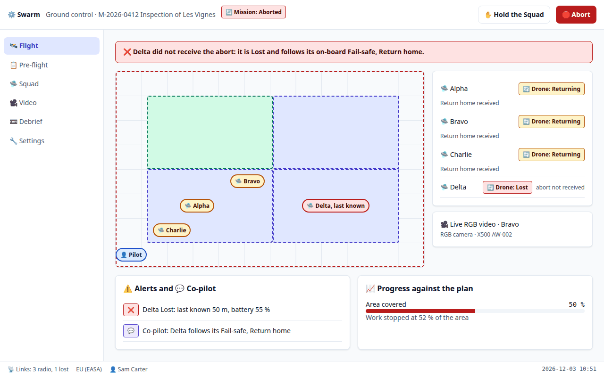](../../screens/UC-006/ko.png) [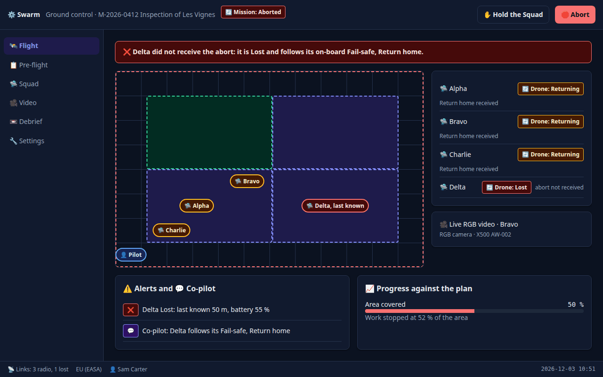](../../screens/UC-006/ko.dark.png) |

## ↪️ Alternative and error flows

| # | At step | Condition | What happens |
| --- | --- | --- | --- |
| A1 | 2 | The Pilot takes manual control of the whole Squad | Ground control hands every Drone over to the chosen input; the Squad no longer decides by itself. Return to Squad gives every Drone back to its plan. |
| A2 | 5 | The Pilot releases 🛑 Abort, or its fixed input, before 1 second | Nothing is sent, a hint says to hold 1 second, and the Mission goes on: a short press never aborts. |
| A3 | 5 | The Pilot aborts while in manual control | The abort applies to every Drone, including the one the Pilot was flying: each Returns home. |
| A4 | 6 | A Drone is [🔄 Drone: Lost](../../glossary.md#st-drone-lost) and cannot receive the abort | Ground control shows it Lost with its last known position. It follows its on-board [🔤 Fail-safe](../../glossary.md#term-fail-safe), Return home ([📏 BR-012](../business-rules/BR-012-pilot-override-always-available.md)). The other Drones Return home and land. |
| A5 | 4 | The Separation distance check fails when the Pilot chooses Return to Squad | Bravo stays in manual control, an Alert says why, and Swarm proposes a safe path back as a Re-plan for the Pilot to approve ([📏 BR-013](../business-rules/BR-013-re-plan-approval.md)) |

## 📏 Business rules applied

| Rule | Where it applies |
| --- | --- |
| [📏 BR-012: Pilot override always available](../business-rules/BR-012-pilot-override-always-available.md) | Steps 1 to 6: manual control, Return to Squad and abort work at any Autonomy level; alternative A4 for a Lost Drone |
| [📏 BR-023: Fixed safety controls](../business-rules/BR-023-fixed-safety-controls.md) | Steps 2 and 5, and alternative A2: Hold the Squad and abort are on every screen, act when held 1 second without a dialog, and keep their fixed inputs |

## 🏁 Postconditions

- ✅ **Success, manual control:** Bravo is back on its planned position, the Squad flies its plan, and the Pilot is Supervising again.
- ✅ **Success, abort:** the Mission is Aborted, every Drone is Landed at its take-off point, and the Flight log records the abort and the Pilot's name.
- ❌ **Failure:** a Lost Drone did not receive the abort; the Pilot sees its last known position while it follows its on-board Fail-safe.

## 🔗 Referenced by

<!-- spec:referenced-by -->
- [📘 FS-004: Fail-safes and emergencies](../features/FS-004-fail-safes-and-emergencies.md)
- [📘 FS-021: Ground control monitoring](../features/FS-021-ground-control-monitoring.md)
- [🎬 UC-004: Supervise a Squad and approve a Re-plan](UC-004-supervise-a-squad-and-approve-a-re-plan.md)
- [🎬 UC-005: Lose a Drone in flight](UC-005-lose-a-drone-in-flight.md)
- [🎬 UC-018: Respond to a Site Alarm](UC-018-respond-to-a-site-alarm.md)
- [🎬 UC-026: Handle an Alert](UC-026-handle-an-alert.md)
<!-- /spec:referenced-by -->

<!-- spec:nav-bottom -->
---

> [🏠 Index](../../README.md) · [◀️ UC-005: Lose a Drone in flight](UC-005-lose-a-drone-in-flight.md) · 📄 **Page 32 / 108** · [UC-007: Register a Drone and track its readiness ▶️](UC-007-register-a-drone-and-track-its-readiness.md)
<!-- /spec:nav-bottom -->
