# 🎬 UC-007: Register a Drone and track its readiness

<!-- spec:nav-top -->
> [🏠 Index](../../README.md) · [◀️ UC-006: Take manual control or abort](UC-006-take-manual-control-or-abort.md) · 📄 **Page 35 / 120** · [UC-008: Record an Authorisation ▶️](UC-008-record-an-authorisation.md)
<!-- /spec:nav-top -->

**Status:** 🟢 Approved · **Updated:** 2026-11-18

> [!NOTE]
> The [👤 Fleet maintainer](../../glossary.md#per-fleet-maintainer) registers a [🗃️ Drone](../../glossary.md#ent-drone) with its [🗃️ Drone model](../../glossary.md#ent-drone-model), [🗃️ Payloads](../../glossary.md#ent-payload) and each [🗃️ Battery](../../glossary.md#ent-battery) it flies with in the [⚙️ Back office](../../glossary.md#sys-back-office), and always knows whether it is Ready to join a [🗃️ Squad](../../glossary.md#ent-squad) or Grounded.

<!-- spec:summary -->
## 📑 Summary

1. [👤 Personas and entities](#actors)
2. [🚦 Preconditions](#preconditions)
3. [⚡ Trigger](#trigger)
4. [➡️ Main flow](#main-flow)
5. [🔀 Flow chart](#flowchart)
6. [🖼️ Screens](#screens)
7. [↪️ Alternative and error flows](#alternative-flows)
8. [📏 Business rules applied](#business-rules)
9. [🏁 Postconditions](#postconditions)
10. [🔗 Referenced by](#referenced-by)
<!-- /spec:summary -->

## 👤 Personas and entities

| Name | Kind | Role in this use case |
| --- | --- | --- |
| [👤 Fleet maintainer](../../glossary.md#per-fleet-maintainer) | Persona | Registers the Drone, adds its Payloads and Batteries, closes its maintenance |
| [🗃️ Drone](../../glossary.md#ent-drone) | Entity | Registered, then Ready or Grounded |
| [🗃️ Drone model](../../glossary.md#ent-drone-model) | Entity | Gives the limits of the Drone and tells whether it is approved |
| [🗃️ Payload](../../glossary.md#ent-payload) | Entity | Linked to the Drone when it fits its Drone model |
| [🗃️ Battery](../../glossary.md#ent-battery) | Entity | Linked to the Drone when its health is above the threshold of the Drone model |
| [🗃️ Flight log](../../glossary.md#ent-flight-log) | Entity | Source of the flight hours and Battery cycles |
| [⚙️ Back office](../../glossary.md#sys-back-office) | System | Holds the Fleet, counts flight hours and sets the readiness of each Drone |

## 🚦 Preconditions

1. The Fleet maintainer, Noah Weber, is signed in to the Back office of the [🗃️ Operator](../../glossary.md#ent-operator) Aerowing Services.
2. The [🗃️ Drone model](../../glossary.md#ent-drone-model) of the Drone is in the Fleet (see [🎬 UC-014: Connect a new Drone model](UC-014-connect-a-new-drone-model.md)).
3. Every [🗃️ Payload](../../glossary.md#ent-payload) and every [🗃️ Battery](../../glossary.md#ent-battery) is registered with the Drone models it fits.

## ⚡ Trigger

A new Drone arrives at Aerowing Services, or the Fleet maintainer opens the Fleet to see which Drones can fly.

## ➡️ Main flow

1. The [👤 Fleet maintainer](../../glossary.md#per-fleet-maintainer) opens 🛸 Fleet and registers the Drone: its name Foxtrot, its registration AW-006 and its Drone model Matrice 4TD (DJI), which is **Drone model: Approved**. The Back office imports the maintenance interval from the maker of the Drone model; the Fleet maintainer may make it shorter, never longer ([📏 BR-011](../business-rules/BR-011-drone-readiness.md)).
2. The Fleet maintainer adds the Payloads Foxtrot can carry (thermal camera, zoom camera) and its Batteries. The Back office offers only the Payloads that fit the Drone model and the Batteries whose health is above the threshold of the Drone model ([📏 BR-022](../business-rules/BR-022-payload-compatibility.md), [📏 BR-011](../business-rules/BR-011-drone-readiness.md)).
3. The Back office counts the flight hours of each Drone and the cycles of each Battery from the [🗃️ Flight logs](../../glossary.md#ent-flight-log), and shows the flight hours left before the next maintenance.
4. The Back office checks each Drone: no maintenance due, no open fault, every Battery above the threshold, an approved Drone model ([📏 BR-015](../business-rules/BR-015-approved-drone-models-only.md)).
5. Foxtrot passes every check: the Back office shows it **Drone: Ready**, and the [👤 Mission planner](../../glossary.md#per-mission-planner) can add it to a Squad.

## 🔀 Flow chart

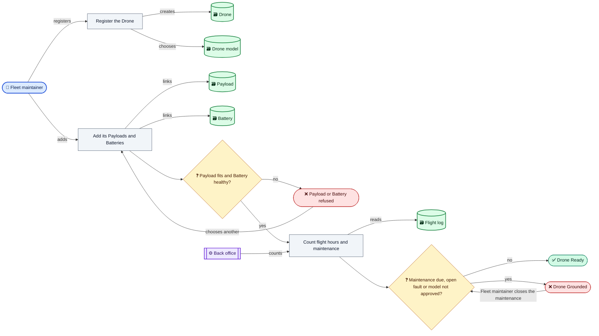

## 🖼️ Screens

One row per state of the flow chart: every action, success and failure node. Click a screen to open it full size. A state with nothing to show reads `➖ No screen: <why>`.

| State | Persona | Entity | Source | Screen |
| --- | --- | --- | --- | --- |
| A1: Register the Drone | [👤 Fleet maintainer](../../glossary.md#per-fleet-maintainer) | [🗃️ Drone](../../glossary.md#ent-drone) [🔄 Drone model: Approved](../../glossary.md#st-drone-model-approved) | ✏️ Mock-up | [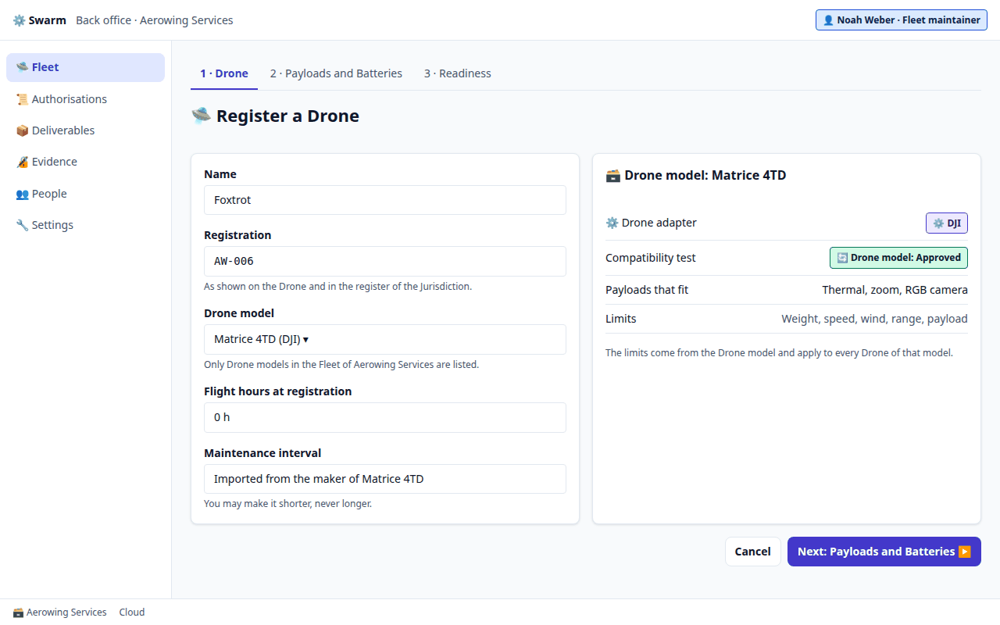](../../screens/UC-007/a1.png) [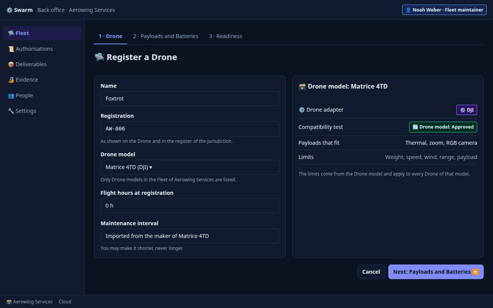](../../screens/UC-007/a1.dark.png) |
| A2: Add its Payloads and Batteries | [👤 Fleet maintainer](../../glossary.md#per-fleet-maintainer) | [🗃️ Payload](../../glossary.md#ent-payload) [🗃️ Battery](../../glossary.md#ent-battery) | ✏️ Mock-up | [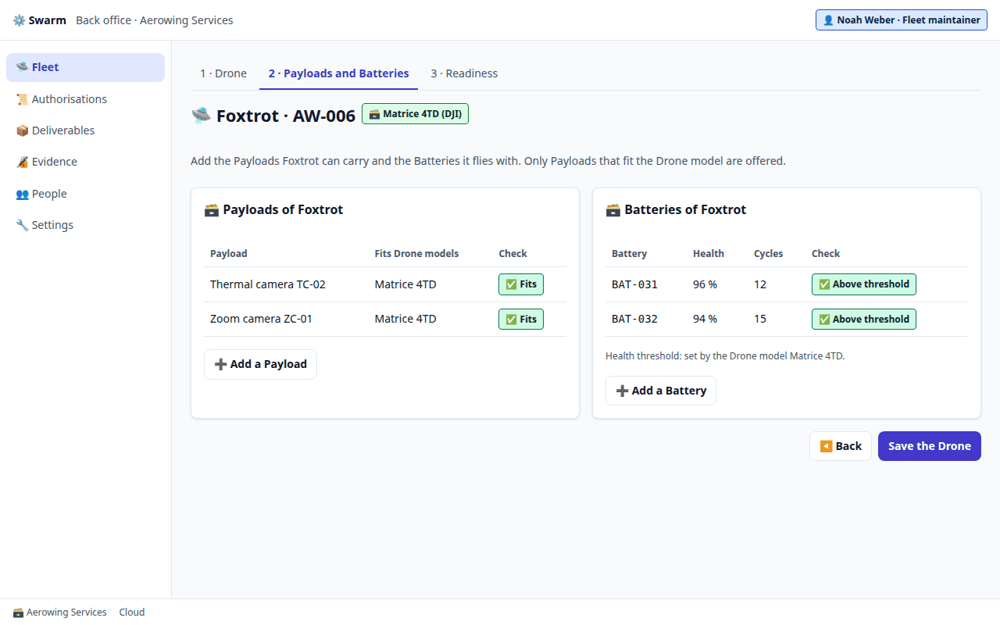](../../screens/UC-007/a2.png) [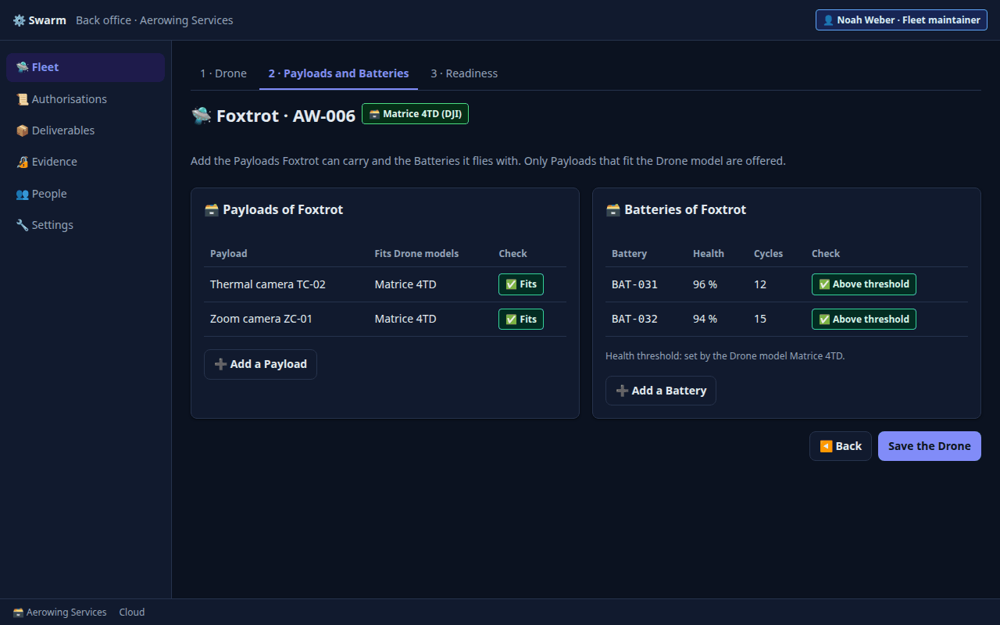](../../screens/UC-007/a2.dark.png) |
| KO1: Payload or Battery refused | [👤 Fleet maintainer](../../glossary.md#per-fleet-maintainer) | [🗃️ Payload](../../glossary.md#ent-payload) [🗃️ Battery](../../glossary.md#ent-battery) | ✏️ Mock-up | [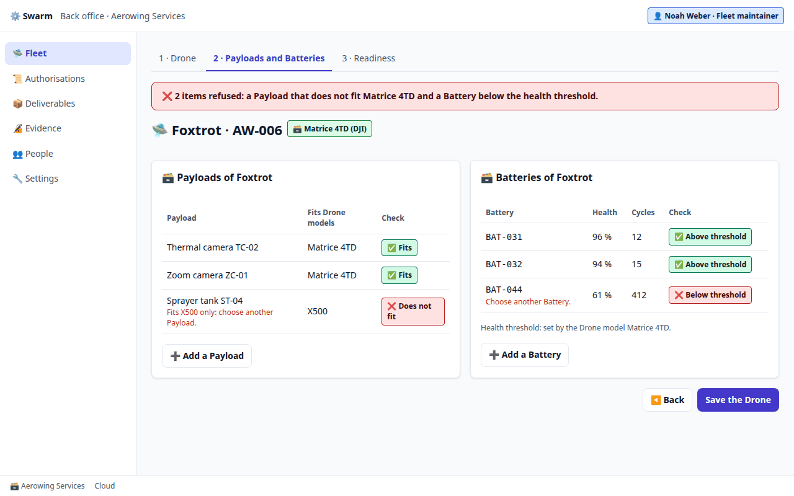](../../screens/UC-007/ko1.png) [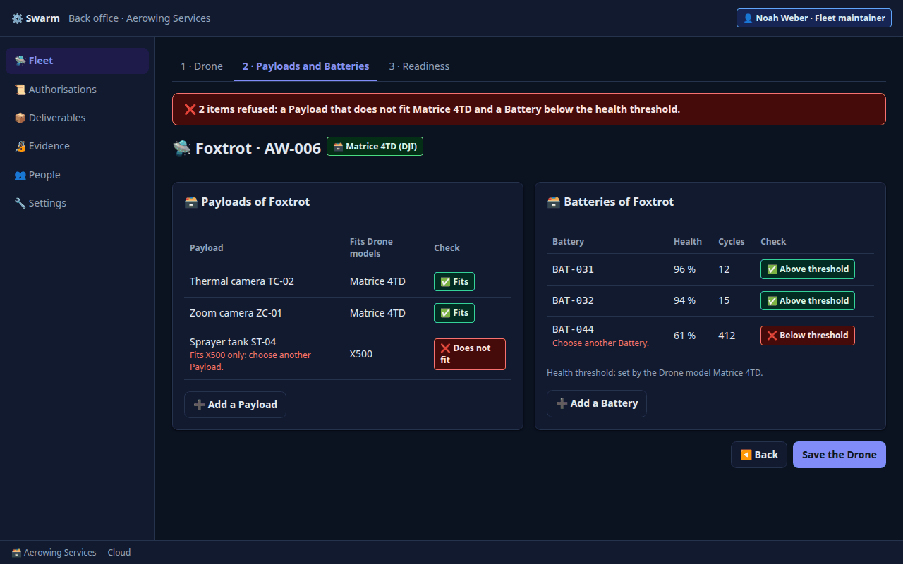](../../screens/UC-007/ko1.dark.png) |
| A3: Count flight hours and maintenance | [👤 Fleet maintainer](../../glossary.md#per-fleet-maintainer) | [🗃️ Flight log](../../glossary.md#ent-flight-log) [🗃️ Drone](../../glossary.md#ent-drone) | ✏️ Mock-up | [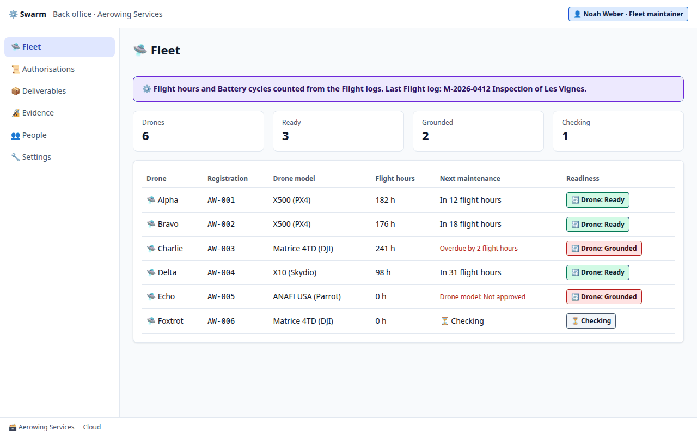](../../screens/UC-007/a3.png) [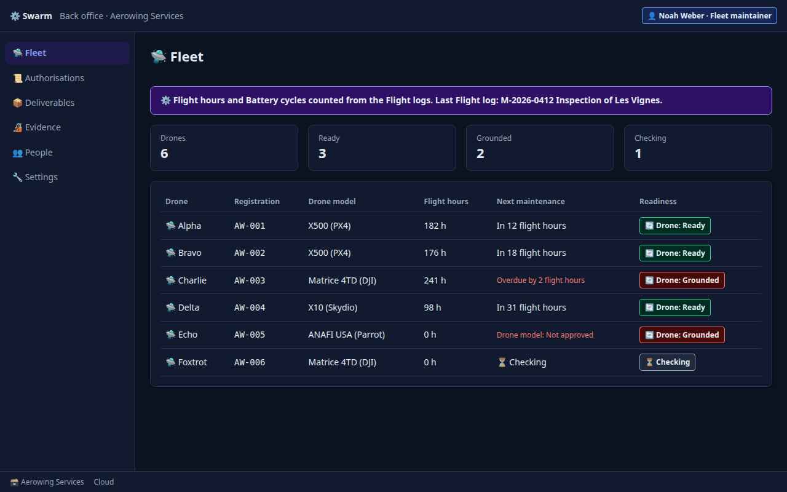](../../screens/UC-007/a3.dark.png) |
| OK: Drone Ready | [👤 Fleet maintainer](../../glossary.md#per-fleet-maintainer) | [🔄 Drone: Ready](../../glossary.md#st-drone-ready) | ✏️ Mock-up | [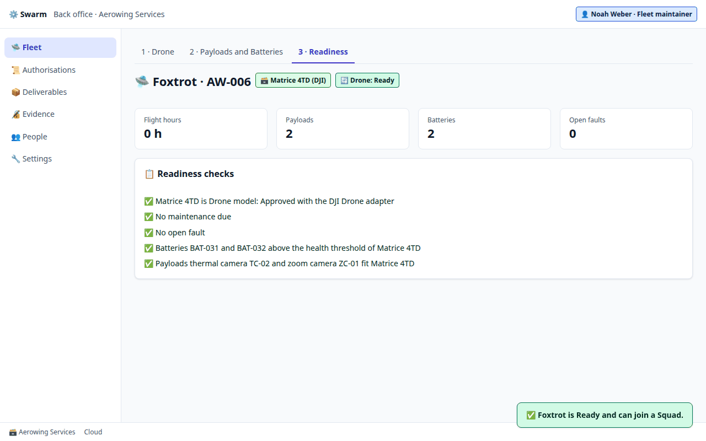](../../screens/UC-007/ok.png) [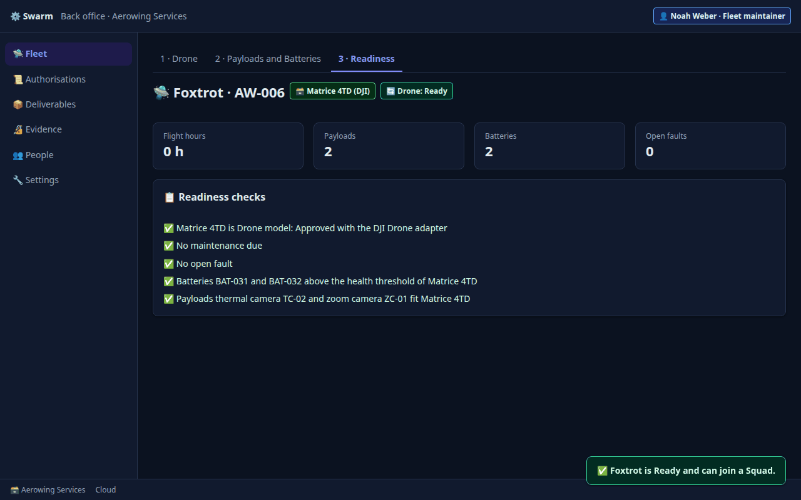](../../screens/UC-007/ok.dark.png) |
| KO2: Drone Grounded | [👤 Fleet maintainer](../../glossary.md#per-fleet-maintainer) | [🔄 Drone: Grounded](../../glossary.md#st-drone-grounded) [🔄 Drone model: Approved](../../glossary.md#st-drone-model-approved) | ✏️ Mock-up | [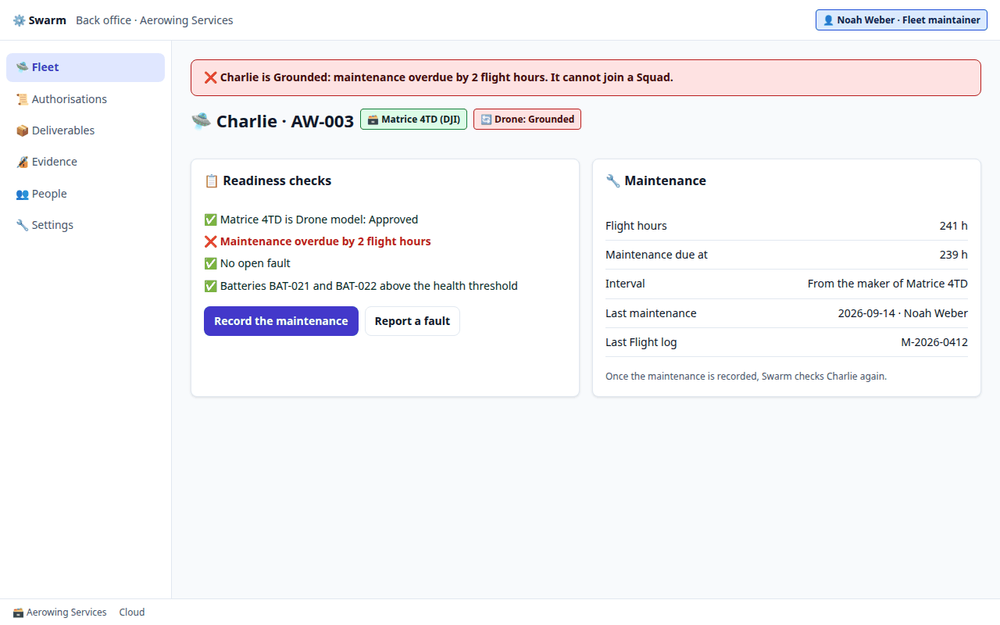](../../screens/UC-007/ko2.png) [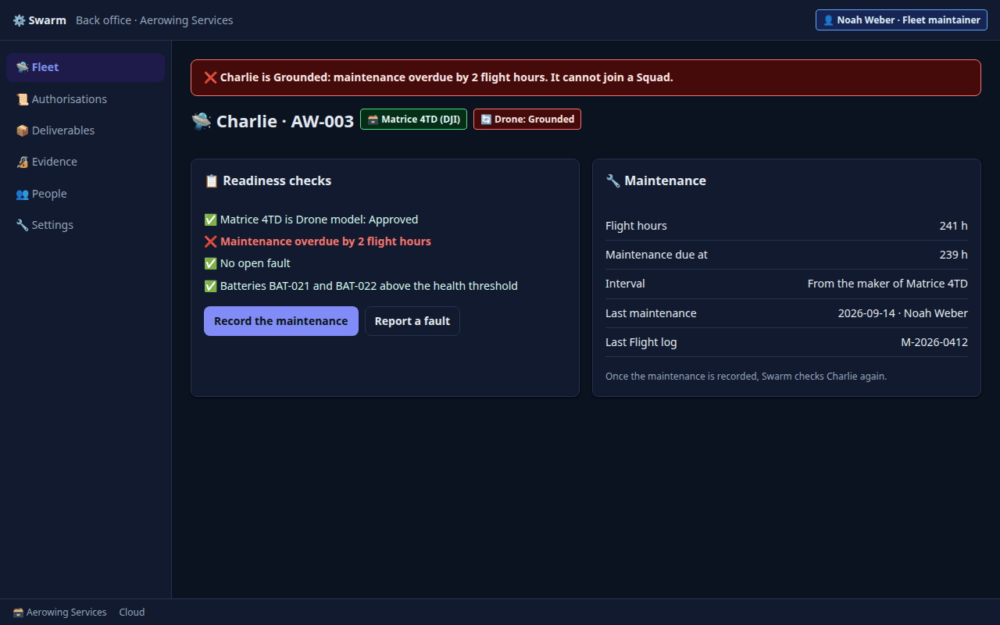](../../screens/UC-007/ko2.dark.png) |

## ↪️ Alternative and error flows

| # | At step | Condition | What happens |
| --- | --- | --- | --- |
| A1 | 2 | The Fleet maintainer adds a Payload that does not fit the Drone model, such as a sprayer tank on a Matrice 4TD | The Back office refuses it and names the Drone models it fits ([📏 BR-022](../business-rules/BR-022-payload-compatibility.md)). The Fleet maintainer chooses another Payload (KO1). |
| A2 | 2 | A Battery's health is below the threshold of the Drone model | The Back office refuses to link it ([📏 BR-011](../business-rules/BR-011-drone-readiness.md)). The Fleet maintainer chooses another Battery (KO1). |
| A3 | 4 | A Drone's maintenance is overdue, such as Charlie (AW-003) overdue by 2 flight hours | The Back office shows it **Drone: Grounded** with the reason, and it cannot join a Squad (KO2). |
| A4 | 4 | The Drone has an open fault, or its Drone model is **Drone model: Not approved** (its compatibility test has not passed, or its firmware changed since) | The Drone is **Drone: Grounded** with the reason (KO2). For a Drone model that is Not approved, see [🎬 UC-014: Connect a new Drone model](UC-014-connect-a-new-drone-model.md). |
| A5 | KO2 | The Fleet maintainer records the maintenance as done, or closes the fault | The Back office checks the Drone again; with nothing left due, it becomes **Drone: Ready** (OK). |

## 📏 Business rules applied

| Rule | Where it applies |
| --- | --- |
| [📏 BR-011: Drone readiness](../business-rules/BR-011-drone-readiness.md) | Steps 1, 2 and 4: maintenance intervals from the maker (shorter only), Battery health, maintenance and faults decide Ready or Grounded |
| [📏 BR-015: Approved Drone models only](../business-rules/BR-015-approved-drone-models-only.md) | Step 4: a Drone of a Drone model that is not approved stays Grounded |
| [📏 BR-022: Payload compatibility](../business-rules/BR-022-payload-compatibility.md) | Step 2: only Payloads that fit the Drone model are linked |

## 🏁 Postconditions

- ✅ **Success:** the Drone is in the Fleet with its Drone model, Payloads and Batteries, its flight hours are counted from the Flight logs, and it shows **Drone: Ready**: it can join a Squad.
- ❌ **Failure:** the Drone shows **Drone: Grounded** with its reason (maintenance due, open fault, Battery below the threshold or Drone model: Not approved) and cannot join a Squad until the Fleet maintainer clears it.

## 🔗 Referenced by

<!-- spec:referenced-by -->
- [📘 FS-005: Fleet and readiness](../features/FS-005-fleet-and-readiness.md)
- [🎬 UC-014: Connect a new Drone model](UC-014-connect-a-new-drone-model.md)
<!-- /spec:referenced-by -->

<!-- spec:nav-bottom -->
---

> [🏠 Index](../../README.md) · [◀️ UC-006: Take manual control or abort](UC-006-take-manual-control-or-abort.md) · 📄 **Page 35 / 120** · [UC-008: Record an Authorisation ▶️](UC-008-record-an-authorisation.md)
<!-- /spec:nav-bottom -->
