# 🎬 UC-008: Record an Authorisation

<!-- spec:nav-top -->
> [🏠 Index](../../README.md) · [◀️ UC-007: Register a Drone and track its readiness](UC-007-register-a-drone-and-track-its-readiness.md) · 📄 **Page 36 / 120** · [UC-009: Process flight data into Deliverables ▶️](UC-009-process-flight-data-into-deliverables.md)
<!-- /spec:nav-top -->

**Status:** 🟢 Approved · **Updated:** 2026-11-18

> [!NOTE]
> The [👤 Mission planner](../../glossary.md#per-mission-planner) records an [🗃️ Authorisation](../../glossary.md#ent-authorisation) of the [🗃️ Operator](../../glossary.md#ent-operator) in the [⚙️ Back office](../../glossary.md#sys-back-office), is warned 30 and 7 days before it ends, and knows which [🗃️ Missions](../../glossary.md#ent-mission) it covers.

<!-- spec:summary -->
## 📑 Summary

1. [👤 Personas and entities](#actors)
2. [🚦 Preconditions](#preconditions)
3. [⚡ Trigger](#trigger)
4. [➡️ Main flow](#main-flow)
5. [🔀 Flow chart](#flowchart)
6. [🖼️ Screens](#screens)
7. [↪️ Alternative and error flows](#alternative-flows)
8. [📏 Business rules applied](#business-rules)
9. [🏁 Postconditions](#postconditions)
10. [🔗 Referenced by](#referenced-by)
<!-- /spec:summary -->

## 👤 Personas and entities

| Name | Kind | Role in this use case |
| --- | --- | --- |
| [👤 Mission planner](../../glossary.md#per-mission-planner) | Persona | Records the Authorisation and its renewal |
| [🗃️ Authorisation](../../glossary.md#ent-authorisation) | Entity | Recorded, Valid, then Expired at its end date |
| [🗃️ Operator](../../glossary.md#ent-operator) | Entity | Holds the Authorisation |
| [🗃️ Mission](../../glossary.md#ent-mission) | Entity | Covered by a Valid Authorisation; goes back to Draft when its Authorisation expires |
| [⚙️ Back office](../../glossary.md#sys-back-office) | System | Stores the Authorisation and its documents, warns before its end date and sends the Missions under an Expired one back to Draft |

## 🚦 Preconditions

1. The Mission planner, Léa Martin, is signed in to the Back office of the Operator Aerowing Services.
2. The aviation authority of the [🔤 Jurisdiction](../../glossary.md#term-jurisdiction) has granted the Authorisation to Aerowing Services.

## ⚡ Trigger

Aerowing Services receives a new Authorisation, or the Back office warns that an Authorisation is about to end.

## ➡️ Main flow

1. The [👤 Mission planner](../../glossary.md#per-mission-planner) opens 📜 Authorisations and records the Authorisation AW-EU-2026-07: its Jurisdiction EU (EASA), its area, its [🔤 Altitude ceiling](../../glossary.md#term-altitude-ceiling), its [🔤 Pilot ratio](../../glossary.md#term-pilot-ratio), whether it covers [🔤 BVLOS](../../glossary.md#term-bvlos), each [🔤 Activity](../../glossary.md#term-activity) it covers and its validity dates. The Mission planner attaches the Authorisation PDF, which is required, and may attach the operations manual and the SORA or ConOps file.
2. The Back office checks that every required field and the Authorisation PDF are there, then saves it for Aerowing Services. It is in force today: the Back office shows **Authorisation: Valid** and lists the Missions it covers, such as M-2026-0413 Spraying of North field ([📏 BR-010](../business-rules/BR-010-valid-authorisation-for-the-jurisdiction.md)).
3. From now on, a Squad flown under this Authorisation may not have more Drones per Pilot than its Pilot ratio ([📏 BR-004](../business-rules/BR-004-pilot-ratio.md)).
4. 30 days and again 7 days before the end date of an Authorisation, the Back office warns the Mission planner and names the Missions it covers.
5. The Mission planner records the renewal before the end date (back to step 1), and the Missions keep their Valid Authorisation.

## 🔀 Flow chart

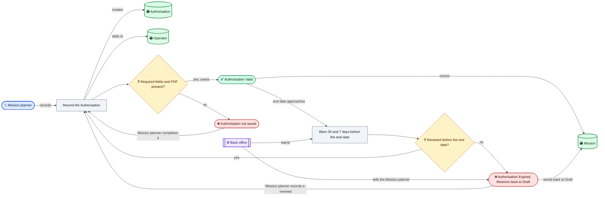

## 🖼️ Screens

One row per state of the flow chart: every action, success and failure node. Click a screen to open it full size. A state with nothing to show reads `➖ No screen: <why>`.

| State | Persona | Entity | Source | Screen |
| --- | --- | --- | --- | --- |
| A1: Record the Authorisation | [👤 Mission planner](../../glossary.md#per-mission-planner) | [🗃️ Authorisation](../../glossary.md#ent-authorisation) [🗃️ Operator](../../glossary.md#ent-operator) | ✏️ Mock-up | [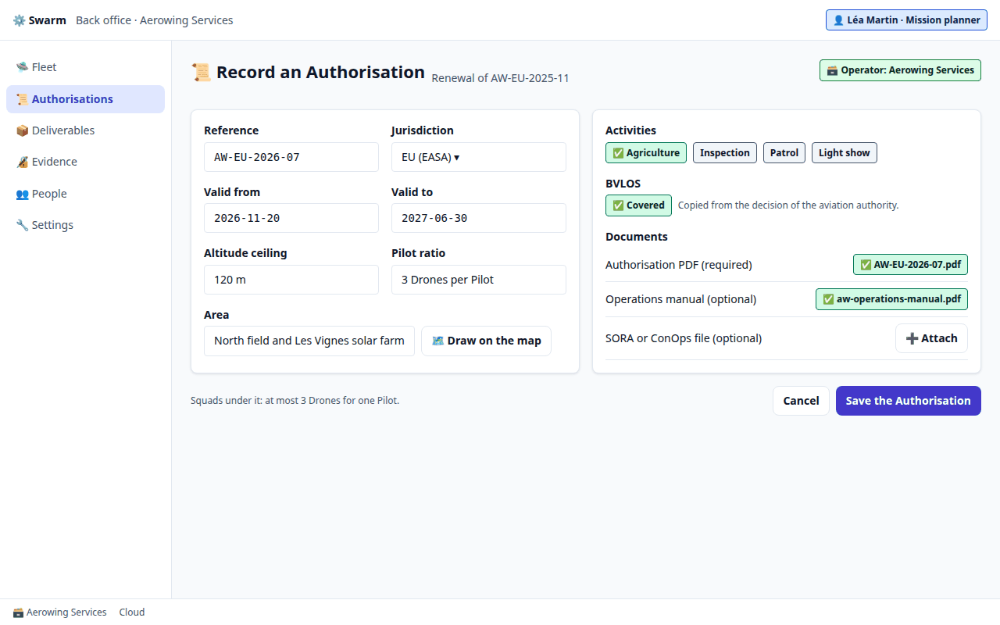](../../screens/UC-008/a1.png) [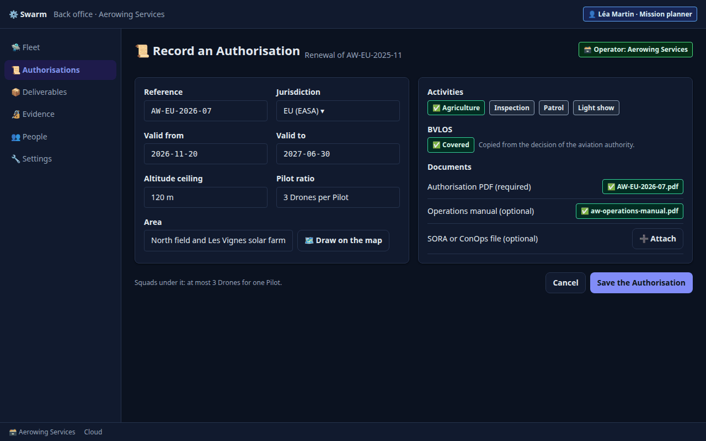](../../screens/UC-008/a1.dark.png) |
| KO1: Authorisation not saved | [👤 Mission planner](../../glossary.md#per-mission-planner) | [🗃️ Authorisation](../../glossary.md#ent-authorisation) | ✏️ Mock-up | [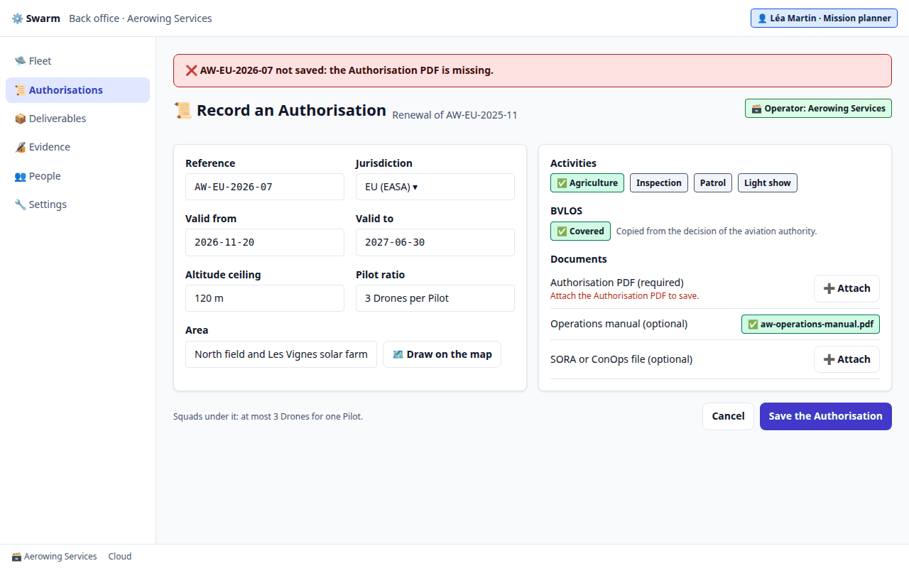](../../screens/UC-008/ko1.png) [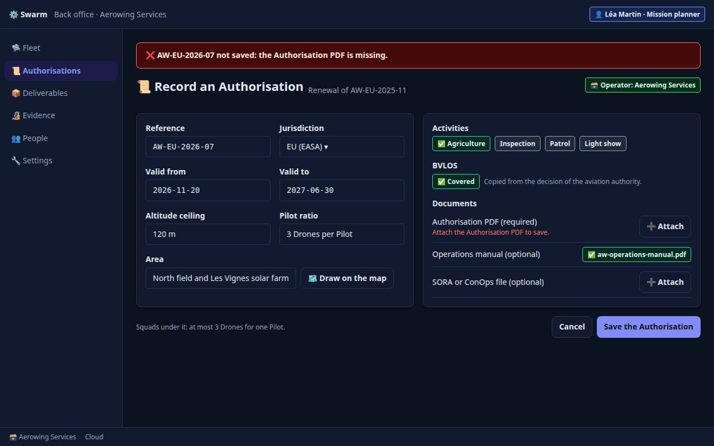](../../screens/UC-008/ko1.dark.png) |
| OK: Authorisation Valid | [👤 Mission planner](../../glossary.md#per-mission-planner) | [🔄 Authorisation: Valid](../../glossary.md#st-authorisation-valid) [🗃️ Mission](../../glossary.md#ent-mission) | ✏️ Mock-up | [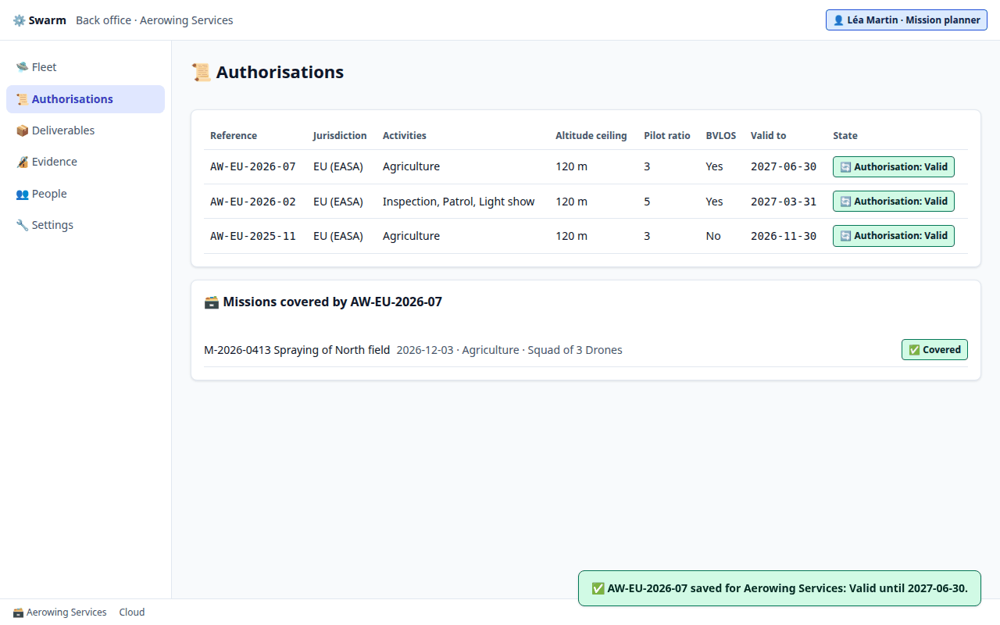](../../screens/UC-008/ok.png) [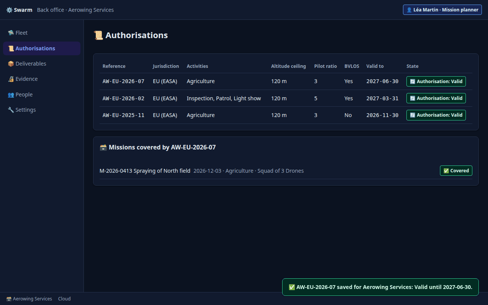](../../screens/UC-008/ok.dark.png) |
| A2: Warn 30 and 7 days before the end date | [👤 Mission planner](../../glossary.md#per-mission-planner) | [🔄 Authorisation: Valid](../../glossary.md#st-authorisation-valid) | ✏️ Mock-up | [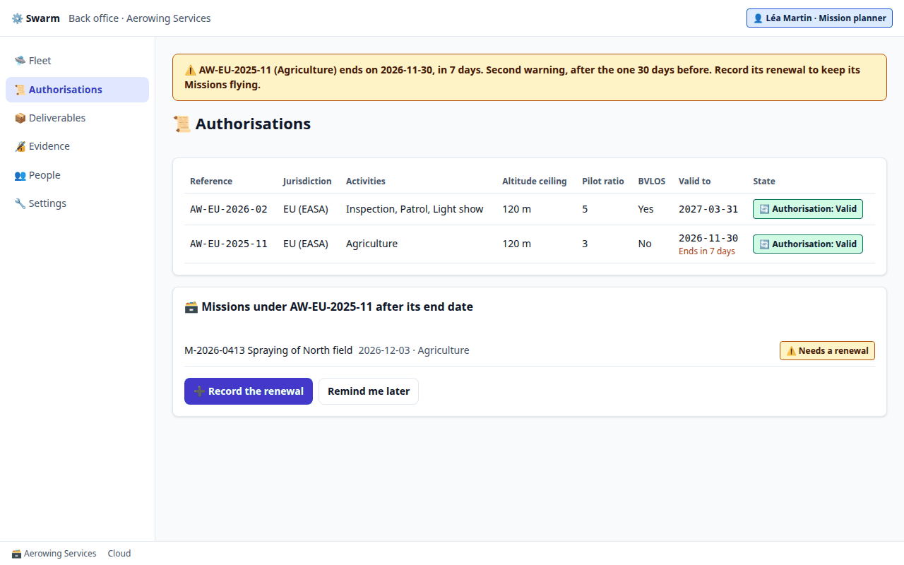](../../screens/UC-008/a2.png) [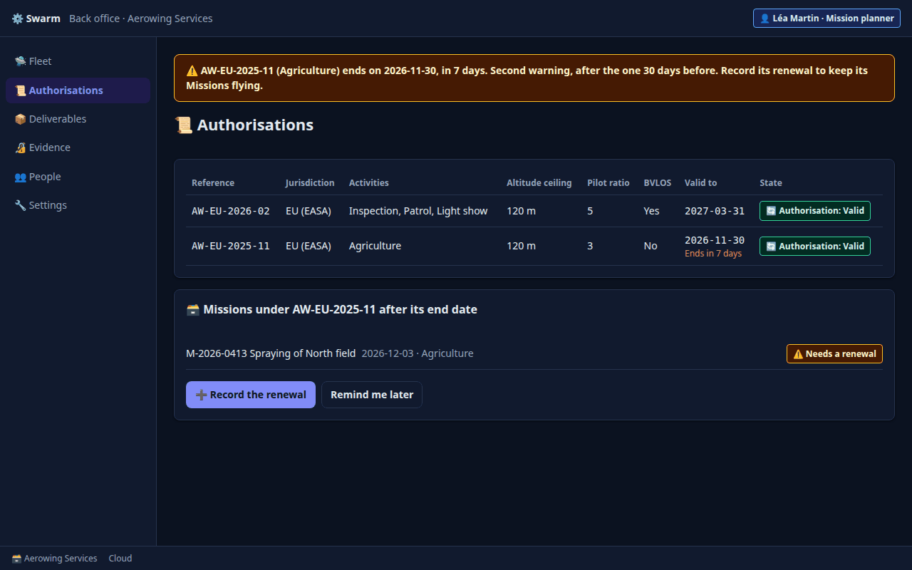](../../screens/UC-008/a2.dark.png) |
| KO2: Authorisation Expired, Missions back to Draft | [👤 Mission planner](../../glossary.md#per-mission-planner) | [🔄 Authorisation: Expired](../../glossary.md#st-authorisation-expired) [🔄 Mission: Draft](../../glossary.md#st-mission-draft) | ✏️ Mock-up | [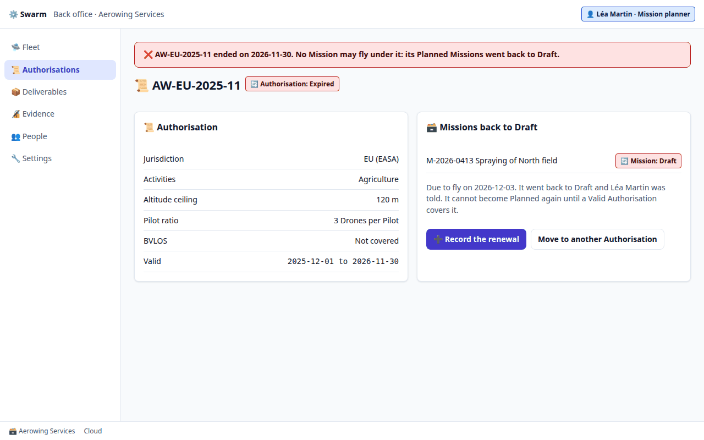](../../screens/UC-008/ko2.png) [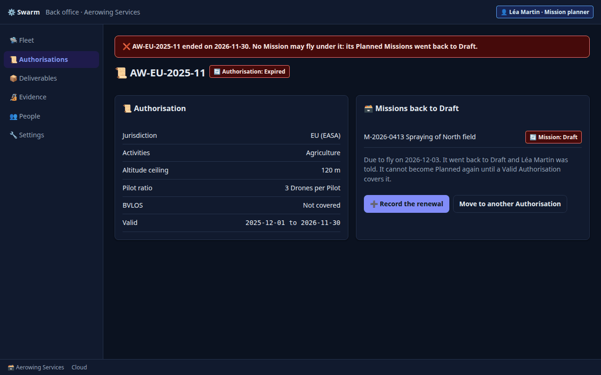](../../screens/UC-008/ko2.dark.png) |

## ↪️ Alternative and error flows

| # | At step | Condition | What happens |
| --- | --- | --- | --- |
| A1 | 2 | A required field or the Authorisation PDF is missing | The Back office does not save the Authorisation and names what is missing. The Mission planner completes it (KO1). |
| A2 | 5 | The Mission planner does not record a renewal, and the end date of AW-EU-2025-11 (2026-11-30) passes | The Back office shows **Authorisation: Expired**. Every Planned Mission under it, such as M-2026-0413 Spraying of North field on 2026-12-03, goes back to **Mission: Draft**, and the Mission planner is told ([📏 BR-010](../business-rules/BR-010-valid-authorisation-for-the-jurisdiction.md)). The Mission planner records a renewal (back to step 1) or moves the Missions under another Valid Authorisation (KO2). |
| A3 | 2 | A Mission is outside the area of the Authorisation, above its Altitude ceiling, of another Activity, or BVLOS when the Authorisation does not cover BVLOS | The Authorisation stays Valid but does not cover that Mission: the rule check names the missing condition ([📏 BR-010](../business-rules/BR-010-valid-authorisation-for-the-jurisdiction.md), see [🎬 UC-001: Design a Mission](UC-001-design-a-mission.md)). |
| A4 | 3 | A Squad has more Drones than the Pilot ratio allows for one Pilot | The launch is refused ([📏 BR-004](../business-rules/BR-004-pilot-ratio.md), see [🎬 UC-003: Run the Pre-flight check and launch](UC-003-run-the-pre-flight-check-and-launch.md)). |

## 📏 Business rules applied

| Rule | Where it applies |
| --- | --- |
| [📏 BR-010: Valid Authorisation for the Jurisdiction](../business-rules/BR-010-valid-authorisation-for-the-jurisdiction.md) | Steps 2 and 5: only a Valid Authorisation that covers a Mission lets it fly; when it expires, its Planned Missions go back to Draft |
| [📏 BR-004: Pilot ratio](../business-rules/BR-004-pilot-ratio.md) | Step 3: the Pilot ratio of the Authorisation limits the Drones per Pilot |

## 🏁 Postconditions

- ✅ **Success:** the Authorisation is stored for Aerowing Services with its PDF, its Jurisdiction, area, Altitude ceiling, Pilot ratio, BVLOS, Activities and validity dates. It shows **Authorisation: Valid** and covers its Missions.
- ❌ **Failure:** without its PDF or a required field, the Authorisation is not saved. Past its end date, it shows **Authorisation: Expired**: no Mission may fly under it, its Planned Missions are back to **Mission: Draft**, and the Mission planner is told and records a renewal.

## 🔗 Referenced by

<!-- spec:referenced-by -->
- [📘 FS-006: Authorisations and compliance](../features/FS-006-authorisations-and-compliance.md)
- [🎬 UC-029: Create an Operator](UC-029-create-an-operator.md)
<!-- /spec:referenced-by -->

<!-- spec:nav-bottom -->
---

> [🏠 Index](../../README.md) · [◀️ UC-007: Register a Drone and track its readiness](UC-007-register-a-drone-and-track-its-readiness.md) · 📄 **Page 36 / 120** · [UC-009: Process flight data into Deliverables ▶️](UC-009-process-flight-data-into-deliverables.md)
<!-- /spec:nav-bottom -->
