# 🎬 UC-009: Process flight data into Deliverables

<!-- spec:nav-top -->
> [🏠 Index](../../README.md) · [◀️ UC-008: Record an Authorisation](UC-008-record-an-authorisation.md) · 📄 **Page 37 / 120** · [UC-010: Order a Mission in the Client portal ▶️](UC-010-order-a-mission-in-the-client-portal.md)
<!-- /spec:nav-top -->

**Status:** 🟢 Approved · **Updated:** 2026-11-18

> [!NOTE]
> After a [🗃️ Mission](../../glossary.md#ent-mission), the [⚙️ Back office](../../glossary.md#sys-back-office) turns the data of each [🗃️ Drone](../../glossary.md#ent-drone) into [🗃️ Deliverables](../../glossary.md#ent-deliverable), and the [👤 Mission planner](../../glossary.md#per-mission-planner) reviews and publishes them to the [👤 Client](../../glossary.md#per-client), each with its [🗃️ Evidence record](../../glossary.md#ent-evidence-record).

<!-- spec:summary -->
## 📑 Summary

1. [👤 Personas and entities](#actors)
2. [🚦 Preconditions](#preconditions)
3. [⚡ Trigger](#trigger)
4. [➡️ Main flow](#main-flow)
5. [🔀 Flow chart](#flowchart)
6. [🖼️ Screens](#screens)
7. [↪️ Alternative and error flows](#alternative-flows)
8. [📏 Business rules applied](#business-rules)
9. [🏁 Postconditions](#postconditions)
10. [🔗 Referenced by](#referenced-by)
<!-- /spec:summary -->

## 👤 Personas and entities

| Name | Kind | Role in this use case |
| --- | --- | --- |
| [👤 Mission planner](../../glossary.md#per-mission-planner) | Persona | Reviews the Deliverables and publishes them, or decides a re-fly |
| [🗃️ Mission](../../glossary.md#ent-mission) | Entity | Completed: its data is processed |
| [🗃️ Flight log](../../glossary.md#ent-flight-log) | Entity | Gives the position and time of every file |
| [🗃️ Drone](../../glossary.md#ent-drone) | Entity | Each file is tagged with the Drone that took it |
| [🗃️ Payload](../../glossary.md#ent-payload) | Entity | Each file is tagged with the Payload that took it |
| [🗃️ Deliverable](../../glossary.md#ent-deliverable) | Entity | Processing, then In review, then Published |
| [🗃️ Evidence record](../../glossary.md#ent-evidence-record) | Entity | Created for each published Deliverable |
| [⚙️ Back office](../../glossary.md#sys-back-office) | System | Collects, tags, checks and processes the data, in the cloud or on the Operator's own GPU server on premises |

## 🚦 Preconditions

1. M-2026-0412 Inspection of Les Vignes is **Mission: Completed**: every Drone of its [🗃️ Squad](../../glossary.md#ent-squad) has landed.
2. The Mission planner, Léa Martin, is signed in to the Back office of the [🗃️ Operator](../../glossary.md#ent-operator) Aerowing Services.

## ⚡ Trigger

The data of the Drones of a Completed Mission reaches the Back office.

## ➡️ Main flow

1. The Back office collects the images, video and [🗃️ Flight log](../../glossary.md#ent-flight-log) of each Drone of M-2026-0412: Alpha (thermal camera), Bravo (RGB camera) and Charlie (zoom camera). It tags every file with its Drone, its [🗃️ Payload](../../glossary.md#ent-payload), its position and its time.
2. The Back office runs the [🔤 Quality checks](../../glossary.md#term-quality-check) of the [🔤 Inspection](../../glossary.md#term-inspection): image overlap, sharpness, thermal calibration, gaps.
3. The checks pass. The Back office builds the Deliverables of the Inspection: an orthomosaic, a 3D model and a defect list. Each shows **Deliverable: Processing** with its progress. Processing runs in the cloud for Aerowing Services; for an Operator on premises, it runs on its own GPU server.
4. Once built, each Deliverable shows **Deliverable: In review**. The [👤 Mission planner](../../glossary.md#per-mission-planner) opens 📦 Deliverables and reviews the orthomosaic, the 3D model and the defect list. The defect list holds the Defects a person has confirmed (see [🎬 UC-020: Review the Defects of an Inspection](UC-020-review-the-defects-of-an-inspection.md)).
5. The Mission planner publishes them to Helio Energy. Each Deliverable shows **Deliverable: Published** and is visible to the Client in the Client portal, and only to that Client of Aerowing Services ([📏 BR-008](../business-rules/BR-008-operator-isolation.md)).
6. The Back office creates the Evidence record of each published Deliverable, signed and chained to the previous one, and anchors it as the Operator chose ([📏 BR-009](../business-rules/BR-009-evidence-integrity.md)).

## 🔀 Flow chart

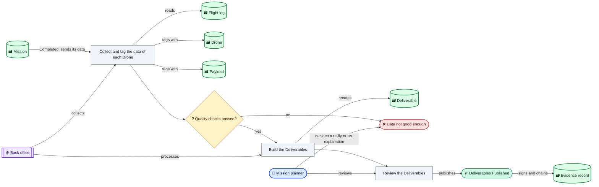

## 🖼️ Screens

One row per state of the flow chart: every action, success and failure node. Click a screen to open it full size. A state with nothing to show reads `➖ No screen: <why>`.

| State | Persona | Entity | Source | Screen |
| --- | --- | --- | --- | --- |
| A1: Collect and tag the data of each Drone | [👤 Mission planner](../../glossary.md#per-mission-planner) | [🔄 Mission: Completed](../../glossary.md#st-mission-completed) [🗃️ Flight log](../../glossary.md#ent-flight-log) | ✏️ Mock-up | [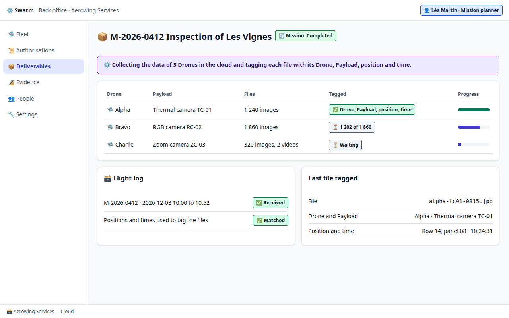](../../screens/UC-009/a1.png) [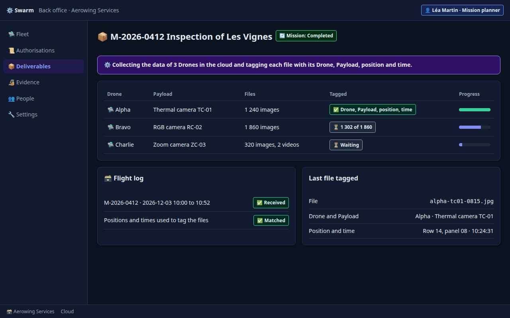](../../screens/UC-009/a1.dark.png) |
| KO: Data not good enough | [👤 Mission planner](../../glossary.md#per-mission-planner) | [🔄 Mission: Completed](../../glossary.md#st-mission-completed) | ✏️ Mock-up | [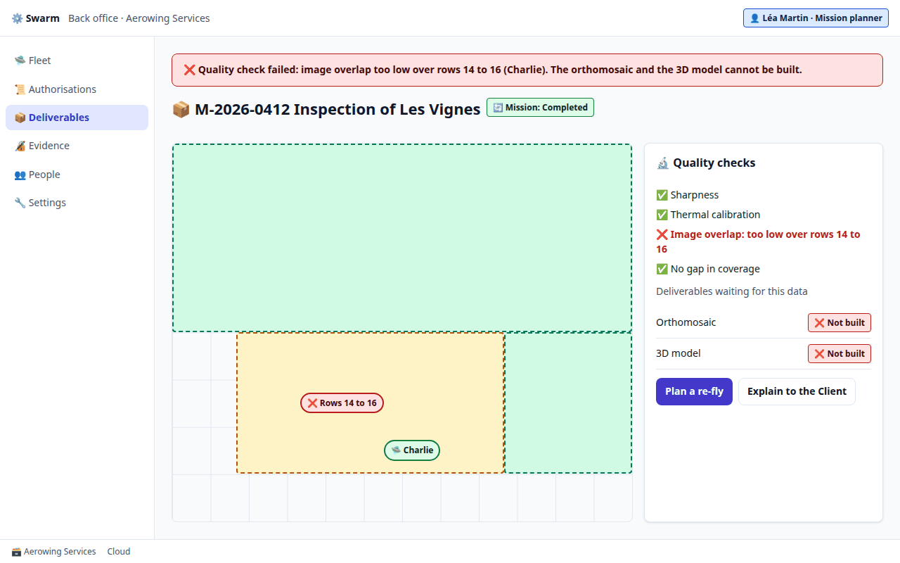](../../screens/UC-009/ko.png) [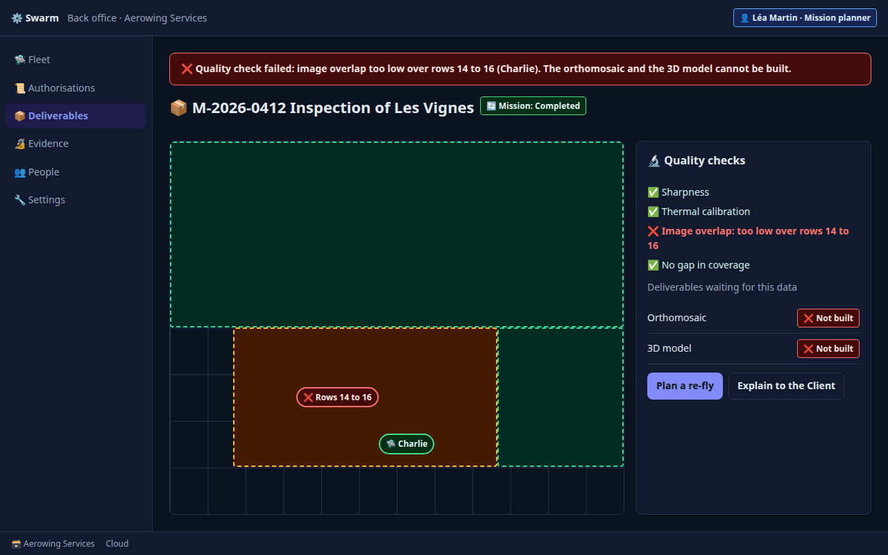](../../screens/UC-009/ko.dark.png) |
| A2: Build the Deliverables | [👤 Mission planner](../../glossary.md#per-mission-planner) | [🔄 Deliverable: Processing](../../glossary.md#st-deliverable-processing) | ✏️ Mock-up | [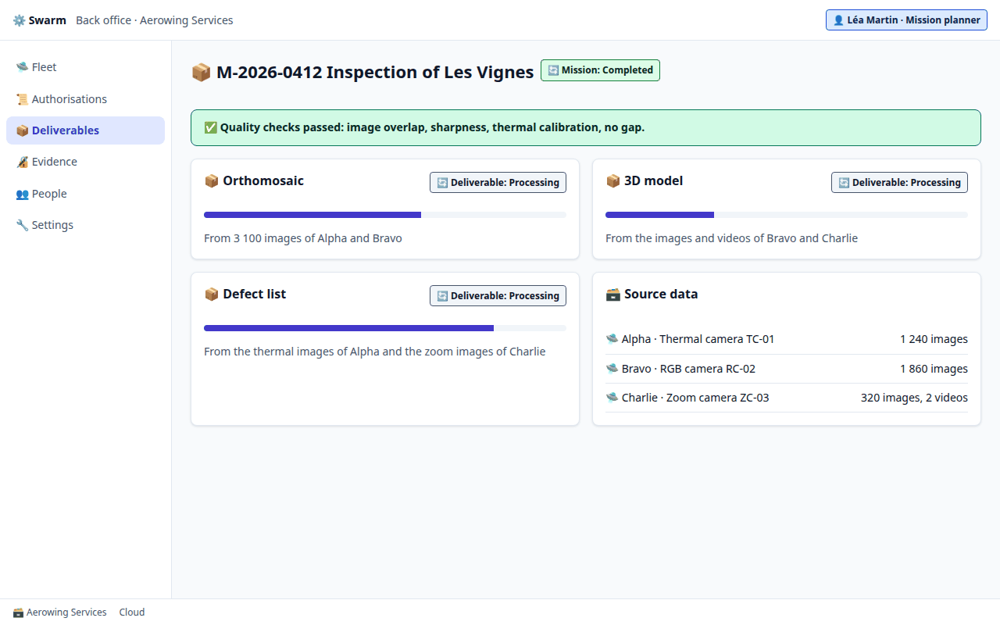](../../screens/UC-009/a2.png) [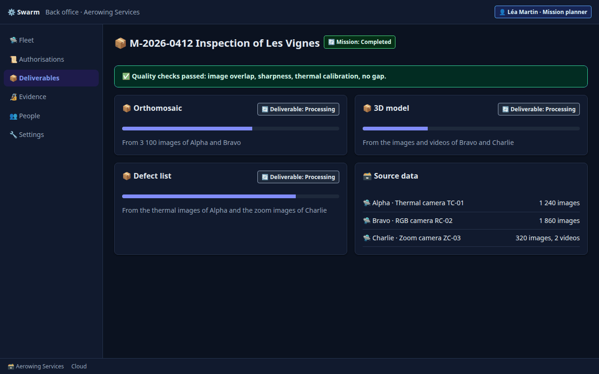](../../screens/UC-009/a2.dark.png) |
| A3: Review the Deliverables | [👤 Mission planner](../../glossary.md#per-mission-planner) | [🔄 Deliverable: In review](../../glossary.md#st-deliverable-in-review) | ✏️ Mock-up | [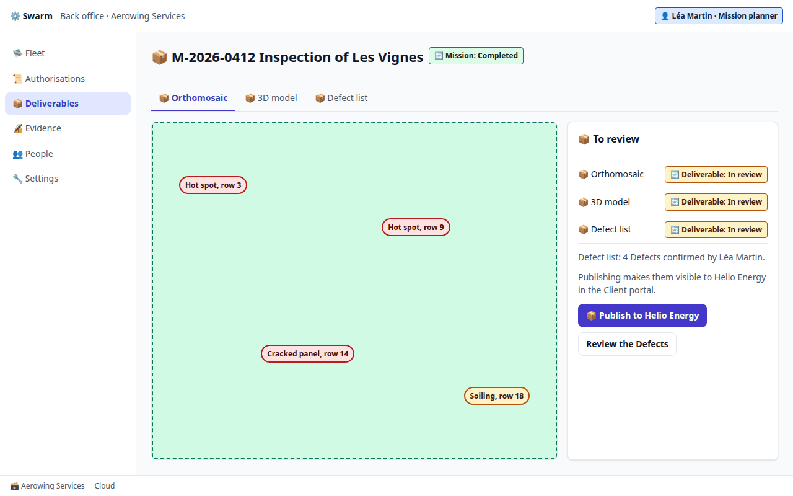](../../screens/UC-009/a3.png) [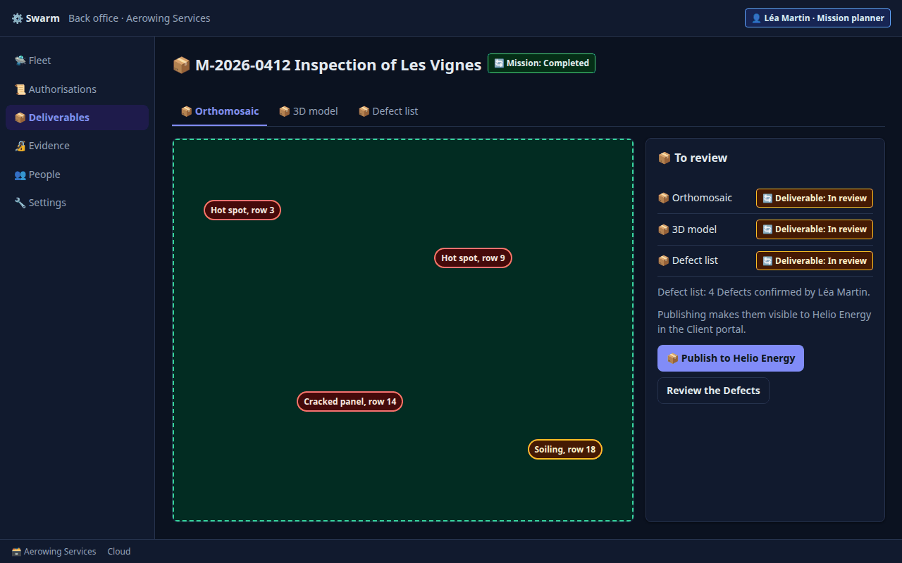](../../screens/UC-009/a3.dark.png) |
| OK: Deliverables Published | [👤 Mission planner](../../glossary.md#per-mission-planner) | [🔄 Deliverable: Published](../../glossary.md#st-deliverable-published) [🗃️ Evidence record](../../glossary.md#ent-evidence-record) | ✏️ Mock-up | [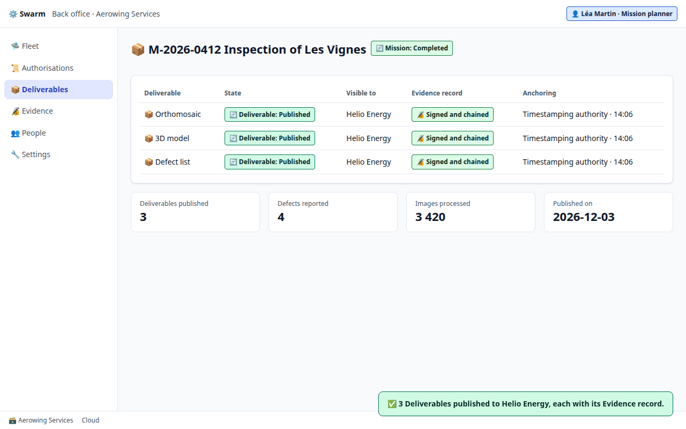](../../screens/UC-009/ok.png) [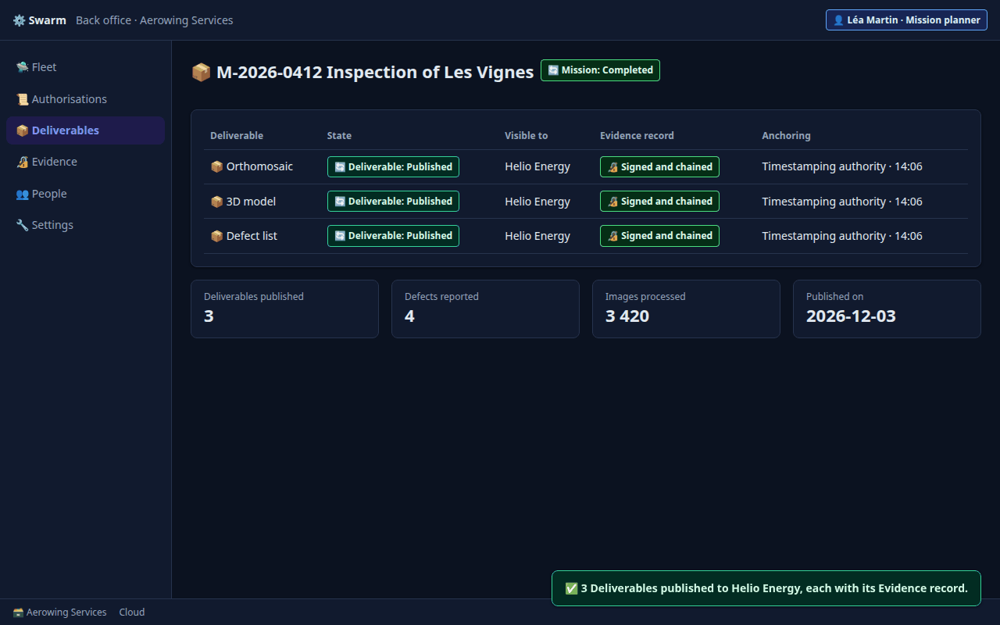](../../screens/UC-009/ok.dark.png) |

## ↪️ Alternative and error flows

| # | At step | Condition | What happens |
| --- | --- | --- | --- |
| A1 | 2 | A Quality check fails, such as an image overlap too low over part of Les Vignes | The Back office does not build the Deliverables that need that data and names the check, the Drone and the part of the Site (KO). The Mission planner decides a re-fly or an explanation to the Client (see [🎬 UC-027: Debrief a Mission](UC-027-debrief-a-mission.md)). |
| A2 | 4 | The Mission planner finds a Defect that is wrong in the defect list | The Deliverable stays **Deliverable: In review**: the Mission planner reviews the Defects first ([🎬 UC-020: Review the Defects of an Inspection](UC-020-review-the-defects-of-an-inspection.md)), then publishes. |
| A3 | 6 | The Operator chose no Anchoring | The Evidence record is signed and chained, not anchored ([📏 BR-009](../business-rules/BR-009-evidence-integrity.md)). |

## 📏 Business rules applied

| Rule | Where it applies |
| --- | --- |
| [📏 BR-009: Evidence integrity](../business-rules/BR-009-evidence-integrity.md) | Step 6: each published Deliverable gets its Evidence record, signed, chained and anchored |
| [📏 BR-008: Operator isolation](../business-rules/BR-008-operator-isolation.md) | Steps 1 to 5: the data and the Deliverables stay inside Aerowing Services |

## 🏁 Postconditions

- ✅ **Success:** the orthomosaic, the 3D model and the defect list of M-2026-0412 show **Deliverable: Published**. Helio Energy sees them in the Client portal, and each has its Evidence record.
- ❌ **Failure:** a Quality check failed: the Deliverables that need the missing data are not built, and the Mission planner sees which check failed, on which Drone and where, to decide a re-fly or an explanation to the Client.

## 🔗 Referenced by

<!-- spec:referenced-by -->
- [📘 FS-007: Data processing and Deliverables](../features/FS-007-data-processing-and-deliverables.md)
- [🎬 UC-012: Verify the Evidence record of a flight](UC-012-verify-the-evidence-record-of-a-flight.md)
- [🎬 UC-020: Review the Defects of an Inspection](UC-020-review-the-defects-of-an-inspection.md)
<!-- /spec:referenced-by -->

<!-- spec:nav-bottom -->
---

> [🏠 Index](../../README.md) · [◀️ UC-008: Record an Authorisation](UC-008-record-an-authorisation.md) · 📄 **Page 37 / 120** · [UC-010: Order a Mission in the Client portal ▶️](UC-010-order-a-mission-in-the-client-portal.md)
<!-- /spec:nav-bottom -->
