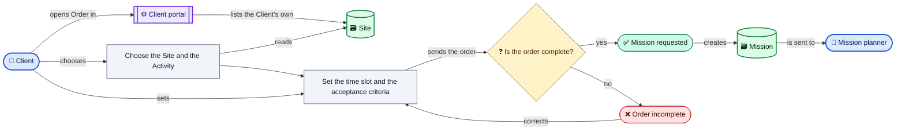
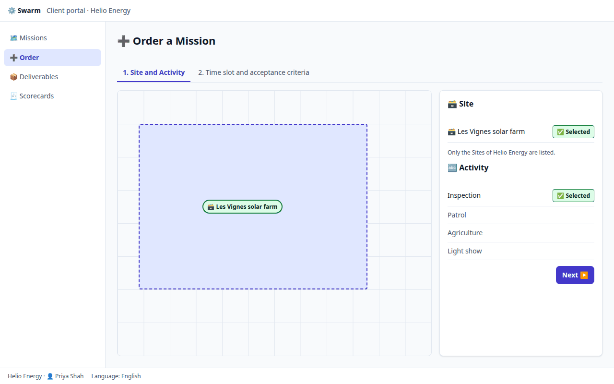
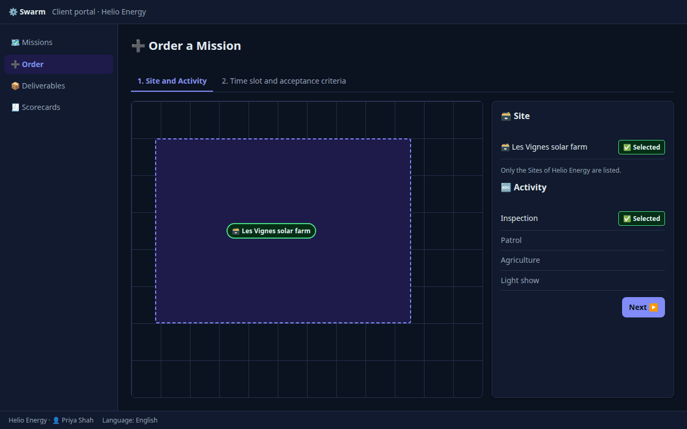
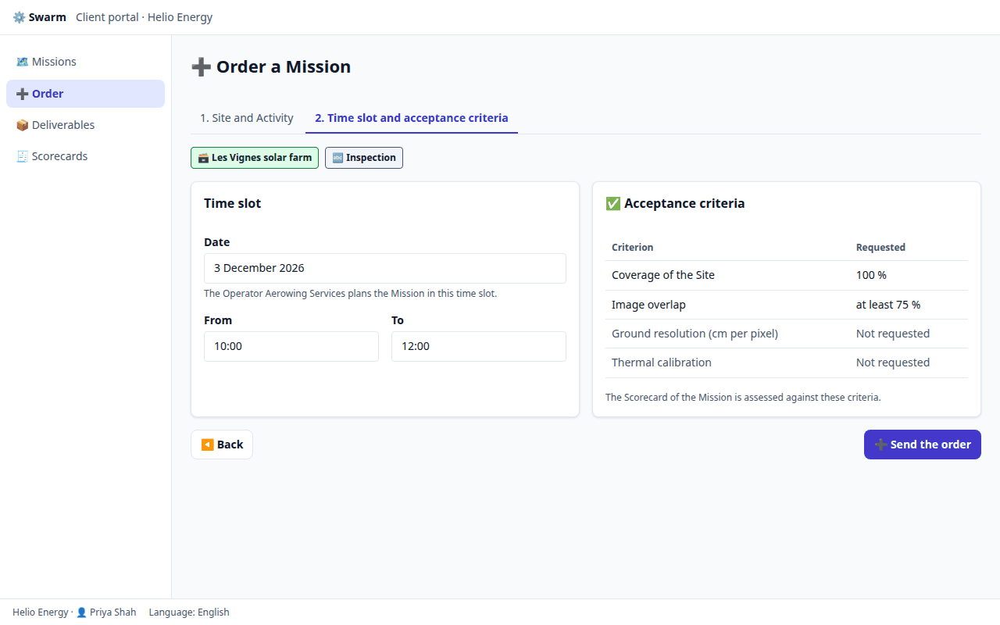
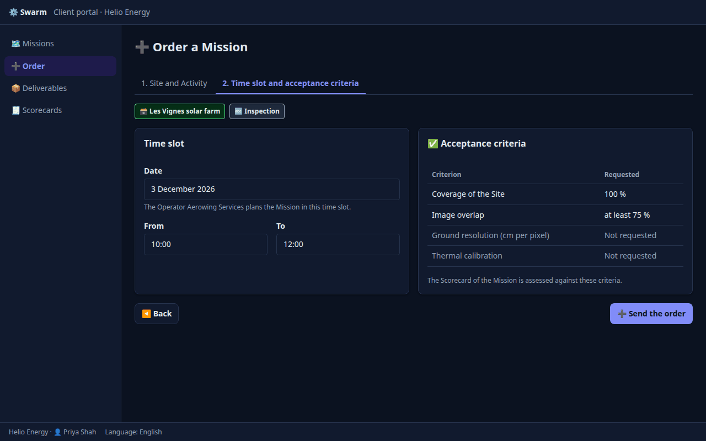
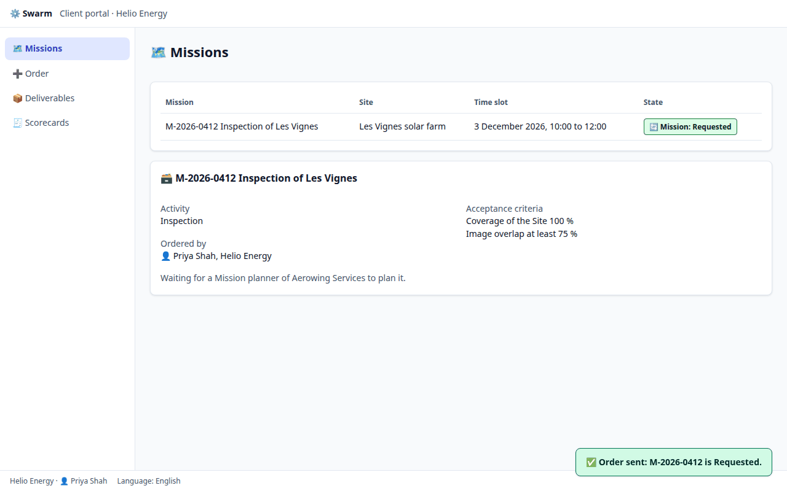
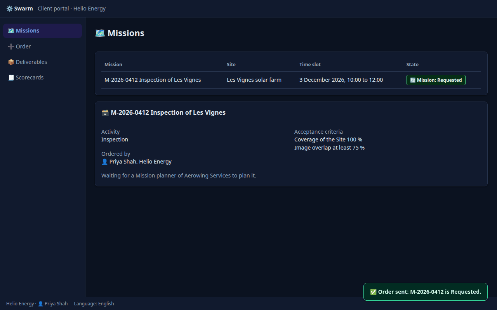
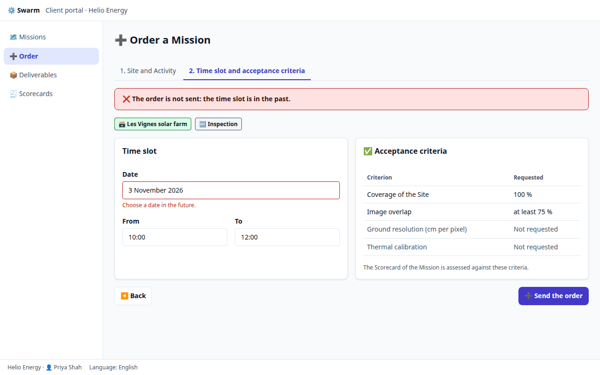
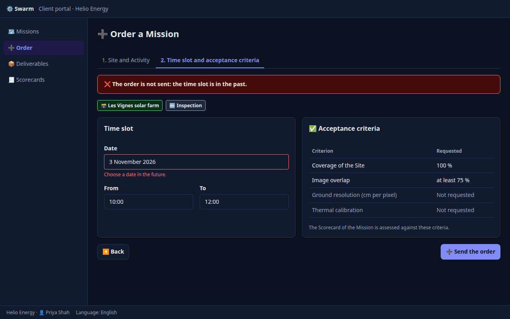

# 🎬 UC-010: Order a Mission in the Client portal

<!-- spec:nav-top -->
> [🏠 Index](../../README.md) · [◀️ UC-009: Process flight data into Deliverables](UC-009-process-flight-data-into-deliverables.md) · 📄 **Page 36 / 108** · [UC-011: Follow a Mission and download its Deliverables ▶️](UC-011-follow-a-mission-and-download-its-deliverables.md)
<!-- /spec:nav-top -->

**Status:** 🟢 Approved · **Updated:** 2026-11-18

> [!NOTE]
> The [👤 Client](../../glossary.md#per-client) orders a [🗃️ Mission](../../glossary.md#ent-mission) for one of its [🗃️ Sites](../../glossary.md#ent-site) in the [⚙️ Client portal](../../glossary.md#sys-client-portal), with a time slot and acceptance criteria, and gets a Mission: Requested that the Operator plans.

<!-- spec:summary -->
## 📑 Summary

1. [👤 Personas and entities](#actors)
2. [🚦 Preconditions](#preconditions)
3. [⚡ Trigger](#trigger)
4. [➡️ Main flow](#main-flow)
5. [🔀 Flow chart](#flowchart)
6. [🖼️ Screens](#screens)
7. [↪️ Alternative and error flows](#alternative-flows)
8. [📏 Business rules applied](#business-rules)
9. [🏁 Postconditions](#postconditions)
10. [🔗 Referenced by](#referenced-by)
<!-- /spec:summary -->

## 👤 Personas and entities

| Name | Kind | Role in this use case |
| --- | --- | --- |
| [👤 Client](../../glossary.md#per-client) | Persona | Priya Shah of Helio Energy: orders the Mission |
| [👤 Mission planner](../../glossary.md#per-mission-planner) | Persona | Receives the request, to plan it later |
| [🗃️ Site](../../glossary.md#ent-site) | Entity | Les Vignes solar farm, one of the Client's own Sites |
| [🗃️ Mission](../../glossary.md#ent-mission) | Entity | Created by the order: M-2026-0412 Inspection of Les Vignes, Mission: Requested |
| [⚙️ Client portal](../../glossary.md#sys-client-portal) | System | Takes the order and checks it is complete |

## 🚦 Preconditions

1. The Client Priya Shah has access to the Client portal of the [🗃️ Operator](../../glossary.md#ent-operator) Aerowing Services, for the Client account Helio Energy ([🎬 UC-015: Invite a Client to the Client portal](UC-015-invite-a-client-to-the-client-portal.md)).
2. The Site Les Vignes solar farm is recorded for Helio Energy.

## ⚡ Trigger

The Client opens **➕ Order** in the Client portal.

## ➡️ Main flow

1. The Client chooses the Site among the Sites of Helio Energy only ([📏 BR-016](../business-rules/BR-016-clients-see-only-their-own-missions.md)), and the [🔤 Activity](../../glossary.md#term-activity) [🔤 Inspection](../../glossary.md#term-inspection).
2. The Client sets the time slot, 3 December 2026 from 10:00 to 12:00, and chooses the acceptance criteria among those of an Inspection ([📘 FS-022: Debrief and assessment](../features/FS-022-debrief-and-assessment.md#details)): coverage %, image overlap %, ground resolution (cm per pixel) and thermal calibration. Priya Shah asks for 100 % of the Site covered and an image overlap of at least 75 %, and leaves the other two out.
3. The Client sends the order. The Client portal checks that the Site, the Activity, the time slot and the acceptance criteria are filled in and that the time slot is in the future.
4. The Client portal creates the Mission M-2026-0412 Inspection of Les Vignes in the state Mission: Requested, for the Operator only ([📏 BR-016](../business-rules/BR-016-clients-see-only-their-own-missions.md)).
5. The [👤 Mission planner](../../glossary.md#per-mission-planner) of Aerowing Services receives the request, to plan it ([🎬 UC-001: Design a Mission](UC-001-design-a-mission.md)).
6. The Client sees the Mission in **🗺️ Missions** with the state Mission: Requested.

## 🔀 Flow chart

## 🖼️ Screens

One row per state of the flow chart: every action, success and failure node. Click a screen to open it full size. A state with nothing to show reads `➖ No screen: <why>`.

| State | Persona | Entity | Source | Screen |
| --- | --- | --- | --- | --- |
| A1: Choose the Site and the Activity | [👤 Client](../../glossary.md#per-client) | [🗃️ Site](../../glossary.md#ent-site) | ✏️ Mock-up |   |
| A2: Set the time slot and the acceptance criteria | [👤 Client](../../glossary.md#per-client) | [🗃️ Mission](../../glossary.md#ent-mission) | ✏️ Mock-up |   |
| OK: Mission requested | [👤 Client](../../glossary.md#per-client) | [🔄 Mission: Requested](../../glossary.md#st-mission-requested) | ✏️ Mock-up |   |
| KO: Order incomplete | [👤 Client](../../glossary.md#per-client) | [🗃️ Mission](../../glossary.md#ent-mission) | ✏️ Mock-up |   |

## ↪️ Alternative and error flows

| # | At step | Condition | What happens |
| --- | --- | --- | --- |
| A1 | 1 | The Site the Client wants is not in the list | The Client can order only for the Sites of its own Client account ([📏 BR-016](../business-rules/BR-016-clients-see-only-their-own-missions.md)); a new Site is recorded by the Operator first |
| A2 | 3 | The Site, the Activity, the time slot or every acceptance criterion is missing, or the time slot is in the past | ❌ The order is not sent: the Client portal marks the field and the Client corrects it. No Mission is created |

## 📏 Business rules applied

| Rule | Where it applies |
| --- | --- |
| [📏 BR-016: Clients see only their own Missions](../business-rules/BR-016-clients-see-only-their-own-missions.md) | Steps 1 and 4: only the Client's own Sites are offered, and the Mission is visible to Helio Energy and its Operator only |

## 🏁 Postconditions

- ✅ **Success:** the Mission M-2026-0412 exists in the state Mission: Requested, with its Site, Activity, time slot and acceptance criteria. The Mission planner can plan it, and the Client sees it in **🗺️ Missions**.
- ❌ **Failure:** no Mission is created. The Client sees which field to correct.

## 🔗 Referenced by

<!-- spec:referenced-by -->
- [📘 FS-008: Client portal](../features/FS-008-client-portal.md)
- [🎬 UC-011: Follow a Mission and download its Deliverables](UC-011-follow-a-mission-and-download-its-deliverables.md)
<!-- /spec:referenced-by -->

<!-- spec:nav-bottom -->
---

> [🏠 Index](../../README.md) · [◀️ UC-009: Process flight data into Deliverables](UC-009-process-flight-data-into-deliverables.md) · 📄 **Page 36 / 108** · [UC-011: Follow a Mission and download its Deliverables ▶️](UC-011-follow-a-mission-and-download-its-deliverables.md)
<!-- /spec:nav-bottom -->
