# 🎬 UC-011: Follow a Mission and download its Deliverables

<!-- spec:nav-top -->
> [🏠 Index](../../README.md) · [◀️ UC-010: Order a Mission in the Client portal](UC-010-order-a-mission-in-the-client-portal.md) · 📄 **Page 37 / 109** · [UC-012: Verify the Evidence record of a flight ▶️](UC-012-verify-the-evidence-record-of-a-flight.md)
<!-- /spec:nav-top -->

**Status:** 🟢 Approved · **Updated:** 2026-11-18

> [!NOTE]
> The [👤 Client](../../glossary.md#per-client) follows its [🗃️ Mission](../../glossary.md#ent-mission) live in the [⚙️ Client portal](../../glossary.md#sys-client-portal), without any command, then reads its published [🗃️ Scorecard](../../glossary.md#ent-scorecard) and downloads its [🗃️ Deliverables](../../glossary.md#ent-deliverable).

<!-- spec:summary -->
## 📑 Summary

1. [👤 Personas and entities](#actors)
2. [🚦 Preconditions](#preconditions)
3. [⚡ Trigger](#trigger)
4. [➡️ Main flow](#main-flow)
5. [🔀 Flow chart](#flowchart)
6. [🖼️ Screens](#screens)
7. [↪️ Alternative and error flows](#alternative-flows)
8. [📏 Business rules applied](#business-rules)
9. [🏁 Postconditions](#postconditions)
10. [🔗 Referenced by](#referenced-by)
<!-- /spec:summary -->

## 👤 Personas and entities

| Name | Kind | Role in this use case |
| --- | --- | --- |
| [👤 Client](../../glossary.md#per-client) | Persona | Priya Shah of Helio Energy: follows the Mission, reads the Scorecard, downloads the Deliverables |
| [🗃️ Mission](../../glossary.md#ent-mission) | Entity | M-2026-0412 Inspection of Les Vignes: Mission: Flying, then Mission: Completed |
| [🗃️ Squad](../../glossary.md#ent-squad) | Entity | Alpha, Bravo, Charlie and Delta, shown on the map, read only |
| [🗃️ Scorecard](../../glossary.md#ent-scorecard) | Entity | Published by the Operator after review, read by the Client |
| [🗃️ Deliverable](../../glossary.md#ent-deliverable) | Entity | Orthomosaic, 3D model, defect list and Mission report, downloaded once published |
| [⚙️ Client portal](../../glossary.md#sys-client-portal) | System | Shows the Mission, the Scorecard and the Deliverables of the Client only |

## 🚦 Preconditions

1. The Client Priya Shah ordered M-2026-0412 ([🎬 UC-010: Order a Mission in the Client portal](UC-010-order-a-mission-in-the-client-portal.md)), and the [🗃️ Operator](../../glossary.md#ent-operator) Aerowing Services planned it.
2. The live view is on for Helio Energy. The Operator can configure other modes per Client, such as results by e-mail only. Live video is off for M-2026-0412: it is off by default ([📘 FS-008: Client portal](../features/FS-008-client-portal.md#details)).

## ⚡ Trigger

The Squad takes off on 3 December 2026 and the Mission is Flying. The Client opens the Mission in **🗺️ Missions**.

## ➡️ Main flow

1. The Client opens M-2026-0412. The Client portal shows the Drone positions of the Squad live on the map, the area covered and the state Mission: Flying, read only: there is no command ([📏 BR-016](../business-rules/BR-016-clients-see-only-their-own-missions.md)).
2. Every Drone lands and the work is done. The Client sees the state Mission: Completed, and the Deliverables in the state Deliverable: Processing, then Deliverable: In review while the Operator reviews them.
3. Once a [👤 Mission planner](../../glossary.md#per-mission-planner) of the Operator has reviewed and published the Scorecard ([🎬 UC-028: Assess a Mission against the request](UC-028-assess-a-mission-against-the-request.md)), the Client reads it in **🧾 Scorecards**: each acceptance criterion of the order, requested and actual, passed or failed ([📏 BR-026](../business-rules/BR-026-scorecard-against-the-request.md)).
4. The Client opens **📦 Deliverables**. The Client portal lists the Deliverables of the Mission in the state Deliverable: Published.
5. The Client downloads the Deliverables.

## 🔀 Flow chart

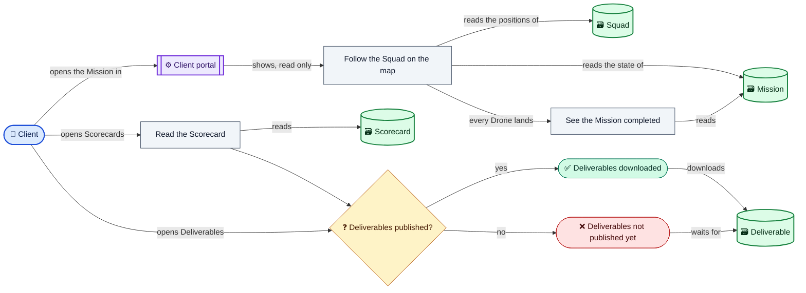

## 🖼️ Screens

One row per state of the flow chart: every action, success and failure node. Click a screen to open it full size. A state with nothing to show reads `➖ No screen: <why>`.

| State | Persona | Entity | Source | Screen |
| --- | --- | --- | --- | --- |
| A1: Follow the Squad on the map | [👤 Client](../../glossary.md#per-client) | [🔄 Mission: Flying](../../glossary.md#st-mission-flying) | ✏️ Mock-up | [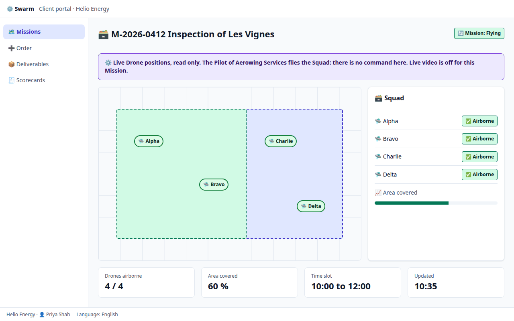](../../screens/UC-011/a1.png) [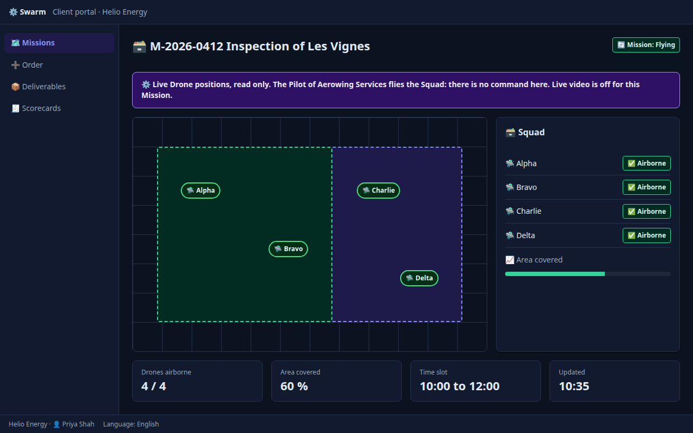](../../screens/UC-011/a1.dark.png) |
| A2: See the Mission completed | [👤 Client](../../glossary.md#per-client) | [🔄 Mission: Completed](../../glossary.md#st-mission-completed) [🔄 Deliverable: Processing](../../glossary.md#st-deliverable-processing) | ✏️ Mock-up | [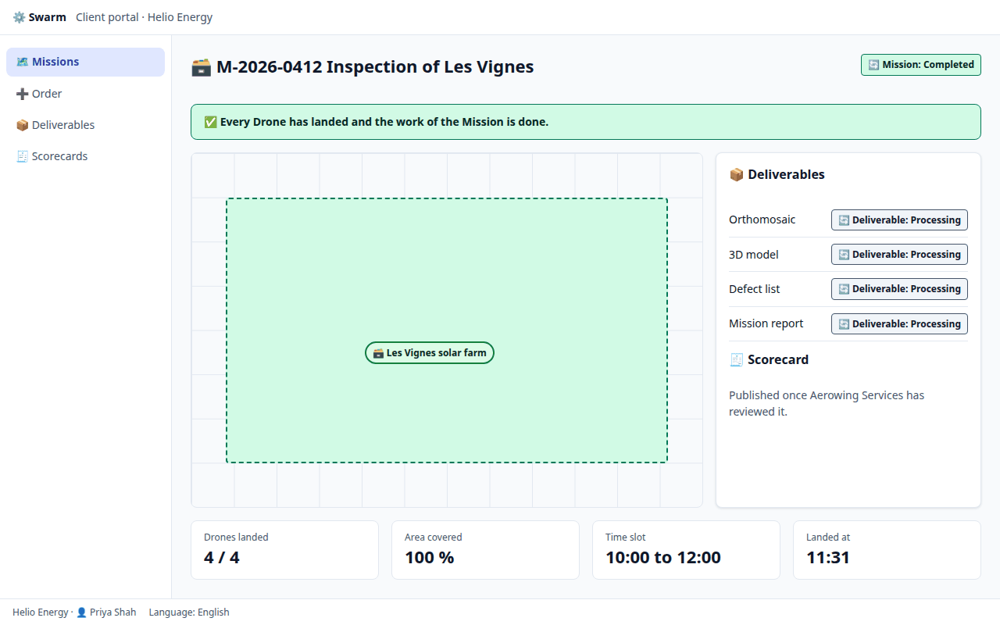](../../screens/UC-011/a2.png) [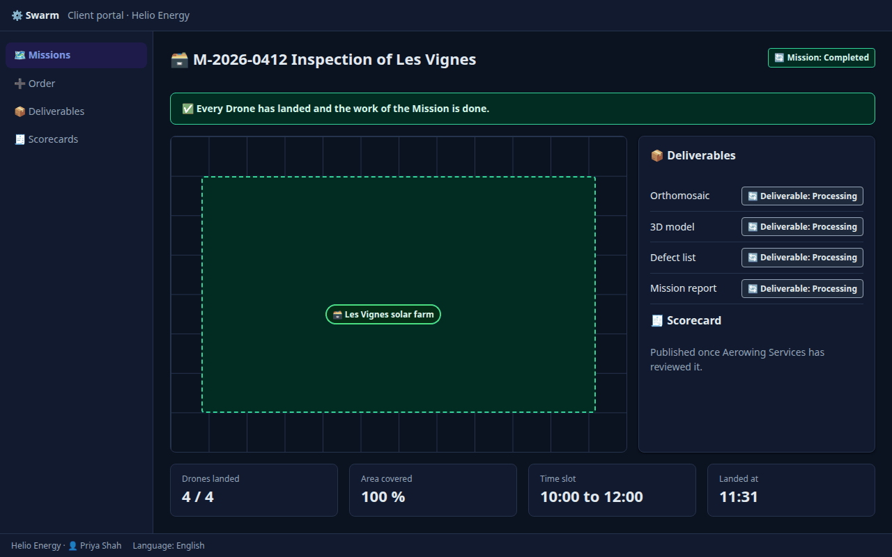](../../screens/UC-011/a2.dark.png) |
| A3: Read the Scorecard | [👤 Client](../../glossary.md#per-client) | [🔄 Scorecard: Passed](../../glossary.md#st-scorecard-passed) | ✏️ Mock-up | [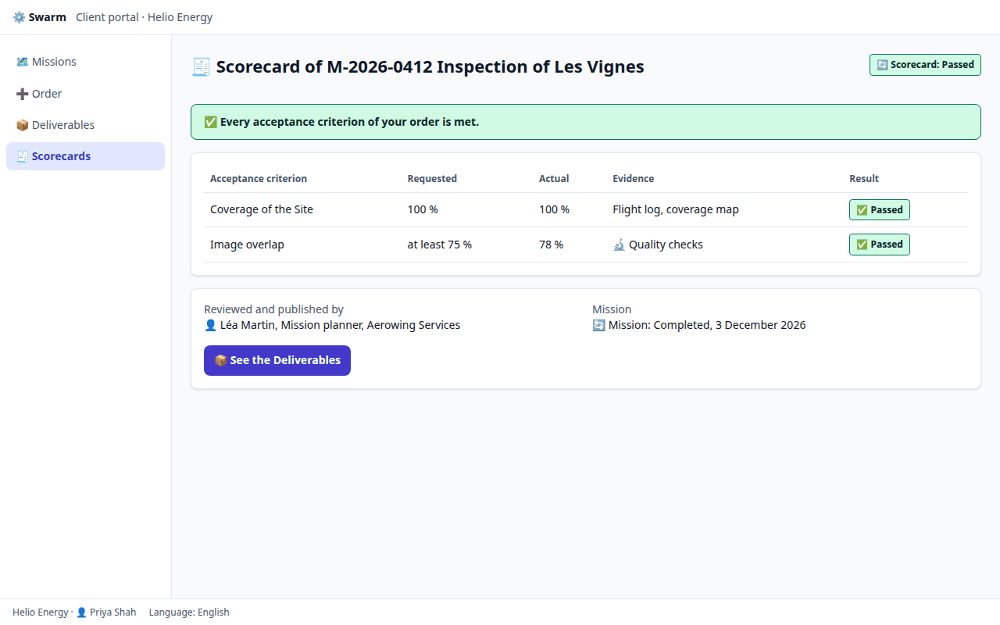](../../screens/UC-011/a3.png) [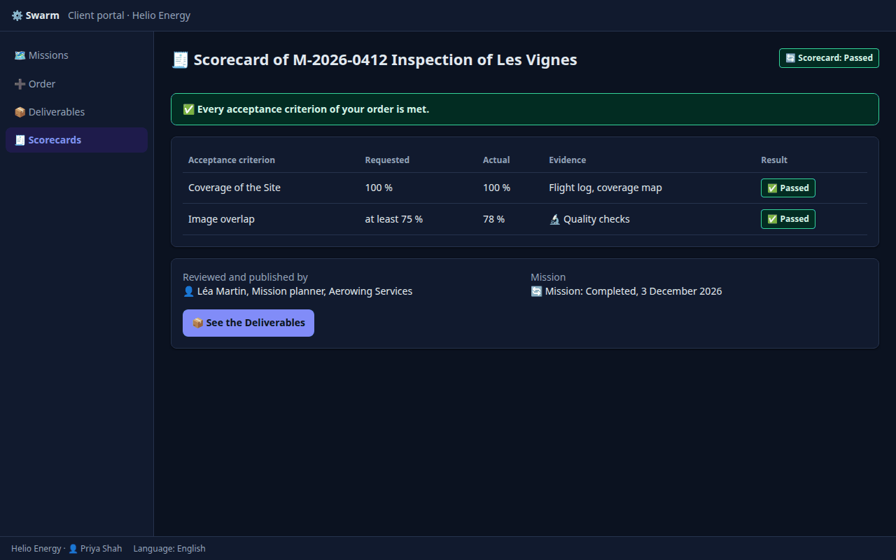](../../screens/UC-011/a3.dark.png) |
| OK: Deliverables downloaded | [👤 Client](../../glossary.md#per-client) | [🔄 Deliverable: Published](../../glossary.md#st-deliverable-published) | ✏️ Mock-up | [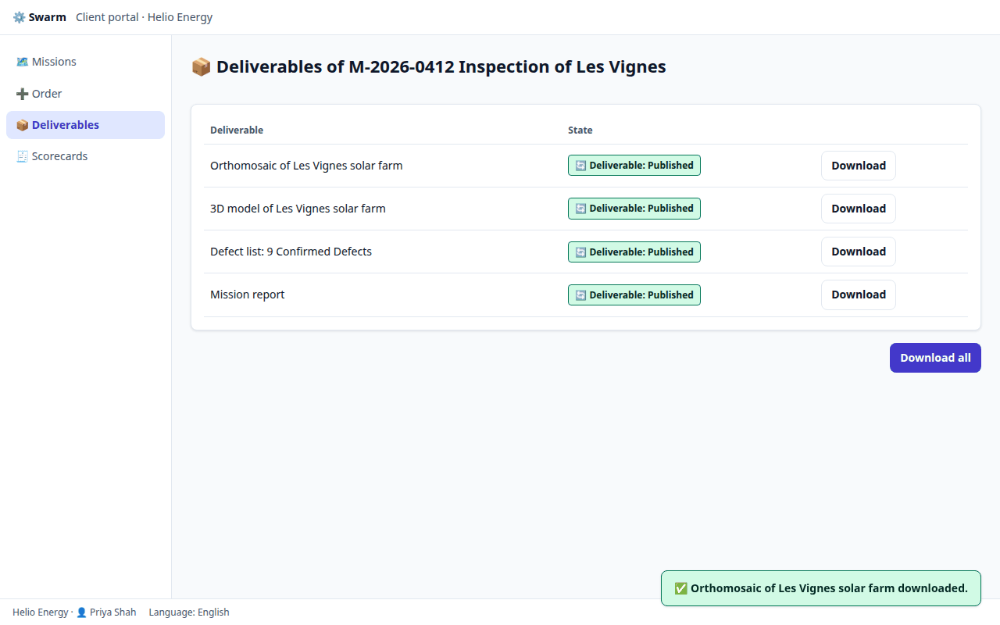](../../screens/UC-011/ok.png) [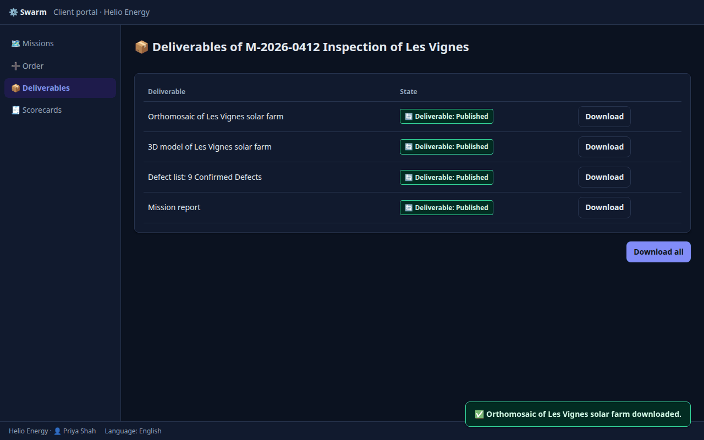](../../screens/UC-011/ok.dark.png) |
| KO: Deliverables not published yet | [👤 Client](../../glossary.md#per-client) | [🔄 Deliverable: In review](../../glossary.md#st-deliverable-in-review) [🔄 Deliverable: Processing](../../glossary.md#st-deliverable-processing) | ✏️ Mock-up | [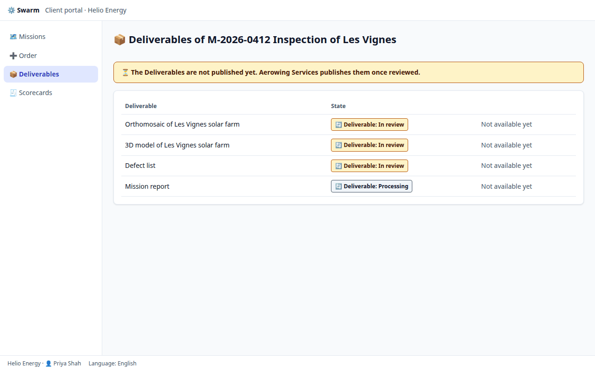](../../screens/UC-011/ko.png) [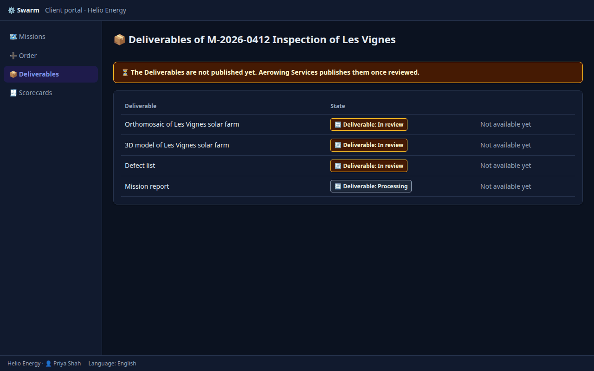](../../screens/UC-011/ko.dark.png) |

## ↪️ Alternative and error flows

| # | At step | Condition | What happens |
| --- | --- | --- | --- |
| A1 | 1 | The Operator has enabled live video for this Mission | The Client also sees the live video of the Drones, read only |
| A2 | 1 | The Operator has turned the live view off for this Client | The Client portal shows the state of the Mission only, with no map |
| A3 | 1 | The Client opens a link to a Mission of another Client | ❌ Not found ([📏 BR-016](../business-rules/BR-016-clients-see-only-their-own-missions.md)) |
| A4 | 3 | The Scorecard is not published yet | **🧾 Scorecards** does not show it: only a reviewed Scorecard reaches the Client ([📏 BR-026](../business-rules/BR-026-scorecard-against-the-request.md)) |
| A5 | 3 | The Scorecard is Scorecard: Failed | The Client reads which criterion failed. The Operator explains, or re-flies the gaps as a new Mission linked to M-2026-0412, and the Scorecard is assessed again with both ([🎬 UC-028: Assess a Mission against the request](UC-028-assess-a-mission-against-the-request.md)) |
| A6 | 4 | The Deliverables are still Deliverable: Processing or Deliverable: In review | ❌ The Client portal lists them without a download; the Client comes back once they are Published |

## 📏 Business rules applied

| Rule | Where it applies |
| --- | --- |
| [📏 BR-016: Clients see only their own Missions](../business-rules/BR-016-clients-see-only-their-own-missions.md) | Steps 1 to 5: only the Missions, Scorecards and Deliverables of Helio Energy, only what the Operator published, and no command |
| [📏 BR-026: Scorecard against the request](../business-rules/BR-026-scorecard-against-the-request.md) | Step 3: the Scorecard assesses each acceptance criterion of the order and reaches the Client only after review |

## 🏁 Postconditions

- ✅ **Success:** the Client has followed the Mission until Mission: Completed, read its Scorecard and downloaded its published Deliverables. Nothing in the Mission was changed by the Client.
- ❌ **Failure:** the Deliverables are not published yet. The Client sees them as Processing or In review, without a download.

## 🔗 Referenced by

<!-- spec:referenced-by -->
- [📘 FS-008: Client portal](../features/FS-008-client-portal.md)
- [📘 FS-022: Debrief and assessment](../features/FS-022-debrief-and-assessment.md)
<!-- /spec:referenced-by -->

<!-- spec:nav-bottom -->
---

> [🏠 Index](../../README.md) · [◀️ UC-010: Order a Mission in the Client portal](UC-010-order-a-mission-in-the-client-portal.md) · 📄 **Page 37 / 109** · [UC-012: Verify the Evidence record of a flight ▶️](UC-012-verify-the-evidence-record-of-a-flight.md)
<!-- /spec:nav-bottom -->
