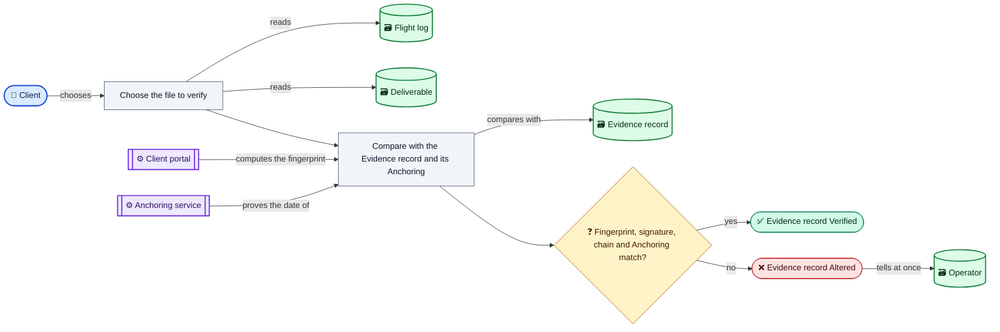
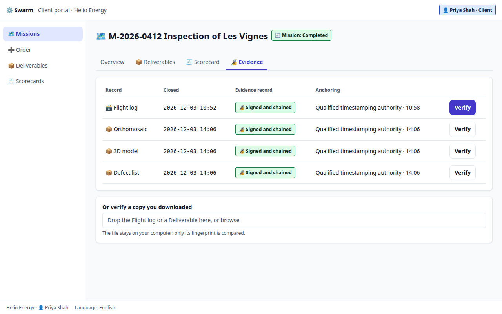
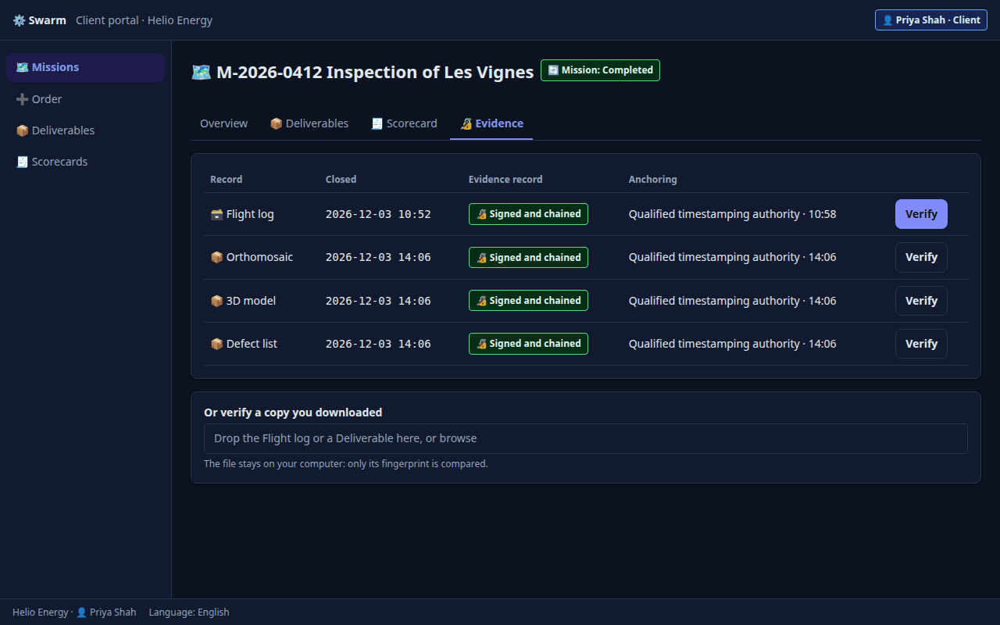
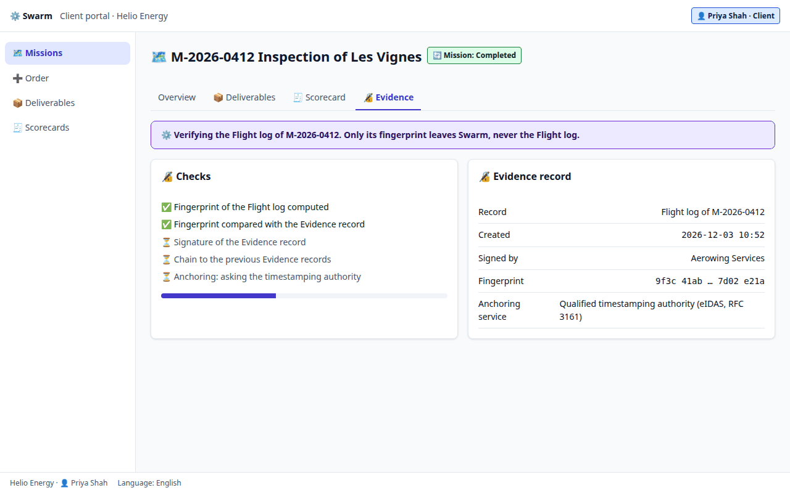
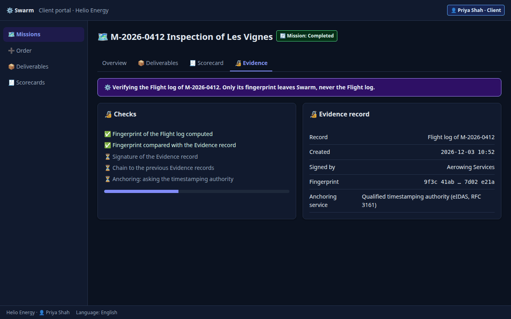
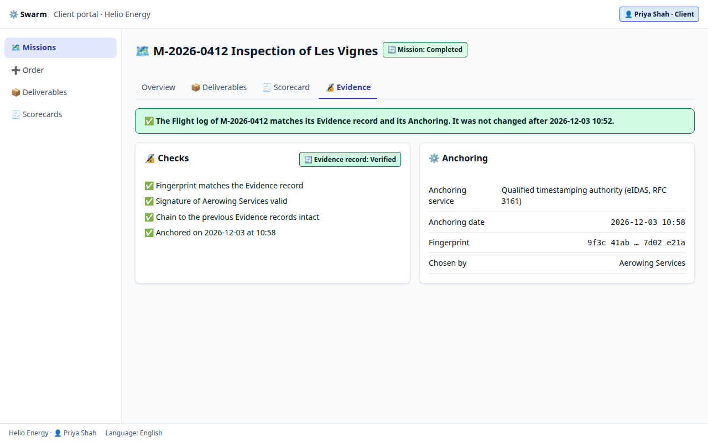
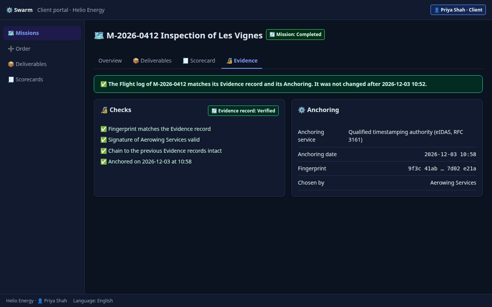
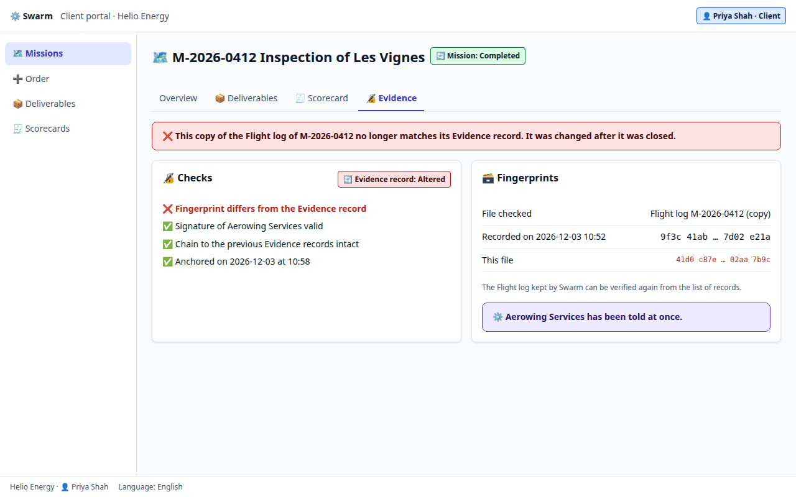
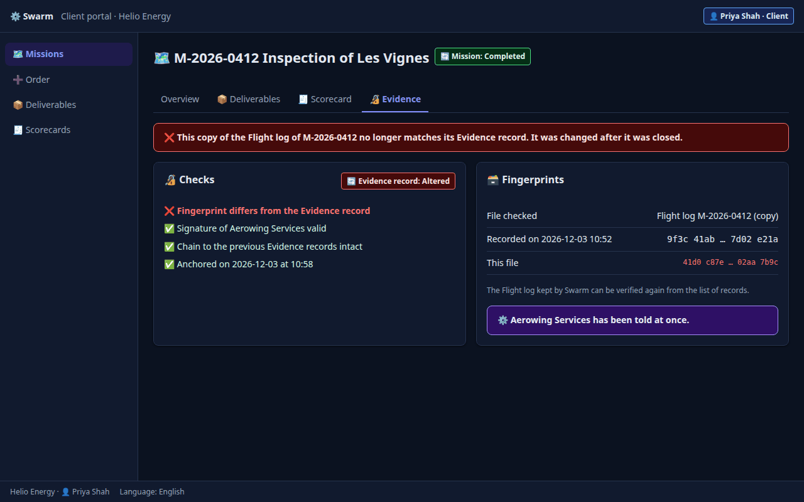

# 🎬 UC-012: Verify the Evidence record of a flight

<!-- spec:nav-top -->
> [🏠 Index](../../README.md) · [◀️ UC-011: Follow a Mission and download its Deliverables](UC-011-follow-a-mission-and-download-its-deliverables.md) · 📄 **Page 38 / 109** · [UC-013: Train on the Simulator ▶️](UC-013-train-on-the-simulator.md)
<!-- /spec:nav-top -->

**Status:** 🟢 Approved · **Updated:** 2026-11-18

> [!NOTE]
> The [👤 Client](../../glossary.md#per-client) checks, in the [⚙️ Client portal](../../glossary.md#sys-client-portal), that a [🗃️ Flight log](../../glossary.md#ent-flight-log) or a [🗃️ Deliverable](../../glossary.md#ent-deliverable) still matches its [🗃️ Evidence record](../../glossary.md#ent-evidence-record) and its [🔤 Anchoring](../../glossary.md#term-anchoring), and gets a clear Verified or Altered answer.

<!-- spec:summary -->
## 📑 Summary

1. [👤 Personas and entities](#actors)
2. [🚦 Preconditions](#preconditions)
3. [⚡ Trigger](#trigger)
4. [➡️ Main flow](#main-flow)
5. [🔀 Flow chart](#flowchart)
6. [🖼️ Screens](#screens)
7. [↪️ Alternative and error flows](#alternative-flows)
8. [📏 Business rules applied](#business-rules)
9. [🏁 Postconditions](#postconditions)
10. [🔗 Referenced by](#referenced-by)
<!-- /spec:summary -->

## 👤 Personas and entities

| Name | Kind | Role in this use case |
| --- | --- | --- |
| [👤 Client](../../glossary.md#per-client) | Persona | Chooses the Flight log or the Deliverable to verify and reads the answer |
| [🗃️ Flight log](../../glossary.md#ent-flight-log) | Entity | Verified against its Evidence record |
| [🗃️ Deliverable](../../glossary.md#ent-deliverable) | Entity | Verified against its Evidence record |
| [🗃️ Evidence record](../../glossary.md#ent-evidence-record) | Entity | Verified or Altered |
| [🗃️ Operator](../../glossary.md#ent-operator) | Entity | Told at once when a record shows Altered |
| [⚙️ Client portal](../../glossary.md#sys-client-portal) | System | Computes the fingerprint and runs the checks |
| [⚙️ Anchoring service](../../glossary.md#sys-anchoring-service) | System | Proves the date and content of the Evidence record: a qualified timestamping authority by default, or a public blockchain, as the Operator chose |

## 🚦 Preconditions

1. M-2026-0412 Inspection of Les Vignes is **Mission: Completed**; its Flight log is closed and its Deliverables are published (see [🎬 UC-009: Process flight data into Deliverables](UC-009-process-flight-data-into-deliverables.md)).
2. Each has its Evidence record, anchored with a qualified timestamping authority (eIDAS, RFC 3161), the default Anchoring that the [🗃️ Operator](../../glossary.md#ent-operator) Aerowing Services kept ([📏 BR-009](../business-rules/BR-009-evidence-integrity.md)).
3. The Client, Priya Shah of Helio Energy, is signed in to the Client portal (see [🎬 UC-015: Invite a Client to the Client portal](UC-015-invite-a-client-to-the-client-portal.md)).

## ⚡ Trigger

The Client needs to prove, to an insurer, an authority or a court, that the Flight log or a Deliverable of a [🗃️ Mission](../../glossary.md#ent-mission) was not changed.

## ➡️ Main flow

1. The [👤 Client](../../glossary.md#per-client) opens 🗺️ Missions, then M-2026-0412 and its 🔏 Evidence tab. The Client portal lists the Flight log and each published Deliverable with its Evidence record and its Anchoring.
2. The Client chooses the Flight log, or drops a copy of a file downloaded earlier.
3. The Client portal computes the fingerprint of the file and compares it with the Evidence record. It checks the signature of the Evidence record and its chain to the previous ones.
4. The Client portal asks the [⚙️ Anchoring service](../../glossary.md#sys-anchoring-service) for the proof of the date and content of the Evidence record. Only the fingerprint leaves Swarm, never the Flight log ([📏 BR-009](../business-rules/BR-009-evidence-integrity.md)).
5. Every check matches: the Client portal shows **Evidence record: Verified**, with the Anchoring date and the Anchoring service.

## 🔀 Flow chart

## 🖼️ Screens

One row per state of the flow chart: every action, success and failure node. Click a screen to open it full size. A state with nothing to show reads `➖ No screen: <why>`.

| State | Persona | Entity | Source | Screen |
| --- | --- | --- | --- | --- |
| A1: Choose the file to verify | [👤 Client](../../glossary.md#per-client) | [🗃️ Flight log](../../glossary.md#ent-flight-log) [🗃️ Deliverable](../../glossary.md#ent-deliverable) | ✏️ Mock-up |   |
| A2: Compare with the Evidence record and its Anchoring | [👤 Client](../../glossary.md#per-client) | [🗃️ Evidence record](../../glossary.md#ent-evidence-record) | ✏️ Mock-up |   |
| OK: Evidence record Verified | [👤 Client](../../glossary.md#per-client) | [🔄 Evidence record: Verified](../../glossary.md#st-evidence-record-verified) | ✏️ Mock-up |   |
| KO: Evidence record Altered | [👤 Client](../../glossary.md#per-client) | [🔄 Evidence record: Altered](../../glossary.md#st-evidence-record-altered) [🗃️ Operator](../../glossary.md#ent-operator) | ✏️ Mock-up |   |

## ↪️ Alternative and error flows

| # | At step | Condition | What happens |
| --- | --- | --- | --- |
| A1 | 3 | The file no longer matches its Evidence record, such as a copy of the Flight log edited after it was closed | The Client portal shows **Evidence record: Altered** and names the check that failed, with the fingerprint recorded and the fingerprint of the file. Aerowing Services is told at once; the Client is told whenever a record that concerns them shows Altered (KO). |
| A2 | 4 | The Operator chose the blockchain option: a public blockchain, through an aggregator that batches fingerprints | The Client portal shows the blockchain transaction that holds the fingerprint, instead of the timestamp token. |
| A3 | 4 | The Operator chose no Anchoring | The Client portal checks the fingerprint, the signature and the chain only, and says the Evidence record is not anchored ([📏 BR-009](../business-rules/BR-009-evidence-integrity.md)). |

## 📏 Business rules applied

| Rule | Where it applies |
| --- | --- |
| [📏 BR-009: Evidence integrity](../business-rules/BR-009-evidence-integrity.md) | Steps 3 to 5: the Evidence record is signed, chained and anchored, and only its fingerprint leaves Swarm |

## 🏁 Postconditions

- ✅ **Success:** the Client sees **Evidence record: Verified** for the Flight log or the Deliverable, with its Anchoring date and Anchoring service, and can rely on it as proof.
- ❌ **Failure:** the Client sees **Evidence record: Altered** and which check failed: the file is not the one Swarm closed and signed. Aerowing Services has been told.

## 🔗 Referenced by

<!-- spec:referenced-by -->
- [📘 FS-009: Evidence ledger and Anchoring](../features/FS-009-evidence-ledger-and-anchoring.md)
<!-- /spec:referenced-by -->

<!-- spec:nav-bottom -->
---

> [🏠 Index](../../README.md) · [◀️ UC-011: Follow a Mission and download its Deliverables](UC-011-follow-a-mission-and-download-its-deliverables.md) · 📄 **Page 38 / 109** · [UC-013: Train on the Simulator ▶️](UC-013-train-on-the-simulator.md)
<!-- /spec:nav-bottom -->
