# 🎬 UC-013: Train on the Simulator

<!-- spec:nav-top -->
> [🏠 Index](../../README.md) · [◀️ UC-012: Verify the Evidence record of a flight](UC-012-verify-the-evidence-record-of-a-flight.md) · 📄 **Page 41 / 120** · [UC-014: Connect a new Drone model ▶️](UC-014-connect-a-new-drone-model.md)
<!-- /spec:nav-top -->

**Status:** 🟢 Approved · **Updated:** 2026-11-18

> [!NOTE]
> The [👤 Pilot](../../glossary.md#per-pilot) flies a simulated [🗃️ Squad](../../glossary.md#ent-squad) in [⚙️ Ground control](../../glossary.md#sys-ground-control) and handles a failure injected by the [👤 Instructor](../../glossary.md#per-instructor), so that they train without any risk for a real [🗃️ Drone](../../glossary.md#ent-drone).

<!-- spec:summary -->
## 📑 Summary

1. [👤 Personas and entities](#actors)
2. [🚦 Preconditions](#preconditions)
3. [⚡ Trigger](#trigger)
4. [➡️ Main flow](#main-flow)
5. [🔀 Flow chart](#flowchart)
6. [🖼️ Screens](#screens)
7. [↪️ Alternative and error flows](#alternative-flows)
8. [📏 Business rules applied](#business-rules)
9. [🏁 Postconditions](#postconditions)
10. [🔗 Referenced by](#referenced-by)
<!-- /spec:summary -->

## 👤 Personas and entities

| Name | Kind | Role in this use case |
| --- | --- | --- |
| [👤 Pilot](../../glossary.md#per-pilot) | Persona | Trains: launches, supervises and handles the injected failure |
| [👤 Instructor](../../glossary.md#per-instructor) | Persona | Runs the training session from a second Ground control and injects the failure |
| [🗃️ Mission](../../glossary.md#ent-mission) | Entity | The Planned Mission flown for training |
| [🗃️ Squad](../../glossary.md#ent-squad) | Entity | Virtual, flown by the Simulator |
| [🗃️ Drone](../../glossary.md#ent-drone) | Entity | Real Drones of the Fleet, which never receive a command of the session |
| [🗃️ Flight log](../../glossary.md#ent-flight-log) | Entity | Records the session, marked simulated |
| [⚙️ Ground control](../../glossary.md#sys-ground-control) | System | Shows the session, with the Simulator banner on every screen |
| [⚙️ Simulator](../../glossary.md#sys-simulator) | System | Flies the virtual Squad and applies the failure the Instructor injects |

## 🚦 Preconditions

1. The [🗃️ Mission](../../glossary.md#ent-mission) M-2026-0412 Inspection of Les Vignes is Planned.
2. The [⚙️ Simulator](../../glossary.md#sys-simulator) has the flight software of every [🗃️ Drone model](../../glossary.md#ent-drone-model) of the Squad.
3. The Pilot Sam Carter is signed in to Ground control. The [👤 Instructor](../../glossary.md#per-instructor), a senior Pilot, has joined the same training session from a second Ground control.

## ⚡ Trigger

The Pilot starts a training session in Ground control.

## ➡️ Main flow

1. The Pilot starts a training session on M-2026-0412 with a simulated Squad: Alpha, Bravo, Charlie and Delta. From now on, every screen of Ground control shows the banner "🕹️ Simulator: no real Drone receives commands" ([📏 BR-014](../business-rules/BR-014-simulation-isolation.md)).
2. The Pilot runs and signs the [🗃️ Pre-flight check](../../glossary.md#ent-pre-flight-check) of the simulated Squad, then launches.
3. The Simulator flies the virtual Squad with the real flight software of each Drone model. The Pilot supervises it as in a real flight.
4. Every command the Pilot gives goes to the Simulator. Swarm checks that it is addressed to a simulated Drone ([📏 BR-014](../business-rules/BR-014-simulation-isolation.md)).
5. During the session, the Instructor injects a failure from the second Ground control: the [🔤 Link](../../glossary.md#term-link) to Delta is lost. The Simulator applies it to the virtual Squad.
6. The Pilot handles the failure as in a real flight: they Hold the Squad, then resume once Delta's area is shared between the other Drones.
7. The simulated Squad lands. The Mission of the session is Completed and its [🗃️ Flight log](../../glossary.md#ent-flight-log) is marked simulated ([📏 BR-014](../business-rules/BR-014-simulation-isolation.md)). The Pilot can open its [🔤 Replay](../../glossary.md#term-replay) in the [🗃️ Debrief](../../glossary.md#ent-debrief).

## 🔀 Flow chart

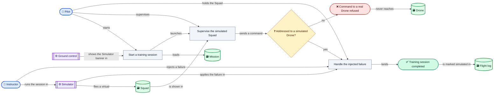

## 🖼️ Screens

One row per state of the flow chart: every action, success and failure node. Click a screen to open it full size. A state with nothing to show reads `➖ No screen: <why>`.

| State | Persona | Entity | Source | Screen |
| --- | --- | --- | --- | --- |
| A1: Start a training session | [👤 Pilot](../../glossary.md#per-pilot) [👤 Instructor](../../glossary.md#per-instructor) | [🔄 Mission: Planned](../../glossary.md#st-mission-planned) | ✏️ Mock-up | [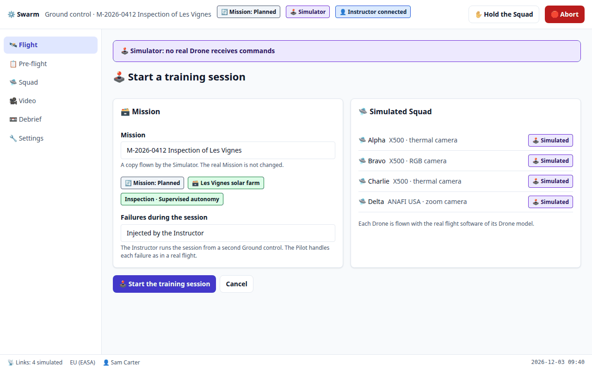](../../screens/UC-013/a1.png) [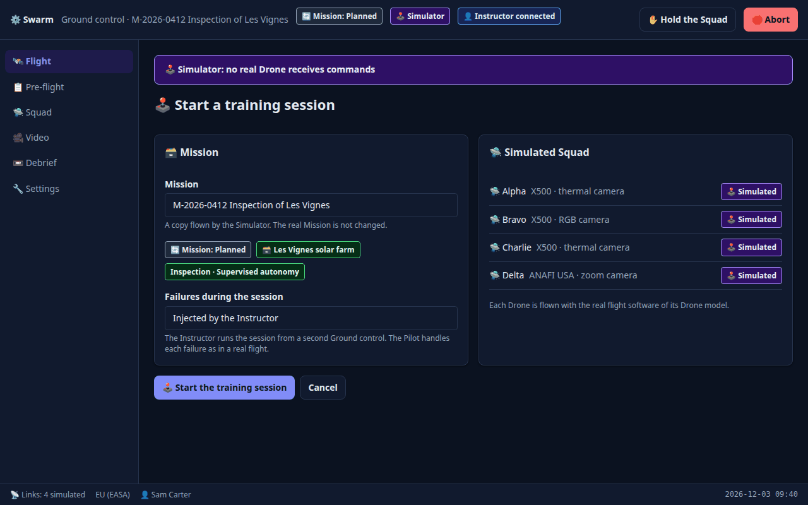](../../screens/UC-013/a1.dark.png) |
| A2: Supervise the simulated Squad | [🔄 Pilot: Supervising](../../glossary.md#st-pilot-supervising) | [🔄 Mission: Flying](../../glossary.md#st-mission-flying) | ✏️ Mock-up | [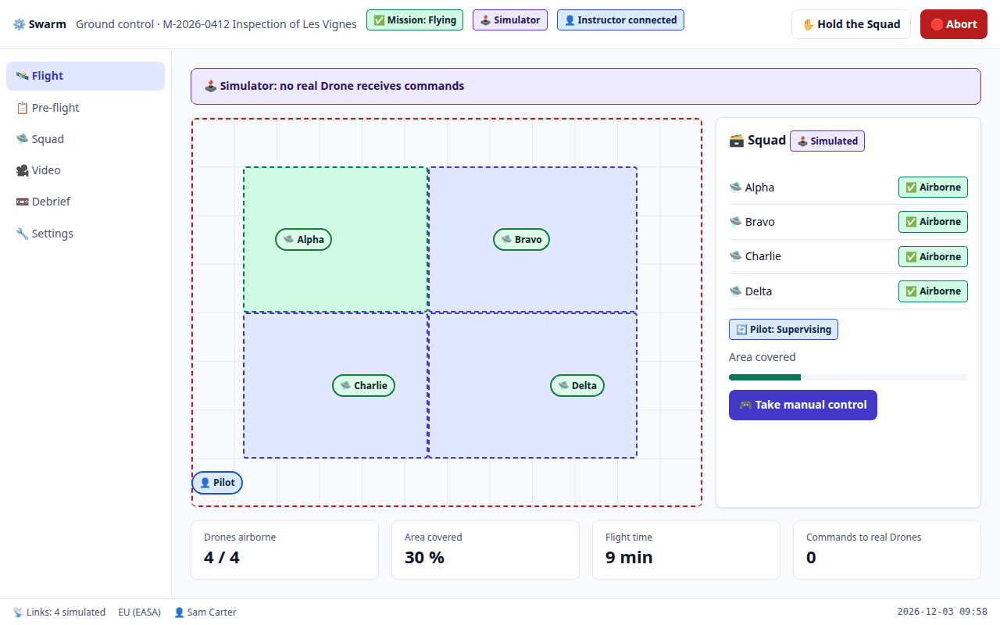](../../screens/UC-013/a2.png) [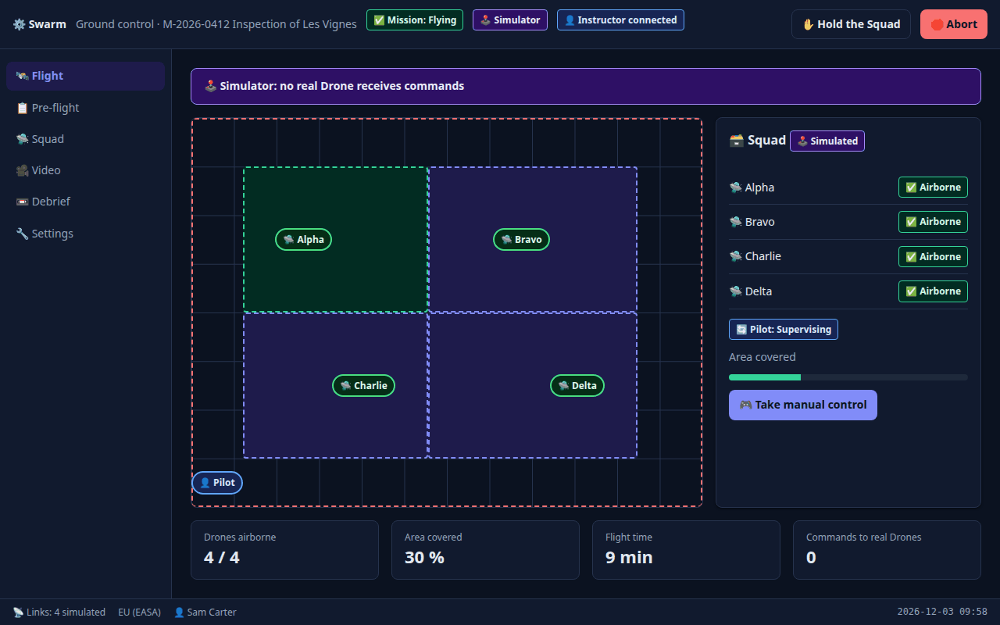](../../screens/UC-013/a2.dark.png) |
| A3: Handle the injected failure | [🔄 Pilot: Supervising](../../glossary.md#st-pilot-supervising) [👤 Instructor](../../glossary.md#per-instructor) | [🔄 Drone: Lost](../../glossary.md#st-drone-lost) [🔄 Mission: Held](../../glossary.md#st-mission-held) | ✏️ Mock-up | [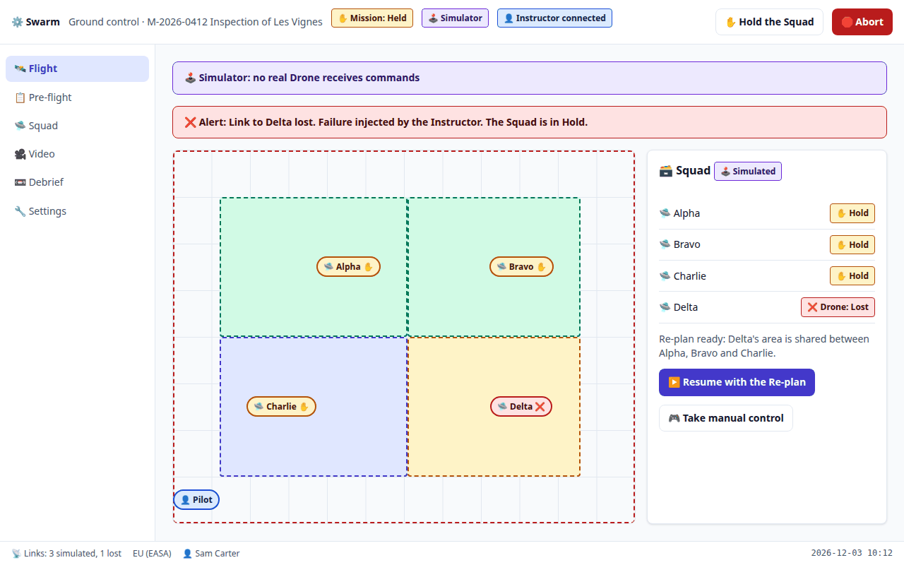](../../screens/UC-013/a3.png) [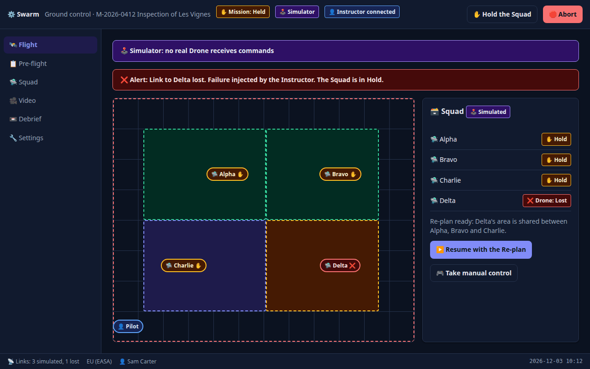](../../screens/UC-013/a3.dark.png) |
| OK: Training session completed | [👤 Pilot](../../glossary.md#per-pilot) | [🔄 Mission: Completed](../../glossary.md#st-mission-completed) [🗃️ Flight log](../../glossary.md#ent-flight-log) | ✏️ Mock-up | [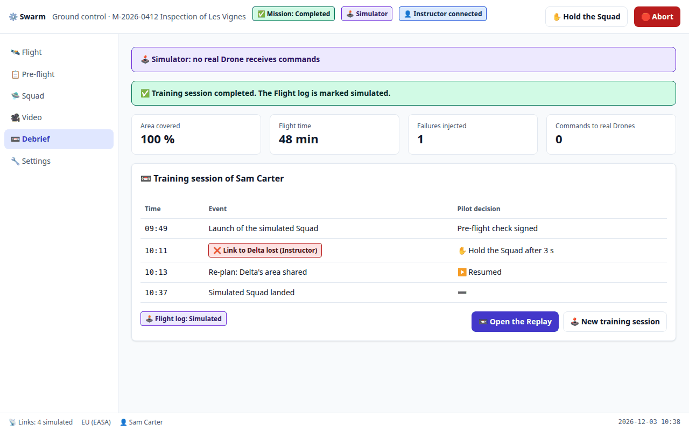](../../screens/UC-013/ok.png) [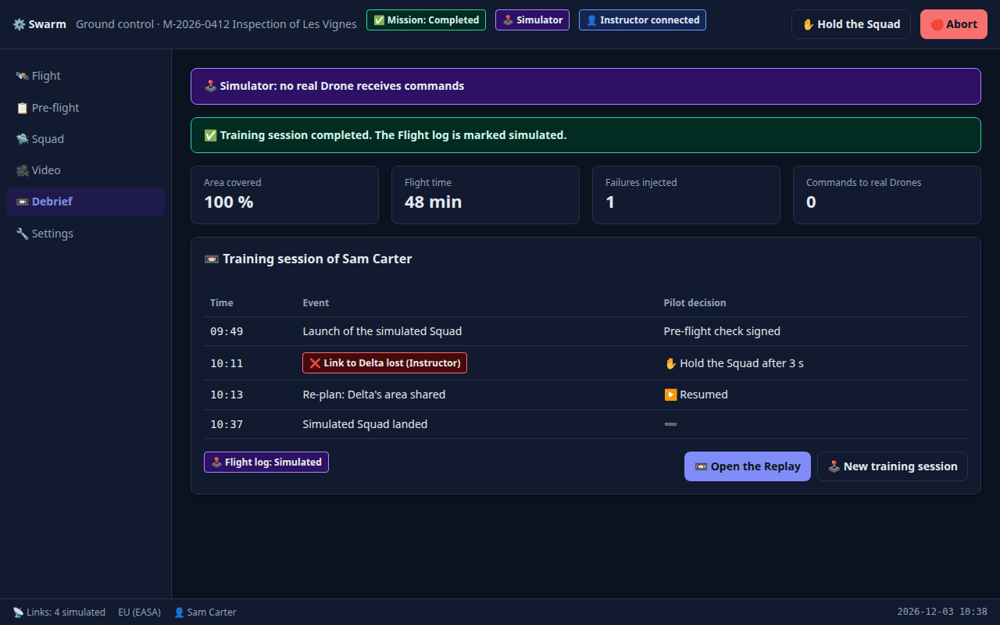](../../screens/UC-013/ok.dark.png) |
| KO: Command to a real Drone refused | [🔄 Pilot: Supervising](../../glossary.md#st-pilot-supervising) | [🗃️ Drone](../../glossary.md#ent-drone) [🗃️ Flight log](../../glossary.md#ent-flight-log) | ✏️ Mock-up | [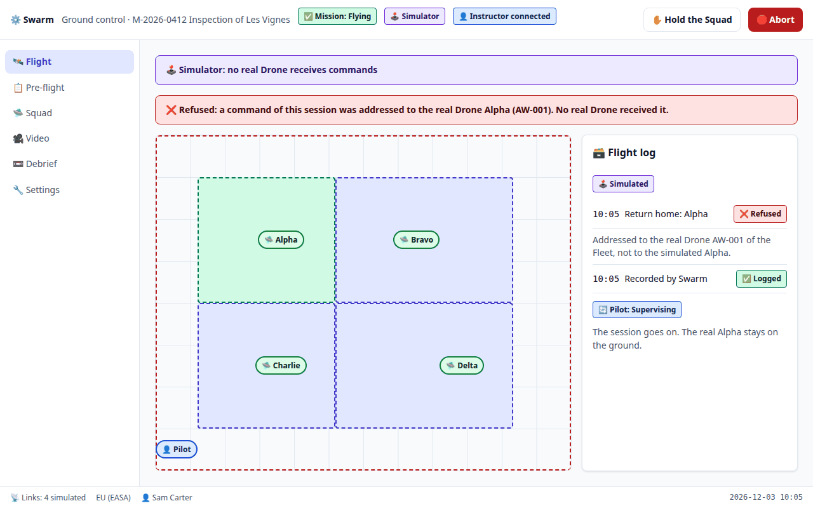](../../screens/UC-013/ko.png) [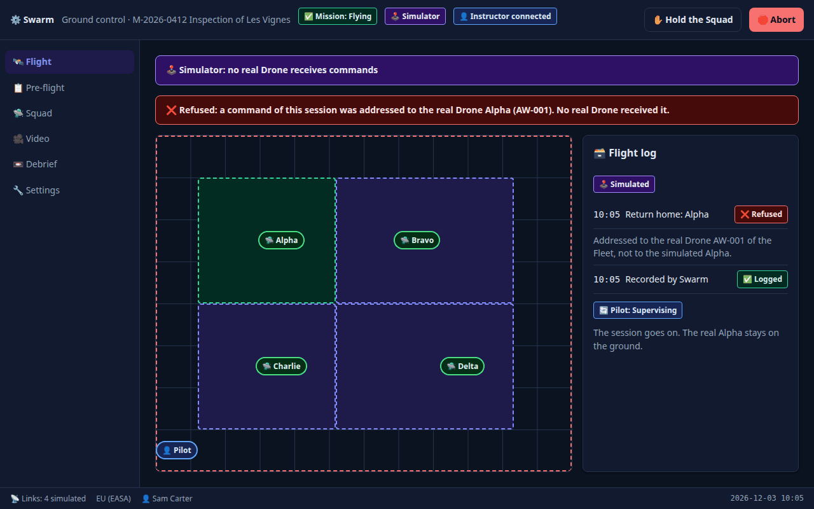](../../screens/UC-013/ko.dark.png) |

## ↪️ Alternative and error flows

| # | At step | Condition | What happens |
| --- | --- | --- | --- |
| A1 | 4 | A command of the session is addressed to a real Drone, such as Alpha (AW-001) of the Fleet | Swarm refuses it and records the refusal in the Flight log. No real Drone receives it. The Pilot sees an [🔤 Alert](../../glossary.md#term-alert) and the session goes on ([📏 BR-014](../business-rules/BR-014-simulation-isolation.md)). |
| A2 | 6 | The Pilot takes manual control of a Drone or aborts the session instead of holding the Squad | The Simulator carries out the command as in a real flight. The Flight log is still marked simulated. |
| A3 | 5 | The Instructor injects another failure | The Pilot handles it the same way; each injected failure and each decision of the Pilot is in the Flight log of the session. |

## 📏 Business rules applied

| Rule | Where it applies |
| --- | --- |
| [📏 BR-014: Simulation isolation](../business-rules/BR-014-simulation-isolation.md) | Steps 1, 4 and 7: the banner, the refusal of any command to a real Drone, the Flight log marked simulated |

## 🏁 Postconditions

- ✅ **Success:** the training session is Completed, its Flight log is marked simulated, and the Pilot can replay it in the Debrief. No real Drone received a command.
- ❌ **Failure:** a command addressed to a real Drone was refused and logged; the Pilot and the Instructor saw the refusal and the real Drone did not move.

## 🔗 Referenced by

<!-- spec:referenced-by -->
- [📘 FS-010: Simulator and training](../features/FS-010-simulator-and-training.md)
<!-- /spec:referenced-by -->

<!-- spec:nav-bottom -->
---

> [🏠 Index](../../README.md) · [◀️ UC-012: Verify the Evidence record of a flight](UC-012-verify-the-evidence-record-of-a-flight.md) · 📄 **Page 41 / 120** · [UC-014: Connect a new Drone model ▶️](UC-014-connect-a-new-drone-model.md)
<!-- /spec:nav-bottom -->
