# 🎬 UC-014: Connect a new Drone model

<!-- spec:nav-top -->
> [🏠 Index](../../README.md) · [◀️ UC-013: Train on the Simulator](UC-013-train-on-the-simulator.md) · 📄 **Page 40 / 109** · [UC-015: Invite a Client to the Client portal ▶️](UC-015-invite-a-client-to-the-client-portal.md)
<!-- /spec:nav-top -->

**Status:** 🟢 Approved · **Updated:** 2026-11-18

> [!NOTE]
> The [👤 Fleet maintainer](../../glossary.md#per-fleet-maintainer) connects a new [🗃️ Drone model](../../glossary.md#ent-drone-model) through its [⚙️ Drone adapter](../../glossary.md#sys-drone-adapter) and runs the compatibility test of Swarm, in the [⚙️ Simulator](../../glossary.md#sys-simulator) then in one real flight: if it passes, the Drone model is Approved and its [🗃️ Drones](../../glossary.md#ent-drone) may fly; if it fails, they stay Grounded.

<!-- spec:summary -->
## 📑 Summary

1. [👤 Personas and entities](#actors)
2. [🚦 Preconditions](#preconditions)
3. [⚡ Trigger](#trigger)
4. [➡️ Main flow](#main-flow)
5. [🔀 Flow chart](#flowchart)
6. [🖼️ Screens](#screens)
7. [↪️ Alternative and error flows](#alternative-flows)
8. [📏 Business rules applied](#business-rules)
9. [🏁 Postconditions](#postconditions)
10. [🔗 Referenced by](#referenced-by)
<!-- /spec:summary -->

## 👤 Personas and entities

| Name | Kind | Role in this use case |
| --- | --- | --- |
| [👤 Fleet maintainer](../../glossary.md#per-fleet-maintainer) | Persona | Adds the Drone model, chooses its Drone adapter and starts the compatibility test |
| [👤 Pilot](../../glossary.md#per-pilot) | Persona | Flies the real test flight in a test area |
| [🗃️ Drone model](../../glossary.md#ent-drone-model) | Entity | Not approved until its test passes, then Approved for its current firmware |
| [🗃️ Drone](../../glossary.md#ent-drone) | Entity | Flies the real test; Grounded until its Drone model is Approved |
| [⚙️ Drone adapter](../../glossary.md#sys-drone-adapter) | System | Translates each command of Swarm for the family of the Drone model |
| [⚙️ Simulator](../../glossary.md#sys-simulator) | System | Flies a virtual Drone of the model with its real flight software, where the Drone model allows it |
| [⚙️ Back office](../../glossary.md#sys-back-office) | System | Holds the Drone models of the Fleet and records the test result |

## 🚦 Preconditions

1. The Fleet maintainer, Noah Weber, is signed in to the Back office of the [🗃️ Operator](../../glossary.md#ent-operator) Aerowing Services.
2. Swarm has a Drone adapter for the family of the new Drone model. Drone adapters come in this order: MAVLink (PX4, ArduPilot) first, then Parrot, then the other vendors.
3. A Drone of that model is registered, such as Echo (AW-005), an ANAFI USA (see [🎬 UC-007: Register a Drone and track its readiness](UC-007-register-a-drone-and-track-its-readiness.md)).

## ⚡ Trigger

Aerowing Services buys Drones of a Drone model that is not yet in its Fleet, or the maker releases a new firmware version for a Drone model of the Fleet.

## ➡️ Main flow

1. The [👤 Fleet maintainer](../../glossary.md#per-fleet-maintainer) opens 🛸 Fleet, then Drone models, and adds ANAFI USA by Parrot with its limits (weight, speed, wind, range, payload) and the Parrot Drone adapter.
2. The Back office saves it as **Drone model: Not approved**: every Drone of that model, such as Echo, is **Drone: Grounded** ([📏 BR-015](../business-rules/BR-015-approved-drone-models-only.md)).
3. The Fleet maintainer starts the compatibility test. The Simulator flies a virtual ANAFI USA with its real flight software, and the Drone adapter sends each command of Swarm and checks that it obeys: take off, follow a route, [🔤 Hold](../../glossary.md#term-hold), [🔤 Return home](../../glossary.md#term-return-home), land, stay inside the [🗃️ Geofence](../../glossary.md#ent-geofence), and control its [🗃️ Payload](../../glossary.md#ent-payload).
4. Every step passes in the Simulator. The [👤 Pilot](../../glossary.md#per-pilot), Sam Carter, then flies Echo once in a test area, and the Drone adapter runs the same steps. The Back office shows each step as it runs.
5. Every step passes: the Back office sets ANAFI USA to **Drone model: Approved** for its current firmware. Echo becomes **Drone: Ready**, as nothing else grounds it ([📏 BR-011](../business-rules/BR-011-drone-readiness.md)).

## 🔀 Flow chart

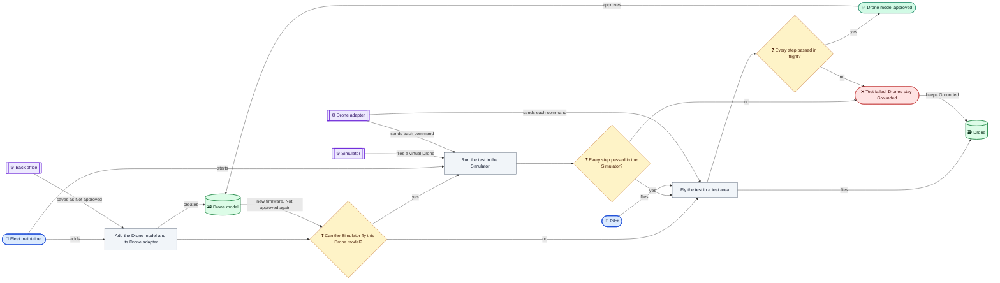

## 🖼️ Screens

One row per state of the flow chart: every action, success and failure node. Click a screen to open it full size. A state with nothing to show reads `➖ No screen: <why>`.

| State | Persona | Entity | Source | Screen |
| --- | --- | --- | --- | --- |
| A1: Add the Drone model and its Drone adapter | [👤 Fleet maintainer](../../glossary.md#per-fleet-maintainer) | [🔄 Drone model: Not approved](../../glossary.md#st-drone-model-not-approved) | ✏️ Mock-up | [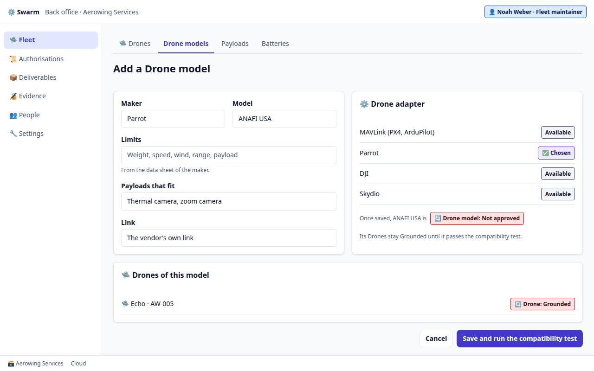](../../screens/UC-014/a1.png) [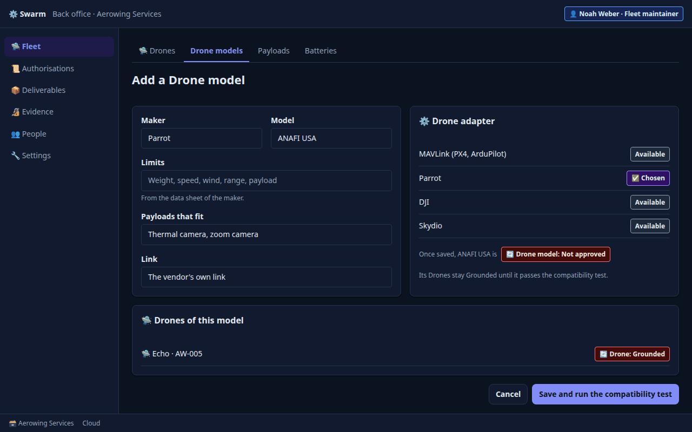](../../screens/UC-014/a1.dark.png) |
| A2: Run the test in the Simulator | [👤 Fleet maintainer](../../glossary.md#per-fleet-maintainer) | [🔄 Drone model: Not approved](../../glossary.md#st-drone-model-not-approved) | ✏️ Mock-up | [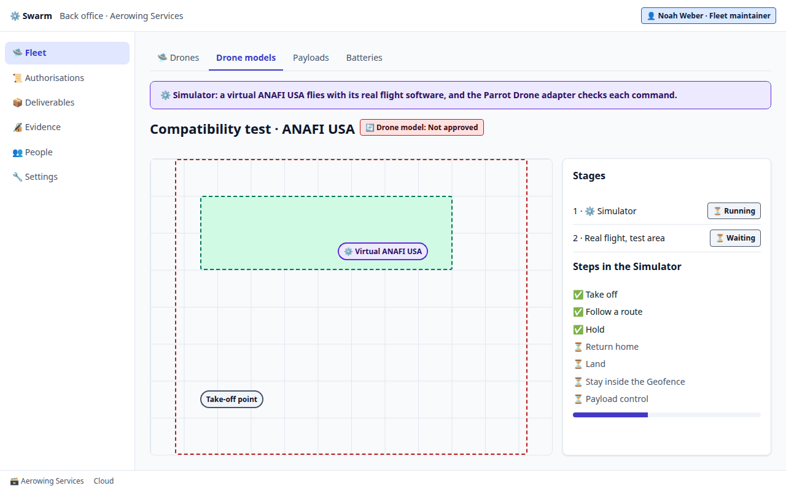](../../screens/UC-014/a2.png) [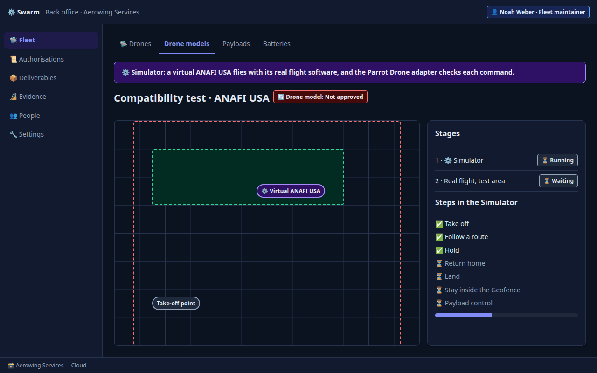](../../screens/UC-014/a2.dark.png) |
| A3: Fly the test in a test area | [👤 Fleet maintainer](../../glossary.md#per-fleet-maintainer) [👤 Pilot](../../glossary.md#per-pilot) | [🔄 Drone model: Not approved](../../glossary.md#st-drone-model-not-approved) [🔄 Drone: Grounded](../../glossary.md#st-drone-grounded) | ✏️ Mock-up | [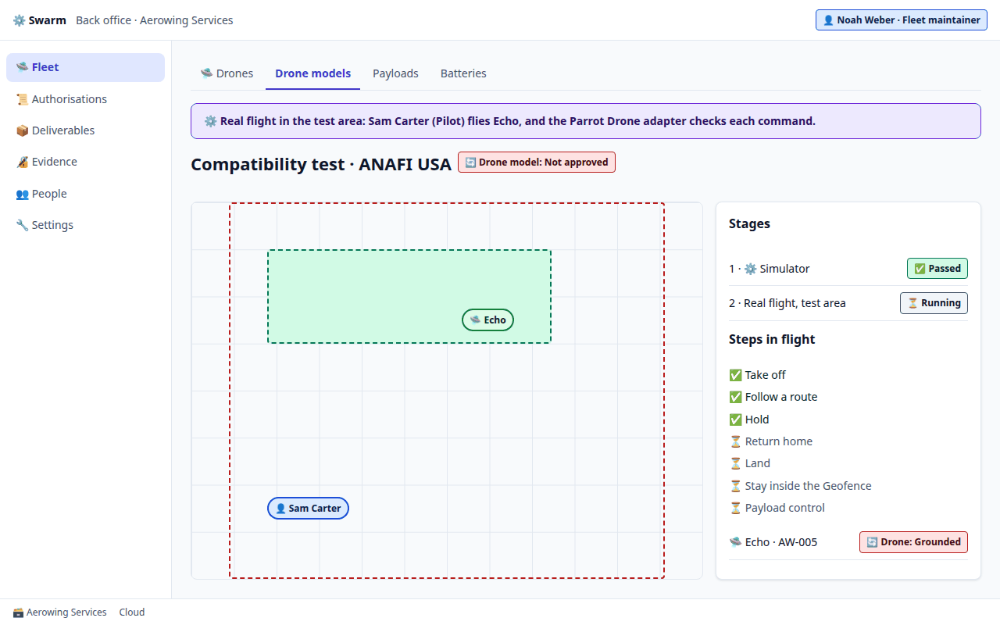](../../screens/UC-014/a3.png) [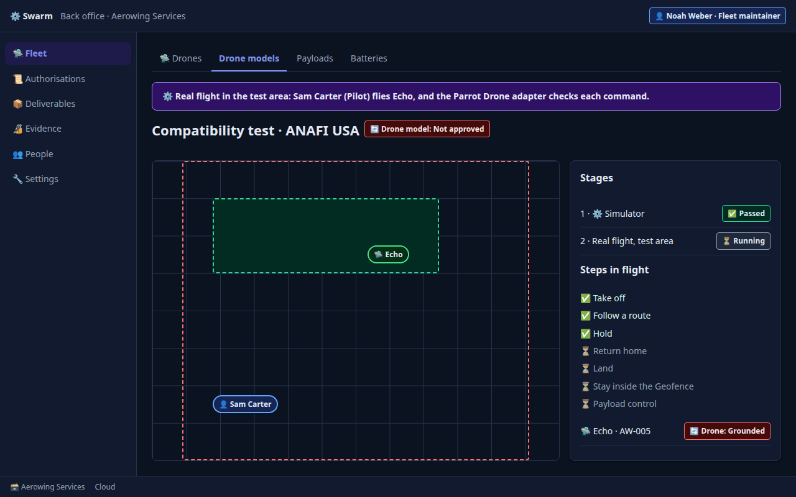](../../screens/UC-014/a3.dark.png) |
| OK: Drone model approved | [👤 Fleet maintainer](../../glossary.md#per-fleet-maintainer) | [🔄 Drone model: Approved](../../glossary.md#st-drone-model-approved) [🔄 Drone: Ready](../../glossary.md#st-drone-ready) | ✏️ Mock-up | [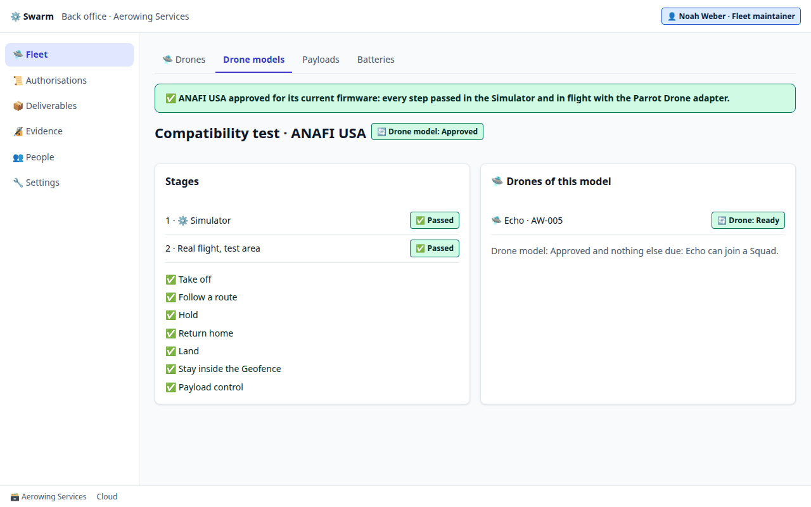](../../screens/UC-014/ok.png) [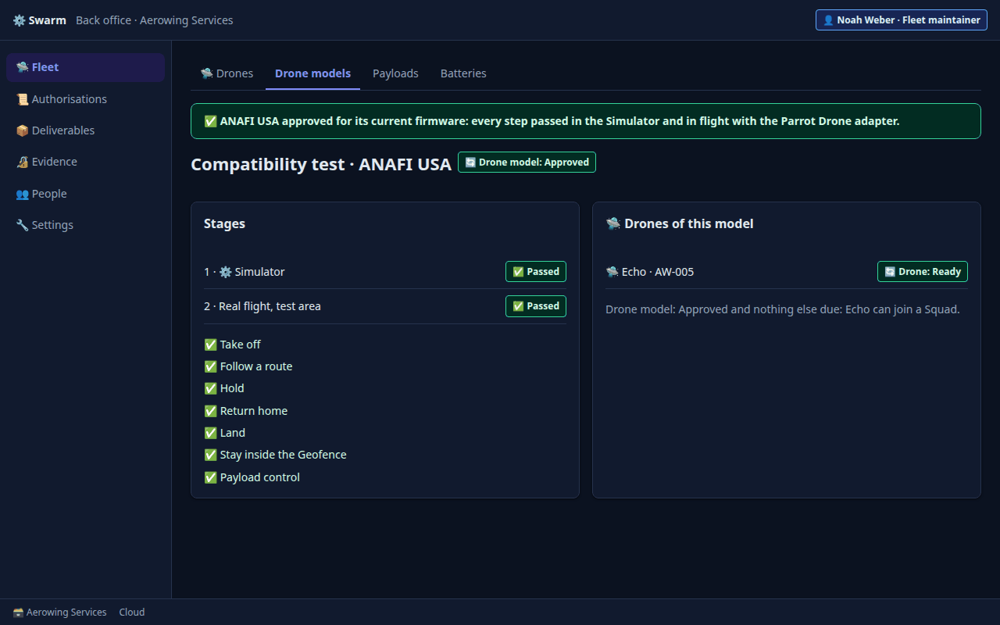](../../screens/UC-014/ok.dark.png) |
| KO: Test failed, Drones stay Grounded | [👤 Fleet maintainer](../../glossary.md#per-fleet-maintainer) | [🔄 Drone model: Not approved](../../glossary.md#st-drone-model-not-approved) [🔄 Drone: Grounded](../../glossary.md#st-drone-grounded) | ✏️ Mock-up | [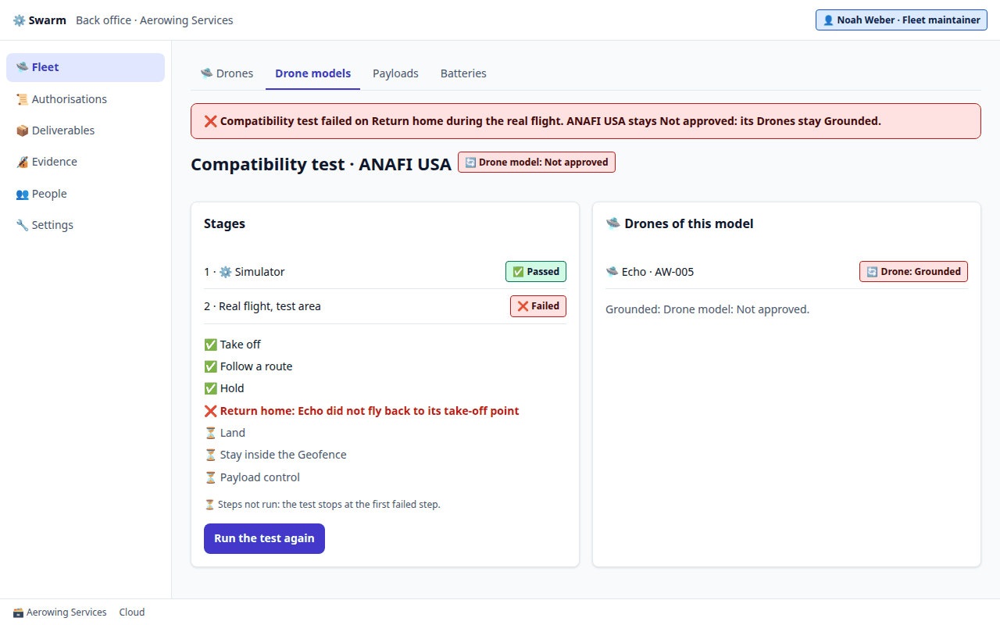](../../screens/UC-014/ko.png) [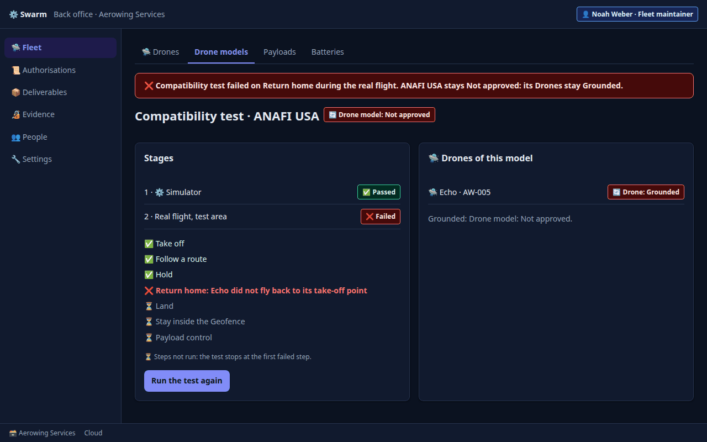](../../screens/UC-014/ko.dark.png) |

## ↪️ Alternative and error flows

| # | At step | Condition | What happens |
| --- | --- | --- | --- |
| A1 | 3 | The Simulator cannot fly this Drone model | The test starts directly with the real flight of step 4. |
| A2 | 3 or 4 | A step fails, such as Return home in the real flight: Echo does not fly back to its take-off point | The test stops and the Back office names the failed step. ANAFI USA stays **Drone model: Not approved** and its Drones stay **Drone: Grounded** ([📏 BR-015](../business-rules/BR-015-approved-drone-models-only.md)). The Fleet maintainer can run the test again later (KO). |
| A3 | 4 | Echo does not answer through the Drone adapter | The step counts as failed: the Drones of the model stay **Drone: Grounded** (KO). |
| A4 | After 5 | The maker releases a new firmware version for ANAFI USA | The Drone model goes back to **Drone model: Not approved** and its Drones to **Drone: Grounded** until the test passes again with the new firmware (back to step 3). |
| A5 | 5 | Echo has another reason to be Grounded, such as an open fault | The Drone model is Approved, but Echo stays **Drone: Grounded** until the Fleet maintainer clears it ([🎬 UC-007: Register a Drone and track its readiness](UC-007-register-a-drone-and-track-its-readiness.md)). |

## 📏 Business rules applied

| Rule | Where it applies |
| --- | --- |
| [📏 BR-015: Approved Drone models only](../business-rules/BR-015-approved-drone-models-only.md) | Steps 2 to 5: a Drone flies only when its Drone model has passed the compatibility test, in the Simulator then in a real flight, for its current firmware |
| [📏 BR-011: Drone readiness](../business-rules/BR-011-drone-readiness.md) | Step 5: once its Drone model is Approved, a Drone is Ready only if nothing else grounds it |

## 🏁 Postconditions

- ✅ **Success:** ANAFI USA is **Drone model: Approved** with the Parrot Drone adapter for its current firmware. Its Drones can become **Drone: Ready** and join a [🗃️ Squad](../../glossary.md#ent-squad).
- ❌ **Failure:** ANAFI USA stays **Drone model: Not approved**. Its Drones stay **Drone: Grounded**, and the Fleet maintainer sees which step of the test failed, in the Simulator or in flight.

## 🔗 Referenced by

<!-- spec:referenced-by -->
- [📘 FS-011: Drone adapters](../features/FS-011-drone-adapters.md)
- [🎬 UC-007: Register a Drone and track its readiness](UC-007-register-a-drone-and-track-its-readiness.md)
<!-- /spec:referenced-by -->

<!-- spec:nav-bottom -->
---

> [🏠 Index](../../README.md) · [◀️ UC-013: Train on the Simulator](UC-013-train-on-the-simulator.md) · 📄 **Page 40 / 109** · [UC-015: Invite a Client to the Client portal ▶️](UC-015-invite-a-client-to-the-client-portal.md)
<!-- /spec:nav-bottom -->
