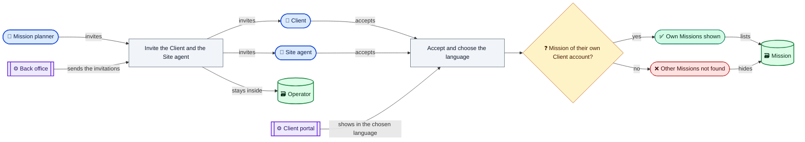
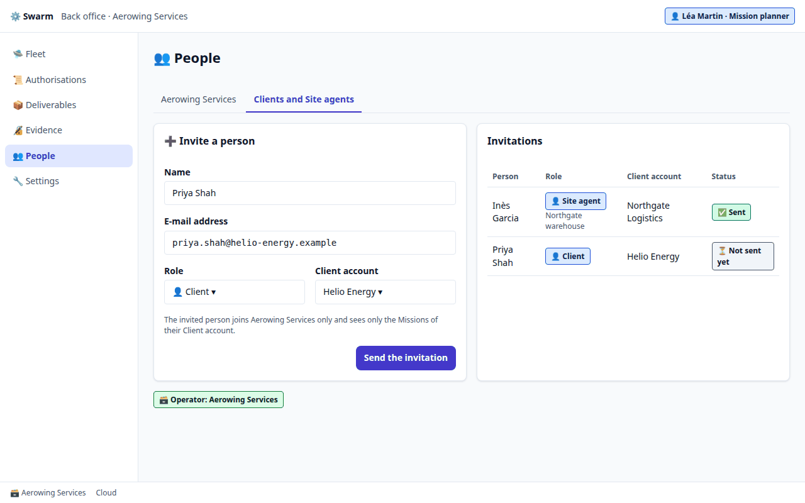
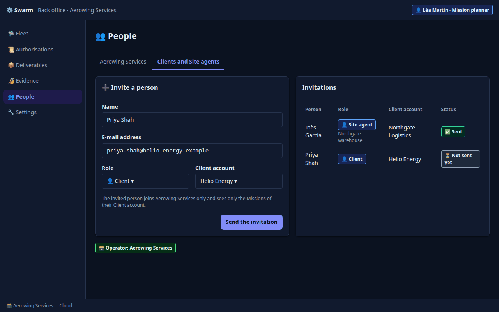
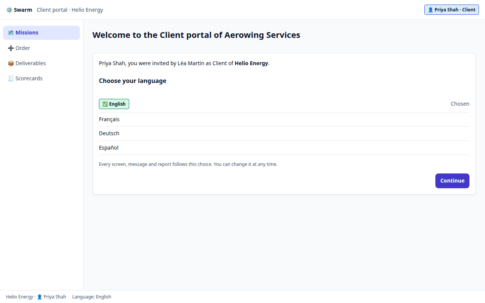
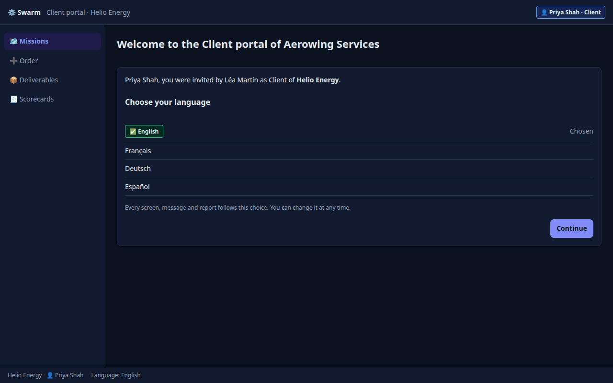
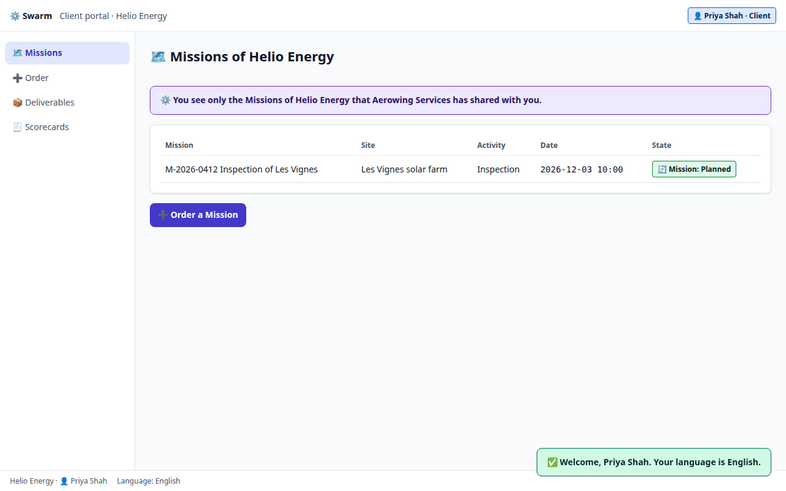
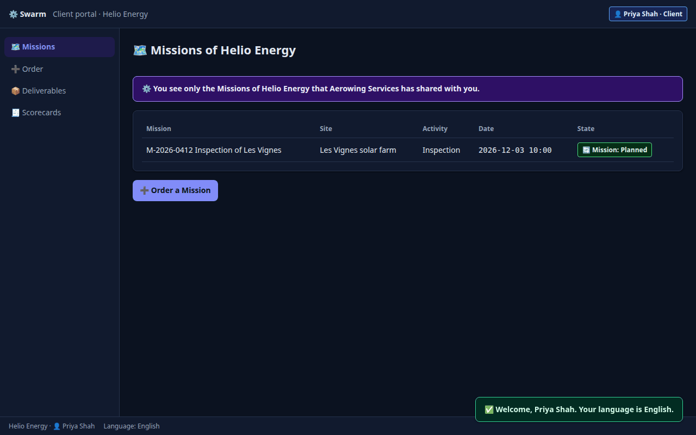
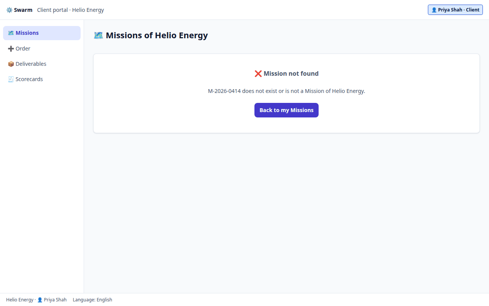
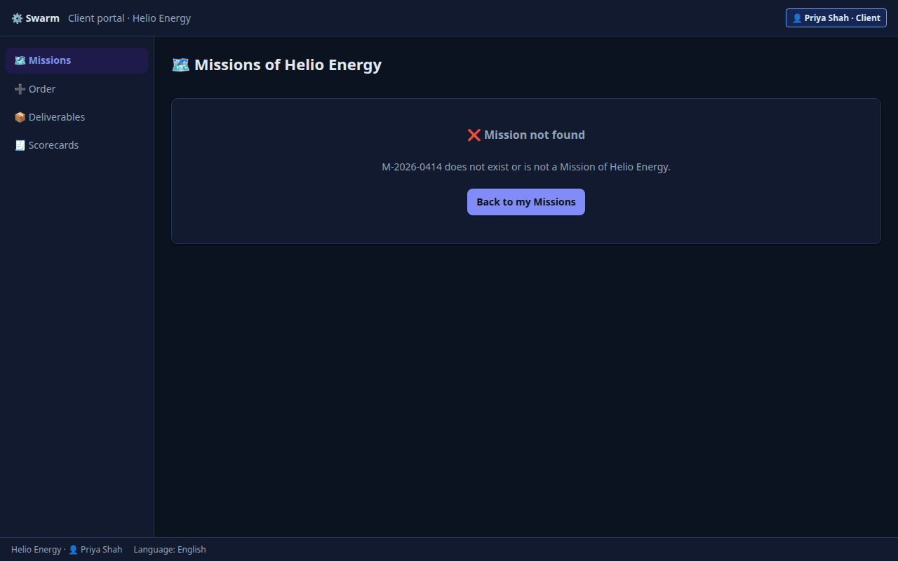

# 🎬 UC-015: Invite a Client to the Client portal

<!-- spec:nav-top -->
> [🏠 Index](../../README.md) · [◀️ UC-014: Connect a new Drone model](UC-014-connect-a-new-drone-model.md) · 📄 **Page 43 / 120** · [UC-016: Import and fly a Light show ▶️](UC-016-import-and-fly-a-light-show.md)
<!-- /spec:nav-top -->

**Status:** 🟢 Approved · **Updated:** 2026-11-18

> [!NOTE]
> The [👤 Mission planner](../../glossary.md#per-mission-planner) invites a [👤 Client](../../glossary.md#per-client) and a [👤 Site agent](../../glossary.md#per-site-agent) from the [⚙️ Back office](../../glossary.md#sys-back-office); each chooses their language and sees, in the [⚙️ Client portal](../../glossary.md#sys-client-portal), only the [🗃️ Missions](../../glossary.md#ent-mission) of their own Client account.

<!-- spec:summary -->
## 📑 Summary

1. [👤 Personas and entities](#actors)
2. [🚦 Preconditions](#preconditions)
3. [⚡ Trigger](#trigger)
4. [➡️ Main flow](#main-flow)
5. [🔀 Flow chart](#flowchart)
6. [🖼️ Screens](#screens)
7. [↪️ Alternative and error flows](#alternative-flows)
8. [📏 Business rules applied](#business-rules)
9. [🏁 Postconditions](#postconditions)
10. [🔗 Referenced by](#referenced-by)
<!-- /spec:summary -->

## 👤 Personas and entities

| Name | Kind | Role in this use case |
| --- | --- | --- |
| [👤 Mission planner](../../glossary.md#per-mission-planner) | Persona | Invites the Client and the Site agent |
| [👤 Client](../../glossary.md#per-client) | Persona | Accepts the invitation, chooses a language and sees the Missions of its Client account |
| [👤 Site agent](../../glossary.md#per-site-agent) | Persona | Accepts the invitation, chooses a language and sees the Missions of its Site |
| [🗃️ Operator](../../glossary.md#ent-operator) | Entity | The only organisation the invited people belong to |
| [🗃️ Mission](../../glossary.md#ent-mission) | Entity | Shown when it belongs to the Client account, not found otherwise |
| [⚙️ Back office](../../glossary.md#sys-back-office) | System | Creates the accesses and sends the invitations |
| [⚙️ Client portal](../../glossary.md#sys-client-portal) | System | Shows each invited person their own Missions in their language |

## 🚦 Preconditions

1. The [🗃️ Operator](../../glossary.md#ent-operator) Aerowing Services exists, created by the [👤 Swarm administrator](../../glossary.md#per-swarm-administrator) (see [🎬 UC-029: Create an Operator](UC-029-create-an-operator.md)), and its Mission planner, Léa Martin, is signed in to its Back office.
2. Helio Energy and Northgate Logistics are Client accounts of Aerowing Services, with their [🗃️ Sites](../../glossary.md#ent-site): Les Vignes solar farm and Northgate warehouse.

## ⚡ Trigger

A Client of Aerowing Services wants to order and follow its Missions in the Client portal.

## ➡️ Main flow

1. The [👤 Mission planner](../../glossary.md#per-mission-planner) opens 👥 People and invites Priya Shah as Client of Helio Energy, with her e-mail address.
2. The Mission planner invites Inès Garcia as [👤 Site agent](../../glossary.md#per-site-agent) of Northgate Logistics, at the Site Northgate warehouse.
3. The Back office creates both accesses inside Aerowing Services only ([📏 BR-008](../business-rules/BR-008-operator-isolation.md)) and sends the invitations.
4. The [👤 Client](../../glossary.md#per-client), Priya Shah, opens her invitation, signs in to the Client portal and chooses her language among English, French, German and Spanish ([📏 BR-017](../business-rules/BR-017-every-screen-in-four-languages.md)). She chooses English.
5. The Client portal shows Priya only the Missions of Helio Energy, such as M-2026-0412 Inspection of Les Vignes ([📏 BR-016](../business-rules/BR-016-clients-see-only-their-own-missions.md)).
6. The Site agent, Inès Garcia, does the same and sees only the Missions of Northgate Logistics, with 🔔 Alarms for her Site.

## 🔀 Flow chart

## 🖼️ Screens

One row per state of the flow chart: every action, success and failure node. Click a screen to open it full size. A state with nothing to show reads `➖ No screen: <why>`.

| State | Persona | Entity | Source | Screen |
| --- | --- | --- | --- | --- |
| A1: Invite the Client and the Site agent | [👤 Mission planner](../../glossary.md#per-mission-planner) | [🗃️ Operator](../../glossary.md#ent-operator) | ✏️ Mock-up |   |
| A2: Accept and choose the language | [👤 Client](../../glossary.md#per-client) | ➖ | ✏️ Mock-up |   |
| OK: Own Missions shown | [👤 Client](../../glossary.md#per-client) | [🔄 Mission: Planned](../../glossary.md#st-mission-planned) | ✏️ Mock-up |   |
| KO: Other Missions not found | [👤 Client](../../glossary.md#per-client) | [🗃️ Mission](../../glossary.md#ent-mission) | ✏️ Mock-up |   |

## ↪️ Alternative and error flows

| # | At step | Condition | What happens |
| --- | --- | --- | --- |
| A1 | 5 | Priya Shah opens a link to M-2026-0414 Night patrol of Northgate, a Mission of another Client account | The Client portal answers that the Mission is not found, as if it did not exist ([📏 BR-016](../business-rules/BR-016-clients-see-only-their-own-missions.md)) (KO). |
| A2 | 4 | The invited person chooses German | Every screen and message of the Client portal is in German; the names of Sites and Drones are not translated ([📏 BR-017](../business-rules/BR-017-every-screen-in-four-languages.md)). |
| A3 | 5 | A person of another Operator tries to open a Mission of Aerowing Services | Not found; the attempt is logged ([📏 BR-008](../business-rules/BR-008-operator-isolation.md)) (KO). |

## 📏 Business rules applied

| Rule | Where it applies |
| --- | --- |
| [📏 BR-008: Operator isolation](../business-rules/BR-008-operator-isolation.md) | Step 3: the invited people belong to Aerowing Services only |
| [📏 BR-017: Every screen in four languages](../business-rules/BR-017-every-screen-in-four-languages.md) | Step 4: each invited person chooses their language |
| [📏 BR-016: Clients see only their own Missions](../business-rules/BR-016-clients-see-only-their-own-missions.md) | Steps 5 and 6: each invited person sees only the Missions of their own Client account |

## 🏁 Postconditions

- ✅ **Success:** Priya Shah and Inès Garcia can sign in to the Client portal of Aerowing Services, in the language they chose, and each sees only the Missions of their own Client account.
- ❌ **Failure:** a Mission of another Client account or of another Operator is not found: nothing about it is shown.

## 🔗 Referenced by

<!-- spec:referenced-by -->
- [📘 FS-008: Client portal](../features/FS-008-client-portal.md)
- [📘 FS-012: Operators, deployment and languages](../features/FS-012-operators-deployment-and-languages.md)
- [🎬 UC-010: Order a Mission in the Client portal](UC-010-order-a-mission-in-the-client-portal.md)
- [🎬 UC-012: Verify the Evidence record of a flight](UC-012-verify-the-evidence-record-of-a-flight.md)
- [🎬 UC-029: Create an Operator](UC-029-create-an-operator.md)
<!-- /spec:referenced-by -->

<!-- spec:nav-bottom -->
---

> [🏠 Index](../../README.md) · [◀️ UC-014: Connect a new Drone model](UC-014-connect-a-new-drone-model.md) · 📄 **Page 43 / 120** · [UC-016: Import and fly a Light show ▶️](UC-016-import-and-fly-a-light-show.md)
<!-- /spec:nav-bottom -->
