# 🎬 UC-016: Import and fly a Light show

<!-- spec:nav-top -->
> [🏠 Index](../../README.md) · [◀️ UC-015: Invite a Client to the Client portal](UC-015-invite-a-client-to-the-client-portal.md) · 📄 **Page 42 / 109** · [UC-017: Spray a Field with refills ▶️](UC-017-spray-a-field-with-refills.md)
<!-- /spec:nav-top -->

**Status:** 🟢 Approved · **Updated:** 2026-11-18

> [!NOTE]
> The [👤 Mission planner](../../glossary.md#per-mission-planner) imports a [🗃️ Choreography](../../glossary.md#ent-choreography) that Swarm checks frame by frame, then the [👤 Pilot](../../glossary.md#per-pilot) flies the [🔤 Light show](../../glossary.md#term-light-show) in [⚙️ Ground control](../../glossary.md#sys-ground-control) on the music time code, and the whole [🗃️ Squad](../../glossary.md#ent-squad) stops if one Drone fails.

<!-- spec:summary -->
## 📑 Summary

1. [👤 Personas and entities](#actors)
2. [🚦 Preconditions](#preconditions)
3. [⚡ Trigger](#trigger)
4. [➡️ Main flow](#main-flow)
5. [🔀 Flow chart](#flowchart)
6. [🖼️ Screens](#screens)
7. [↪️ Alternative and error flows](#alternative-flows)
8. [📏 Business rules applied](#business-rules)
9. [🏁 Postconditions](#postconditions)
10. [🔗 Referenced by](#referenced-by)
<!-- /spec:summary -->

## 👤 Personas and entities

| Name | Kind | Role in this use case |
| --- | --- | --- |
| [👤 Mission planner](../../glossary.md#per-mission-planner) | Persona | Imports the Choreography from Blender or Skybrush Studio |
| [👤 Pilot](../../glossary.md#per-pilot) | Persona | Launches the show and supervises the Squad on the music time code |
| [🗃️ Choreography](../../glossary.md#ent-choreography) | Entity | Imported, checked frame by frame, accepted or refused |
| [🗃️ Mission](../../glossary.md#ent-mission) | Entity | Draft while the Choreography is checked, then Planned, Flying, and Completed or Held |
| [🗃️ Squad](../../glossary.md#ent-squad) | Entity | The 200 Drones of the show, each with a show light |
| [🗃️ Drone](../../glossary.md#ent-drone) | Entity | One Drone of the Squad that reports a fault in flight |
| [⚙️ Mission studio](../../glossary.md#sys-mission-studio) | System | Checks every frame of the Choreography |
| [⚙️ Ground control](../../glossary.md#sys-ground-control) | System | Flies the show on the music time code and applies the Fail-safe |

## 🚦 Preconditions

1. The [🗃️ Mission](../../glossary.md#ent-mission) M-2026-0415 Riverside Festival show exists for the Client Riverside Festival at the [🗃️ Site](../../glossary.md#ent-site) Riverside park, as [🔄 Mission: Draft](../../glossary.md#st-mission-draft), with its [🗃️ Geofence](../../glossary.md#ent-geofence) and the [🔤 Separation distance](../../glossary.md#term-separation-distance) of the Mission, 3 m.
2. The Mission planner Léa Martin has the Choreography of the show, made in Blender or Skybrush Studio, for 200 Drones carrying a show light [🗃️ Payload](../../glossary.md#ent-payload).
3. The [🔤 Activity](../../glossary.md#term-activity) is Light show, so the Mission is Pre-planned ([📏 BR-005](../business-rules/BR-005-autonomy-level-per-activity.md)).

## ⚡ Trigger

The Mission planner imports the Choreography in **🖊️ Design** of the Mission studio.

## ➡️ Main flow

1. The Mission planner imports the Choreography from Blender or Skybrush Studio into the Mission M-2026-0415.
2. The Mission studio checks every frame: the Separation distance between every two Drones and from the audience ([📏 BR-002](../business-rules/BR-002-separation-distance.md)), the speed against the limits of the [🗃️ Drone model](../../glossary.md#ent-drone-model), and the battery each Drone needs to the end of the show.
3. Every frame passes: the Mission studio accepts the Choreography and the Mission becomes [🔄 Mission: Planned](../../glossary.md#st-mission-planned).
4. On 3 December 2026, the Pilot Sam Carter runs the [🗃️ Pre-flight check](../../glossary.md#ent-pre-flight-check) in Ground control ([🎬 UC-003](UC-003-run-the-pre-flight-check-and-launch.md)); the Mission is [🔄 Mission: Verified](../../glossary.md#st-mission-verified).
5. The Pilot launches the show. Ground control sends a standard time code (SMPTE LTC or MIDI time code) to the audio desk of the show, or plays the music itself, and the Squad flies the Choreography, frame by frame, on that time code. The Mission is [🔄 Mission: Flying](../../glossary.md#st-mission-flying) and the Pilot is [🔄 Pilot: Supervising](../../glossary.md#st-pilot-supervising). Only [🔤 Fail-safes](../../glossary.md#term-fail-safe) act in flight ([📏 BR-005](../business-rules/BR-005-autonomy-level-per-activity.md)).
6. The last frame ends: every Drone lands at its landing position ([🔄 Drone: Landed](../../glossary.md#st-drone-landed)) and the Mission is [🔄 Mission: Completed](../../glossary.md#st-mission-completed).

## 🔀 Flow chart

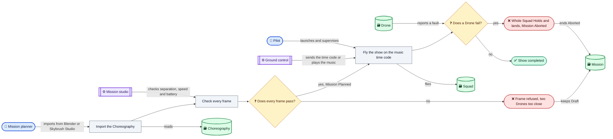

## 🖼️ Screens

One row per state of the flow chart: every action, success and failure node. Click a screen to open it full size. A state with nothing to show reads `➖ No screen: <why>`.

| State | Persona | Entity | Source | Screen |
| --- | --- | --- | --- | --- |
| A1: Import the Choreography | [👤 Mission planner](../../glossary.md#per-mission-planner) | [🔄 Mission: Draft](../../glossary.md#st-mission-draft) [🗃️ Choreography](../../glossary.md#ent-choreography) | ✏️ Mock-up | [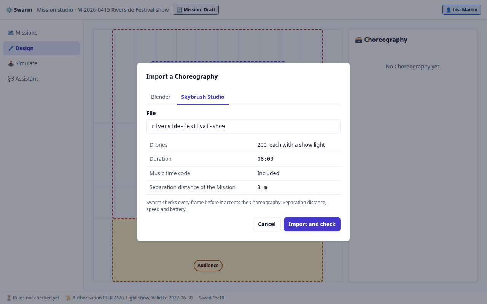](../../screens/UC-016/a1.png) [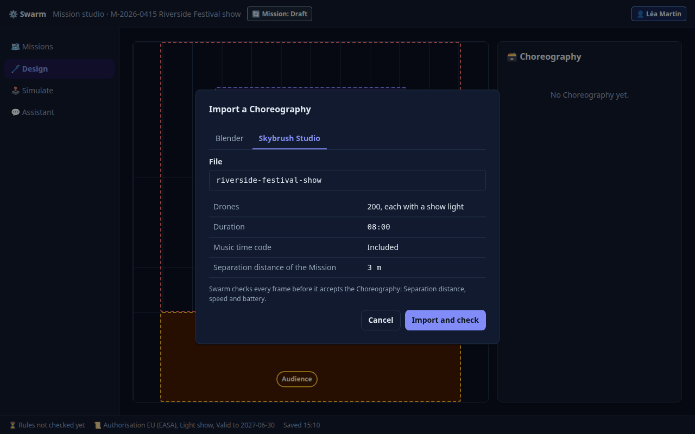](../../screens/UC-016/a1.dark.png) |
| A2: Check every frame | [👤 Mission planner](../../glossary.md#per-mission-planner) | [🔄 Mission: Draft](../../glossary.md#st-mission-draft) [🗃️ Choreography](../../glossary.md#ent-choreography) | ✏️ Mock-up | [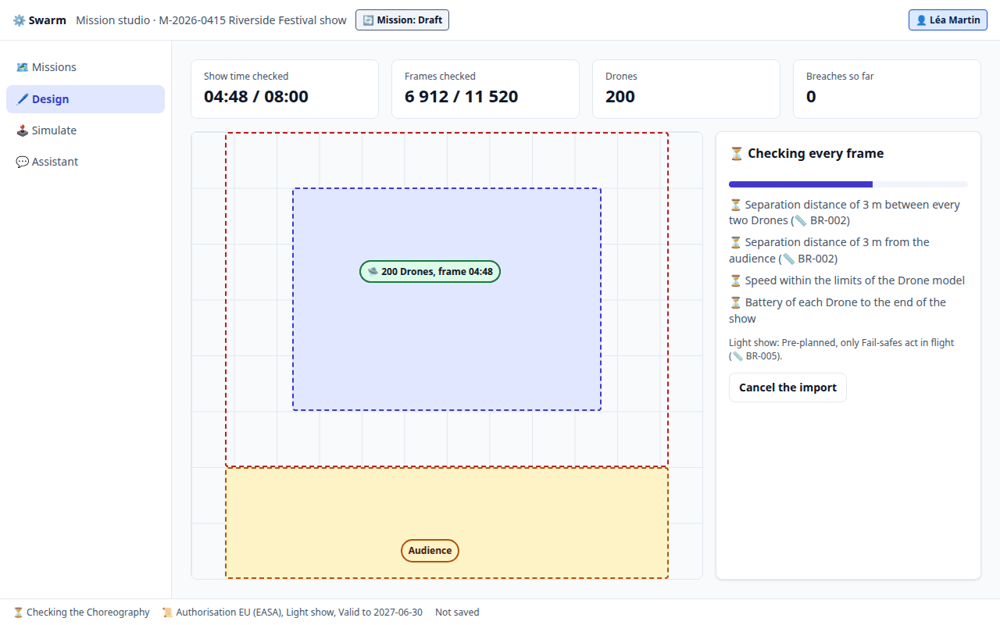](../../screens/UC-016/a2.png) [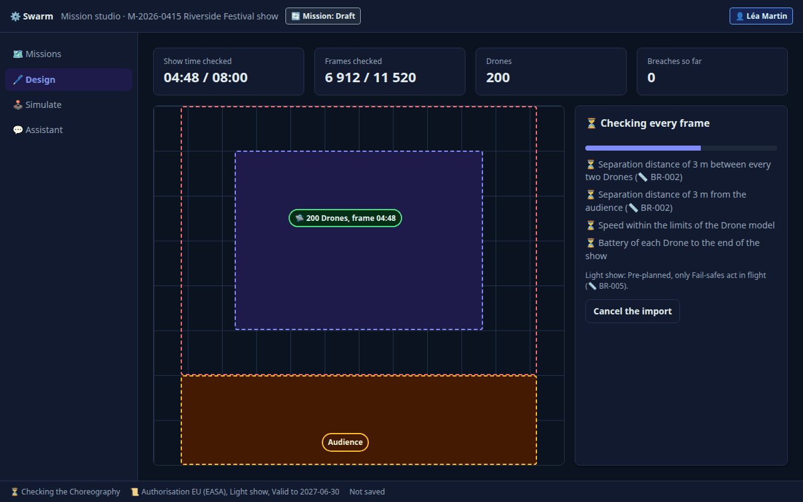](../../screens/UC-016/a2.dark.png) |
| KO1: Frame refused, two Drones too close | [👤 Mission planner](../../glossary.md#per-mission-planner) | [🔄 Mission: Draft](../../glossary.md#st-mission-draft) [🗃️ Choreography](../../glossary.md#ent-choreography) | ✏️ Mock-up | [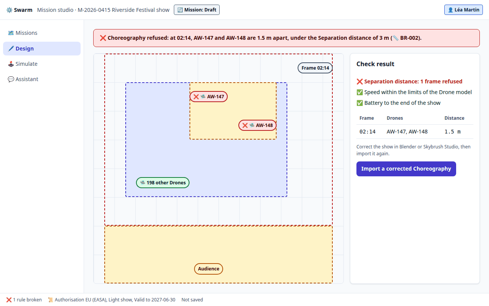](../../screens/UC-016/ko1.png) [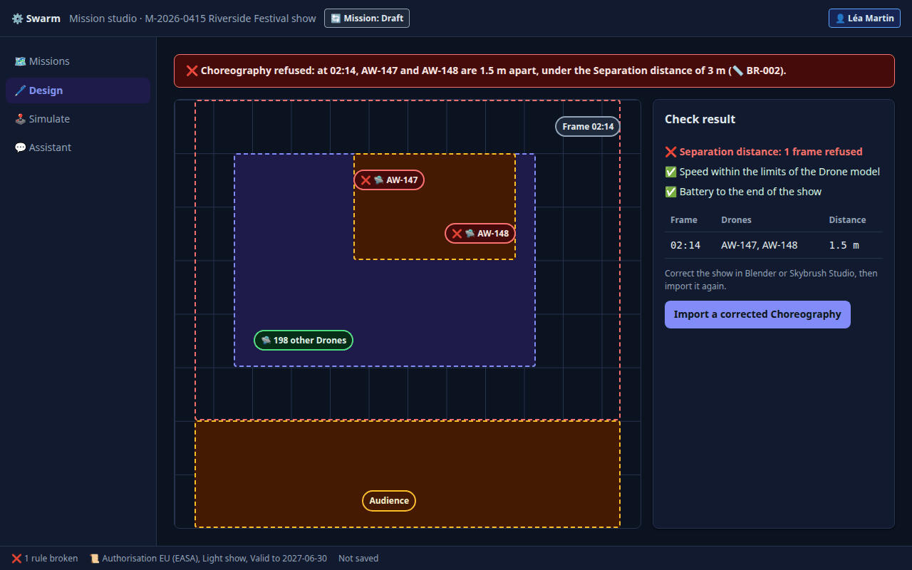](../../screens/UC-016/ko1.dark.png) |
| A3: Fly the show on the music time code | [🔄 Pilot: Supervising](../../glossary.md#st-pilot-supervising) | [🔄 Mission: Flying](../../glossary.md#st-mission-flying) [🗃️ Squad](../../glossary.md#ent-squad) | ✏️ Mock-up | [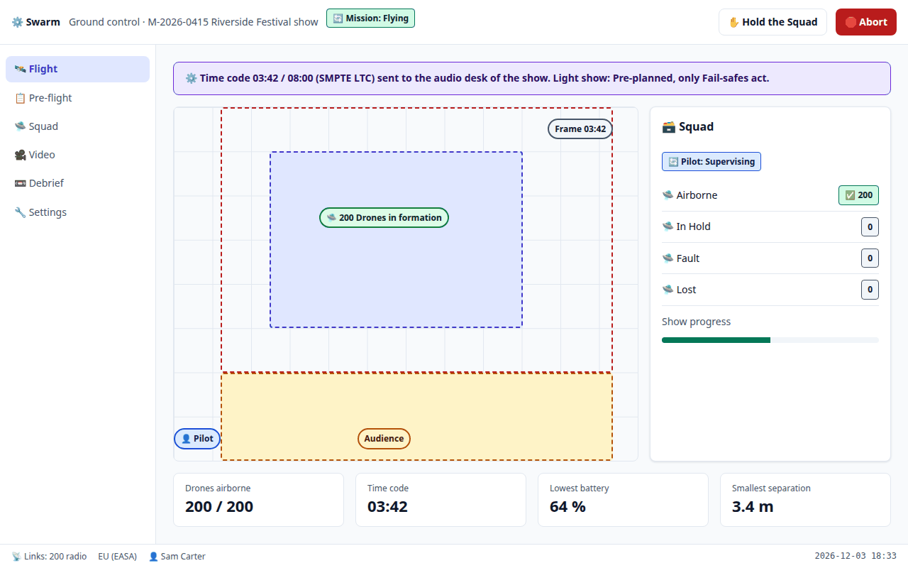](../../screens/UC-016/a3.png) [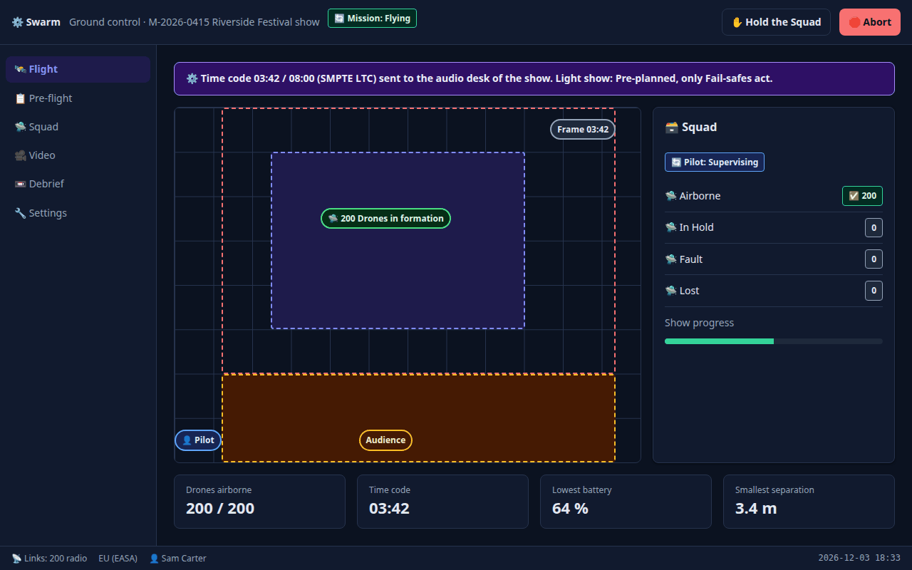](../../screens/UC-016/a3.dark.png) |
| OK: Show completed | [👤 Pilot](../../glossary.md#per-pilot) | [🔄 Mission: Completed](../../glossary.md#st-mission-completed) [🔄 Drone: Landed](../../glossary.md#st-drone-landed) | ✏️ Mock-up | [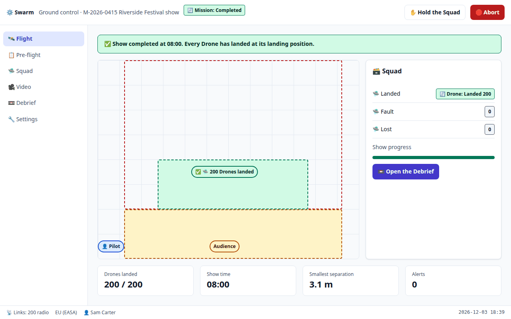](../../screens/UC-016/ok.png) [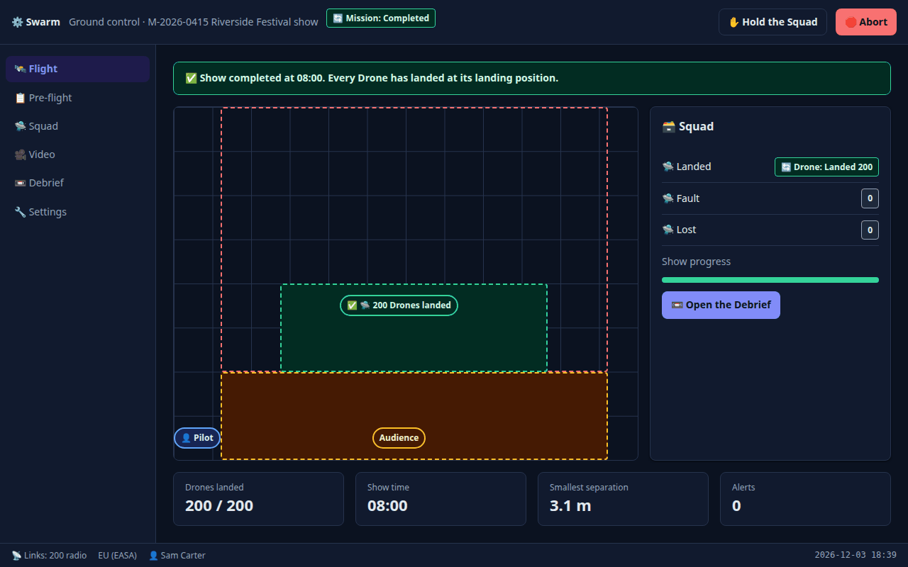](../../screens/UC-016/ok.dark.png) |
| KO2: Whole Squad Holds and lands, Mission Aborted | [🔄 Pilot: Supervising](../../glossary.md#st-pilot-supervising) | [🔄 Mission: Held](../../glossary.md#st-mission-held) [🔄 Mission: Aborted](../../glossary.md#st-mission-aborted) [🔄 Drone: Landed](../../glossary.md#st-drone-landed) | ✏️ Mock-up | [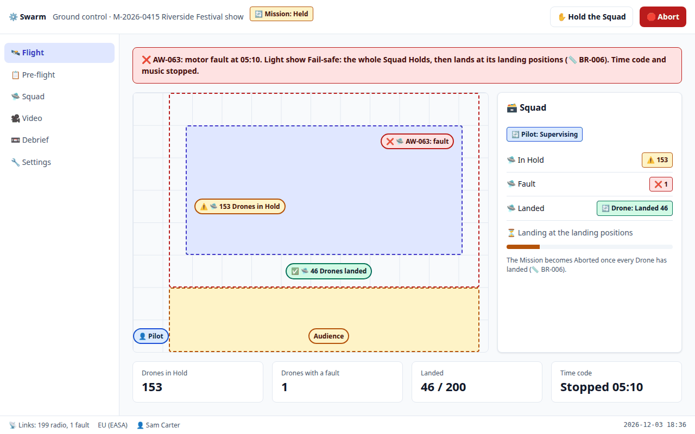](../../screens/UC-016/ko2.png) [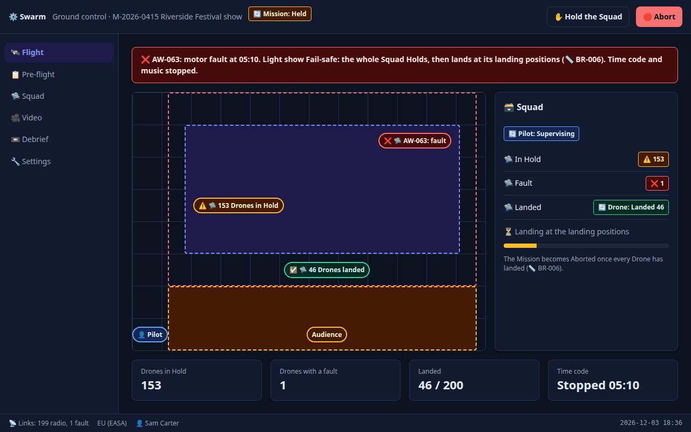](../../screens/UC-016/ko2.dark.png) |

## ↪️ Alternative and error flows

| # | At step | Condition | What happens |
| --- | --- | --- | --- |
| A1 | 2 | At 02:14 of the show, the Drones AW-147 and AW-148 are 1.5 m apart, under the Separation distance of 3 m | The import is refused and names the frame and the two Drones; the Mission stays Draft (KO1) ([📏 BR-002](../business-rules/BR-002-separation-distance.md)) |
| A2 | 2 | A frame asks a Drone for a speed above the limit of its Drone model, or a Drone needs more battery than it has to finish the show | The import is refused and names the frame, the Drone and the limit; the Mission stays Draft (KO1) |
| A3 | 2 | A frame brings a Drone closer to the audience than the Separation distance | The import is refused and names the frame and the Drone (KO1) ([📏 BR-002](../business-rules/BR-002-separation-distance.md)) |
| A4 | KO1 | The Mission planner corrects the show in Blender or Skybrush Studio | The Mission planner imports the corrected Choreography, from step 1 |
| A5 | 5 | The Drone AW-063 reports a motor fault, or is lost | The whole Squad Holds, then lands at its landing positions; the time code and the music stop; the Mission is [🔄 Mission: Held](../../glossary.md#st-mission-held) while the Drones land, then Aborted once every Drone has landed (KO2) ([📏 BR-006](../business-rules/BR-006-fail-safe-per-activity.md)) |
| A6 | 5 | A Drone of the show proposes a new path to avoid another | Not allowed: the Squad keeps the Choreography and the Fail-safe applies (KO2) ([📏 BR-005](../business-rules/BR-005-autonomy-level-per-activity.md)) |

## 📏 Business rules applied

| Rule | Where it applies |
| --- | --- |
| [📏 BR-002: Separation distance](../business-rules/BR-002-separation-distance.md) | Step 2, A1, A3 |
| [📏 BR-005: Autonomy level per Activity](../business-rules/BR-005-autonomy-level-per-activity.md) | Preconditions, step 5, A6 |
| [📏 BR-006: Fail-safe per Activity](../business-rules/BR-006-fail-safe-per-activity.md) | Step 5, A5 |

## 🏁 Postconditions

- ✅ **Success:** the Choreography is accepted, the show is flown on the music time code, every Drone has landed at its landing position and the Mission is Completed. The [🗃️ Flight log](../../glossary.md#ent-flight-log) holds the whole show.
- ❌ **Failure, at import:** the Choreography is refused, the Mission stays Draft, and the Mission planner sees the frame, the Drones and the limit at fault.
- ❌ **Failure, in flight:** one Drone failed, so the whole Squad Held, then landed at its landing positions. Once every Drone has landed, the Mission is [🔄 Mission: Aborted](../../glossary.md#st-mission-aborted). The Pilot sees the Drone at fault and the landing of every Drone.

## 🔗 Referenced by

<!-- spec:referenced-by -->
- [📘 FS-013: Light shows](../features/FS-013-light-shows.md)
<!-- /spec:referenced-by -->

<!-- spec:nav-bottom -->
---

> [🏠 Index](../../README.md) · [◀️ UC-015: Invite a Client to the Client portal](UC-015-invite-a-client-to-the-client-portal.md) · 📄 **Page 42 / 109** · [UC-017: Spray a Field with refills ▶️](UC-017-spray-a-field-with-refills.md)
<!-- /spec:nav-bottom -->
