# 🎬 UC-017: Spray a Field with refills

<!-- spec:nav-top -->
> [🏠 Index](../../README.md) · [◀️ UC-016: Import and fly a Light show](UC-016-import-and-fly-a-light-show.md) · 📄 **Page 43 / 108** · [UC-018: Respond to a Site Alarm ▶️](UC-018-respond-to-a-site-alarm.md)
<!-- /spec:nav-top -->

**Status:** 🟢 Approved · **Updated:** 2026-11-18

> [!NOTE]
> The [👤 Pilot](../../glossary.md#per-pilot) supervises a [🗃️ Squad](../../glossary.md#ent-squad) spraying a [🗃️ Field](../../glossary.md#ent-field) at the doses of its [🗃️ Prescription map](../../glossary.md#ent-prescription-map), approves the refill [🗃️ Re-plans](../../glossary.md#ent-re-plan), and gets the whole Field sprayed with nothing outside it.

<!-- spec:summary -->
## 📑 Summary

1. [👤 Personas and entities](#actors)
2. [🚦 Preconditions](#preconditions)
3. [⚡ Trigger](#trigger)
4. [➡️ Main flow](#main-flow)
5. [🔀 Flow chart](#flowchart)
6. [🖼️ Screens](#screens)
7. [↪️ Alternative and error flows](#alternative-flows)
8. [📏 Business rules applied](#business-rules)
9. [🏁 Postconditions](#postconditions)
10. [🔗 Referenced by](#referenced-by)
<!-- /spec:summary -->

## 👤 Personas and entities

| Name | Kind | Role in this use case |
| --- | --- | --- |
| [👤 Pilot](../../glossary.md#per-pilot) | Persona | Launches, supervises and approves the refill Re-plans |
| [🗃️ Mission](../../glossary.md#ent-mission) | Entity | M-2026-0413 Spraying of North field, with its Pre-planned routes |
| [🗃️ Field](../../glossary.md#ent-field) | Entity | North field: its boundary is the edge of the spraying |
| [🗃️ Prescription map](../../glossary.md#ent-prescription-map) | Entity | Gives the dose of each zone |
| [🗃️ Squad](../../glossary.md#ent-squad) | Entity | Alpha, Bravo and Charlie spray together and propose the refills |
| [🗃️ Payload](../../glossary.md#ent-payload) | Entity | The sprayer tank and its pump on each Drone |
| [🗃️ Re-plan](../../glossary.md#ent-re-plan) | Entity | The refill Re-plan the Pilot approves or rejects |
| [🗃️ Drone](../../glossary.md#ent-drone) | Entity | Alpha flies to the refill point and back |
| [⚙️ Ground control](../../glossary.md#sys-ground-control) | System | Shows the doses, the tanks and the Re-plan to the Pilot |

## 🚦 Preconditions

1. The [🗃️ Mission](../../glossary.md#ent-mission) M-2026-0413 Spraying of North field, for the [👤 Client](../../glossary.md#per-client) Domaine des Trois Chênes, is Verified.
2. The boundary of North field sets the [🗃️ Geofence](../../glossary.md#ent-geofence) of the Mission ([📏 BR-001](../business-rules/BR-001-geofence-and-altitude-ceiling.md)).
3. The Prescription map of North field is imported: zone A at 2 L/ha, zone B at 1 L/ha.
4. Alpha, Bravo and Charlie each carry a sprayer tank, filled. The refill point is at the [🗃️ Field kit](../../glossary.md#ent-field-kit).
5. Swarm has recorded the licences of the Pilot Sam Carter: the drone qualification of the [🔤 Jurisdiction](../../glossary.md#term-jurisdiction) (EU A2 or STS, US Part 107) and the pesticide applicator licence. In the US, Swarm also has the Part 137 certificate of the [🗃️ Operator](../../glossary.md#ent-operator).
6. The Operator sets the refill level: here, 10 % of the tank left.

## ⚡ Trigger

The Pilot launches M-2026-0413 in [⚙️ Ground control](../../glossary.md#sys-ground-control).

## ➡️ Main flow

1. The Pilot launches the Squad. Each [🗃️ Drone](../../glossary.md#ent-drone) flies its Pre-planned route ([📏 BR-005](../business-rules/BR-005-autonomy-level-per-activity.md)).
2. Each Drone sprays the dose of the zone it flies over: 2 L/ha in zone A, 1 L/ha in zone B ([📏 BR-018](../business-rules/BR-018-dose-follows-the-prescription-map.md)). The Pilot supervises the doses, the tank levels and the area sprayed.
3. At the end of each pass, a Drone that reaches the Field boundary stops its pump: nothing is sprayed outside the Field ([📏 BR-018](../business-rules/BR-018-dose-follows-the-prescription-map.md)). The Pilot sees where the pump stopped.
4. When the tank of Alpha reaches 10 % (the Operator setting), the Squad proposes a refill Re-plan: Alpha flies to the refill point, then resumes its route where it stopped. Refills are supervised, so the Pilot must approve it ([📏 BR-005](../business-rules/BR-005-autonomy-level-per-activity.md), [📏 BR-013](../business-rules/BR-013-re-plan-approval.md)).
5. The Pilot approves the Re-plan. Alpha returns to the refill point, the crew refills its tank, and Alpha resumes where it stopped. Bravo and Charlie keep spraying.
6. When every zone has received its dose, the Squad lands. The Mission is Completed and the dose applied in each zone is recorded for the spray map.

## 🔀 Flow chart

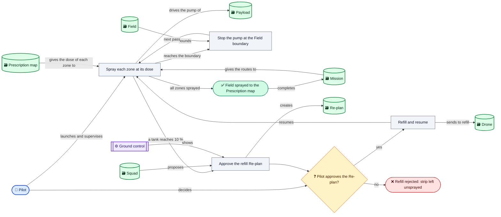

## 🖼️ Screens

One row per state of the flow chart: every action, success and failure node. Click a screen to open it full size. A state with nothing to show reads `➖ No screen: <why>`.

| State | Persona | Entity | Source | Screen |
| --- | --- | --- | --- | --- |
| A1: Spray each zone at its dose | [🔄 Pilot: Supervising](../../glossary.md#st-pilot-supervising) | [🔄 Mission: Flying](../../glossary.md#st-mission-flying) | ✏️ Mock-up | [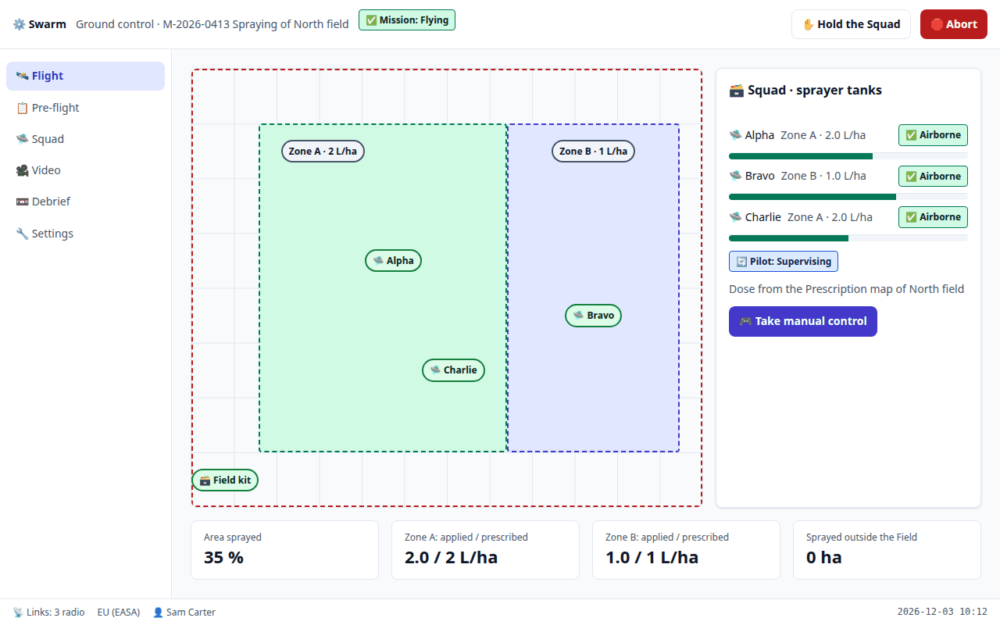](../../screens/UC-017/a1.png) [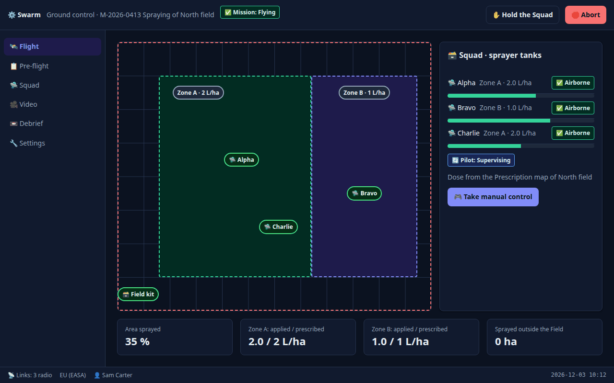](../../screens/UC-017/a1.dark.png) |
| A4: Stop the pump at the Field boundary | [🔄 Pilot: Supervising](../../glossary.md#st-pilot-supervising) | [🗃️ Field](../../glossary.md#ent-field) [🗃️ Payload](../../glossary.md#ent-payload) | ✏️ Mock-up | [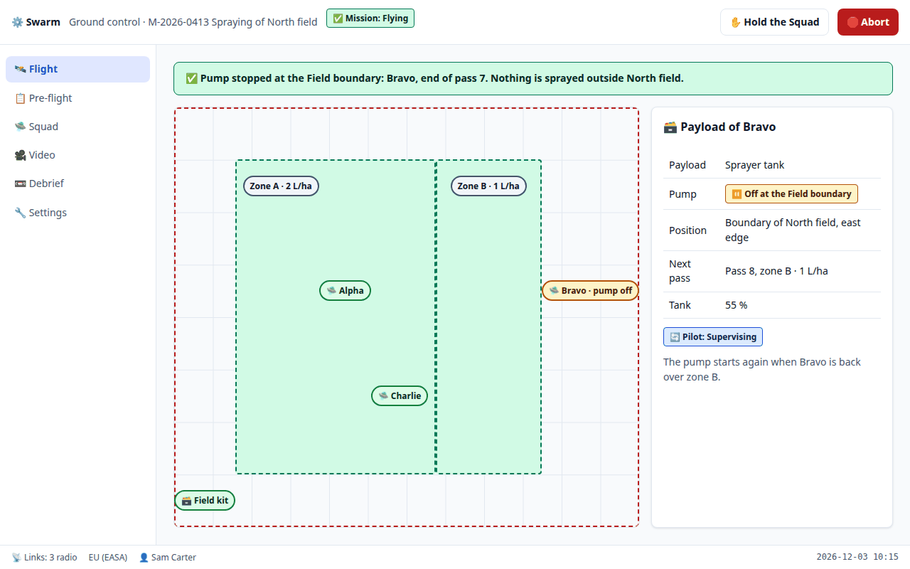](../../screens/UC-017/a4.png) [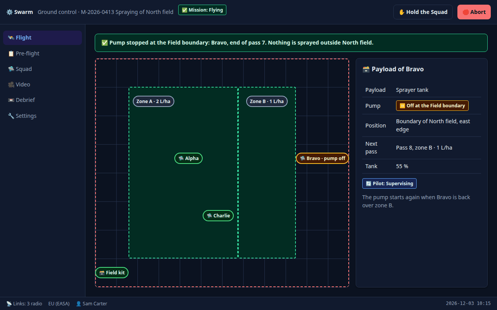](../../screens/UC-017/a4.dark.png) |
| A2: Approve the refill Re-plan | [🔄 Pilot: Supervising](../../glossary.md#st-pilot-supervising) | [🔄 Re-plan: Proposed](../../glossary.md#st-re-plan-proposed) | ✏️ Mock-up | [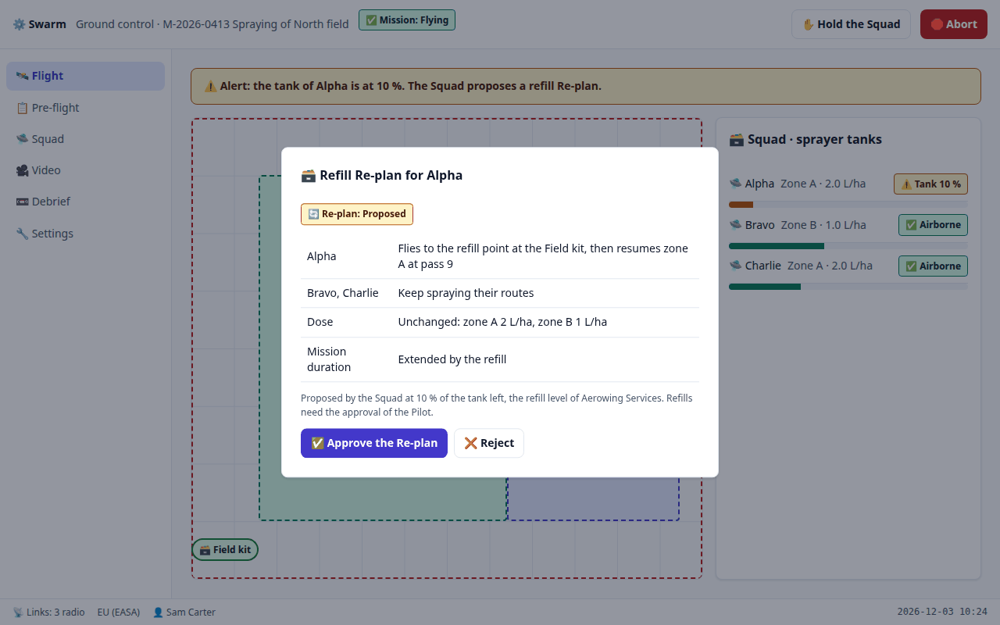](../../screens/UC-017/a2.png) [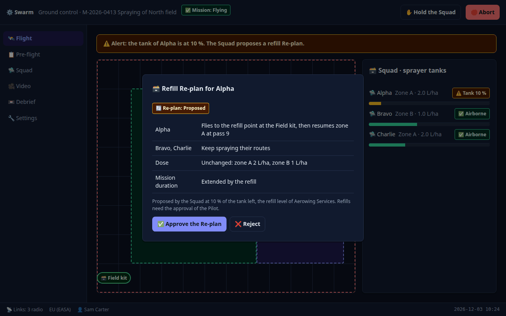](../../screens/UC-017/a2.dark.png) |
| A3: Refill and resume | [🔄 Pilot: Supervising](../../glossary.md#st-pilot-supervising) | [🔄 Re-plan: Applied](../../glossary.md#st-re-plan-applied) [🔄 Drone: Returning](../../glossary.md#st-drone-returning) | ✏️ Mock-up | [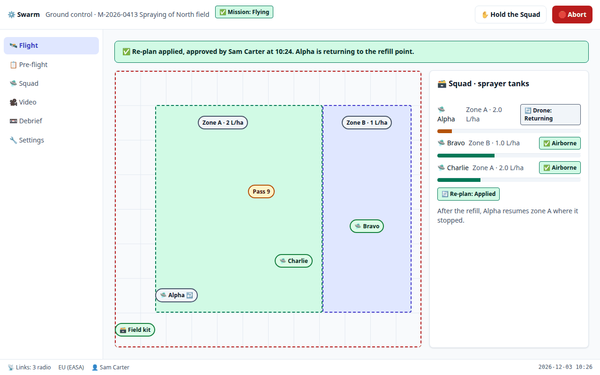](../../screens/UC-017/a3.png) [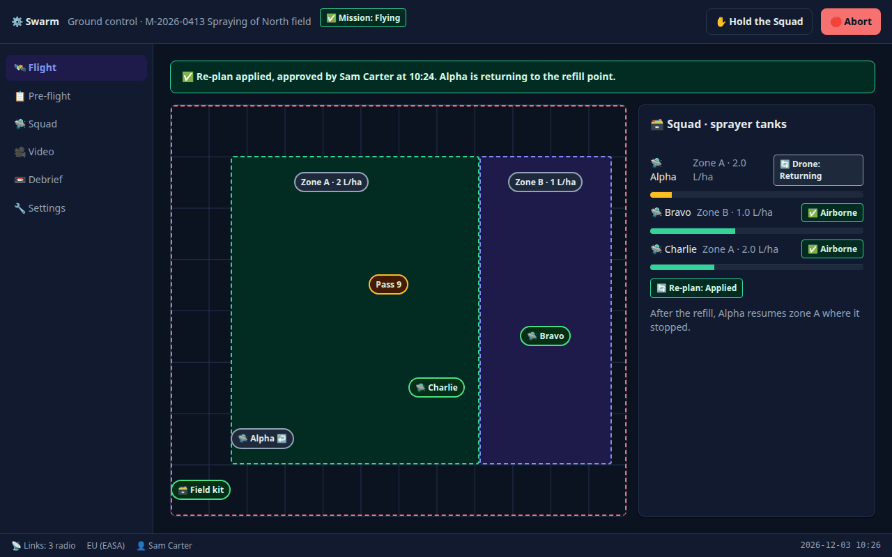](../../screens/UC-017/a3.dark.png) |
| OK: Field sprayed to the Prescription map | [👤 Pilot](../../glossary.md#per-pilot) | [🔄 Mission: Completed](../../glossary.md#st-mission-completed) | ✏️ Mock-up | [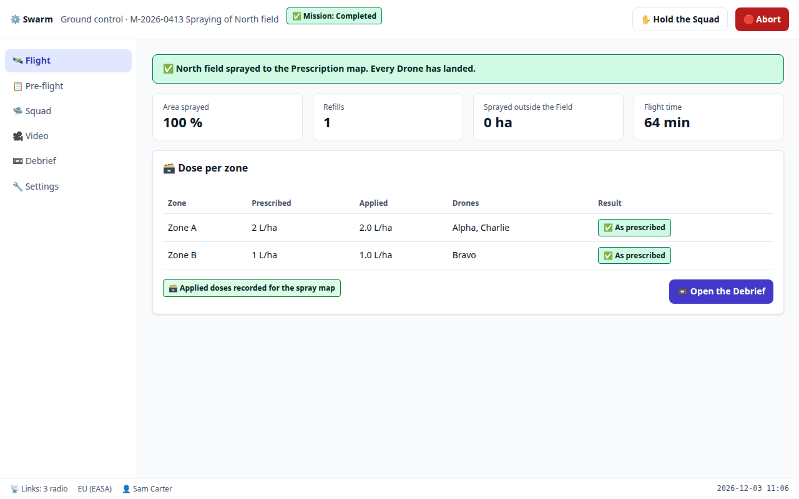](../../screens/UC-017/ok.png) [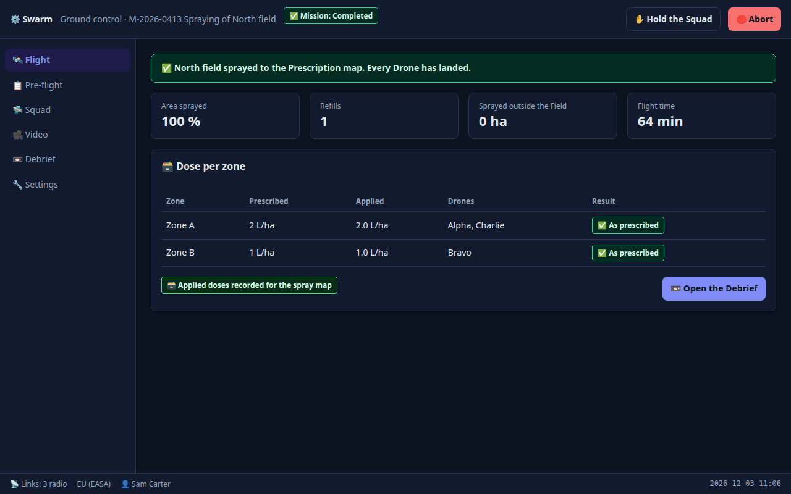](../../screens/UC-017/ok.dark.png) |
| KO: Refill rejected: strip left unsprayed | [🔄 Pilot: Supervising](../../glossary.md#st-pilot-supervising) | [🔄 Re-plan: Rejected](../../glossary.md#st-re-plan-rejected) | ✏️ Mock-up | [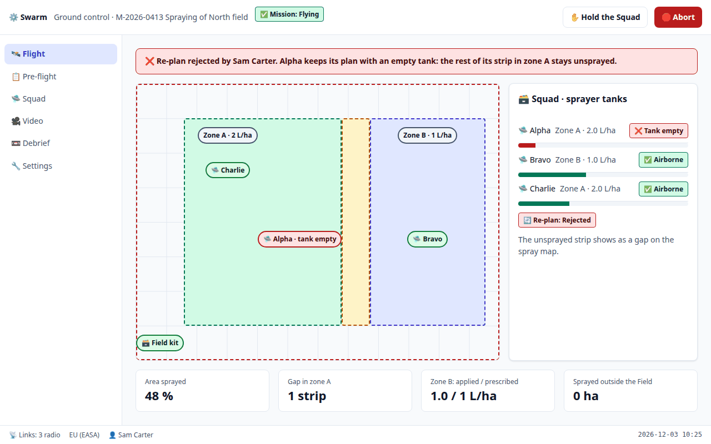](../../screens/UC-017/ko.png) [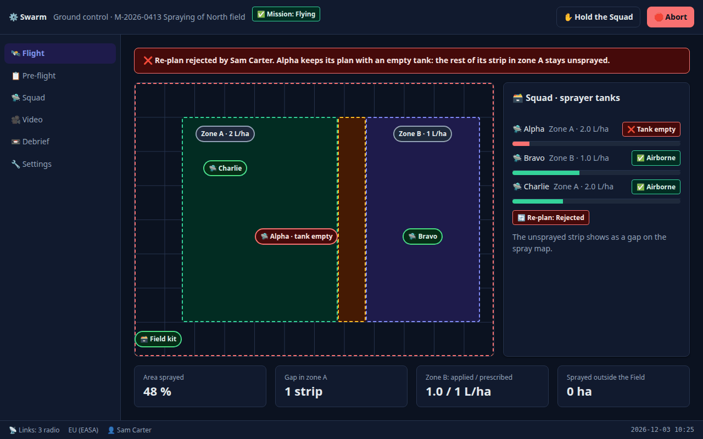](../../screens/UC-017/ko.dark.png) |

## ↪️ Alternative and error flows

| # | At step | Condition | What happens |
| --- | --- | --- | --- |
| A1 | 5 | The Pilot rejects the refill Re-plan | The Squad keeps its plan. Alpha flies the rest of its strip with an empty tank: that strip of zone A stays unsprayed and shows as a gap on the spray map. |
| A2 | 3 | A Drone reaches the Field boundary with its pump on | The pump stops at the boundary. Nothing is sprayed outside the Field ([📏 BR-018](../business-rules/BR-018-dose-follows-the-prescription-map.md)). |

## 📏 Business rules applied

| Rule | Where it applies |
| --- | --- |
| [📏 BR-018: Dose follows the Prescription map](../business-rules/BR-018-dose-follows-the-prescription-map.md) | Steps 2 and 3: the dose of each zone, the pump stopped at the Field boundary |
| [📏 BR-001: Geofence and Altitude ceiling](../business-rules/BR-001-geofence-and-altitude-ceiling.md) | Precondition 2: the Field sets the Geofence |
| [📏 BR-005: Autonomy level per Activity](../business-rules/BR-005-autonomy-level-per-activity.md) | Steps 1 and 4: Pre-planned routes, supervised refills |
| [📏 BR-013: Re-plan approval](../business-rules/BR-013-re-plan-approval.md) | Step 5: the Pilot approves the refill Re-plan before it applies |

## 🏁 Postconditions

- ✅ **Success:** every zone of North field received the dose of the Prescription map, nothing was sprayed outside the Field, and the Mission is Completed with the applied doses recorded for the spray map.
- ❌ **Failure:** the refill Re-plan was rejected; the strip Alpha could not spray shows as a gap, and the Pilot sees it on the map and in the area sprayed.

## 🔗 Referenced by

<!-- spec:referenced-by -->
- [📘 FS-014: Agriculture](../features/FS-014-agriculture.md)
<!-- /spec:referenced-by -->

<!-- spec:nav-bottom -->
---

> [🏠 Index](../../README.md) · [◀️ UC-016: Import and fly a Light show](UC-016-import-and-fly-a-light-show.md) · 📄 **Page 43 / 108** · [UC-018: Respond to a Site Alarm ▶️](UC-018-respond-to-a-site-alarm.md)
<!-- /spec:nav-bottom -->
