# 🎬 UC-018: Respond to a Site Alarm

<!-- spec:nav-top -->
> [🏠 Index](../../README.md) · [◀️ UC-017: Spray a Field with refills](UC-017-spray-a-field-with-refills.md) · 📄 **Page 44 / 109** · [UC-019: Request a Patrol on demand ▶️](UC-019-request-a-patrol-on-demand.md)
<!-- /spec:nav-top -->

**Status:** 🟢 Approved · **Updated:** 2026-11-18

> [!NOTE]
> When the [⚙️ Site security system](../../glossary.md#sys-site-security-system) raises an [🗃️ Alarm](../../glossary.md#ent-alarm), the nearest [🗃️ Drones](../../glossary.md#ent-drone) take off from their [🗃️ Docks](../../glossary.md#ent-dock), by themselves or sent by the [👤 Pilot](../../glossary.md#per-pilot), who watches the video in [⚙️ Ground control](../../glossary.md#sys-ground-control) and closes the Alarm with its outcome, which the [👤 Site agent](../../glossary.md#per-site-agent) receives in the [⚙️ Client portal](../../glossary.md#sys-client-portal).

<!-- spec:summary -->
## 📑 Summary

1. [👤 Personas and entities](#actors)
2. [🚦 Preconditions](#preconditions)
3. [⚡ Trigger](#trigger)
4. [➡️ Main flow](#main-flow)
5. [🔀 Flow chart](#flowchart)
6. [🖼️ Screens](#screens)
7. [↪️ Alternative and error flows](#alternative-flows)
8. [📏 Business rules applied](#business-rules)
9. [🏁 Postconditions](#postconditions)
10. [🔗 Referenced by](#referenced-by)
<!-- /spec:summary -->

## 👤 Personas and entities

| Name | Kind | Role in this use case |
| --- | --- | --- |
| [👤 Pilot](../../glossary.md#per-pilot) | Persona | Sam Carter: on duty, supervises the Drones, watches the video, closes the Alarm with its outcome |
| [👤 Site agent](../../glossary.md#per-site-agent) | Persona | Inès Garcia of Northgate Logistics: receives the outcome, never pilots |
| [🗃️ Alarm](../../glossary.md#ent-alarm) | Entity | Intrusion at gate 3: Alarm: Raised, then Alarm: Closed |
| [🗃️ Mission](../../glossary.md#ent-mission) | Entity | M-2026-0414 Night patrol of Northgate, Mission: Flying |
| [🗃️ Dock](../../glossary.md#ent-dock) | Entity | Dock 1 and Dock 2 at Northgate warehouse, where the Drones take off |
| [🗃️ Drone](../../glossary.md#ent-drone) | Entity | Delta and Echo, Drone: Ready in their Docks, then Drone: Airborne |
| [⚙️ Site security system](../../glossary.md#sys-site-security-system) | System | Raises the Alarm with its position |
| [⚙️ Ground control](../../glossary.md#sys-ground-control) | System | Shows the Alarm, launches the nearest Drones or proposes them, shows the video |
| [⚙️ Client portal](../../glossary.md#sys-client-portal) | System | Shows the outcome to the Site agent, in **🔔 Alarms** |

## 🚦 Preconditions

1. The Mission M-2026-0414 Night patrol of Northgate is Mission: Flying on 3 December 2026, under Supervised autonomy ([📏 BR-005](../business-rules/BR-005-autonomy-level-per-activity.md)): Charlie flies the [🗃️ Patrol route](../../glossary.md#ent-patrol-route), Delta and Echo wait in Dock 1 and Dock 2.
2. The Pilot Sam Carter is on duty, Pilot: Supervising in Ground control.
3. The Operator Aerowing Services has enabled launch on Alarm for Northgate warehouse.
4. The Site security system of Northgate warehouse is connected to Swarm through its generic web API (webhook). Alarm panels connect through SIA DC-09 ([📘 FS-015: Patrol](../features/FS-015-patrol.md#details)).

## ⚡ Trigger

At 22:41, the Site security system raises an intrusion Alarm at gate 3.

## ➡️ Main flow

1. Ground control shows the Pilot the Alarm, Alarm: Raised, with its position on the map, and the nearest Drones that are Drone: Ready in a Dock: Delta and Echo.
2. Launch on Alarm is enabled for the Site and a Pilot is on duty, so Delta and Echo take off by themselves from Dock 1 and Dock 2 and fly to gate 3, Drone: Airborne. The Pilot keeps Pilot: Supervising: the Squad flies by itself, the Pilot can intervene at any time.
3. The Pilot watches the live video of Delta and Echo at gate 3 in **🎥 Video**.
4. The Pilot closes the Alarm with its outcome, chosen from a fixed list (false alarm, intrusion confirmed, fire confirmed, other), and an optional comment. The Alarm is Alarm: Closed, and the clip of the Alarm gets its [🗃️ Evidence record](../../glossary.md#ent-evidence-record) ([📏 BR-009](../business-rules/BR-009-evidence-integrity.md)).
5. Delta and Echo [🔤 Return home](../../glossary.md#term-return-home) to their Docks.
6. The Site agent Inès Garcia receives the outcome in the Client portal, in **🔔 Alarms**. She can read it, never command the Squad ([📏 BR-019](../business-rules/BR-019-site-agents-request-never-pilot.md)).

## 🔀 Flow chart

```mermaid
flowchart LR
    S1[["⚙️ Site security system"]]:::system
    S2[["⚙️ Ground control"]]:::system
    S3[["⚙️ Client portal"]]:::system
    P1(["👤 Pilot"]):::persona
    P2(["👤 Site agent"]):::persona
    E1[("🗃️ Alarm")]:::entity
    E2[("🗃️ Mission")]:::entity
    E3[("🗃️ Dock")]:::entity
    E4[("🗃️ Drone")]:::entity
    A1["Receive the Alarm"]:::action
    D1{"❓ A Drone Ready in a Dock?"}:::decision
    A2["Launch the nearest Drones from the Docks"]:::action
    A3["Watch the video at gate 3"]:::action
    A4["Close the Alarm with its outcome"]:::action
    OK(["✅ Outcome sent to the Site agent"]):::success
    KO(["❌ No Drone ready to respond"]):::failure

    S1 -- "raises" --> E1
    E1 -- "is raised during" --> E2
    E1 -- "is shown in" --> S2
    S2 -- "shows the nearest Ready Drones" --> A1
    P1 -- "sees" --> A1
    A1 --> D1
    D1 -- "yes" --> A2
    D1 -- "no" --> KO
    P1 -- "supervises, or sends if launch on Alarm is off" --> A2
    A2 -- "takes off from" --> E3
    A2 -- "flies" --> E4
    A2 --> A3
    P1 -- "watches" --> A3
    A3 --> A4
    P1 -- "closes" --> A4
    A4 -- "closes" --> E1
    A4 --> OK
    OK -- "is shown in" --> S3
    S3 -- "informs" --> P2
    KO -- "tells at once" --> P2

    classDef persona fill:#dbeafe,stroke:#1d4ed8,stroke-width:2px,color:#0b1f4d
    classDef entity fill:#dcfce7,stroke:#15803d,stroke-width:2px,color:#052e16
    classDef system fill:#ede9fe,stroke:#6d28d9,stroke-width:2px,color:#2e1065
    classDef action fill:#f1f5f9,stroke:#475569,color:#0f172a
    classDef decision fill:#fef3c7,stroke:#b45309,color:#451a03
    classDef success fill:#d1fae5,stroke:#047857,color:#022c22
    classDef failure fill:#fee2e2,stroke:#b91c1c,color:#450a0a
```

## 🖼️ Screens

One row per state of the flow chart: every action, success and failure node. Click a screen to open it full size. A state with nothing to show reads `➖ No screen: <why>`.

| State | Persona | Entity | Source | Screen |
| --- | --- | --- | --- | --- |
| A1: Receive the Alarm | [🔄 Pilot: Supervising](../../glossary.md#st-pilot-supervising) | [🔄 Alarm: Raised](../../glossary.md#st-alarm-raised) [🔄 Drone: Ready](../../glossary.md#st-drone-ready) | ✏️ Mock-up | [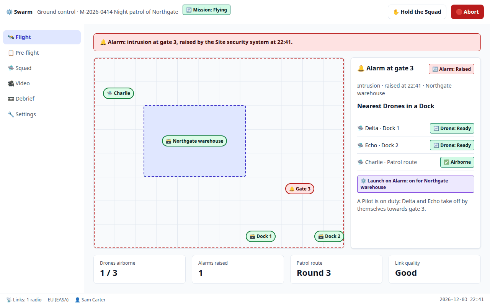](../../screens/UC-018/a1.png) [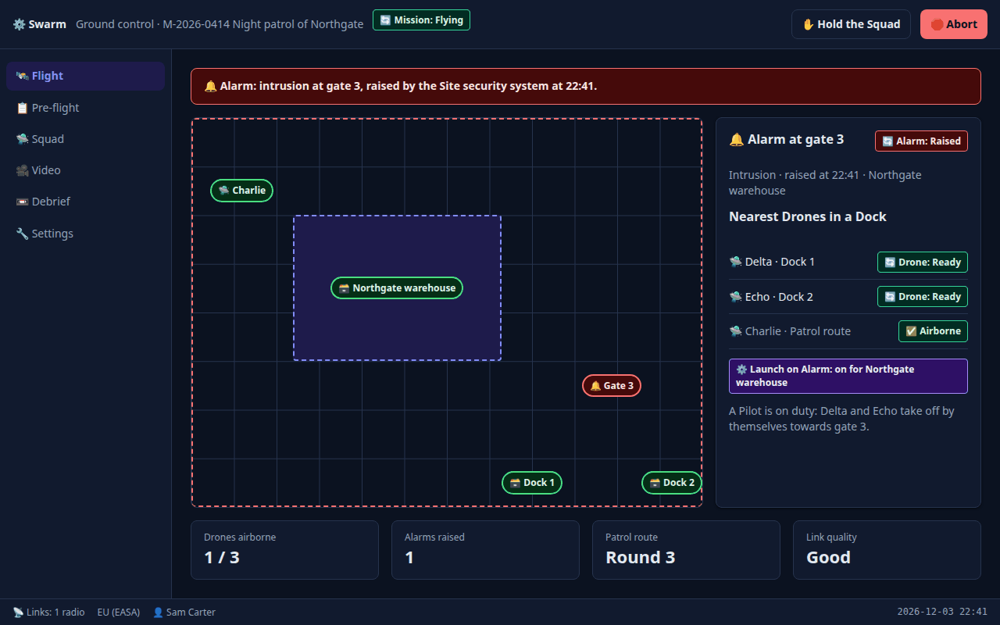](../../screens/UC-018/a1.dark.png) |
| A2: Launch the nearest Drones from the Docks | [🔄 Pilot: Supervising](../../glossary.md#st-pilot-supervising) | [🔄 Drone: Airborne](../../glossary.md#st-drone-airborne) [🔄 Mission: Flying](../../glossary.md#st-mission-flying) | ✏️ Mock-up | [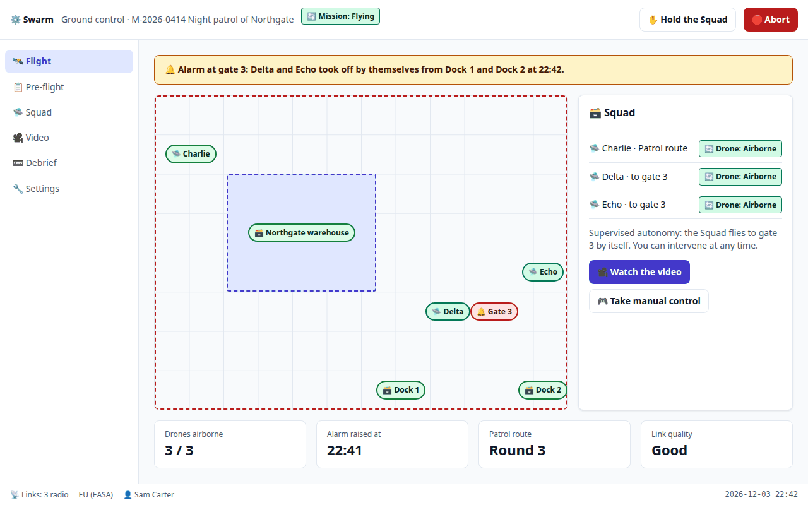](../../screens/UC-018/a2.png) [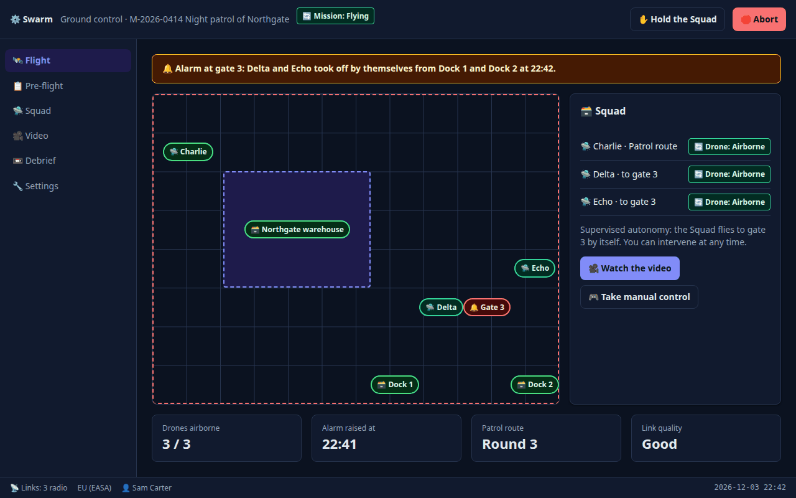](../../screens/UC-018/a2.dark.png) |
| A3: Watch the video at gate 3 | [🔄 Pilot: Supervising](../../glossary.md#st-pilot-supervising) | [🔄 Alarm: Raised](../../glossary.md#st-alarm-raised) | ✏️ Mock-up | [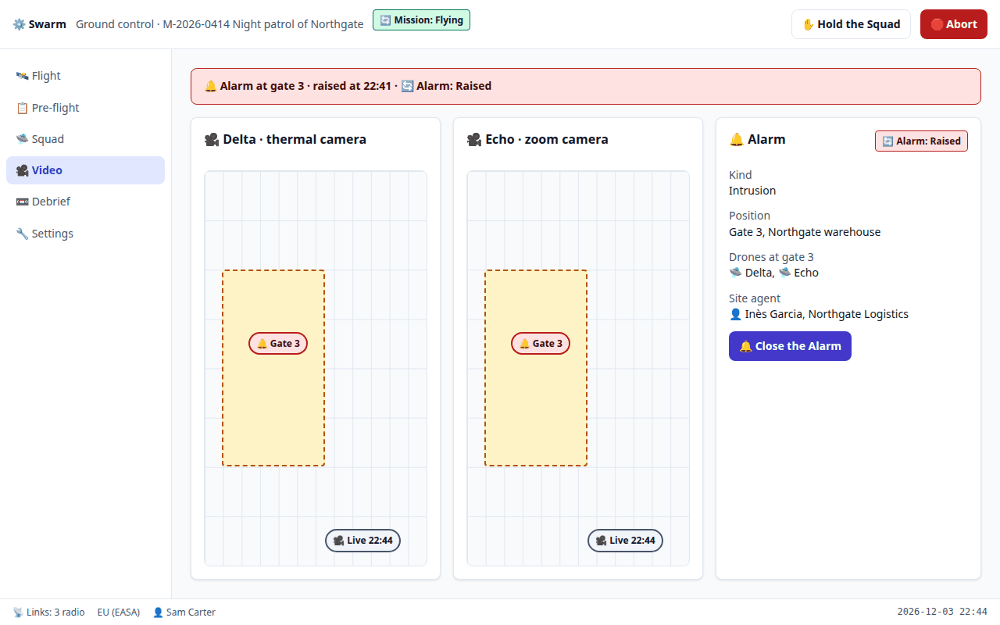](../../screens/UC-018/a3.png) [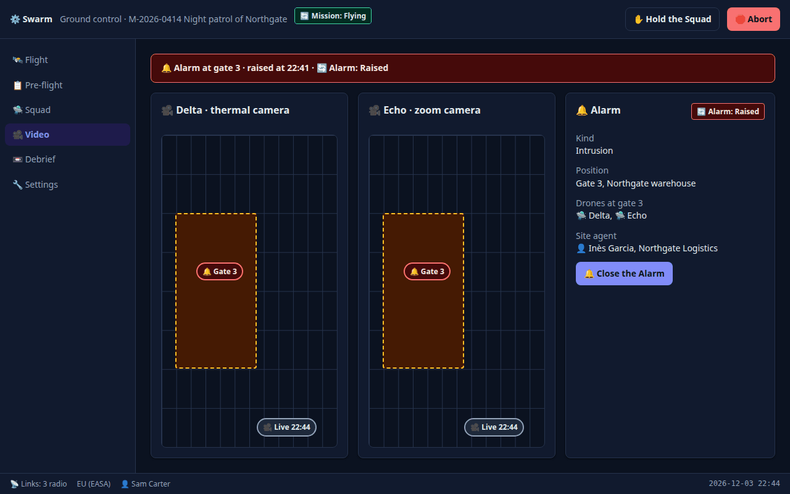](../../screens/UC-018/a3.dark.png) |
| A4: Close the Alarm with its outcome | [🔄 Pilot: Supervising](../../glossary.md#st-pilot-supervising) | [🔄 Alarm: Raised](../../glossary.md#st-alarm-raised) | ✏️ Mock-up | [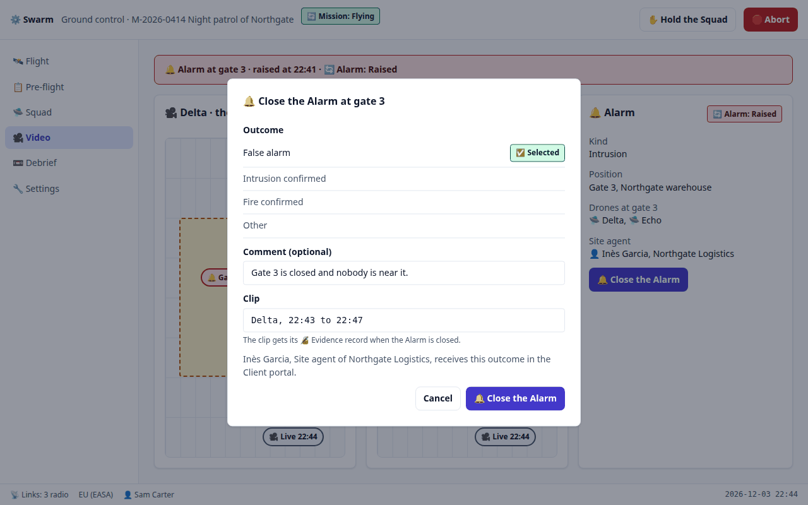](../../screens/UC-018/a4.png) [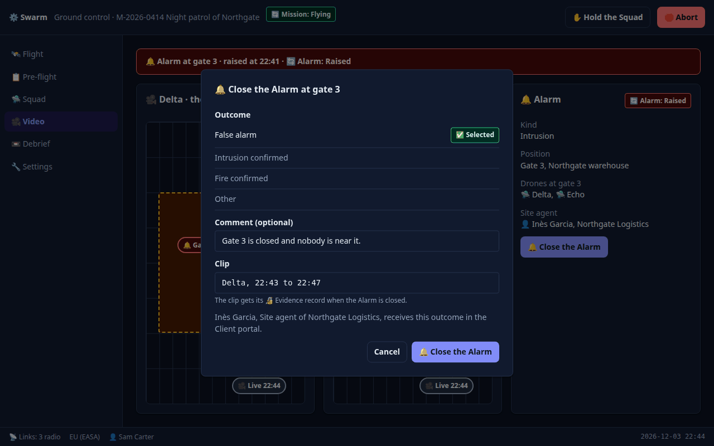](../../screens/UC-018/a4.dark.png) |
| OK: Outcome sent to the Site agent | [👤 Site agent](../../glossary.md#per-site-agent) | [🔄 Alarm: Closed](../../glossary.md#st-alarm-closed) | ✏️ Mock-up | [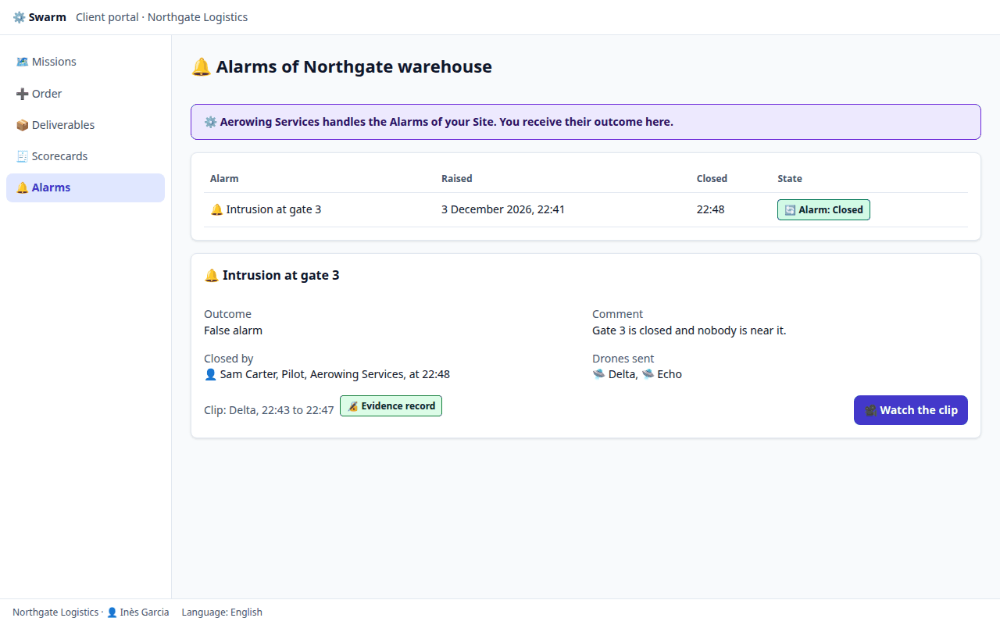](../../screens/UC-018/ok.png) [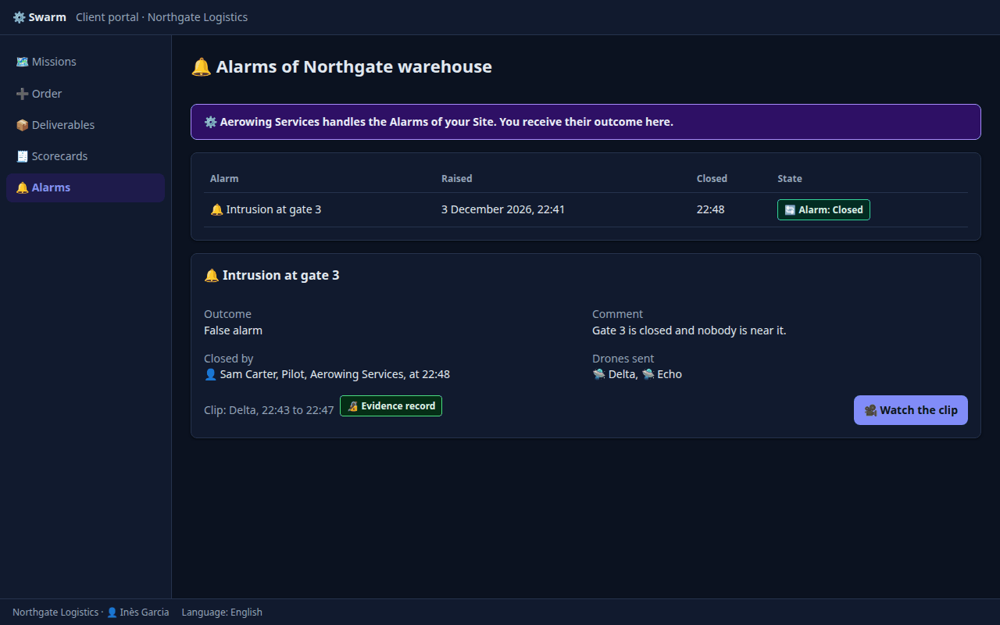](../../screens/UC-018/ok.dark.png) |
| KO: No Drone ready to respond | [🔄 Pilot: Supervising](../../glossary.md#st-pilot-supervising) | [🔄 Alarm: Raised](../../glossary.md#st-alarm-raised) [🔄 Drone: Grounded](../../glossary.md#st-drone-grounded) | ✏️ Mock-up | [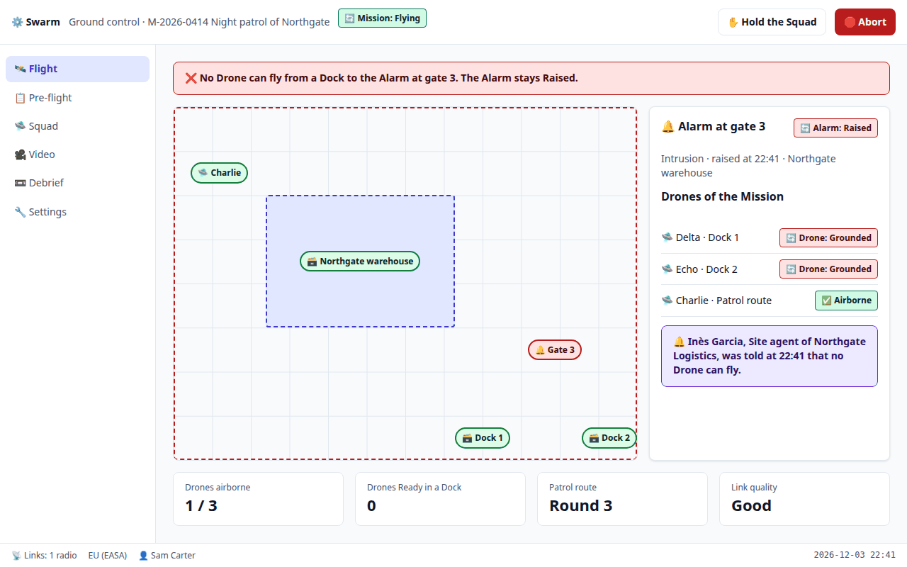](../../screens/UC-018/ko.png) [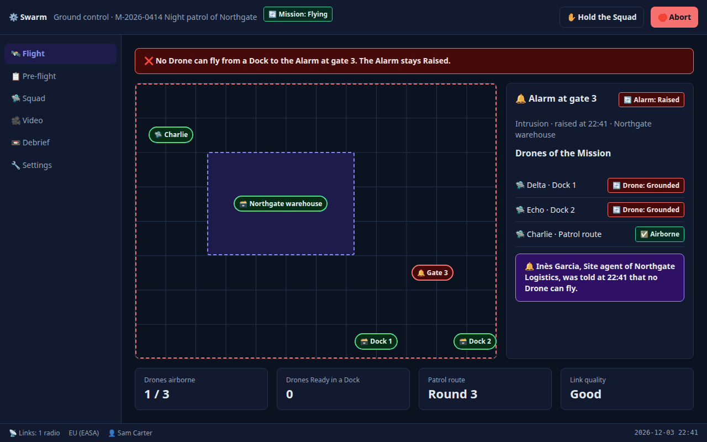](../../screens/UC-018/ko.dark.png) |

## ↪️ Alternative and error flows

| # | At step | Condition | What happens |
| --- | --- | --- | --- |
| A1 | 1 | No Drone of the Mission is Drone: Ready in a Dock | ❌ The Alarm stays Alarm: Raised. Ground control tells the Pilot, and the Client portal tells the Site agent, at once that no Drone can fly |
| A2 | 2 | Launch on Alarm is not enabled for the Site | Nothing takes off by itself: Ground control proposes the nearest Ready Drones and the Pilot sends them |
| A3 | 2 to 4 | The Pilot sees a risk in flight | The Pilot holds the Squad, takes manual control or aborts at any time ([🎬 UC-006: Take manual control or abort](UC-006-take-manual-control-or-abort.md)) |
| A4 | 6 | The Site agent wants the Drones to look elsewhere | Not possible from the Client portal ([📏 BR-019](../business-rules/BR-019-site-agents-request-never-pilot.md)); the Site agent can request a Patrol on demand ([🎬 UC-019: Request a Patrol on demand](UC-019-request-a-patrol-on-demand.md)) |

## 📏 Business rules applied

| Rule | Where it applies |
| --- | --- |
| [📏 BR-005: Autonomy level per Activity](../business-rules/BR-005-autonomy-level-per-activity.md) | Steps 1 and 2: the [🔤 Patrol](../../glossary.md#term-patrol) flies under Supervised autonomy, so the Squad flies to the Alarm by itself and the Pilot supervises |
| [📏 BR-019: Site agents request, never pilot](../business-rules/BR-019-site-agents-request-never-pilot.md) | Step 6: the Site agent receives the outcome and has no command |
| [📏 BR-009: Evidence integrity](../business-rules/BR-009-evidence-integrity.md) | Step 4: the clip of the Alarm gets its Evidence record |

## 🏁 Postconditions

- ✅ **Success:** the Alarm is Alarm: Closed with its outcome, recorded with the Pilot's name. Its clip has an Evidence record. Delta and Echo are back in their Docks, and the Site agent has the outcome.
- ❌ **Failure:** no Drone can fly from a Dock. The Alarm stays Alarm: Raised, and the Pilot and the Site agent know it at once.

## 🔗 Referenced by

<!-- spec:referenced-by -->
- [📘 FS-015: Patrol](../features/FS-015-patrol.md)
<!-- /spec:referenced-by -->

<!-- spec:nav-bottom -->
---

> [🏠 Index](../../README.md) · [◀️ UC-017: Spray a Field with refills](UC-017-spray-a-field-with-refills.md) · 📄 **Page 44 / 109** · [UC-019: Request a Patrol on demand ▶️](UC-019-request-a-patrol-on-demand.md)
<!-- /spec:nav-bottom -->
