# 🎬 UC-019: Request a Patrol on demand

<!-- spec:nav-top -->
> [🏠 Index](../../README.md) · [◀️ UC-018: Respond to a Site Alarm](UC-018-respond-to-a-site-alarm.md) · 📄 **Page 45 / 108** · [UC-020: Review the Defects of an Inspection ▶️](UC-020-review-the-defects-of-an-inspection.md)
<!-- /spec:nav-top -->

**Status:** 🟢 Approved · **Updated:** 2026-11-18

> [!NOTE]
> The [👤 Site agent](../../glossary.md#per-site-agent) requests a look at a point of the [🗃️ Site](../../glossary.md#ent-site) in the [⚙️ Client portal](../../glossary.md#sys-client-portal), and gets a [🗃️ Mission](../../glossary.md#ent-mission) only if a [👤 Pilot](../../glossary.md#per-pilot) accepts it in [⚙️ Ground control](../../glossary.md#sys-ground-control) within the waiting time.

<!-- spec:summary -->
## 📑 Summary

1. [👤 Personas and entities](#actors)
2. [🚦 Preconditions](#preconditions)
3. [⚡ Trigger](#trigger)
4. [➡️ Main flow](#main-flow)
5. [🔀 Flow chart](#flowchart)
6. [🖼️ Screens](#screens)
7. [↪️ Alternative and error flows](#alternative-flows)
8. [📏 Business rules applied](#business-rules)
9. [🏁 Postconditions](#postconditions)
10. [🔗 Referenced by](#referenced-by)
<!-- /spec:summary -->

## 👤 Personas and entities

| Name | Kind | Role in this use case |
| --- | --- | --- |
| [👤 Site agent](../../glossary.md#per-site-agent) | Persona | Inès Garcia of Northgate Logistics: requests a look at the car park, never pilots |
| [👤 Pilot](../../glossary.md#per-pilot) | Persona | Sam Carter: accepts or declines the request |
| [🗃️ Site](../../glossary.md#ent-site) | Entity | Northgate warehouse, with its car park and its Docks |
| [🗃️ Mission](../../glossary.md#ent-mission) | Entity | The request: Mission: Requested, then Mission: Planned when a Pilot accepts it, or Mission: Declined |
| [🗃️ Patrol route](../../glossary.md#ent-patrol-route) | Entity | The path and the point to watch, the car park, on which the accepted Mission is planned |
| [⚙️ Client portal](../../glossary.md#sys-client-portal) | System | Takes the request and shows its answer to the Site agent |
| [⚙️ Ground control](../../glossary.md#sys-ground-control) | System | Shows the request to the Pilot |

## 🚦 Preconditions

1. The Site agent Inès Garcia has access to the Client portal for the Site Northgate warehouse of Northgate Logistics.
2. The [🗃️ Operator](../../glossary.md#ent-operator) Aerowing Services flies [🔤 Patrols](../../glossary.md#term-patrol) at Northgate warehouse, from its [🗃️ Docks](../../glossary.md#ent-dock).
3. The Pilot Sam Carter is on duty in Ground control.

## ⚡ Trigger

On 3 December 2026 at 10:05, the Site agent sees an unknown van in the car park and opens **➕ Order** in the Client portal.

## ➡️ Main flow

1. The Site agent chooses the point to watch on the map of the Site, the car park, and adds a note for the Pilot.
2. The Site agent sends the request. The Client portal creates the Mission "Patrol on demand: car park of Northgate" in the state Mission: Requested and sends it to the Pilots on duty of the Operator. The request waits 10 minutes for a Pilot, a waiting time the Operator can change ([📏 BR-019](../business-rules/BR-019-site-agents-request-never-pilot.md)).
3. The Site agent sees the request waiting for a Pilot. The Client portal offers no command over any Drone or Squad.
4. The Pilot sees the request in Ground control, with the point to watch, the note and the Drones Ready in the Docks of the Site.
5. The Pilot accepts the request within the 10 minutes. The Mission becomes Mission: Planned on its Patrol route, and the Pilot prepares the flight ([🎬 UC-003: Run the Pre-flight check and launch](UC-003-run-the-pre-flight-check-and-launch.md)).
6. The Site agent sees in the Client portal that the Pilot accepted the request.

## 🔀 Flow chart

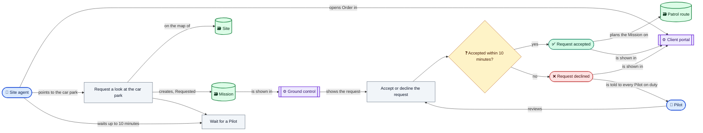

## 🖼️ Screens

One row per state of the flow chart: every action, success and failure node. Click a screen to open it full size. A state with nothing to show reads `➖ No screen: <why>`.

| State | Persona | Entity | Source | Screen |
| --- | --- | --- | --- | --- |
| A1: Request a look at the car park | [👤 Site agent](../../glossary.md#per-site-agent) | [🗃️ Site](../../glossary.md#ent-site) | ✏️ Mock-up | [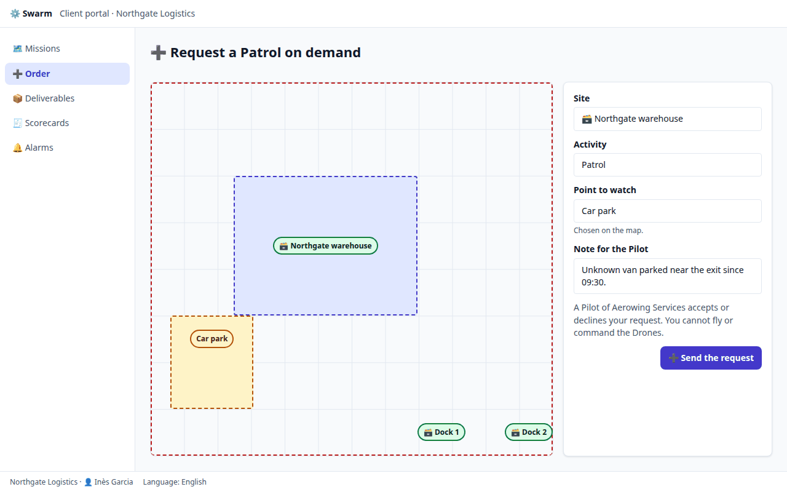](../../screens/UC-019/a1.png) [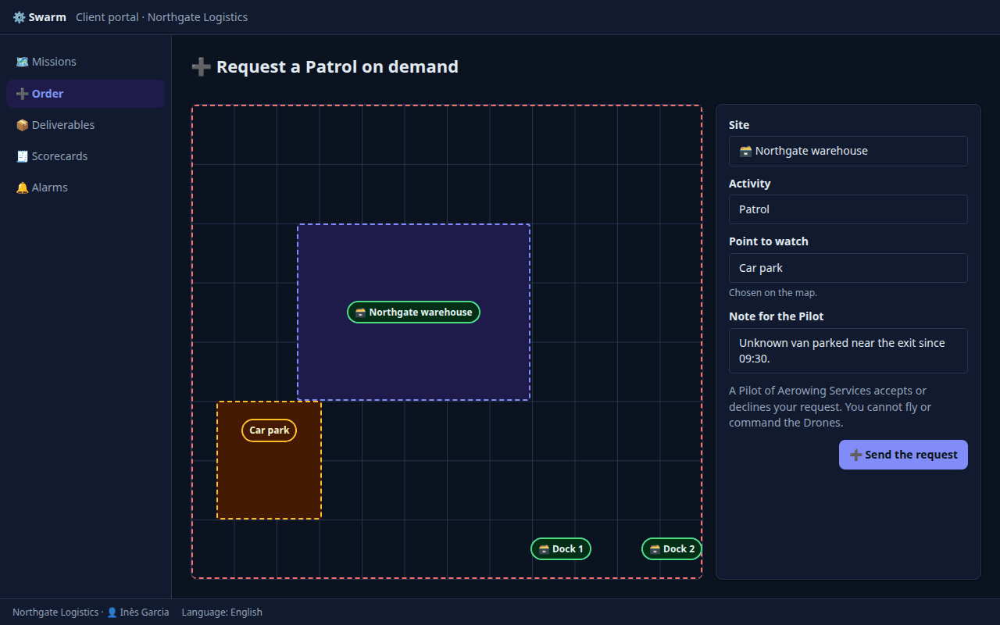](../../screens/UC-019/a1.dark.png) |
| A2: Wait for a Pilot | [👤 Site agent](../../glossary.md#per-site-agent) | [🔄 Mission: Requested](../../glossary.md#st-mission-requested) | ✏️ Mock-up | [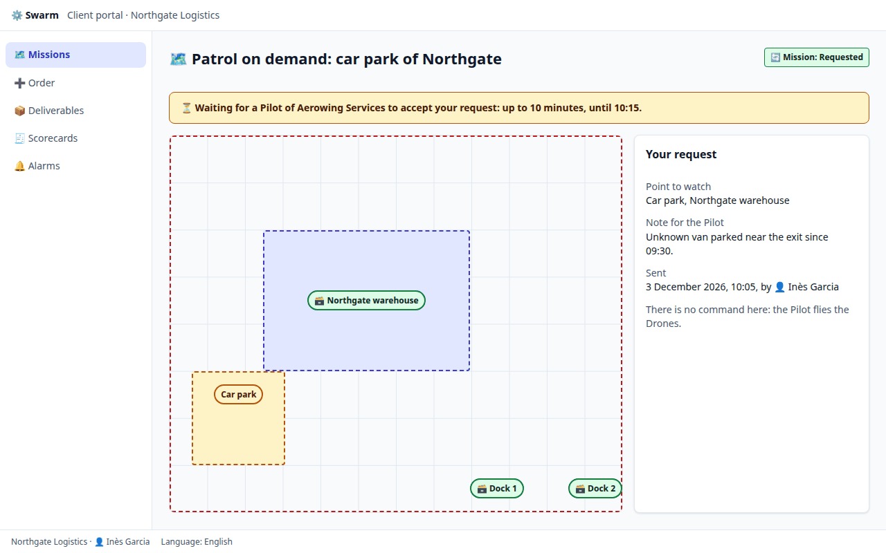](../../screens/UC-019/a2.png) [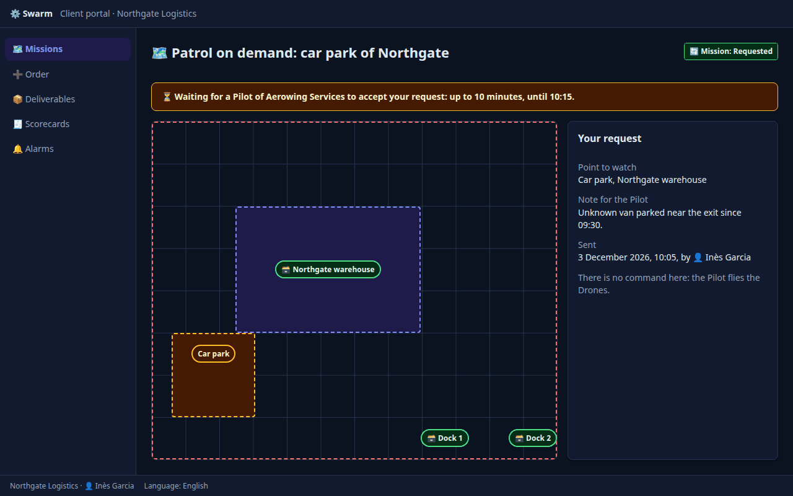](../../screens/UC-019/a2.dark.png) |
| A3: Accept or decline the request | [👤 Pilot](../../glossary.md#per-pilot) | [🔄 Mission: Requested](../../glossary.md#st-mission-requested) | ✏️ Mock-up | [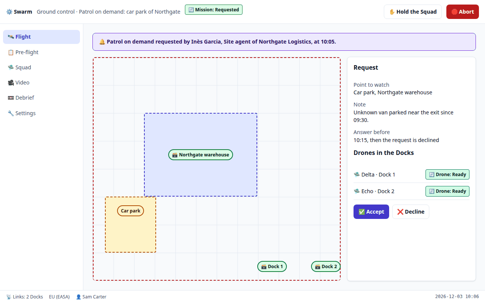](../../screens/UC-019/a3.png) [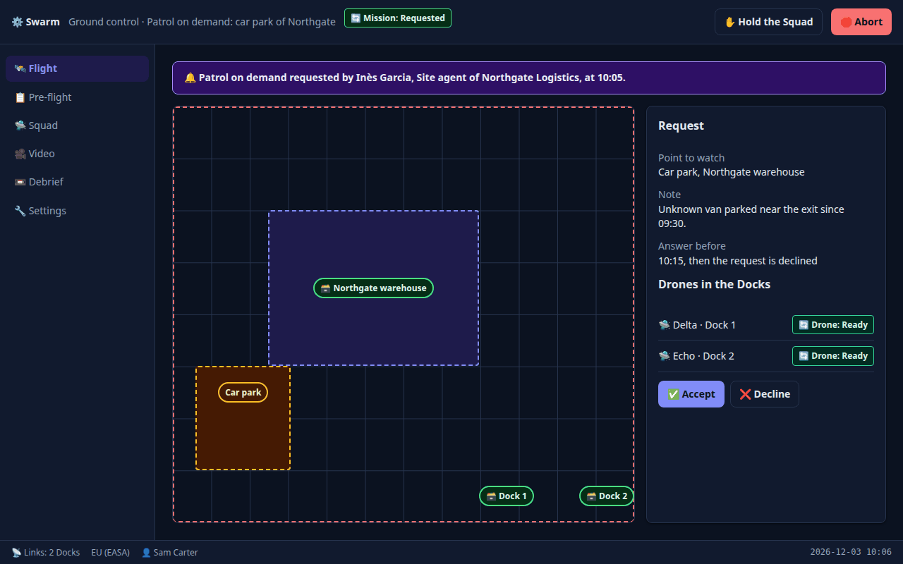](../../screens/UC-019/a3.dark.png) |
| OK: Request accepted | [👤 Site agent](../../glossary.md#per-site-agent) | [🔄 Mission: Planned](../../glossary.md#st-mission-planned) | ✏️ Mock-up | [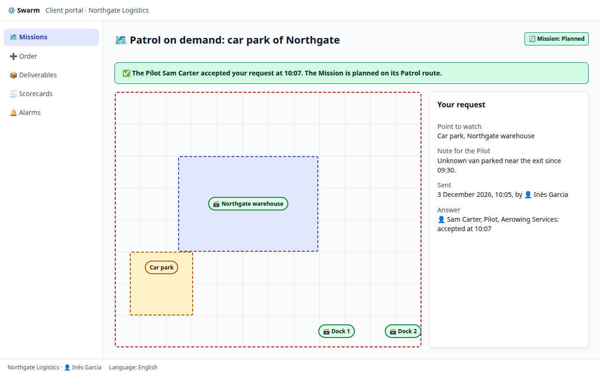](../../screens/UC-019/ok.png) [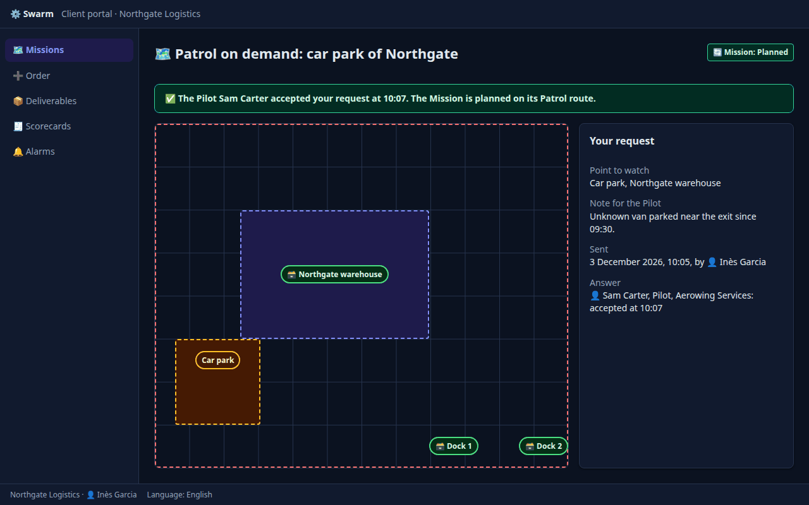](../../screens/UC-019/ok.dark.png) |
| KO: Request declined | [👤 Site agent](../../glossary.md#per-site-agent) | [🔄 Mission: Declined](../../glossary.md#st-mission-declined) | ✏️ Mock-up | [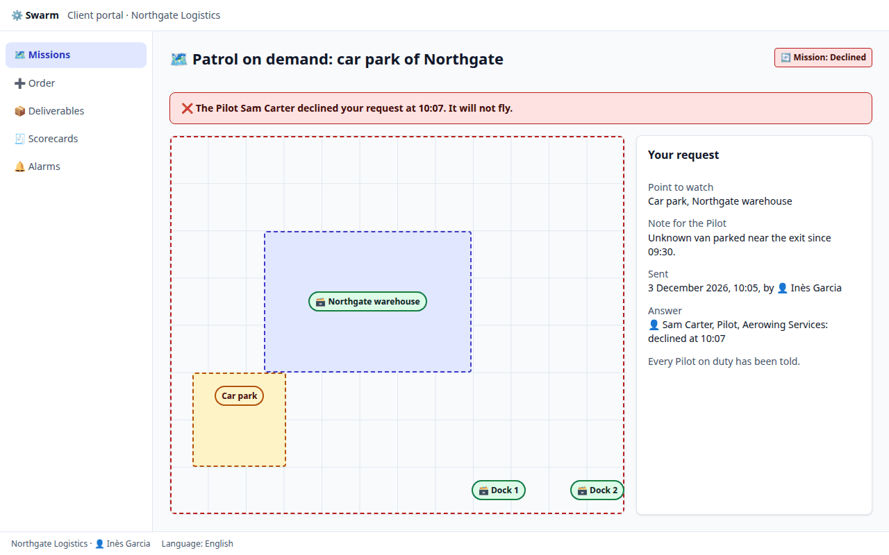](../../screens/UC-019/ko.png) [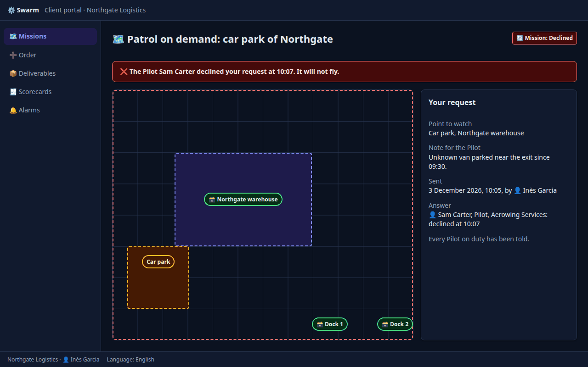](../../screens/UC-019/ko.dark.png) |

## ↪️ Alternative and error flows

| # | At step | Condition | What happens |
| --- | --- | --- | --- |
| A1 | 5 | The Pilot declines the request | ❌ The Mission is Mission: Declined and will not fly. The Site agent and every Pilot on duty are told |
| A2 | 3 | The Site agent tries to launch, command or change a Drone or the Squad | Not possible: the Client portal has no such command ([📏 BR-019](../business-rules/BR-019-site-agents-request-never-pilot.md)) |
| A3 | 4 | No Pilot answers within 10 minutes | ❌ The Mission is Mission: Declined and will not fly. The Site agent and every Pilot on duty are told ([📏 BR-019](../business-rules/BR-019-site-agents-request-never-pilot.md)) |

## 📏 Business rules applied

| Rule | Where it applies |
| --- | --- |
| [📏 BR-019: Site agents request, never pilot](../business-rules/BR-019-site-agents-request-never-pilot.md) | Steps 2, 3 and 5: the Site agent requests and never commands; the request becomes a Mission only when a Pilot accepts it within the 10 minutes, otherwise it is Declined |

## 🏁 Postconditions

- ✅ **Success:** the Pilot has accepted the request. The Mission is Mission: Planned on its Patrol route, and the Pilot prepares it. The Site agent sees that it was accepted, and by whom.
- ❌ **Failure:** a Pilot declined the request, or no Pilot answered within 10 minutes. The Mission is Mission: Declined, nothing flies, and the Site agent and every Pilot on duty are told.

## 🔗 Referenced by

<!-- spec:referenced-by -->
- [📘 FS-015: Patrol](../features/FS-015-patrol.md)
- [🎬 UC-018: Respond to a Site Alarm](UC-018-respond-to-a-site-alarm.md)
<!-- /spec:referenced-by -->

<!-- spec:nav-bottom -->
---

> [🏠 Index](../../README.md) · [◀️ UC-018: Respond to a Site Alarm](UC-018-respond-to-a-site-alarm.md) · 📄 **Page 45 / 108** · [UC-020: Review the Defects of an Inspection ▶️](UC-020-review-the-defects-of-an-inspection.md)
<!-- /spec:nav-bottom -->
