# 🎬 UC-020: Review the Defects of an Inspection

<!-- spec:nav-top -->
> [🏠 Index](../../README.md) · [◀️ UC-019: Request a Patrol on demand](UC-019-request-a-patrol-on-demand.md) · 📄 **Page 46 / 109** · [UC-021: Plan a Mission with the Mission assistant ▶️](UC-021-plan-a-mission-with-the-mission-assistant.md)
<!-- /spec:nav-top -->

**Status:** 🟢 Approved · **Updated:** 2026-11-18

> [!NOTE]
> The [👤 Mission planner](../../glossary.md#per-mission-planner) reviews each Suspected [🗃️ Defect](../../glossary.md#ent-defect) of an Inspection with its pictures in the [⚙️ Back office](../../glossary.md#sys-back-office), confirms or dismisses it, and publishes a defect list in which the [👤 Client](../../glossary.md#per-client) gets only the Confirmed Defects.

<!-- spec:summary -->
## 📑 Summary

1. [👤 Personas and entities](#actors)
2. [🚦 Preconditions](#preconditions)
3. [⚡ Trigger](#trigger)
4. [➡️ Main flow](#main-flow)
5. [🔀 Flow chart](#flowchart)
6. [🖼️ Screens](#screens)
7. [↪️ Alternative and error flows](#alternative-flows)
8. [📏 Business rules applied](#business-rules)
9. [🏁 Postconditions](#postconditions)
10. [🔗 Referenced by](#referenced-by)
<!-- /spec:summary -->

## 👤 Personas and entities

| Name | Kind | Role in this use case |
| --- | --- | --- |
| [👤 Mission planner](../../glossary.md#per-mission-planner) | Persona | Léa Martin: reviews, confirms or dismisses each Defect, then publishes the defect list |
| [👤 Client](../../glossary.md#per-client) | Persona | Priya Shah of Helio Energy: receives the Confirmed Defects only |
| [🗃️ Defect](../../glossary.md#ent-defect) | Entity | Hot spots and broken panels of Les Vignes solar farm: Defect: Suspected, then Confirmed or Dismissed |
| [🗃️ Deliverable](../../glossary.md#ent-deliverable) | Entity | The defect list of M-2026-0412, published with the Confirmed Defects |
| [⚙️ Back office](../../glossary.md#sys-back-office) | System | Lists the Defects with their pictures, in **📦 Deliverables** |

## 🚦 Preconditions

1. The [🗃️ Mission](../../glossary.md#ent-mission) M-2026-0412 Inspection of Les Vignes is Mission: Completed and its data is processed ([🎬 UC-009: Process flight data into Deliverables](UC-009-process-flight-data-into-deliverables.md)).
2. Detection, with the solar farm model that Swarm ships, has marked 12 Defects in the state Defect: Suspected, each with its position and its thermal and RGB pictures, taken by the [🗃️ Payloads](../../glossary.md#ent-payload) of the Squad. An Operator may also use detection models it trained on its own data ([📘 FS-016: Inspection](../features/FS-016-inspection.md#details)).

## ⚡ Trigger

The Mission planner Léa Martin opens the Defects of M-2026-0412 in **📦 Deliverables** of the Back office.

## ➡️ Main flow

1. The Back office lists the 12 Suspected Defects with their kind (hot spot, broken panel), their position on the Site and their pictures.
2. The Mission planner opens a Defect and compares its thermal and RGB pictures.
3. The Mission planner confirms it: Defect: Confirmed ([📏 BR-020](../business-rules/BR-020-defects-confirmed-by-a-person.md)).
4. The Mission planner repeats steps 2 and 3 for every Defect. In the example, 9 are confirmed and 3 dismissed.
5. The Mission planner publishes the defect list. It holds the 9 Confirmed Defects only, and becomes Deliverable: Published for the Client ([📏 BR-020](../business-rules/BR-020-defects-confirmed-by-a-person.md)), with its [🗃️ Evidence record](../../glossary.md#ent-evidence-record) ([📏 BR-009](../business-rules/BR-009-evidence-integrity.md)).

## 🔀 Flow chart

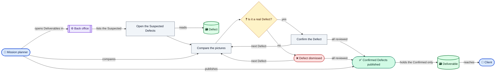

## 🖼️ Screens

One row per state of the flow chart: every action, success and failure node. Click a screen to open it full size. A state with nothing to show reads `➖ No screen: <why>`.

| State | Persona | Entity | Source | Screen |
| --- | --- | --- | --- | --- |
| A1: Open the Suspected Defects | [👤 Mission planner](../../glossary.md#per-mission-planner) | [🔄 Defect: Suspected](../../glossary.md#st-defect-suspected) | ✏️ Mock-up | [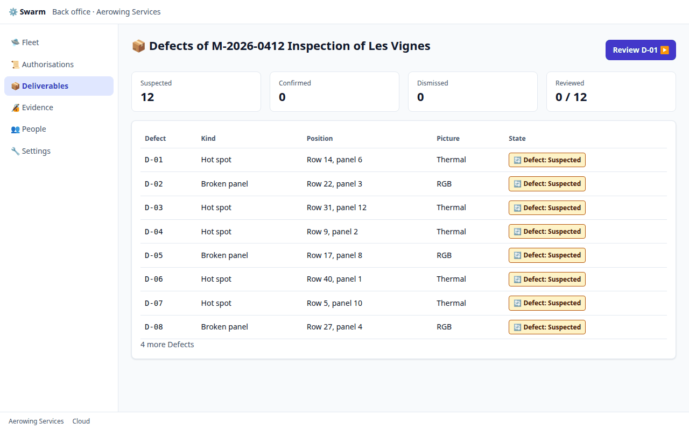](../../screens/UC-020/a1.png) [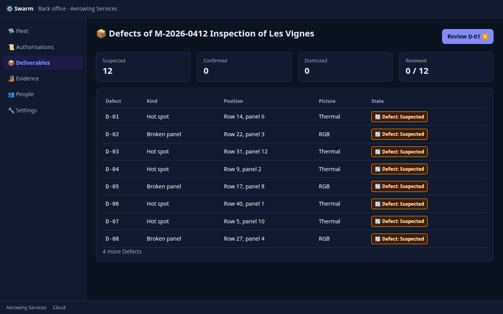](../../screens/UC-020/a1.dark.png) |
| A2: Compare the pictures | [👤 Mission planner](../../glossary.md#per-mission-planner) | [🔄 Defect: Suspected](../../glossary.md#st-defect-suspected) | ✏️ Mock-up | [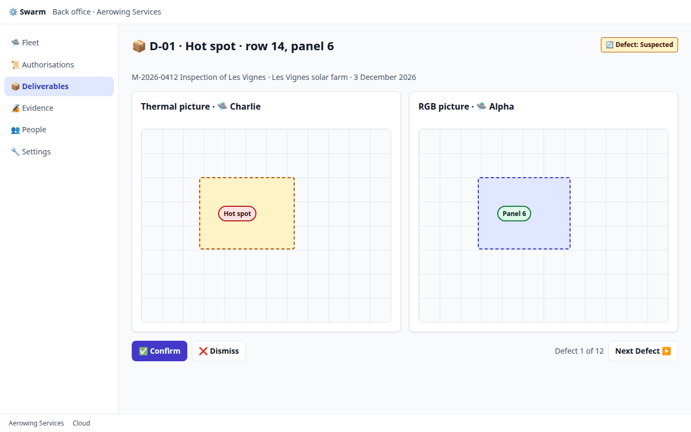](../../screens/UC-020/a2.png) [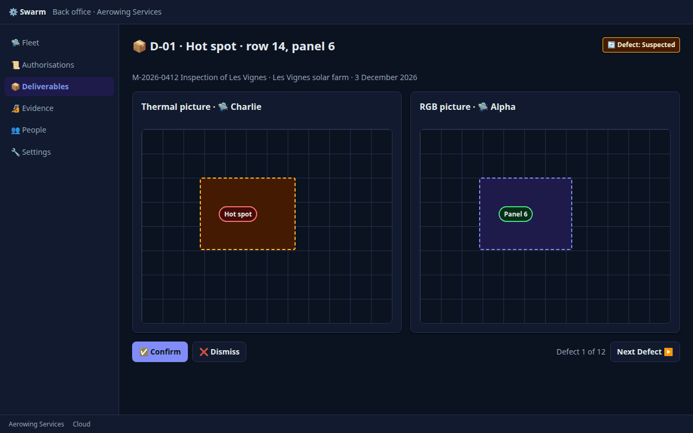](../../screens/UC-020/a2.dark.png) |
| A3: Confirm the Defect | [👤 Mission planner](../../glossary.md#per-mission-planner) | [🔄 Defect: Confirmed](../../glossary.md#st-defect-confirmed) | ✏️ Mock-up | [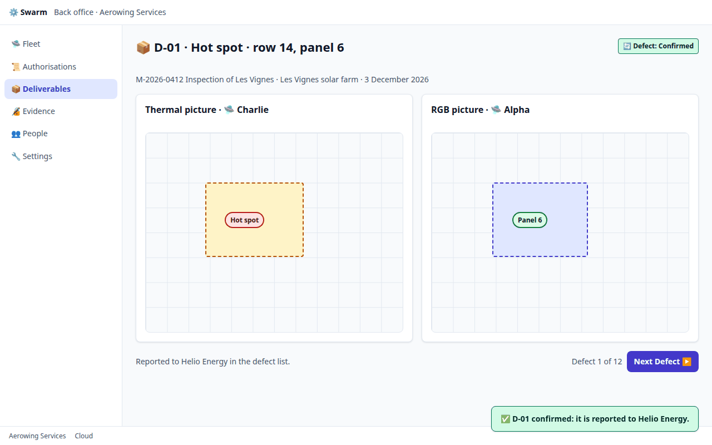](../../screens/UC-020/a3.png) [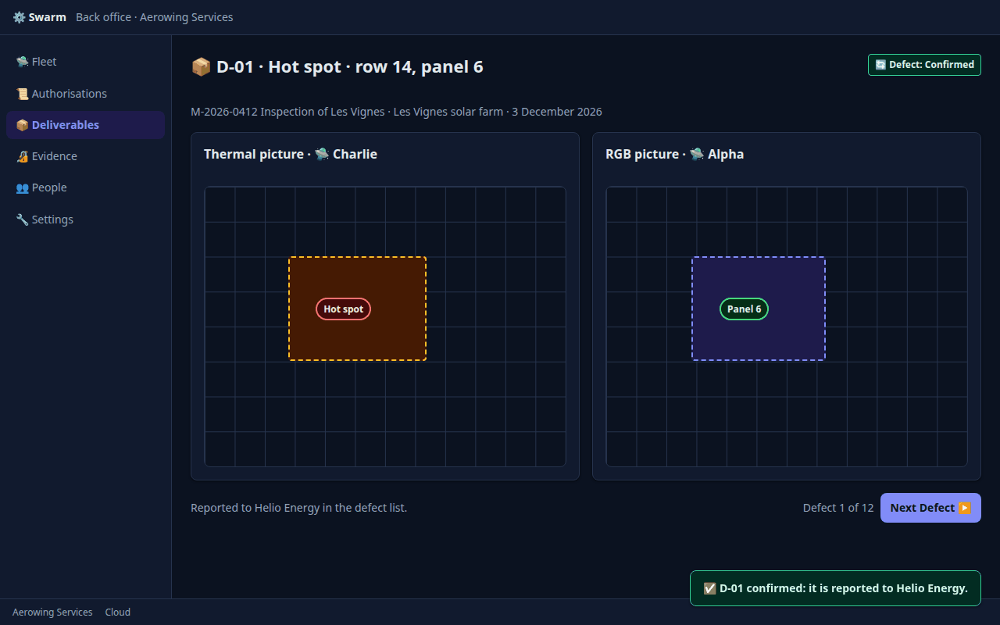](../../screens/UC-020/a3.dark.png) |
| KO: Defect dismissed | [👤 Mission planner](../../glossary.md#per-mission-planner) | [🔄 Defect: Dismissed](../../glossary.md#st-defect-dismissed) | ✏️ Mock-up | [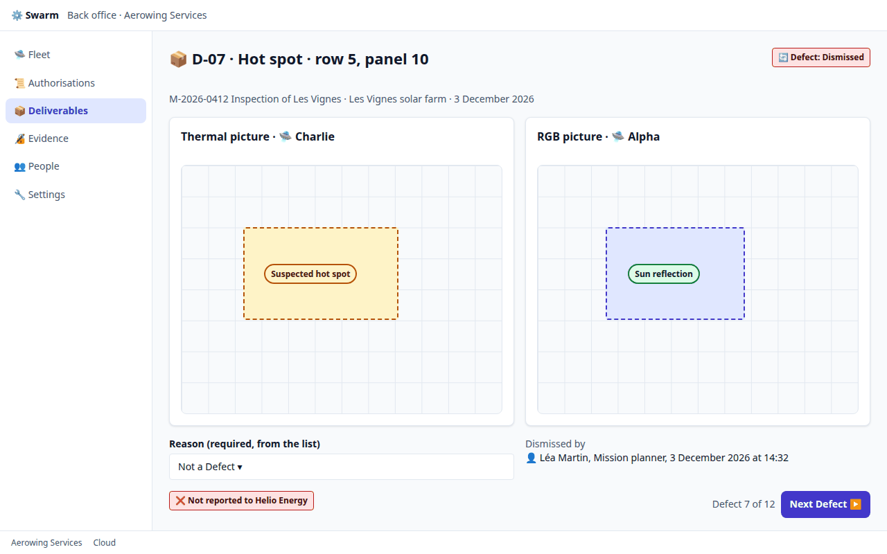](../../screens/UC-020/ko.png) [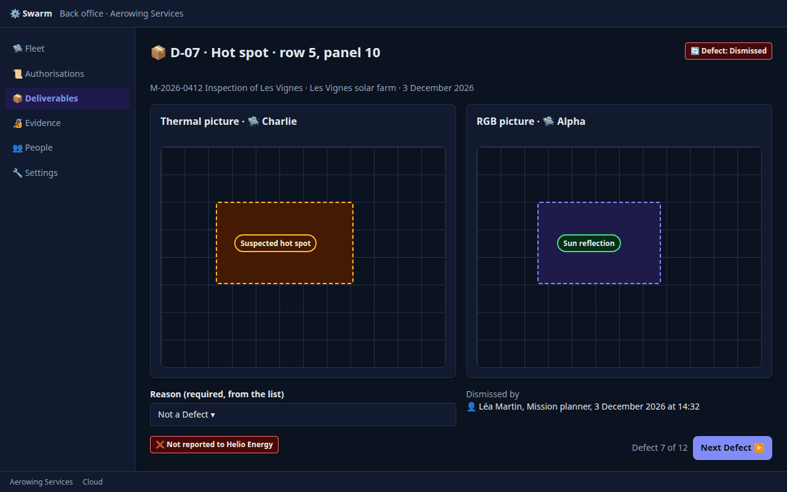](../../screens/UC-020/ko.dark.png) |
| OK: Confirmed Defects published | [👤 Mission planner](../../glossary.md#per-mission-planner) | [🔄 Deliverable: Published](../../glossary.md#st-deliverable-published) [🔄 Defect: Confirmed](../../glossary.md#st-defect-confirmed) | ✏️ Mock-up | [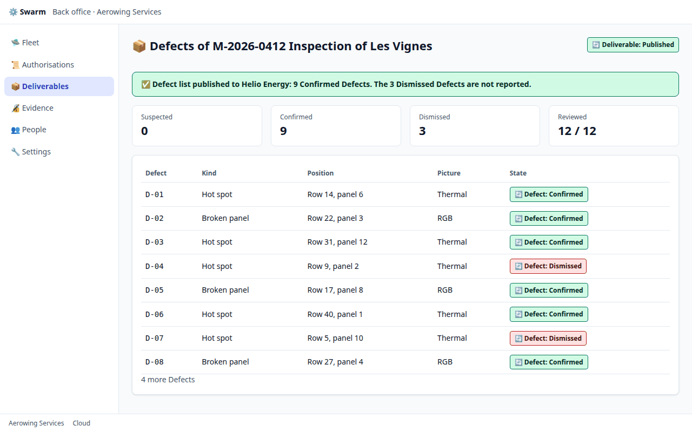](../../screens/UC-020/ok.png) [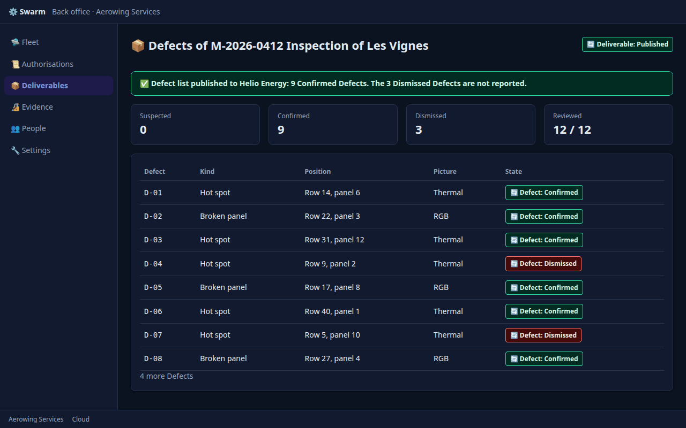](../../screens/UC-020/ok.dark.png) |

## ↪️ Alternative and error flows

| # | At step | Condition | What happens |
| --- | --- | --- | --- |
| A1 | 3 | The pictures show no fault, such as a sun reflection taken for a hot spot | ❌ The Mission planner dismisses the Defect with a reason chosen from a fixed list; the reason is required. Swarm records the Mission planner's name and the time. The Defect is Defect: Dismissed and is never reported to the Client ([📏 BR-020](../business-rules/BR-020-defects-confirmed-by-a-person.md)) |
| A2 | 5 | Some Defects are still Defect: Suspected when the defect list is published | They are not reported to the Client ([📏 BR-020](../business-rules/BR-020-defects-confirmed-by-a-person.md)) |
| A3 | 1 | The Mission planner opens the Defects of another Operator | Not found ([📏 BR-008](../business-rules/BR-008-operator-isolation.md)) |

## 📏 Business rules applied

| Rule | Where it applies |
| --- | --- |
| [📏 BR-020: Defects confirmed by a person](../business-rules/BR-020-defects-confirmed-by-a-person.md) | Steps 3 to 5: a Defect stays Suspected until a person decides, only Confirmed Defects reach the Client, and a dismissal has a reason from a fixed list, the reviewer's name and the time |
| [📏 BR-009: Evidence integrity](../business-rules/BR-009-evidence-integrity.md) | Step 5: the published defect list gets its Evidence record |
| [📏 BR-008: Operator isolation](../business-rules/BR-008-operator-isolation.md) | Step 1: the Mission planner sees only the Defects of Aerowing Services |

## 🏁 Postconditions

- ✅ **Success:** every Defect is Confirmed or Dismissed by a person. The defect list is Deliverable: Published with the 9 Confirmed Defects, and the Client sees it in the Client portal.
- ❌ **Failure:** a dismissed Defect is kept in the Back office as Defect: Dismissed, with its reason, the reviewer's name and the time, and never reaches the Client. Confirmations record the reviewer's name and the time too. The reasons are: not a Defect, duplicate, already known to the Client, image quality too low, other (with a comment).

## 🔗 Referenced by

<!-- spec:referenced-by -->
- [📘 FS-007: Data processing and Deliverables](../features/FS-007-data-processing-and-deliverables.md)
- [📘 FS-016: Inspection](../features/FS-016-inspection.md)
- [🎬 UC-009: Process flight data into Deliverables](UC-009-process-flight-data-into-deliverables.md)
- [🎬 UC-022: Receive the Mission report](UC-022-receive-the-mission-report.md)
<!-- /spec:referenced-by -->

<!-- spec:nav-bottom -->
---

> [🏠 Index](../../README.md) · [◀️ UC-019: Request a Patrol on demand](UC-019-request-a-patrol-on-demand.md) · 📄 **Page 46 / 109** · [UC-021: Plan a Mission with the Mission assistant ▶️](UC-021-plan-a-mission-with-the-mission-assistant.md)
<!-- /spec:nav-bottom -->
