# 🎬 UC-021: Plan a Mission with the Mission assistant

<!-- spec:nav-top -->
> [🏠 Index](../../README.md) · [◀️ UC-020: Review the Defects of an Inspection](UC-020-review-the-defects-of-an-inspection.md) · 📄 **Page 47 / 109** · [UC-022: Receive the Mission report ▶️](UC-022-receive-the-mission-report.md)
<!-- /spec:nav-top -->

**Status:** 🟢 Approved · **Updated:** 2026-11-18

> [!NOTE]
> The [👤 Mission planner](../../glossary.md#per-mission-planner) describes a need in words to the [⚙️ Mission assistant](../../glossary.md#sys-mission-assistant), which proposes a Draft [🗃️ Mission](../../glossary.md#ent-mission) with its reasons and the rules it checked; the Mission planner edits it and accepts it, or rejects it.

<!-- spec:summary -->
## 📑 Summary

1. [👤 Personas and entities](#actors)
2. [🚦 Preconditions](#preconditions)
3. [⚡ Trigger](#trigger)
4. [➡️ Main flow](#main-flow)
5. [🔀 Flow chart](#flowchart)
6. [🖼️ Screens](#screens)
7. [↪️ Alternative and error flows](#alternative-flows)
8. [📏 Business rules applied](#business-rules)
9. [🏁 Postconditions](#postconditions)
10. [🔗 Referenced by](#referenced-by)
<!-- /spec:summary -->

## 👤 Personas and entities

| Name | Kind | Role in this use case |
| --- | --- | --- |
| [👤 Mission planner](../../glossary.md#per-mission-planner) | Persona | Describes the need, edits the proposal, accepts or rejects it |
| [🗃️ Mission](../../glossary.md#ent-mission) | Entity | Requested by the Client; becomes Draft only when the Mission planner accepts the proposal |
| [🗃️ Squad](../../glossary.md#ent-squad) | Entity | Proposed by the Mission assistant, one task per Drone |
| [🗃️ Payload](../../glossary.md#ent-payload) | Entity | Proposed per Drone for its task |
| [⚙️ Mission assistant](../../glossary.md#sys-mission-assistant) | System | Proposes the area, the Squad, the routes and the time slot, explains them and checks the rules |
| [⚙️ Mission studio](../../glossary.md#sys-mission-studio) | System | Holds the conversation in **💬 Assistant** and opens the accepted Draft in **🖊️ Design** |

## 🚦 Preconditions

1. The Client Helio Energy (Priya Shah) has asked for the Mission M-2026-0412 Inspection of Les Vignes: it is [🔄 Mission: Requested](../../glossary.md#st-mission-requested).
2. The Mission planner Léa Martin of the [🗃️ Operator](../../glossary.md#ent-operator) Aerowing Services has it open in the Mission studio.
3. The Operator holds an [🗃️ Authorisation](../../glossary.md#ent-authorisation) for [🔤 Inspection](../../glossary.md#term-inspection) in the EU (EASA) [🔤 Jurisdiction](../../glossary.md#term-jurisdiction).

## ⚡ Trigger

The Mission planner opens **💬 Assistant** and writes the need in words.

## ➡️ Main flow

1. The Mission planner describes the need: a thermal inspection of the panels of Les Vignes solar farm and an orthomosaic of the whole [🗃️ Site](../../glossary.md#ent-site), on the morning of 3 December 2026.
2. The Mission assistant, running on the [🔤 LLM provider](../../glossary.md#term-llm-provider) the Operator chose, proposes a Draft Mission: the area and its [🗃️ Geofence](../../glossary.md#ent-geofence) under the [🔤 Altitude ceiling](../../glossary.md#term-altitude-ceiling) of the Authorisation, a Squad with a Payload and a task per [🗃️ Drone](../../glossary.md#ent-drone) (Alpha with a thermal camera on the panels, Bravo with an RGB camera for the orthomosaic), the routes, and the time slot 10:00 to 11:00.
3. The Mission assistant gives the reason for each choice and lists the rules it checked, each passed or failed. Nothing takes effect yet ([📏 BR-021](../business-rules/BR-021-ai-agents-propose-people-decide.md)).
4. The Mission planner edits the proposal, in words or in the proposal itself: here, adding Charlie with a zoom camera for close-ups of the inverters. The Mission assistant updates the proposal and checks the rules again.
5. The Mission planner accepts the proposal. Swarm records that Léa Martin accepted it, the Mission becomes [🔄 Mission: Draft](../../glossary.md#st-mission-draft), and the Mission studio opens it in **🖊️ Design**, where the Mission planner completes and saves it ([🎬 UC-001](UC-001-design-a-mission.md)).

## 🔀 Flow chart

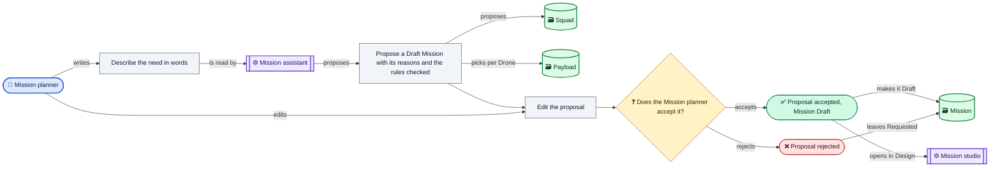

## 🖼️ Screens

One row per state of the flow chart: every action, success and failure node. Click a screen to open it full size. A state with nothing to show reads `➖ No screen: <why>`.

| State | Persona | Entity | Source | Screen |
| --- | --- | --- | --- | --- |
| A1: Describe the need in words | [👤 Mission planner](../../glossary.md#per-mission-planner) | [🔄 Mission: Requested](../../glossary.md#st-mission-requested) | ✏️ Mock-up | [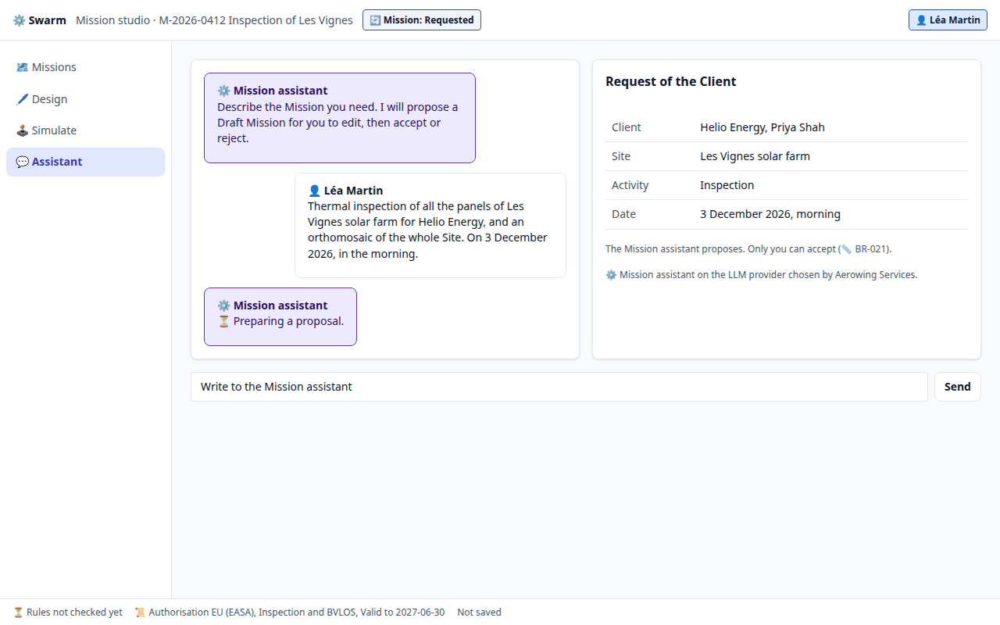](../../screens/UC-021/a1.png) [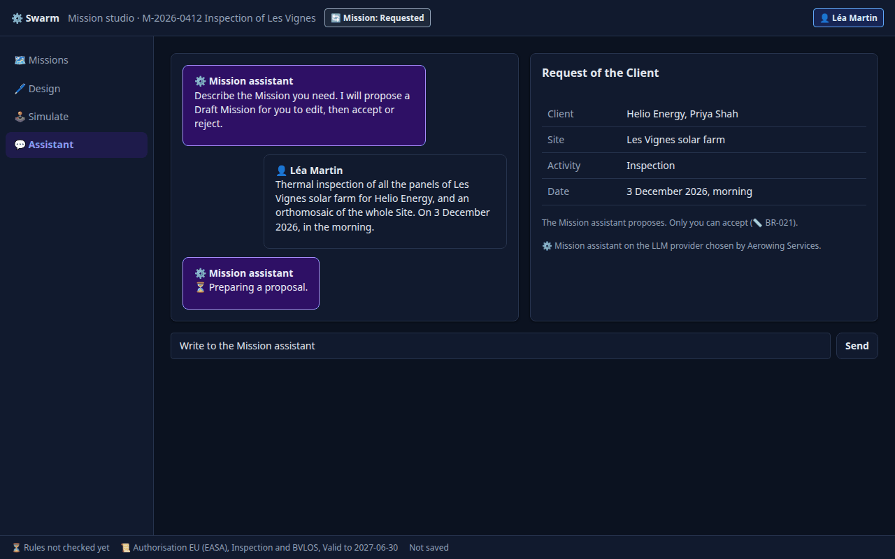](../../screens/UC-021/a1.dark.png) |
| A2: Propose a Draft Mission with its reasons and the rules checked | [👤 Mission planner](../../glossary.md#per-mission-planner) | [🔄 Mission: Requested](../../glossary.md#st-mission-requested) [🗃️ Squad](../../glossary.md#ent-squad) | ✏️ Mock-up | [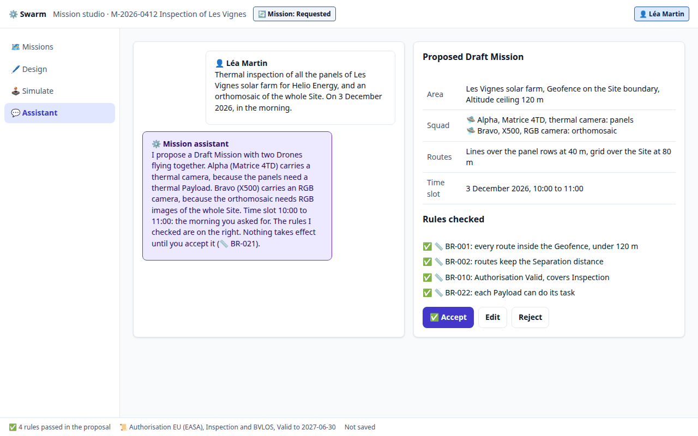](../../screens/UC-021/a2.png) [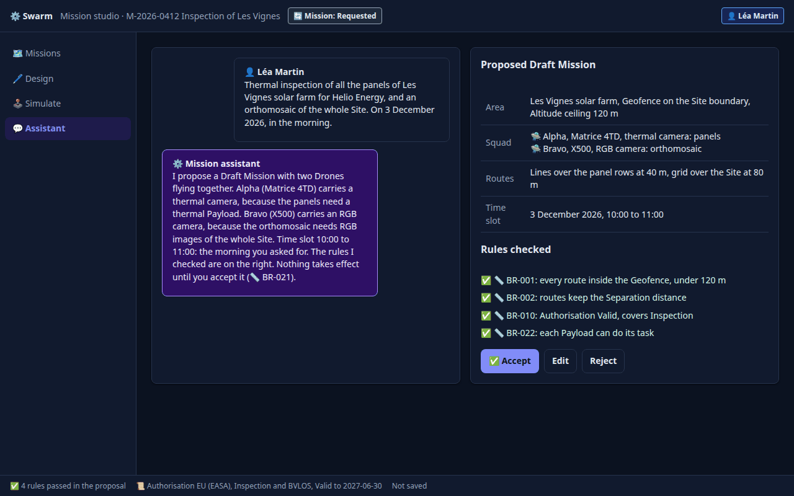](../../screens/UC-021/a2.dark.png) |
| A3: Edit the proposal | [👤 Mission planner](../../glossary.md#per-mission-planner) | [🔄 Mission: Requested](../../glossary.md#st-mission-requested) [🗃️ Payload](../../glossary.md#ent-payload) | ✏️ Mock-up | [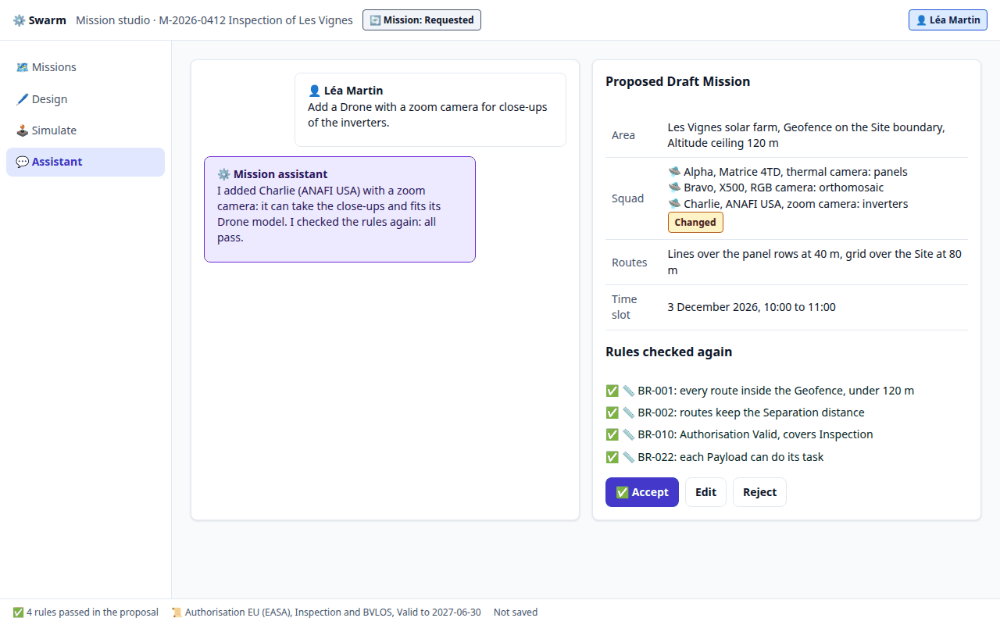](../../screens/UC-021/a3.png) [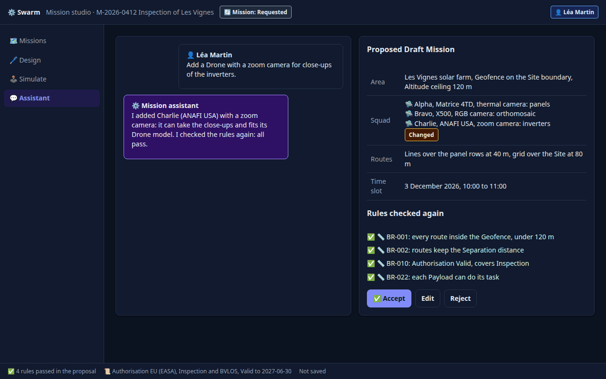](../../screens/UC-021/a3.dark.png) |
| OK: Proposal accepted, Mission Draft | [👤 Mission planner](../../glossary.md#per-mission-planner) | [🔄 Mission: Draft](../../glossary.md#st-mission-draft) | ✏️ Mock-up | [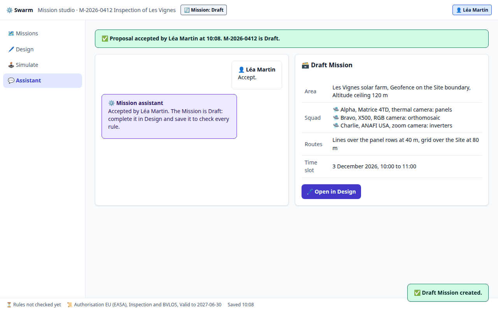](../../screens/UC-021/ok.png) [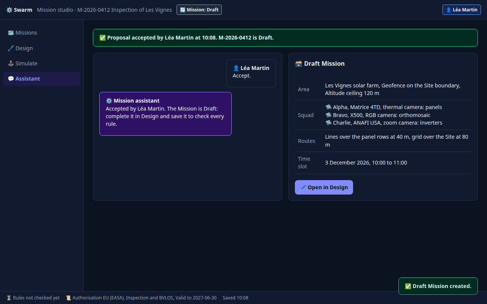](../../screens/UC-021/ok.dark.png) |
| KO: Proposal rejected | [👤 Mission planner](../../glossary.md#per-mission-planner) | [🔄 Mission: Requested](../../glossary.md#st-mission-requested) | ✏️ Mock-up | [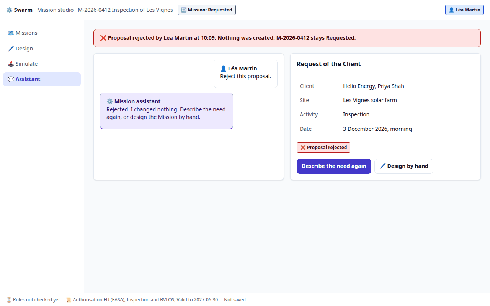](../../screens/UC-021/ko.png) [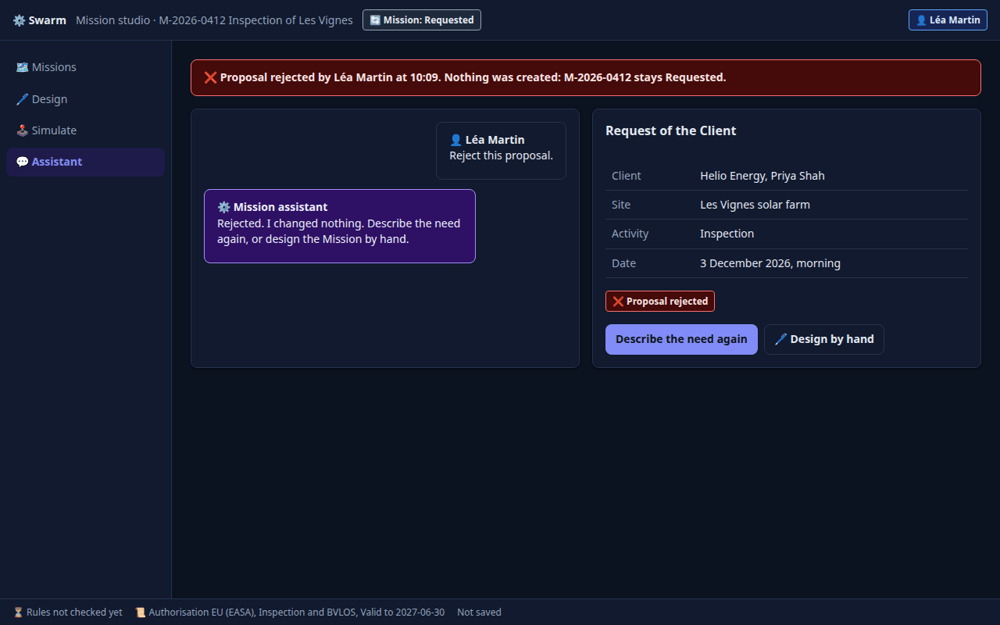](../../screens/UC-021/ko.dark.png) |

## ↪️ Alternative and error flows

| # | At step | Condition | What happens |
| --- | --- | --- | --- |
| A1 | 2 | The Mission assistant cannot meet a rule, for example no Ready Drone carries a thermal camera on that day | The proposal shows the rule as failed and says why; the Mission planner edits the need or rejects the proposal ([📏 BR-021](../business-rules/BR-021-ai-agents-propose-people-decide.md)) |
| A2 | 4 | The Mission planner asks for something that breaks a rule, such as a route above the Altitude ceiling | The Mission assistant keeps the rule as failed in the proposal and explains it; accepting it gives a Draft Mission that cannot become Planned until fixed ([🎬 UC-001](UC-001-design-a-mission.md)) |
| A3 | 5 | The Mission planner rejects the proposal | Nothing is created or changed; the Mission stays Requested and the conversation is kept (KO) |
| A4 | 2 to 4 | The Mission assistant would act by itself, such as saving or planning the Mission | Not allowed: every proposal takes effect only when the Mission planner accepts it ([📏 BR-021](../business-rules/BR-021-ai-agents-propose-people-decide.md)) |

## 📏 Business rules applied

| Rule | Where it applies |
| --- | --- |
| [📏 BR-021: AI agents propose, people decide](../business-rules/BR-021-ai-agents-propose-people-decide.md) | Steps 3 and 5, A1, A3, A4 |

## 🏁 Postconditions

- ✅ **Success:** the Mission M-2026-0412 is Draft with the accepted area, Squad, Payloads, routes and time slot. Swarm has recorded that Léa Martin accepted the proposal. The Mission planner continues in **🖊️ Design**.
- ❌ **Failure:** the proposal is rejected. The Mission stays Requested, nothing of the proposal is kept in it, and the Mission planner can describe the need again or design the Mission by hand.

## 🔗 Referenced by

<!-- spec:referenced-by -->
- [📘 FS-001: Mission design](../features/FS-001-mission-design.md)
- [📘 FS-017: Mission assistant](../features/FS-017-mission-assistant.md)
<!-- /spec:referenced-by -->

<!-- spec:nav-bottom -->
---

> [🏠 Index](../../README.md) · [◀️ UC-020: Review the Defects of an Inspection](UC-020-review-the-defects-of-an-inspection.md) · 📄 **Page 47 / 109** · [UC-022: Receive the Mission report ▶️](UC-022-receive-the-mission-report.md)
<!-- /spec:nav-bottom -->
