# 🎬 UC-022: Receive the Mission report

<!-- spec:nav-top -->
> [🏠 Index](../../README.md) · [◀️ UC-021: Plan a Mission with the Mission assistant](UC-021-plan-a-mission-with-the-mission-assistant.md) · 📄 **Page 48 / 109** · [UC-023: Configure the Workspace of Ground control ▶️](UC-023-configure-the-workspace-of-ground-control.md)
<!-- /spec:nav-top -->

**Status:** 🟢 Approved · **Updated:** 2026-11-18

> [!NOTE]
> The [⚙️ Report writer](../../glossary.md#sys-report-writer) drafts the Mission report, a [🗃️ Deliverable](../../glossary.md#ent-deliverable); the [👤 Mission planner](../../glossary.md#per-mission-planner) reviews and publishes it; the [👤 Client](../../glossary.md#per-client) receives it in the [⚙️ Client portal](../../glossary.md#sys-client-portal), in the Client's language, with its [🗃️ Evidence record](../../glossary.md#ent-evidence-record).

<!-- spec:summary -->
## 📑 Summary

1. [👤 Personas and entities](#actors)
2. [🚦 Preconditions](#preconditions)
3. [⚡ Trigger](#trigger)
4. [➡️ Main flow](#main-flow)
5. [🔀 Flow chart](#flowchart)
6. [🖼️ Screens](#screens)
7. [↪️ Alternative and error flows](#alternative-flows)
8. [📏 Business rules applied](#business-rules)
9. [🏁 Postconditions](#postconditions)
10. [🔗 Referenced by](#referenced-by)
<!-- /spec:summary -->

## 👤 Personas and entities

| Name | Kind | Role in this use case |
| --- | --- | --- |
| [👤 Mission planner](../../glossary.md#per-mission-planner) | Persona | Léa Martin: reviews the draft, then publishes it or rejects it |
| [👤 Client](../../glossary.md#per-client) | Persona | Priya Shah of Helio Energy: receives and downloads the Mission report |
| [🗃️ Deliverable](../../glossary.md#ent-deliverable) | Entity | The Mission report of M-2026-0412: Deliverable: Processing, then Deliverable: In review, then Deliverable: Published |
| [🗃️ Defect](../../glossary.md#ent-defect) | Entity | The 9 Confirmed Defects of Les Vignes, the only ones in the report |
| [🗃️ Evidence record](../../glossary.md#ent-evidence-record) | Entity | Created for the report when it is published |
| [⚙️ Report writer](../../glossary.md#sys-report-writer) | System | The AI agent that drafts the report; it never publishes |
| [⚙️ Client portal](../../glossary.md#sys-client-portal) | System | Gives the published report to the Client |

## 🚦 Preconditions

1. The [🗃️ Mission](../../glossary.md#ent-mission) M-2026-0412 Inspection of Les Vignes is Mission: Completed.
2. Its Defects are reviewed: 9 Confirmed, 3 Dismissed ([🎬 UC-020: Review the Defects of an Inspection](UC-020-review-the-defects-of-an-inspection.md)), and its [🗃️ Scorecard](../../glossary.md#ent-scorecard) is reviewed ([🎬 UC-028: Assess a Mission against the request](UC-028-assess-a-mission-against-the-request.md)).
3. The Client Priya Shah has chosen her language in the Client portal: English ([📏 BR-017](../business-rules/BR-017-every-screen-in-four-languages.md)).

## ⚡ Trigger

The Deliverables of M-2026-0412 are ready for review in the [⚙️ Back office](../../glossary.md#sys-back-office).

## ➡️ Main flow

1. The Report writer drafts the Mission report in the Client's language, while it is Deliverable: Processing. The report follows the common skeleton: summary, Mission, Squad, work done against the request, Scorecard, Deliverables, incidents and Evidence records. For an Inspection it adds the Confirmed Defects with their pictures, and only those ([📏 BR-020](../business-rules/BR-020-defects-confirmed-by-a-person.md), [📘 FS-019: Mission reports](../features/FS-019-mission-reports.md#details)). The draft is then Deliverable: In review.
2. The Mission planner Léa Martin opens the draft, Deliverable: In review, in **📦 Deliverables** of the Back office and reviews it. She can ask the Report writer for changes in a conversation.
3. The Mission planner publishes the report. Only a person can publish it: the Report writer cannot ([📏 BR-021](../business-rules/BR-021-ai-agents-propose-people-decide.md)). Swarm records who published it.
4. Swarm creates the Evidence record of the report, signed and chained, and anchors it if the [🗃️ Operator](../../glossary.md#ent-operator) chose an [⚙️ Anchoring service](../../glossary.md#sys-anchoring-service) ([📏 BR-009](../business-rules/BR-009-evidence-integrity.md)). The report is Deliverable: Published.
5. The Client receives the report in the Client portal, in **📦 Deliverables**, with its Evidence record, and downloads it.

## 🔀 Flow chart

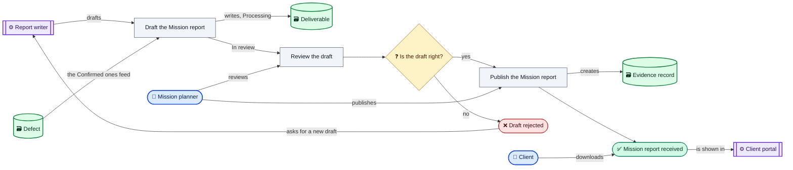

## 🖼️ Screens

One row per state of the flow chart: every action, success and failure node. Click a screen to open it full size. A state with nothing to show reads `➖ No screen: <why>`.

| State | Persona | Entity | Source | Screen |
| --- | --- | --- | --- | --- |
| A1: Draft the Mission report | [👤 Mission planner](../../glossary.md#per-mission-planner) | [🔄 Deliverable: Processing](../../glossary.md#st-deliverable-processing) [🔄 Defect: Confirmed](../../glossary.md#st-defect-confirmed) | ✏️ Mock-up | [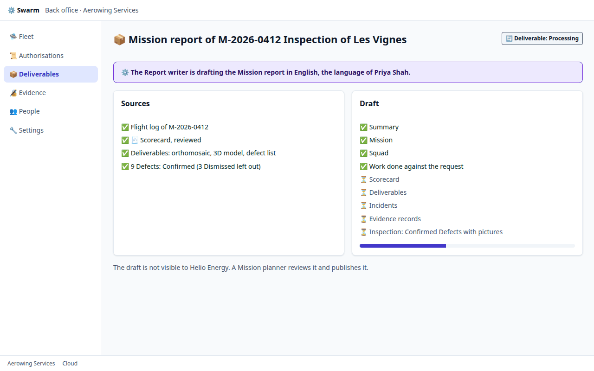](../../screens/UC-022/a1.png) [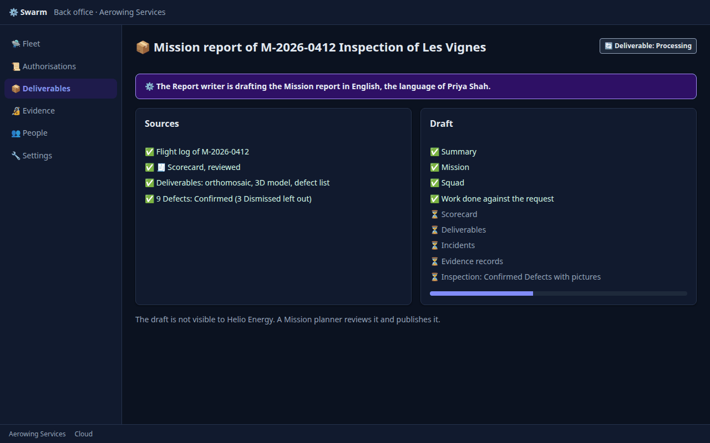](../../screens/UC-022/a1.dark.png) |
| A2: Review the draft | [👤 Mission planner](../../glossary.md#per-mission-planner) | [🔄 Deliverable: In review](../../glossary.md#st-deliverable-in-review) | ✏️ Mock-up | [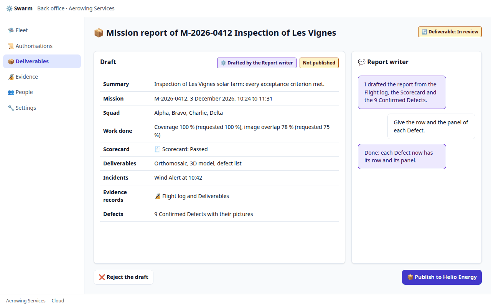](../../screens/UC-022/a2.png) [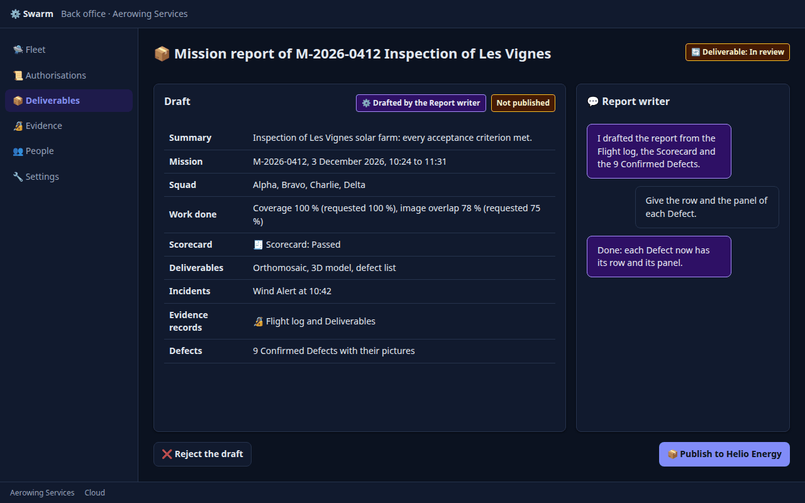](../../screens/UC-022/a2.dark.png) |
| KO: Draft rejected | [👤 Mission planner](../../glossary.md#per-mission-planner) | [🔄 Deliverable: In review](../../glossary.md#st-deliverable-in-review) | ✏️ Mock-up | [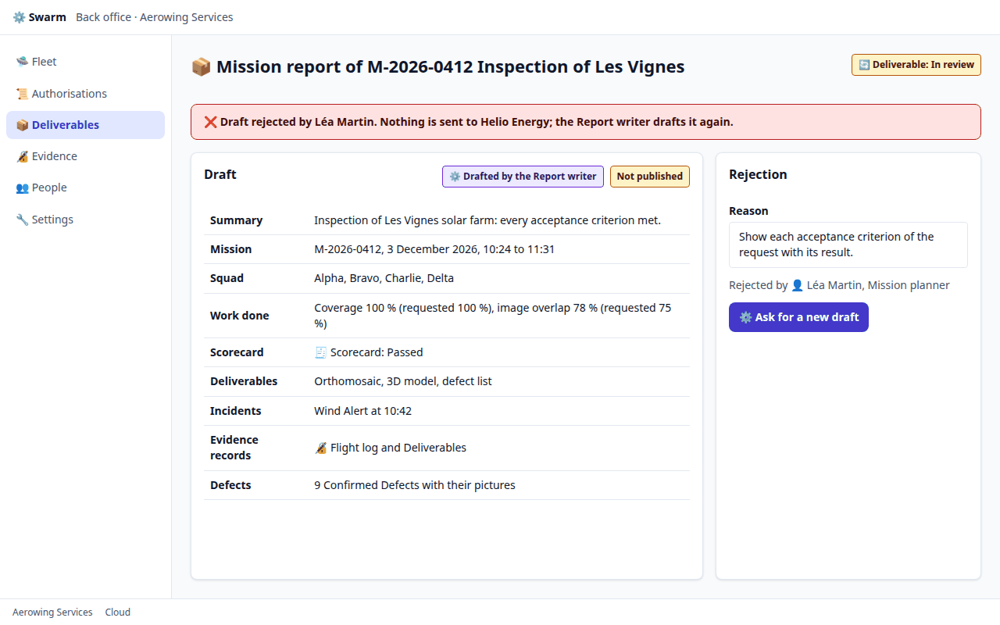](../../screens/UC-022/ko.png) [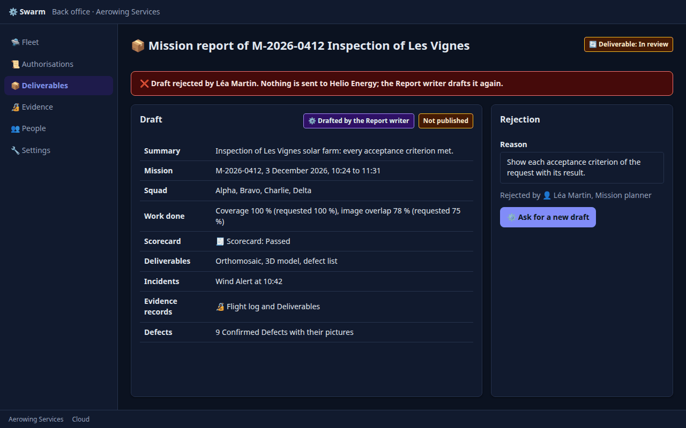](../../screens/UC-022/ko.dark.png) |
| A3: Publish the Mission report | [👤 Mission planner](../../glossary.md#per-mission-planner) | [🔄 Deliverable: In review](../../glossary.md#st-deliverable-in-review) | ✏️ Mock-up | [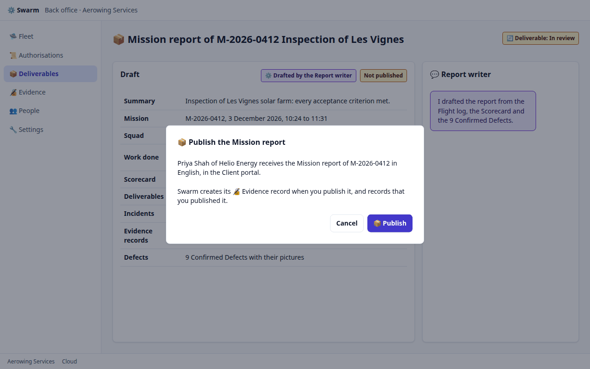](../../screens/UC-022/a3.png) [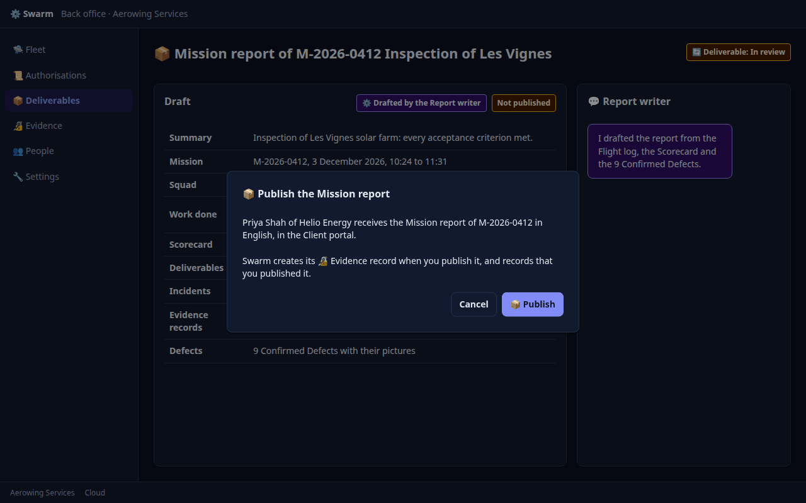](../../screens/UC-022/a3.dark.png) |
| OK: Mission report received | [👤 Client](../../glossary.md#per-client) | [🔄 Deliverable: Published](../../glossary.md#st-deliverable-published) [🗃️ Evidence record](../../glossary.md#ent-evidence-record) | ✏️ Mock-up | [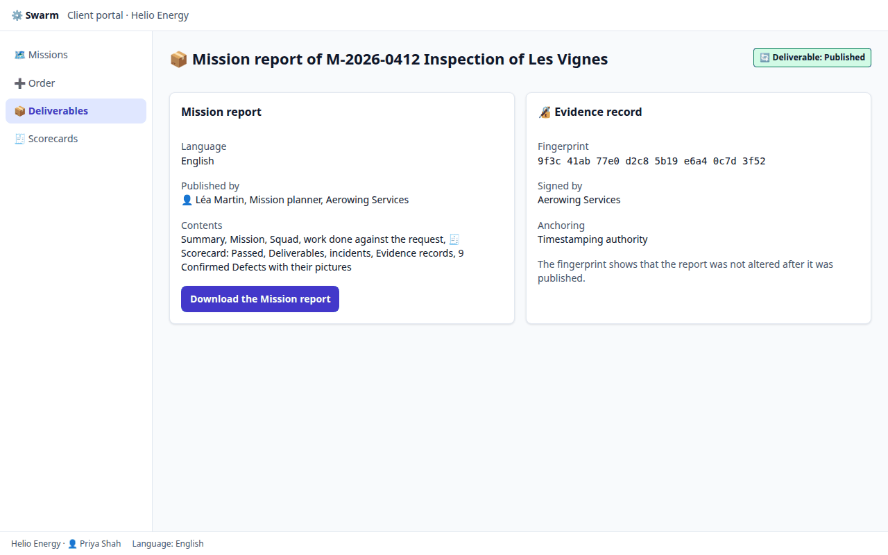](../../screens/UC-022/ok.png) [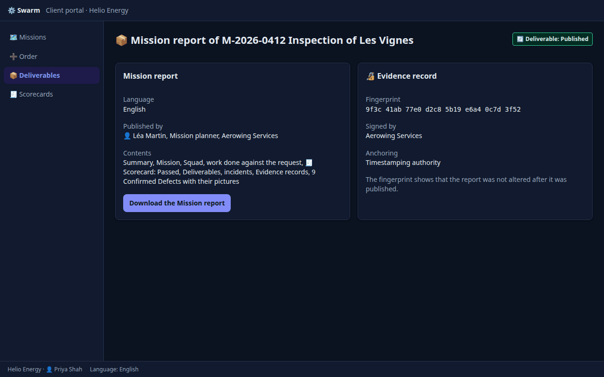](../../screens/UC-022/ok.dark.png) |

## ↪️ Alternative and error flows

| # | At step | Condition | What happens |
| --- | --- | --- | --- |
| A1 | 2 | The draft is wrong or incomplete | ❌ The Mission planner rejects it with a reason. Nothing reaches the Client; the Report writer drafts it again |
| A2 | 1 | Some Defects are still Defect: Suspected | They are left out of the report ([📏 BR-020](../business-rules/BR-020-defects-confirmed-by-a-person.md)) |
| A3 | 4 | The Operator chose no Anchoring service | The Evidence record is signed and chained, not anchored ([📏 BR-009](../business-rules/BR-009-evidence-integrity.md)) |

## 📏 Business rules applied

| Rule | Where it applies |
| --- | --- |
| [📏 BR-021: AI agents propose, people decide](../business-rules/BR-021-ai-agents-propose-people-decide.md) | Steps 1 to 3: the report stays a draft until the Mission planner publishes it, and Swarm records who did |
| [📏 BR-020: Defects confirmed by a person](../business-rules/BR-020-defects-confirmed-by-a-person.md) | Step 1: only Confirmed Defects are in the report |
| [📏 BR-009: Evidence integrity](../business-rules/BR-009-evidence-integrity.md) | Step 4: the published report gets its Evidence record |
| [📏 BR-017: Every screen in four languages](../business-rules/BR-017-every-screen-in-four-languages.md) | Step 1: the report is written in the language the Client chose |

## 🏁 Postconditions

- ✅ **Success:** the Mission report is Deliverable: Published, with its Evidence record and the name of the Mission planner who published it. The Client has it in English in the Client portal.
- ❌ **Failure:** the draft is rejected. Nothing reaches the Client; the Report writer drafts it again (Deliverable: Processing), and the new draft comes back Deliverable: In review.

## 🔗 Referenced by

<!-- spec:referenced-by -->
- [📘 FS-019: Mission reports](../features/FS-019-mission-reports.md)
<!-- /spec:referenced-by -->

<!-- spec:nav-bottom -->
---

> [🏠 Index](../../README.md) · [◀️ UC-021: Plan a Mission with the Mission assistant](UC-021-plan-a-mission-with-the-mission-assistant.md) · 📄 **Page 48 / 109** · [UC-023: Configure the Workspace of Ground control ▶️](UC-023-configure-the-workspace-of-ground-control.md)
<!-- /spec:nav-bottom -->
