# 🎬 UC-023: Configure the Workspace of Ground control

<!-- spec:nav-top -->
> [🏠 Index](../../README.md) · [◀️ UC-022: Receive the Mission report](UC-022-receive-the-mission-report.md) · 📄 **Page 49 / 108** · [UC-024: Configure each Drone of the Squad on the Site ▶️](UC-024-configure-each-drone-of-the-squad-on-the-site.md)
<!-- /spec:nav-top -->

**Status:** 🟢 Approved · **Updated:** 2026-11-18

> [!NOTE]
> The [👤 Pilot](../../glossary.md#per-pilot) arranges the panels, the Alert thresholds, the units, the language, the mode and the Control mapping of [⚙️ Ground control](../../glossary.md#sys-ground-control) for one platform, and gets a [🗃️ Workspace](../../glossary.md#ent-workspace) that opens the same way next time.

<!-- spec:summary -->
## 📑 Summary

1. [👤 Personas and entities](#actors)
2. [🚦 Preconditions](#preconditions)
3. [⚡ Trigger](#trigger)
4. [➡️ Main flow](#main-flow)
5. [🔀 Flow chart](#flowchart)
6. [🖼️ Screens](#screens)
7. [↪️ Alternative and error flows](#alternative-flows)
8. [📏 Business rules applied](#business-rules)
9. [🏁 Postconditions](#postconditions)
10. [🔗 Referenced by](#referenced-by)
<!-- /spec:summary -->

## 👤 Personas and entities

| Name | Kind | Role in this use case |
| --- | --- | --- |
| [👤 Pilot](../../glossary.md#per-pilot) | Persona | Configures Ground control for one platform |
| [🗃️ Workspace](../../glossary.md#ent-workspace) | Entity | Saved per Pilot and platform |
| [🗃️ Operator](../../glossary.md#ent-operator) | Entity | Sets the limits of the Alert thresholds |
| [⚙️ Ground control](../../glossary.md#sys-ground-control) | System | Keeps Hold the Squad and abort visible and fixed |

## 🚦 Preconditions

1. The Pilot Sam Carter is signed in to Ground control on one platform: desktop with several screens, laptop, tablet or web browser.
2. The [🗃️ Operator](../../glossary.md#ent-operator) Aerowing Services has kept the default limits of each [🔤 Alert threshold](../../glossary.md#term-alert-threshold) and the default maximum of video streams per platform: desktop 4, laptop 2, tablet 1, web browser 2.
3. No Squad is in flight under this Pilot.

## ⚡ Trigger

The Pilot opens 🔧 Settings in Ground control.

## ➡️ Main flow

1. The Pilot picks the platform, here a desktop with three screens, and places the panels on each screen: map and Squad on screen 1, video and Alerts on screen 2, progress on screen 3. Ground control keeps Hold the Squad and abort in the title bar of every screen ([📏 BR-023](../business-rules/BR-023-fixed-safety-controls.md)).
2. The Pilot chooses how many video streams the [🔤 Mosaic](../../glossary.md#term-mosaic) shows, up to the Operator maximum for the platform (4 on a desktop), and the severity at or above which an event a Drone detects opens the [🔤 Focus view](../../glossary.md#term-focus-view) ([📏 BR-027](../business-rules/BR-027-the-pilot-s-attention-is-preserved.md)).
3. The Pilot sets the Alert thresholds. Ground control shows the Operator limits and the default next to each value and accepts only a value within them ([📏 BR-024](../business-rules/BR-024-alert-thresholds-within-the-operator-limits.md)): low battery 25 % to 40 % (default 30 %), [🔤 Link](../../glossary.md#term-link) quality 30 % to 70 % (default 50 %), wind 60 % to 90 % of the limit of the [🗃️ Drone model](../../glossary.md#ent-drone-model) (default 80 %).
4. The Pilot chooses the units (metric or imperial), the language (English, French, German or Spanish) and light or dark mode ([📏 BR-017](../business-rules/BR-017-every-screen-in-four-languages.md)).
5. The Pilot sets the [🔤 Control mapping](../../glossary.md#term-control-mapping) of the controller (XInput gamepads first, then generic USB joysticks) and the keyboard. The inputs of Hold the Squad and abort are shown locked, each acting when held for 1 second: Hold the Squad is the key H or both gamepad bumpers, abort is Ctrl+Shift+A or the gamepad Back and Start buttons ([📏 BR-023](../business-rules/BR-023-fixed-safety-controls.md)).
6. The Pilot saves. The Workspace is saved for Sam Carter on this platform and opens the same way next time.

## 🔀 Flow chart

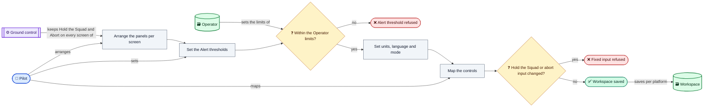

## 🖼️ Screens

One row per state of the flow chart: every action, success and failure node. Click a screen to open it full size. A state with nothing to show reads `➖ No screen: <why>`.

| State | Persona | Entity | Source | Screen |
| --- | --- | --- | --- | --- |
| A1: Arrange the panels per screen | [👤 Pilot](../../glossary.md#per-pilot) | [🗃️ Workspace](../../glossary.md#ent-workspace) | ✏️ Mock-up | [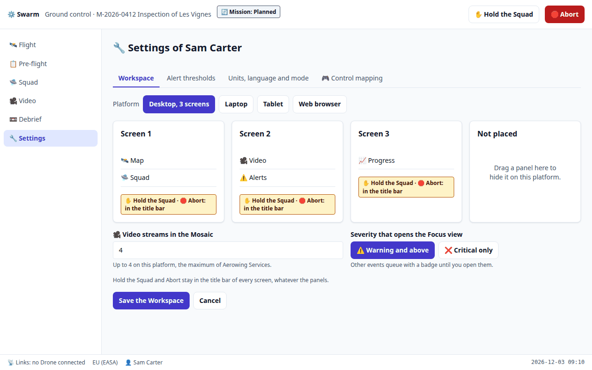](../../screens/UC-023/a1.png) [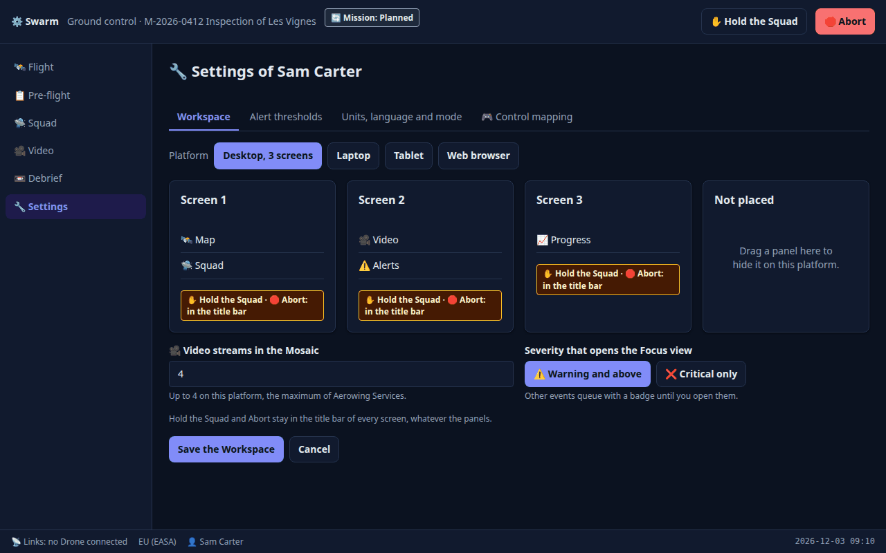](../../screens/UC-023/a1.dark.png) |
| A2: Set the Alert thresholds | [👤 Pilot](../../glossary.md#per-pilot) | [🗃️ Workspace](../../glossary.md#ent-workspace) [🗃️ Operator](../../glossary.md#ent-operator) | ✏️ Mock-up | [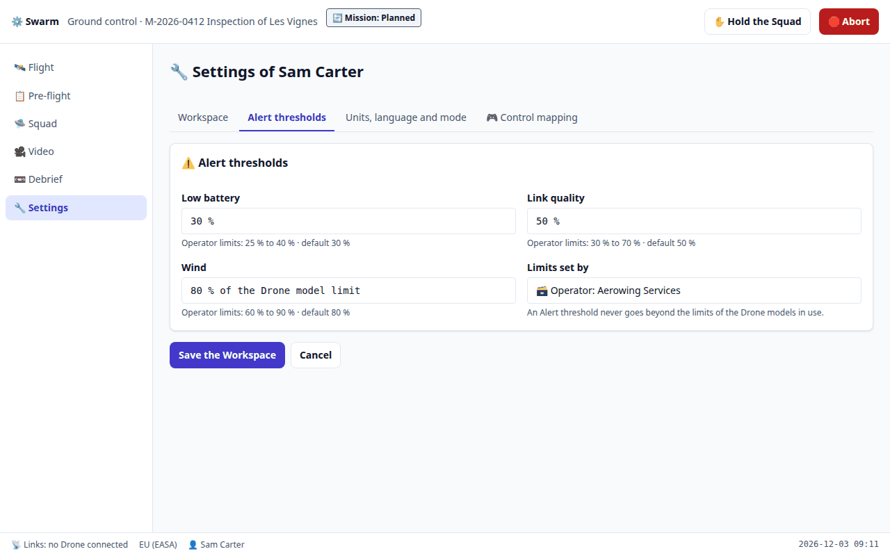](../../screens/UC-023/a2.png) [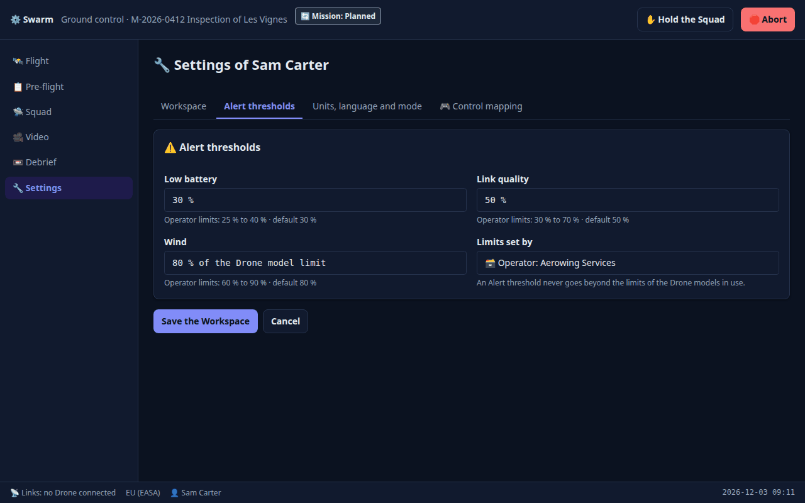](../../screens/UC-023/a2.dark.png) |
| A3: Set units, language and mode | [👤 Pilot](../../glossary.md#per-pilot) | [🗃️ Workspace](../../glossary.md#ent-workspace) | ✏️ Mock-up | [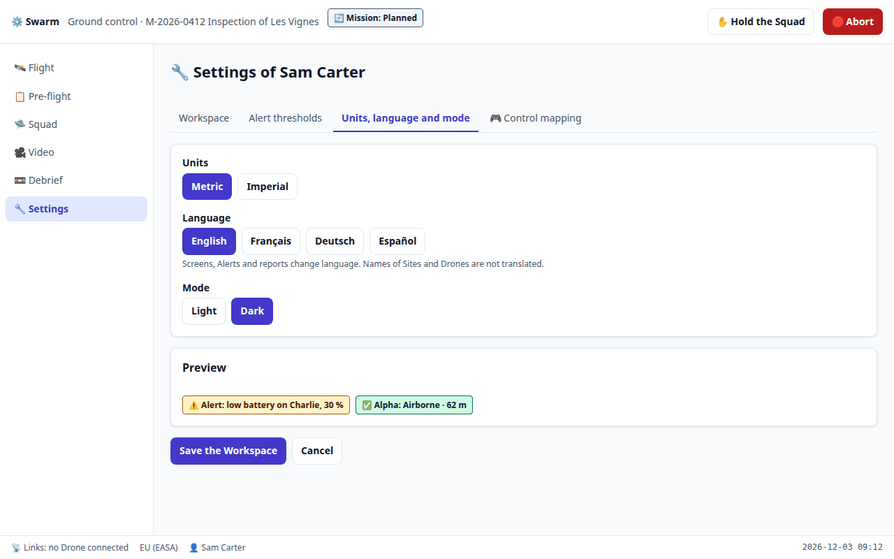](../../screens/UC-023/a3.png) [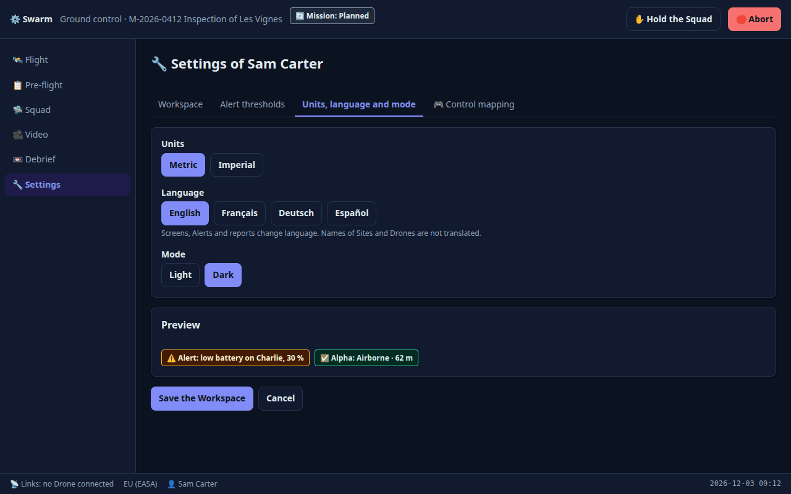](../../screens/UC-023/a3.dark.png) |
| A4: Map the controls | [👤 Pilot](../../glossary.md#per-pilot) | [🗃️ Workspace](../../glossary.md#ent-workspace) | ✏️ Mock-up | [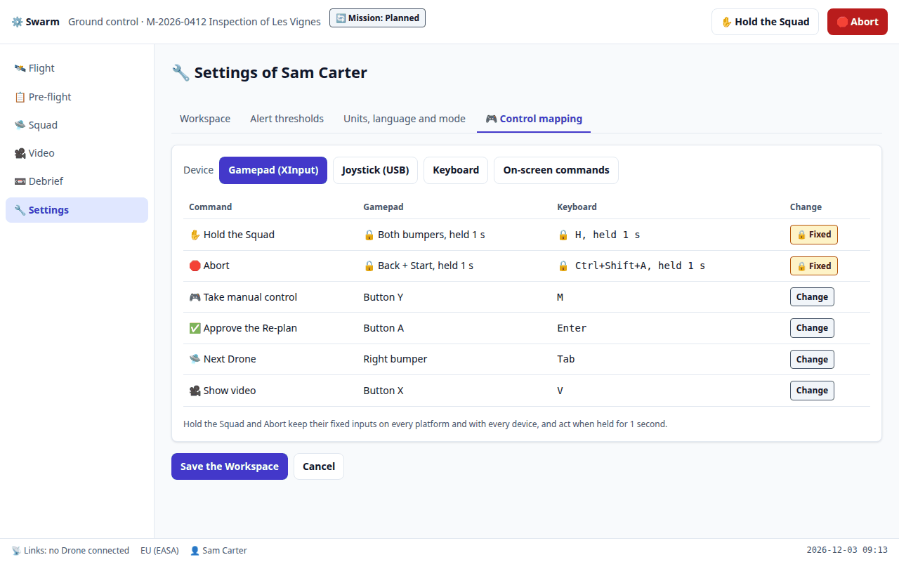](../../screens/UC-023/a4.png) [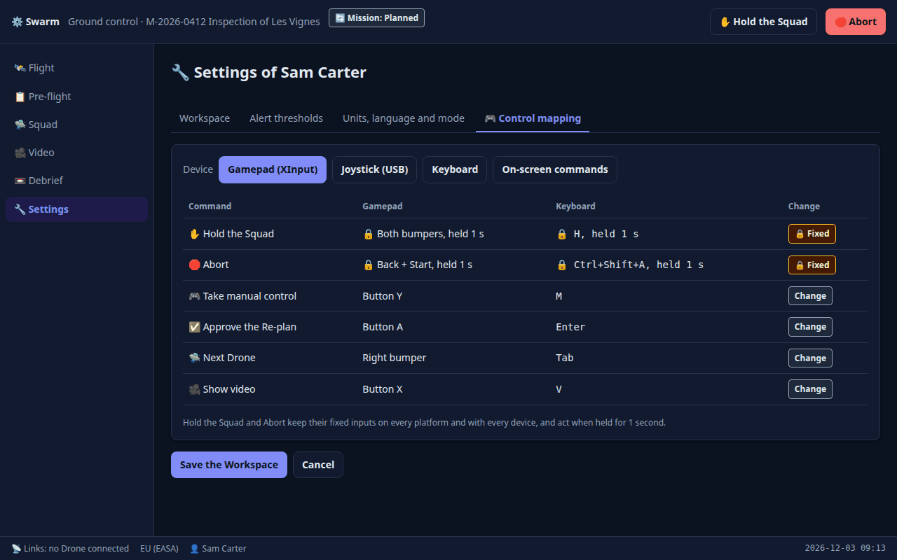](../../screens/UC-023/a4.dark.png) |
| OK: Workspace saved | [👤 Pilot](../../glossary.md#per-pilot) | [🗃️ Workspace](../../glossary.md#ent-workspace) | ✏️ Mock-up | [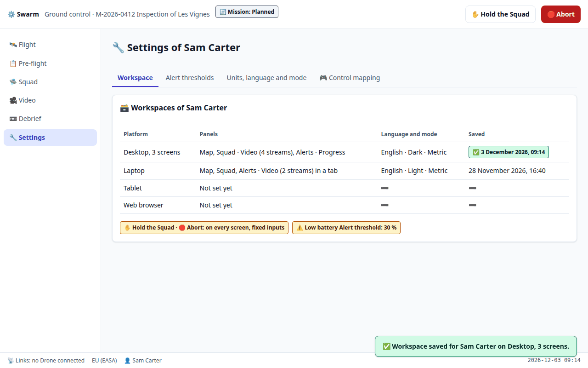](../../screens/UC-023/ok.png) [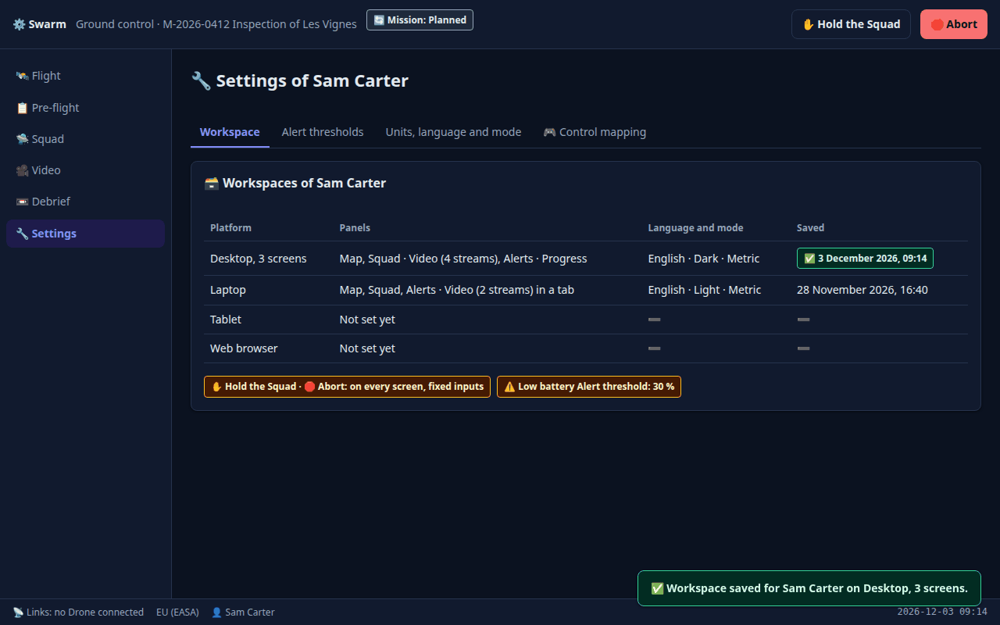](../../screens/UC-023/ok.dark.png) |
| KO1: Alert threshold refused | [👤 Pilot](../../glossary.md#per-pilot) | [🗃️ Operator](../../glossary.md#ent-operator) | ✏️ Mock-up | [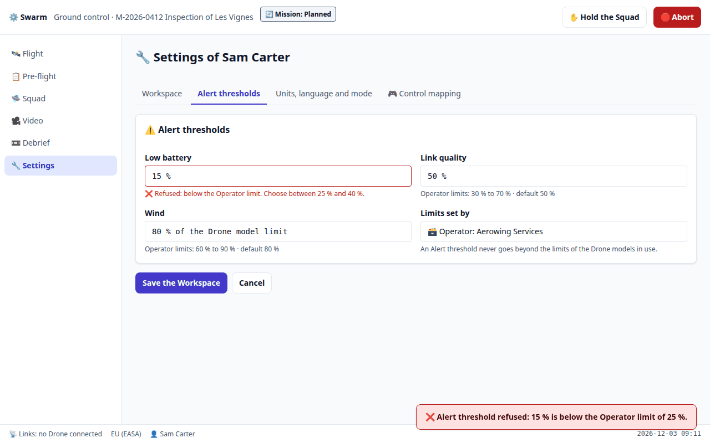](../../screens/UC-023/ko1.png) [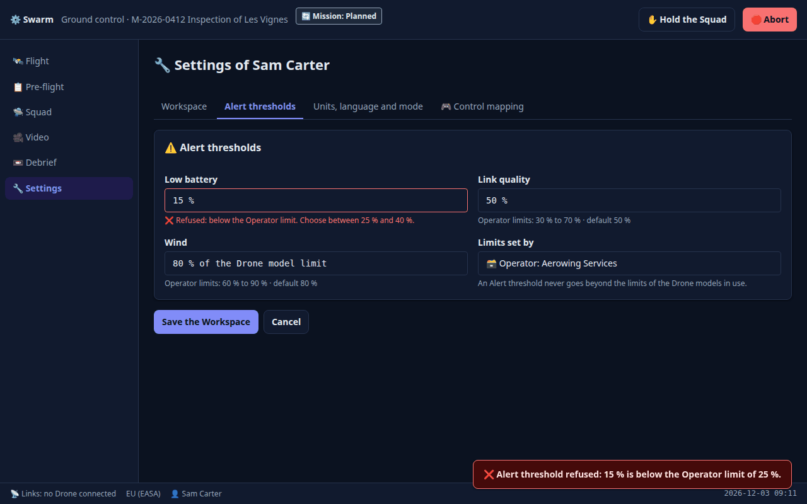](../../screens/UC-023/ko1.dark.png) |
| KO2: Fixed input refused | [👤 Pilot](../../glossary.md#per-pilot) | [🗃️ Workspace](../../glossary.md#ent-workspace) | ✏️ Mock-up | [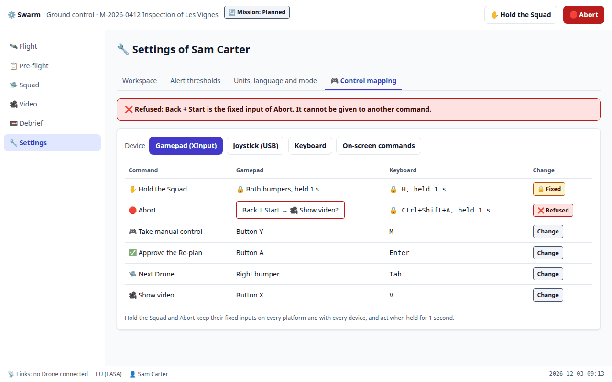](../../screens/UC-023/ko2.png) [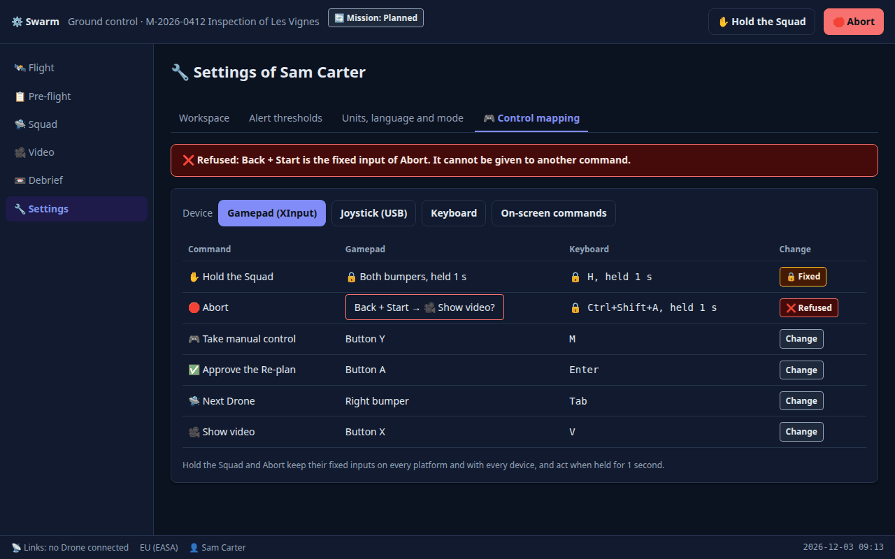](../../screens/UC-023/ko2.dark.png) |

## ↪️ Alternative and error flows

| # | At step | Condition | What happens |
| --- | --- | --- | --- |
| A1 | 3 | The Pilot sets the low battery Alert threshold to 15 % while the Operator range is 25 % to 40 % | Refused: Ground control shows the Operator range and keeps the last valid value ([📏 BR-024](../business-rules/BR-024-alert-thresholds-within-the-operator-limits.md)). The Pilot corrects it and goes on. |
| A2 | 5 | The Pilot maps the abort input, or the Hold the Squad input, to another command | Refused: the input is fixed ([📏 BR-023](../business-rules/BR-023-fixed-safety-controls.md)). The other mappings are kept. |
| A3 | 1 | The Pilot configures another platform, such as a laptop or a tablet | A separate Workspace is saved for that platform, with up to the streams that platform allows (laptop 2, tablet 1, web browser 2). The Workspace of the desktop is unchanged. A tablet has one screen and no manual control: it does everything else, including Hold the Squad, abort, approving Re-plans and closing Alarms. |

## 📏 Business rules applied

| Rule | Where it applies |
| --- | --- |
| [📏 BR-023: Fixed safety controls](../business-rules/BR-023-fixed-safety-controls.md) | Steps 1 and 5: Hold the Squad and abort on every screen, their inputs fixed and held for 1 second |
| [📏 BR-024: Alert thresholds within the Operator limits](../business-rules/BR-024-alert-thresholds-within-the-operator-limits.md) | Step 3: each Alert threshold within the Operator limits |
| [📏 BR-017: Every screen in four languages](../business-rules/BR-017-every-screen-in-four-languages.md) | Step 4: the Pilot chooses one of four languages |
| [📏 BR-027: The Pilot's attention is preserved](../business-rules/BR-027-the-pilot-s-attention-is-preserved.md) | Step 2: video streams up to the Operator maximum, the severity that opens the Focus view |

## 🏁 Postconditions

- ✅ **Success:** the Workspace of Sam Carter for this platform is saved and opens the same way next time. Hold the Squad and abort are on every screen with their fixed inputs.
- ❌ **Failure:** an Alert threshold out of the Operator limits, or a change to a fixed input, is refused with the reason; the last valid setting is kept.

## 🔗 Referenced by

<!-- spec:referenced-by -->
- [📘 FS-020: Ground control Workspace and configuration](../features/FS-020-ground-control-workspace-and-configuration.md)
- [🎬 UC-025: Monitor a Mission in Ground control](UC-025-monitor-a-mission-in-ground-control.md)
<!-- /spec:referenced-by -->

<!-- spec:nav-bottom -->
---

> [🏠 Index](../../README.md) · [◀️ UC-022: Receive the Mission report](UC-022-receive-the-mission-report.md) · 📄 **Page 49 / 108** · [UC-024: Configure each Drone of the Squad on the Site ▶️](UC-024-configure-each-drone-of-the-squad-on-the-site.md)
<!-- /spec:nav-bottom -->
