# 🎬 UC-024: Configure each Drone of the Squad on the Site

<!-- spec:nav-top -->
> [🏠 Index](../../README.md) · [◀️ UC-023: Configure the Workspace of Ground control](UC-023-configure-the-workspace-of-ground-control.md) · 📄 **Page 50 / 109** · [UC-025: Monitor a Mission in Ground control ▶️](UC-025-monitor-a-mission-in-ground-control.md)
<!-- /spec:nav-top -->

**Status:** 🟢 Approved · **Updated:** 2026-11-18

> [!NOTE]
> The [👤 Pilot](../../glossary.md#per-pilot) changes a [🗃️ Battery](../../glossary.md#ent-battery), a [🗃️ Drone](../../glossary.md#ent-drone) or a [🗃️ Payload](../../glossary.md#ent-payload) of the [🗃️ Squad](../../glossary.md#ent-squad) on the Site before launch, and gets a [🗃️ Mission](../../glossary.md#ent-mission) checked again and ready to sign.

<!-- spec:summary -->
## 📑 Summary

1. [👤 Personas and entities](#actors)
2. [🚦 Preconditions](#preconditions)
3. [⚡ Trigger](#trigger)
4. [➡️ Main flow](#main-flow)
5. [🔀 Flow chart](#flowchart)
6. [🖼️ Screens](#screens)
7. [↪️ Alternative and error flows](#alternative-flows)
8. [📏 Business rules applied](#business-rules)
9. [🏁 Postconditions](#postconditions)
10. [🔗 Referenced by](#referenced-by)
<!-- /spec:summary -->

## 👤 Personas and entities

| Name | Kind | Role in this use case |
| --- | --- | --- |
| [👤 Pilot](../../glossary.md#per-pilot) | Persona | Reviews and changes each Drone of the Squad, then signs the Pre-flight check again |
| [👤 Mission planner](../../glossary.md#per-mission-planner) | Persona | Is told of the changes made on the Site |
| [🗃️ Squad](../../glossary.md#ent-squad) | Entity | Alpha, Bravo, Charlie and Delta, each with its own Drone model, Payload and Battery |
| [🗃️ Drone](../../glossary.md#ent-drone) | Entity | Charlie is replaced by the spare Echo |
| [🗃️ Battery](../../glossary.md#ent-battery) | Entity | The Battery of Bravo is swapped |
| [🗃️ Payload](../../glossary.md#ent-payload) | Entity | A Payload that does not fit is refused |
| [🗃️ Mission](../../glossary.md#ent-mission) | Entity | Checked again after the changes |
| [🗃️ Pre-flight check](../../glossary.md#ent-pre-flight-check) | Entity | Run and signed again |
| [🗃️ Flight log](../../glossary.md#ent-flight-log) | Entity | Records each change made on the Site |
| [⚙️ Ground control](../../glossary.md#sys-ground-control) | System | Checks each change and the Mission again |

## 🚦 Preconditions

1. The Mission M-2026-0412 Inspection of Les Vignes is Verified: its [🗃️ Pre-flight check](../../glossary.md#ent-pre-flight-check) was signed by the Pilot Sam Carter.
2. The Squad is Alpha, Bravo and Charlie (X500) and Delta (ANAFI USA). The spare Echo (X500, thermal camera) is in the [🗃️ Field kit](../../glossary.md#ent-field-kit) on the [🗃️ Site](../../glossary.md#ent-site) Les Vignes solar farm.
3. The Squad has not launched.

## ⚡ Trigger

The Pilot opens 🛸 Squad in [⚙️ Ground control](../../glossary.md#sys-ground-control) to change the Squad before launch.

## ➡️ Main flow

1. The Pilot reviews each Drone of the Squad: its [🗃️ Drone model](../../glossary.md#ent-drone-model), its Payload and task, its Battery and its readiness.
2. The Pilot swaps the Battery of Bravo for a fully charged one.
3. Charlie shows an open fault and is Grounded ([📏 BR-011](../business-rules/BR-011-drone-readiness.md)). The Pilot replaces Charlie by the spare Echo, of the same Drone model and with the same Payload.
4. Ground control checks each change: Echo is Ready, the new Battery is above the health threshold set for its Drone model, and each Payload fits its Drone model and can perform its task ([📏 BR-011](../business-rules/BR-011-drone-readiness.md), [📏 BR-022](../business-rules/BR-022-payload-compatibility.md)).
5. Ground control checks the Mission again with the new Squad ([📏 BR-025](../business-rules/BR-025-on-site-changes-are-checked-again.md)). The Mission is Planned again: the signature of the earlier Pre-flight check no longer applies.
6. Ground control tells the [👤 Mission planner](../../glossary.md#per-mission-planner) Léa Martin of the changes and records them in the [🗃️ Flight log](../../glossary.md#ent-flight-log) ([📏 BR-025](../business-rules/BR-025-on-site-changes-are-checked-again.md)).
7. The Pilot runs the Pre-flight check again and signs it. The Mission is Verified and can launch.

## 🔀 Flow chart

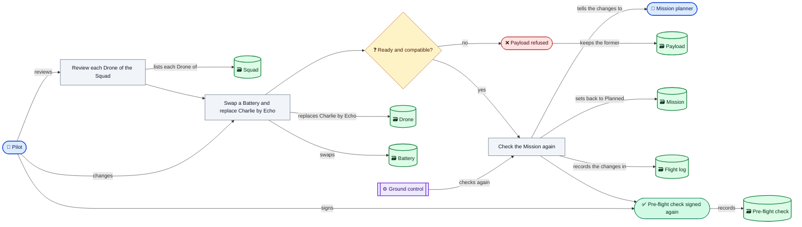

## 🖼️ Screens

One row per state of the flow chart: every action, success and failure node. Click a screen to open it full size. A state with nothing to show reads `➖ No screen: <why>`.

| State | Persona | Entity | Source | Screen |
| --- | --- | --- | --- | --- |
| A1: Review each Drone of the Squad | [👤 Pilot](../../glossary.md#per-pilot) | [🔄 Mission: Verified](../../glossary.md#st-mission-verified) [🔄 Drone: Ready](../../glossary.md#st-drone-ready) | ✏️ Mock-up | [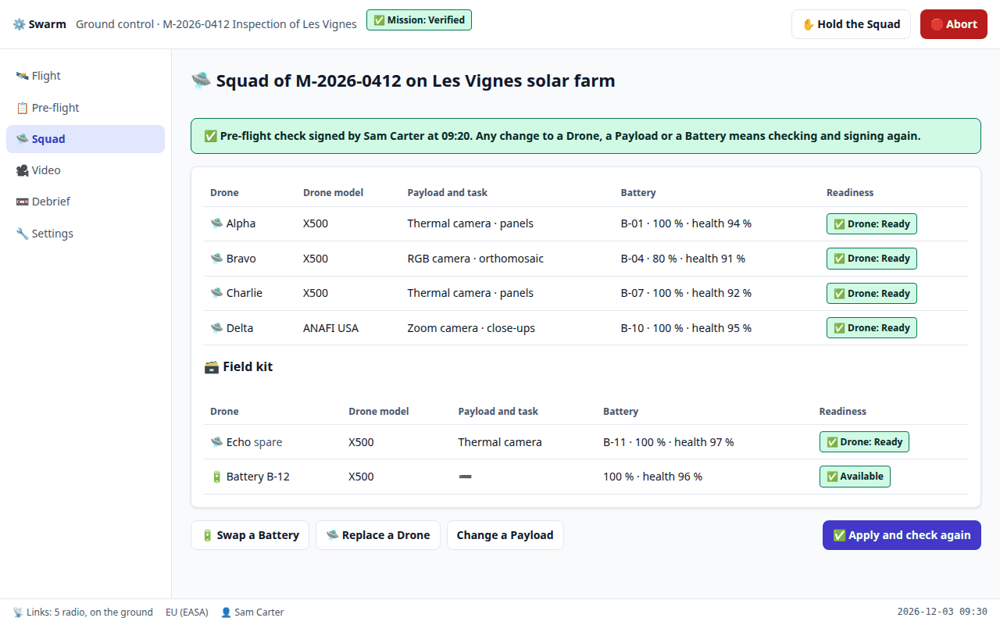](../../screens/UC-024/a1.png) [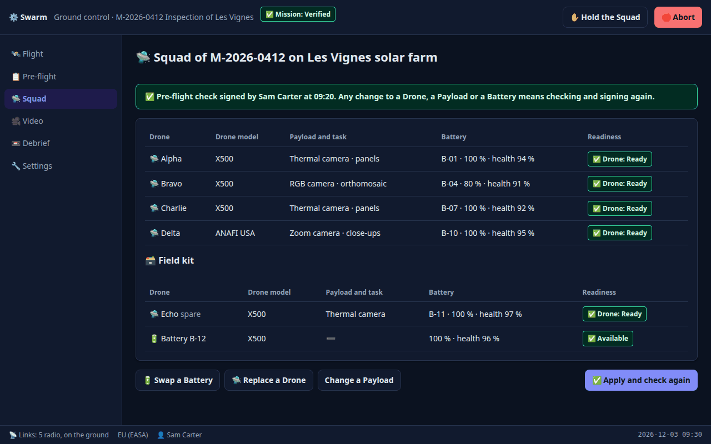](../../screens/UC-024/a1.dark.png) |
| A2: Swap a Battery and replace Charlie by Echo | [👤 Pilot](../../glossary.md#per-pilot) | [🔄 Drone: Grounded](../../glossary.md#st-drone-grounded) [🔄 Drone: Ready](../../glossary.md#st-drone-ready) | ✏️ Mock-up | [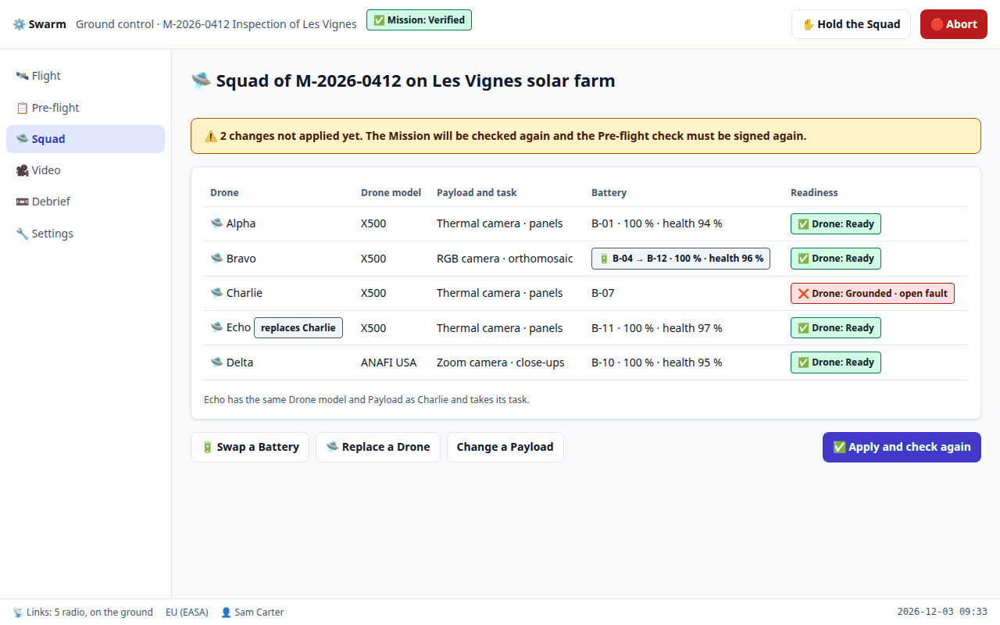](../../screens/UC-024/a2.png) [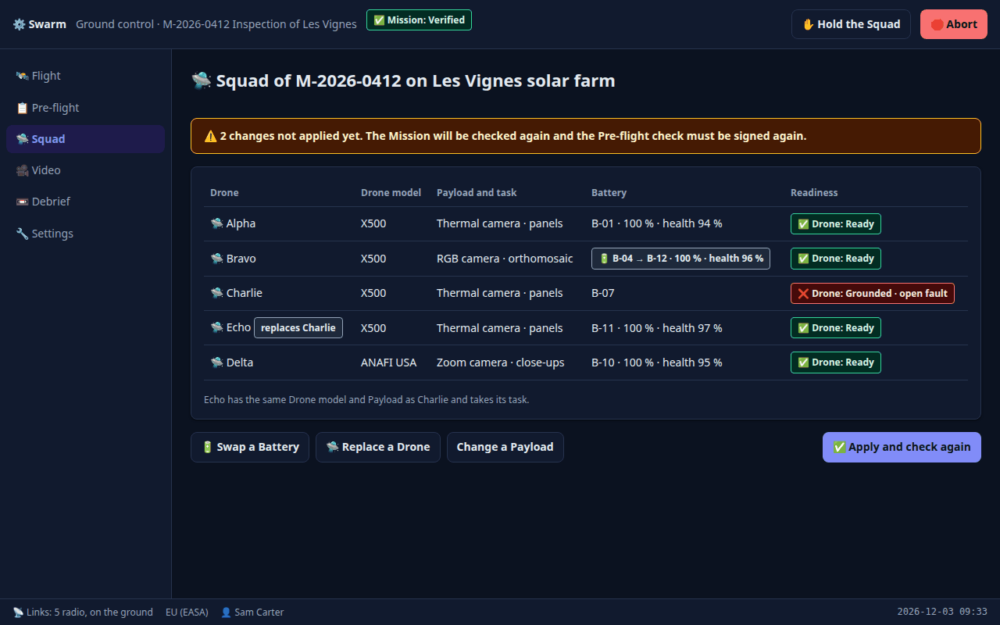](../../screens/UC-024/a2.dark.png) |
| A3: Check the Mission again | [👤 Pilot](../../glossary.md#per-pilot) [👤 Mission planner](../../glossary.md#per-mission-planner) | [🔄 Mission: Planned](../../glossary.md#st-mission-planned) [🗃️ Flight log](../../glossary.md#ent-flight-log) | ✏️ Mock-up | [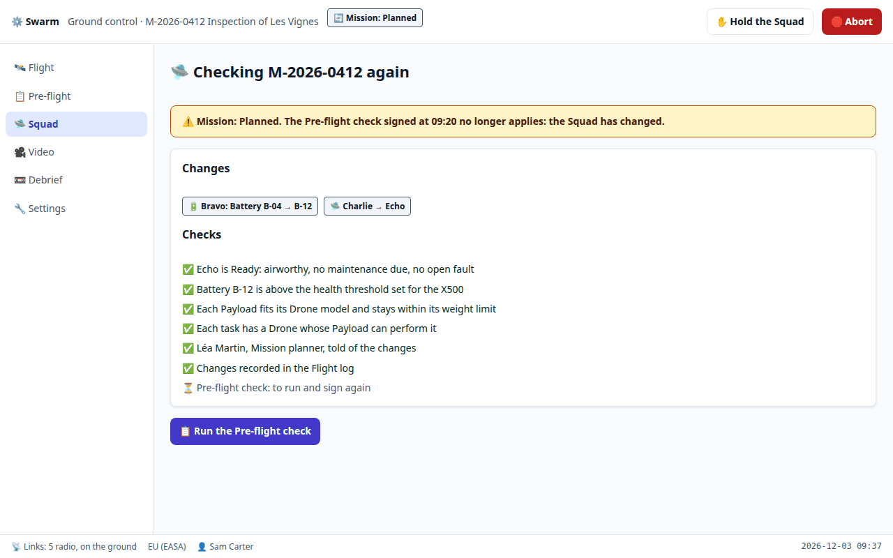](../../screens/UC-024/a3.png) [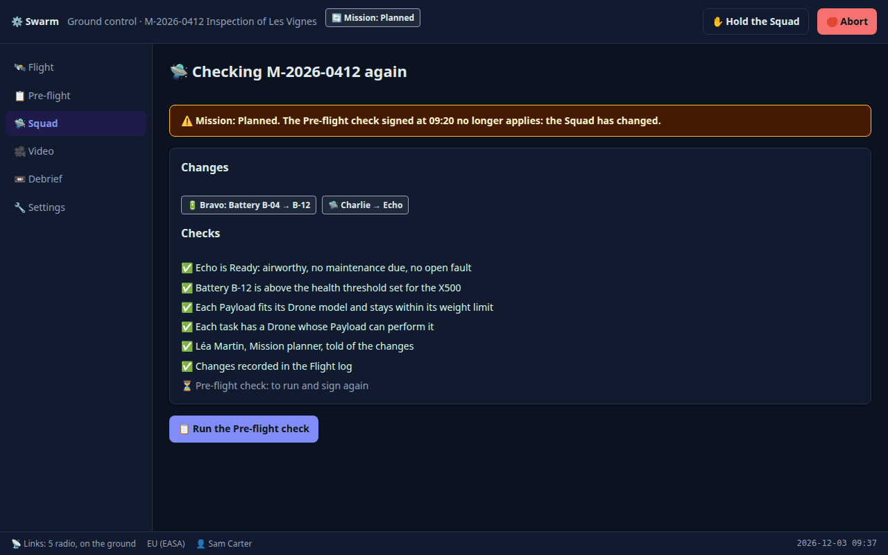](../../screens/UC-024/a3.dark.png) |
| OK: Pre-flight check signed again | [👤 Pilot](../../glossary.md#per-pilot) | [🔄 Mission: Verified](../../glossary.md#st-mission-verified) [🗃️ Pre-flight check](../../glossary.md#ent-pre-flight-check) | ✏️ Mock-up | [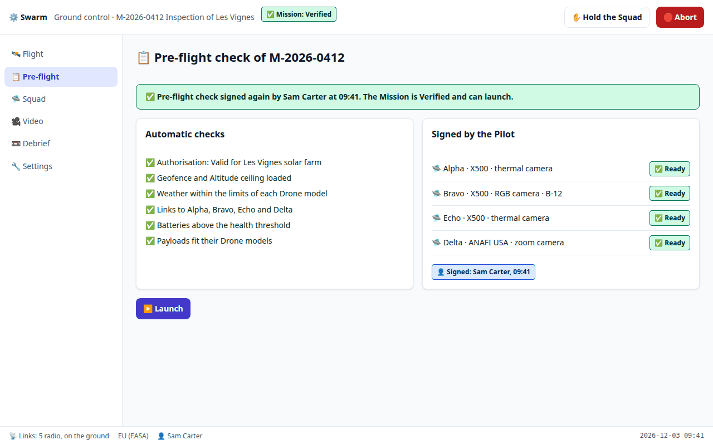](../../screens/UC-024/ok.png) [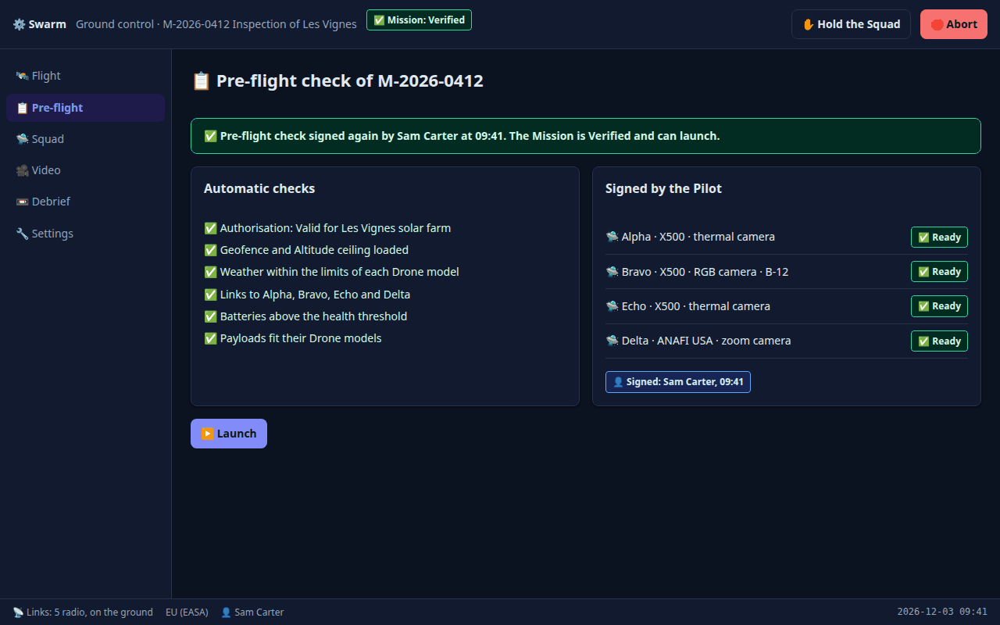](../../screens/UC-024/ok.dark.png) |
| KO: Payload refused | [👤 Pilot](../../glossary.md#per-pilot) | [🗃️ Payload](../../glossary.md#ent-payload) | ✏️ Mock-up | [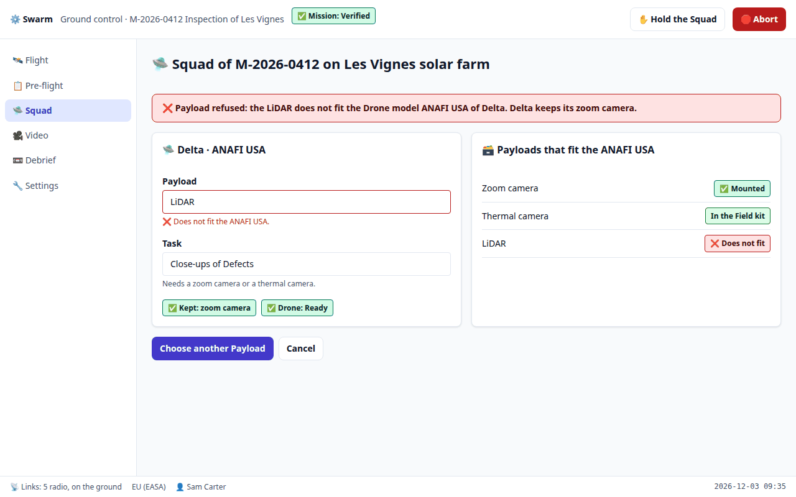](../../screens/UC-024/ko.png) [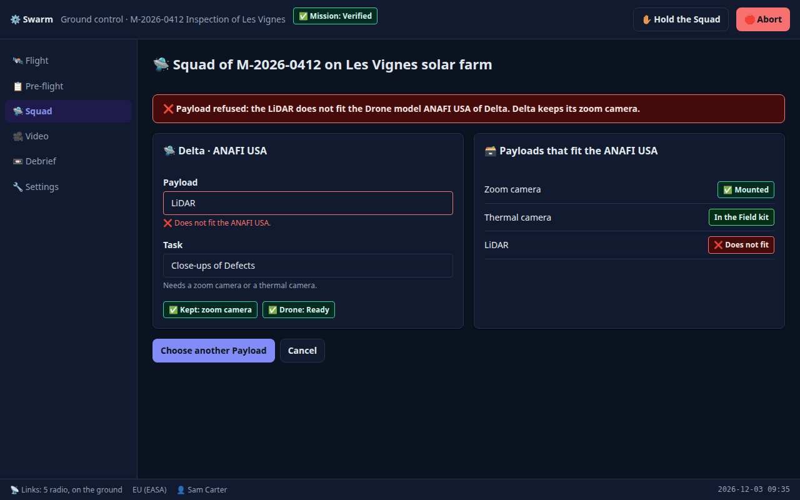](../../screens/UC-024/ko.dark.png) |

## ↪️ Alternative and error flows

| # | At step | Condition | What happens |
| --- | --- | --- | --- |
| A1 | 4 | The Pilot mounts the LiDAR of the Field kit on Delta, and it does not fit the ANAFI USA | Refused: Ground control names the Drone, the Payload and the reason ([📏 BR-022](../business-rules/BR-022-payload-compatibility.md)). Delta keeps its zoom camera. |
| A2 | 4 | A Payload would take a Drone over the weight limit of its Drone model | Refused with the excess weight ([📏 BR-025](../business-rules/BR-025-on-site-changes-are-checked-again.md)). |

## 📏 Business rules applied

| Rule | Where it applies |
| --- | --- |
| [📏 BR-025: On-site changes are checked again](../business-rules/BR-025-on-site-changes-are-checked-again.md) | Steps 5 to 7: the Mission is checked again, the changes are told to the Mission planner and recorded, the Pre-flight check is signed again |
| [📏 BR-022: Payload compatibility](../business-rules/BR-022-payload-compatibility.md) | Step 4: each Payload fits its Drone model and can perform its task |
| [📏 BR-011: Drone readiness](../business-rules/BR-011-drone-readiness.md) | Steps 3 and 4: Charlie Grounded, Echo Ready, the new Battery above the health threshold |

## 🏁 Postconditions

- ✅ **Success:** the Squad is Alpha, Bravo with its new Battery, Echo and Delta; the Mission passed its checks again and is Verified with a new signed Pre-flight check. Léa Martin knows of the changes, and the Flight log records them.
- ❌ **Failure:** a change that breaks a rule is refused with its reason, the Squad keeps its former setting, and the Mission stays as it was until the Pilot makes a valid change.

## 🔗 Referenced by

<!-- spec:referenced-by -->
- [📘 FS-020: Ground control Workspace and configuration](../features/FS-020-ground-control-workspace-and-configuration.md)
<!-- /spec:referenced-by -->

<!-- spec:nav-bottom -->
---

> [🏠 Index](../../README.md) · [◀️ UC-023: Configure the Workspace of Ground control](UC-023-configure-the-workspace-of-ground-control.md) · 📄 **Page 50 / 109** · [UC-025: Monitor a Mission in Ground control ▶️](UC-025-monitor-a-mission-in-ground-control.md)
<!-- /spec:nav-bottom -->
