# 🎬 UC-025: Monitor a Mission in Ground control

<!-- spec:nav-top -->
> [🏠 Index](../../README.md) · [◀️ UC-024: Configure each Drone of the Squad on the Site](UC-024-configure-each-drone-of-the-squad-on-the-site.md) · 📄 **Page 51 / 109** · [UC-026: Handle an Alert ▶️](UC-026-handle-an-alert.md)
<!-- /spec:nav-top -->

**Status:** 🟢 Approved · **Updated:** 2026-11-18

> [!NOTE]
> The [👤 Pilot](../../glossary.md#per-pilot) follows a Flying [🗃️ Mission](../../glossary.md#ent-mission) in the [🗃️ Workspace](../../glossary.md#ent-workspace) of [⚙️ Ground control](../../glossary.md#sys-ground-control), with the map and the [🗃️ Squad](../../glossary.md#ent-squad), the live video, the Alerts and the progress always in view.

<!-- spec:summary -->
## 📑 Summary

1. [👤 Personas and entities](#actors)
2. [🚦 Preconditions](#preconditions)
3. [⚡ Trigger](#trigger)
4. [➡️ Main flow](#main-flow)
5. [🔀 Flow chart](#flowchart)
6. [🖼️ Screens](#screens)
7. [↪️ Alternative and error flows](#alternative-flows)
8. [📏 Business rules applied](#business-rules)
9. [🏁 Postconditions](#postconditions)
10. [🔗 Referenced by](#referenced-by)
<!-- /spec:summary -->

## 👤 Personas and entities

| Name | Kind | Role in this use case |
| --- | --- | --- |
| [👤 Pilot](../../glossary.md#per-pilot) | Persona | Watches the Squad, the video, the Alerts and the progress |
| [🗃️ Workspace](../../glossary.md#ent-workspace) | Entity | Places the panels over the Pilot's screens |
| [🗃️ Squad](../../glossary.md#ent-squad) | Entity | Shown Drone by Drone on the map and in the Squad panel |
| [🗃️ Drone](../../glossary.md#ent-drone) | Entity | Shown with its state, Payload, battery and Link |
| [🗃️ Payload](../../glossary.md#ent-payload) | Entity | Gives the live video of its Drone: RGB or thermal |
| [🗃️ Mission](../../glossary.md#ent-mission) | Entity | Its progress is compared with its plan |
| [⚙️ Ground control](../../glossary.md#sys-ground-control) | System | Shows the four areas and takes the Pilot's commands |
| [⚙️ Co-pilot](../../glossary.md#sys-co-pilot) | System | Explains the Alerts in the Alerts area |

## 🚦 Preconditions

1. The Mission is [🔄 Mission: Flying](../../glossary.md#st-mission-flying) ([🎬 UC-003: Run the Pre-flight check and launch](UC-003-run-the-pre-flight-check-and-launch.md)). Sample: M-2026-0412 Inspection of Les Vignes, a mixed Squad: Alpha and Bravo (X500, RGB camera), Charlie and Delta (Matrice 4TD, thermal camera).
2. The Pilot has a Workspace for this platform, here a desktop with two screens ([🎬 UC-023: Configure the Workspace of Ground control](UC-023-configure-the-workspace-of-ground-control.md)), and has chosen 4 video streams, the desktop maximum of the Operator.

## ⚡ Trigger

The Squad takes off and Ground control opens the 🛰️ Flight view.

## ➡️ Main flow

1. Ground control opens the Pilot's Workspace. The Pilot is [🔄 Pilot: Supervising](../../glossary.md#st-pilot-supervising).
2. The first screen shows the four areas that are always visible: 🗺️ the map and the Squad (each Drone with its state, battery %, [🔤 Link](../../glossary.md#term-link) quality, altitude and Payload, always visible; speed, heading, GNSS accuracy, motor and Battery temperatures and Payload status on demand; the [🗃️ Geofence](../../glossary.md#ent-geofence); the work done and left), 🎥 the live video, ⚠️ the [🔤 Alerts](../../glossary.md#term-alert) with the Co-pilot, and 📈 the progress against the plan. ✋ Hold the Squad and 🛑 Abort are in the title bar of every screen ([📏 BR-023](../business-rules/BR-023-fixed-safety-controls.md)).
3. To look at one Drone, the Pilot selects Charlie. The video area shows the thermal video of Charlie's Payload with its [🔤 Telemetry](../../glossary.md#term-telemetry); every Drone stays [🔄 Drone: Airborne](../../glossary.md#st-drone-airborne). To see Charlie large, the Pilot opens its [🔤 Focus view](../../glossary.md#term-focus-view) ([🎬 UC-030: Focus on a Drone](UC-030-focus-on-a-drone.md)).
4. To look at the whole Squad, the Pilot opens the [🔤 Mosaic](../../glossary.md#term-mosaic) on the second screen: one tile per Drone, the RGB video of Alpha and Bravo and the thermal video of Charlie and Delta, with the Alerts and the progress kept in view. The Mosaic shows at most the number of streams the Pilot chose, up to the Operator's maximum for the platform: by default 4 on a desktop, 2 on a laptop, 1 on a tablet and 2 in a web browser ([📏 BR-027](../business-rules/BR-027-the-pilot-s-attention-is-preserved.md)).
5. The Pilot follows the progress against the plan: area covered, time left and battery left of each Drone. When an Alert appears, the Co-pilot explains it in the Alerts area ([🎬 UC-026: Handle an Alert](UC-026-handle-an-alert.md)). The Pilot can act at any time ([📏 BR-012](../business-rules/BR-012-pilot-override-always-available.md)).

## 🔀 Flow chart

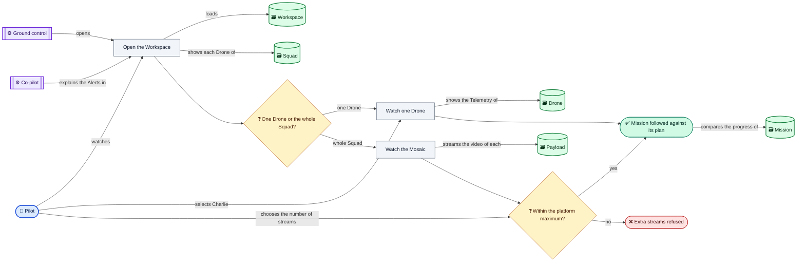

## 🖼️ Screens

One row per state of the flow chart: every action, success and failure node. Each state shows its light then its dark screen; click one to open it full size. A state with nothing to show reads `➖ No screen: <why>`.

| State | Persona | Entity | Source | Screen |
| --- | --- | --- | --- | --- |
| A1: Open the Workspace | [🔄 Pilot: Supervising](../../glossary.md#st-pilot-supervising) | [🗃️ Workspace](../../glossary.md#ent-workspace) [🔄 Drone: Airborne](../../glossary.md#st-drone-airborne) | ✏️ Mock-up | [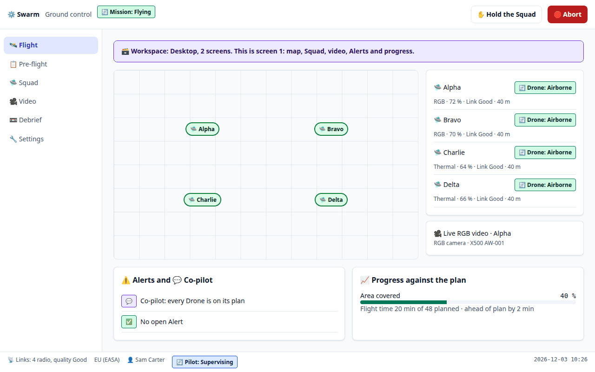](../../screens/UC-025/a1.png) [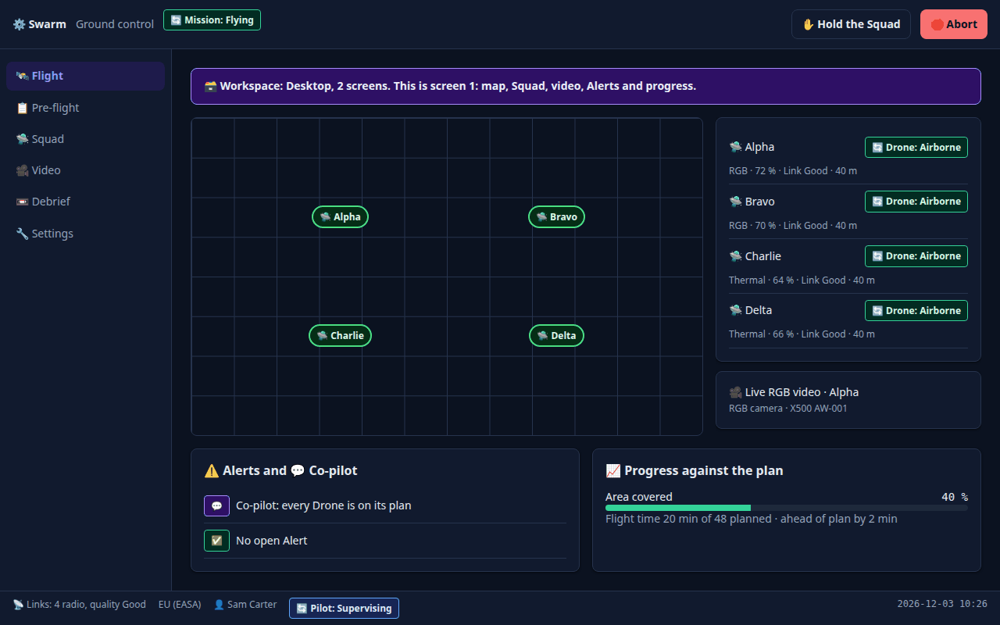](../../screens/UC-025/a1.dark.png) |
| A2: Watch one Drone | [🔄 Pilot: Supervising](../../glossary.md#st-pilot-supervising) | [🔄 Drone: Airborne](../../glossary.md#st-drone-airborne) [🗃️ Payload](../../glossary.md#ent-payload) | ✏️ Mock-up | [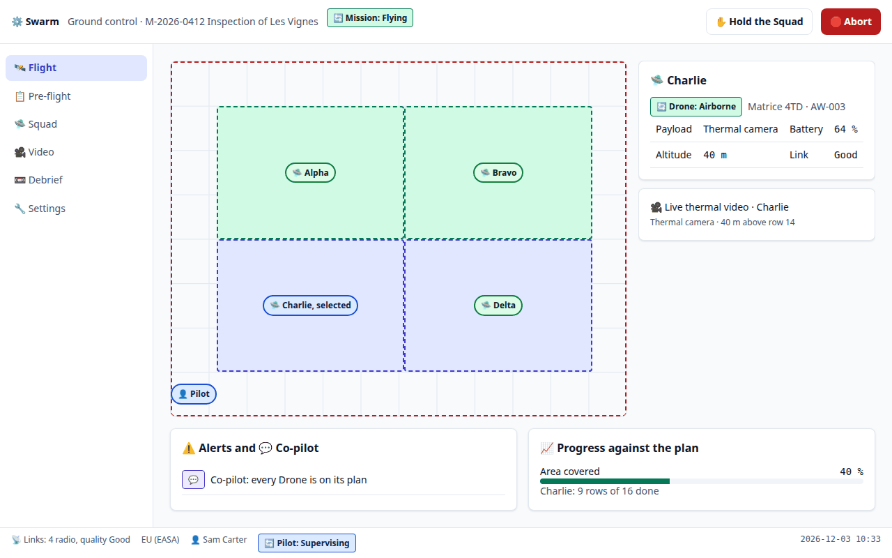](../../screens/UC-025/a2.png) [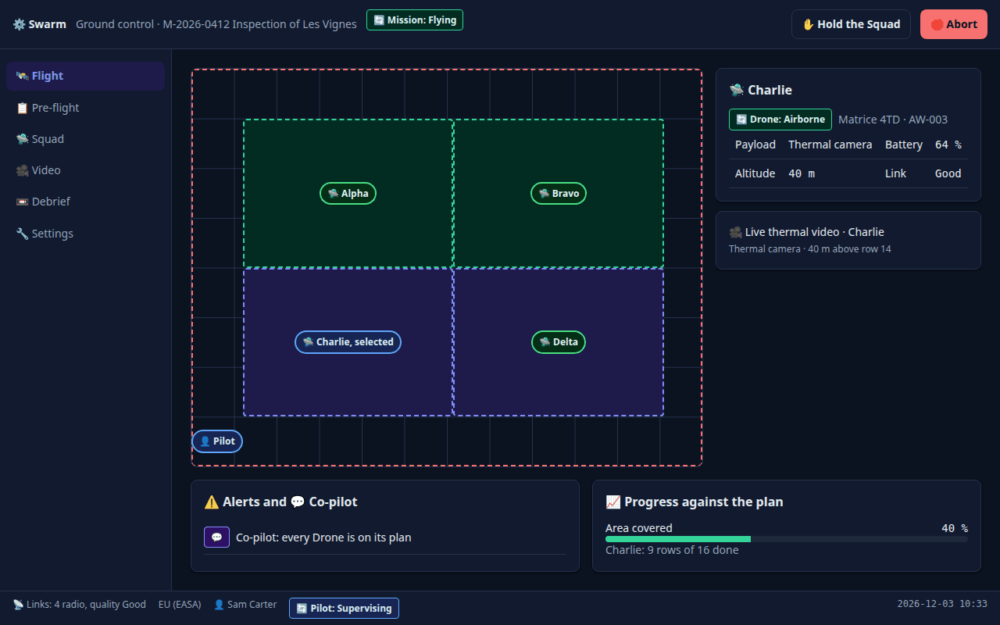](../../screens/UC-025/a2.dark.png) |
| A3: Watch the Mosaic | [🔄 Pilot: Supervising](../../glossary.md#st-pilot-supervising) | [🗃️ Workspace](../../glossary.md#ent-workspace) [🗃️ Payload](../../glossary.md#ent-payload) | ✏️ Mock-up | [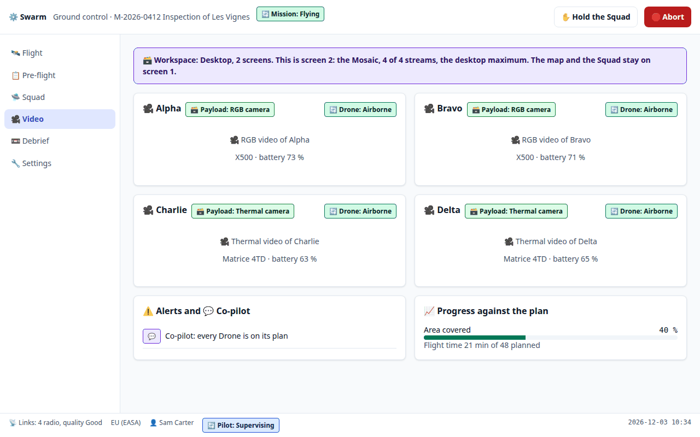](../../screens/UC-025/a3.png) [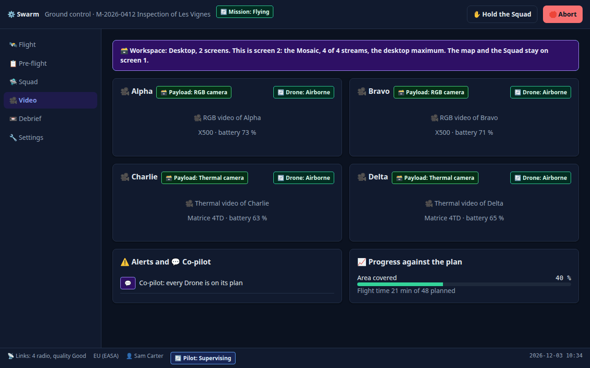](../../screens/UC-025/a3.dark.png) |
| OK: Mission followed against its plan | [🔄 Pilot: Supervising](../../glossary.md#st-pilot-supervising) | [🔄 Mission: Flying](../../glossary.md#st-mission-flying) | ✏️ Mock-up | [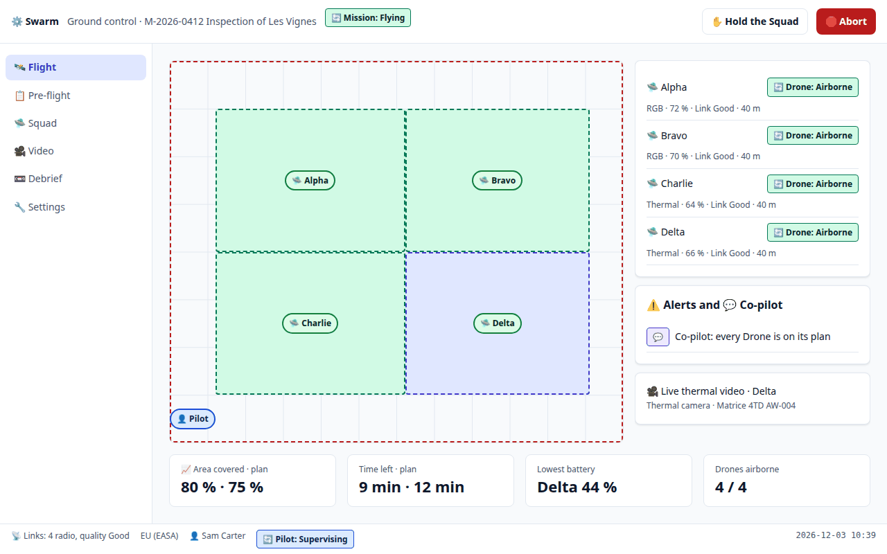](../../screens/UC-025/ok.png) [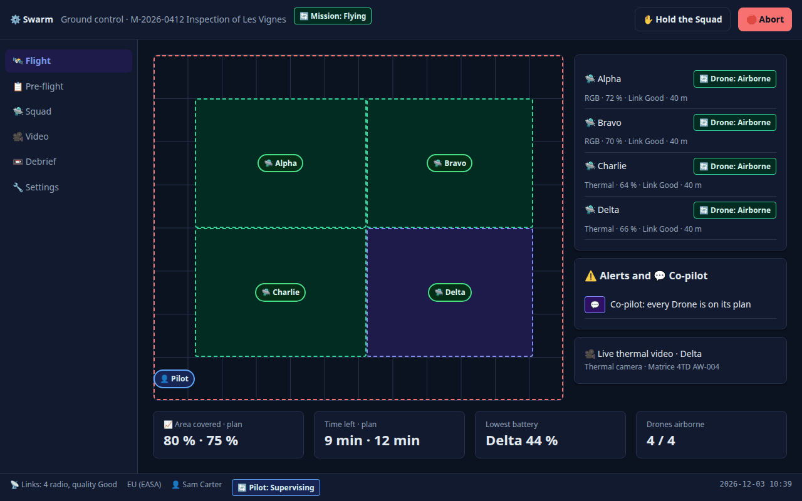](../../screens/UC-025/ok.dark.png) |
| KO: Extra streams refused | [🔄 Pilot: Supervising](../../glossary.md#st-pilot-supervising) | [🗃️ Workspace](../../glossary.md#ent-workspace) [🗃️ Payload](../../glossary.md#ent-payload) | ✏️ Mock-up | [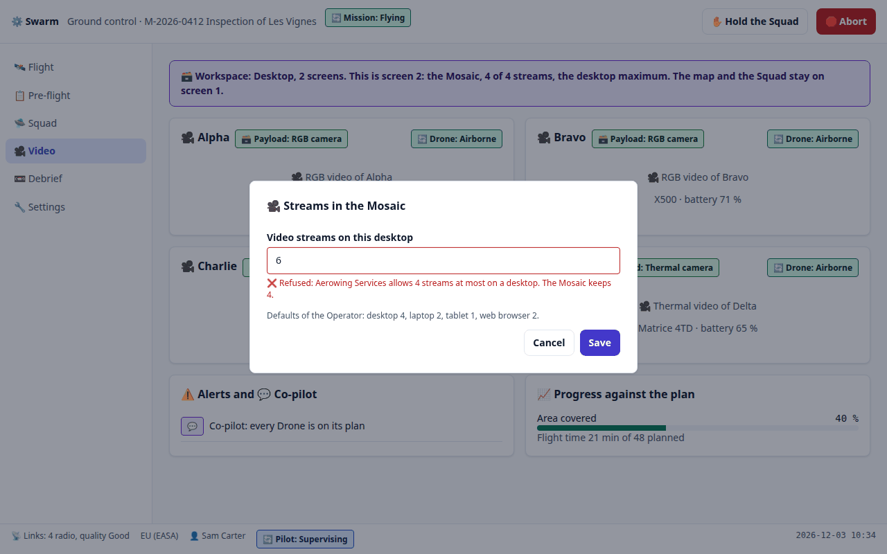](../../screens/UC-025/ko.png) [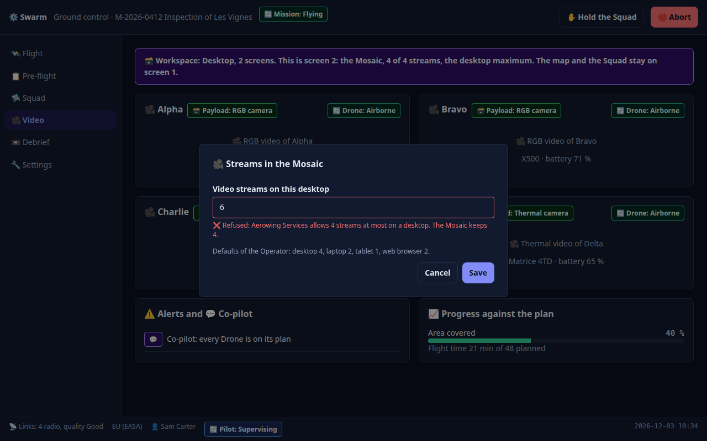](../../screens/UC-025/ko.dark.png) |

## ↪️ Alternative and error flows

| # | At step | Condition | What happens |
| --- | --- | --- | --- |
| A1 | 1 | The Pilot works on a laptop, a tablet or in a web browser with one screen | Ground control opens the Workspace saved for that platform. The four areas and the two safety controls stay visible on the one screen, and the Mosaic holds at most the streams of that platform: 2 on a laptop, 1 on a tablet, 2 in a web browser by default. |
| A3 | 4 | The Pilot asks for more streams than the Operator's maximum for the platform, such as 6 on this desktop | Ground control refuses and keeps the streams at the maximum, 4 ([📏 BR-027](../business-rules/BR-027-the-pilot-s-attention-is-preserved.md)). |
| A4 | 3 or 4 | The Pilot clicks a Drone on the map or its tile in the Mosaic, or a Drone detects an event | The Focus view of that Drone opens, as in [🎬 UC-030: Focus on a Drone](UC-030-focus-on-a-drone.md). |
| A2 | 5 | An Alert appears | The Alert shows in the Alerts area with the Co-pilot's explanation; the Pilot handles it as in [🎬 UC-026: Handle an Alert](UC-026-handle-an-alert.md). |

## 📏 Business rules applied

| Rule | Where it applies |
| --- | --- |
| [📏 BR-023: Fixed safety controls](../business-rules/BR-023-fixed-safety-controls.md) | Steps 2 to 5: Hold the Squad and abort are in the title bar of every screen of the Workspace |
| [📏 BR-012: Pilot override always available](../business-rules/BR-012-pilot-override-always-available.md) | Step 5: whatever the Pilot is watching, every command stays one action away |
| [📏 BR-027: The Pilot's attention is preserved](../business-rules/BR-027-the-pilot-s-attention-is-preserved.md) | Step 4 and alternative A3: no more streams than the Operator allows on the platform; the map and the Squad stay visible |

## 🏁 Postconditions

- ✅ **Success:** the Pilot has followed the Mission against its plan, with the map, the video, the Alerts and the progress in view on every screen of the Workspace.
- ❌ **Failure:** a request for more streams than the platform allows is refused and the Mosaic keeps the maximum. Alerts and failures in flight are handled in [🎬 UC-026: Handle an Alert](UC-026-handle-an-alert.md) and [🎬 UC-005: Lose a Drone in flight](UC-005-lose-a-drone-in-flight.md).

## 🔗 Referenced by

<!-- spec:referenced-by -->
- [📘 FS-021: Ground control monitoring](../features/FS-021-ground-control-monitoring.md)
- [🎬 UC-003: Run the Pre-flight check and launch](UC-003-run-the-pre-flight-check-and-launch.md)
- [🎬 UC-004: Supervise a Squad and approve a Re-plan](UC-004-supervise-a-squad-and-approve-a-re-plan.md)
- [🎬 UC-026: Handle an Alert](UC-026-handle-an-alert.md)
- [🎬 UC-030: Focus on a Drone](UC-030-focus-on-a-drone.md)
<!-- /spec:referenced-by -->

<!-- spec:nav-bottom -->
---

> [🏠 Index](../../README.md) · [◀️ UC-024: Configure each Drone of the Squad on the Site](UC-024-configure-each-drone-of-the-squad-on-the-site.md) · 📄 **Page 51 / 109** · [UC-026: Handle an Alert ▶️](UC-026-handle-an-alert.md)
<!-- /spec:nav-bottom -->
