# 🎬 UC-026: Handle an Alert

<!-- spec:nav-top -->
> [🏠 Index](../../README.md) · [◀️ UC-025: Monitor a Mission in Ground control](UC-025-monitor-a-mission-in-ground-control.md) · 📄 **Page 54 / 120** · [UC-027: Debrief a Mission ▶️](UC-027-debrief-a-mission.md)
<!-- /spec:nav-top -->

**Status:** 🟢 Approved · **Updated:** 2026-11-18

> [!NOTE]
> When a [🗃️ Drone](../../glossary.md#ent-drone) crosses an [🔤 Alert threshold](../../glossary.md#term-alert-threshold), [⚙️ Ground control](../../glossary.md#sys-ground-control) warns the [👤 Pilot](../../glossary.md#per-pilot), the [⚙️ Co-pilot](../../glossary.md#sys-co-pilot) explains it and proposes actions, and the Pilot decides what the Drone does.

<!-- spec:summary -->
## 📑 Summary

1. [👤 Personas and entities](#actors)
2. [🚦 Preconditions](#preconditions)
3. [⚡ Trigger](#trigger)
4. [➡️ Main flow](#main-flow)
5. [🔀 Flow chart](#flowchart)
6. [🖼️ Screens](#screens)
7. [↪️ Alternative and error flows](#alternative-flows)
8. [📏 Business rules applied](#business-rules)
9. [🏁 Postconditions](#postconditions)
10. [🔗 Referenced by](#referenced-by)
<!-- /spec:summary -->

## 👤 Personas and entities

| Name | Kind | Role in this use case |
| --- | --- | --- |
| [👤 Pilot](../../glossary.md#per-pilot) | Persona | Reads the Alert and the explanation, chooses an action or changes the threshold |
| [🗃️ Drone](../../glossary.md#ent-drone) | Entity | Crosses the Alert threshold, then Returns home |
| [🗃️ Operator](../../glossary.md#ent-operator) | Entity | Sets the limits within which the Pilot sets each Alert threshold |
| [⚙️ Ground control](../../glossary.md#sys-ground-control) | System | Raises the Alert, sends the Pilot's command, checks a new threshold |
| [⚙️ Co-pilot](../../glossary.md#sys-co-pilot) | System | Explains the Alert in plain words and proposes actions |

## 🚦 Preconditions

1. The [🗃️ Mission](../../glossary.md#ent-mission) is [🔄 Mission: Flying](../../glossary.md#st-mission-flying). Sample: M-2026-0412 Inspection of Les Vignes, Squad Alpha, Bravo, Charlie and Delta.
2. The Pilot is [🔄 Pilot: Supervising](../../glossary.md#st-pilot-supervising) in the 🛰️ Flight view ([🎬 UC-025: Monitor a Mission in Ground control](UC-025-monitor-a-mission-in-ground-control.md)).
3. Each Alert threshold is within the limits of the Operator ([📏 BR-024](../business-rules/BR-024-alert-thresholds-within-the-operator-limits.md)). The Pilot uses the defaults of Aerowing Services:

   | Alert threshold | Operator limits | Default |
   | --- | --- | --- |
   | Link quality warning | 30 % to 70 % | 50 % |
   | Wind warning | 60 % to 90 % of the Drone model limit | 80 % |
   | Low battery warning | 25 % to 40 % | 30 % |

## ⚡ Trigger

The [🔤 Telemetry](../../glossary.md#term-telemetry) of a Drone crosses one of its Alert thresholds: here, Charlie's battery falls to 30 %.

## ➡️ Main flow

1. Charlie's battery reaches the low battery warning. Ground control raises an [🔤 Alert](../../glossary.md#term-alert): a banner at the top of the screen, the Alert first in the Alerts area, and Charlie highlighted on the map. A low battery is not a critical Alert, so the Co-pilot does not speak it aloud.
2. The Co-pilot explains the Alert in plain words: Charlie's [🗃️ Battery](../../glossary.md#ent-battery) drains faster than planned and will not last until the end of its area. It proposes actions with their effect: Return home now and share its area with the others, or Hold.
3. The Pilot reads the explanation and chooses Return home for Charlie. The Co-pilot only proposes; the command is the Pilot's ([📏 BR-021](../business-rules/BR-021-ai-agents-propose-people-decide.md)).
4. Ground control sends the command. Charlie becomes [🔄 Drone: Returning](../../glossary.md#st-drone-returning) and the Alert is marked handled. The [🗃️ Flight log](../../glossary.md#ent-flight-log) records the Alert, the action and the Pilot's name.
5. Sharing Charlie's area changes the area covered: the Co-pilot proposes it as a [🗃️ Re-plan](../../glossary.md#ent-re-plan) that waits for the Pilot ([📏 BR-013](../business-rules/BR-013-re-plan-approval.md), [🎬 UC-004: Supervise a Squad and approve a Re-plan](UC-004-supervise-a-squad-and-approve-a-re-plan.md)).

## 🔀 Flow chart

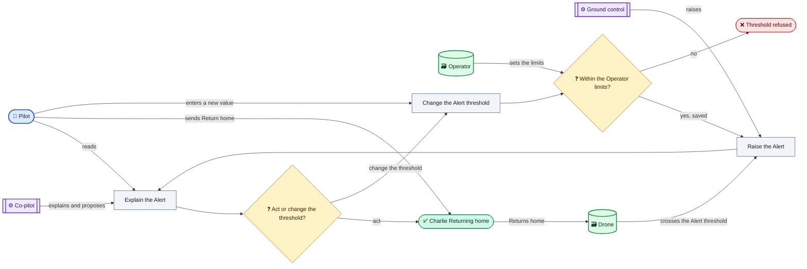

## 🖼️ Screens

One row per state of the flow chart: every action, success and failure node. Each state shows its light then its dark screen; click one to open it full size. A state with nothing to show reads `➖ No screen: <why>`.

| State | Persona | Entity | Source | Screen |
| --- | --- | --- | --- | --- |
| A1: Raise the Alert | [🔄 Pilot: Supervising](../../glossary.md#st-pilot-supervising) | [🔄 Drone: Airborne](../../glossary.md#st-drone-airborne) | ✏️ Mock-up | [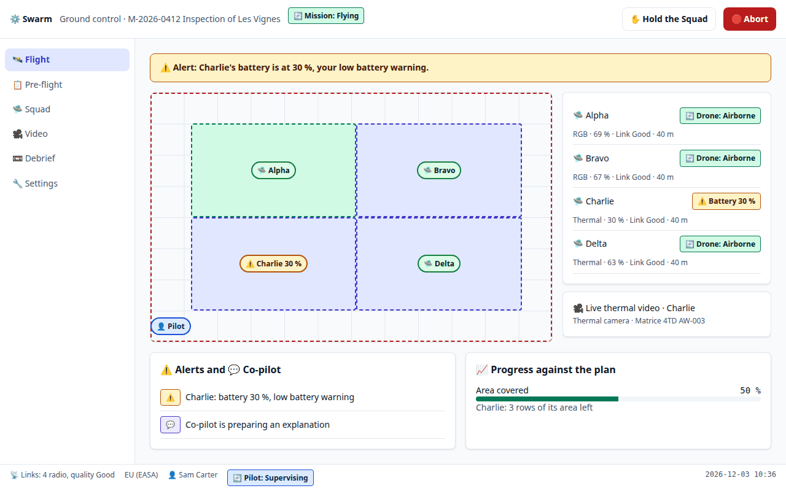](../../screens/UC-026/a1.png) [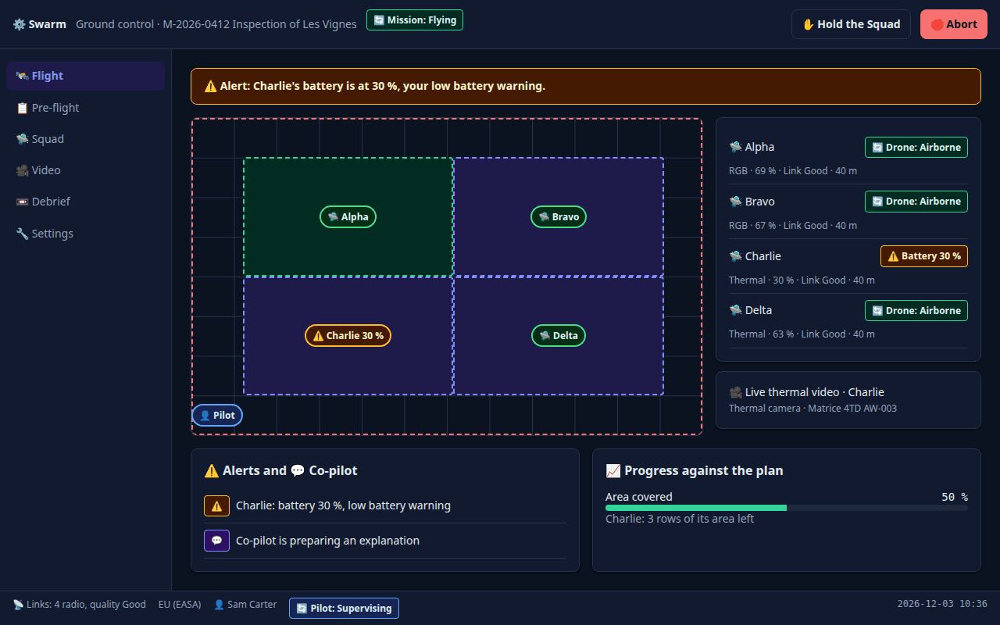](../../screens/UC-026/a1.dark.png) |
| A2: Explain the Alert | [🔄 Pilot: Supervising](../../glossary.md#st-pilot-supervising) | [🔄 Drone: Airborne](../../glossary.md#st-drone-airborne) | ✏️ Mock-up | [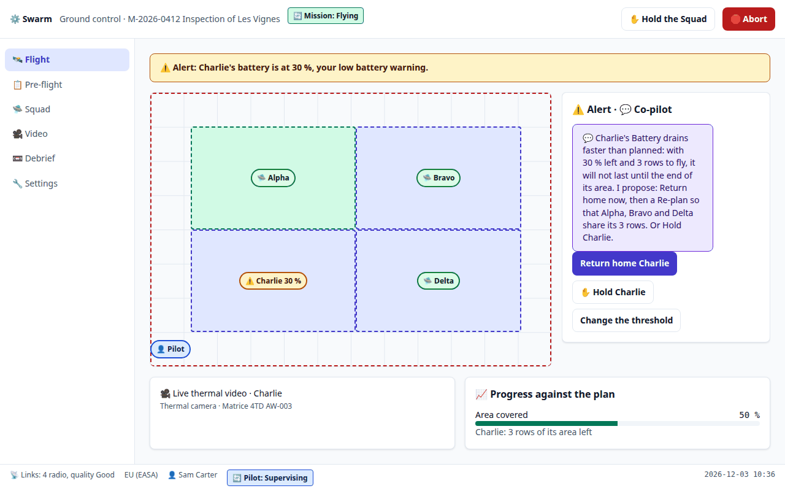](../../screens/UC-026/a2.png) [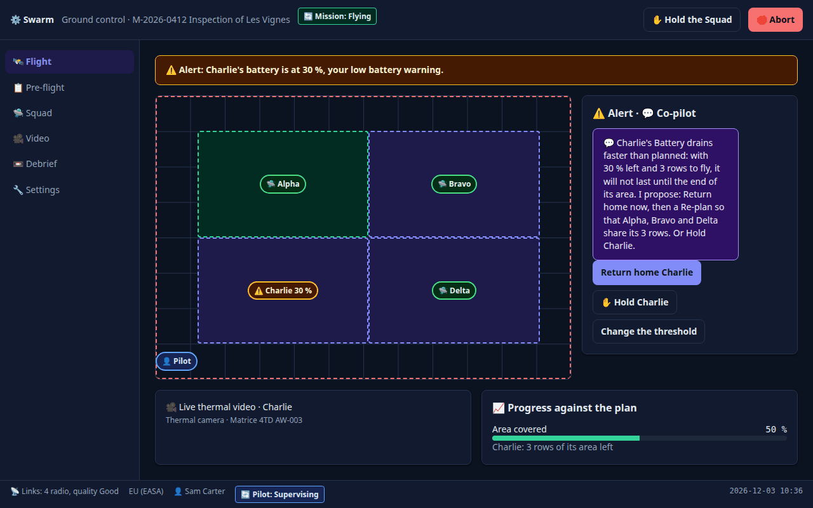](../../screens/UC-026/a2.dark.png) |
| OK: Charlie Returning home | [🔄 Pilot: Supervising](../../glossary.md#st-pilot-supervising) | [🔄 Drone: Returning](../../glossary.md#st-drone-returning) | ✏️ Mock-up | [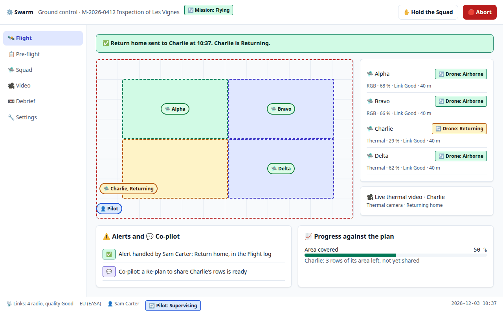](../../screens/UC-026/ok.png) [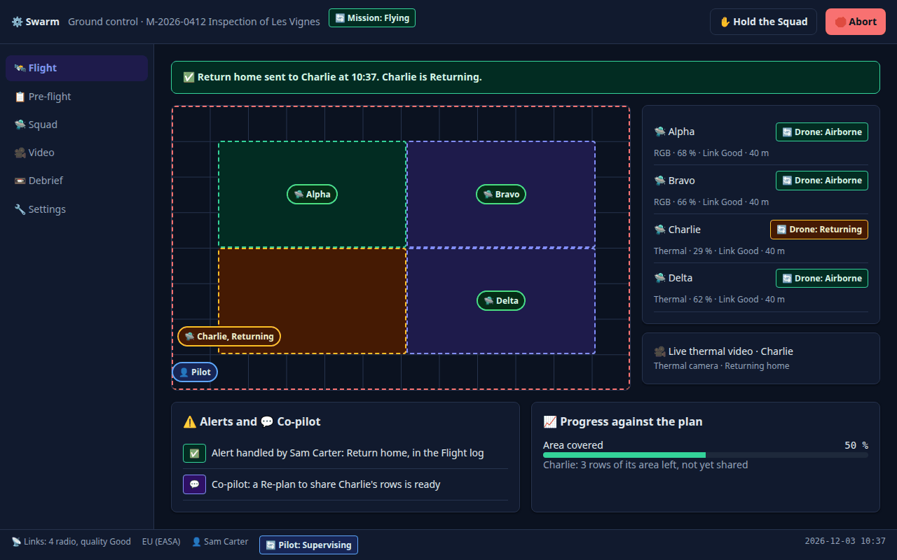](../../screens/UC-026/ok.dark.png) |
| A3: Change the Alert threshold | [🔄 Pilot: Supervising](../../glossary.md#st-pilot-supervising) | [🗃️ Operator](../../glossary.md#ent-operator) | ✏️ Mock-up | [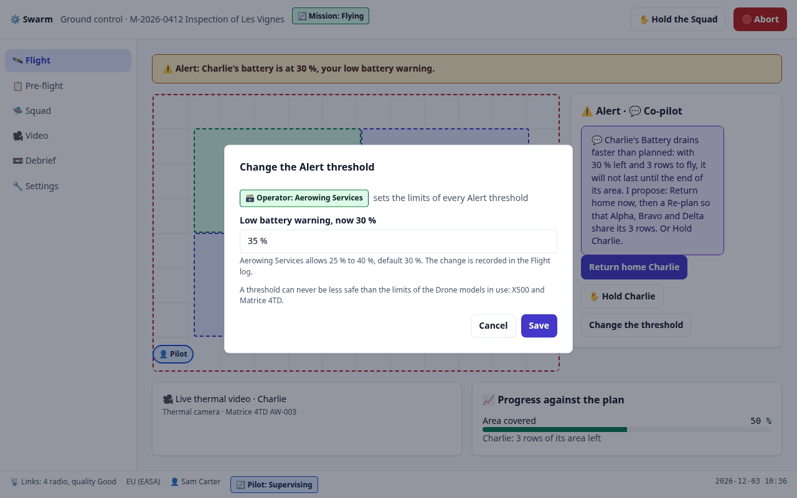](../../screens/UC-026/a3.png) [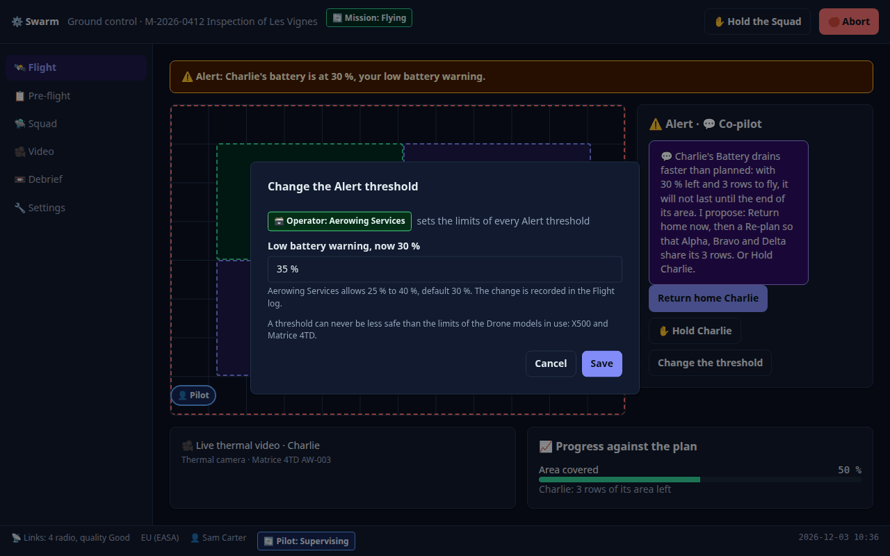](../../screens/UC-026/a3.dark.png) |
| KO: Threshold refused | [🔄 Pilot: Supervising](../../glossary.md#st-pilot-supervising) | [🗃️ Operator](../../glossary.md#ent-operator) | ✏️ Mock-up | [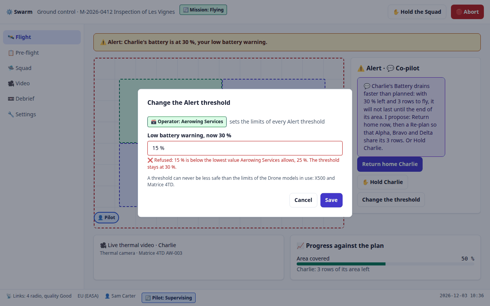](../../screens/UC-026/ko.png) [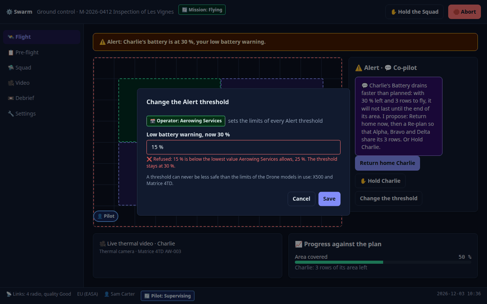](../../screens/UC-026/ko.dark.png) |

## ↪️ Alternative and error flows

| # | At step | Condition | What happens |
| --- | --- | --- | --- |
| A1 | 1 | The [🔤 Link](../../glossary.md#term-link) quality of a Drone, such as Bravo, falls below its Alert threshold | Same flow: the Co-pilot explains why the Link weakens and proposes Hold, Return home or manual control ([🎬 UC-006: Take manual control or abort](UC-006-take-manual-control-or-abort.md)). The Pilot chooses. |
| A2 | 3 | The Pilot changes the Alert threshold from the Alert, and the new value is within the Operator's limits and no less safe than the limits of the [🗃️ Drone models](../../glossary.md#ent-drone-model) in use | Ground control saves it, records the change and the Pilot's name in the Flight log, and checks the Telemetry again against the new threshold. |
| A3 | 3 | The new value is outside the Operator's limits, such as a low battery warning at 15 %, below 25 % | Ground control refuses it and shows the allowed range. The threshold and the Alert are unchanged ([📏 BR-024](../business-rules/BR-024-alert-thresholds-within-the-operator-limits.md)). |
| A4 | 1 | The Alert is critical: a Drone Lost, a Drone at the Geofence, or weather beyond the limits | Same flow, and the Co-pilot also speaks the Alert aloud. The Pilot can mute the spoken Alerts that are not critical, never the critical ones. |

## 📏 Business rules applied

| Rule | Where it applies |
| --- | --- |
| [📏 BR-024: Alert thresholds within the Operator limits](../business-rules/BR-024-alert-thresholds-within-the-operator-limits.md) | Precondition 3 and alternatives A2 and A3 |
| [📏 BR-021: AI agents propose, people decide](../business-rules/BR-021-ai-agents-propose-people-decide.md) | Steps 2 and 3: the Co-pilot explains and proposes, the Pilot decides |
| [📏 BR-013: Re-plan approval](../business-rules/BR-013-re-plan-approval.md) | Step 5: sharing Charlie's area is a Re-plan that waits for the Pilot |

## 🏁 Postconditions

- ✅ **Success:** Charlie is Returning home, the Alert is handled, and the Flight log records the Alert, the action and the Pilot's name. A threshold changed from the Alert is also recorded in the Flight log.
- ❌ **Failure:** the new threshold is refused, the Pilot sees the allowed range, and the Alert stays open with the threshold unchanged.

## 🔗 Referenced by

<!-- spec:referenced-by -->
- [📘 FS-021: Ground control monitoring](../features/FS-021-ground-control-monitoring.md)
- [🎬 UC-004: Supervise a Squad and approve a Re-plan](UC-004-supervise-a-squad-and-approve-a-re-plan.md)
- [🎬 UC-025: Monitor a Mission in Ground control](UC-025-monitor-a-mission-in-ground-control.md)
- [🎬 UC-031: Ask the Assistant](UC-031-ask-the-assistant.md)
- [🎬 UC-034: Let the Assistant hold a Squad](UC-034-let-the-assistant-hold-a-squad.md)
<!-- /spec:referenced-by -->

<!-- spec:nav-bottom -->
---

> [🏠 Index](../../README.md) · [◀️ UC-025: Monitor a Mission in Ground control](UC-025-monitor-a-mission-in-ground-control.md) · 📄 **Page 54 / 120** · [UC-027: Debrief a Mission ▶️](UC-027-debrief-a-mission.md)
<!-- /spec:nav-bottom -->
