# 🎬 UC-027: Debrief a Mission

<!-- spec:nav-top -->
> [🏠 Index](../../README.md) · [◀️ UC-026: Handle an Alert](UC-026-handle-an-alert.md) · 📄 **Page 55 / 120** · [UC-028: Assess a Mission against the request ▶️](UC-028-assess-a-mission-against-the-request.md)
<!-- /spec:nav-top -->

**Status:** 🟢 Approved · **Updated:** 2026-11-18

> [!NOTE]
> The [👤 Pilot](../../glossary.md#per-pilot) opens the [🗃️ Debrief](../../glossary.md#ent-debrief) of a [🗃️ Mission](../../glossary.md#ent-mission) right after landing, and gets its Replay, its plan against actual and the Quality checks of its data, from a [🗃️ Flight log](../../glossary.md#ent-flight-log) proven unaltered.

<!-- spec:summary -->
## 📑 Summary

1. [👤 Personas and entities](#actors)
2. [🚦 Preconditions](#preconditions)
3. [⚡ Trigger](#trigger)
4. [➡️ Main flow](#main-flow)
5. [🔀 Flow chart](#flowchart)
6. [🖼️ Screens](#screens)
7. [↪️ Alternative and error flows](#alternative-flows)
8. [📏 Business rules applied](#business-rules)
9. [🏁 Postconditions](#postconditions)
10. [🔗 Referenced by](#referenced-by)
<!-- /spec:summary -->

## 👤 Personas and entities

| Name | Kind | Role in this use case |
| --- | --- | --- |
| [👤 Pilot](../../glossary.md#per-pilot) | Persona | Debriefs the Mission right after landing |
| [🗃️ Mission](../../glossary.md#ent-mission) | Entity | M-2026-0412 Inspection of Les Vignes, Completed |
| [🗃️ Flight log](../../glossary.md#ent-flight-log) | Entity | The source of the Replay and of the plan against actual |
| [🗃️ Evidence record](../../glossary.md#ent-evidence-record) | Entity | Proves the Flight log was not altered |
| [🗃️ Operator](../../glossary.md#ent-operator) | Entity | Told at once when the Flight log is altered |
| [🗃️ Debrief](../../glossary.md#ent-debrief) | Entity | Replay, plan against actual and Quality checks, ready for the Mission planner |
| [⚙️ Ground control](../../glossary.md#sys-ground-control) | System | Shows the Debrief to the Pilot |

## 🚦 Preconditions

1. Every Drone of the Squad of M-2026-0412 (Alpha, Bravo, Charlie and Delta) has landed or is accounted for. The Mission is Completed.
2. The Flight log of the Mission is closed and its [🗃️ Evidence record](../../glossary.md#ent-evidence-record) is created ([📏 BR-009](../business-rules/BR-009-evidence-integrity.md)).

## ⚡ Trigger

The Pilot opens 📼 Debrief in [⚙️ Ground control](../../glossary.md#sys-ground-control) right after landing.

## ➡️ Main flow

1. The Pilot opens the Debrief of M-2026-0412. Ground control checks that the Flight log matches its Evidence record ([📏 BR-009](../business-rules/BR-009-evidence-integrity.md)).
2. The Pilot plays the [🔤 Replay](../../glossary.md#term-replay): the map, the timeline and its events (launch at 10:00, Link to Delta lost at 10:31, [🗃️ Re-plan](../../glossary.md#ent-re-plan) approved at 10:33, landing at 10:52) and each decision of the Pilot.
3. The Pilot compares the plan against actual: coverage 96 % for 100 % planned, two rows of panels left as gaps, one Drone lost (Delta), one Re-plan applied, flight time.
4. The Pilot reviews the [🔤 Quality checks](../../glossary.md#term-quality-check) of the data: image overlap, sharpness and thermal calibration pass; the gaps fail. Each pass level is the Swarm default for Inspection, made stricter where the [🗃️ Operator](../../glossary.md#ent-operator) chose to, and the criterion of the [👤 Client](../../glossary.md#per-client) when it is stricter: here image overlap of 75 % and full coverage, from the request of Helio Energy.
5. The Pilot closes the Debrief. It is ready for the [👤 Mission planner](../../glossary.md#per-mission-planner), who assesses the Mission against the request in [🎬 UC-028: Assess a Mission against the request](UC-028-assess-a-mission-against-the-request.md).

## 🔀 Flow chart

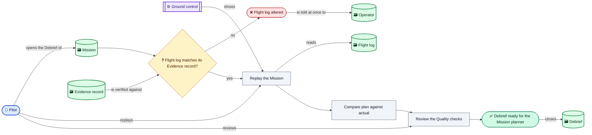

## 🖼️ Screens

One row per state of the flow chart: every action, success and failure node. Click a screen to open it full size. A state with nothing to show reads `➖ No screen: <why>`.

| State | Persona | Entity | Source | Screen |
| --- | --- | --- | --- | --- |
| A1: Replay the Mission | [👤 Pilot](../../glossary.md#per-pilot) | [🔄 Mission: Completed](../../glossary.md#st-mission-completed) [🔄 Evidence record: Verified](../../glossary.md#st-evidence-record-verified) | ✏️ Mock-up | [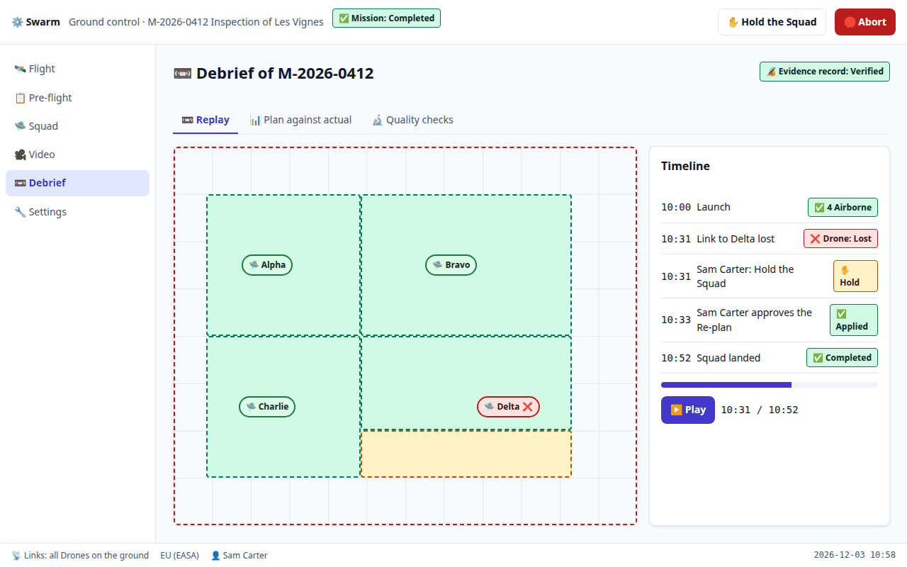](../../screens/UC-027/a1.png) [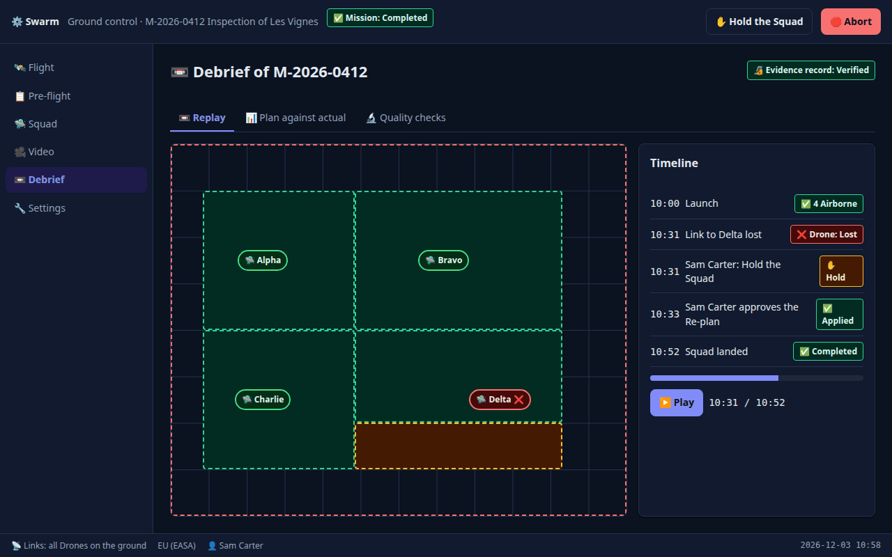](../../screens/UC-027/a1.dark.png) |
| A2: Compare plan against actual | [👤 Pilot](../../glossary.md#per-pilot) | [🗃️ Debrief](../../glossary.md#ent-debrief) | ✏️ Mock-up | [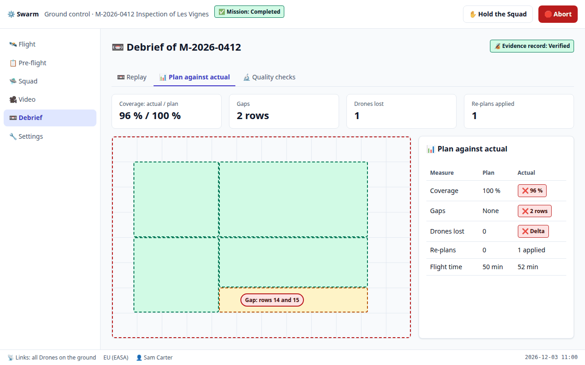](../../screens/UC-027/a2.png) [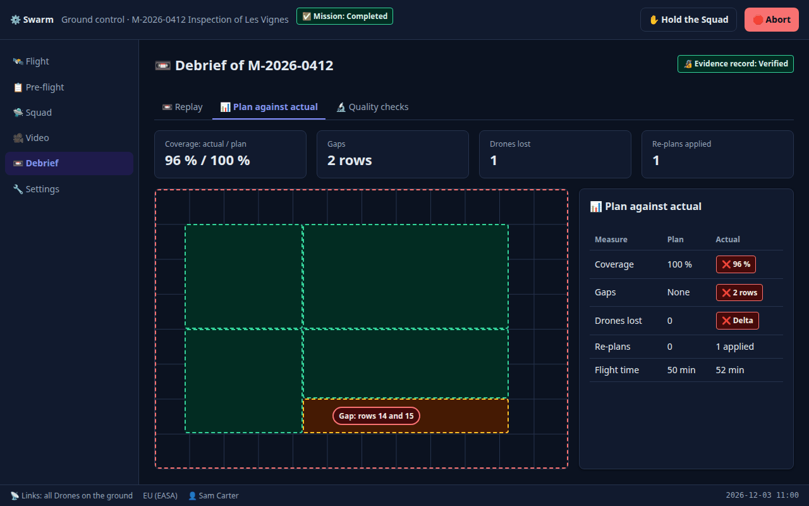](../../screens/UC-027/a2.dark.png) |
| A3: Review the Quality checks | [👤 Pilot](../../glossary.md#per-pilot) | [🗃️ Debrief](../../glossary.md#ent-debrief) | ✏️ Mock-up | [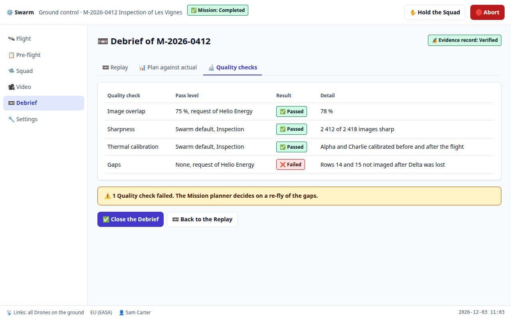](../../screens/UC-027/a3.png) [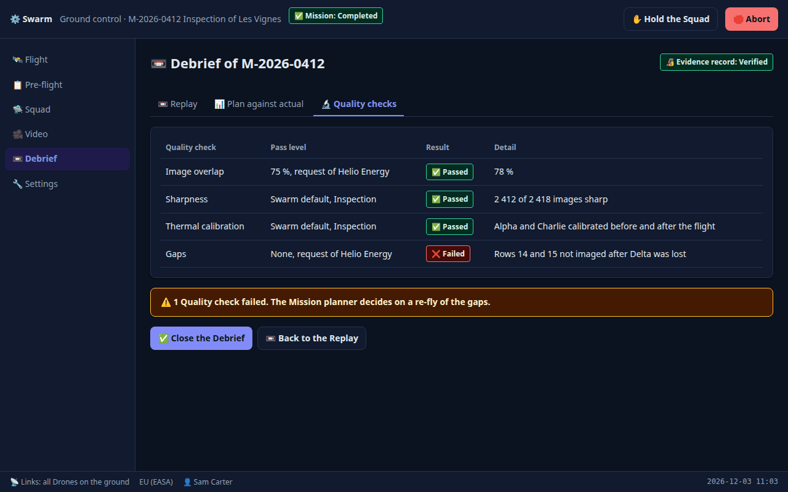](../../screens/UC-027/a3.dark.png) |
| OK: Debrief ready for the Mission planner | [👤 Pilot](../../glossary.md#per-pilot) | [🗃️ Debrief](../../glossary.md#ent-debrief) [🔄 Mission: Completed](../../glossary.md#st-mission-completed) | ✏️ Mock-up | [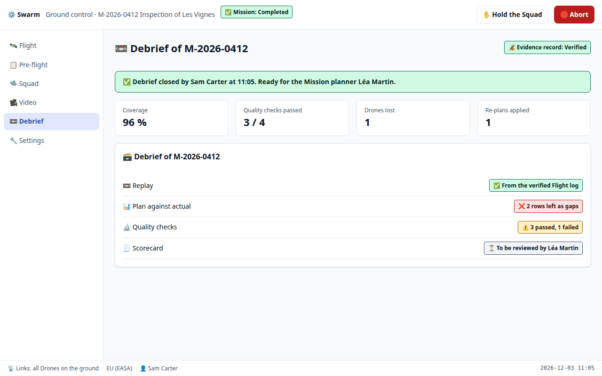](../../screens/UC-027/ok.png) [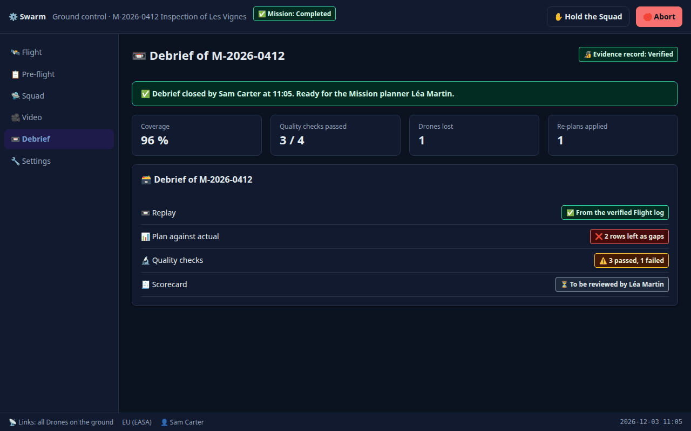](../../screens/UC-027/ok.dark.png) |
| KO: Flight log altered | [👤 Pilot](../../glossary.md#per-pilot) | [🔄 Evidence record: Altered](../../glossary.md#st-evidence-record-altered) [🗃️ Operator](../../glossary.md#ent-operator) | ✏️ Mock-up | [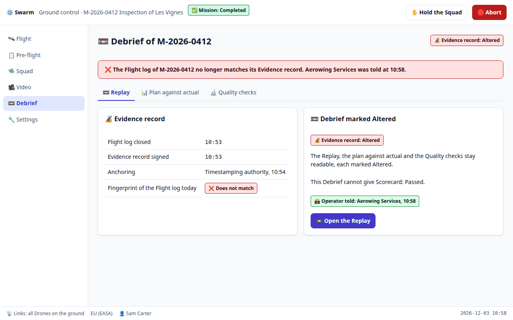](../../screens/UC-027/ko.png) [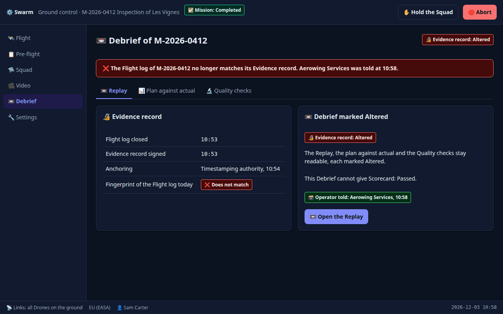](../../screens/UC-027/ko.dark.png) |

## ↪️ Alternative and error flows

| # | At step | Condition | What happens |
| --- | --- | --- | --- |
| A1 | 1 | The Flight log no longer matches its Evidence record | Ground control tells the Operator Aerowing Services at once. The Debrief stays readable, marked Evidence record: Altered, and cannot give Scorecard: Passed ([📏 BR-009](../business-rules/BR-009-evidence-integrity.md), [📏 BR-026](../business-rules/BR-026-scorecard-against-the-request.md)). |
| A2 | 4 | A Quality check fails, here the gaps | The failed check and the areas concerned are shown; the Mission planner decides on a re-fly in [🎬 UC-028: Assess a Mission against the request](UC-028-assess-a-mission-against-the-request.md). |

## 📏 Business rules applied

| Rule | Where it applies |
| --- | --- |
| [📏 BR-009: Evidence integrity](../business-rules/BR-009-evidence-integrity.md) | Step 1: the Debrief relies on a Flight log that matches its Evidence record |
| [📏 BR-026: Scorecard against the request](../business-rules/BR-026-scorecard-against-the-request.md) | Steps 3 and 4: the plan against actual and the Quality checks are the evidence of the Scorecard; an altered Flight log cannot give Scorecard: Passed |

## 🏁 Postconditions

- ✅ **Success:** the Debrief of M-2026-0412 holds the Replay, the plan against actual and the Quality checks, from a Flight log that matches its Evidence record, and is ready for the Mission planner.
- ❌ **Failure:** the Flight log does not match its Evidence record; the Operator was told at once, and the Debrief stays readable, marked Altered, and cannot give Scorecard: Passed.

## 🔗 Referenced by

<!-- spec:referenced-by -->
- [📘 FS-022: Debrief and assessment](../features/FS-022-debrief-and-assessment.md)
- [🎬 UC-009: Process flight data into Deliverables](UC-009-process-flight-data-into-deliverables.md)
- [🎬 UC-028: Assess a Mission against the request](UC-028-assess-a-mission-against-the-request.md)
<!-- /spec:referenced-by -->

<!-- spec:nav-bottom -->
---

> [🏠 Index](../../README.md) · [◀️ UC-026: Handle an Alert](UC-026-handle-an-alert.md) · 📄 **Page 55 / 120** · [UC-028: Assess a Mission against the request ▶️](UC-028-assess-a-mission-against-the-request.md)
<!-- /spec:nav-bottom -->
