# 🎬 UC-028: Assess a Mission against the request

<!-- spec:nav-top -->
> [🏠 Index](../../README.md) · [◀️ UC-027: Debrief a Mission](UC-027-debrief-a-mission.md) · 📄 **Page 54 / 108** · [UC-029: Create an Operator ▶️](UC-029-create-an-operator.md)
<!-- /spec:nav-top -->

**Status:** 🟢 Approved · **Updated:** 2026-11-18

> [!NOTE]
> The [👤 Mission planner](../../glossary.md#per-mission-planner) reviews the [🗃️ Scorecard](../../glossary.md#ent-scorecard) of a [🗃️ Mission](../../glossary.md#ent-mission) against the request of the [👤 Client](../../glossary.md#per-client), has the gaps re-flown when a criterion fails, and publishes the Scorecard so that the Client sees whether they got what they asked for.

<!-- spec:summary -->
## 📑 Summary

1. [👤 Personas and entities](#actors)
2. [🚦 Preconditions](#preconditions)
3. [⚡ Trigger](#trigger)
4. [➡️ Main flow](#main-flow)
5. [🔀 Flow chart](#flowchart)
6. [🖼️ Screens](#screens)
7. [↪️ Alternative and error flows](#alternative-flows)
8. [📏 Business rules applied](#business-rules)
9. [🏁 Postconditions](#postconditions)
10. [🔗 Referenced by](#referenced-by)
<!-- /spec:summary -->

## 👤 Personas and entities

| Name | Kind | Role in this use case |
| --- | --- | --- |
| [👤 Mission planner](../../glossary.md#per-mission-planner) | Persona | Reviews the Scorecard, decides a re-fly, publishes |
| [👤 Client](../../glossary.md#per-client) | Persona | Sees the published Scorecard |
| [🗃️ Scorecard](../../glossary.md#ent-scorecard) | Entity | Each criterion of the request, passed or failed, with its evidence |
| [🗃️ Debrief](../../glossary.md#ent-debrief) | Entity | Gives the evidence: plan against actual and Quality checks |
| [🗃️ Mission](../../glossary.md#ent-mission) | Entity | M-2026-0412 Inspection of Les Vignes, and M-2026-0416, the re-fly of its gaps, a new Mission linked to it |
| [⚙️ Mission studio](../../glossary.md#sys-mission-studio) | System | Shows the Scorecard to the Mission planner |
| [⚙️ Client portal](../../glossary.md#sys-client-portal) | System | Shows the published Scorecard to the Client |

## 🚦 Preconditions

1. The Mission M-2026-0412 Inspection of Les Vignes is Completed and its [🗃️ Debrief](../../glossary.md#ent-debrief) is closed by the [👤 Pilot](../../glossary.md#per-pilot) ([🎬 UC-027: Debrief a Mission](UC-027-debrief-a-mission.md)).
2. The request of the Client Helio Energy, made by Priya Shah, holds the acceptance criteria of an [🔤 Inspection](../../glossary.md#term-inspection): 100 % of Les Vignes covered, image overlap of 75 % or more, ground resolution of 2 cm per pixel or finer, thermal calibration checked.

## ⚡ Trigger

The Mission planner Léa Martin opens the Scorecard of M-2026-0412 in the [⚙️ Mission studio](../../glossary.md#sys-mission-studio).

## ➡️ Main flow

1. The Mission planner reviews the Scorecard: each acceptance criterion of the request, passed or failed, with its evidence from the [🗃️ Flight log](../../glossary.md#ent-flight-log), the [🔤 Quality checks](../../glossary.md#term-quality-check) and the [🗃️ Deliverables](../../glossary.md#ent-deliverable) ([📏 BR-026](../business-rules/BR-026-scorecard-against-the-request.md)).
2. Coverage is 96 % against 100 % requested: rows 14 and 15 of the panels were missed after Delta was lost. Image overlap (78 %), ground resolution (1.6 cm per pixel) and thermal calibration pass. The Scorecard is Failed.
3. The Mission planner decides a re-fly of the gaps: a new Mission, M-2026-0416 Re-fly of Les Vignes, linked to M-2026-0412. She plans it in the Mission studio for 14:00.
4. M-2026-0416 is flown and debriefed. The original Scorecard of M-2026-0412 is assessed again with both Missions ([📏 BR-026](../business-rules/BR-026-scorecard-against-the-request.md)): coverage is 100 %, every criterion passes, and the Scorecard is Passed.
5. The Mission planner publishes the Scorecard to the Client. Swarm records that Léa Martin published it ([📏 BR-021](../business-rules/BR-021-ai-agents-propose-people-decide.md)).
6. Priya Shah of Helio Energy sees the Scorecard in the [⚙️ Client portal](../../glossary.md#sys-client-portal).

## 🔀 Flow chart

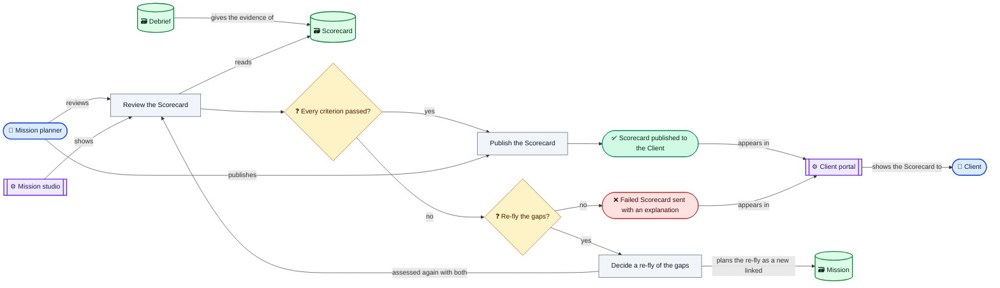

## 🖼️ Screens

One row per state of the flow chart: every action, success and failure node. Click a screen to open it full size. A state with nothing to show reads `➖ No screen: <why>`.

| State | Persona | Entity | Source | Screen |
| --- | --- | --- | --- | --- |
| A1: Review the Scorecard | [👤 Mission planner](../../glossary.md#per-mission-planner) | [🔄 Scorecard: Failed](../../glossary.md#st-scorecard-failed) | ✏️ Mock-up | [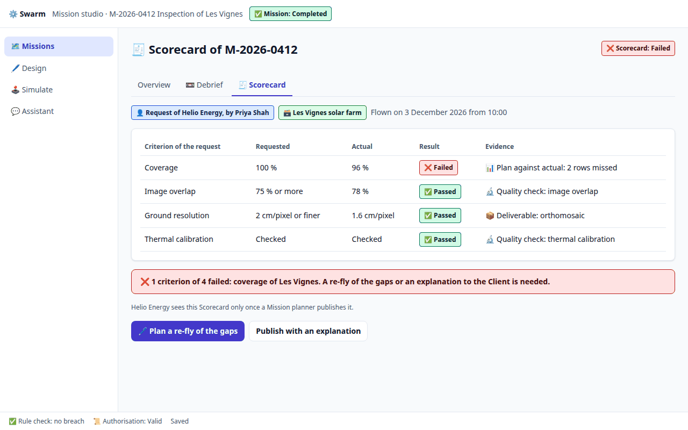](../../screens/UC-028/a1.png) [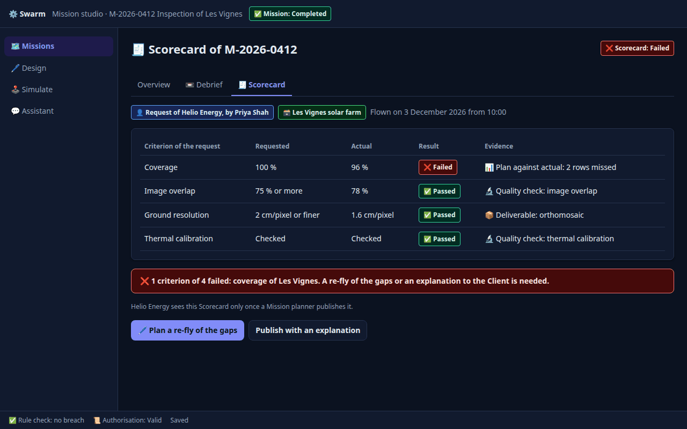](../../screens/UC-028/a1.dark.png) |
| A2: Decide a re-fly of the gaps | [👤 Mission planner](../../glossary.md#per-mission-planner) | [🔄 Scorecard: Failed](../../glossary.md#st-scorecard-failed) [🗃️ Mission](../../glossary.md#ent-mission) | ✏️ Mock-up | [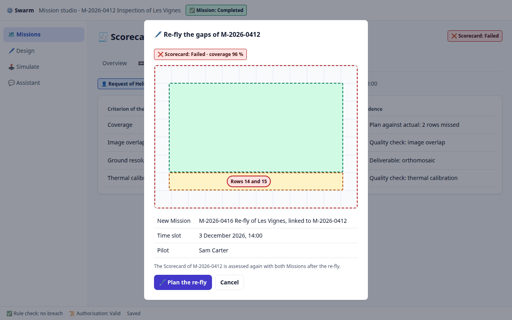](../../screens/UC-028/a2.png) [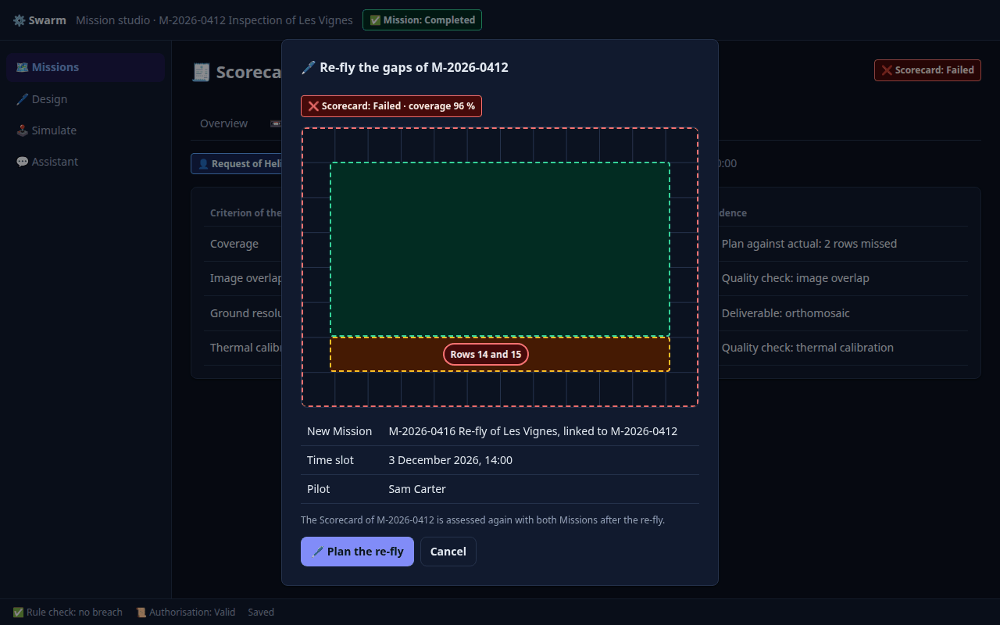](../../screens/UC-028/a2.dark.png) |
| A3: Publish the Scorecard | [👤 Mission planner](../../glossary.md#per-mission-planner) | [🔄 Scorecard: Passed](../../glossary.md#st-scorecard-passed) | ✏️ Mock-up | [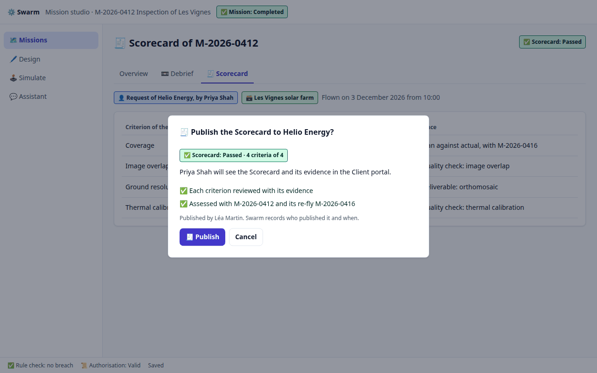](../../screens/UC-028/a3.png) [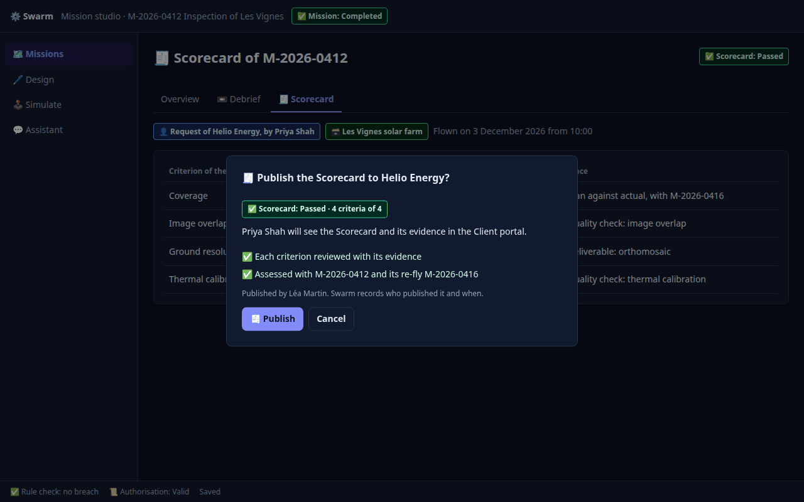](../../screens/UC-028/a3.dark.png) |
| OK: Scorecard published to the Client | [👤 Mission planner](../../glossary.md#per-mission-planner) | [🔄 Scorecard: Passed](../../glossary.md#st-scorecard-passed) | ✏️ Mock-up | [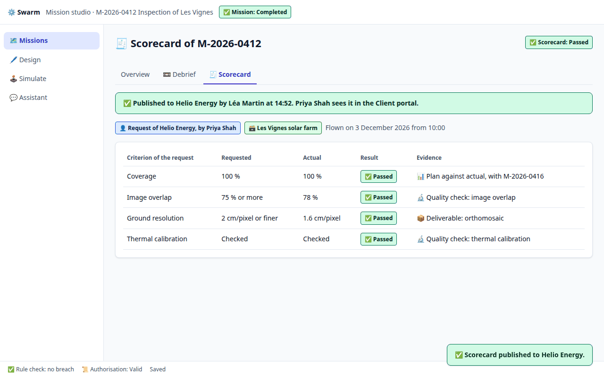](../../screens/UC-028/ok.png) [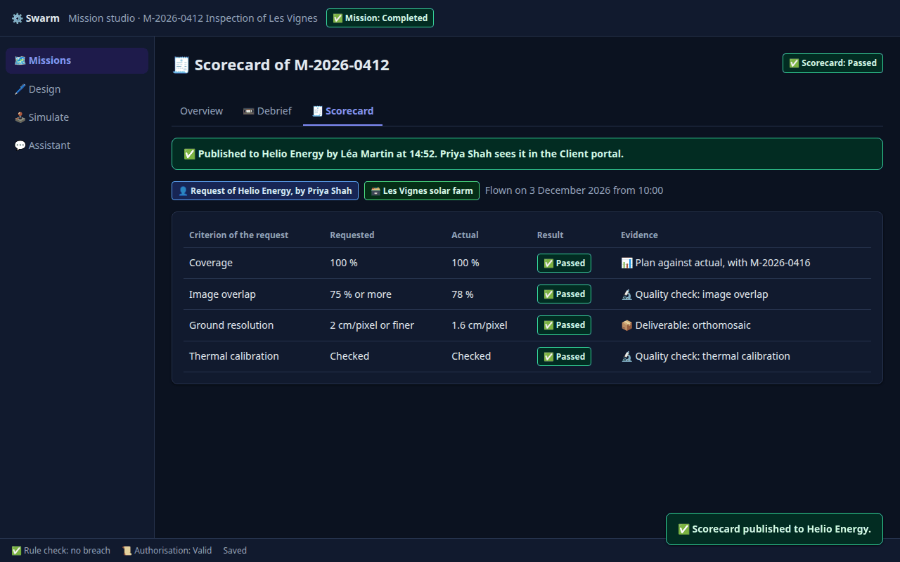](../../screens/UC-028/ok.dark.png) |
| KO: Failed Scorecard sent with an explanation | [👤 Mission planner](../../glossary.md#per-mission-planner) | [🔄 Scorecard: Failed](../../glossary.md#st-scorecard-failed) | ✏️ Mock-up | [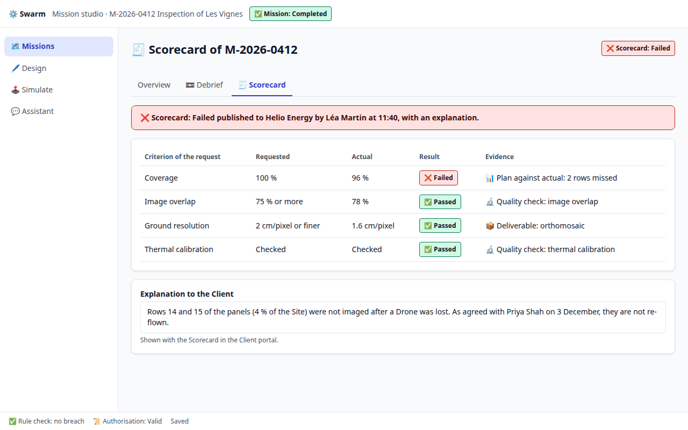](../../screens/UC-028/ko.png) [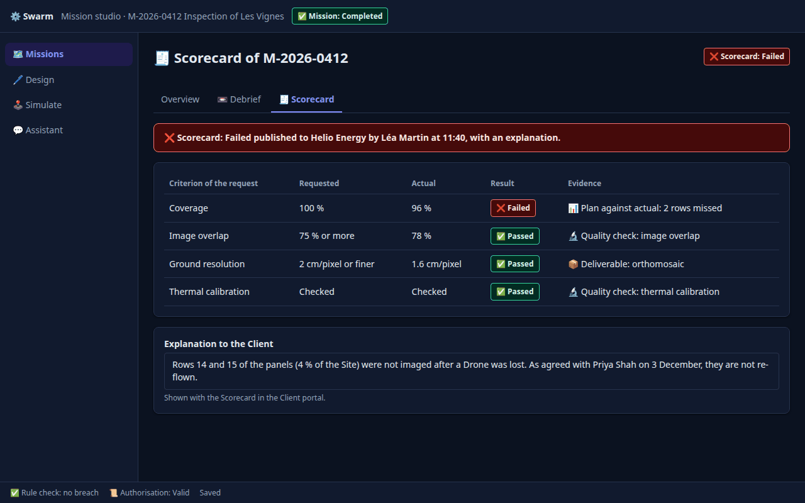](../../screens/UC-028/ko.dark.png) |

## ↪️ Alternative and error flows

| # | At step | Condition | What happens |
| --- | --- | --- | --- |
| A1 | 1 | Every criterion passes at the first assessment | The Scorecard is Passed; the Mission planner publishes it at once (step 5). |
| A2 | 3 | The Mission planner decides not to re-fly the gaps, for example after agreeing it with the Client | She publishes the Failed Scorecard with an explanation of each failed criterion. The Client sees it in the Client portal ([📏 BR-026](../business-rules/BR-026-scorecard-against-the-request.md)). |

## 📏 Business rules applied

| Rule | Where it applies |
| --- | --- |
| [📏 BR-026: Scorecard against the request](../business-rules/BR-026-scorecard-against-the-request.md) | Steps 1 to 4: each criterion passed or failed with its evidence; the re-fly is a new linked Mission and the original Scorecard is assessed again with both; Passed only when all pass; published after review |
| [📏 BR-021: AI agents propose, people decide](../business-rules/BR-021-ai-agents-propose-people-decide.md) | Step 5: a person publishes the Scorecard, and Swarm records who |

## 🏁 Postconditions

- ✅ **Success:** the Scorecard of M-2026-0412, assessed with its re-fly M-2026-0416, is Passed, published by Léa Martin, and visible to Priya Shah of Helio Energy in the Client portal.
- ❌ **Failure:** the Scorecard stays Failed; the Client sees it in the Client portal with the explanation of each failed criterion.

## 🔗 Referenced by

<!-- spec:referenced-by -->
- [📘 FS-022: Debrief and assessment](../features/FS-022-debrief-and-assessment.md)
- [🎬 UC-011: Follow a Mission and download its Deliverables](UC-011-follow-a-mission-and-download-its-deliverables.md)
- [🎬 UC-022: Receive the Mission report](UC-022-receive-the-mission-report.md)
- [🎬 UC-027: Debrief a Mission](UC-027-debrief-a-mission.md)
<!-- /spec:referenced-by -->

<!-- spec:nav-bottom -->
---

> [🏠 Index](../../README.md) · [◀️ UC-027: Debrief a Mission](UC-027-debrief-a-mission.md) · 📄 **Page 54 / 108** · [UC-029: Create an Operator ▶️](UC-029-create-an-operator.md)
<!-- /spec:nav-bottom -->
