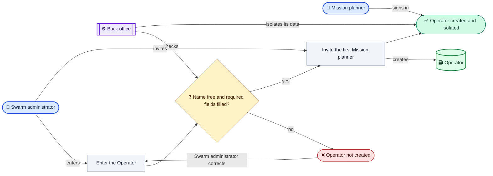
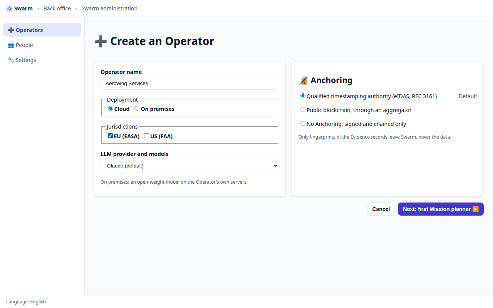
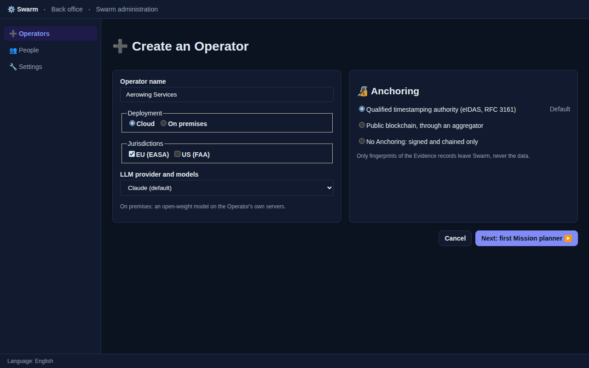
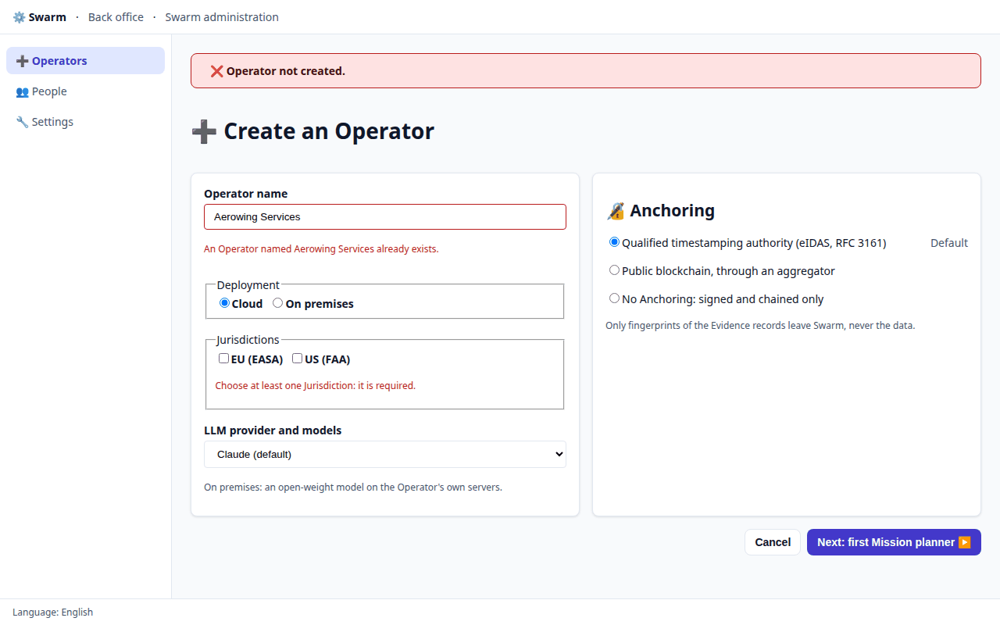
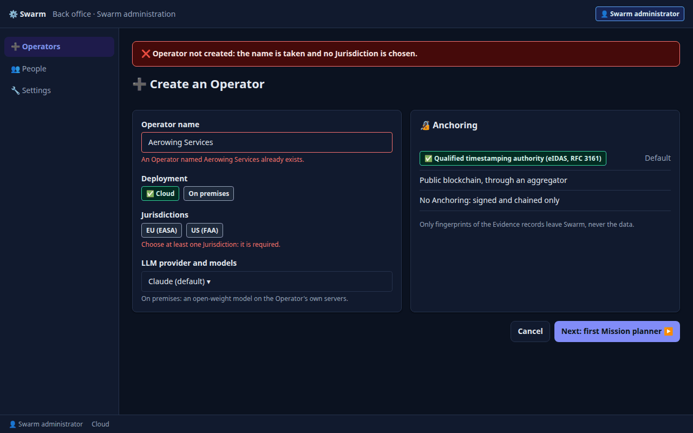
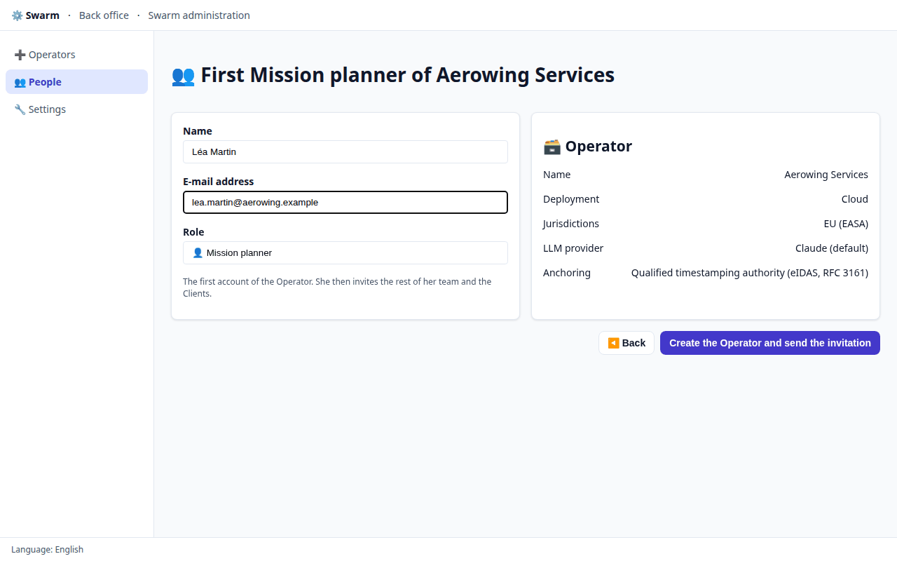
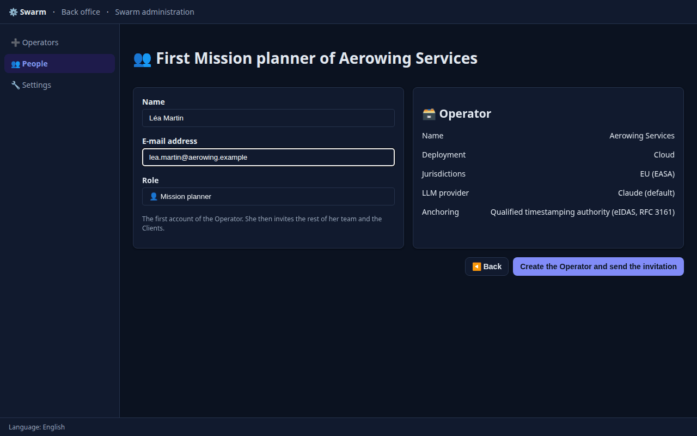
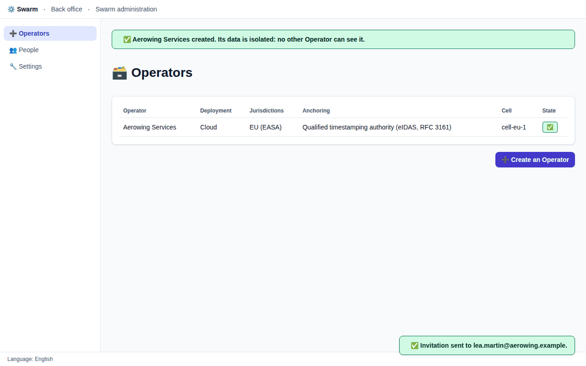
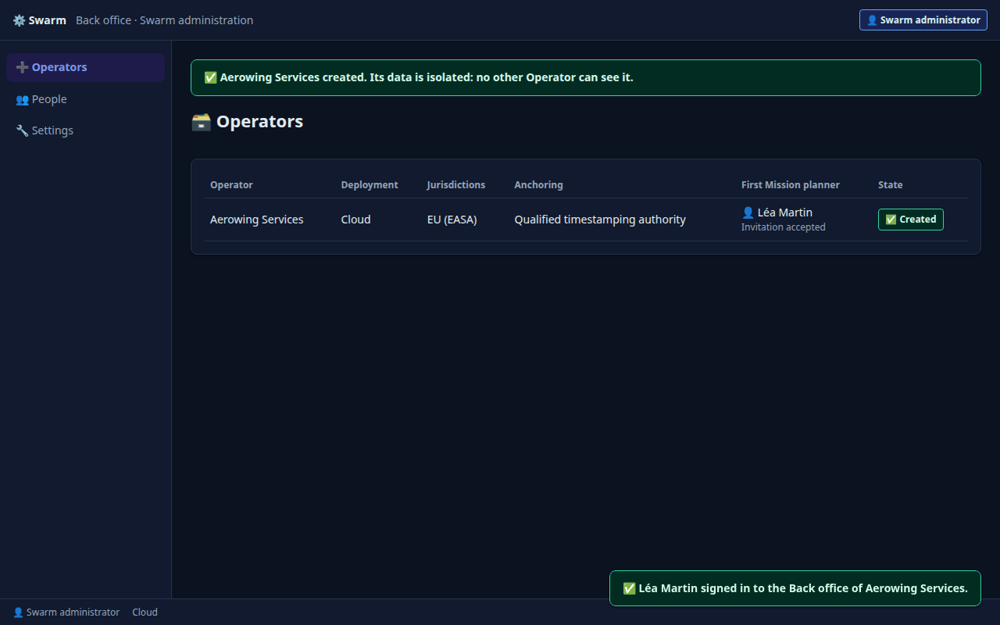

# 🎬 UC-029: Create an Operator

<!-- spec:nav-top -->
> [🏠 Index](../../README.md) · [◀️ UC-028: Assess a Mission against the request](UC-028-assess-a-mission-against-the-request.md) · 📄 **Page 57 / 120** · [UC-030: Focus on a Drone ▶️](UC-030-focus-on-a-drone.md)
<!-- /spec:nav-top -->

**Status:** 🟢 Approved · **Updated:** 2026-11-18

> [!NOTE]
> The [👤 Swarm administrator](../../glossary.md#per-swarm-administrator) creates an [🗃️ Operator](../../glossary.md#ent-operator) in the [⚙️ Back office](../../glossary.md#sys-back-office) and invites its first [👤 Mission planner](../../glossary.md#per-mission-planner), who gets a Back office whose data no other Operator can see.

<!-- spec:summary -->
## 📑 Summary

1. [👤 Personas and entities](#actors)
2. [🚦 Preconditions](#preconditions)
3. [⚡ Trigger](#trigger)
4. [➡️ Main flow](#main-flow)
5. [🔀 Flow chart](#flowchart)
6. [🖼️ Screens](#screens)
7. [↪️ Alternative and error flows](#alternative-flows)
8. [📏 Business rules applied](#business-rules)
9. [🏁 Postconditions](#postconditions)
10. [🔗 Referenced by](#referenced-by)
<!-- /spec:summary -->

## 👤 Personas and entities

| Name | Kind | Role in this use case |
| --- | --- | --- |
| [👤 Swarm administrator](../../glossary.md#per-swarm-administrator) | Persona | Creates the Operator and invites its first Mission planner. In the cloud, a member of the Swarm team; on premises, the IT administrator of the company |
| [👤 Mission planner](../../glossary.md#per-mission-planner) | Persona | First account of the new Operator |
| [🗃️ Operator](../../glossary.md#ent-operator) | Entity | Created with its name, deployment, Jurisdictions, LLM provider and Anchoring choice |
| [⚙️ Back office](../../glossary.md#sys-back-office) | System | Checks the entry, creates the Operator with its own isolated data and sends the invitation |

## 🚦 Preconditions

1. The Swarm administrator is signed in to the Back office: in the cloud, of the Swarm service; on premises, of the company's own installation.
2. The drone service company Aerowing Services has agreed to use Swarm.

## ⚡ Trigger

A new organisation, such as Aerowing Services, needs its Operator in Swarm.

## ➡️ Main flow

1. The [👤 Swarm administrator](../../glossary.md#per-swarm-administrator) opens ➕ Operators, then ➕ Create an Operator, and enters its name, Aerowing Services, and its deployment: cloud or on premises. Aerowing Services is in the cloud.
2. The Swarm administrator chooses the [🔤 Jurisdictions](../../glossary.md#term-jurisdiction) the Operator flies under, EU (EASA), its [🔤 LLM provider](../../glossary.md#term-llm-provider) and models (on premises, an open-weight model on its own servers), and its [🔤 Anchoring](../../glossary.md#term-anchoring): a qualified timestamping authority (eIDAS, RFC 3161) by default, a public blockchain through an aggregator, or none.
3. The Back office checks that no Operator has that name and that every required field is filled.
4. The Swarm administrator opens 👥 People and invites the first [👤 Mission planner](../../glossary.md#per-mission-planner) of the Operator, Léa Martin, with her e-mail address.
5. The Back office creates the Operator with its own data, which no other Operator can see, in the cloud as on premises ([📏 BR-008](../business-rules/BR-008-operator-isolation.md)), and sends the invitation.
6. The Mission planner accepts it and signs in to the Back office of Aerowing Services. She can then record its Authorisations and invite its Clients (see [🎬 UC-008: Record an Authorisation](UC-008-record-an-authorisation.md) and [🎬 UC-015: Invite a Client to the Client portal](UC-015-invite-a-client-to-the-client-portal.md)).

## 🔀 Flow chart

## 🖼️ Screens

One row per state of the flow chart: every action, success and failure node. Click a screen to open it full size. A state with nothing to show reads `➖ No screen: <why>`.

| State | Persona | Entity | Source | Screen |
| --- | --- | --- | --- | --- |
| A1: Enter the Operator | [👤 Swarm administrator](../../glossary.md#per-swarm-administrator) | [🗃️ Operator](../../glossary.md#ent-operator) | ✏️ Mock-up |   |
| KO: Operator not created | [👤 Swarm administrator](../../glossary.md#per-swarm-administrator) | [🗃️ Operator](../../glossary.md#ent-operator) | ✏️ Mock-up |   |
| A2: Invite the first Mission planner | [👤 Swarm administrator](../../glossary.md#per-swarm-administrator) | [🗃️ Operator](../../glossary.md#ent-operator) | ✏️ Mock-up |   |
| OK: Operator created and isolated | [👤 Swarm administrator](../../glossary.md#per-swarm-administrator) [👤 Mission planner](../../glossary.md#per-mission-planner) | [🗃️ Operator](../../glossary.md#ent-operator) | ✏️ Mock-up |   |

## ↪️ Alternative and error flows

| # | At step | Condition | What happens |
| --- | --- | --- | --- |
| A1 | 3 | An Operator named Aerowing Services already exists | The Back office does not create the Operator and says that the name is taken. The Swarm administrator corrects the name (KO). |
| A2 | 3 | A required field is missing, such as the Jurisdiction (required: name, deployment, at least one Jurisdiction, the first Mission planner's e-mail; the LLM provider and the Anchoring have defaults) | The Back office does not create the Operator and names the missing field (KO). |
| A3 | 1 | The company runs Swarm on premises | Its IT administrator is the Swarm administrator and creates the Operator in the company's own installation; the LLM provider is an open-weight model on the company's servers. |

## 📏 Business rules applied

| Rule | Where it applies |
| --- | --- |
| [📏 BR-008: Operator isolation](../business-rules/BR-008-operator-isolation.md) | Step 5: the new Operator's data is visible to its own people only, in the cloud as on premises |

## 🏁 Postconditions

- ✅ **Success:** Aerowing Services exists in Swarm with its deployment, Jurisdictions, LLM provider and Anchoring choice. Its first Mission planner, Léa Martin, is invited, and no other Operator sees its data.
- ❌ **Failure:** no Operator is created; the Swarm administrator sees that the name is taken or which required field is missing.

## 🔗 Referenced by

<!-- spec:referenced-by -->
- [📘 FS-012: Operators, deployment and languages](../features/FS-012-operators-deployment-and-languages.md)
- [🎬 UC-015: Invite a Client to the Client portal](UC-015-invite-a-client-to-the-client-portal.md)
<!-- /spec:referenced-by -->

<!-- spec:nav-bottom -->
---

> [🏠 Index](../../README.md) · [◀️ UC-028: Assess a Mission against the request](UC-028-assess-a-mission-against-the-request.md) · 📄 **Page 57 / 120** · [UC-030: Focus on a Drone ▶️](UC-030-focus-on-a-drone.md)
<!-- /spec:nav-bottom -->
