# 🎬 UC-030: Focus on a Drone

<!-- spec:nav-top -->
> [🏠 Index](../../README.md) · [◀️ UC-029: Create an Operator](UC-029-create-an-operator.md) · 📄 **Page 56 / 108** · [BR-001: Geofence and Altitude ceiling ▶️](../business-rules/BR-001-geofence-and-altitude-ceiling.md)
<!-- /spec:nav-top -->

**Status:** 🟢 Approved · **Updated:** 2026-11-18

> [!NOTE]
> The [👤 Pilot](../../glossary.md#per-pilot) sees one [🗃️ Drone](../../glossary.md#ent-drone) large in the [🔤 Focus view](../../glossary.md#term-focus-view) of [⚙️ Ground control](../../glossary.md#sys-ground-control), opened by an event the Drone detects or by a click, without losing sight of the [🗃️ Squad](../../glossary.md#ent-squad), the critical Alerts or the safety controls.

<!-- spec:summary -->
## 📑 Summary

1. [👤 Personas and entities](#actors)
2. [🚦 Preconditions](#preconditions)
3. [⚡ Trigger](#trigger)
4. [➡️ Main flow](#main-flow)
5. [🔀 Flow chart](#flowchart)
6. [🖼️ Screens](#screens)
7. [↪️ Alternative and error flows](#alternative-flows)
8. [📏 Business rules applied](#business-rules)
9. [🏁 Postconditions](#postconditions)
10. [🔗 Referenced by](#referenced-by)
<!-- /spec:summary -->

## 👤 Personas and entities

| Name | Kind | Role in this use case |
| --- | --- | --- |
| [👤 Pilot](../../glossary.md#per-pilot) | Persona | Watches the Focus view, opens a queued event, goes back to the previous view |
| [🗃️ Drone](../../glossary.md#ent-drone) | Entity | Detects an event, then is shown large with its video and Telemetry |
| [🗃️ Squad](../../glossary.md#ent-squad) | Entity | Stays visible, smaller, on the map and in the Squad panel |
| [⚙️ Ground control](../../glossary.md#sys-ground-control) | System | Opens the Focus view, queues new events, keeps critical Alerts and the safety controls uncovered |

## 🚦 Preconditions

1. The [🗃️ Mission](../../glossary.md#ent-mission) is [🔄 Mission: Flying](../../glossary.md#st-mission-flying). Sample: M-2026-0412 Inspection of Les Vignes, Squad Alpha and Bravo (RGB camera), Charlie and Delta (thermal camera).
2. The Pilot is [🔄 Pilot: Supervising](../../glossary.md#st-pilot-supervising) in the 🛰️ Flight view ([🎬 UC-025: Monitor a Mission in Ground control](UC-025-monitor-a-mission-in-ground-control.md)), and no Focus view is open.
3. The Pilot has set the severity from which a detected event opens the Focus view. Severities are those of the Alerts: Information, Warning, Critical; the default setting is Warning and above.

## ⚡ Trigger

A Drone detects an event (a person, a fire, a hot spot or an obstacle) at or above the Pilot's severity setting, or the Pilot clicks a Drone on the map or its tile in the [🔤 Mosaic](../../glossary.md#term-mosaic).

## ➡️ Main flow

1. Charlie, [🔄 Drone: Airborne](../../glossary.md#st-drone-airborne), detects a hot spot of severity Warning, at the Pilot's setting.
2. Ground control opens the Focus view of Charlie: its live video and [🔤 Telemetry](../../glossary.md#term-telemetry) large, the map and the Squad still visible but smaller. Critical [🔤 Alerts](../../glossary.md#term-alert), ✋ Hold the Squad and 🛑 Abort are never covered ([📏 BR-027](../business-rules/BR-027-the-pilot-s-attention-is-preserved.md), [📏 BR-023](../business-rules/BR-023-fixed-safety-controls.md)).
3. While the Focus view of Charlie is open, Bravo detects a person. Ground control does not switch: Bravo's event queues with a badge. Only one Focus view is open at a time.
4. The Pilot clicks the badge. The Focus view switches to Bravo; Charlie's event stays in the Alerts area.
5. The Pilot goes back to the previous view in one action, with Back to the Flight view. The Flight view is shown as it was.

## 🔀 Flow chart

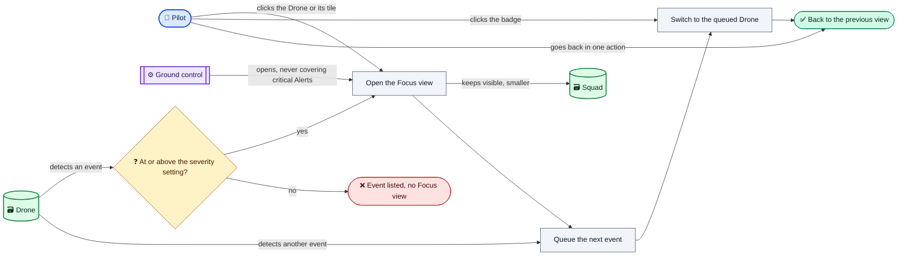

## 🖼️ Screens

One row per state of the flow chart: every action, success and failure node. Each state shows its light then its dark screen; click one to open it full size. A state with nothing to show reads `➖ No screen: <why>`.

| State | Persona | Entity | Source | Screen |
| --- | --- | --- | --- | --- |
| A1: Open the Focus view | [🔄 Pilot: Supervising](../../glossary.md#st-pilot-supervising) | [🔄 Drone: Airborne](../../glossary.md#st-drone-airborne) [🗃️ Squad](../../glossary.md#ent-squad) | ✏️ Mock-up | [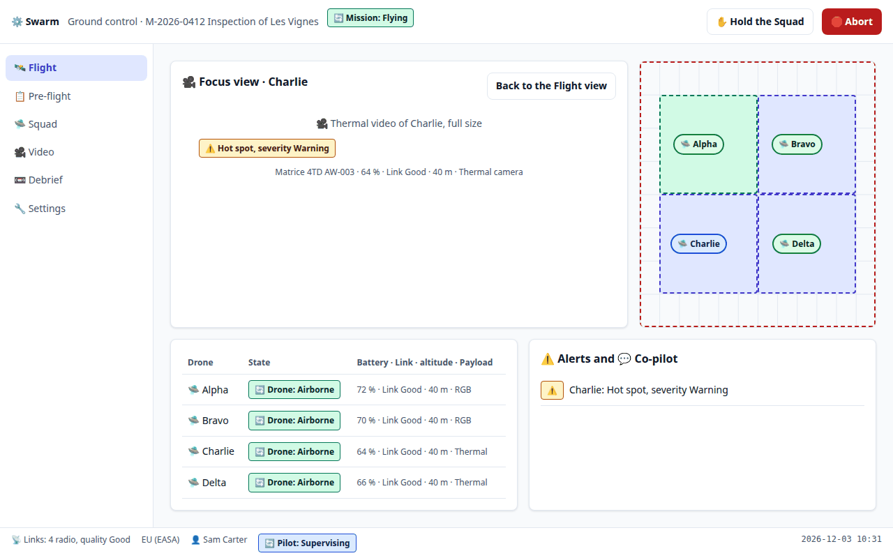](../../screens/UC-030/a1.png) [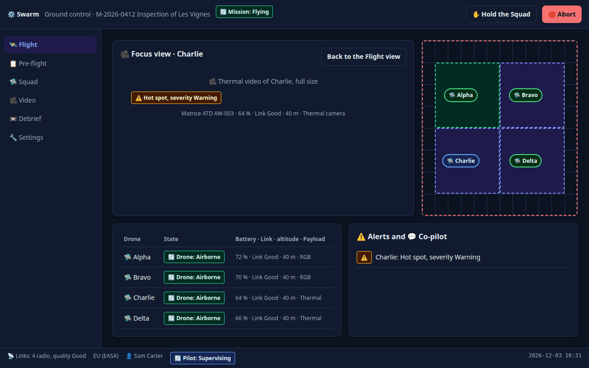](../../screens/UC-030/a1.dark.png) |
| A2: Queue the next event | [🔄 Pilot: Supervising](../../glossary.md#st-pilot-supervising) | [🔄 Drone: Airborne](../../glossary.md#st-drone-airborne) | ✏️ Mock-up | [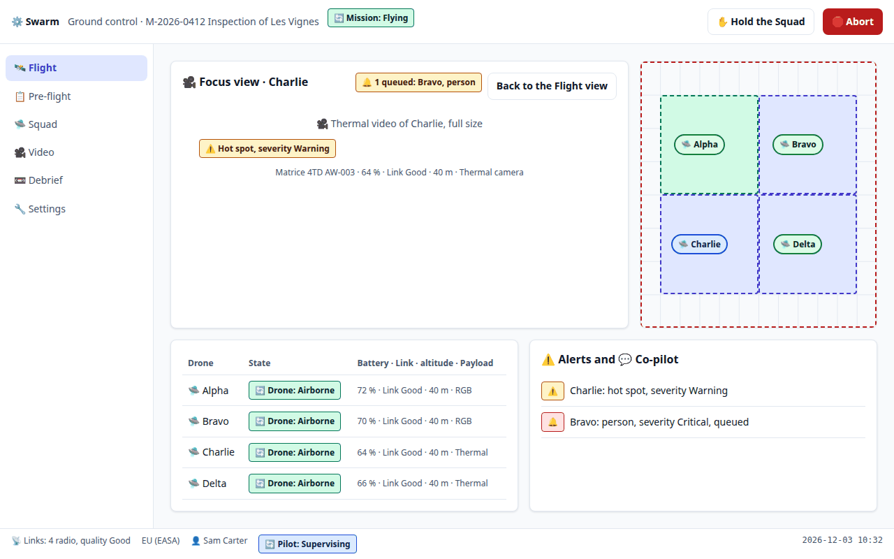](../../screens/UC-030/a2.png) [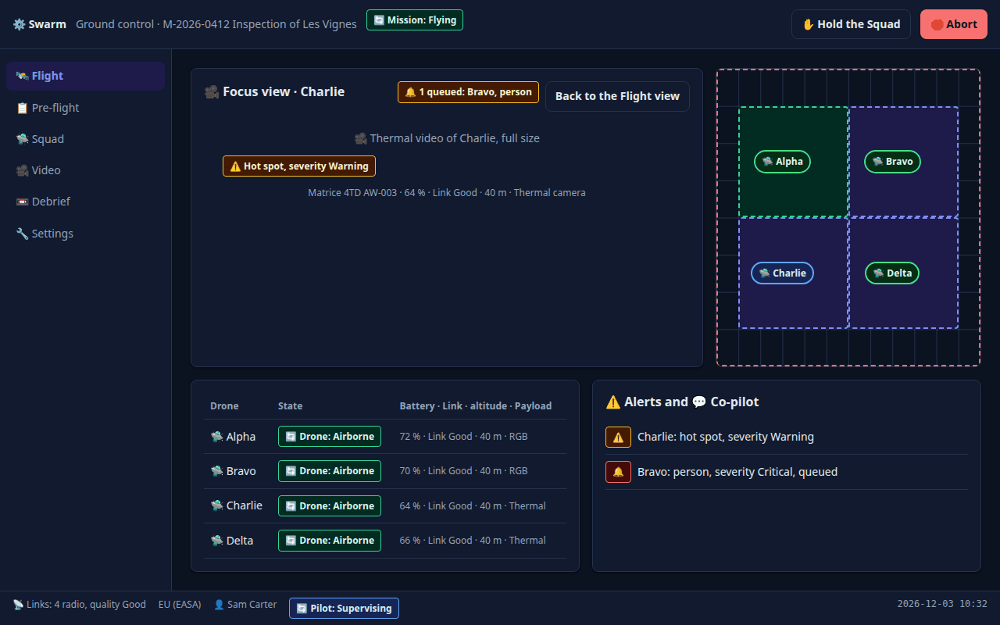](../../screens/UC-030/a2.dark.png) |
| A3: Switch to the queued Drone | [🔄 Pilot: Supervising](../../glossary.md#st-pilot-supervising) | [🔄 Drone: Airborne](../../glossary.md#st-drone-airborne) | ✏️ Mock-up | [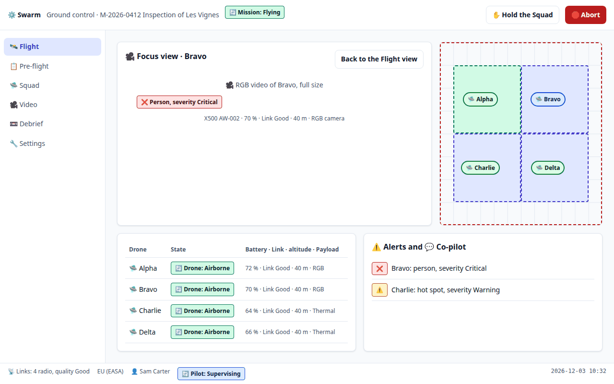](../../screens/UC-030/a3.png) [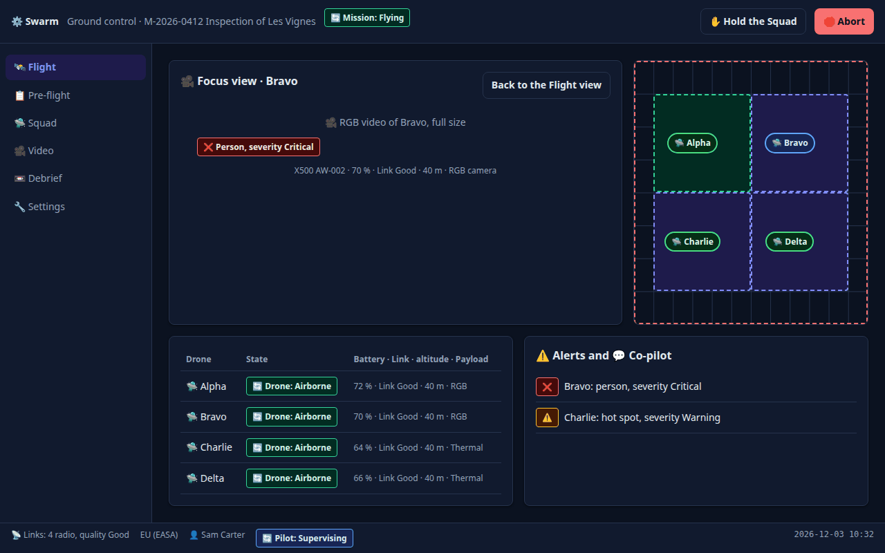](../../screens/UC-030/a3.dark.png) |
| OK: Back to the previous view | [🔄 Pilot: Supervising](../../glossary.md#st-pilot-supervising) | [🗃️ Squad](../../glossary.md#ent-squad) | ✏️ Mock-up | [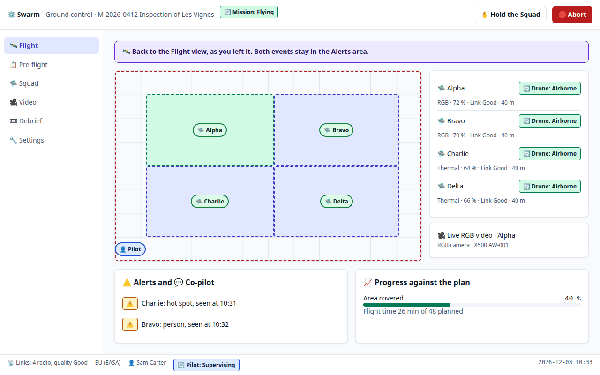](../../screens/UC-030/ok.png) [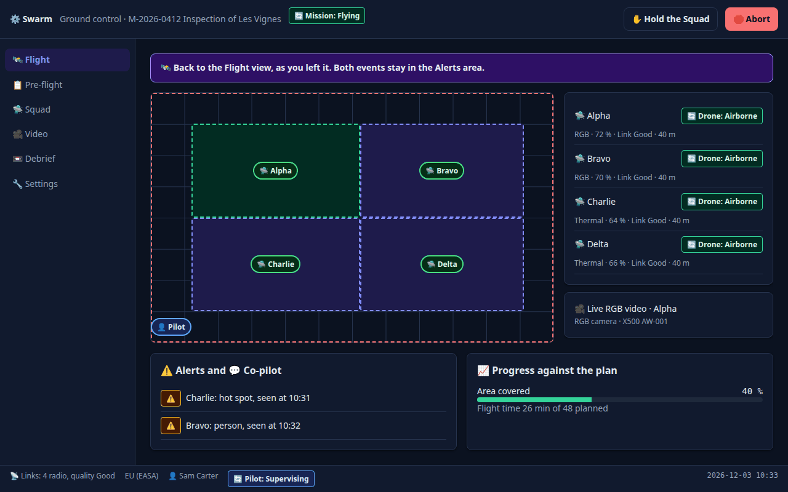](../../screens/UC-030/ok.dark.png) |
| KO: Event listed, no Focus view | [🔄 Pilot: Supervising](../../glossary.md#st-pilot-supervising) | [🔄 Drone: Airborne](../../glossary.md#st-drone-airborne) | ✏️ Mock-up | [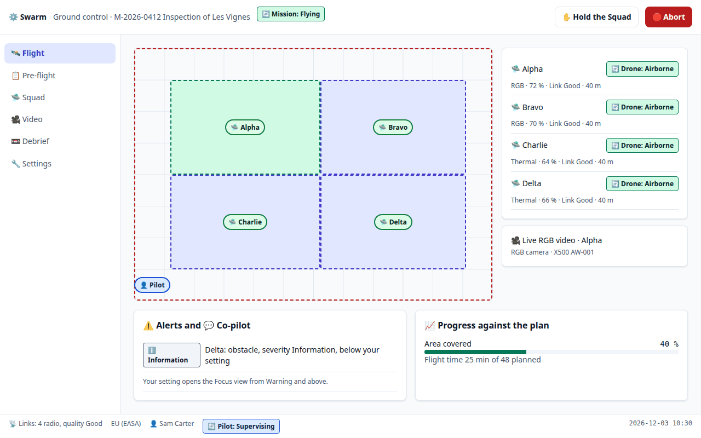](../../screens/UC-030/ko.png) [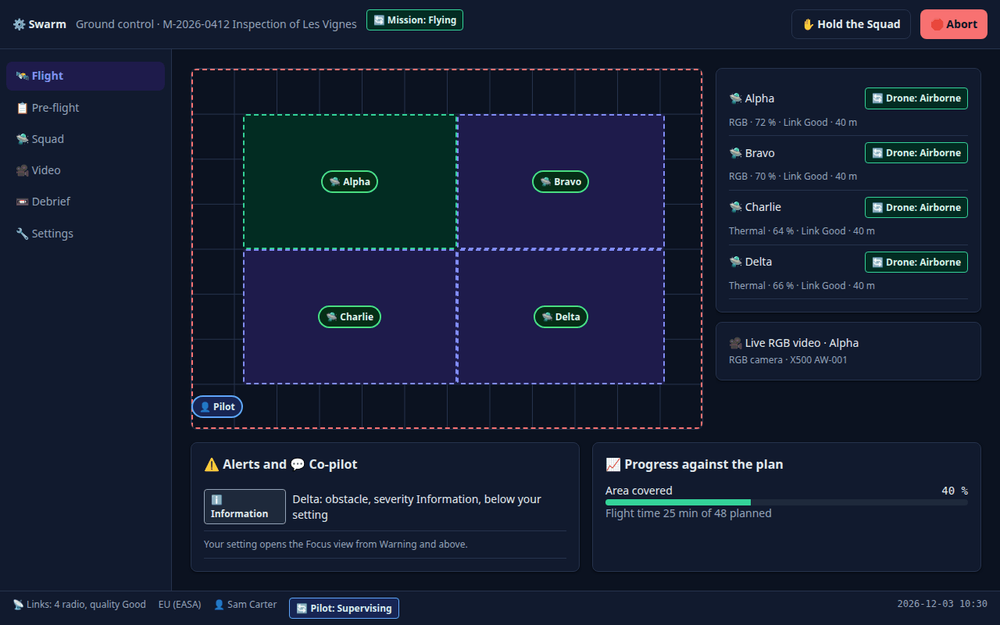](../../screens/UC-030/ko.dark.png) |

## ↪️ Alternative and error flows

| # | At step | Condition | What happens |
| --- | --- | --- | --- |
| A1 | 1 | The Pilot clicks a Drone on the map, or its tile in the Mosaic | The Focus view of that Drone opens, as in step 2. |
| A2 | 1 | The detected event is below the Pilot's severity setting, such as an obstacle of severity Information seen by Delta | No Focus view opens: the event is listed in the Alerts area, where the Pilot can open it with a click. |
| A3 | 3 | A critical Alert arrives while the Focus view is open | The Alert shows in full above the Focus view, with ✋ Hold the Squad and 🛑 Abort still in the title bar ([📏 BR-027](../business-rules/BR-027-the-pilot-s-attention-is-preserved.md)). |

## 📏 Business rules applied

| Rule | Where it applies |
| --- | --- |
| [📏 BR-027: The Pilot's attention is preserved](../business-rules/BR-027-the-pilot-s-attention-is-preserved.md) | Steps 2 to 5 and alternative A3: one Focus view at a time, new events queued with a badge, the map and the Squad visible, critical Alerts never covered, the previous view one action away |
| [📏 BR-023: Fixed safety controls](../business-rules/BR-023-fixed-safety-controls.md) | Steps 2 to 5: Hold the Squad and abort stay in the title bar of the Focus view |

## 🏁 Postconditions

- ✅ **Success:** the Pilot has looked at each Drone that needed attention, one at a time, and is back in the view used before, with no event lost: each is in the Alerts area.
- ❌ **Failure:** an event below the severity setting does not open the Focus view; it is listed in the Alerts area and the Pilot's view does not change.

## 🔗 Referenced by

<!-- spec:referenced-by -->
- [📘 FS-021: Ground control monitoring](../features/FS-021-ground-control-monitoring.md)
- [🎬 UC-025: Monitor a Mission in Ground control](UC-025-monitor-a-mission-in-ground-control.md)
<!-- /spec:referenced-by -->

<!-- spec:nav-bottom -->
---

> [🏠 Index](../../README.md) · [◀️ UC-029: Create an Operator](UC-029-create-an-operator.md) · 📄 **Page 56 / 108** · [BR-001: Geofence and Altitude ceiling ▶️](../business-rules/BR-001-geofence-and-altitude-ceiling.md)
<!-- /spec:nav-bottom -->
