# 🎬 UC-031: Ask the Assistant

<!-- spec:nav-top -->
> [🏠 Index](../../README.md) · [◀️ UC-030: Focus on a Drone](UC-030-focus-on-a-drone.md) · 📄 **Page 59 / 120** · [UC-032: Set the Assistant permissions ▶️](UC-032-set-the-assistant-permissions.md)
<!-- /spec:nav-top -->

**Status:** 🟡 Draft · **Updated:** 2026-11-20

> [!NOTE]
> The [👤 Fleet maintainer](../../glossary.md#per-fleet-maintainer) asks the [⚙️ Assistant](../../glossary.md#sys-assistant) about the [🗃️ Fleet](../../glossary.md#ent-fleet) and for an action; the Assistant answers with its sources and, as the [🗃️ Assistant permission](../../glossary.md#ent-assistant-permission) of that action allows, does nothing, proposes it or does it and reports it.

<!-- spec:summary -->
## 📑 Summary

1. [👤 Personas and entities](#actors)
2. [🚦 Preconditions](#preconditions)
3. [⚡ Trigger](#trigger)
4. [➡️ Main flow](#main-flow)
5. [🔀 Flow chart](#flowchart)
6. [🖼️ Screens](#screens)
7. [↪️ Alternative and error flows](#alternative-flows)
8. [📏 Business rules applied](#business-rules)
9. [🏁 Postconditions](#postconditions)
10. [🔗 Referenced by](#referenced-by)
<!-- /spec:summary -->

## 👤 Personas and entities

| Name | Kind | Role in this use case |
| --- | --- | --- |
| [👤 Fleet maintainer](../../glossary.md#per-fleet-maintainer) | Persona | Asks, accepts or undoes |
| [⚙️ Assistant](../../glossary.md#sys-assistant) | System | Answers with its sources; proposes or does the action as its Assistant permission allows |
| [⚙️ Back office](../../glossary.md#sys-back-office) | System | Holds the Assistant panel, aware of the screen the Fleet maintainer is on |
| [🗃️ Drone](../../glossary.md#ent-drone) | Entity | Charlie, whose maintenance is asked about and scheduled |
| [🗃️ Knowledge document](../../glossary.md#ent-knowledge-document) | Entity | The maintenance procedure of the Operator, cited in the answer |
| [🗃️ Conversation](../../glossary.md#ent-conversation) | Entity | Keeps the questions and the answers |
| [🗃️ Assistant permission](../../glossary.md#ent-assistant-permission) | Entity | The level of "Schedule a maintenance" for the Fleet maintainer: Propose |
| [🗃️ Assistant activity](../../glossary.md#ent-assistant-activity) | Entity | Records the proposal, who accepted it and the sources |

## 🚦 Preconditions

1. The Fleet maintainer of the [🗃️ Operator](../../glossary.md#ent-operator) Aerowing Services has the Back office open on **🛸 Fleet**.
2. Charlie (X500) has flown 48 of the 50 hours its maker allows between two maintenances (sample values).
3. "Schedule a maintenance" is at Propose for the Fleet maintainer role, the default of a new Operator ([📏 BR-028: Assistant permissions are layered](../business-rules/BR-028-assistant-permissions-are-layered.md)).
4. The maintenance procedure of Aerowing Services is one of its Knowledge documents.

## ⚡ Trigger

The Fleet maintainer opens the Assistant panel and asks a question in words.

## ➡️ Main flow

1. The Fleet maintainer asks: "Which Drones will not be Ready for the Mission of 3 December, and why?"
2. The Assistant, running on the [🔤 LLM provider](../../glossary.md#term-llm-provider) of the Operator, reads the Fleet as the Fleet maintainer may ([📏 BR-032: The Assistant reaches only what its person may reach](../business-rules/BR-032-the-assistant-reaches-only-what-its-person-may-reach.md)) and answers: Charlie reaches its maintenance interval on 2 December. It cites the flight hours it read and the maintenance procedure, and links Charlie.
3. The Fleet maintainer asks: "Schedule Charlie's maintenance on 1 December."
4. The Assistant reads the Assistant permission of "Schedule a maintenance" for this person: Propose. It prepares the change and shows exactly what it will do; nothing takes effect yet ([📏 BR-021: AI agents propose, people decide](../business-rules/BR-021-ai-agents-propose-people-decide.md)).
5. The Fleet maintainer accepts. Swarm schedules the maintenance, Charlie stays Ready until 1 December, and the Assistant activity records the request, the permission used, the sources and that the Fleet maintainer accepted it. The Conversation is kept.

## 🔀 Flow chart

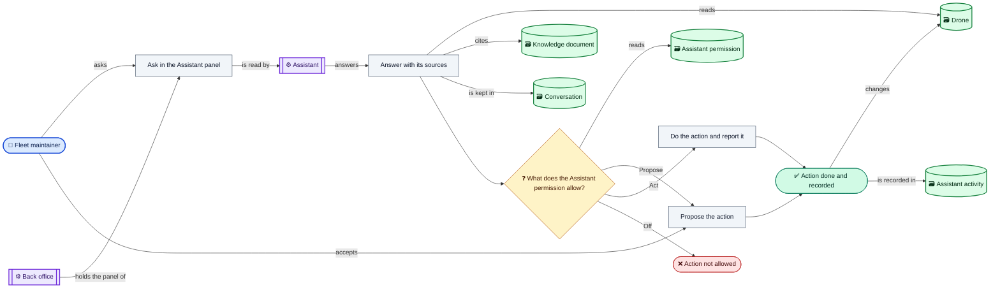

## 🖼️ Screens

One row per state of the flow chart: every action, success and failure node. Click a screen to open it full size. A state with nothing to show reads `➖ No screen: <why>`.

| State | Persona | Entity | Source | Screen |
| --- | --- | --- | --- | --- |
| A1: Ask in the Assistant panel | [👤 Fleet maintainer](../../glossary.md#per-fleet-maintainer) | [🗃️ Conversation](../../glossary.md#ent-conversation) | ✏️ Mock-up | [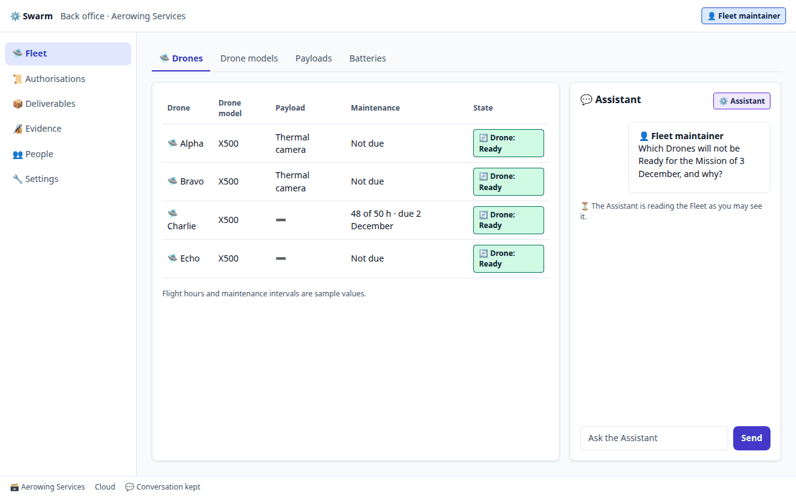](../../screens/UC-031/a1.png) [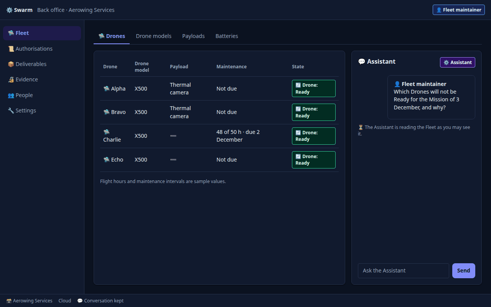](../../screens/UC-031/a1.dark.png) |
| A2: Answer with its sources | [👤 Fleet maintainer](../../glossary.md#per-fleet-maintainer) | [🔄 Drone: Ready](../../glossary.md#st-drone-ready) [🗃️ Knowledge document](../../glossary.md#ent-knowledge-document) | ✏️ Mock-up | [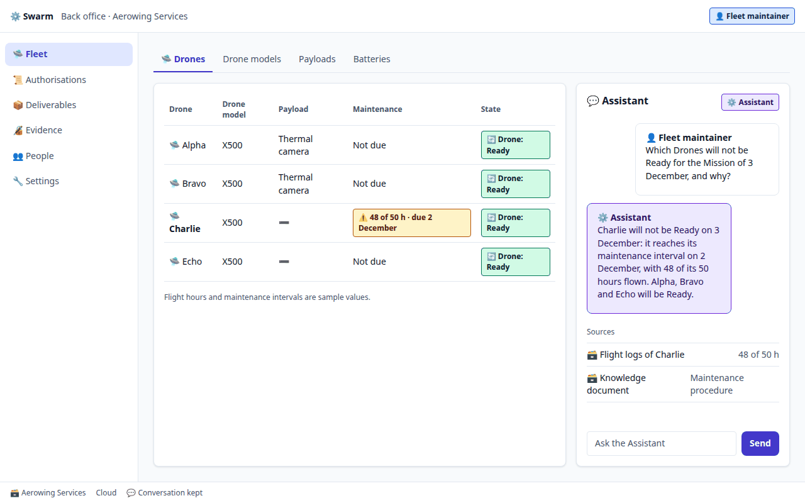](../../screens/UC-031/a2.png) [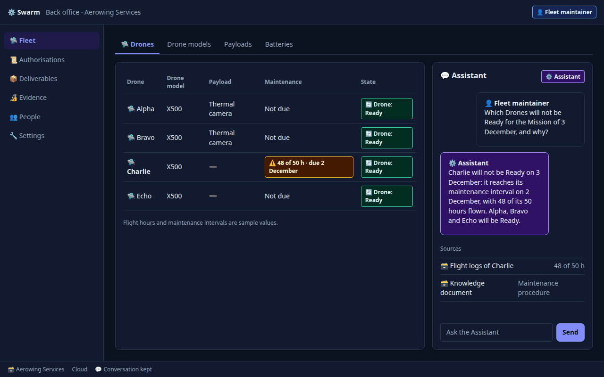](../../screens/UC-031/a2.dark.png) |
| A3: Propose the action | [👤 Fleet maintainer](../../glossary.md#per-fleet-maintainer) | [🗃️ Assistant permission](../../glossary.md#ent-assistant-permission) | ✏️ Mock-up | [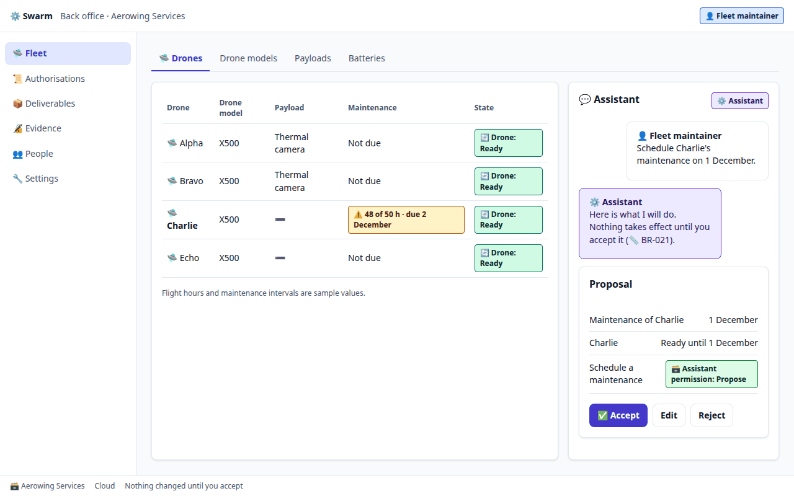](../../screens/UC-031/a3.png) [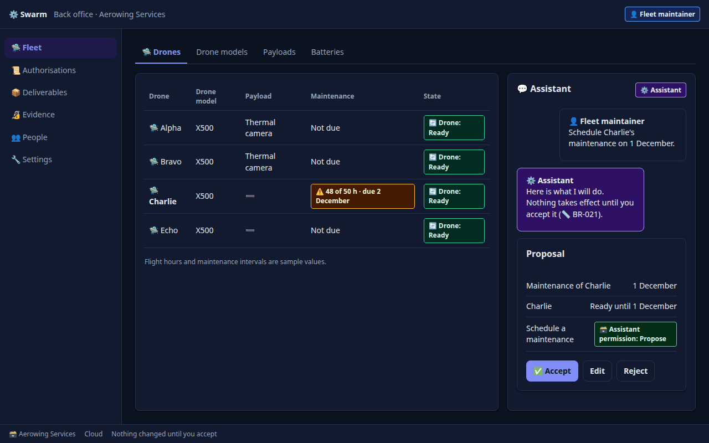](../../screens/UC-031/a3.dark.png) |
| A4: Do the action and report it | [👤 Fleet maintainer](../../glossary.md#per-fleet-maintainer) | [🗃️ Assistant activity](../../glossary.md#ent-assistant-activity) | ✏️ Mock-up | [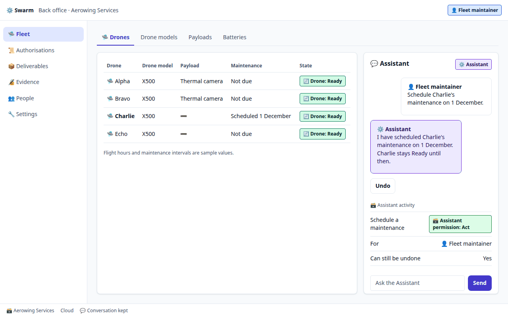](../../screens/UC-031/a4.png) [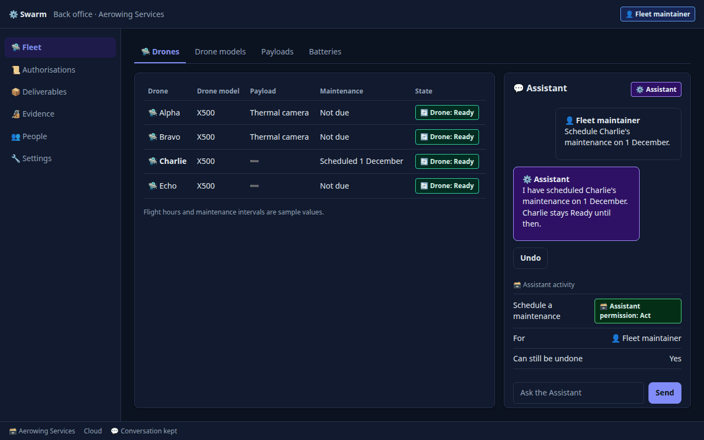](../../screens/UC-031/a4.dark.png) |
| OK: Action done and recorded | [👤 Fleet maintainer](../../glossary.md#per-fleet-maintainer) | [🔄 Drone: Ready](../../glossary.md#st-drone-ready) [🗃️ Assistant activity](../../glossary.md#ent-assistant-activity) | ✏️ Mock-up | [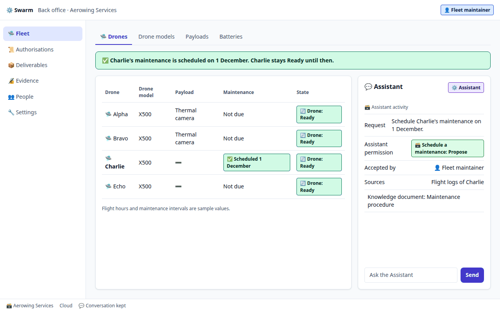](../../screens/UC-031/ok.png) [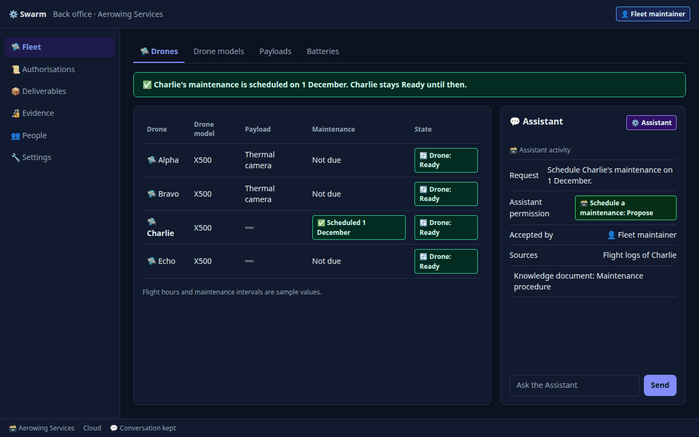](../../screens/UC-031/ok.dark.png) |
| KO: Action not allowed | [👤 Fleet maintainer](../../glossary.md#per-fleet-maintainer) | [🗃️ Assistant permission](../../glossary.md#ent-assistant-permission) | ✏️ Mock-up | [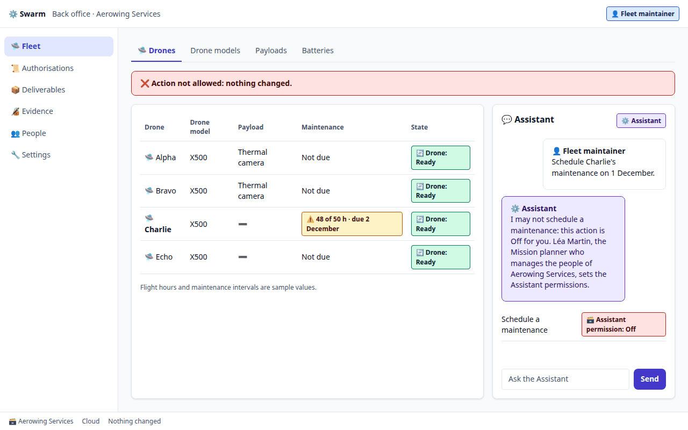](../../screens/UC-031/ko.png) [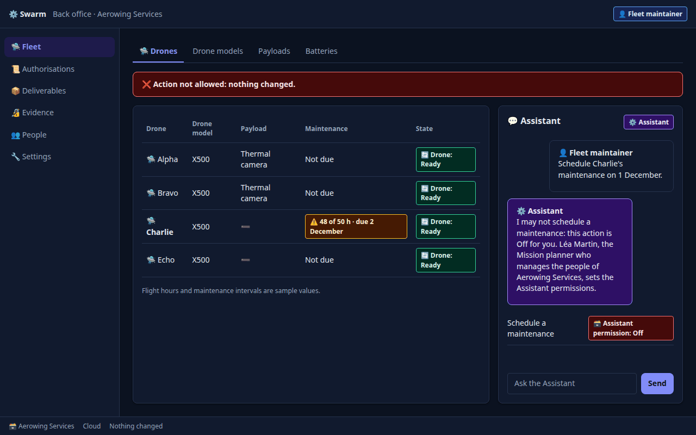](../../screens/UC-031/ko.dark.png) |

## ↪️ Alternative and error flows

| # | At step | Condition | What happens |
| --- | --- | --- | --- |
| A1 | 4 | "Schedule a maintenance" is at Act for the Fleet maintainer | The Assistant schedules it and reports it, with **Undo** for 5 minutes by default, an Operator setting (A4); where the Operator asked for it, it first asks a one-tap confirmation |
| A2 | 4 | "Schedule a maintenance" is Off for this person | The Assistant says it may not do it and who sets its permissions; nothing changes (KO) |
| A3 | 2 | The request belongs to a specialist: design a Mission, explain an Alert, draft a report | The Assistant hands it to the [⚙️ Mission assistant](../../glossary.md#sys-mission-assistant), the [⚙️ Co-pilot](../../glossary.md#sys-co-pilot) or the [⚙️ Report writer](../../glossary.md#sys-report-writer), in the same Conversation ([🎬 UC-021: Plan a Mission with the Mission assistant](UC-021-plan-a-mission-with-the-mission-assistant.md), [🎬 UC-026: Handle an Alert](UC-026-handle-an-alert.md), [🎬 UC-022: Receive the Mission report](UC-022-receive-the-mission-report.md)) |
| A4 | 1 | The Fleet maintainer speaks, or writes from a mobile phone or a chat tool | The same flow; an answer that needs a screen comes with a link to it |
| A5 | 5 | The Fleet maintainer asks why | The Assistant shows the data, the Knowledge documents and the rules it used |
| A6 | 2 to 5 | The [🔤 Assistant budget](../../glossary.md#term-assistant-budget) of the Operator is spent | The Assistant answers in read-only mode and proposes nothing ([📏 BR-030](../business-rules/BR-030-the-assistant-stays-within-its-budget.md)) |
| A7 | 2 | The question is about data the Fleet maintainer may not see | Refused: the Assistant says it cannot see it ([📏 BR-032](../business-rules/BR-032-the-assistant-reaches-only-what-its-person-may-reach.md)) |
| A8 | 1 to 5 | No link to the cloud, and the Operator has enabled the offline mode | The Assistant answers with an open-weight model on the person's machine, within the same permissions; what needs the cloud waits for the link |

## 📏 Business rules applied

| Rule | Where it applies |
| --- | --- |
| [📏 BR-021: AI agents propose, people decide](../business-rules/BR-021-ai-agents-propose-people-decide.md) | Steps 4 and 5, A1, A2 |
| [📏 BR-028: Assistant permissions are layered](../business-rules/BR-028-assistant-permissions-are-layered.md) | Step 4, A1, A2 |
| [📏 BR-030: The Assistant stays within its budget](../business-rules/BR-030-the-assistant-stays-within-its-budget.md) | A6 |
| [📏 BR-032: The Assistant reaches only what its person may reach](../business-rules/BR-032-the-assistant-reaches-only-what-its-person-may-reach.md) | Step 2, A7 |

## 🏁 Postconditions

- ✅ **Success:** Charlie's maintenance is scheduled on 1 December. The Assistant activity names the Fleet maintainer who accepted it, the permission used and the sources. The Conversation is kept 12 months by default, the retention the Operator set.
- ❌ **Failure:** The action is not allowed: nothing changes, and the Fleet maintainer sees which permission stops it and who sets it.

## 🔗 Referenced by

<!-- spec:referenced-by -->
- [📘 FS-023: AI Assistant](../features/FS-023-ai-assistant.md)
<!-- /spec:referenced-by -->

<!-- spec:nav-bottom -->
---

> [🏠 Index](../../README.md) · [◀️ UC-030: Focus on a Drone](UC-030-focus-on-a-drone.md) · 📄 **Page 59 / 120** · [UC-032: Set the Assistant permissions ▶️](UC-032-set-the-assistant-permissions.md)
<!-- /spec:nav-bottom -->
