# 🎬 UC-032: Set the Assistant permissions

<!-- spec:nav-top -->
> [🏠 Index](../../README.md) · [◀️ UC-031: Ask the Assistant](UC-031-ask-the-assistant.md) · 📄 **Page 60 / 120** · [UC-033: Cover a Squad shortfall through the ERP ▶️](UC-033-cover-a-squad-shortfall-through-the-erp.md)
<!-- /spec:nav-top -->

**Status:** 🟡 Draft · **Updated:** 2026-11-20

> [!NOTE]
> The [👤 Swarm administrator](../../glossary.md#per-swarm-administrator) sets the ceiling of the [🗃️ Assistant permission](../../glossary.md#ent-assistant-permission)s of an [🗃️ Operator](../../glossary.md#ent-operator), the [👤 Mission planner](../../glossary.md#per-mission-planner) sets the level of each role within it, and a [👤 Pilot](../../glossary.md#per-pilot) narrows their own levels.

<!-- spec:summary -->
## 📑 Summary

1. [👤 Personas and entities](#actors)
2. [🚦 Preconditions](#preconditions)
3. [⚡ Trigger](#trigger)
4. [➡️ Main flow](#main-flow)
5. [🔀 Flow chart](#flowchart)
6. [🖼️ Screens](#screens)
7. [↪️ Alternative and error flows](#alternative-flows)
8. [📏 Business rules applied](#business-rules)
9. [🏁 Postconditions](#postconditions)
10. [🔗 Referenced by](#referenced-by)
<!-- /spec:summary -->

## 👤 Personas and entities

| Name | Kind | Role in this use case |
| --- | --- | --- |
| [👤 Swarm administrator](../../glossary.md#per-swarm-administrator) | Persona | Sets the ceiling of each action for the Operator |
| [👤 Mission planner](../../glossary.md#per-mission-planner) | Persona | Sets the level of each action for each role of the Operator |
| [👤 Pilot](../../glossary.md#per-pilot) | Persona | Narrows their own levels |
| [🗃️ Operator](../../glossary.md#ent-operator) | Entity | Aerowing Services, whose Assistant permissions are set |
| [🗃️ Assistant permission](../../glossary.md#ent-assistant-permission) | Entity | One level per action and role: Off, Read, Propose or Act |
| [⚙️ Back office](../../glossary.md#sys-back-office) | System | Shows the ceiling and the levels, and refuses a level above the ceiling |

## 🚦 Preconditions

1. The Operator Aerowing Services has the default Assistant permissions of a new Operator: Propose for every action its people may do ([📏 BR-028: Assistant permissions are layered](../business-rules/BR-028-assistant-permissions-are-layered.md)).
2. The Swarm administrator is signed in to **Back office · Swarm administration**.
3. Léa Martin, the Mission planner who manages the people of Aerowing Services, is signed in to its Back office.

## ⚡ Trigger

Aerowing Services asks to let its Fleet maintainers place Purchase orders, and to let the Assistant of its Pilots hold a Squad when the weather goes beyond the limits.

## ➡️ Main flow

1. The Swarm administrator opens Aerowing Services in Swarm administration and raises the ceiling of "Place a Purchase order" and of "Hold" to Act.
2. Léa Martin opens **🔧 Settings › Assistant** in the Back office: the actions of Swarm grouped by area, one column per role, each cell Off, Read, Propose or Act, with the ceiling shown.
3. Léa Martin sets "Place a Purchase order" to Act for the Fleet maintainers, with a confirmation before each order, and "Hold" to Act for the Pilots, which the screen marks as a [🔤 Flight-critical act](../../glossary.md#term-flight-critical-act) ([📏 BR-029: Flight-critical acts need a Pilot on duty](../business-rules/BR-029-flight-critical-acts-need-a-pilot-on-duty.md)).
4. Swarm checks each level against the ceiling and saves them ([📏 BR-028: Assistant permissions are layered](../business-rules/BR-028-assistant-permissions-are-layered.md)). Every person of each role gets the new levels, and the change is recorded with Léa Martin's name.
5. The Pilot Sam Carter lowers "Hold" to Propose for himself, in the Assistant settings of his own account.

## 🔀 Flow chart

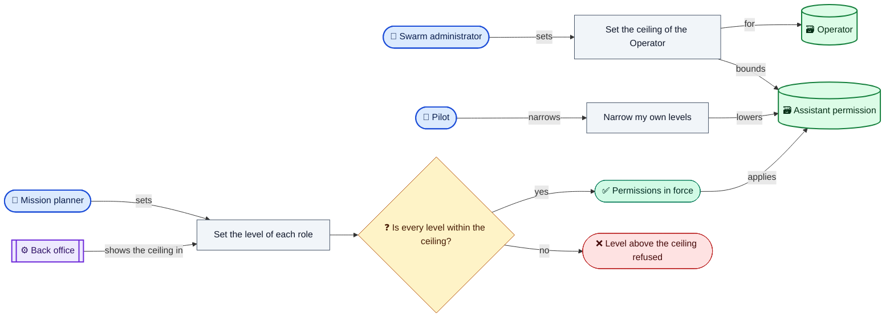

## 🖼️ Screens

One row per state of the flow chart: every action, success and failure node. Click a screen to open it full size. A state with nothing to show reads `➖ No screen: <why>`.

| State | Persona | Entity | Source | Screen |
| --- | --- | --- | --- | --- |
| A1: Set the ceiling of the Operator | [👤 Swarm administrator](../../glossary.md#per-swarm-administrator) | [🗃️ Operator](../../glossary.md#ent-operator) | ✏️ Mock-up | [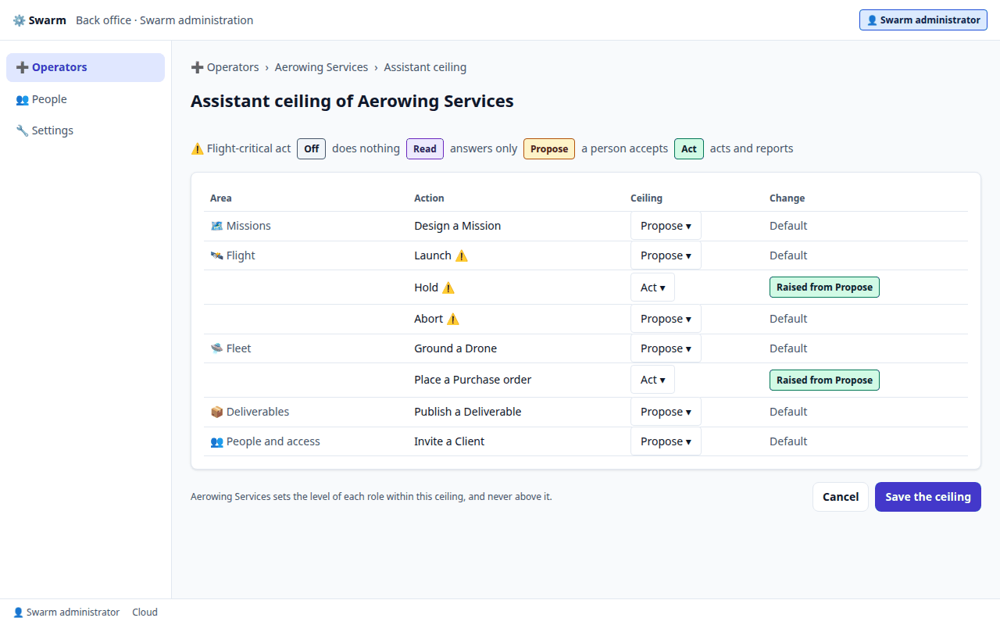](../../screens/UC-032/a1.png) [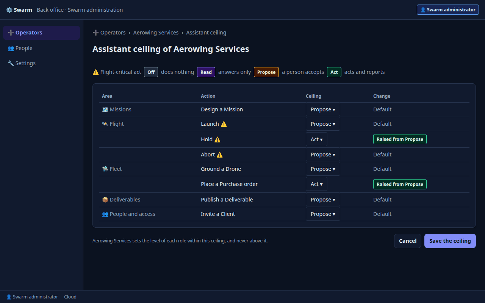](../../screens/UC-032/a1.dark.png) |
| A2: Set the level of each role | [👤 Mission planner](../../glossary.md#per-mission-planner) | [🗃️ Assistant permission](../../glossary.md#ent-assistant-permission) | ✏️ Mock-up | [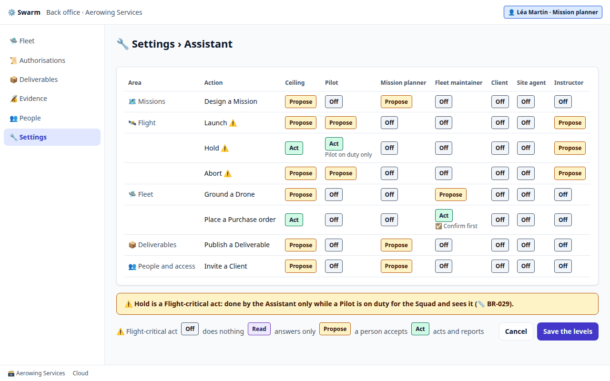](../../screens/UC-032/a2.png) [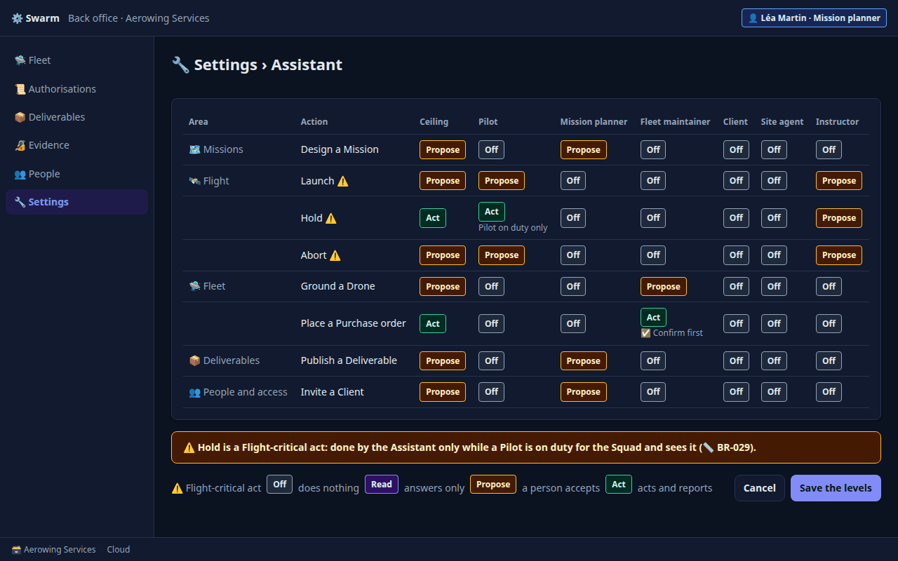](../../screens/UC-032/a2.dark.png) |
| A3: Narrow my own levels | [👤 Pilot](../../glossary.md#per-pilot) | [🗃️ Assistant permission](../../glossary.md#ent-assistant-permission) | ✏️ Mock-up | [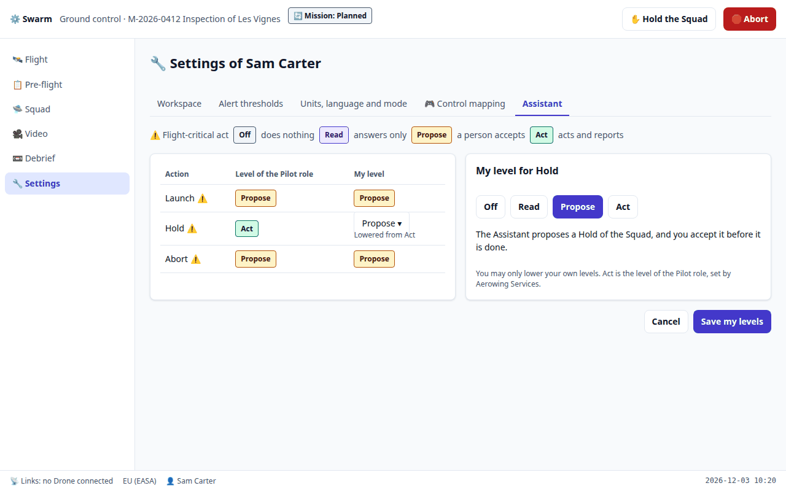](../../screens/UC-032/a3.png) [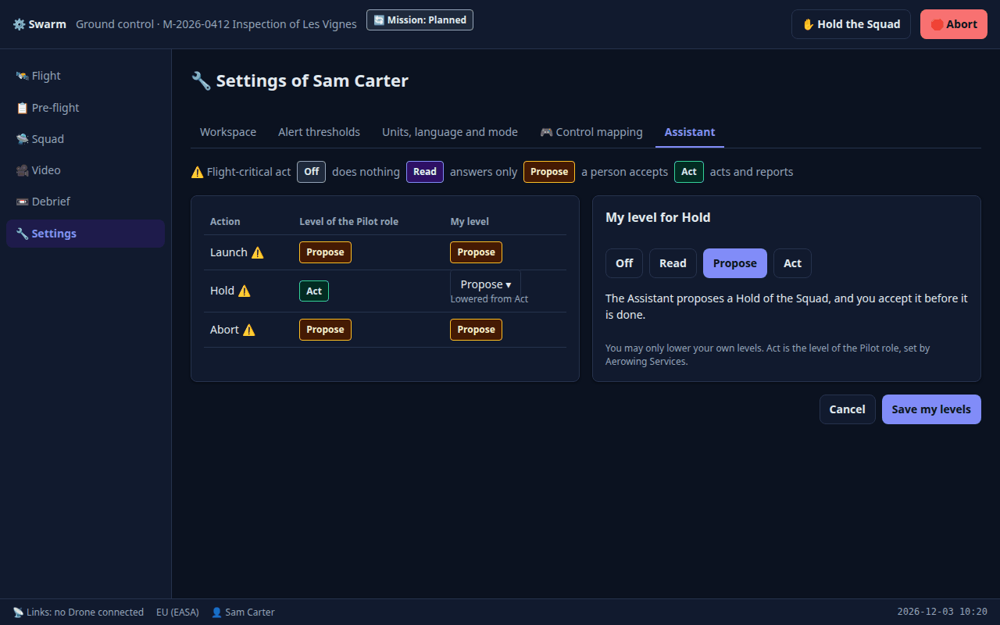](../../screens/UC-032/a3.dark.png) |
| OK: Permissions in force | [👤 Mission planner](../../glossary.md#per-mission-planner) | [🗃️ Assistant permission](../../glossary.md#ent-assistant-permission) | ✏️ Mock-up | [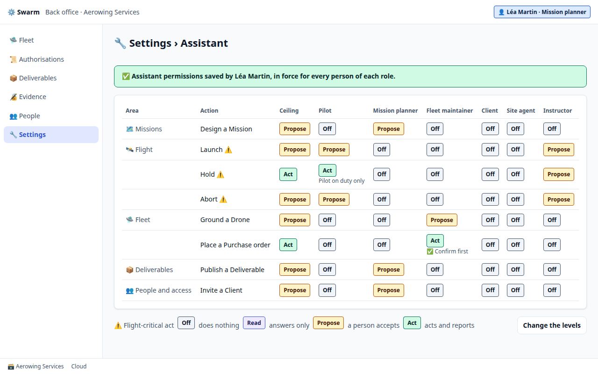](../../screens/UC-032/ok.png) [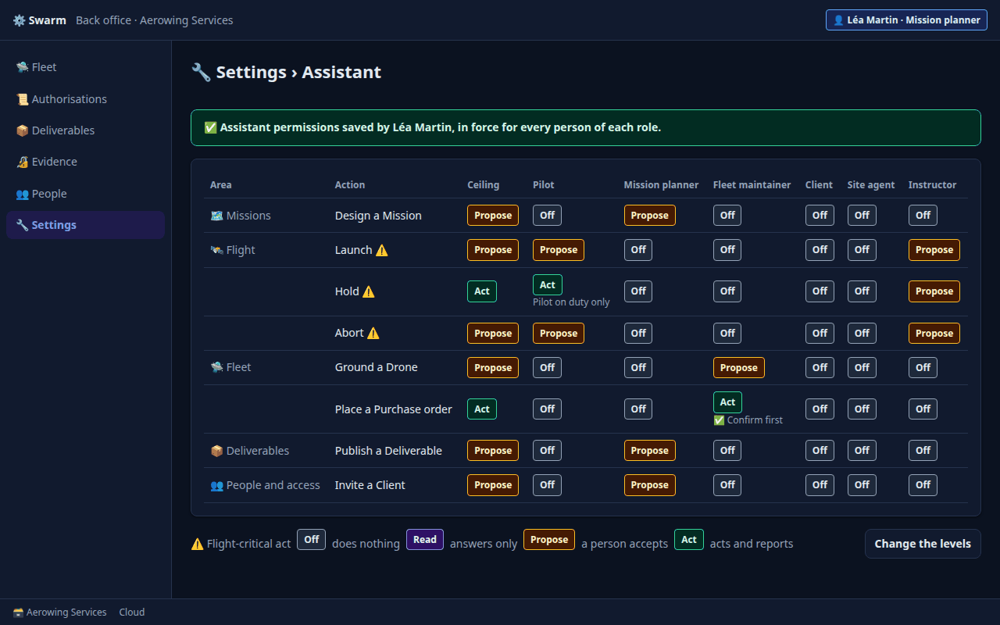](../../screens/UC-032/ok.dark.png) |
| KO: Level above the ceiling refused | [👤 Mission planner](../../glossary.md#per-mission-planner) | [🗃️ Assistant permission](../../glossary.md#ent-assistant-permission) | ✏️ Mock-up | [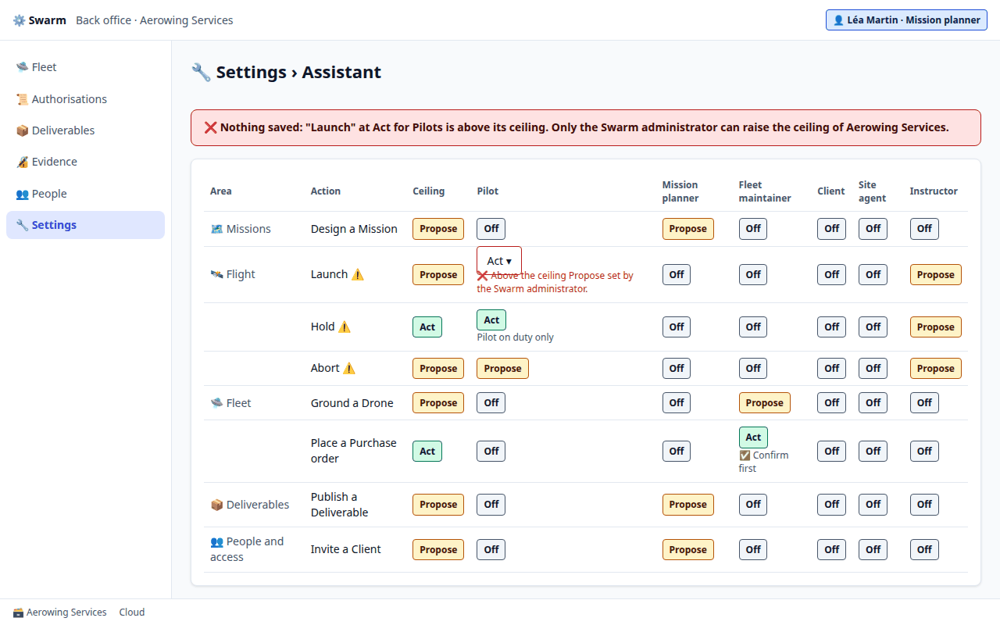](../../screens/UC-032/ko.png) [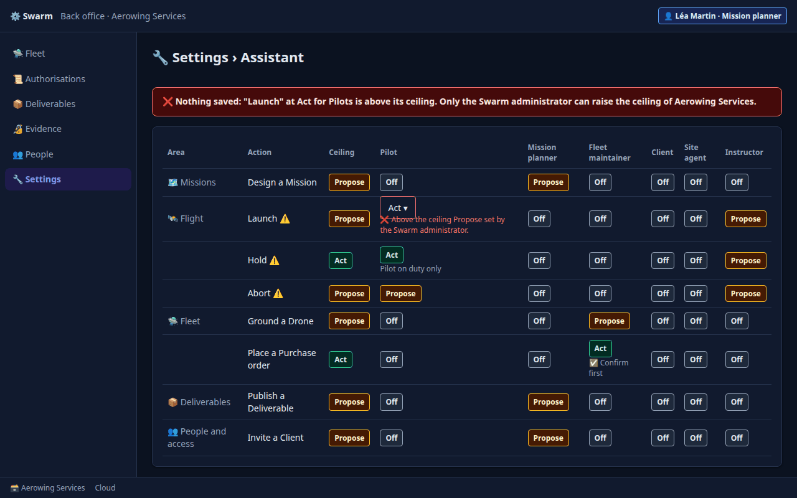](../../screens/UC-032/ko.dark.png) |

## ↪️ Alternative and error flows

| # | At step | Condition | What happens |
| --- | --- | --- | --- |
| A1 | 3 | Léa Martin sets an action above the ceiling, such as "Launch" at Act while its ceiling is Propose | Refused: the cell stays at the ceiling and the screen says who can raise it (KO) |
| A2 | 5 | Sam Carter tries to raise one of his levels above the level of the Pilot role | Refused: a person may only lower their own levels |
| A3 | 1 | The Swarm administrator lowers a ceiling below the level a role has | The level of that role comes down to the new ceiling, and Léa Martin is told which levels changed |
| A4 | 3 | An action is set to Act with a confirmation | The Assistant prepares the act and asks the person for a one-tap confirmation before doing it |

## 📏 Business rules applied

| Rule | Where it applies |
| --- | --- |
| [📏 BR-028: Assistant permissions are layered](../business-rules/BR-028-assistant-permissions-are-layered.md) | Steps 1 to 5, A1 to A3 |
| [📏 BR-029: Flight-critical acts need a Pilot on duty](../business-rules/BR-029-flight-critical-acts-need-a-pilot-on-duty.md) | Step 3 |

## 🏁 Postconditions

- ✅ **Success:** Fleet maintainers' Assistant may place Purchase orders after a confirmation, the Pilots' Assistant may hold a Squad under the conditions of BR-029, Sam Carter keeps "Hold" at Propose for himself, and each change is recorded with the name of the person who made it.
- ❌ **Failure:** The level above the ceiling is refused; the levels in force do not change.

## 🔗 Referenced by

<!-- spec:referenced-by -->
- [📘 FS-023: AI Assistant](../features/FS-023-ai-assistant.md)
- [🎬 UC-034: Let the Assistant hold a Squad](UC-034-let-the-assistant-hold-a-squad.md)
<!-- /spec:referenced-by -->

<!-- spec:nav-bottom -->
---

> [🏠 Index](../../README.md) · [◀️ UC-031: Ask the Assistant](UC-031-ask-the-assistant.md) · 📄 **Page 60 / 120** · [UC-033: Cover a Squad shortfall through the ERP ▶️](UC-033-cover-a-squad-shortfall-through-the-erp.md)
<!-- /spec:nav-bottom -->
