# 🎬 UC-033: Cover a Squad shortfall through the ERP

<!-- spec:nav-top -->
> [🏠 Index](../../README.md) · [◀️ UC-032: Set the Assistant permissions](UC-032-set-the-assistant-permissions.md) · 📄 **Page 61 / 120** · [UC-034: Let the Assistant hold a Squad ▶️](UC-034-let-the-assistant-hold-a-squad.md)
<!-- /spec:nav-top -->

**Status:** 🟡 Draft · **Updated:** 2026-11-20

> [!NOTE]
> The [👤 Mission planner](../../glossary.md#per-mission-planner) sizes the [🗃️ Squad](../../glossary.md#ent-squad) of a [🗃️ Mission](../../glossary.md#ent-mission); when the [🗃️ Fleet](../../glossary.md#ent-fleet) falls short, Swarm shows the [🔤 Squad shortfall](../../glossary.md#term-squad-shortfall) and the [⚙️ Assistant](../../glossary.md#sys-assistant) proposes, from the [⚙️ ERP](../../glossary.md#sys-erp), a [🗃️ Manufacturing order](../../glossary.md#ent-manufacturing-order), a [🗃️ Purchase order](../../glossary.md#ent-purchase-order), the earliest date or a smaller Squad.

<!-- spec:summary -->
## 📑 Summary

1. [👤 Personas and entities](#actors)
2. [🚦 Preconditions](#preconditions)
3. [⚡ Trigger](#trigger)
4. [➡️ Main flow](#main-flow)
5. [🔀 Flow chart](#flowchart)
6. [🖼️ Screens](#screens)
7. [↪️ Alternative and error flows](#alternative-flows)
8. [📏 Business rules applied](#business-rules)
9. [🏁 Postconditions](#postconditions)
10. [🔗 Referenced by](#referenced-by)
<!-- /spec:summary -->

## 👤 Personas and entities

| Name | Kind | Role in this use case |
| --- | --- | --- |
| [👤 Mission planner](../../glossary.md#per-mission-planner) | Persona | Sizes the Squad and chooses how to cover the shortfall |
| [🗃️ Mission](../../glossary.md#ent-mission) | Entity | M-2026-0412 Inspection of Les Vignes, Draft |
| [🗃️ Squad](../../glossary.md#ent-squad) | Entity | Three Drones with a thermal camera |
| [🗃️ Fleet](../../glossary.md#ent-fleet) | Entity | Has two X500 with a thermal camera Ready on 3 December |
| [🗃️ Drone model](../../glossary.md#ent-drone-model) | Entity | X500, built in-house by Aerowing Services |
| [🗃️ Manufacturing order](../../glossary.md#ent-manufacturing-order) | Entity | Proposed, then sent to the ERP to build one X500 |
| [🗃️ Purchase order](../../glossary.md#ent-purchase-order) | Entity | Proposed when parts or raw materials are missing |
| [⚙️ Assistant](../../glossary.md#sys-assistant) | System | Reads the ERP and proposes the ways to cover the shortfall |
| [⚙️ ERP](../../glossary.md#sys-erp) | System | Holds the stock, the bills of materials and the lead times, and receives the order |
| [⚙️ Mission studio](../../glossary.md#sys-mission-studio) | System | Shows the Squad, the shortfall and the proposals |

## 🚦 Preconditions

1. The Mission M-2026-0412 Inspection of Les Vignes is [🔄 Mission: Draft](../../glossary.md#st-mission-draft) ([🎬 UC-021: Plan a Mission with the Mission assistant](UC-021-plan-a-mission-with-the-mission-assistant.md)).
2. Aerowing Services builds its X500 in-house. Its ERP, Simple-ERP, is connected: it holds the bill of materials of the X500, the stock of its parts and its lead time.
3. Of the three X500 with a thermal camera of the Fleet, Echo is taken by another Mission on 3 December.
4. "Place a Manufacturing order" is at Propose for the Mission planner ([📏 BR-028: Assistant permissions are layered](../business-rules/BR-028-assistant-permissions-are-layered.md)).

## ⚡ Trigger

The Mission planner sets the size of the Squad in **🖊️ Design**.

## ➡️ Main flow

1. Léa Martin sizes the Squad from the work: three Drones with a thermal camera cover the panel rows in one hour. The flight profile follows: lines over the rows at 40 m, one Drone per block of rows.
2. Swarm reads the Fleet for 3 December: two X500 with a thermal camera are Ready, Echo is taken. It shows a Squad shortfall of one Drone ([📏 BR-031: A Squad shortfall is covered through the ERP](../business-rules/BR-031-a-squad-shortfall-is-covered-through-the-erp.md)).
3. The Assistant reads the ERP and proposes four ways, each with its effect: a Manufacturing order for one X500, ready on 27 November with every part in stock; the Mission on 4 December, the earliest date the Fleet alone completes the Squad; a Squad of two Drones, flying one hour thirty instead of one hour; or nothing, leaving the shortfall open.
4. Léa Martin chooses the Manufacturing order. Its Assistant permission is Propose, so the Assistant shows the order (Drone model X500, quantity 1, needed by 2 December, ready on 27 November according to the ERP) and Léa Martin accepts it ([📏 BR-021: AI agents propose, people decide](../business-rules/BR-021-ai-agents-propose-people-decide.md)).
5. Swarm sends the Manufacturing order to the ERP, which returns its number MO-2026-0117. The Mission shows the shortfall as covered by MO-2026-0117 and stays Draft; the new Drone joins the Squad once the Fleet maintainer has registered it and it is Ready.

## 🔀 Flow chart

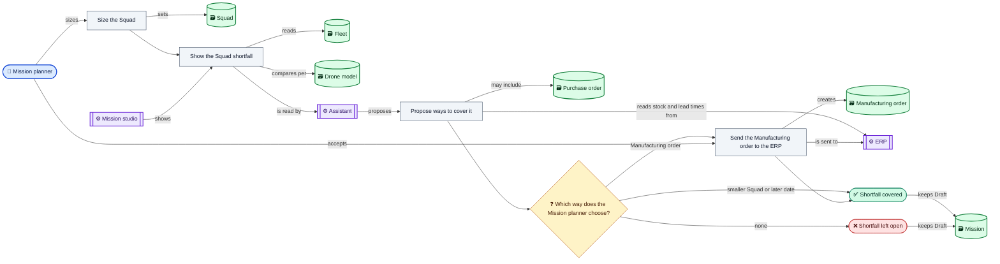

## 🖼️ Screens

One row per state of the flow chart: every action, success and failure node. Click a screen to open it full size. A state with nothing to show reads `➖ No screen: <why>`.

| State | Persona | Entity | Source | Screen |
| --- | --- | --- | --- | --- |
| A1: Size the Squad | [👤 Mission planner](../../glossary.md#per-mission-planner) | [🔄 Mission: Draft](../../glossary.md#st-mission-draft) [🗃️ Squad](../../glossary.md#ent-squad) | ✏️ Mock-up | [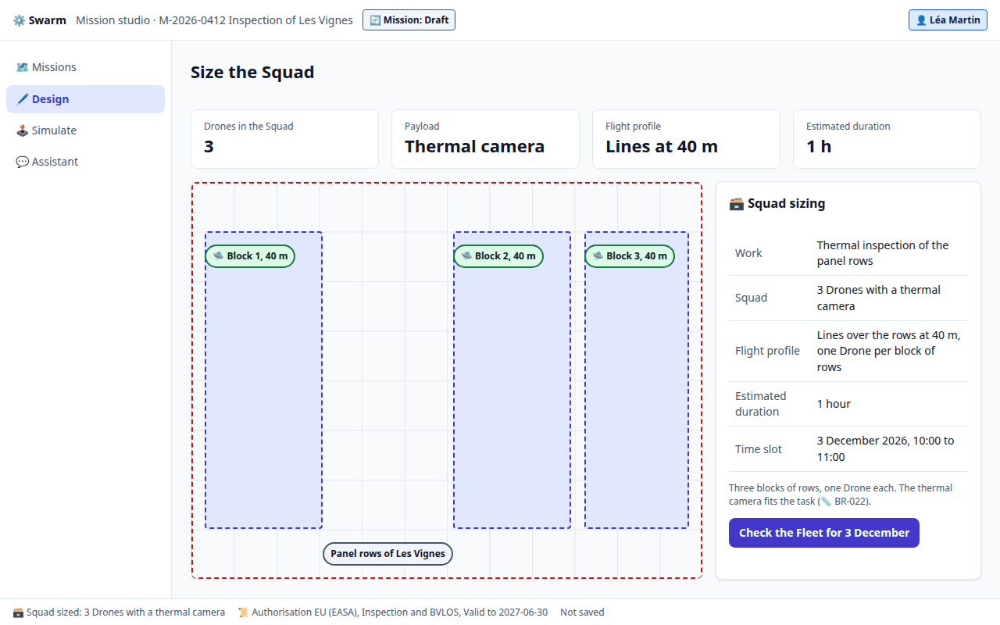](../../screens/UC-033/a1.png) [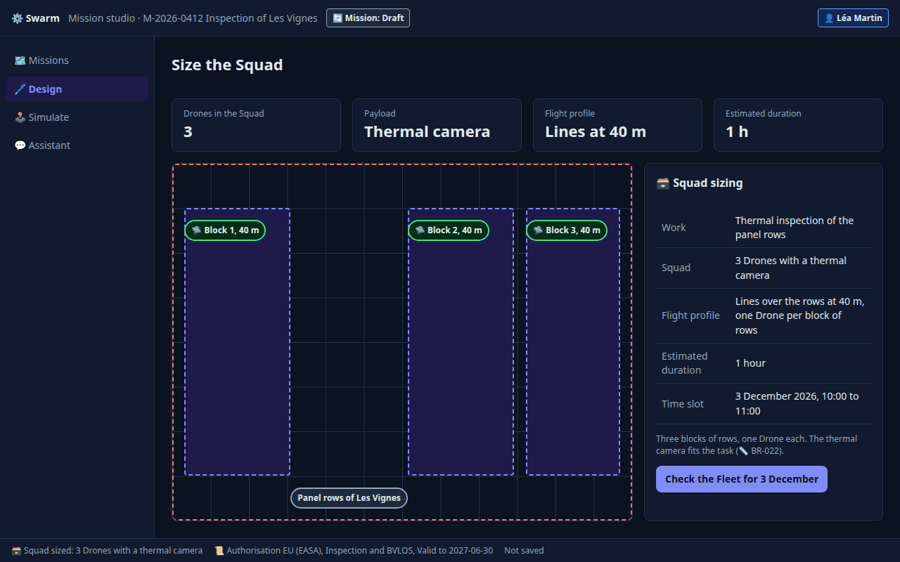](../../screens/UC-033/a1.dark.png) |
| A2: Show the Squad shortfall | [👤 Mission planner](../../glossary.md#per-mission-planner) | [🔄 Mission: Draft](../../glossary.md#st-mission-draft) [🗃️ Fleet](../../glossary.md#ent-fleet) | ✏️ Mock-up | [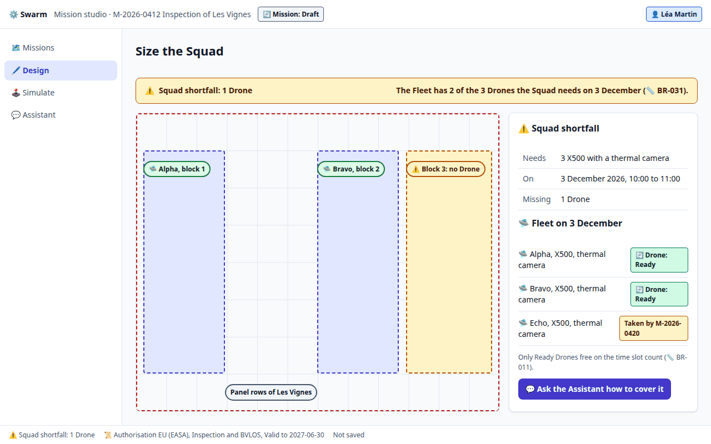](../../screens/UC-033/a2.png) [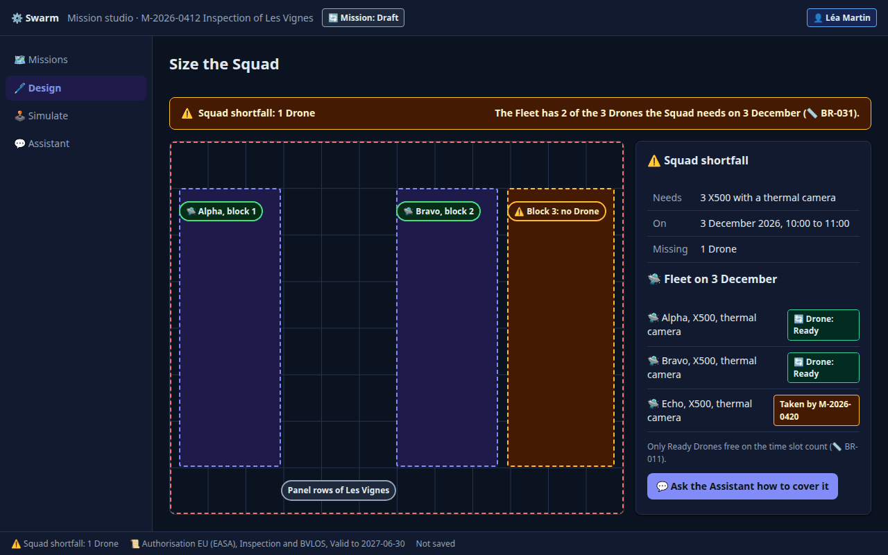](../../screens/UC-033/a2.dark.png) |
| A3: Propose ways to cover it | [👤 Mission planner](../../glossary.md#per-mission-planner) | [🗃️ Drone model](../../glossary.md#ent-drone-model) [🗃️ Manufacturing order](../../glossary.md#ent-manufacturing-order) | ✏️ Mock-up | [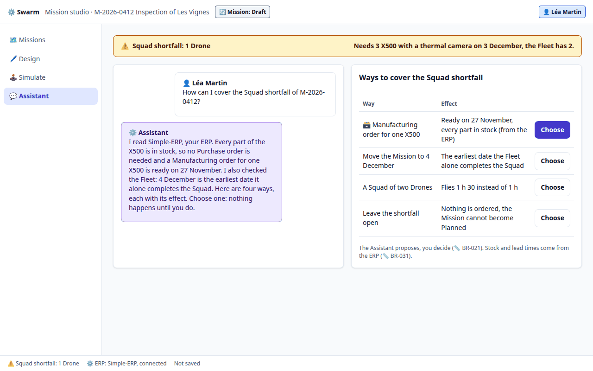](../../screens/UC-033/a3.png) [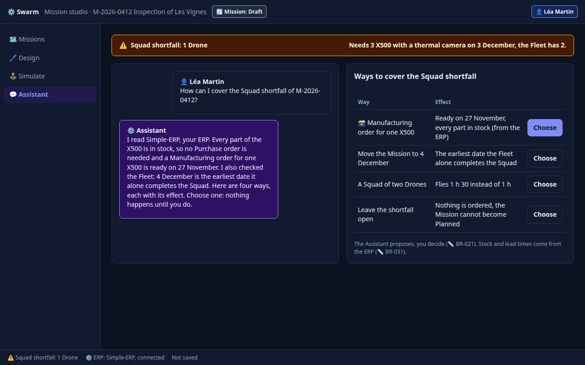](../../screens/UC-033/a3.dark.png) |
| A4: Send the Manufacturing order to the ERP | [👤 Mission planner](../../glossary.md#per-mission-planner) | [🗃️ Manufacturing order](../../glossary.md#ent-manufacturing-order) | ✏️ Mock-up | [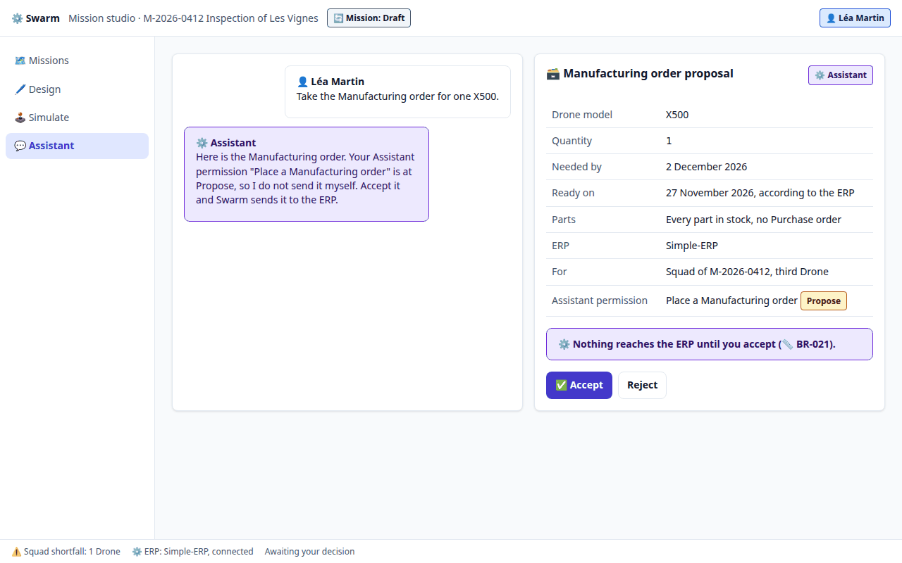](../../screens/UC-033/a4.png) [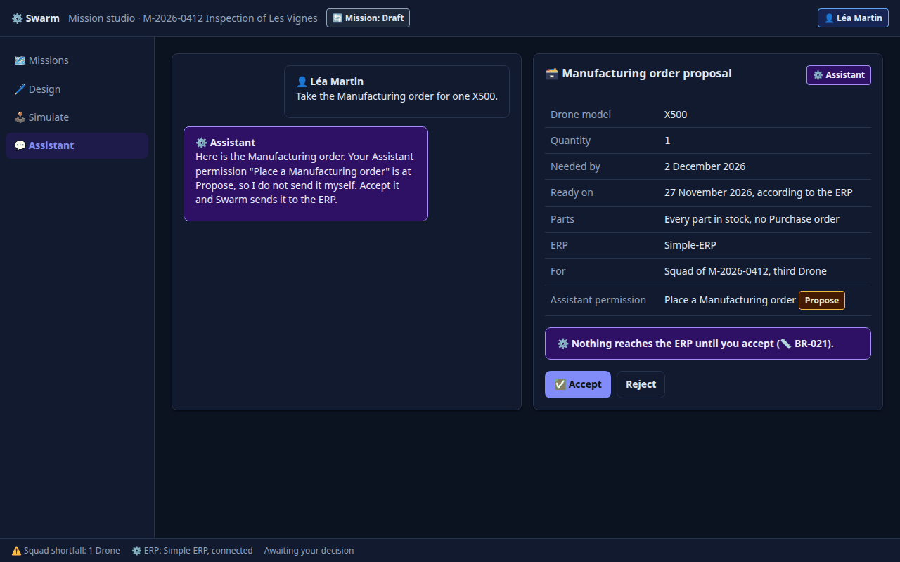](../../screens/UC-033/a4.dark.png) |
| OK: Shortfall covered | [👤 Mission planner](../../glossary.md#per-mission-planner) | [🔄 Mission: Draft](../../glossary.md#st-mission-draft) [🗃️ Manufacturing order](../../glossary.md#ent-manufacturing-order) | ✏️ Mock-up | [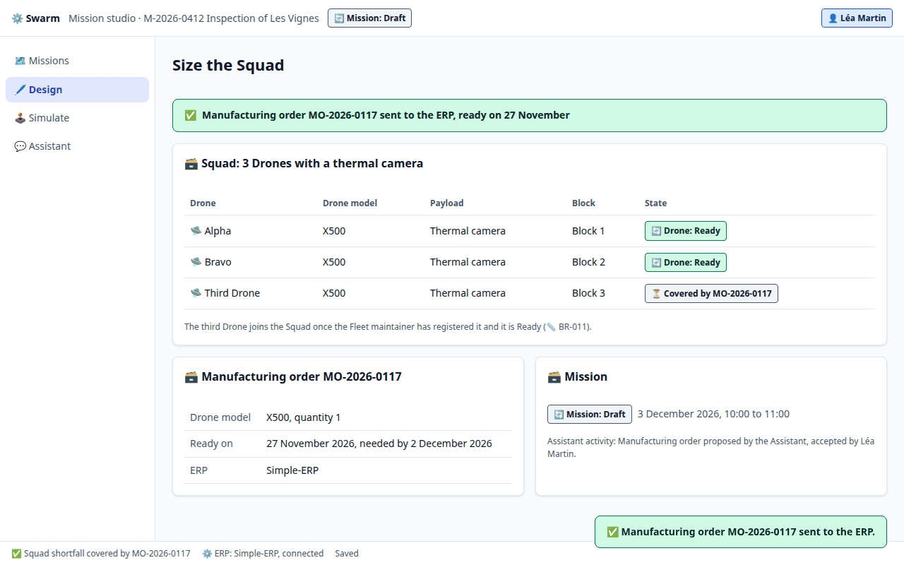](../../screens/UC-033/ok.png) [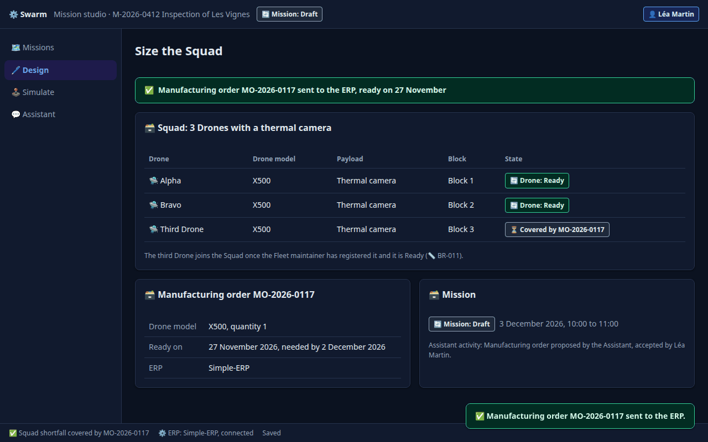](../../screens/UC-033/ok.dark.png) |
| KO: Shortfall left open | [👤 Mission planner](../../glossary.md#per-mission-planner) | [🔄 Mission: Draft](../../glossary.md#st-mission-draft) [🗃️ Squad](../../glossary.md#ent-squad) | ✏️ Mock-up | [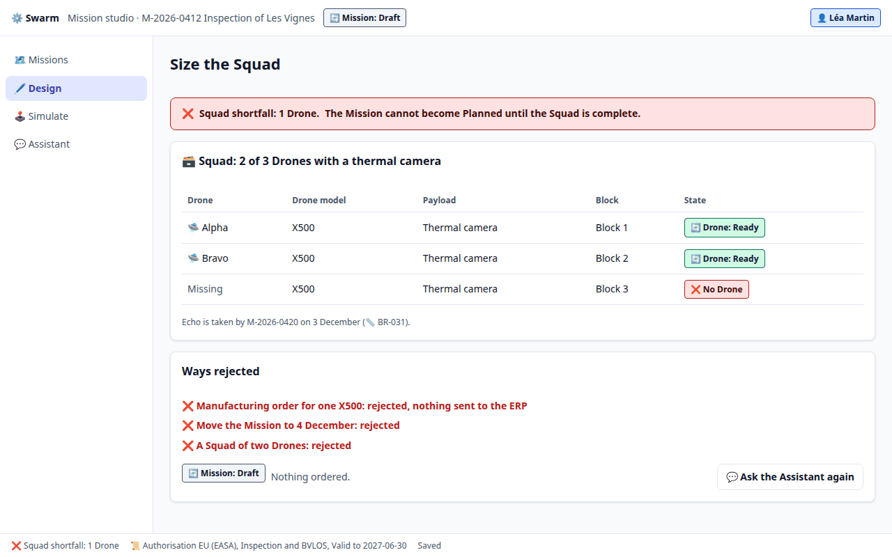](../../screens/UC-033/ko.png) [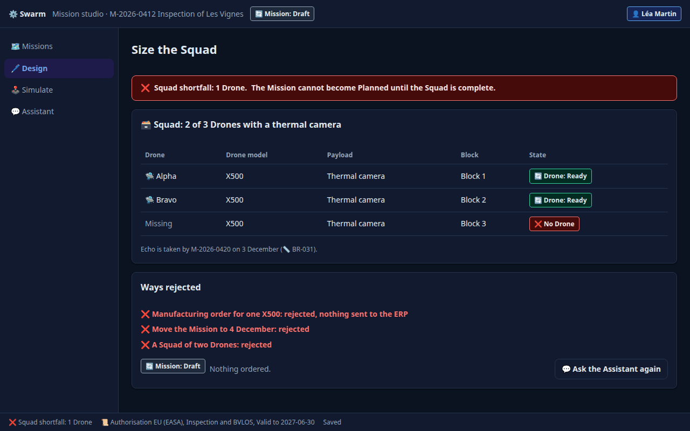](../../screens/UC-033/ko.dark.png) |

## ↪️ Alternative and error flows

| # | At step | Condition | What happens |
| --- | --- | --- | --- |
| A1 | 3 | A part of the X500, or a raw material, is missing from the stock | The Assistant also proposes a Purchase order for it, and the ready date of the Manufacturing order follows its delivery |
| A2 | 3 | The Drone model is bought from its maker, not built in-house | The Assistant proposes a Purchase order for the Drone instead of a Manufacturing order |
| A3 | 4 | Léa Martin chooses the smaller Squad | The Assistant re-plans the routes for two Drones and shows the trade-off; once Léa Martin accepts, the shortfall is gone (OK) |
| A4 | 4 | Léa Martin chooses the earliest date | The time slot moves to 4 December once Léa Martin accepts, and the Client sees the new date in the Client portal (OK) |
| A5 | 4 | "Place a Manufacturing order" is at Act for the Mission planner | The Assistant sends the order and reports it; once the ERP has received the order it cannot be undone, so the Assistant says so before sending it; cancelling it is a new act in the ERP |
| A6 | 3 | No ERP is connected, or the ERP does not answer | The shortfall is shown, but no order and no ERP date can be proposed; the Assistant says why and still proposes the smaller Squad ([📏 BR-031](../business-rules/BR-031-a-squad-shortfall-is-covered-through-the-erp.md)) |
| A7 | 4 | Léa Martin rejects every way | Nothing is ordered; the Mission stays Draft with the shortfall shown, and cannot become Planned until the Squad is complete (KO) |

## 📏 Business rules applied

| Rule | Where it applies |
| --- | --- |
| [📏 BR-031: A Squad shortfall is covered through the ERP](../business-rules/BR-031-a-squad-shortfall-is-covered-through-the-erp.md) | Steps 2 to 5, A1, A2, A6 |
| [📏 BR-021: AI agents propose, people decide](../business-rules/BR-021-ai-agents-propose-people-decide.md) | Step 4, A5 |
| [📏 BR-028: Assistant permissions are layered](../business-rules/BR-028-assistant-permissions-are-layered.md) | Step 4, A5 |
| [📏 BR-011: Drone readiness](../business-rules/BR-011-drone-readiness.md) | Steps 2 and 5 |
| [📏 BR-022: Payload compatibility](../business-rules/BR-022-payload-compatibility.md) | Steps 1 and 2 |

## 🏁 Postconditions

- ✅ **Success:** The Manufacturing order MO-2026-0117 is in the ERP, ready on 27 November; the Mission M-2026-0412 is Draft with its shortfall covered by that order, and the Assistant activity names Léa Martin, who accepted it.
- ❌ **Failure:** No way is accepted: nothing is ordered, and the Mission stays Draft with its Squad shortfall shown.

## 🔗 Referenced by

<!-- spec:referenced-by -->
- [📘 FS-024: ERP and Squad shortfall](../features/FS-024-erp-and-squad-shortfall.md)
<!-- /spec:referenced-by -->

<!-- spec:nav-bottom -->
---

> [🏠 Index](../../README.md) · [◀️ UC-032: Set the Assistant permissions](UC-032-set-the-assistant-permissions.md) · 📄 **Page 61 / 120** · [UC-034: Let the Assistant hold a Squad ▶️](UC-034-let-the-assistant-hold-a-squad.md)
<!-- /spec:nav-bottom -->
