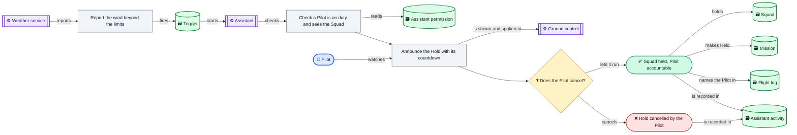
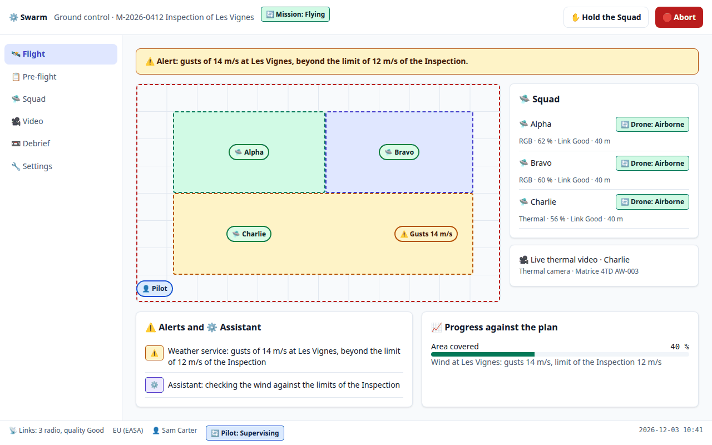
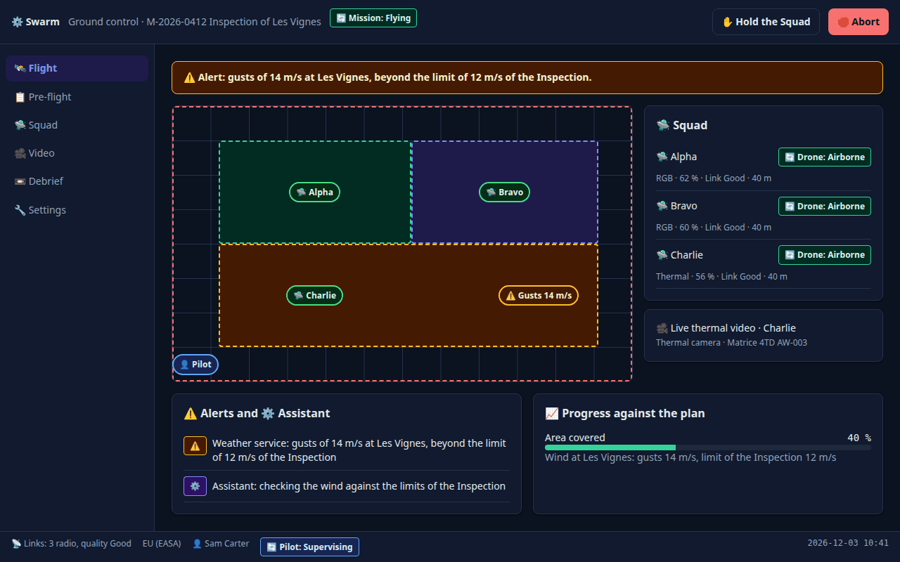
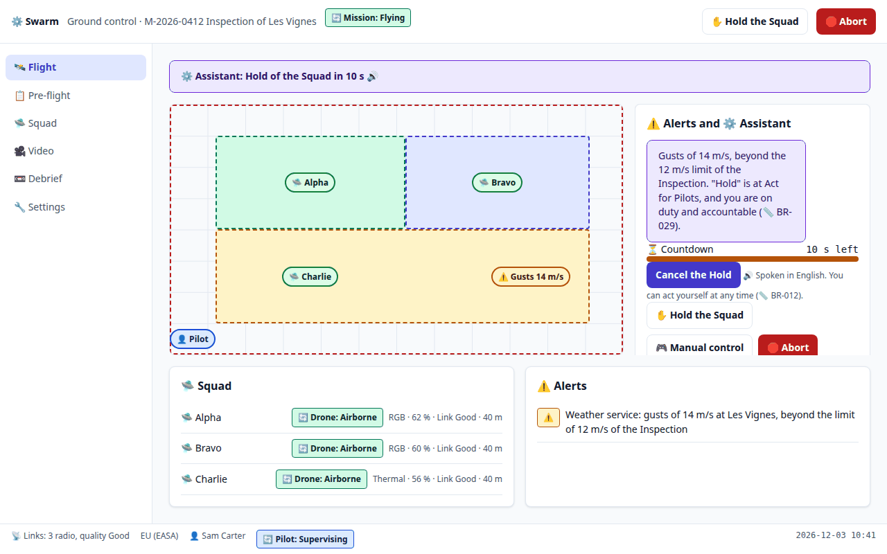
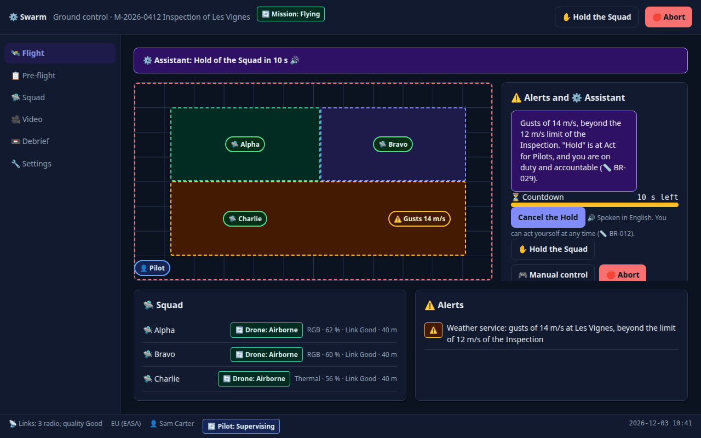
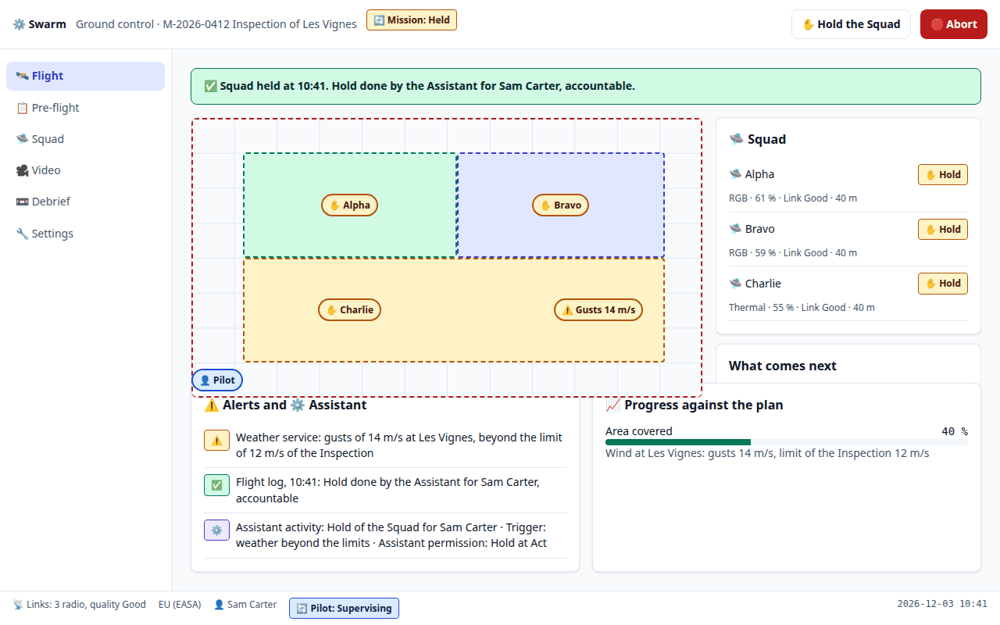
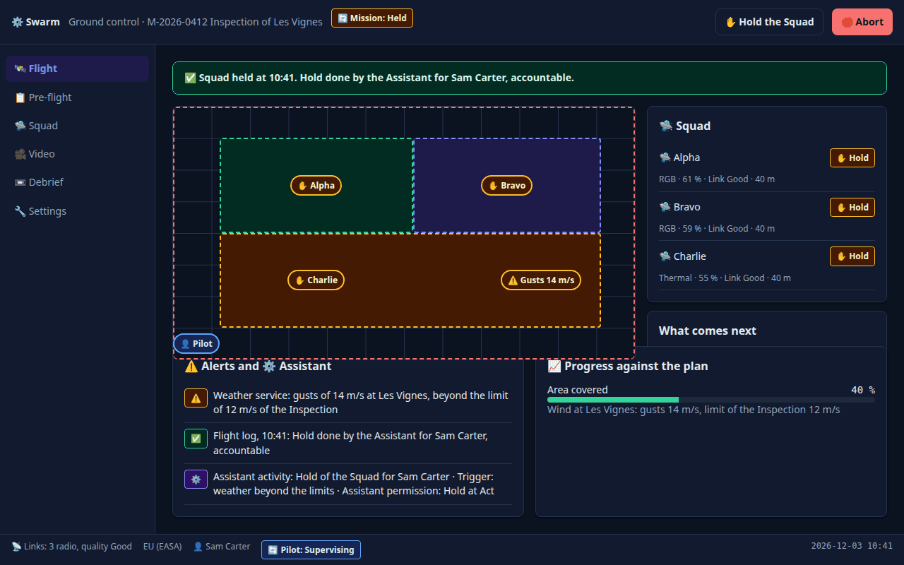
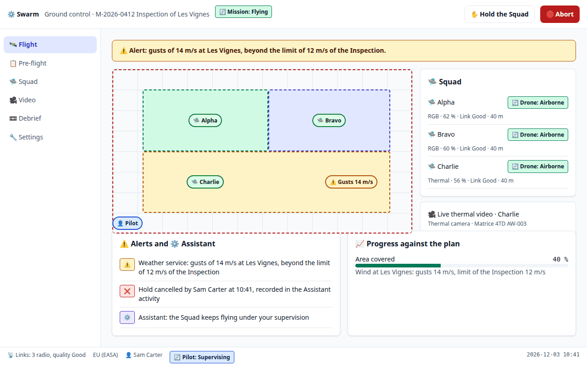
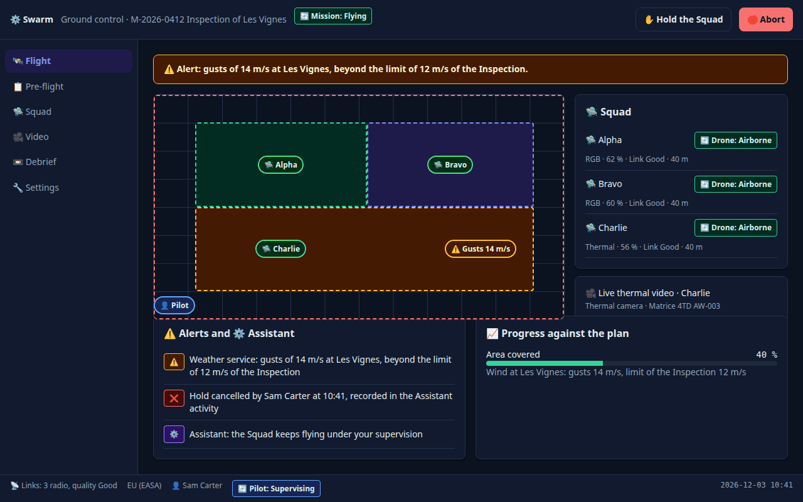

# 🎬 UC-034: Let the Assistant hold a Squad

<!-- spec:nav-top -->
> [🏠 Index](../../README.md) · [◀️ UC-033: Cover a Squad shortfall through the ERP](UC-033-cover-a-squad-shortfall-through-the-erp.md) · 📄 **Page 62 / 120** · [BR-001: Geofence and Altitude ceiling ▶️](../business-rules/BR-001-geofence-and-altitude-ceiling.md)
<!-- /spec:nav-top -->

**Status:** 🟡 Draft · **Updated:** 2026-11-20

> [!NOTE]
> When the wind rises beyond the limits during a flight, the [⚙️ Assistant](../../glossary.md#sys-assistant), at Act for [🔤 Hold](../../glossary.md#term-hold), announces a Hold of the [🗃️ Squad](../../glossary.md#ent-squad) with a countdown in [⚙️ Ground control](../../glossary.md#sys-ground-control); the [👤 Pilot](../../glossary.md#per-pilot) on duty lets it run or cancels it, and stays accountable.

<!-- spec:summary -->
## 📑 Summary

1. [👤 Personas and entities](#actors)
2. [🚦 Preconditions](#preconditions)
3. [⚡ Trigger](#trigger)
4. [➡️ Main flow](#main-flow)
5. [🔀 Flow chart](#flowchart)
6. [🖼️ Screens](#screens)
7. [↪️ Alternative and error flows](#alternative-flows)
8. [📏 Business rules applied](#business-rules)
9. [🏁 Postconditions](#postconditions)
10. [🔗 Referenced by](#referenced-by)
<!-- /spec:summary -->

## 👤 Personas and entities

| Name | Kind | Role in this use case |
| --- | --- | --- |
| [👤 Pilot](../../glossary.md#per-pilot) | Persona | Sam Carter, on duty for the Squad; lets the Hold run or cancels it |
| [🗃️ Squad](../../glossary.md#ent-squad) | Entity | Holds in place |
| [🗃️ Mission](../../glossary.md#ent-mission) | Entity | M-2026-0412, from Flying to Held |
| [🗃️ Trigger](../../glossary.md#ent-trigger) | Entity | Weather beyond the limits of the Activity |
| [🗃️ Assistant permission](../../glossary.md#ent-assistant-permission) | Entity | "Hold" at Act for the Pilot role |
| [🗃️ Flight log](../../glossary.md#ent-flight-log) | Entity | Records the Hold, done by the Assistant for Sam Carter, who is accountable |
| [🗃️ Assistant activity](../../glossary.md#ent-assistant-activity) | Entity | Records the act or its cancellation, with the Trigger |
| [⚙️ Weather service](../../glossary.md#sys-weather-service) | System | Reports the wind at the Site |
| [⚙️ Assistant](../../glossary.md#sys-assistant) | System | Checks the conditions, announces the Hold and does it |
| [⚙️ Ground control](../../glossary.md#sys-ground-control) | System | Shows the announcement and its countdown, and speaks it |

## 🚦 Preconditions

1. The Mission M-2026-0412 is [🔄 Mission: Flying](../../glossary.md#st-mission-flying); the Pilot Sam Carter is on duty for its Squad and [🔄 Pilot: Supervising](../../glossary.md#st-pilot-supervising) in Ground control.
2. "Hold" is at Act for the Pilot role of Aerowing Services ([🎬 UC-032: Set the Assistant permissions](UC-032-set-the-assistant-permissions.md)), and Sam Carter has kept that level.
3. A Trigger starts the Assistant when the weather goes beyond the limits of the Activity ([📏 BR-003: Weather limits](../business-rules/BR-003-weather-limits.md)).

## ⚡ Trigger

The Weather service reports wind beyond the limits at Les Vignes.

## ➡️ Main flow

1. The Weather service reports gusts beyond the limit of the Inspection at Les Vignes. Ground control shows the Alert, and the Trigger starts the Assistant.
2. The Assistant checks that Sam Carter is on duty for this Squad and has it open in Ground control, and that "Hold" is at Act ([📏 BR-029: Flight-critical acts need a Pilot on duty](../business-rules/BR-029-flight-critical-acts-need-a-pilot-on-duty.md)).
3. Ground control announces the Hold in the Alerts area with its reason and its countdown (10 seconds by default, an Operator setting), and speaks it in Sam Carter's language, with a **Cancel** button.
4. Sam Carter lets the countdown run out. The Squad holds and the Mission becomes Held. The Flight log records the Hold, done by the Assistant for Sam Carter, accountable; the Assistant activity records it with its Trigger.
5. Sam Carter decides what comes next: resume when the wind drops, approve a Re-plan, or bring the Squad back ([🎬 UC-026: Handle an Alert](UC-026-handle-an-alert.md)).

## 🔀 Flow chart

## 🖼️ Screens

One row per state of the flow chart: every action, success and failure node. Click a screen to open it full size. A state with nothing to show reads `➖ No screen: <why>`.

| State | Persona | Entity | Source | Screen |
| --- | --- | --- | --- | --- |
| A1: Report the wind beyond the limits | [🔄 Pilot: Supervising](../../glossary.md#st-pilot-supervising) | [🔄 Mission: Flying](../../glossary.md#st-mission-flying) | ✏️ Mock-up |   |
| A2: Check a Pilot is on duty and sees the Squad | [🔄 Pilot: Supervising](../../glossary.md#st-pilot-supervising) | [🗃️ Assistant permission](../../glossary.md#ent-assistant-permission) | ➖ | ➖ No screen: a check inside Swarm; Ground control still shows A1 |
| A3: Announce the Hold with its countdown | [🔄 Pilot: Supervising](../../glossary.md#st-pilot-supervising) | [🔄 Mission: Flying](../../glossary.md#st-mission-flying) | ✏️ Mock-up |   |
| OK: Squad held, Pilot accountable | [🔄 Pilot: Supervising](../../glossary.md#st-pilot-supervising) | [🔄 Mission: Held](../../glossary.md#st-mission-held) [🗃️ Flight log](../../glossary.md#ent-flight-log) | ✏️ Mock-up |   |
| KO: Hold cancelled by the Pilot | [🔄 Pilot: Supervising](../../glossary.md#st-pilot-supervising) | [🔄 Mission: Flying](../../glossary.md#st-mission-flying) [🗃️ Assistant activity](../../glossary.md#ent-assistant-activity) | ✏️ Mock-up |   |

## ↪️ Alternative and error flows

| # | At step | Condition | What happens |
| --- | --- | --- | --- |
| A1 | 4 | Sam Carter cancels during the countdown | Nothing is done; the Squad keeps flying, and the cancellation is recorded in the Assistant activity (KO) |
| A2 | 2 | No Pilot is on duty for the Squad | Not done: the Hold becomes a proposal to the Pilots of the Operator, with a [🔤 Notification](../../glossary.md#term-notification) ([📏 BR-029: Flight-critical acts need a Pilot on duty](../business-rules/BR-029-flight-critical-acts-need-a-pilot-on-duty.md)) |
| A3 | 2 | Sam Carter is on duty but does not have the Squad open in Ground control | Not done: the Assistant asks him to open the Squad, and proposes the Hold instead |
| A4 | 2 | Sam Carter has lowered "Hold" to Propose for himself | The Assistant proposes the Hold in the Alerts area; it takes effect only when Sam Carter accepts it |
| A5 | 1 to 5 | Sam Carter acts himself | He can Hold, take manual control or abort at any time, before, during or after the countdown ([📏 BR-012: Pilot override always available](../business-rules/BR-012-pilot-override-always-available.md)) |
| A6 | 1 | A Fail-safe of the Squad applies first | The Squad does it by itself, without the Assistant and without a countdown ([📏 BR-006: Fail-safe per Activity](../business-rules/BR-006-fail-safe-per-activity.md)) |
| A7 | 1 to 5 | The [🔤 Assistant budget](../../glossary.md#term-assistant-budget) is spent | The Assistant keeps helping until the flight ends ([📏 BR-030](../business-rules/BR-030-the-assistant-stays-within-its-budget.md)) |

## 📏 Business rules applied

| Rule | Where it applies |
| --- | --- |
| [📏 BR-029: Flight-critical acts need a Pilot on duty](../business-rules/BR-029-flight-critical-acts-need-a-pilot-on-duty.md) | Steps 2 to 4, A2, A3 |
| [📏 BR-021: AI agents propose, people decide](../business-rules/BR-021-ai-agents-propose-people-decide.md) | Step 4, A4 |
| [📏 BR-012: Pilot override always available](../business-rules/BR-012-pilot-override-always-available.md) | A5 |
| [📏 BR-003: Weather limits](../business-rules/BR-003-weather-limits.md) | Step 1 |
| [📏 BR-030: The Assistant stays within its budget](../business-rules/BR-030-the-assistant-stays-within-its-budget.md) | A7 |

## 🏁 Postconditions

- ✅ **Success:** The Squad holds and the Mission is Held. The Flight log names Sam Carter as accountable for a Hold done by the Assistant, and the Assistant activity records it with its Trigger.
- ❌ **Failure:** Sam Carter cancelled the Hold: the Squad keeps flying under his supervision, and the cancellation is recorded.

## 🔗 Referenced by

<!-- spec:referenced-by -->
- [📘 FS-023: AI Assistant](../features/FS-023-ai-assistant.md)
<!-- /spec:referenced-by -->

<!-- spec:nav-bottom -->
---

> [🏠 Index](../../README.md) · [◀️ UC-033: Cover a Squad shortfall through the ERP](UC-033-cover-a-squad-shortfall-through-the-erp.md) · 📄 **Page 62 / 120** · [BR-001: Geofence and Altitude ceiling ▶️](../business-rules/BR-001-geofence-and-altitude-ceiling.md)
<!-- /spec:nav-bottom -->
