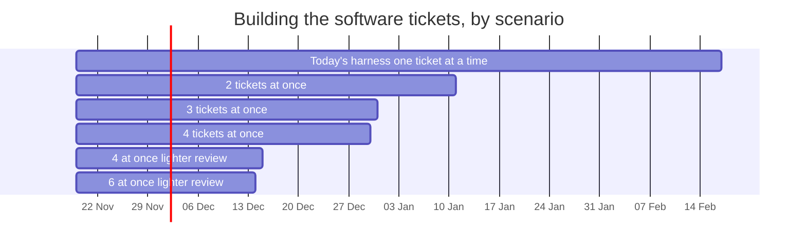
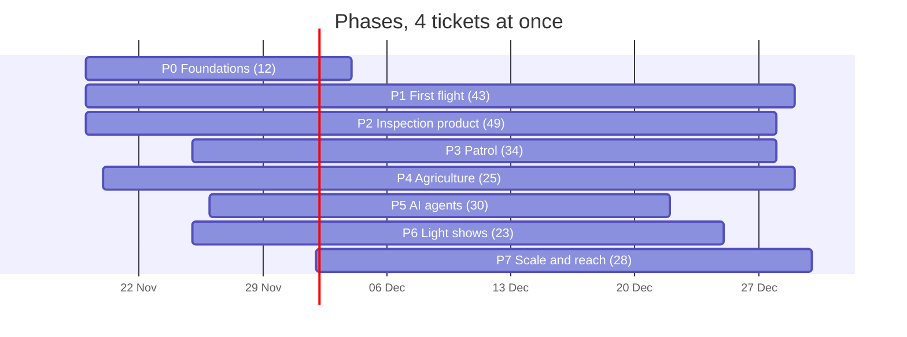
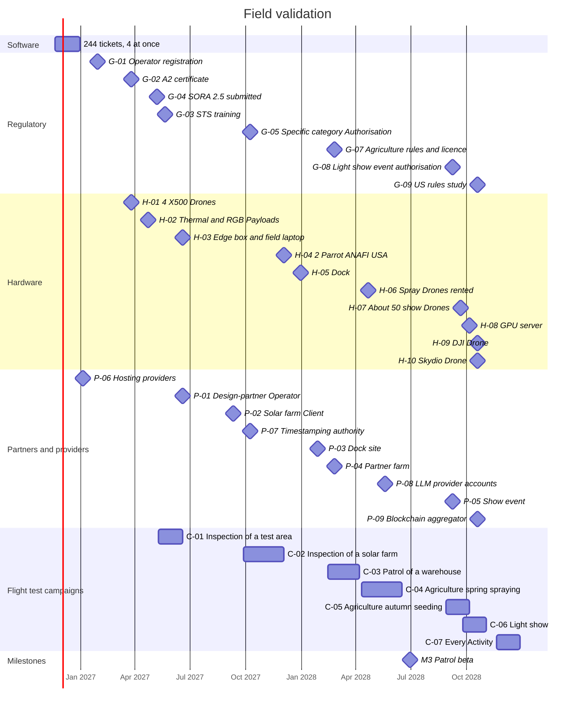

# ⛓️ Parallel plan

<!-- spec:nav-top -->
> [🏠 Index](../README.md) · [◀️ Traceability](13-traceability.md) · 📄 **Page 109 / 109**
<!-- /spec:nav-top -->

**Status:** 🟡 Draft · **Updated:** 2026-11-19

> [!NOTE]
> Which roadmap tickets can run at the same time, and how long the roadmap's software takes when several tickets are open at once instead of one. Built from the ticket rows of the phase pages and the timings of the tickets merged so far. The dates of the regulatory track, the hardware, the partners and the flight test campaigns do not move.

<!-- spec:summary -->
## 📑 Summary

1. [🔭 Overview](#overview)
2. [📆 Timeline](#timeline)
3. [⛓️ Dependencies](#dependencies)
4. [🛫 Field validation](#field)
5. [🧑‍💻 Work split](#work-split)
6. [🧮 Method](#method)
<!-- /spec:summary -->

## 🔭 Overview

- **Why:** the roadmap plans about 5 tickets merged per sprint, one ticket after another in each sprint. Most tickets do not need each other: the longest chain of tickets that must follow one another is short, so many can be open together.
- **What limits it:** the harness runs one ticket at a time, because `ticket_tree.py prepare` puts the main checkout on `ticket/<ID>` until `finish` merges it ([🎫 TKT-5](../../../.claude/rules/tickets.md#tkt-5)). With several tickets open, the person's review becomes the limit ([🎲 R-01](12-risks.md#r-01)).
- **What does not move:** the [🏛️ Regulatory track](09-regulatory-track.md), the [🤝 Hardware and partners](11-hardware-and-partners.md) and the [🛫 Flight test campaigns](10-flight-test-campaigns.md). Tickets whose acceptance needs them are built and tested on the Simulator first, and accepted on the roadmap's dates.
- **Interactive Gantt chart:** [gantt/parallel-plan.html](gantt/parallel-plan.html), opened in a browser, shows every ticket per scenario, its prerequisites and what it unblocks, the critical path and the field dates.
- **Rebuilt, never edited by hand:** `python3 .claude/scripts/roadmap_gantt.py build` rewrites the interactive page and the sections between the `gantt:plan` markers below, from [gantt/ticket-graph.json](gantt/ticket-graph.json), the phase pages and the tickets merged on `develop`; then run `specs.py build`. `roadmap_gantt.py check` prints nothing when both are up to date.

<!-- gantt:plan -->

## 📆 Timeline

As of 19 Nov 2026: 8 of the 262 tickets are merged. The 244 software tickets left are scheduled in working days of 6 hours, without holidays. The [interactive Gantt chart](gantt/parallel-plan.html) shows every ticket.

| Scenario | Lanes | Review time | Working days | Built by | Review load |
| --- | --- | --- | --- | --- | --- |
| Today's harness, one ticket at a time | 1 | full | 65 | 17 Feb 2027 | 39 % |
| 2 tickets at once | 2 | full | 37 | 11 Jan 2027 | 67 % |
| 3 tickets at once | 3 | full | 31 | 31 Dec 2026 | 81 % |
| 4 tickets at once | 4 | full | 29 | 30 Dec 2026 | 86 % |
| 4 at once, lighter review | 4 | halved off identity and isolation | 18 | 15 Dec 2026 | 68 % |
| 6 at once, lighter review | 6 | halved off identity and isolation | 17 | 14 Dec 2026 | 72 % |
| Roadmap plan, 5 tickets per sprint | | | 24 months | 29 Dec 2028 | |

With 4 tickets at once, every phase overlaps the others:

## ⛓️ Dependencies

**Ready now**, every ticket they need merged:

- T0.09: NATS JetStream and Operator accounts
- T0.10: Images, scans, signatures and Playwright
- T0.12: Service skeletons with row-level security
- T0.14: Design tokens, components and app shells
- T1.01: Safety tick in Rust
- T4.02: Shapefile parser in the Rust planner crate
- T6.03: Separation between every two Drones in every frame, in the swarm-core planner crate

**Critical path**, 17 tickets and 38 hours of work: the floor, whatever the number of lanes.

T0.09 › T0.13 › T0.18 › T0.19 › T1.08 › T1.11 › T1.13 › T1.14 › T1.16 › T1.17 › T4.14 › T4.16 › T4.22 › T5.11 › T5.25 › T5.26 › T5.30

**Waves**: a ticket's wave is one more than the latest wave of the tickets it needs. Tickets of a wave can run together when they share no area.

| Wave | Tickets | Count |
| --- | --- | --- |
| 1 | T0.09 T0.10 T0.12 T0.14 T1.01 T4.02 T6.03 | 7 |
| 2 | T0.11 T0.13 T0.15 T1.05 T1.09 T2.03 T2.04 T2.05 T3.01 T4.01 T4.03 T5.01 T6.01 | 13 |
| 3 | T0.16 T0.18 T2.06 T2.09 T2.10 T2.13 T2.14 T2.15 T2.16 T3.02 T3.03 T3.05 T4.04 T4.05 T4.09 T5.02 T6.02 T6.05 T6.14 | 19 |
| 4 | T0.19 T0.20 T1.02 T1.04 T1.06 T1.07 T1.29 T2.11 T2.12 T2.17 T2.22 T2.34 T2.48 T3.06 T3.11 T3.18 T3.24 T4.08 T4.13 T7.15 T7.18 | 21 |
| 5 | T0.17 T1.03 T1.08 T1.10 T1.12 T1.32 T2.18 T2.30 T2.39 T3.07 T4.10 T5.10 T7.02 | 13 |
| 6 | T1.11 T1.15 T1.22 T2.01 T2.19 T2.24 T2.42 T2.49 T3.08 T3.10 T4.07 T4.12 T4.20 T4.25 T5.05 T6.04 T6.09 T6.21 T7.08 T7.09 T7.11 | 21 |
| 7 | T1.13 T1.25 T1.30 T2.02 T2.08 T2.20 T2.21 T2.40 T3.04 T3.09 T3.12 T3.16 T4.06 T4.11 T5.03 T6.06 T6.07 T6.08 T7.03 T7.16 | 20 |
| 8 | T1.14 T1.38 T2.07 T2.23 T2.25 T3.19 T3.30 T4.15 T4.21 T5.04 T5.20 T6.10 T7.04 T7.05 T7.13 T7.17 | 16 |
| 9 | T1.16 T1.18 T1.20 T1.21 T1.26 T1.27 T1.28 T1.31 T1.44 T2.26 T2.27 T3.17 T3.20 T3.21 T5.06 T5.21 T5.22 T6.12 T6.15 T6.18 T6.22 T7.06 T7.07 T7.10 T7.12 T7.24 | 26 |
| 10 | T1.17 T1.23 T1.37 T1.43 T1.45 T2.28 T2.29 T3.13 T3.25 T5.07 T5.15 T5.18 T6.11 T6.17 T7.23 T7.25 | 16 |
| 11 | T1.19 T1.40 T2.31 T2.41 T3.14 T3.15 T3.22 T3.35 T4.14 T5.08 T5.09 T5.16 T5.23 T6.13 T6.16 T7.14 | 16 |
| 12 | T1.24 T1.36 T2.32 T2.35 T2.37 T3.23 T3.26 T3.28 T3.29 T4.16 T4.17 T4.19 T4.24 T5.17 T5.19 T5.24 T6.23 T7.28 | 18 |
| 13 | T1.34 T2.33 T2.36 T2.38 T3.27 T3.34 T4.18 T4.22 T7.19 T7.29 T7.30 | 11 |
| 14 | T1.35 T2.46 T2.47 T4.23 T5.11 | 5 |
| 15 | T1.41 T1.42 T3.31 T5.12 T5.14 T5.25 T7.22 | 7 |
| 16 | T2.43 T5.13 T5.26 T5.27 T5.28 T5.29 T6.19 T7.01 | 8 |
| 17 | T2.44 T2.45 T3.33 T5.30 T6.20 T7.20 T7.21 | 7 |

## 🛫 Field validation

44 software tickets are built and tested on the Simulator first, but their acceptance waits for an external item. 10 more only exist after a campaign or the Patrol beta. These keep the dates of the roadmap: parallel work does not move them.

| Item | Date | Tickets waiting for it | Tickets after it |
| --- | --- | --- | --- |
| [🏛️ G-02](09-regulatory-track.md#g-02) A2 certificate | 26 Mar 2027 | T1.28 T1.36 | ➖ |
| [🏛️ G-05](09-regulatory-track.md#g-05) Specific category Authorisation | 8 Oct 2027 | T7.25 | ➖ |
| [🏛️ G-07](09-regulatory-track.md#g-07) Agriculture rules and licence | 25 Feb 2028 | T4.02 T4.03 | ➖ |
| [🏛️ G-08](09-regulatory-track.md#g-08) Light show event authorisation | 8 Sep 2028 | T6.21 | ➖ |
| [🏛️ G-09](09-regulatory-track.md#g-09) US rules study | 20 Oct 2028 | T7.13 | ➖ |
| [🤝 H-01](11-hardware-and-partners.md#h-01) 4 X500 Drones | 26 Mar 2027 | T1.06 T1.28 T1.36 | ➖ |
| [🤝 H-02](11-hardware-and-partners.md#h-02) Thermal and RGB Payloads | 23 Apr 2027 | T1.22 | ➖ |
| [🤝 H-03](11-hardware-and-partners.md#h-03) Edge box and field laptop | 18 Jun 2027 | T1.37 | ➖ |
| [🤝 H-04](11-hardware-and-partners.md#h-04) 2 Parrot ANAFI USA | 3 Dec 2027 | T3.07 T3.08 T3.09 T3.12 T3.16 | ➖ |
| [🤝 H-05](11-hardware-and-partners.md#h-05) Dock | 31 Dec 2027 | T3.12 T3.13 | ➖ |
| [🤝 H-06](11-hardware-and-partners.md#h-06) Spray Drones, rented | 21 Apr 2028 | T4.10 T4.11 T4.12 | ➖ |
| [🤝 H-07](11-hardware-and-partners.md#h-07) About 50 show Drones | 22 Sep 2028 | T6.21 | ➖ |
| [🤝 H-08](11-hardware-and-partners.md#h-08) GPU server | 6 Oct 2028 | T7.17 | ➖ |
| [🤝 H-09](11-hardware-and-partners.md#h-09) DJI Drone | 20 Oct 2028 | T7.25 | ➖ |
| [🤝 H-10](11-hardware-and-partners.md#h-10) Skydio Drone | 20 Oct 2028 | T7.25 | ➖ |
| [🤝 P-06](11-hardware-and-partners.md#p-06) Hosting providers | 4 Jan 2027 | T1.29 T1.38 T2.49 T5.10 T5.22 T5.26 T5.30 T7.03 T7.04 T7.05 T7.11 T7.29 | ➖ |
| [🤝 P-01](11-hardware-and-partners.md#p-01) Design-partner Operator | 18 Jun 2027 | T1.38 T1.44 T2.16 T5.30 | ➖ |
| [🤝 P-07](11-hardware-and-partners.md#p-07) Timestamping authority | 8 Oct 2027 | T2.34 | ➖ |
| [🤝 P-03](11-hardware-and-partners.md#p-03) Dock site | 28 Jan 2028 | T3.35 | ➖ |
| [🤝 P-04](11-hardware-and-partners.md#p-04) Partner farm | 25 Feb 2028 | T4.02 | ➖ |
| [🤝 P-08](11-hardware-and-partners.md#p-08) LLM provider accounts | 19 May 2028 | T5.02 | ➖ |
| [🤝 P-09](11-hardware-and-partners.md#p-09) Blockchain aggregator | 20 Oct 2028 | T7.18 | ➖ |
| [🛫 C-01](10-flight-test-campaigns.md#c-01) Inspection of a test area | 10 May 2027 | T1.28 T1.32 T1.35 T1.36 T1.37 T2.06 T2.16 T5.19 | T1.33 T1.39 |
| [🛫 C-02](10-flight-test-campaigns.md#c-02) Inspection of a solar farm | 27 Sep 2027 | T2.39 T2.41 T2.49 T5.19 | T2.50 |
| [🛫 C-03](10-flight-test-campaigns.md#c-03) Patrol of a warehouse | 14 Feb 2028 | T3.16 T5.19 | T3.32 |
| [🛫 C-04](10-flight-test-campaigns.md#c-04) Agriculture, spring spraying | 10 Apr 2028 | T4.11 T5.19 | ➖ |
| [🛫 C-06](10-flight-test-campaigns.md#c-06) Light show | 25 Sep 2028 | ➖ | T6.24 T6.25 |
| [🛫 C-07](10-flight-test-campaigns.md#c-07) Every Activity | 20 Nov 2028 | ➖ | T7.26 T7.27 |
| [🏆 M3](README.md#milestones) Patrol beta | 30 Jun 2028 | ➖ | T4.26 T5.31 |

<!-- /gantt:plan -->

## 🧑‍💻 Work split

Proposed changes to the harness to open several tickets at once. None is built yet: each is a decision for the person, then a harness ticket.

| Change | What it does |
| --- | --- |
| One worktree per ticket | `prepare` creates a worktree on `ticket/<ID>` from `develop` instead of switching the main checkout; the workers branch from it, and `integrate` and `finish` run there. Still one commit per ticket, never pushed ([🎫 TKT-5](../../../.claude/rules/tickets.md#tkt-5)) |
| Start on merged prerequisites | A ticket starts once every ticket it needs is merged into `develop`, not when its sprint comes; `/ticket-plan` refuses a ticket whose prerequisites are open |
| Area locks | Two open tickets never change the same service, front end or package; generated files (`specs.py build`, the generated models) are rebuilt after each merge rather than merged |
| Merge queue | `finish` merges one ticket at a time; when `develop` moved since the ticket started, its tree is applied again to `develop` and the verifier runs again before the commit |
| Lighter review | Line by line only for identity, isolation and the Simulator's isolation, on tests and screens for the rest, as [🛣️ P0](01-p0-foundations.md#work-split) already plans |
| Global agent cap | At most 8 agents per ticket ([🎫 TKT-4](../../../.claude/rules/tickets.md#tkt-4)) gives 32 with 4 tickets open: a cap across tickets keeps the usage limits in reach |

## 🧮 Method

- **Prerequisites:** for each ticket, the tickets whose merged output it needs before it can be built and tested, read from its row on the phase pages (what it delivers, where, and when it is done), and the external items its acceptance needs. They are an estimate kept in [gantt/ticket-graph.json](gantt/ticket-graph.json), to correct when a ticket is planned and its `TICKET.md` says more.
- **Field tickets:** the fixes from a campaign and the reserved slots of the Patrol beta only exist after that campaign or beta, so they are placed on its dates, not scheduled.
- **Durations:** small, medium or large per ticket, in hours of agent work then of the person's time (plan approval and review), set in the graph file from the timings of the merged tickets with a margin for later tickets being larger.
- **Simulation:** K lanes. A ticket starts when every ticket it needs is merged and no open ticket shares one of its areas, holds its lane and its areas until it is merged, and one person approves and reviews the tickets one after another. The ticket with the most work after it goes first.
- **Not included:** holidays, fix rounds beyond those of the measured tickets, and rework found in the field.

<!-- spec:nav-bottom -->
---

> [🏠 Index](../README.md) · [◀️ Traceability](13-traceability.md) · 📄 **Page 109 / 109**
<!-- /spec:nav-bottom -->
