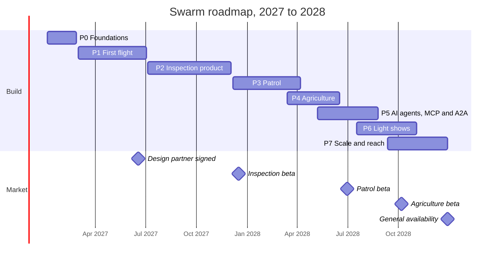

# 🛣️ Roadmap

<!-- spec:nav-top -->
> [🏠 Index](../README.md) · [◀️ GUI and WebUI](../technical/10-frontends.md) · 📄 **Page 95 / 109** · [P0: Foundations ▶️](01-p0-foundations.md)
<!-- /spec:nav-top -->

**Status:** 🟢 Approved · **Updated:** 2026-11-18

> [!NOTE]
> When each feature of Swarm is delivered, from 4 January 2027 to 29 December 2028: 52 sprints of two weeks, eight phases, eight milestones. One person builds Swarm with Claude Code agents working in parallel. Each roadmap page links to the features (📘) it delivers and to the technical pages (🛠️) it builds on, and uses the names of the [glossary](../glossary.md).

<!-- spec:summary -->
## 📑 Summary

1. [🔭 Overview](#overview)
2. [📆 Timeline](#timeline)
3. [🛣️ Phases](#phases)
4. [🏆 Milestones](#milestones)
5. [🗓️ Cadence](#cadence)
6. [⛓️ Cross-cutting tracks](#tracks)
<!-- /spec:summary -->

## 🔭 Overview

| Frame | Decision |
| --- | --- |
| Start | Monday 4 January 2027 (sprint S01) |
| Horizon | 24 months, to Friday 29 December 2028 (sprint S52) |
| Scope | Every phase, P0 to P7: the whole functional and technical specification |
| Order | Inspection first, then Patrol, Agriculture, AI agents, Light shows, scale and reach |
| Team | One person, who steers and codes, with Claude Code agents that take tickets and split them into parallel tasks |
| Flight tests | The person flies as the Pilot, with a small fleet, under the Open category, then a Specific category Authorisation |
| Launch | A design-partner Operator from month 6, betas per Activity, general availability of Inspection and Patrol in month 24 |

**Capacity.** About **5 tickets merged per sprint**, about 260 over the 24 months; from S41 to S52, where P5, P6 and P7 overlap, about **6 per sprint** (accepted, watched through [🎲 R-01](12-risks.md#r-01) and [🎲 R-08](12-risks.md#r-08)). The person's review is the bottleneck: each ticket is split by the agents into parallel tasks (code, tests, mock-up updates, documentation), so a ticket takes days, not weeks. Phases overlap because agents can work on two phases while the person reviews.

## 📆 Timeline

## 🛣️ Phases

| Phase | Sprints | Dates | Delivers |
| --- | --- | --- | --- |
| [🛣️ P0: Foundations](01-p0-foundations.md) | S01 to S04 | 4 Jan to 26 Feb 2027 | Mono-repo, CI/CD, ticket harness, shared packages, identity, one dev cell, NATS and databases, simulator, design tokens, observability base |
| [🛣️ P1: First flight](02-p1-first-flight.md) | S05 to S13 | 1 Mar to 2 Jul 2027 | Flight engine and safety loop, MAVLink adapter, Ground control, Pre-flight check, Fail-safes, manual control, Mission studio for Inspection, Fleet, Authorisations |
| [🛣️ P2: Inspection product](03-p2-inspection-product.md) | S14 to S24 | 5 Jul to 3 Dec 2027 | Processing (OpenDroneMap, detection), Deliverables and Defects, Back office, Client portal, evidence ledger, Debrief and Scorecard |
| [🛣️ P3: Patrol](04-p3-patrol.md) | S25 to S33 | 6 Dec 2027 to 7 Apr 2028 | Docks, Parrot adapter, Alarms and webhooks, Site agents, video at scale, Notifications |
| [🛣️ P4: Agriculture](05-p4-agriculture.md) | S32 to S38 | 13 Mar to 16 Jun 2028 | Fields, Prescription maps, dose computation, refills, spray Drones, spring campaign |
| [🛣️ P5: AI agents, MCP and A2A](06-p5-ai-agents.md) | S36 to S43 | 8 May to 25 Aug 2028 | Mission assistant, Co-pilot, Report writer, MCP server and A2A behind Kubernetes Services with KEDA, the human gate |
| [🛣️ P6: Light shows](07-p6-light-shows.md) | S41 to S48 | 17 Jul to 3 Nov 2028 | Choreography import and designer, partitioned edge, show coordinator, 5,000-Drone load test, a real show |
| [🛣️ P7: Scale and reach](08-p7-scale-and-reach.md) | S45 to S52 | 11 Sep to 29 Dec 2028 | Cells at target, OVHcloud and Scaleway production, US self-hosted cell, on-premises bundle, DJI and Skydio adapters, general availability |

## 🏆 Milestones

| # | Milestone | Date | Sprint | Proof |
| --- | --- | --- | --- | --- |
| M0 | Foundations ready | 26 Feb 2027 | S04 | CI green on every language; a simulated Squad of 10 Drones visible in Ground control in the dev cell |
| M1 | First real flight | 18 Jun 2027 | S12 | One real Drone at a time (Open category) flown through the whole Squad pipeline with every Fail-safe tested; the 4-Drone Squad under supervised autonomy proven in the Simulator with the same Mission |
| M1b | Design partner signed | 18 Jun 2027 | S12 | A drone service company commits to the Inspection beta |
| M2 | Inspection beta | 17 Dec 2027 | S25 | The first real Squad flights (4 Drones, one Pilot, under the Specific category Authorisation) during C-02; the design partner flies a real Mission for a Client on the OVHcloud cell and delivers an orthomosaic, Defects and a Scorecard |
| M3 | Patrol beta | 30 Jun 2028 | S39 | A Dock site patrols on a schedule and on Alarms for one month |
| M4 | Agriculture beta | 6 Oct 2028 | S46 | An autumn seeding campaign on a partner farm, with dose maps |
| M5 | AI agents in beta | 25 Aug 2028 | S43 | Mission assistant, Co-pilot and Report writer used by the design partner; MCP and A2A enabled for one Operator |
| M6 | Light show demonstration | 3 Nov 2028 | S48 | A real show of about 50 Drones, and 5,000 simulated Drones on a partitioned edge within budget |
| M7 | General availability | 29 Dec 2028 | S52 | Inspection and Patrol sold in the EU cloud cells; a full cell at target load in staging; the on-premises bundle installed once |

## 🗓️ Cadence

- **Sprints of two weeks**, Monday to Friday of the next week; sprint numbers S01 to S52 are used on every page.
- **A release every sprint** to the dev and staging cells; production releases once the first Operator flies (from M2), in waves.
- **Cells before general availability:** an OVHcloud cell opened in S24 for the design partner, and a self-hosted beta cell as the second cell (on-premises rehearsal and fallback); every cell is provisioned with Terraform, then deployed with Helm and Argo CD ([🚢 Deployment](../technical/09-deployment.md#iac)).
- **Betas are supported from the running phases:** the Patrol beta (M3) takes its fixes from the P4 and P5 capacity, the Agriculture beta (M4) from P6 and P7.
- **A demonstration per phase**, written on the phase page, given to the design partner from P2 on.
- **Tickets** carry the work: each one names its phase, sprint, features, use cases and business rules; the Claude Code agents split it into tasks that run in parallel.
- **Exit criteria** close a phase: the acceptance criteria of its features pass, its budgets hold in the load tests, `specs.py check` passes, and its use case screens move from ✏️ Mock-up to 📸 Screenshot.

## ⛓️ Cross-cutting tracks

| Page | Covers |
| --- | --- |
| [🏛️ Regulatory track](09-regulatory-track.md) | Pilot certificates, the Specific category Authorisation (SORA 2.5), U-space, US rules before the US cell |
| [🛫 Flight test campaigns](10-flight-test-campaigns.md) | Every real flight: where, with which Drones, what it proves |
| [🤝 Hardware and partners](11-hardware-and-partners.md) | Drone models, Payloads, Docks, design partners, hosting providers, with dates |
| [🎲 Risks](12-risks.md) | The risks register with owners, signals and responses |
| [🧬 Traceability](13-traceability.md) | Every feature, use case and business rule, with the phase and sprint that delivers it |
| [⛓️ Parallel plan](14-parallel-plan.md) | Which tickets can run at the same time, their Gantt charts per scenario, and the field dates that do not move |

<!-- spec:nav-bottom -->
---

> [🏠 Index](../README.md) · [◀️ GUI and WebUI](../technical/10-frontends.md) · 📄 **Page 95 / 109** · [P0: Foundations ▶️](01-p0-foundations.md)
<!-- /spec:nav-bottom -->
