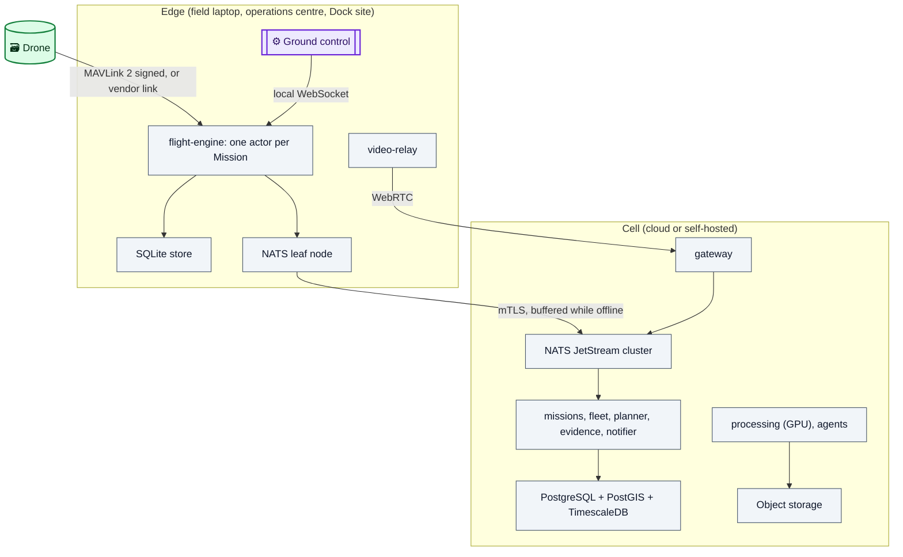

# 🏗️ Architecture

<!-- spec:nav-top -->
> [🏠 Index](../README.md) · [◀️ Technical specifications](README.md) · 📄 **Page 96 / 120** · [Data models ▶️](02-data-models.md)
<!-- /spec:nav-top -->

**Status:** 🟢 Approved · **Updated:** 2026-11-26

> [!NOTE]
> How Swarm is split: a mono-repo for every language, a flight engine at the edge, independent cells in the core, the services that live in each, and the layers every backend app is built from.

<!-- spec:summary -->
## <a id="summary"></a>📑 Summary

1. [🗂️ Mono-repo](#mono-repo)
2. [🧅 Layers as packages](#layers)
3. [🌐 Edge and core](#edge-and-core)
4. [🔲 Cells and the global layer](#cells)
5. [🔁 Main flows](#flows)
6. [🔗 Features implemented](#features)
<!-- /spec:summary -->

## <a id="mono-repo"></a>🗂️ Mono-repo

One repository holds the backend, the frontends, the shared code and the deployment. Each backend app and each front end builds exactly one image (AGENT.md). The backend is made of layers, each one a package with a folder per domain inside it, a kernel of libraries, and one thin app per image ([decision 105](../../research/interview.md)).

```text
swarm/
├── backend/                   Python, one uv workspace
│   ├── libs/                  kernel: swarm-lifecycle, swarm-logging, swarm-catalog, swarm-nats, swarm-web
│   ├── swarm-models/          layer 0: Pydantic models, enums, exceptions, each app's configuration
│   ├── swarm-storage/         layer 1: repositories and the other stores, a folder per domain
│   ├── swarm-clients/         layer 1: calls to other apps and external systems, a folder per domain
│   ├── swarm-service/         layer 2: business rules and runnables, a folder per domain
│   ├── swarm-api/             layer 3: endpoints only, a router folder per domain under v1/
│   └── apps/                  layer 4: one thin app per image
│       ├── flight-engine/     edge: Drone adapters, safety loop, Fail-safes, Flight log
│       ├── video-relay/       edge: Payload video to the SFU
│       ├── gateway/           REST, WebSocket fan-out, authentication, rate limits
│       ├── missions/          Missions, Squads, Authorisations, Pre-flight rules, Scorecards
│       ├── fleet/             Drones, Drone models, Payloads, Batteries, Docks
│       ├── planner/           coverage paths, Choreography checks, Re-plan proposals
│       ├── processing/        photogrammetry and detection on GPU workers
│       ├── agents/            Mission assistant, Co-pilot, Report writer, MCP server, A2A
│       ├── evidence/          signing, chaining, Anchoring
│       ├── notifier/          in-app, e-mail and push Notifications
│       └── simulator/         simulated Squads for tests, training and adapter tests
├── scripts/                   operations: OpenAPI, migrations, schema export, message check (uv run, no arguments)
├── frontend/
│   ├── apps/                  React and TypeScript apps (pnpm workspace)
│   │   ├── ground-control/    Pilot: flight, Focus view, Debrief (web, tablet, desktop)
│   │   ├── mission-studio/    Mission planner: design, simulation, Mission assistant
│   │   ├── back-office/       Fleet, Authorisations, Deliverables, Evidence, people
│   │   ├── client-portal/     Clients and Site agents
│   │   └── desktop/           Tauri 2 shell for Ground control and Mission studio
│   └── packages/              shared TypeScript: ui, live, tokens, i18n, api-client, config
├── rust/                      swarm-core crates (safety, planner, mavlink) with PyO3, generated models, synthetic Drones
├── qa/e2e/                    Playwright configuration and tests against the real images
├── infra/                     Terraform, Helm charts, Argo CD environments, images, k3s bundle, edge appliance
├── tests/                     Python tests mirroring the packages, conventions, load (k6, simulated fleets), chaos
└── docs/                      specifications and research
```

| Toolchain | Workspace | Lock file |
| --- | --- | --- |
| Python 3.12 | uv workspace (root `pyproject.toml`): `backend/libs/*`, `backend/swarm-*`, `backend/apps/*`, `scripts` | one `uv.lock` |
| Rust | Cargo workspace in `rust/`, wheels built with maturin | `Cargo.lock` |
| TypeScript | pnpm workspace (`frontend/apps/*`, `frontend/packages/*`, `qa/e2e`), Turborepo task cache | `pnpm-lock.yaml` |

## <a id="layers"></a>🧅 Layers as packages

Every layer is one package of `backend/`, and each domain is a folder inside the layers it needs, beside a `shared/` folder for what every domain uses (decision T42, whose layout [decisions 105 to 109](../../research/interview.md) replace). Each layer only calls the ones below it, and the tests of `tests/conventions/backend/` fail on any other import.

```text
swarm_api       layer 3: FastAPI endpoints and their /v1 routers, Depends providers, middlewares,
                exception handlers, the /v1/live WebSocket. Validates input, calls one service,
   │            shapes the answer. No business rule, no storage, no client.
   ▼
swarm_service   layer 2: the business logic, one class per entity (MissionService, PreFlightService,
                ReplanService, ScorecardService...), and every runnable: NATS responders and consumers,
   │            flights. Applies the business rules, orchestrates repositories and clients inside
   │            a unit of work, publishes events.
   ├──────────────────────────────┐
   ▼                              ▼
swarm_storage   every class that  swarm_clients  every class that calls another app
                stores or reads                  (NATS request-reply) or an external system:
                data: PostgreSQL                 Keycloak, LLM providers, Anchoring service,
                repositories,                    Weather service, U-space service, SMTP, Web
                TimescaleDB writers,             Push, Drone vendors' cloud APIs.
                object storage, Valkey,
                edge SQLite, the event outbox.
   │                              │
   ▼                              ▼
swarm_models    layer 0: Pydantic models, enums, exceptions; imported by every layer, imports none.

backend/libs/   the kernel (lifecycle, logging, catalogs, NATS connector, web app builder), usable by every layer.
backend/apps/   layer 4: one thin app per image, which wires the domains it owns and runs them.
```

| Rule | Detail |
| --- | --- |
| Layers are packages | `backend/swarm-models`, `swarm-storage`, `swarm-clients`, `swarm-service` and `swarm-api`, with a folder per domain inside them, a kernel of libraries in `backend/libs/`, and one app per image in `backend/apps/<app>` ([decision 105](../../research/interview.md)). |
| API layer | `swarm_api` holds only the FastAPI endpoints and their versioned routers (`/v1/...`), their `Depends` providers, the middlewares, the exception handlers and the `/v1/live` WebSocket; everything else moves to the service layer or the kernel ([decision 106](../../research/interview.md)). A class whose `__call__` takes a request or a WebSocket counts as a `Depends` provider ([decision 113](../../research/interview.md)). An endpoint never touches `swarm_storage` or `swarm_clients`. |
| Service layer | All business logic and every runnable live in `swarm_service`, NATS handlers and consumers included. A service receives repositories and clients through its constructor (built by its factory, AGENT.md), never opens a connection itself, and never returns a storage object to `swarm_api`. |
| Storage layer | All storage classes live in `swarm_storage`, in the folder of their domain, and the stores every domain uses in `swarm_storage/shared/` (PostgreSQL in `shared/postgres/`). Nothing outside `swarm_storage` imports a database or object storage library. |
| Repositories | **One repository per entity stored in PostgreSQL**, listed in [🗄️ Storage](03-storage.md#repositories). |
| Clients layer | Calls to other apps and external systems live in `swarm_clients`, one class per remote system; the service layer uses them like repositories. |
| One class per entity | Within a layer, an entity has exactly one responsible class (one repository, client, service or router); classes that split one entity's work in a layer are merged; factories and exceptions are exempt ([decision 109](../../research/interview.md)). |
| Models | `swarm_models` may import the configuration models of the kernel (`swarm_web.models`, `swarm_nats.models`), which the apps' configurations embed ([decision 112](../../research/interview.md)). |
| Apps | No command line in the product: no `cli` module under `swarm_api`, no argument parser in `backend/` or `scripts/`; each app's `main()` reads its configuration; only the harness and CI keep command lines ([decision 107](../../research/interview.md)). An app lists the domains it owns, and each domain has one owning app. The simulator starts a simulated flight with `POST /v1/simulations` and answers Commands on NATS in the background ([decision 111](../../research/interview.md)). |
| Operations | OpenAPI export and check, migrations, the schema export and the message check are argument-free Python scripts in `scripts/`, run with `uv run` ([decisions 108 and 110](../../research/interview.md)). |

## <a id="edge-and-core"></a>🌐 Edge and core



- The **edge** holds what a flight needs: the Mission, its Squad and Geofence, copied to the edge when the Pre-flight check starts. Ground control talks to its local flight engine directly, so the Pilot's view and commands never go through the core.
- The **core** receives the Telemetry through the NATS leaf node when a link exists, and serves everyone else: the Mission planner, the Client portal, the Back office, processing and the agents.
- When the edge loses the core, it keeps flying, buffers its messages in JetStream and its Flight log in SQLite, and replays them in order when the link returns.

## <a id="cells"></a>🔲 Cells and the global layer

| Layer | Holds | Scales by |
| --- | --- | --- |
| Global (one per deployment) | Keycloak identity, Operator directory, routing of each Operator to its cell | Replicas; small and read-mostly |
| Cell (many per region) | Every service above, its NATS cluster, databases, Valkey and object storage buckets | Adding cells; inside a cell, pods scale with load |
| Edge (one per flying place) | flight-engine, video-relay, SQLite, NATS leaf node | One per Ground control or Dock site; big Light shows use several (sectors) |

An Operator lives in exactly one cell; an on-premises install is one cell. Sizes and limits are in [🚀 Scalability and performance](07-scalability.md#cells).

## <a id="flows"></a>🔁 Main flows

| Flow | Path | Protocol |
| --- | --- | --- |
| Telemetry | Drone → flight-engine → Ground control (local) and → leaf node → cell → gateway → viewers | MAVLink or vendor SDK, then MessagePack over NATS and WebSocket |
| Pilot command | Ground control → flight-engine → Drone adapter → Drone | Local WebSocket, priority lane, then MAVLink |
| Mission design | Mission studio → gateway REST → missions, planner | REST, then NATS request-reply |
| Mission to the edge | missions → leaf node → flight-engine (at the Pre-flight check) | NATS, stored in SQLite |
| Data after landing | edge → object storage (multipart upload) → processing → Deliverables | S3 API, NATS work queue |
| Evidence | every service → evidence (append) → Anchoring service | NATS, then RFC 3161 or blockchain aggregator |
| Live video | Payload → video-relay → SFU → Ground control (WebRTC), → LL-HLS for the Client portal | WebRTC, LL-HLS |

## <a id="features"></a>🔗 Features implemented

Every feature relies on this architecture; the edge exists for [📘 FS-002](../functional/features/FS-002-pre-flight-check-and-launch.md), [📘 FS-003](../functional/features/FS-003-live-supervision.md), [📘 FS-004](../functional/features/FS-004-fail-safes-and-emergencies.md) and [📘 FS-021](../functional/features/FS-021-ground-control-monitoring.md); cells exist for [📘 FS-012](../functional/features/FS-012-operators-deployment-and-languages.md).

<!-- spec:nav-bottom -->
---

> [🏠 Index](../README.md) · [◀️ Technical specifications](README.md) · 📄 **Page 96 / 120** · [Data models ▶️](02-data-models.md)
<!-- /spec:nav-bottom -->
