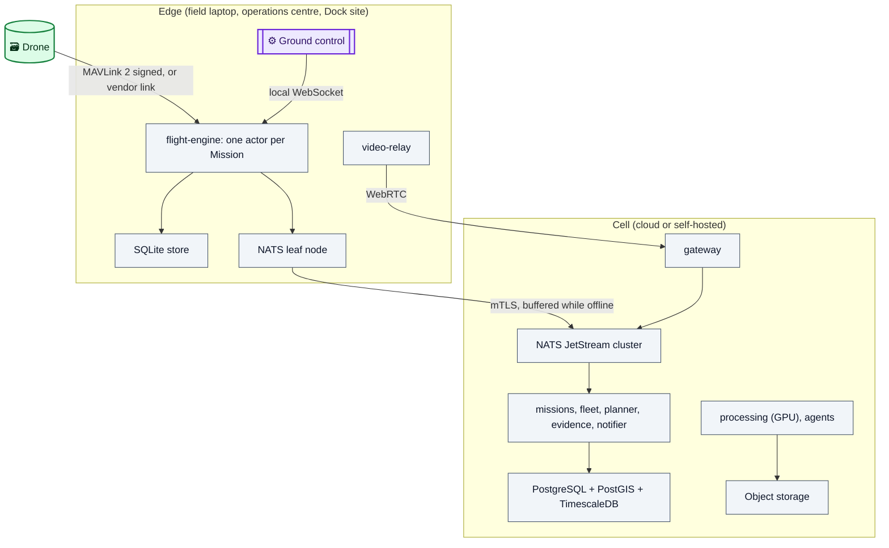

# 🏗️ Architecture

<!-- spec:nav-top -->
> [🏠 Index](../README.md) · [◀️ Technical specifications](README.md) · 📄 **Page 96 / 120** · [Data models ▶️](02-data-models.md)
<!-- /spec:nav-top -->

**Status:** 🟢 Approved · **Updated:** 2026-11-18

> [!NOTE]
> How Swarm is split: a mono-repo for every language, a flight engine at the edge, independent cells in the core, and the services that live in each.

<!-- spec:summary -->
## <a id="summary"></a>📑 Summary

1. [🗂️ Mono-repo](#mono-repo)
2. [🧅 Layers inside each service](#layers)
3. [🌐 Edge and core](#edge-and-core)
4. [🔲 Cells and the global layer](#cells)
5. [🔁 Main flows](#flows)
6. [🔗 Features implemented](#features)
<!-- /spec:summary -->

## <a id="mono-repo"></a>🗂️ Mono-repo

One repository holds the backend, the frontends, the shared code and the deployment. Each service and each front end builds exactly one image (AGENT.md).

```text
swarm/
├── services/                  Python services, one image each (AGENT.md layers inside)
│   ├── flight-engine/         edge: Drone adapters, safety loop, Fail-safes, Flight log
│   ├── video-relay/           edge: Payload video to the SFU
│   ├── gateway/               REST, WebSocket fan-out, authentication, rate limits
│   ├── missions/              Missions, Squads, Authorisations, Pre-flight rules, Scorecards
│   ├── fleet/                 Drones, Drone models, Payloads, Batteries, Docks
│   ├── planner/               coverage paths, Choreography checks, Re-plan proposals
│   ├── processing/            photogrammetry and detection on GPU workers
│   ├── agents/                Mission assistant, Co-pilot, Report writer, MCP server, A2A
│   ├── evidence/              signing, chaining, Anchoring
│   ├── notifier/              in-app, e-mail and push Notifications
│   └── simulator/             simulated Squads for tests, training and adapter tests
├── frontend/apps/                 React and TypeScript apps (pnpm workspace)
│   ├── ground-control/        Pilot: flight, Focus view, Debrief (web, tablet, desktop)
│   ├── mission-studio/        Mission planner: design, simulation, Mission assistant
│   ├── back-office/           Fleet, Authorisations, Deliverables, Evidence, people
│   ├── client-portal/         Clients and Site agents
│   └── desktop/               Tauri 2 shell for Ground control and Mission studio
├── packages/
│   ├── python/                shared Python: models, lifecycle, logging, NATS client
│   ├── rust/                  swarm-core crates (safety, planner, mavlink) with PyO3
│   └── ts/                    shared TypeScript: ui, live, tokens, i18n, api-client
├── infra/                     Helm charts, Argo CD apps, k3s bundle, edge appliance
├── tests/                     conventions, load (k6, simulated fleets), chaos
└── docs/                      specifications and research
```

| Toolchain | Workspace | Lock file |
| --- | --- | --- |
| Python 3.12 | uv workspace (root `pyproject.toml`) | one `uv.lock` |
| Rust | Cargo workspace in `rust/`, wheels built with maturin | `Cargo.lock` |
| TypeScript | pnpm workspace, Turborepo task cache | `pnpm-lock.yaml` |

## <a id="layers"></a>🧅 Layers inside each service

Every Python service has the same five modules under `services/<service>/src/<service>/` (decision T42). Each module only calls the ones below it, and a test in `tests/conventions/` fails on any other import.

```text
api/        every entry point: REST endpoints, WebSocket handlers, NATS request-reply handlers,
            event consumers, command line. Validates input, calls one service, shapes the answer.
   │        No business rule, no storage, no client.
   ▼
service/    the business logic, one class per concern (MissionService, PreFlightService,
            ReplanService, ScorecardService...). Applies the business rules, orchestrates
   │        repositories and clients inside a unit of work, publishes events.
   ├──────────────────────────────┐
   ▼                              ▼
storage/    every class that      clients/   every class that calls another service
            stores or reads data:            (NATS request-reply) or an external system:
            PostgreSQL repositories,         Keycloak, LLM providers, Anchoring service,
            TimescaleDB writers, object      Weather service, U-space service, SMTP, Web
            storage, Valkey, edge SQLite,    Push, Drone vendors' cloud APIs.
            the event outbox.
   │                              │
   ▼                              ▼
models/     Pydantic models, enums, exceptions; imported by every layer, imports none.
```

| Rule | Detail |
| --- | --- |
| API module | All endpoints live in `api/`: `api/rest/` (FastAPI routers), `api/live/` (WebSocket), `api/bus/` (NATS handlers and consumers), `api/cli/`. An endpoint never touches `storage/` or `clients/`. |
| Service layer | All business logic lives in `service/`. A service receives repositories and clients through its constructor (built by the layer's factory, AGENT.md), never opens a connection itself, and never returns a storage object to `api/`. |
| Storage module | All storage classes live in `storage/`, one sub-package per store: `storage/postgres/` (repositories), `storage/timescale/`, `storage/objects/`, `storage/cache/`, `storage/edge/`. Nothing outside `storage/` imports a database or object storage library. |
| Repositories | **One repository per entity stored in PostgreSQL**, listed in [🗄️ Storage](03-storage.md#repositories). |
| Clients module | Calls to other services and external systems live in `clients/`, one class per remote system; the service layer uses them like repositories. |

## <a id="edge-and-core"></a>🌐 Edge and core



- The **edge** holds what a flight needs: the Mission, its Squad and Geofence, copied to the edge when the Pre-flight check starts. Ground control talks to its local flight engine directly, so the Pilot's view and commands never go through the core.
- The **core** receives the Telemetry through the NATS leaf node when a link exists, and serves everyone else: the Mission planner, the Client portal, the Back office, processing and the agents.
- When the edge loses the core, it keeps flying, buffers its messages in JetStream and its Flight log in SQLite, and replays them in order when the link returns.

## <a id="cells"></a>🔲 Cells and the global layer

| Layer | Holds | Scales by |
| --- | --- | --- |
| Global (one per deployment) | Keycloak identity, Operator directory, routing of each Operator to its cell | Replicas; small and read-mostly |
| Cell (many per region) | Every service above, its NATS cluster, databases, Valkey and object storage buckets | Adding cells; inside a cell, pods scale with load |
| Edge (one per flying place) | flight-engine, video-relay, SQLite, NATS leaf node | One per Ground control or Dock site; big Light shows use several (sectors) |

An Operator lives in exactly one cell; an on-premises install is one cell. Sizes and limits are in [🚀 Scalability and performance](07-scalability.md#cells).

## <a id="flows"></a>🔁 Main flows

| Flow | Path | Protocol |
| --- | --- | --- |
| Telemetry | Drone → flight-engine → Ground control (local) and → leaf node → cell → gateway → viewers | MAVLink or vendor SDK, then MessagePack over NATS and WebSocket |
| Pilot command | Ground control → flight-engine → Drone adapter → Drone | Local WebSocket, priority lane, then MAVLink |
| Mission design | Mission studio → gateway REST → missions, planner | REST, then NATS request-reply |
| Mission to the edge | missions → leaf node → flight-engine (at the Pre-flight check) | NATS, stored in SQLite |
| Data after landing | edge → object storage (multipart upload) → processing → Deliverables | S3 API, NATS work queue |
| Evidence | every service → evidence (append) → Anchoring service | NATS, then RFC 3161 or blockchain aggregator |
| Live video | Payload → video-relay → SFU → Ground control (WebRTC), → LL-HLS for the Client portal | WebRTC, LL-HLS |

## <a id="features"></a>🔗 Features implemented

Every feature relies on this architecture; the edge exists for [📘 FS-002](../functional/features/FS-002-pre-flight-check-and-launch.md), [📘 FS-003](../functional/features/FS-003-live-supervision.md), [📘 FS-004](../functional/features/FS-004-fail-safes-and-emergencies.md) and [📘 FS-021](../functional/features/FS-021-ground-control-monitoring.md); cells exist for [📘 FS-012](../functional/features/FS-012-operators-deployment-and-languages.md).

<!-- spec:nav-bottom -->
---

> [🏠 Index](../README.md) · [◀️ Technical specifications](README.md) · 📄 **Page 96 / 120** · [Data models ▶️](02-data-models.md)
<!-- /spec:nav-bottom -->
