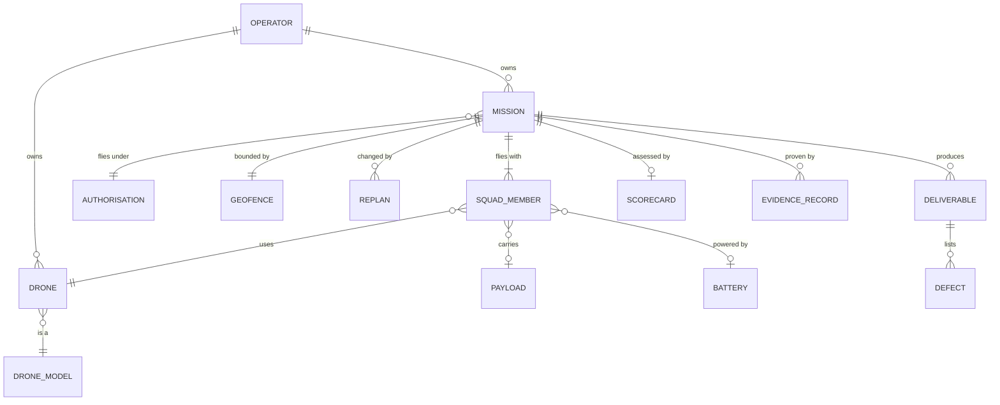

# 🧱 Data models

<!-- spec:nav-top -->
> [🏠 Index](../README.md) · [◀️ Architecture](01-architecture.md) · 📄 **Page 97 / 120** · [Storage ▶️](03-storage.md)
<!-- /spec:nav-top -->

**Status:** 🟢 Approved · **Updated:** 2026-11-18

> [!NOTE]
> Pydantic is the single source of every model (decision T3): the REST resources, the events, the Telemetry frames and the commands. Other languages get their types generated from it.

<!-- spec:summary -->
## <a id="summary"></a>📑 Summary

1. [🏷️ Conventions](#conventions)
2. [🧱 Main models](#models)
3. [📨 Telemetry frames and commands](#telemetry)
4. [📨 Events and proposals](#events)
5. [🔢 Versioning and generated types](#versioning)
6. [🔗 Features implemented](#features)
<!-- /spec:summary -->

## <a id="conventions"></a>🏷️ Conventions

- **Pydantic v2**, under the rules of AGENT.md: one class per file in `models/`, `Field(description=...)` and a validator raising its own exception for every field, `extra="forbid"`, `frozen=True` for events, frames and commands.
- **Identifiers:** UUIDv7 (time-ordered, so new rows land at the end of indexes). Every Operator-owned model carries `operator_id`.
- **Time:** UTC, microsecond precision; Telemetry uses `t_us` (integer microseconds since the epoch) to avoid parsing.
- **Units in names** (AGENT.md): `altitude_m`, `speed_m_s`, `battery_pct`, `dose_l_ha` (liquids), `dose_kg_ha` (seeds and granules), `separation_m`, `heading_deg`.
- **Geometry:** GeoJSON (WGS 84) in models and APIs, PostGIS `geometry(…, 4326)` in storage; altitudes above take-off point and above mean sea level are separate fields.
- **States** are `StrEnum` members with the glossary names: `MissionState.PLANNED`, `DroneState.LANDED`, `ReplanState.PROPOSED`.
- **Shared package:** `packages/python/swarm-models`, imported by every service; services never redefine a model.

## <a id="models"></a>🧱 Main models

| Owner service | Models |
| --- | --- |
| missions | `Mission`, `SquadMember` (Drone, Payload, Battery and task of one Drone in one Mission), `Geofence`, `Route`, `Choreography`, `Field`, `PrescriptionMap`, `PatrolRoute`, `Authorisation`, `PreFlightCheck`, `Replan`, `AcceptanceCriterion`, `Scorecard` |
| fleet | `Drone`, `DroneModel`, `Payload`, `Battery`, `Dock`, `FieldKit`, `MaintenanceRecord`, `CompatibilityTest` |
| processing | `ProcessingTask`, `Deliverable`, `Defect`, `DetectionModel` |
| flight-engine | `TelemetryFrame`, `SquadFrame`, `Command`, `Alert`, `FlightLogEntry` |
| agents | `Proposal`, `AgentSession`, `Delegation`, `AssistantPermission`, `AssistantActivity`, `Trigger`, `Conversation`, `KnowledgeDocument`, `AssistantBudget` |
| erp (adapter in the `agents` service) | `ErpLink` (the ERP of an Operator and its credentials' name in Vault), `ErpOrderRef` (a Manufacturing order or Purchase order sent to the ERP, with its number and state) |
| evidence | `EvidenceRecord`, `AnchorReceipt` |
| notifier | `Notification`, `DeliveryAttempt` |
| gateway | `Subscription` (live data), `ApiToken` |
| global | `Operator`, `Person`, `Role`, `CellAssignment` |



`SquadMember` is what lets each Drone of a Squad differ ([📏 BR-022](../functional/business-rules/BR-022-payload-compatibility.md), [📏 BR-025](../functional/business-rules/BR-025-on-site-changes-are-checked-again.md)): its validator checks that the Payload fits the Drone model and its weight limit.

## <a id="telemetry"></a>📨 Telemetry frames and commands

```python
class TelemetryFrame(BaseModel):          # frozen, one per Drone per tick
    mission_id: UUID
    drone_id: UUID
    seq: int                               # per Drone, detects gaps
    t_us: int
    lat_e7: int                            # degrees x 1e7, integers keep frames small
    lon_e7: int
    altitude_m: float
    speed_m_s: float
    heading_deg: float
    battery_pct: float
    link_quality_pct: float
    state: DroneState
    payload_state: Optional[PayloadState]
```

- **Encoding (decision T23):** frames and WebSocket messages are MessagePack (`ormsgpack`, which serialises Pydantic models natively in Rust), about 50 bytes per frame; REST stays JSON.
- **Batching:** the flight engine emits one `SquadFrame` per Mission per tick: the frames of every Drone, delta-encoded against the previous tick (only changed fields).
- **Commands:** `Command` (id, Mission, target Drone or Squad, kind, issued by, lane). Two lanes: **safety** (Hold the Squad, abort, Return home, manual control) always jumps the queue; **normal** for the rest.
- **Rust mirror:** the Rust core uses structs generated from the JSON Schema of these models (`typify`), so Pydantic stays the single source.

## <a id="events"></a>📨 Events and proposals

Every change is published as an `Event`:

| Field | Holds |
| --- | --- |
| `id`, `type`, `version` | UUIDv7, `mission.planned`, schema version |
| `operator_id`, `mission_id` | Routing and isolation |
| `occurred_at` | UTC, microseconds |
| `actor` | Person, Swarm agent, or Outside agent with the person it acts for |
| `payload` | The model that changed |

NATS subjects follow `op.<operator_id>.mission.<mission_id>.<event>` and `op.<operator_id>.fleet.<event>`, so permissions and streams split by Operator.

A `Proposal` (author agent, delegate of whom, kind, payload, state Proposed, Accepted or Rejected, decided by, decided at) is the only thing an AI agent can create; accepting it is a person's act ([📏 BR-021](../functional/business-rules/BR-021-ai-agents-propose-people-decide.md)).

## <a id="versioning"></a>🔢 Versioning and generated types

- **Within a version:** additive changes only (new optional fields). A breaking change creates a new version of the event or resource; both are served for two releases.
- **REST:** OpenAPI 3.1 generated by FastAPI, versioned `/v1`; TypeScript client and types generated (`openapi-typescript`) into `frontend/packages/api-client`.
- **Live frames and events:** JSON Schema exported from the Pydantic models, TypeScript types generated (`json-schema-to-typescript`) into `frontend/packages/live`.
- **CI** fails when a generated file is out of date, the same way `specs.py check` fails on stale generated content.

## <a id="features"></a>🔗 Features implemented

All features; in particular [📘 FS-001](../functional/features/FS-001-mission-design.md) (Missions and Squads), [📘 FS-005](../functional/features/FS-005-fleet-and-readiness.md) (Fleet), [📘 FS-020](../functional/features/FS-020-ground-control-workspace-and-configuration.md) (per-Drone configuration) and [📘 FS-017](../functional/features/FS-017-mission-assistant.md) (Proposals).

<!-- spec:nav-bottom -->
---

> [🏠 Index](../README.md) · [◀️ Architecture](01-architecture.md) · 📄 **Page 97 / 120** · [Storage ▶️](03-storage.md)
<!-- /spec:nav-bottom -->
