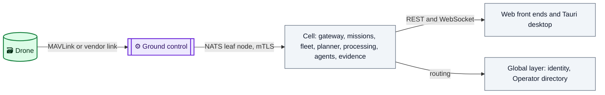

# 🛠️ Technical specifications

<!-- spec:nav-top -->
> [🏠 Index](../README.md) · [◀️ BR-032: The Assistant reaches only what its person may reach](../functional/business-rules/BR-032-the-assistant-reaches-only-what-its-person-may-reach.md) · 📄 **Page 95 / 120** · [Architecture ▶️](01-architecture.md)
<!-- /spec:nav-top -->

**Status:** 🟢 Approved · **Updated:** 2026-11-18

> [!NOTE]
> How Swarm is built: one mono-repo for backend and frontends, a flight engine at the edge, cells in the core, optimised for performance and scalability. Each page links to the features (📘) it implements and uses the names of the [glossary](../glossary.md).

<!-- spec:summary -->
## 📑 Summary

1. [🔭 Overview](#overview)
2. [💎 Principles](#principles)
3. [📚 Pages](#pages)
4. [⚖️ Decisions](#decisions)
<!-- /spec:summary -->

## 🔭 Overview

Swarm is built in two halves that never wait for each other while a [🗃️ Squad](../glossary.md#ent-squad) flies:

- **The edge** runs next to the Drones: on the [⚙️ Ground control](../glossary.md#sys-ground-control) machine, in an operations centre or on a Dock site. It holds the flight engine, which talks to every Drone, runs the safety loop and keeps flying without network.
- **The core** runs in **cells**: independent copies of the platform, each serving a set of [🗃️ Operators](../glossary.md#ent-operator), in a sovereign EU cloud (OVHcloud, Scaleway) or self-hosted on k3s. It holds Missions, the Fleet, planning, processing, the AI agents, the evidence ledger and the four web front ends.

## 💎 Principles

1. **Safety never waits for the network.** Every flight decision is taken at the edge or on board; the core can be down while a Mission flies.
2. **Performance is a requirement.** Each hot path has a budget ([⏱️ Scalability and performance](07-scalability.md#budgets)), checked by load tests that fail the build when missed.
3. **Scale by copying, not by growing.** A cell has a fixed size; more Operators mean more cells.
4. **One source per model.** Pydantic models are the single definition of every object, from the Drone frame to the REST resource.
5. **The same software everywhere.** Cloud, self-hosted and on premises run the same images and charts; no provider-only service sits in the critical path.
6. **People decide.** AI agents, inside or outside Swarm, act behind the human gate of [📏 BR-021](../functional/business-rules/BR-021-ai-agents-propose-people-decide.md).

## 📚 Pages

| Page | Covers |
| --- | --- |
| [🏗️ Architecture](01-architecture.md) | Mono-repo layout, edge and core, cells, services and data flows |
| [🧱 Data models](02-data-models.md) | Pydantic conventions, the main models, Telemetry frames, events, versioning |
| [🗄️ Storage](03-storage.md) | PostgreSQL and PostGIS, TimescaleDB, object storage, Valkey, the edge store, retention, backups |
| [🔩 Engine and services](04-engine.md) | Flight engine and safety loop, Drone adapters, planner, processing, agents, MCP and A2A, evidence, notifier, simulator |
| [🔌 API layer](05-api.md) | REST, WebSocket live data, video, webhooks, MCP and A2A endpoints |
| [🔐 Security](06-security.md) | Identity, roles, Operator isolation, the human gate, links, secrets, supply chain, GDPR |
| [🚀 Scalability and performance](07-scalability.md) | Targets, cells, partitioned edge, hot-path techniques, budgets, load tests |
| [🩺 Observability](08-observability.md) | OpenTelemetry, dashboards, SLOs, alerting, edge buffering |
| [🚢 Deployment](09-deployment.md) | Providers, Kubernetes, rollout waves, edge appliance, on-premises bundle, CI/CD, environments |
| [🖥️ GUI and WebUI](10-frontends.md) | React apps, Tauri desktop, live data in the browser, maps, video, design system, inputs |

## ⚖️ Decisions

The 44 technical decisions (T1 to T44) and their reasons are in the [technical interview](../../research/interview-technical.md). The functional decisions they serve are in the [functional interview](../../research/interview.md).

<!-- spec:nav-bottom -->
---

> [🏠 Index](../README.md) · [◀️ BR-032: The Assistant reaches only what its person may reach](../functional/business-rules/BR-032-the-assistant-reaches-only-what-its-person-may-reach.md) · 📄 **Page 95 / 120** · [Architecture ▶️](01-architecture.md)
<!-- /spec:nav-bottom -->
