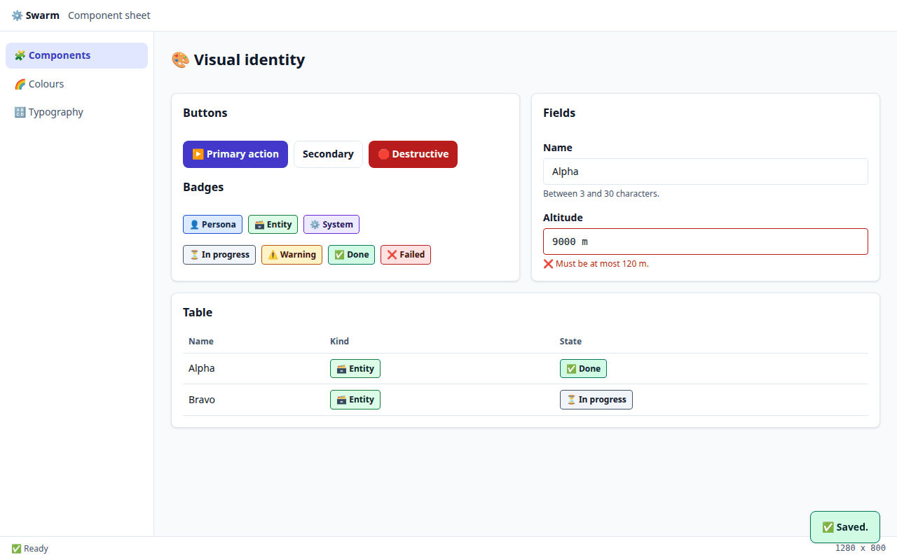
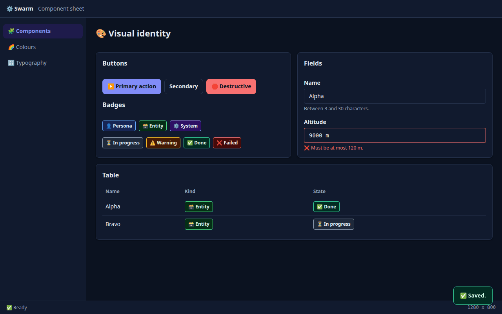
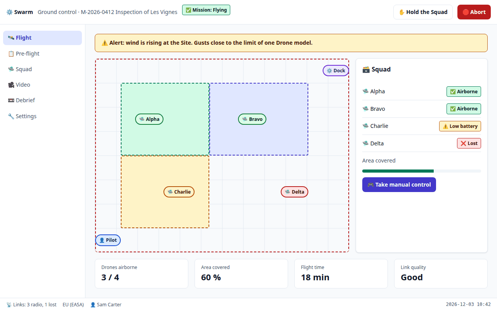
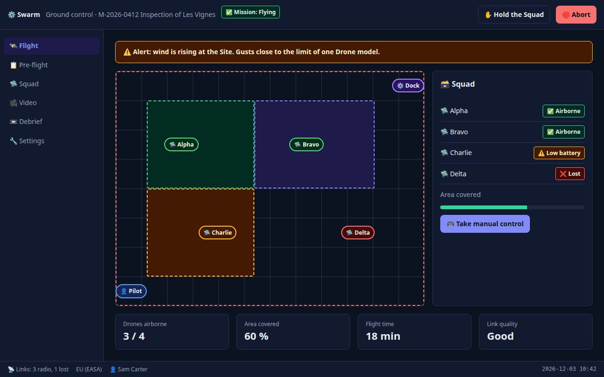
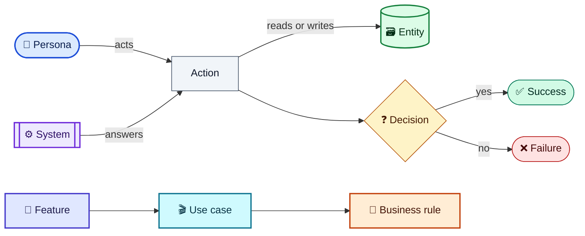

# 🎨 Visual identity

<!-- spec:nav-top -->
> [🏠 Index](README.md) · [◀️ Glossary](glossary.md) · 📄 **Page 3 / 109** · [Functional specifications ▶️](functional/README.md)
<!-- /spec:nav-top -->

**Status:** 🟢 Approved · **Updated:** 2026-11-18

> [!IMPORTANT]
> The single source of the look of Swarm: its screens, the mock-ups and screenshots of the use cases, and the flow charts. Every value is a **token**. `specs.py build` turns the tokens into [visual-identity.css](screens/mockups/visual-identity.css) for the mock-ups and into the colours of every flow chart. The application uses the same tokens. Change a value here, never in a screen.

<!-- spec:summary -->
## <a id="summary"></a>📑 Summary

1. [💎 Principles](#principles)
2. [🌈 Colours](#colours)
3. [🔠 Typography](#typography)
4. [📐 Spacing and shapes](#spacing)
5. [🔣 Iconography](#iconography)
6. [🧩 Components](#components)
7. [🖼️ Screens and screenshots](#screens)
8. [🔀 Diagrams](#diagrams)
<!-- /spec:summary -->

## <a id="principles"></a>💎 Principles

1. **One colour per kind, everywhere.** 👤 Personas are blue, 🗃️ entities green, ⚙️ systems violet, in the flow charts, in the badges and on the screens.
2. **Never colour alone.** A state always shows a colour, an icon and a word (✅ Done, ❌ Failed), so that it reads in grey scale and for colour-blind people. Text keeps a contrast of at least 4.5:1 with its background.
3. **Calm by default, loud on purpose.** Screens are mostly white and grey. Strong colour is kept for the one primary action and for failures.
4. **Glossary words on screen.** Labels, titles and messages use the names of the [glossary](glossary.md), in British English.
5. **One primary action per screen.** Other actions are secondary buttons or links.
6. **Light and dark.** Every screen exists in a light and a dark mode, following the system setting of the persona, with the same layout. Each colour token has its two values below; nothing else changes between the modes.

## <a id="colours"></a>🌈 Colours

**Surfaces and text**

| Token | Light | Dark | Looks like | Use |
| --- | --- | --- | --- | --- |
| `color.background` | `#f8fafc` | `#0b1220` | ⬜ | Window background |
| `color.surface` | `#ffffff` | `#111a2e` | ⬜ | Cards, title bar, fields, tables |
| `color.text` | `#0f172a` | `#e2e8f0` | ⬛ | Body text |
| `color.muted` | `#475569` | `#94a3b8` | 🔘 | Secondary text, hints, captions |
| `color.border` | `#e2e8f0` | `#26334d` | ⬜ | Borders and separators |
| `color.primary` | `#4338ca` | `#818cf8` | 🟦 | The primary action, links, the selected item |
| `color.primary-soft` | `#e0e7ff` | `#1e1b4b` | 🟦 | Background of the selected item |
| `color.primary-ink` | `#ffffff` | `#0b1220` | ⬜ | Text on `color.primary` and on `color.failure` |
| `color.overlay` | `#0f172a` | `#000000` | ⬜ | Dims the screen behind a dialog |

**Kinds and states.** Each kind has three tokens: the strong colour (borders, icons), `-soft` (backgrounds) and `-ink` (text on `-soft`). In dark mode the strong colour lightens, `-soft` darkens and `-ink` lightens, so that the same classes read on a dark background.

| Token | Light | Dark | Looks like | Use |
| --- | --- | --- | --- | --- |
| `color.persona` | `#1d4ed8` | `#60a5fa` | 🟦 | 👤 Personas |
| `color.persona-soft` | `#dbeafe` | `#172554` | 🟦 | |
| `color.persona-ink` | `#0b1f4d` | `#dbeafe` | 🟦 | |
| `color.entity` | `#15803d` | `#4ade80` | 🟩 | 🗃️ Entities |
| `color.entity-soft` | `#dcfce7` | `#052e16` | 🟩 | |
| `color.entity-ink` | `#052e16` | `#dcfce7` | 🟩 | |
| `color.system` | `#6d28d9` | `#a78bfa` | 🟪 | ⚙️ Systems |
| `color.system-soft` | `#ede9fe` | `#2e1065` | 🟪 | |
| `color.system-ink` | `#2e1065` | `#ede9fe` | 🟪 | |
| `color.action` | `#475569` | `#94a3b8` | 🔘 | Neutral steps, in progress |
| `color.action-soft` | `#f1f5f9` | `#1e293b` | 🔘 | |
| `color.action-ink` | `#0f172a` | `#e2e8f0` | 🔘 | |
| `color.decision` | `#b45309` | `#fbbf24` | 🟨 | ❓ Decisions, ⚠️ warnings |
| `color.decision-soft` | `#fef3c7` | `#451a03` | 🟨 | |
| `color.decision-ink` | `#451a03` | `#fef3c7` | 🟨 | |
| `color.success` | `#047857` | `#34d399` | 🟩 | ✅ Success |
| `color.success-soft` | `#d1fae5` | `#022c22` | 🟩 | |
| `color.success-ink` | `#022c22` | `#d1fae5` | 🟩 | |
| `color.failure` | `#b91c1c` | `#f87171` | 🟥 | ❌ Failure, destructive actions |
| `color.failure-soft` | `#fee2e2` | `#450a0a` | 🟥 | |
| `color.failure-ink` | `#450a0a` | `#fee2e2` | 🟥 | |
| `color.feature` | `#4338ca` | `#818cf8` | 🟦 | 📘 Features, in the specifications |
| `color.feature-soft` | `#e0e7ff` | `#1e1b4b` | 🟦 | |
| `color.feature-ink` | `#1e1b4b` | `#e0e7ff` | 🟦 | |
| `color.usecase` | `#0e7490` | `#22d3ee` | 🟦 | 🎬 Use cases, in the specifications |
| `color.usecase-soft` | `#cffafe` | `#083344` | 🟦 | |
| `color.usecase-ink` | `#083344` | `#cffafe` | 🟦 | |
| `color.rule` | `#c2410c` | `#fb923c` | 🟧 | 📏 Business rules, in the specifications |
| `color.rule-soft` | `#ffedd5` | `#431407` | 🟧 | |
| `color.rule-ink` | `#431407` | `#ffedd5` | 🟧 | |

## <a id="typography"></a>🔠 Typography

| Token | Value | Use |
| --- | --- | --- |
| `font.ui` | `"Noto Sans", "Segoe UI", Arial, sans-serif` | All text |
| `font.mono` | `"DejaVu Sans Mono", "Consolas", monospace` | Identifiers, coordinates, logs |
| `font.emoji` | `"Noto Color Emoji", "Segoe UI Emoji", "Apple Color Emoji"` | Icons |
| `size.title` | `22px` | Screen title, one per screen |
| `size.heading` | `16px` | Card and section headings |
| `size.body` | `14px` | Body text, buttons, fields |
| `size.small` | `12px` | Badges, hints, captions, status bar |

- Weights: 400 for text, 600 for headings, buttons and badges. No italics on screen.
- Sentence case everywhere: "Submit the task", not "Submit The Task".

## <a id="spacing"></a>📐 Spacing and shapes

| Token | Light | Dark | Use |
| --- | --- | --- | --- |
| `space.1` | `4px` | | Inside badges, between an icon and its word |
| `space.2` | `8px` | | Between related items |
| `space.3` | `12px` | | Inside buttons and fields |
| `space.4` | `16px` | | Inside cards, between cards |
| `space.6` | `24px` | | Around the content of a screen |
| `radius.s` | `4px` | | Badges, fields |
| `radius.m` | `8px` | | Cards, buttons, toasts |
| `shadow.card` | `0 1px 3px rgba(15, 23, 42, 0.12)` | `0 1px 3px rgba(0, 0, 0, 0.6)` | Cards and toasts |

## <a id="iconography"></a>🔣 Iconography

- Icons are emoji, drawn with `font.emoji`, always followed by a word.
- One meaning, one icon, the same as in the specifications ([SPEC-8](../../.claude/rules/specs.md#spec-8)): 👤 persona, 🗃️ entity, ⚙️ system, 🛸 Drone on a map or in a list, ✅ success, ❌ failure, ⚠️ warning, ❓ decision, ⏳ in progress, 🔄 state.
- A new icon is added to SPEC-8 first, then used.

## <a id="components"></a>🧩 Components

The components are the classes of [components.css](screens/mockups/components.css). Mock-ups use them and nothing else: no inline style, no other stylesheet.

| Component | Class | Look |
| --- | --- | --- |
| Window | `window` | Title bar, side bar, content, status bar |
| Title bar | `titlebar` | `color.surface`, application name then screen title |
| Side bar | `sidebar`, `nav-item`, `nav-item active` | Selected item on `color.primary-soft` |
| Card | `card` | `color.surface`, `radius.m`, `shadow.card` |
| Buttons | `button primary`, `button secondary`, `button danger` | One primary per screen |
| Badges | `badge persona`, `badge entity`, `badge system`, `badge success`, `badge failure`, `badge decision`, `badge action` | Icon and word on the `-soft` colour |
| Field | `field`, `input`, `input invalid`, `hint`, `error` | Label above, hint or error below |
| Table | `table` | Header in `color.muted`, rows separated by `color.border` |
| Toast | `toast success`, `toast failure` | Bottom right, icon and one sentence |
| Empty state | `empty` | Centred, icon, one sentence, one action |
| Map | `map`, `zone`, `zone geofence`, `zone done`, `zone risk`, `marker <kind>` | 12 x 8 grid; place with `c1`..`c12` `r1`..`r8`, size zones with `w<n>` `h<n>` |
| Panels | `split`, `panel`, `kpis`, `kpi` (`value`, `label`) | Map on the left, side panel on the right; key figures in tiles |
| Progress | `progress`, `progress success`, `progress failure`, `progress decision`, `p10`..`p100` | Thin bar, width in steps of 10 % |
| Banner | `banner success`, `banner failure`, `banner decision`, `banner system` | Full-width message at the top of the content, for Alerts |
| Dialog | `overlay` then `dialog` (siblings) | A decision the persona must take now, over a dimmed screen |
| Checklist | `checklist`, `check ok`, `check fail`, `check pending` | ✅ passed, ❌ failed, ⏳ not run yet |
| Tabs and lists | `tabs`, `tab`, `tab active`, `list`, `list-item` | |
| Conversation | `conversation`, `message person`, `message agent` | Exchanges with an AI agent; the agent in the ⚙️ system colours |
| Layout | `row`, `stack`, `grid-2`, `spacer`, `muted`, `mono` | Helpers |

**Frames.** Every screen of a part of Swarm uses the same frame. Side bar items appear in this order; the current one is `nav-item active`.

| Part | Title bar | Side bar | Status bar |
| --- | --- | --- | --- |
| ⚙️ Ground control | `⚙️ Swarm` · Ground control · Mission name · Mission state badge, then on the right `✋ Hold the Squad` (`button secondary`) and `🛑 Abort` (`button danger`), on every screen ([BR-023](functional/business-rules/BR-023-fixed-safety-controls.md)) | 🛰️ Flight · 📋 Pre-flight · 🛸 Squad · 🎥 Video · 📼 Debrief · 🔧 Settings | 📡 Links · Jurisdiction · Pilot · time (24-hour) |
| ⚙️ Mission studio | `⚙️ Swarm` · Mission studio · Mission name · Mission state badge | 🗺️ Missions · 🖊️ Design · 🕹️ Simulate · 💬 Assistant | Rule check result · Authorisation · saved or not |
| ⚙️ Back office | `⚙️ Swarm` · Back office · Operator name | 🛸 Fleet · 📜 Authorisations · 📦 Deliverables · 🔏 Evidence · 👥 People · 🔧 Settings | Operator · cloud or on premises |
| ⚙️ Client portal | `⚙️ Swarm` · Client portal · Client name | 🗺️ Missions · ➕ Order · 📦 Deliverables · 🧾 Scorecards · 🔔 Alarms (Site agents only) | Client · language |
| ⚙️ Swarm administration | `⚙️ Swarm` · Back office · Swarm administration (no Operator yet) | ➕ Operators · 👥 People · 🔧 Settings | Swarm administrator · cloud or on premises |

**Component sheet**: every component, rendered from [identity/components.html](screens/mockups/identity/components.html).

[](screens/identity/components.png) [](screens/identity/components.dark.png)

**Layout sheet**: the Ground control layout with the map, the Squad panel, a banner and key figures, rendered from [identity/layouts.html](screens/mockups/identity/layouts.html).

[](screens/identity/layouts.png) [](screens/identity/layouts.dark.png)

## <a id="screens"></a>🖼️ Screens and screenshots

| Token | Value | Use |
| --- | --- | --- |
| `screen.width` | `1280px` | Width of every screen PNG |
| `screen.height` | `800px` | Height of every screen PNG |

- **Two PNGs per state.** Each use case shows one screen for every state of its flow chart (see [SPEC-12](../../.claude/rules/specs.md#spec-12)), in light mode `screens/<UC-ID>/<node>.png` and in dark mode `screens/<UC-ID>/<node>.dark.png`.
- **✏️ Mock-up** until the application shows that state: an HTML page in `screens/mockups/<UC-ID>/<node>.html`, drawn with the components only and rendered by `specs.py render`.
- **📸 Screenshot** once it does: a capture of the real window at exactly `screen.width` x `screen.height`, scale 1, once in light and once in dark mode. The mock-up is then deleted.
- **Sample data** is fictional, uses glossary names, and is the same across all screens. No real person, address or key. Use this cast:

  | Kind | Sample |
  | --- | --- |
  | Operator | Aerowing Services |
  | Pilot | Sam Carter |
  | Instructor | Shown by role only, as "Instructor" |
  | Swarm administrator | Shown by role only, as "Swarm administrator" |
  | Mission planner | Léa Martin |
  | Fleet maintainer | Noah Weber |
  | Clients | Helio Energy (solar farms), Domaine des Trois Chênes (farm), Northgate Logistics (warehouse), Riverside Festival (events) |
  | Client contact | Priya Shah (Helio Energy) |
  | Site agent | Inès Garcia (Northgate Logistics) |
  | Sites | Les Vignes solar farm, North field, Northgate warehouse, Riverside park |
  | Drones | Alpha, Bravo, Charlie, Delta, Echo, Foxtrot (registrations AW-001 to AW-006) |
  | Drone models | X500 (PX4, MAVLink), Matrice 4TD (DJI), X10 (Skydio), ANAFI USA (Parrot) |
  | Missions | M-2026-0412 Inspection of Les Vignes, M-2026-0413 Spraying of North field, M-2026-0414 Night patrol of Northgate, M-2026-0415 Riverside Festival show |
  | Date and time | 3 December 2026, from 10:00 (24-hour clock) |

## <a id="diagrams"></a>🔀 Diagrams

Flow chart classes and their colours, generated from the tokens above. `specs.py build` applies them to every flow chart.

<!-- spec:palette -->
```text
classDef persona fill:#dbeafe,stroke:#1d4ed8,stroke-width:2px,color:#0b1f4d
classDef entity fill:#dcfce7,stroke:#15803d,stroke-width:2px,color:#052e16
classDef system fill:#ede9fe,stroke:#6d28d9,stroke-width:2px,color:#2e1065
classDef action fill:#f1f5f9,stroke:#475569,color:#0f172a
classDef decision fill:#fef3c7,stroke:#b45309,color:#451a03
classDef success fill:#d1fae5,stroke:#047857,color:#022c22
classDef failure fill:#fee2e2,stroke:#b91c1c,color:#450a0a
classDef feature fill:#e0e7ff,stroke:#4338ca,stroke-width:2px,color:#1e1b4b
classDef usecase fill:#cffafe,stroke:#0e7490,stroke-width:2px,color:#083344
classDef rule fill:#ffedd5,stroke:#c2410c,stroke-width:2px,color:#431407
```


<!-- /spec:palette -->

<!-- spec:nav-bottom -->
---

> [🏠 Index](README.md) · [◀️ Glossary](glossary.md) · 📄 **Page 3 / 109** · [Functional specifications ▶️](functional/README.md)
<!-- /spec:nav-bottom -->
