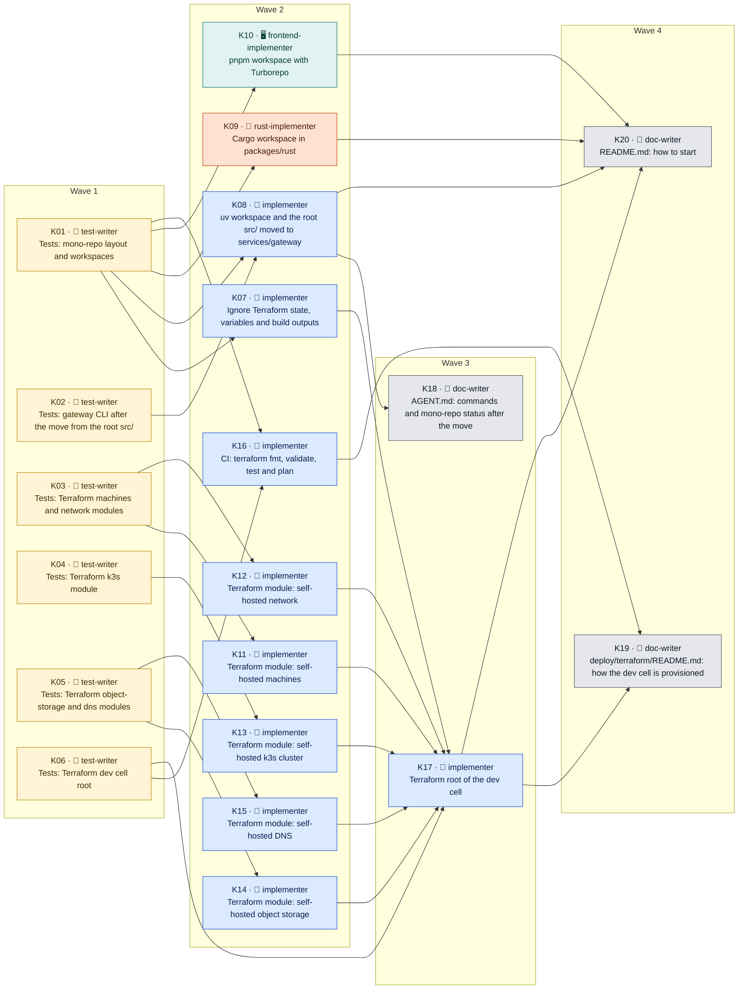

# T0.01: Plan

**Plan:** 🟢 Approved

<!-- ticket:specs -->
## 📚 Specifications

The technical pages, features, use cases and business rules of [TICKET.md](TICKET.md), copied by `python3 .claude/scripts/ticket_refs.py sync`.

- [🏗️ Architecture: mono-repo](../../specs/technical/01-architecture.md#mono-repo)
- [🏗️ Architecture: cells and the global layer](../../specs/technical/01-architecture.md#cells)
- [🚢 Deployment: infrastructure as code](../../specs/technical/09-deployment.md#iac)
- [🚢 Deployment: where it runs](../../specs/technical/09-deployment.md#providers)
<!-- /ticket:specs -->

## Summary

T0.01 is split into 20 tasks over 4 waves. Wave 1 holds 6 test-writers: the mono-repo layout tests (stdlib pytest under tests/conventions/mono_repo/), the moved gateway CLI test, and Terraform native tests (.tftest.hcl, command = plan with mock providers) for each self-hosted building-block module and for the dev cell root. These tests fix every interface the later tasks implement. Wave 2 has 10 tasks, run at most 8 at once by the workflow: .gitignore; the uv workspace with the root src/swarm moved to services/gateway (one task, because uv.lock depends on both); the Cargo workspace; the pnpm and Turborepo workspace; one task per Terraform module (machines, network, k3s, object-storage, dns) under deploy/terraform/modules/self-hosted/; and the terraform-plan CI workflow. Wave 3 has the dev cell root in deploy/terraform/cells/dev (a partial s3 backend, so the state stays outside the repository) and the AGENT.md update. Wave 4 has the two documentation tasks: deploy/terraform/README.md and the root README "How to start" (acceptance criterion 3). Acceptance criterion 1 is checked by the clean-clone install commands in each workspace task's done_when. Criterion 2 is checked automatically by validate, test and a local plan. The real `terraform apply` needs the P-06 machines, so the person has to run it.

## Assumptions

1. The roadmap names no feature, use case or business rule for T0.01, so none is listed and no Given/when/then criterion of a feature is closed.
2. The three acceptance criteria are the three clauses of the roadmap's 'done when', rewritten as Given/when/then without adding facts.
3. The location of the Terraform state is left open by the specifications (outside the repository); it is a decision for the person, per the phase page's work split.
4. The out-of-scope list is derived from the other P0 ticket rows (T0.02, T0.03, T0.04, T0.08) and from the phase page saying production cells come in P7.
5. The root src/swarm (a placeholder main() printing "Hello from swarm!") moves to services/gateway, the REST entry point of the architecture, as distribution swarm-gateway with the import package gateway and the console script swarm-gateway. Its main() goes to gateway/api/cli/main.py because AGENT.md lets only api/cli/ print. The specifications do not name the target service, so the person should confirm it at approval.
6. langchain, langgraph and babel are dropped from the lock with the move. They belong to the future agents service (P5) and to the four-languages work (T0.15), which add them back. fastapi and pydantic go to the gateway.
7. The root pyproject.toml becomes a virtual uv workspace root (no [project]) with a dev dependency group: ruff, mypy, pytest, pytest-xdist and pytest-asyncio, which the AGENT.md commands need, and maturin for the Cargo workspace's wheels. Fuller linter configuration stays with T0.03.
8. The gateway service gets no Dockerfile and no conf/ in this ticket: images are T0.10, and the logging configuration is T0.05.
9. The Cargo workspace starts as a virtual manifest with no members. The swarm-core crates and the first maturin-built wheel come in T0.07, so maturin is provided through the uv dev group.
10. The pnpm workspace and Turborepo get no package yet: frontends/ and packages/ts/ hold only a .gitkeep until T0.14. The pnpm version and the Node LTS range are the current stable ones at implementation time.
11. The mono-repo layout tests go in tests/conventions/mono_repo/, because the layout is a convention. They use only the standard library, because no YAML library is installed.
12. No agent kind exists for infrastructure code, so the Terraform modules, the dev root, .gitignore and the CI workflow are given to the implementer agent.
13. 'One module per provider' (TICKET.md) and 'one module per building block' (09-deployment.md#iac) are reconciled as deploy/terraform/modules/self-hosted/<building block>/, with one folder per provider. Only self-hosted is written now, and OVHcloud and Scaleway come in P7. The phase page leaves the module layout to the person.
14. The Terraform state uses an empty partial s3 backend. The values, including use_lockfile for locking, come from a file outside the repository, because the ticket leaves the state's location to the person. use_lockfile sets the floor of Terraform >= 1.10, which also covers terraform test with mock providers.
15. The self-hosted machines (P-06) already exist and are reachable over SSH by a user with passwordless sudo. They run a Debian-family Linux with apt and ufw, such as Ubuntu Server LTS. Terraform prepares them, but cannot create them. The person decides the k3s machines, so the person should confirm this.
16. Only Terraform's built-in terraform_data with provisioners is used for the machines, network and k3s modules, plus hashicorp/random for the k3s join token. Provider versions are constrained to their current major version. The k3s ports opened by the network module are the inbound rules k3s documents for embedded etcd and flannel VXLAN.
17. The k3s join token is a sensitive random_password, so it is stored in the remote Terraform state until the vault of T0.08 exists. The kubeconfig is written with mode 0600 to a path outside the repository and is never output.
18. Object storage (MinIO buckets through aminueza/minio) and DNS (RFC 2136 through hashicorp/dns) are written and tested, but off by default in the dev root. MinIO is deployed on the cluster in T0.08, and the P-06 DNS server is not specified yet. Their credentials come only from the providers' environment variables. The DNS module publishes one record, api, for the k3s API.
19. Acceptance criterion 2 (terraform apply from nothing) cannot run in an agent worktree, because it needs the P-06 machines and a state backend. Agents prove it with terraform validate, terraform test and a local-backend plan, and the person runs the real apply.
20. The CI plan job reads its backend configuration and its variables from GitHub secrets and repository variables, whose names are listed in deploy/terraform/README.md. It fails with an explicit error when TF_BACKEND_CONFIG is missing rather than skipping silently. The other CI steps remain T0.04.
21. Terraform, cargo, Node with corepack, uv and git are available to the worker agents and the verifier.

<!-- plan:graph -->

> [!NOTE]
> Generated from the json block at the end of this page by `python3 .claude/scripts/plan.py render`.
> To change a task, edit the json block, then render again: never edit this view by hand.

## Waves

| Wave | Tasks | Agents running at once |
| --- | --- | --- |
| 1 | [K01](#k01), [K02](#k02), [K03](#k03), [K04](#k04), [K05](#k05), [K06](#k06) | 6 of 6 |
| 2 | [K07](#k07), [K08](#k08), [K09](#k09), [K10](#k10), [K11](#k11), [K12](#k12), [K13](#k13), [K14](#k14), [K15](#k15), [K16](#k16) | 8 of 10 |
| 3 | [K17](#k17), [K18](#k18) | 2 of 2 |
| 4 | [K19](#k19), [K20](#k20) | 2 of 2 |

| Wave | Task | Agent | Depends on | Unblocks |
| --- | --- | --- | --- | --- |
| 1 | [K01](#k01) Tests: mono-repo layout and workspaces | 🧪 test-writer | none | [K07](#k07), [K08](#k08), [K09](#k09), [K10](#k10), [K16](#k16) |
| 1 | [K02](#k02) Tests: gateway CLI after the move from the root src/ | 🧪 test-writer | none | [K08](#k08) |
| 1 | [K03](#k03) Tests: Terraform machines and network modules | 🧪 test-writer | none | [K11](#k11), [K12](#k12) |
| 1 | [K04](#k04) Tests: Terraform k3s module | 🧪 test-writer | none | [K13](#k13) |
| 1 | [K05](#k05) Tests: Terraform object-storage and dns modules | 🧪 test-writer | none | [K14](#k14), [K15](#k15) |
| 1 | [K06](#k06) Tests: Terraform dev cell root | 🧪 test-writer | none | [K16](#k16), [K17](#k17) |
| 2 | [K07](#k07) Ignore Terraform state, variables and build outputs | 🐍 implementer | [K01](#k01) | [K17](#k17) |
| 2 | [K08](#k08) uv workspace and the root src/ moved to services/gateway | 🐍 implementer | [K01](#k01), [K02](#k02) | [K18](#k18), [K20](#k20) |
| 2 | [K09](#k09) Cargo workspace in packages/rust | 🦀 rust-implementer | [K01](#k01) | [K20](#k20) |
| 2 | [K10](#k10) pnpm workspace with Turborepo | 🖥️ frontend-implementer | [K01](#k01) | [K20](#k20) |
| 2 | [K11](#k11) Terraform module: self-hosted machines | 🐍 implementer | [K03](#k03) | [K17](#k17) |
| 2 | [K12](#k12) Terraform module: self-hosted network | 🐍 implementer | [K03](#k03) | [K17](#k17) |
| 2 | [K13](#k13) Terraform module: self-hosted k3s cluster | 🐍 implementer | [K04](#k04) | [K17](#k17) |
| 2 | [K14](#k14) Terraform module: self-hosted object storage | 🐍 implementer | [K05](#k05) | [K17](#k17) |
| 2 | [K15](#k15) Terraform module: self-hosted DNS | 🐍 implementer | [K05](#k05) | [K17](#k17) |
| 2 | [K16](#k16) CI: terraform fmt, validate, test and plan | 🐍 implementer | [K01](#k01), [K06](#k06) | [K19](#k19) |
| 3 | [K17](#k17) Terraform root of the dev cell | 🐍 implementer | [K06](#k06), [K07](#k07), [K11](#k11), [K12](#k12), [K13](#k13), [K14](#k14), [K15](#k15) | [K19](#k19), [K20](#k20) |
| 3 | [K18](#k18) AGENT.md: commands and mono-repo status after the move | 📝 doc-writer | [K08](#k08) | none |
| 4 | [K19](#k19) deploy/terraform/README.md: how the dev cell is provisioned | 📝 doc-writer | [K16](#k16), [K17](#k17) | none |
| 4 | [K20](#k20) README.md: how to start | 📝 doc-writer | [K08](#k08), [K09](#k09), [K10](#k10), [K17](#k17) | none |

## Dependency graph



## Tasks

### <a id="k01"></a>K01: Tests: mono-repo layout and workspaces

| Agent | Wave | Depends on | Unblocks |
| --- | --- | --- | --- |
| 🧪 test-writer | 1 | none | [K07](#k07), [K08](#k08), [K09](#k09), [K10](#k10), [K16](#k16) |

**Files** (only this task may change them in its wave):

- `tests/conventions/mono_repo/helpers.py`
- `tests/conventions/mono_repo/test_python_workspace.py`
- `tests/conventions/mono_repo/test_rust_workspace.py`
- `tests/conventions/mono_repo/test_pnpm_workspace.py`
- `tests/conventions/mono_repo/test_terraform_layout.py`

**Done when:** `uvx pytest tests/conventions/mono_repo` collects every test without a collection error, and the tests fail on assertions about missing files or settings. `uvx ruff check tests/conventions/mono_repo` and `uvx ruff format --check --line-length 120 tests/conventions/mono_repo` pass.

**Brief:**

Write the layout tests of ticket T0.01 (docs/tickets/T0.01/TICKET.md) before anything exists. Follow docs/specs/technical/01-architecture.md#mono-repo, docs/specs/technical/09-deployment.md#iac and the AGENT.md Tests rules: one Test&lt;Subject> class per file, test names written as sentences, pytest.mark.parametrize for cases of one behaviour, no mocks, no __init__.py, standard library only (pathlib, tomllib, json, re, subprocess for `git ls-files`), because no YAML library is installed. Parse pnpm-workspace.yaml line by line. helpers.py may hold the shared repository-root function (Path(__file__).resolve().parents[3]) and shared constants. Write these tests. (1) test_python_workspace.py, TestPythonWorkspace: the root pyproject.toml has no [project] table and has [tool.uv.workspace] members containing "services/*" and "packages/python/*"; its [dependency-groups] dev lists ruff, mypy, pytest, pytest-xdist, pytest-asyncio and maturin; the root src/ folder does not exist; exactly one uv.lock exists, at the root, with none under services/ or packages/; packages/python/ exists; services/gateway/pyproject.toml has project name "swarm-gateway" and the console script swarm-gateway = "gateway.api.cli.main:main"; services/gateway/src/gateway/ holds the packages api, service, storage, clients and models, each with an __init__.py; no services/&lt;service>/src/ holds a top-level api, service, storage or models package (AGENT.md Services rule). (2) test_rust_workspace.py, TestRustWorkspace: packages/rust/Cargo.toml has a [workspace] table with a members list and a resolver; packages/rust/Cargo.lock exists; there is no Cargo.toml at the repository root. (3) test_pnpm_workspace.py, TestPnpmWorkspace: the root package.json has private true, a packageManager starting with "pnpm@" and turbo in devDependencies; pnpm-workspace.yaml lists "frontends/*" and "packages/ts/*"; turbo.json is valid JSON whose "tasks" has build, lint, typecheck and test; pnpm-lock.yaml exists at the root; frontends/ and packages/ts/ exist. (4) test_terraform_layout.py, TestTerraformLayout: each of deploy/terraform/modules/self-hosted/{machines,network,k3s,object-storage,dns}/ has main.tf, variables.tf, outputs.tf and versions.tf; deploy/terraform/cells/dev/ has main.tf, variables.tf, outputs.tf, versions.tf, terraform.tfvars.example and .terraform.lock.hcl; cells/dev/versions.tf declares an empty partial backend (regex backend\s+"s3"\s*\{\s*\}); `git ls-files deploy/terraform` lists no *.tfstate, *.tfstate.* or *.tfvars file other than *.tfvars.example; .gitignore holds the lines .terraform/, *.tfstate, *.tfstate.*, *.tfvars and !*.tfvars.example; .github/workflows/terraform.yml exists, contains "terraform plan", and filters on the path deploy/terraform/**. The tests must fail now only because the layout is missing, never because of an error in a test.

### <a id="k02"></a>K02: Tests: gateway CLI after the move from the root src/

| Agent | Wave | Depends on | Unblocks |
| --- | --- | --- | --- |
| 🧪 test-writer | 1 | none | [K08](#k08) |

**Files** (only this task may change them in its wave):

- `services/gateway/tests/api/cli/test_main.py`

**Done when:** `uvx pytest services/gateway/tests/api/cli/test_main.py` fails only with ModuleNotFoundError for gateway. `uvx ruff check services/gateway/tests` and `uvx ruff format --check --line-length 120 services/gateway/tests` pass.

**Brief:**

The root src/swarm/__init__.py (a main() that prints "Hello from swarm!") moves to the gateway service as the Mono-repo section of AGENT.md plans (services/&lt;service>/src/&lt;service>/{api,service,storage,clients,models}/; print is allowed only in api/cli/). Write services/gateway/tests/api/cli/test_main.py with one class TestMain, following the AGENT.md Tests rules (sentence names, no mocks, no __init__.py, no docstrings needed). Write two tests. test_main_prints_the_greeting: import main from gateway.api.cli.main, call it, and check with capsys that stdout is exactly "Hello from swarm!\n". test_the_console_script_points_at_main: importlib.metadata.entry_points(group="console_scripts") holds an entry named "swarm-gateway" whose value is "gateway.api.cli.main:main". The file must fail now only because the gateway package does not exist yet.

### <a id="k03"></a>K03: Tests: Terraform machines and network modules

| Agent | Wave | Depends on | Unblocks |
| --- | --- | --- | --- |
| 🧪 test-writer | 1 | none | [K11](#k11), [K12](#k12) |

**Files** (only this task may change them in its wave):

- `deploy/terraform/modules/self-hosted/machines/tests/machines.tftest.hcl`
- `deploy/terraform/modules/self-hosted/network/tests/network.tftest.hcl`

**Done when:** `terraform fmt -check` passes on both files. `terraform test` in each module folder fails only because the module's configuration is missing.

**Brief:**

Write Terraform native tests (terraform test, Terraform >= 1.10, `command = plan` only) for two self-hosted building-block modules of the dev cell (docs/specs/technical/09-deployment.md#iac and #providers, ticket docs/tickets/T0.01/TICKET.md). Use only RFC 5737 documentation addresses (192.0.2.x) and fake paths. Both modules take machines = list(object({ name = string, address = string, role = string })), with role "server" or "agent", plus ssh_user (string) and ssh_private_key_path (string). (1) machines.tftest.hcl for modules/self-hosted/machines: with dev-server-1 (server, 192.0.2.10), dev-agent-1 and dev-agent-2 (agents, .11 and .12), terraform_data.machine (for_each by name) has 3 instances; output.servers is a list of objects whose names are ["dev-server-1"]; output.agents has names ["dev-agent-1","dev-agent-2"]. Use expect_failures = [var.machines] for three cases: a list without a server, an unknown role ("worker"), and duplicate names. (2) network.tftest.hcl for modules/self-hosted/network: extra variables api_allowed_cidrs (list(string), default []), cluster_cidr (default "10.42.0.0/16") and service_cidr (default "10.43.0.0/16"). With the same three machines, terraform_data.firewall (for_each by name) has 3 instances, output.cluster_cidr is "10.42.0.0/16" and output.service_cidr is "10.43.0.0/16". Use expect_failures for an invalid CIDR in api_allowed_cidrs ([var.api_allowed_cidrs]) and in cluster_cidr ([var.cluster_cidr]). These names are the contract the implementers follow.

### <a id="k04"></a>K04: Tests: Terraform k3s module

| Agent | Wave | Depends on | Unblocks |
| --- | --- | --- | --- |
| 🧪 test-writer | 1 | none | [K13](#k13) |

**Files** (only this task may change them in its wave):

- `deploy/terraform/modules/self-hosted/k3s/tests/k3s.tftest.hcl`

**Done when:** `terraform fmt -check` passes on the file. `terraform test` in the module folder fails only because the module's configuration is missing.

**Brief:**

Write the Terraform native test (Terraform >= 1.10, `command = plan`, mock_provider "random") for modules/self-hosted/k3s, which installs the dev cell's k3s cluster on self-hosted machines (docs/specs/technical/09-deployment.md#iac and #providers, ticket docs/tickets/T0.01/TICKET.md). The interface is the contract. Variables: servers and agents (list(object({ name = string, address = string })), agents defaults to []), ssh_user, ssh_private_key_path, k3s_version (string, no default), cluster_cidr (default "10.42.0.0/16"), service_cidr (default "10.43.0.0/16"), tls_san (list(string), default []) and kubeconfig_path (string). Resources: random_password.token, terraform_data.first_server, terraform_data.server (for_each over the servers after the first), terraform_data.agent (for_each over the agents) and terraform_data.kubeconfig. Outputs: api_endpoint and kubeconfig_path. Runs: (1) with one server dev-server-1 at 192.0.2.10 and agents at .11 and .12, length(terraform_data.server) == 0, length(terraform_data.agent) == 2, output.api_endpoint == "https://192.0.2.10:6443", and output.kubeconfig_path equals the variable; (2) expect_failures [var.servers] when servers is empty; (3) expect_failures [var.k3s_version] when it is "" and when it is "latest". Use RFC 5737 addresses and fake paths only.

### <a id="k05"></a>K05: Tests: Terraform object-storage and dns modules

| Agent | Wave | Depends on | Unblocks |
| --- | --- | --- | --- |
| 🧪 test-writer | 1 | none | [K14](#k14), [K15](#k15) |

**Files** (only this task may change them in its wave):

- `deploy/terraform/modules/self-hosted/object-storage/tests/object_storage.tftest.hcl`
- `deploy/terraform/modules/self-hosted/dns/tests/dns.tftest.hcl`

**Done when:** `terraform fmt -check` passes on both files. `terraform test` in each module folder fails only because the module's configuration is missing.

**Brief:**

Write Terraform native tests (Terraform >= 1.10, `command = plan`, mock providers) for two self-hosted building-block modules (docs/specs/technical/09-deployment.md#iac and #providers: the self-hosted object storage is MinIO; ticket docs/tickets/T0.01/TICKET.md). (1) object_storage.tftest.hcl for modules/self-hosted/object-storage, with mock_provider "minio" (aminueza/minio). The variable buckets is a set(string). With buckets ["dev-deliverables","dev-flight-logs"], minio_s3_bucket.bucket (for_each) has those two keys and output.bucket_names holds both. expect_failures [var.buckets] for a name with upper-case letters and for a name shorter than 3 characters. (2) dns.tftest.hcl for modules/self-hosted/dns, with mock_provider "dns" (hashicorp/dns, RFC 2136 updates). Variables: zone (string, must end with "."), records (map(string), name to IPv4 address) and ttl (number, default 300). With zone "dev.example.org." and records { api = "192.0.2.10" }, dns_a_record_set.record has the key "api" and output.fqdns contains "api.dev.example.org.". expect_failures [var.zone] for a zone without the trailing dot, and [var.records] for an address that is not IPv4. Use documentation names and RFC 5737 addresses only. These names are the contract the implementers follow.

### <a id="k06"></a>K06: Tests: Terraform dev cell root

| Agent | Wave | Depends on | Unblocks |
| --- | --- | --- | --- |
| 🧪 test-writer | 1 | none | [K16](#k16), [K17](#k17) |

**Files** (only this task may change them in its wave):

- `deploy/terraform/cells/dev/tests/dev.tftest.hcl`

**Done when:** `terraform fmt -check` passes on the file. `terraform test` in deploy/terraform/cells/dev fails only because the root configuration is missing.

**Brief:**

Write the Terraform native test (Terraform >= 1.10, `command = plan`, mock_provider "random", "minio" and "dns") for the dev cell root deploy/terraform/cells/dev (docs/specs/technical/09-deployment.md#iac: one root per cell; Terraform creates the empty cell; ticket docs/tickets/T0.01/TICKET.md, acceptance criterion 2). Root interface (the contract): machines (list(object({ name, address, role })), validated in the root to contain at least one "server"), ssh_user, ssh_private_key_path, k3s_version, kubeconfig_path, api_allowed_cidrs (default []), object_storage_enabled (bool, default false), object_storage_endpoint (string, default ""), object_storage_buckets (set(string), default []), dns_enabled (bool, default false), dns_server (string, default "") and dns_zone (string, default ""). It calls the modules machines, network and k3s, plus object_storage and dns with count = 1 only when enabled. Outputs: api_endpoint, kubeconfig_path, server_names and agent_names. Runs: (1) plans_an_empty_k3s_cluster_from_nothing: one server at 192.0.2.10 and two agents, with object storage and DNS left at their defaults; check that length(module.object_storage) == 0, length(module.dns) == 0, output.api_endpoint == "https://192.0.2.10:6443" and output.server_names == ["dev-server-1"]; (2) plans_buckets_and_records_when_enabled: object_storage_enabled = true with one bucket, dns_enabled = true with zone "dev.example.org."; check that length(module.object_storage) == 1 and length(module.dns) == 1; (3) refuses_a_cell_without_a_server: expect_failures [var.machines]. Use RFC 5737 addresses and fake paths only.

### <a id="k07"></a>K07: Ignore Terraform state, variables and build outputs

| Agent | Wave | Depends on | Unblocks |
| --- | --- | --- | --- |
| 🐍 implementer | 2 | [K01](#k01) | [K17](#k17) |

**Files** (only this task may change them in its wave):

- `.gitignore`

**Done when:** `uvx pytest tests/conventions/mono_repo/test_terraform_layout.py -k gitignore` passes. `git check-ignore deploy/terraform/cells/dev/terraform.tfstate deploy/terraform/cells/dev/terraform.tfvars` prints both paths, and `git check-ignore deploy/terraform/cells/dev/terraform.tfvars.example` prints nothing.

**Brief:**

Extend the root .gitignore so that the Terraform state and environment values stay outside the repository (ticket docs/tickets/T0.01/TICKET.md: "Its state is kept outside the repository"; docs/specs/technical/09-deployment.md#iac), and so that the new toolchains' outputs are not committed. Keep the existing entries. Add these sections, each under a comment. Terraform: .terraform/, *.tfstate, *.tfstate.*, *.tfplan, *.tfvars, !*.tfvars.example, crash.log, crash.*.log, *.tfbackend, and deploy/terraform/modules/**/.terraform.lock.hcl (only cell roots commit their provider lock). Rust: packages/rust/target/. Node: node_modules/ and .turbo/. Write the lines exactly as the layout test in tests/conventions/mono_repo/test_terraform_layout.py expects.

### <a id="k08"></a>K08: uv workspace and the root src/ moved to services/gateway

| Agent | Wave | Depends on | Unblocks |
| --- | --- | --- | --- |
| 🐍 implementer | 2 | [K01](#k01), [K02](#k02) | [K18](#k18), [K20](#k20) |

**Files** (only this task may change them in its wave):

- `pyproject.toml`
- `uv.lock`
- `src/swarm/__init__.py`
- `packages/python/.gitkeep`
- `services/gateway/pyproject.toml`
- `services/gateway/src/gateway/__init__.py`
- `services/gateway/src/gateway/api/__init__.py`
- `services/gateway/src/gateway/api/cli/__init__.py`
- `services/gateway/src/gateway/api/cli/main.py`
- `services/gateway/src/gateway/service/__init__.py`
- `services/gateway/src/gateway/storage/__init__.py`
- `services/gateway/src/gateway/clients/__init__.py`
- `services/gateway/src/gateway/models/__init__.py`

**Done when:** From a clean clone, `uv sync --locked` succeeds. `uv run pytest services/gateway/tests -n 2` and `uv run pytest tests/conventions/mono_repo/test_python_workspace.py` pass. `uv run ruff check services tests`, `uv run ruff format --check` on the edited Python files, and `uv run mypy services/gateway/src` pass.

**Brief:**

Turn the repository into the uv workspace of docs/specs/technical/01-architecture.md#mono-repo (one uv.lock for the whole repository), and move the root src/ to its service as the Mono-repo section of AGENT.md plans. (1) Make the root pyproject.toml a virtual workspace root: remove [project], [project.scripts] and [build-system]. Add [tool.uv.workspace] members = ["services/*", "packages/python/*"]. Add a [dependency-groups] dev group with ruff, mypy, pytest, pytest-xdist, pytest-asyncio and maturin (maturin for the Cargo workspace's wheels, docs/specs/technical/01-architecture.md toolchain table). Add [tool.ruff] line-length = 120 with double quotes, and [tool.pytest.ini_options] with asyncio_mode = "auto", set up so that `uv run pytest tests/conventions` and `uv run pytest services/gateway/tests` both work from the root. Add a minimal [tool.mypy] that checks services/gateway/src. Fuller linter settings belong to T0.03. (2) Create services/gateway/pyproject.toml: project name "swarm-gateway", requires-python ">=3.12", dependencies fastapi and pydantic (with the bounds of the current root), the uv_build backend with module-name "gateway", and [project.scripts] swarm-gateway = "gateway.api.cli.main:main". langchain, langgraph and babel are not carried over: they belong to the future agents service and to the i18n work (T0.15), which add them back. (3) Create services/gateway/src/gateway/ with empty __init__.py files for the package and for api, api/cli, service, storage, clients and models (docs/specs/technical/01-architecture.md#layers). Move main() into api/cli/main.py, unchanged in behaviour (prints "Hello from swarm!"), following AGENT.md: from __future__ import annotations first, import group comments, a Google docstring and -> None. (4) Delete src/swarm/__init__.py so that the root src/ disappears. Add an empty packages/python/.gitkeep. (5) Regenerate uv.lock. Do not edit the tests of K01 or K02.

### <a id="k09"></a>K09: Cargo workspace in packages/rust

| Agent | Wave | Depends on | Unblocks |
| --- | --- | --- | --- |
| 🦀 rust-implementer | 2 | [K01](#k01) | [K20](#k20) |

**Files** (only this task may change them in its wave):

- `packages/rust/Cargo.toml`
- `packages/rust/Cargo.lock`
- `packages/rust/rust-toolchain.toml`

**Done when:** From a clean clone, `cargo metadata --no-deps --manifest-path packages/rust/Cargo.toml --format-version 1 --locked > /dev/null` and `cargo fetch --manifest-path packages/rust/Cargo.toml --locked` succeed. `uvx pytest tests/conventions/mono_repo/test_rust_workspace.py` passes.

**Brief:**

Create the Cargo workspace of docs/specs/technical/01-architecture.md#mono-repo (Rust: Cargo workspace in packages/rust, wheels built with maturin, lock file Cargo.lock). Write packages/rust/Cargo.toml as a virtual workspace manifest with an empty members list (the swarm-core crates safety, planner and mavlink, with their PyO3 bindings, come in T0.07) and an explicit resolver. Shared settings may go under [workspace.package] (edition) only if they need no crate. Add packages/rust/rust-toolchain.toml pinning the stable channel with the rustfmt and clippy components. Generate packages/rust/Cargo.lock. Maturin is installed by the root uv dev group (task K08), so this task adds no Python file. Do not create a Cargo.toml at the repository root.

### <a id="k10"></a>K10: pnpm workspace with Turborepo

| Agent | Wave | Depends on | Unblocks |
| --- | --- | --- | --- |
| 🖥️ frontend-implementer | 2 | [K01](#k01) | [K20](#k20) |

**Files** (only this task may change them in its wave):

- `package.json`
- `pnpm-workspace.yaml`
- `pnpm-lock.yaml`
- `turbo.json`
- `frontends/.gitkeep`
- `packages/ts/.gitkeep`

**Done when:** From a clean clone, `corepack enable && pnpm install --frozen-lockfile` succeeds and `pnpm turbo run build` exits 0. `uvx pytest tests/conventions/mono_repo/test_pnpm_workspace.py` passes.

**Brief:**

Create the TypeScript workspace of docs/specs/technical/01-architecture.md#mono-repo (pnpm workspace, Turborepo task cache, lock file pnpm-lock.yaml) at the repository root. In package.json: name "swarm", private true, packageManager "pnpm@&lt;current stable version>", turbo as the only devDependency, an engines.node range for the current Node LTS, and scripts build, lint, typecheck and test that call `turbo run <task>`. pnpm-workspace.yaml lists "frontends/*" and "packages/ts/*". turbo.json uses the current schema, with tasks build (outputs dist/**), lint, typecheck and test (the eslint, tsc and Vitest steps of docs/specs/technical/09-deployment.md#ci). Add empty frontends/.gitkeep and packages/ts/.gitkeep, because no front end or package exists yet (they come in T0.14). Generate pnpm-lock.yaml.

### <a id="k11"></a>K11: Terraform module: self-hosted machines

| Agent | Wave | Depends on | Unblocks |
| --- | --- | --- | --- |
| 🐍 implementer | 2 | [K03](#k03) | [K17](#k17) |

**Files** (only this task may change them in its wave):

- `deploy/terraform/modules/self-hosted/machines/main.tf`
- `deploy/terraform/modules/self-hosted/machines/variables.tf`
- `deploy/terraform/modules/self-hosted/machines/outputs.tf`
- `deploy/terraform/modules/self-hosted/machines/versions.tf`

**Done when:** In the module folder, `terraform init -backend=false`, `terraform validate` and `terraform test` pass, and `terraform fmt -check -recursive` passes.

**Brief:**

Write the machines building block of the self-hosted provider (docs/specs/technical/09-deployment.md#iac: one module per building block; #providers: self-hosted k3s; docs/specs/roadmap/11-hardware-and-partners.md#p-06). The machines are given by the person (P-06). The module prepares them over SSH and creates no hardware. Follow exactly the interface in deploy/terraform/modules/self-hosted/machines/tests/machines.tftest.hcl, and do not edit it. Variables: machines (with validations: at least one server, role in ["server","agent"], unique names, unique addresses), ssh_user and ssh_private_key_path (a path to a key file kept outside the repository, never its content). Resource: terraform_data.machine, for_each by name, triggers_replace on the address, with a remote-exec provisioner (connection over ssh, private_key = file(var.ssh_private_key_path), evaluated only at apply) that sets the hostname to the name and installs curl and ca-certificates with apt using sudo. Outputs: servers and agents (lists of { name, address }, in input order) and ready (map of name to id, for depends_on). versions.tf has required_version ">= 1.10" and no provider. Describe each variable and output.

### <a id="k12"></a>K12: Terraform module: self-hosted network

| Agent | Wave | Depends on | Unblocks |
| --- | --- | --- | --- |
| 🐍 implementer | 2 | [K03](#k03) | [K17](#k17) |

**Files** (only this task may change them in its wave):

- `deploy/terraform/modules/self-hosted/network/main.tf`
- `deploy/terraform/modules/self-hosted/network/variables.tf`
- `deploy/terraform/modules/self-hosted/network/outputs.tf`
- `deploy/terraform/modules/self-hosted/network/versions.tf`

**Done when:** In the module folder, `terraform init -backend=false`, `terraform validate` and `terraform test` pass, and `terraform fmt -check -recursive` passes.

**Brief:**

Write the network building block of the self-hosted provider (docs/specs/technical/09-deployment.md#iac and #providers). Follow exactly the interface in deploy/terraform/modules/self-hosted/network/tests/network.tftest.hcl, and do not edit it. Variables: machines (list(object({ name, address, role }))), ssh_user, ssh_private_key_path, api_allowed_cidrs (list(string), default [], each a valid CIDR), cluster_cidr (default "10.42.0.0/16") and service_cidr (default "10.43.0.0/16"), with CIDR validations using can(cidrnetmask(...)). Resource: terraform_data.firewall, for_each by machine name, with a remote-exec provisioner (connection evaluated only at apply) that configures ufw with sudo. Deny incoming by default. Allow 22/tcp. Allow 6443/tcp from the cell machines and api_allowed_cidrs. Allow 10250/tcp and 8472/udp between cell machines. Allow 2379-2380/tcp between servers. Allow traffic from cluster_cidr and service_cidr. Then enable ufw. These are the inbound rules k3s documents for a cluster with embedded etcd and flannel VXLAN. Outputs: cluster_cidr, service_cidr and ready (map of name to id). versions.tf: required_version ">= 1.10", no provider.

### <a id="k13"></a>K13: Terraform module: self-hosted k3s cluster

| Agent | Wave | Depends on | Unblocks |
| --- | --- | --- | --- |
| 🐍 implementer | 2 | [K04](#k04) | [K17](#k17) |

**Files** (only this task may change them in its wave):

- `deploy/terraform/modules/self-hosted/k3s/main.tf`
- `deploy/terraform/modules/self-hosted/k3s/variables.tf`
- `deploy/terraform/modules/self-hosted/k3s/outputs.tf`
- `deploy/terraform/modules/self-hosted/k3s/versions.tf`

**Done when:** In the module folder, `terraform init -backend=false`, `terraform validate` and `terraform test` pass, and `terraform fmt -check -recursive` passes.

**Brief:**

Write the k3s building block that creates the dev cell's empty k3s cluster (ticket docs/tickets/T0.01/TICKET.md acceptance criterion 2; docs/specs/technical/09-deployment.md#iac and #providers). Follow exactly the interface in deploy/terraform/modules/self-hosted/k3s/tests/k3s.tftest.hcl, and do not edit it. Validations: servers is not empty; k3s_version is neither empty nor "latest". random_password.token (hashicorp/random, length 48, no special characters) is the cluster join token. It is sensitive and never output. terraform_data.first_server installs k3s on the first server over SSH (remote-exec, sudo, connection evaluated only at apply) with the official installer (curl -sfL https://get.k3s.io), INSTALL_K3S_VERSION, K3S_TOKEN, and `server --cluster-init --cluster-cidr --service-cidr` plus one --tls-san per tls_san entry. terraform_data.server joins the other servers and terraform_data.agent joins the agents, through K3S_URL=https://&lt;first server>:6443, after the first server. terraform_data.kubeconfig uses local-exec to read /etc/rancher/k3s/k3s.yaml with `ssh ... sudo cat`, replace 127.0.0.1 with the first server's address, and write it to kubeconfig_path with mode 0600. This path is outside the repository, and the kubeconfig content is never an output. Outputs: api_endpoint ("https://&lt;first server address>:6443") and kubeconfig_path. versions.tf: required_version ">= 1.10" and hashicorp/random with a constraint on its current major version.

### <a id="k14"></a>K14: Terraform module: self-hosted object storage

| Agent | Wave | Depends on | Unblocks |
| --- | --- | --- | --- |
| 🐍 implementer | 2 | [K05](#k05) | [K17](#k17) |

**Files** (only this task may change them in its wave):

- `deploy/terraform/modules/self-hosted/object-storage/main.tf`
- `deploy/terraform/modules/self-hosted/object-storage/variables.tf`
- `deploy/terraform/modules/self-hosted/object-storage/outputs.tf`
- `deploy/terraform/modules/self-hosted/object-storage/versions.tf`

**Done when:** In the module folder, `terraform init -backend=false`, `terraform validate` and `terraform test` pass, and `terraform fmt -check -recursive` passes.

**Brief:**

Write the object storage building block of the self-hosted provider. On a self-hosted cell this is MinIO (docs/specs/technical/09-deployment.md#providers and #iac: object storage buckets). The module creates buckets on an existing S3-compatible MinIO endpoint. MinIO itself is deployed on the cluster in T0.08, so the dev root keeps this module off by default. Follow exactly the interface in deploy/terraform/modules/self-hosted/object-storage/tests/object_storage.tftest.hcl, and do not edit it. Variable: buckets (set(string)), validated against the S3 bucket name rules (3 to 63 characters, lower-case letters, digits, dots and hyphens, starting and ending with a letter or a digit). Resource: minio_s3_bucket.bucket, for_each over buckets, private. Output: bucket_names. The module configures no provider: the root does. versions.tf: required_version ">= 1.10" and aminueza/minio with a constraint on its current major version.

### <a id="k15"></a>K15: Terraform module: self-hosted DNS

| Agent | Wave | Depends on | Unblocks |
| --- | --- | --- | --- |
| 🐍 implementer | 2 | [K05](#k05) | [K17](#k17) |

**Files** (only this task may change them in its wave):

- `deploy/terraform/modules/self-hosted/dns/main.tf`
- `deploy/terraform/modules/self-hosted/dns/variables.tf`
- `deploy/terraform/modules/self-hosted/dns/outputs.tf`
- `deploy/terraform/modules/self-hosted/dns/versions.tf`

**Done when:** In the module folder, `terraform init -backend=false`, `terraform validate` and `terraform test` pass, and `terraform fmt -check -recursive` passes.

**Brief:**

Write the DNS building block of the self-hosted provider (docs/specs/technical/09-deployment.md#iac: DNS). It writes records to a self-hosted DNS server through RFC 2136 dynamic updates with the hashicorp/dns provider. Follow exactly the interface in deploy/terraform/modules/self-hosted/dns/tests/dns.tftest.hcl, and do not edit it. Variables: zone (must end with "."), records (map(string) of name to IPv4 address, validated with a regex or cidrhost) and ttl (number, default 300, positive). Resource: dns_a_record_set.record, for_each over records, with addresses = [value]. Output: fqdns (list of "&lt;name>.&lt;zone>"). The module configures no provider: the root does, with the TSIG secret from the environment. versions.tf: required_version ">= 1.10" and hashicorp/dns with a constraint on its current major version.

### <a id="k16"></a>K16: CI: terraform fmt, validate, test and plan

| Agent | Wave | Depends on | Unblocks |
| --- | --- | --- | --- |
| 🐍 implementer | 2 | [K01](#k01), [K06](#k06) | [K19](#k19) |

**Files** (only this task may change them in its wave):

- `.github/workflows/terraform.yml`

**Done when:** `uvx --from actionlint-py actionlint .github/workflows/terraform.yml` exits 0, and `uvx pytest tests/conventions/mono_repo/test_terraform_layout.py -k workflow` passes.

**Brief:**

Write .github/workflows/terraform.yml, the check named in the ticket (docs/tickets/T0.01/TICKET.md: the state is "checked by terraform plan in CI"; docs/specs/technical/09-deployment.md#iac: `terraform plan` runs in CI on every change under deploy/terraform/, and `apply` is manual after review). The other CI steps are T0.04 and are out of scope. Triggers: pull_request and push, with paths deploy/terraform/** and .github/workflows/terraform.yml. permissions: contents: read. Job check: actions/checkout and hashicorp/setup-terraform with a Terraform >= 1.10. Run `terraform fmt -check -recursive deploy/terraform`. Then, for each folder deploy/terraform/modules/self-hosted/{machines,network,k3s,object-storage,dns} and deploy/terraform/cells/dev (a matrix), run `terraform init -backend=false`, `terraform validate` and `terraform test`. Job plan (needs: check) in deploy/terraform/cells/dev: write the backend configuration from the secret TF_BACKEND_CONFIG to $RUNNER_TEMP/backend.tfbackend, outside the workspace. Read the backend credentials AWS_ACCESS_KEY_ID and AWS_SECRET_ACCESS_KEY from secrets, and the root variables from TF_VAR_machines (repository variable DEV_CELL_MACHINES, JSON), TF_VAR_ssh_user, TF_VAR_k3s_version and TF_VAR_api_allowed_cidrs (repository variables). Set TF_VAR_ssh_private_key_path and TF_VAR_kubeconfig_path to paths under $RUNNER_TEMP, because plan neither reads nor writes them. Then run `terraform init -input=false -backend-config=$RUNNER_TEMP/backend.tfbackend` and `terraform plan -input=false -lock-timeout=5m`. If TF_BACKEND_CONFIG is empty, the job fails with an ::error:: message naming the missing secret: it never skips silently. No apply step. Never print a secret.

### <a id="k17"></a>K17: Terraform root of the dev cell

| Agent | Wave | Depends on | Unblocks |
| --- | --- | --- | --- |
| 🐍 implementer | 3 | [K06](#k06), [K07](#k07), [K11](#k11), [K12](#k12), [K13](#k13), [K14](#k14), [K15](#k15) | [K19](#k19), [K20](#k20) |

**Files** (only this task may change them in its wave):

- `deploy/terraform/cells/dev/main.tf`
- `deploy/terraform/cells/dev/variables.tf`
- `deploy/terraform/cells/dev/outputs.tf`
- `deploy/terraform/cells/dev/versions.tf`
- `deploy/terraform/cells/dev/providers.tf`
- `deploy/terraform/cells/dev/terraform.tfvars.example`
- `deploy/terraform/cells/dev/.terraform.lock.hcl`

**Done when:** In deploy/terraform/cells/dev, `terraform init -backend=false`, `terraform validate` and `terraform test` pass, and `terraform fmt -check -recursive deploy/terraform` passes. With an uncommitted, git-ignored backend_override.tf that sets a local backend, `terraform init` and `terraform plan -var-file=terraform.tfvars.example` succeed with object storage and DNS off, and the override is then deleted. `uvx pytest tests/conventions/mono_repo/test_terraform_layout.py` passes.

**Brief:**

Write the root of the dev cell (docs/specs/technical/09-deployment.md#iac: one root per cell in deploy/terraform/cells/&lt;cell>/, the state kept remotely with locking, Terraform creates the empty cell; docs/specs/technical/01-architecture.md#cells; ticket docs/tickets/T0.01/TICKET.md). Follow exactly the interface in deploy/terraform/cells/dev/tests/dev.tftest.hcl, and do not edit it. versions.tf: required_version ">= 1.10", required_providers for hashicorp/random, aminueza/minio and hashicorp/dns with the same constraints as the modules, and an empty partial backend `backend "s3" {}`. Its values (bucket, key, endpoint, use_path_style, use_lockfile and so on) come from a file outside the repository passed with -backend-config, because where the state lives is the person's decision. variables.tf: the root variables of the test, with descriptions and a validation that machines holds at least one server. main.tf calls ../../modules/self-hosted/machines, then network (depends_on machines), then k3s with servers and agents from the machines outputs (depends_on network), passing cluster_cidr and service_cidr from network, and tls_san = ["api.&lt;zone without the trailing dot>"] only when dns_enabled. It calls object_storage (count = object_storage_enabled ? 1 : 0) with object_storage_buckets, and dns (count = dns_enabled ? 1 : 0) with records { api = &lt;first server address> }. providers.tf configures minio from object_storage_endpoint, with the credentials only from the provider's environment variables, and dns updates to dns_server, with the TSIG key only from the provider's environment variables. Neither provider may fail when its feature is disabled. outputs.tf: api_endpoint, kubeconfig_path, server_names and agent_names. terraform.tfvars.example uses RFC 5737 addresses, placeholder paths outside the repository and a pinned k3s_version, with object storage and DNS off. Generate .terraform.lock.hcl with `terraform providers lock -platform=linux_amd64 -platform=linux_arm64 -platform=darwin_arm64`.

### <a id="k18"></a>K18: AGENT.md: commands and mono-repo status after the move

| Agent | Wave | Depends on | Unblocks |
| --- | --- | --- | --- |
| 📝 doc-writer | 3 | [K08](#k08) | none |

**Files** (only this task may change them in its wave):

- `AGENT.md`

**Done when:** AGENT.md no longer contains "has not moved to this layout yet". The commands it lists run as written from the repository root after `uv sync` (`uv run ruff check services packages tests`, `uv run mypy services/gateway/src`, `uv run pytest services/gateway/tests -n 2`). `python3 .claude/skills/write-specs/scripts/specs.py check` prints nothing.

**Brief:**

Update AGENT.md for the moved layout, and change nothing else in it. In Commands, replace `uv run ruff check src tests`, `uv run mypy src` and `uv run pytest tests/<layer>/<package> -n 2` with their mono-repo forms: `uv run ruff check services packages tests`, `uv run mypy services/<service>/src` and `uv run pytest services/<service>/tests/<layer>/<package> -n 2`. Keep the other bullets. In Mono-repo, replace the sentence saying that the repository has not moved yet and that the root src/ layout still applies with one saying that the root src/ has moved to services/gateway (ticket T0.01), so that the services/&lt;service>/src/&lt;service>/ reading of src/ applies everywhere. In the Mono-repo table, add a row for deploy/terraform/ ("The Terraform modules per provider and building block, and one root per cell"), and note that packages/ holds packages/python, packages/rust (Cargo workspace) and packages/ts (pnpm workspace). The Rules a test enforces section and its claims belong to T0.03: leave them. Use plain British English, no em dashes, and lines wrapped at 120 characters as in the rest of the file.

### <a id="k19"></a>K19: deploy/terraform/README.md: how the dev cell is provisioned

| Agent | Wave | Depends on | Unblocks |
| --- | --- | --- | --- |
| 📝 doc-writer | 4 | [K16](#k16), [K17](#k17) | none |

**Files** (only this task may change them in its wave):

- `deploy/terraform/README.md`

**Done when:** Every command in the file matches the files and variable names of deploy/terraform/cells/dev and .github/workflows/terraform.yml. Every relative link resolves to an existing file and anchor. `python3 .claude/skills/write-specs/scripts/specs.py check` prints nothing.

**Brief:**

Write deploy/terraform/README.md for the person who runs the dev cell (ticket docs/tickets/T0.01/TICKET.md; docs/specs/technical/09-deployment.md#iac and #providers; docs/specs/roadmap/11-hardware-and-partners.md#p-06). Cover these sections. Layout: modules/self-hosted/&lt;building block> (machines, network, k3s, object-storage, dns), cells/dev as the first root, and that the OVHcloud and Scaleway modules come in P7. Prerequisites: Terraform >= 1.10, the P-06 machines reachable over SSH with a key kept outside the repository and passwordless sudo, ufw available, and the assumption on the operating system. State: an empty partial s3 backend, a backend configuration file kept outside the repository (list the keys bucket, key, region, endpoints.s3, use_path_style, use_lockfile and the skip_* flags, without values), and that the person chooses where the state lives. First apply: copy terraform.tfvars.example to a terraform.tfvars that is not committed, then `terraform init -backend-config=<path>`, `terraform plan`, and `terraform apply` run by hand after review. The result is the empty k3s cluster and the kubeconfig written to kubeconfig_path. Object storage and DNS: off by default, how to turn them on, and the provider environment variables for their credentials. CI: what .github/workflows/terraform.yml checks, and the secrets and repository variables it needs (TF_BACKEND_CONFIG, AWS_ACCESS_KEY_ID, AWS_SECRET_ACCESS_KEY, DEV_CELL_MACHINES, TF_VAR_ssh_user, TF_VAR_k3s_version, TF_VAR_api_allowed_cidrs). What comes next: Helm and Argo CD in T0.08. Use relative links to the specification sections, plain British English, no em dashes, and no secret or real address.

### <a id="k20"></a>K20: README.md: how to start

| Agent | Wave | Depends on | Unblocks |
| --- | --- | --- | --- |
| 📝 doc-writer | 4 | [K08](#k08), [K09](#k09), [K10](#k10), [K17](#k17) | none |

**Files** (only this task may change them in its wave):

- `README.md`

**Done when:** From a clean clone, following the README's How to start commands in order installs the uv, Cargo and pnpm workspaces without error. Every relative link in README.md resolves, including deploy/terraform/README.md after the merge of K19. `python3 .claude/skills/write-specs/scripts/specs.py check` prints nothing.

**Brief:**

Update the root README.md so that it says how to start (ticket docs/tickets/T0.01/TICKET.md, acceptance criterion 3). Replace the Development section with a "How to start" section. Prerequisites: uv with Python 3.12, a stable Rust toolchain (packages/rust/rust-toolchain.toml), Node LTS with corepack for pnpm, and Terraform >= 1.10 for deploy/terraform. Then the commands from a clean clone: `uv sync`, `cargo fetch --manifest-path packages/rust/Cargo.toml`, `corepack enable && pnpm install`. Then how to run the checks: `uv run ruff check services packages tests`, `uv run mypy services/gateway/src`, `uv run pytest services/gateway/tests -n 2`, `uv run pytest tests/conventions`, and `pnpm turbo run build`. Add a link to deploy/terraform/README.md for provisioning the dev cell. In "What is in the repository", replace the src/swarm/ row with rows for services/ (the gateway service, moved from the root src/), packages/ (python, rust, ts), frontends/, deploy/terraform/ and tests/. Point the pyproject.toml link in the pretext section at services/gateway/pyproject.toml, and note that the root pyproject.toml is the uv workspace. Keep the other sections. Use plain British English, no em dashes, and lines wrapped at 120 characters as in the file.

<!-- /plan:graph -->

## Task graph

<details>
<summary>🤖 Task graph as read by <code>/ticket-run</code> (json)</summary>

```json
[
  {
    "id": "K01",
    "title": "Tests: mono-repo layout and workspaces",
    "agent": "test-writer",
    "depends_on": [],
    "files": [
      "tests/conventions/mono_repo/helpers.py",
      "tests/conventions/mono_repo/test_python_workspace.py",
      "tests/conventions/mono_repo/test_rust_workspace.py",
      "tests/conventions/mono_repo/test_pnpm_workspace.py",
      "tests/conventions/mono_repo/test_terraform_layout.py"
    ],
    "brief": "Write the layout tests of ticket T0.01 (docs/tickets/T0.01/TICKET.md) before anything exists. Follow docs/specs/technical/01-architecture.md#mono-repo, docs/specs/technical/09-deployment.md#iac and the AGENT.md Tests rules: one Test<Subject> class per file, test names written as sentences, pytest.mark.parametrize for cases of one behaviour, no mocks, no __init__.py, standard library only (pathlib, tomllib, json, re, subprocess for `git ls-files`), because no YAML library is installed. Parse pnpm-workspace.yaml line by line. helpers.py may hold the shared repository-root function (Path(__file__).resolve().parents[3]) and shared constants. Write these tests. (1) test_python_workspace.py, TestPythonWorkspace: the root pyproject.toml has no [project] table and has [tool.uv.workspace] members containing \"services/*\" and \"packages/python/*\"; its [dependency-groups] dev lists ruff, mypy, pytest, pytest-xdist, pytest-asyncio and maturin; the root src/ folder does not exist; exactly one uv.lock exists, at the root, with none under services/ or packages/; packages/python/ exists; services/gateway/pyproject.toml has project name \"swarm-gateway\" and the console script swarm-gateway = \"gateway.api.cli.main:main\"; services/gateway/src/gateway/ holds the packages api, service, storage, clients and models, each with an __init__.py; no services/<service>/src/ holds a top-level api, service, storage or models package (AGENT.md Services rule). (2) test_rust_workspace.py, TestRustWorkspace: packages/rust/Cargo.toml has a [workspace] table with a members list and a resolver; packages/rust/Cargo.lock exists; there is no Cargo.toml at the repository root. (3) test_pnpm_workspace.py, TestPnpmWorkspace: the root package.json has private true, a packageManager starting with \"pnpm@\" and turbo in devDependencies; pnpm-workspace.yaml lists \"frontends/*\" and \"packages/ts/*\"; turbo.json is valid JSON whose \"tasks\" has build, lint, typecheck and test; pnpm-lock.yaml exists at the root; frontends/ and packages/ts/ exist. (4) test_terraform_layout.py, TestTerraformLayout: each of deploy/terraform/modules/self-hosted/{machines,network,k3s,object-storage,dns}/ has main.tf, variables.tf, outputs.tf and versions.tf; deploy/terraform/cells/dev/ has main.tf, variables.tf, outputs.tf, versions.tf, terraform.tfvars.example and .terraform.lock.hcl; cells/dev/versions.tf declares an empty partial backend (regex backend\\s+\"s3\"\\s*\\{\\s*\\}); `git ls-files deploy/terraform` lists no *.tfstate, *.tfstate.* or *.tfvars file other than *.tfvars.example; .gitignore holds the lines .terraform/, *.tfstate, *.tfstate.*, *.tfvars and !*.tfvars.example; .github/workflows/terraform.yml exists, contains \"terraform plan\", and filters on the path deploy/terraform/**. The tests must fail now only because the layout is missing, never because of an error in a test.",
    "done_when": "`uvx pytest tests/conventions/mono_repo` collects every test without a collection error, and the tests fail on assertions about missing files or settings. `uvx ruff check tests/conventions/mono_repo` and `uvx ruff format --check --line-length 120 tests/conventions/mono_repo` pass.",
    "wave": 1
  },
  {
    "id": "K02",
    "title": "Tests: gateway CLI after the move from the root src/",
    "agent": "test-writer",
    "depends_on": [],
    "files": [
      "services/gateway/tests/api/cli/test_main.py"
    ],
    "brief": "The root src/swarm/__init__.py (a main() that prints \"Hello from swarm!\") moves to the gateway service as the Mono-repo section of AGENT.md plans (services/<service>/src/<service>/{api,service,storage,clients,models}/; print is allowed only in api/cli/). Write services/gateway/tests/api/cli/test_main.py with one class TestMain, following the AGENT.md Tests rules (sentence names, no mocks, no __init__.py, no docstrings needed). Write two tests. test_main_prints_the_greeting: import main from gateway.api.cli.main, call it, and check with capsys that stdout is exactly \"Hello from swarm!\\n\". test_the_console_script_points_at_main: importlib.metadata.entry_points(group=\"console_scripts\") holds an entry named \"swarm-gateway\" whose value is \"gateway.api.cli.main:main\". The file must fail now only because the gateway package does not exist yet.",
    "done_when": "`uvx pytest services/gateway/tests/api/cli/test_main.py` fails only with ModuleNotFoundError for gateway. `uvx ruff check services/gateway/tests` and `uvx ruff format --check --line-length 120 services/gateway/tests` pass.",
    "wave": 1
  },
  {
    "id": "K03",
    "title": "Tests: Terraform machines and network modules",
    "agent": "test-writer",
    "depends_on": [],
    "files": [
      "deploy/terraform/modules/self-hosted/machines/tests/machines.tftest.hcl",
      "deploy/terraform/modules/self-hosted/network/tests/network.tftest.hcl"
    ],
    "brief": "Write Terraform native tests (terraform test, Terraform >= 1.10, `command = plan` only) for two self-hosted building-block modules of the dev cell (docs/specs/technical/09-deployment.md#iac and #providers, ticket docs/tickets/T0.01/TICKET.md). Use only RFC 5737 documentation addresses (192.0.2.x) and fake paths. Both modules take machines = list(object({ name = string, address = string, role = string })), with role \"server\" or \"agent\", plus ssh_user (string) and ssh_private_key_path (string). (1) machines.tftest.hcl for modules/self-hosted/machines: with dev-server-1 (server, 192.0.2.10), dev-agent-1 and dev-agent-2 (agents, .11 and .12), terraform_data.machine (for_each by name) has 3 instances; output.servers is a list of objects whose names are [\"dev-server-1\"]; output.agents has names [\"dev-agent-1\",\"dev-agent-2\"]. Use expect_failures = [var.machines] for three cases: a list without a server, an unknown role (\"worker\"), and duplicate names. (2) network.tftest.hcl for modules/self-hosted/network: extra variables api_allowed_cidrs (list(string), default []), cluster_cidr (default \"10.42.0.0/16\") and service_cidr (default \"10.43.0.0/16\"). With the same three machines, terraform_data.firewall (for_each by name) has 3 instances, output.cluster_cidr is \"10.42.0.0/16\" and output.service_cidr is \"10.43.0.0/16\". Use expect_failures for an invalid CIDR in api_allowed_cidrs ([var.api_allowed_cidrs]) and in cluster_cidr ([var.cluster_cidr]). These names are the contract the implementers follow.",
    "done_when": "`terraform fmt -check` passes on both files. `terraform test` in each module folder fails only because the module's configuration is missing.",
    "wave": 1
  },
  {
    "id": "K04",
    "title": "Tests: Terraform k3s module",
    "agent": "test-writer",
    "depends_on": [],
    "files": [
      "deploy/terraform/modules/self-hosted/k3s/tests/k3s.tftest.hcl"
    ],
    "brief": "Write the Terraform native test (Terraform >= 1.10, `command = plan`, mock_provider \"random\") for modules/self-hosted/k3s, which installs the dev cell's k3s cluster on self-hosted machines (docs/specs/technical/09-deployment.md#iac and #providers, ticket docs/tickets/T0.01/TICKET.md). The interface is the contract. Variables: servers and agents (list(object({ name = string, address = string })), agents defaults to []), ssh_user, ssh_private_key_path, k3s_version (string, no default), cluster_cidr (default \"10.42.0.0/16\"), service_cidr (default \"10.43.0.0/16\"), tls_san (list(string), default []) and kubeconfig_path (string). Resources: random_password.token, terraform_data.first_server, terraform_data.server (for_each over the servers after the first), terraform_data.agent (for_each over the agents) and terraform_data.kubeconfig. Outputs: api_endpoint and kubeconfig_path. Runs: (1) with one server dev-server-1 at 192.0.2.10 and agents at .11 and .12, length(terraform_data.server) == 0, length(terraform_data.agent) == 2, output.api_endpoint == \"https://192.0.2.10:6443\", and output.kubeconfig_path equals the variable; (2) expect_failures [var.servers] when servers is empty; (3) expect_failures [var.k3s_version] when it is \"\" and when it is \"latest\". Use RFC 5737 addresses and fake paths only.",
    "done_when": "`terraform fmt -check` passes on the file. `terraform test` in the module folder fails only because the module's configuration is missing.",
    "wave": 1
  },
  {
    "id": "K05",
    "title": "Tests: Terraform object-storage and dns modules",
    "agent": "test-writer",
    "depends_on": [],
    "files": [
      "deploy/terraform/modules/self-hosted/object-storage/tests/object_storage.tftest.hcl",
      "deploy/terraform/modules/self-hosted/dns/tests/dns.tftest.hcl"
    ],
    "brief": "Write Terraform native tests (Terraform >= 1.10, `command = plan`, mock providers) for two self-hosted building-block modules (docs/specs/technical/09-deployment.md#iac and #providers: the self-hosted object storage is MinIO; ticket docs/tickets/T0.01/TICKET.md). (1) object_storage.tftest.hcl for modules/self-hosted/object-storage, with mock_provider \"minio\" (aminueza/minio). The variable buckets is a set(string). With buckets [\"dev-deliverables\",\"dev-flight-logs\"], minio_s3_bucket.bucket (for_each) has those two keys and output.bucket_names holds both. expect_failures [var.buckets] for a name with upper-case letters and for a name shorter than 3 characters. (2) dns.tftest.hcl for modules/self-hosted/dns, with mock_provider \"dns\" (hashicorp/dns, RFC 2136 updates). Variables: zone (string, must end with \".\"), records (map(string), name to IPv4 address) and ttl (number, default 300). With zone \"dev.example.org.\" and records { api = \"192.0.2.10\" }, dns_a_record_set.record has the key \"api\" and output.fqdns contains \"api.dev.example.org.\". expect_failures [var.zone] for a zone without the trailing dot, and [var.records] for an address that is not IPv4. Use documentation names and RFC 5737 addresses only. These names are the contract the implementers follow.",
    "done_when": "`terraform fmt -check` passes on both files. `terraform test` in each module folder fails only because the module's configuration is missing.",
    "wave": 1
  },
  {
    "id": "K06",
    "title": "Tests: Terraform dev cell root",
    "agent": "test-writer",
    "depends_on": [],
    "files": [
      "deploy/terraform/cells/dev/tests/dev.tftest.hcl"
    ],
    "brief": "Write the Terraform native test (Terraform >= 1.10, `command = plan`, mock_provider \"random\", \"minio\" and \"dns\") for the dev cell root deploy/terraform/cells/dev (docs/specs/technical/09-deployment.md#iac: one root per cell; Terraform creates the empty cell; ticket docs/tickets/T0.01/TICKET.md, acceptance criterion 2). Root interface (the contract): machines (list(object({ name, address, role })), validated in the root to contain at least one \"server\"), ssh_user, ssh_private_key_path, k3s_version, kubeconfig_path, api_allowed_cidrs (default []), object_storage_enabled (bool, default false), object_storage_endpoint (string, default \"\"), object_storage_buckets (set(string), default []), dns_enabled (bool, default false), dns_server (string, default \"\") and dns_zone (string, default \"\"). It calls the modules machines, network and k3s, plus object_storage and dns with count = 1 only when enabled. Outputs: api_endpoint, kubeconfig_path, server_names and agent_names. Runs: (1) plans_an_empty_k3s_cluster_from_nothing: one server at 192.0.2.10 and two agents, with object storage and DNS left at their defaults; check that length(module.object_storage) == 0, length(module.dns) == 0, output.api_endpoint == \"https://192.0.2.10:6443\" and output.server_names == [\"dev-server-1\"]; (2) plans_buckets_and_records_when_enabled: object_storage_enabled = true with one bucket, dns_enabled = true with zone \"dev.example.org.\"; check that length(module.object_storage) == 1 and length(module.dns) == 1; (3) refuses_a_cell_without_a_server: expect_failures [var.machines]. Use RFC 5737 addresses and fake paths only.",
    "done_when": "`terraform fmt -check` passes on the file. `terraform test` in deploy/terraform/cells/dev fails only because the root configuration is missing.",
    "wave": 1
  },
  {
    "id": "K07",
    "title": "Ignore Terraform state, variables and build outputs",
    "agent": "implementer",
    "depends_on": [
      "K01"
    ],
    "files": [
      ".gitignore"
    ],
    "brief": "Extend the root .gitignore so that the Terraform state and environment values stay outside the repository (ticket docs/tickets/T0.01/TICKET.md: \"Its state is kept outside the repository\"; docs/specs/technical/09-deployment.md#iac), and so that the new toolchains' outputs are not committed. Keep the existing entries. Add these sections, each under a comment. Terraform: .terraform/, *.tfstate, *.tfstate.*, *.tfplan, *.tfvars, !*.tfvars.example, crash.log, crash.*.log, *.tfbackend, and deploy/terraform/modules/**/.terraform.lock.hcl (only cell roots commit their provider lock). Rust: packages/rust/target/. Node: node_modules/ and .turbo/. Write the lines exactly as the layout test in tests/conventions/mono_repo/test_terraform_layout.py expects.",
    "done_when": "`uvx pytest tests/conventions/mono_repo/test_terraform_layout.py -k gitignore` passes. `git check-ignore deploy/terraform/cells/dev/terraform.tfstate deploy/terraform/cells/dev/terraform.tfvars` prints both paths, and `git check-ignore deploy/terraform/cells/dev/terraform.tfvars.example` prints nothing.",
    "wave": 2
  },
  {
    "id": "K08",
    "title": "uv workspace and the root src/ moved to services/gateway",
    "agent": "implementer",
    "depends_on": [
      "K01",
      "K02"
    ],
    "files": [
      "pyproject.toml",
      "uv.lock",
      "src/swarm/__init__.py",
      "packages/python/.gitkeep",
      "services/gateway/pyproject.toml",
      "services/gateway/src/gateway/__init__.py",
      "services/gateway/src/gateway/api/__init__.py",
      "services/gateway/src/gateway/api/cli/__init__.py",
      "services/gateway/src/gateway/api/cli/main.py",
      "services/gateway/src/gateway/service/__init__.py",
      "services/gateway/src/gateway/storage/__init__.py",
      "services/gateway/src/gateway/clients/__init__.py",
      "services/gateway/src/gateway/models/__init__.py"
    ],
    "brief": "Turn the repository into the uv workspace of docs/specs/technical/01-architecture.md#mono-repo (one uv.lock for the whole repository), and move the root src/ to its service as the Mono-repo section of AGENT.md plans. (1) Make the root pyproject.toml a virtual workspace root: remove [project], [project.scripts] and [build-system]. Add [tool.uv.workspace] members = [\"services/*\", \"packages/python/*\"]. Add a [dependency-groups] dev group with ruff, mypy, pytest, pytest-xdist, pytest-asyncio and maturin (maturin for the Cargo workspace's wheels, docs/specs/technical/01-architecture.md toolchain table). Add [tool.ruff] line-length = 120 with double quotes, and [tool.pytest.ini_options] with asyncio_mode = \"auto\", set up so that `uv run pytest tests/conventions` and `uv run pytest services/gateway/tests` both work from the root. Add a minimal [tool.mypy] that checks services/gateway/src. Fuller linter settings belong to T0.03. (2) Create services/gateway/pyproject.toml: project name \"swarm-gateway\", requires-python \">=3.12\", dependencies fastapi and pydantic (with the bounds of the current root), the uv_build backend with module-name \"gateway\", and [project.scripts] swarm-gateway = \"gateway.api.cli.main:main\". langchain, langgraph and babel are not carried over: they belong to the future agents service and to the i18n work (T0.15), which add them back. (3) Create services/gateway/src/gateway/ with empty __init__.py files for the package and for api, api/cli, service, storage, clients and models (docs/specs/technical/01-architecture.md#layers). Move main() into api/cli/main.py, unchanged in behaviour (prints \"Hello from swarm!\"), following AGENT.md: from __future__ import annotations first, import group comments, a Google docstring and -> None. (4) Delete src/swarm/__init__.py so that the root src/ disappears. Add an empty packages/python/.gitkeep. (5) Regenerate uv.lock. Do not edit the tests of K01 or K02.",
    "done_when": "From a clean clone, `uv sync --locked` succeeds. `uv run pytest services/gateway/tests -n 2` and `uv run pytest tests/conventions/mono_repo/test_python_workspace.py` pass. `uv run ruff check services tests`, `uv run ruff format --check` on the edited Python files, and `uv run mypy services/gateway/src` pass.",
    "wave": 2
  },
  {
    "id": "K09",
    "title": "Cargo workspace in packages/rust",
    "agent": "rust-implementer",
    "depends_on": [
      "K01"
    ],
    "files": [
      "packages/rust/Cargo.toml",
      "packages/rust/Cargo.lock",
      "packages/rust/rust-toolchain.toml"
    ],
    "brief": "Create the Cargo workspace of docs/specs/technical/01-architecture.md#mono-repo (Rust: Cargo workspace in packages/rust, wheels built with maturin, lock file Cargo.lock). Write packages/rust/Cargo.toml as a virtual workspace manifest with an empty members list (the swarm-core crates safety, planner and mavlink, with their PyO3 bindings, come in T0.07) and an explicit resolver. Shared settings may go under [workspace.package] (edition) only if they need no crate. Add packages/rust/rust-toolchain.toml pinning the stable channel with the rustfmt and clippy components. Generate packages/rust/Cargo.lock. Maturin is installed by the root uv dev group (task K08), so this task adds no Python file. Do not create a Cargo.toml at the repository root.",
    "done_when": "From a clean clone, `cargo metadata --no-deps --manifest-path packages/rust/Cargo.toml --format-version 1 --locked > /dev/null` and `cargo fetch --manifest-path packages/rust/Cargo.toml --locked` succeed. `uvx pytest tests/conventions/mono_repo/test_rust_workspace.py` passes.",
    "wave": 2
  },
  {
    "id": "K10",
    "title": "pnpm workspace with Turborepo",
    "agent": "frontend-implementer",
    "depends_on": [
      "K01"
    ],
    "files": [
      "package.json",
      "pnpm-workspace.yaml",
      "pnpm-lock.yaml",
      "turbo.json",
      "frontends/.gitkeep",
      "packages/ts/.gitkeep"
    ],
    "brief": "Create the TypeScript workspace of docs/specs/technical/01-architecture.md#mono-repo (pnpm workspace, Turborepo task cache, lock file pnpm-lock.yaml) at the repository root. In package.json: name \"swarm\", private true, packageManager \"pnpm@<current stable version>\", turbo as the only devDependency, an engines.node range for the current Node LTS, and scripts build, lint, typecheck and test that call `turbo run <task>`. pnpm-workspace.yaml lists \"frontends/*\" and \"packages/ts/*\". turbo.json uses the current schema, with tasks build (outputs dist/**), lint, typecheck and test (the eslint, tsc and Vitest steps of docs/specs/technical/09-deployment.md#ci). Add empty frontends/.gitkeep and packages/ts/.gitkeep, because no front end or package exists yet (they come in T0.14). Generate pnpm-lock.yaml.",
    "done_when": "From a clean clone, `corepack enable && pnpm install --frozen-lockfile` succeeds and `pnpm turbo run build` exits 0. `uvx pytest tests/conventions/mono_repo/test_pnpm_workspace.py` passes.",
    "wave": 2
  },
  {
    "id": "K11",
    "title": "Terraform module: self-hosted machines",
    "agent": "implementer",
    "depends_on": [
      "K03"
    ],
    "files": [
      "deploy/terraform/modules/self-hosted/machines/main.tf",
      "deploy/terraform/modules/self-hosted/machines/variables.tf",
      "deploy/terraform/modules/self-hosted/machines/outputs.tf",
      "deploy/terraform/modules/self-hosted/machines/versions.tf"
    ],
    "brief": "Write the machines building block of the self-hosted provider (docs/specs/technical/09-deployment.md#iac: one module per building block; #providers: self-hosted k3s; docs/specs/roadmap/11-hardware-and-partners.md#p-06). The machines are given by the person (P-06). The module prepares them over SSH and creates no hardware. Follow exactly the interface in deploy/terraform/modules/self-hosted/machines/tests/machines.tftest.hcl, and do not edit it. Variables: machines (with validations: at least one server, role in [\"server\",\"agent\"], unique names, unique addresses), ssh_user and ssh_private_key_path (a path to a key file kept outside the repository, never its content). Resource: terraform_data.machine, for_each by name, triggers_replace on the address, with a remote-exec provisioner (connection over ssh, private_key = file(var.ssh_private_key_path), evaluated only at apply) that sets the hostname to the name and installs curl and ca-certificates with apt using sudo. Outputs: servers and agents (lists of { name, address }, in input order) and ready (map of name to id, for depends_on). versions.tf has required_version \">= 1.10\" and no provider. Describe each variable and output.",
    "done_when": "In the module folder, `terraform init -backend=false`, `terraform validate` and `terraform test` pass, and `terraform fmt -check -recursive` passes.",
    "wave": 2
  },
  {
    "id": "K12",
    "title": "Terraform module: self-hosted network",
    "agent": "implementer",
    "depends_on": [
      "K03"
    ],
    "files": [
      "deploy/terraform/modules/self-hosted/network/main.tf",
      "deploy/terraform/modules/self-hosted/network/variables.tf",
      "deploy/terraform/modules/self-hosted/network/outputs.tf",
      "deploy/terraform/modules/self-hosted/network/versions.tf"
    ],
    "brief": "Write the network building block of the self-hosted provider (docs/specs/technical/09-deployment.md#iac and #providers). Follow exactly the interface in deploy/terraform/modules/self-hosted/network/tests/network.tftest.hcl, and do not edit it. Variables: machines (list(object({ name, address, role }))), ssh_user, ssh_private_key_path, api_allowed_cidrs (list(string), default [], each a valid CIDR), cluster_cidr (default \"10.42.0.0/16\") and service_cidr (default \"10.43.0.0/16\"), with CIDR validations using can(cidrnetmask(...)). Resource: terraform_data.firewall, for_each by machine name, with a remote-exec provisioner (connection evaluated only at apply) that configures ufw with sudo. Deny incoming by default. Allow 22/tcp. Allow 6443/tcp from the cell machines and api_allowed_cidrs. Allow 10250/tcp and 8472/udp between cell machines. Allow 2379-2380/tcp between servers. Allow traffic from cluster_cidr and service_cidr. Then enable ufw. These are the inbound rules k3s documents for a cluster with embedded etcd and flannel VXLAN. Outputs: cluster_cidr, service_cidr and ready (map of name to id). versions.tf: required_version \">= 1.10\", no provider.",
    "done_when": "In the module folder, `terraform init -backend=false`, `terraform validate` and `terraform test` pass, and `terraform fmt -check -recursive` passes.",
    "wave": 2
  },
  {
    "id": "K13",
    "title": "Terraform module: self-hosted k3s cluster",
    "agent": "implementer",
    "depends_on": [
      "K04"
    ],
    "files": [
      "deploy/terraform/modules/self-hosted/k3s/main.tf",
      "deploy/terraform/modules/self-hosted/k3s/variables.tf",
      "deploy/terraform/modules/self-hosted/k3s/outputs.tf",
      "deploy/terraform/modules/self-hosted/k3s/versions.tf"
    ],
    "brief": "Write the k3s building block that creates the dev cell's empty k3s cluster (ticket docs/tickets/T0.01/TICKET.md acceptance criterion 2; docs/specs/technical/09-deployment.md#iac and #providers). Follow exactly the interface in deploy/terraform/modules/self-hosted/k3s/tests/k3s.tftest.hcl, and do not edit it. Validations: servers is not empty; k3s_version is neither empty nor \"latest\". random_password.token (hashicorp/random, length 48, no special characters) is the cluster join token. It is sensitive and never output. terraform_data.first_server installs k3s on the first server over SSH (remote-exec, sudo, connection evaluated only at apply) with the official installer (curl -sfL https://get.k3s.io), INSTALL_K3S_VERSION, K3S_TOKEN, and `server --cluster-init --cluster-cidr --service-cidr` plus one --tls-san per tls_san entry. terraform_data.server joins the other servers and terraform_data.agent joins the agents, through K3S_URL=https://<first server>:6443, after the first server. terraform_data.kubeconfig uses local-exec to read /etc/rancher/k3s/k3s.yaml with `ssh ... sudo cat`, replace 127.0.0.1 with the first server's address, and write it to kubeconfig_path with mode 0600. This path is outside the repository, and the kubeconfig content is never an output. Outputs: api_endpoint (\"https://<first server address>:6443\") and kubeconfig_path. versions.tf: required_version \">= 1.10\" and hashicorp/random with a constraint on its current major version.",
    "done_when": "In the module folder, `terraform init -backend=false`, `terraform validate` and `terraform test` pass, and `terraform fmt -check -recursive` passes.",
    "wave": 2
  },
  {
    "id": "K14",
    "title": "Terraform module: self-hosted object storage",
    "agent": "implementer",
    "depends_on": [
      "K05"
    ],
    "files": [
      "deploy/terraform/modules/self-hosted/object-storage/main.tf",
      "deploy/terraform/modules/self-hosted/object-storage/variables.tf",
      "deploy/terraform/modules/self-hosted/object-storage/outputs.tf",
      "deploy/terraform/modules/self-hosted/object-storage/versions.tf"
    ],
    "brief": "Write the object storage building block of the self-hosted provider. On a self-hosted cell this is MinIO (docs/specs/technical/09-deployment.md#providers and #iac: object storage buckets). The module creates buckets on an existing S3-compatible MinIO endpoint. MinIO itself is deployed on the cluster in T0.08, so the dev root keeps this module off by default. Follow exactly the interface in deploy/terraform/modules/self-hosted/object-storage/tests/object_storage.tftest.hcl, and do not edit it. Variable: buckets (set(string)), validated against the S3 bucket name rules (3 to 63 characters, lower-case letters, digits, dots and hyphens, starting and ending with a letter or a digit). Resource: minio_s3_bucket.bucket, for_each over buckets, private. Output: bucket_names. The module configures no provider: the root does. versions.tf: required_version \">= 1.10\" and aminueza/minio with a constraint on its current major version.",
    "done_when": "In the module folder, `terraform init -backend=false`, `terraform validate` and `terraform test` pass, and `terraform fmt -check -recursive` passes.",
    "wave": 2
  },
  {
    "id": "K15",
    "title": "Terraform module: self-hosted DNS",
    "agent": "implementer",
    "depends_on": [
      "K05"
    ],
    "files": [
      "deploy/terraform/modules/self-hosted/dns/main.tf",
      "deploy/terraform/modules/self-hosted/dns/variables.tf",
      "deploy/terraform/modules/self-hosted/dns/outputs.tf",
      "deploy/terraform/modules/self-hosted/dns/versions.tf"
    ],
    "brief": "Write the DNS building block of the self-hosted provider (docs/specs/technical/09-deployment.md#iac: DNS). It writes records to a self-hosted DNS server through RFC 2136 dynamic updates with the hashicorp/dns provider. Follow exactly the interface in deploy/terraform/modules/self-hosted/dns/tests/dns.tftest.hcl, and do not edit it. Variables: zone (must end with \".\"), records (map(string) of name to IPv4 address, validated with a regex or cidrhost) and ttl (number, default 300, positive). Resource: dns_a_record_set.record, for_each over records, with addresses = [value]. Output: fqdns (list of \"<name>.<zone>\"). The module configures no provider: the root does, with the TSIG secret from the environment. versions.tf: required_version \">= 1.10\" and hashicorp/dns with a constraint on its current major version.",
    "done_when": "In the module folder, `terraform init -backend=false`, `terraform validate` and `terraform test` pass, and `terraform fmt -check -recursive` passes.",
    "wave": 2
  },
  {
    "id": "K16",
    "title": "CI: terraform fmt, validate, test and plan",
    "agent": "implementer",
    "depends_on": [
      "K01",
      "K06"
    ],
    "files": [
      ".github/workflows/terraform.yml"
    ],
    "brief": "Write .github/workflows/terraform.yml, the check named in the ticket (docs/tickets/T0.01/TICKET.md: the state is \"checked by terraform plan in CI\"; docs/specs/technical/09-deployment.md#iac: `terraform plan` runs in CI on every change under deploy/terraform/, and `apply` is manual after review). The other CI steps are T0.04 and are out of scope. Triggers: pull_request and push, with paths deploy/terraform/** and .github/workflows/terraform.yml. permissions: contents: read. Job check: actions/checkout and hashicorp/setup-terraform with a Terraform >= 1.10. Run `terraform fmt -check -recursive deploy/terraform`. Then, for each folder deploy/terraform/modules/self-hosted/{machines,network,k3s,object-storage,dns} and deploy/terraform/cells/dev (a matrix), run `terraform init -backend=false`, `terraform validate` and `terraform test`. Job plan (needs: check) in deploy/terraform/cells/dev: write the backend configuration from the secret TF_BACKEND_CONFIG to $RUNNER_TEMP/backend.tfbackend, outside the workspace. Read the backend credentials AWS_ACCESS_KEY_ID and AWS_SECRET_ACCESS_KEY from secrets, and the root variables from TF_VAR_machines (repository variable DEV_CELL_MACHINES, JSON), TF_VAR_ssh_user, TF_VAR_k3s_version and TF_VAR_api_allowed_cidrs (repository variables). Set TF_VAR_ssh_private_key_path and TF_VAR_kubeconfig_path to paths under $RUNNER_TEMP, because plan neither reads nor writes them. Then run `terraform init -input=false -backend-config=$RUNNER_TEMP/backend.tfbackend` and `terraform plan -input=false -lock-timeout=5m`. If TF_BACKEND_CONFIG is empty, the job fails with an ::error:: message naming the missing secret: it never skips silently. No apply step. Never print a secret.",
    "done_when": "`uvx --from actionlint-py actionlint .github/workflows/terraform.yml` exits 0, and `uvx pytest tests/conventions/mono_repo/test_terraform_layout.py -k workflow` passes.",
    "wave": 2
  },
  {
    "id": "K17",
    "title": "Terraform root of the dev cell",
    "agent": "implementer",
    "depends_on": [
      "K06",
      "K07",
      "K11",
      "K12",
      "K13",
      "K14",
      "K15"
    ],
    "files": [
      "deploy/terraform/cells/dev/main.tf",
      "deploy/terraform/cells/dev/variables.tf",
      "deploy/terraform/cells/dev/outputs.tf",
      "deploy/terraform/cells/dev/versions.tf",
      "deploy/terraform/cells/dev/providers.tf",
      "deploy/terraform/cells/dev/terraform.tfvars.example",
      "deploy/terraform/cells/dev/.terraform.lock.hcl"
    ],
    "brief": "Write the root of the dev cell (docs/specs/technical/09-deployment.md#iac: one root per cell in deploy/terraform/cells/<cell>/, the state kept remotely with locking, Terraform creates the empty cell; docs/specs/technical/01-architecture.md#cells; ticket docs/tickets/T0.01/TICKET.md). Follow exactly the interface in deploy/terraform/cells/dev/tests/dev.tftest.hcl, and do not edit it. versions.tf: required_version \">= 1.10\", required_providers for hashicorp/random, aminueza/minio and hashicorp/dns with the same constraints as the modules, and an empty partial backend `backend \"s3\" {}`. Its values (bucket, key, endpoint, use_path_style, use_lockfile and so on) come from a file outside the repository passed with -backend-config, because where the state lives is the person's decision. variables.tf: the root variables of the test, with descriptions and a validation that machines holds at least one server. main.tf calls ../../modules/self-hosted/machines, then network (depends_on machines), then k3s with servers and agents from the machines outputs (depends_on network), passing cluster_cidr and service_cidr from network, and tls_san = [\"api.<zone without the trailing dot>\"] only when dns_enabled. It calls object_storage (count = object_storage_enabled ? 1 : 0) with object_storage_buckets, and dns (count = dns_enabled ? 1 : 0) with records { api = <first server address> }. providers.tf configures minio from object_storage_endpoint, with the credentials only from the provider's environment variables, and dns updates to dns_server, with the TSIG key only from the provider's environment variables. Neither provider may fail when its feature is disabled. outputs.tf: api_endpoint, kubeconfig_path, server_names and agent_names. terraform.tfvars.example uses RFC 5737 addresses, placeholder paths outside the repository and a pinned k3s_version, with object storage and DNS off. Generate .terraform.lock.hcl with `terraform providers lock -platform=linux_amd64 -platform=linux_arm64 -platform=darwin_arm64`.",
    "done_when": "In deploy/terraform/cells/dev, `terraform init -backend=false`, `terraform validate` and `terraform test` pass, and `terraform fmt -check -recursive deploy/terraform` passes. With an uncommitted, git-ignored backend_override.tf that sets a local backend, `terraform init` and `terraform plan -var-file=terraform.tfvars.example` succeed with object storage and DNS off, and the override is then deleted. `uvx pytest tests/conventions/mono_repo/test_terraform_layout.py` passes.",
    "wave": 3
  },
  {
    "id": "K18",
    "title": "AGENT.md: commands and mono-repo status after the move",
    "agent": "doc-writer",
    "depends_on": [
      "K08"
    ],
    "files": [
      "AGENT.md"
    ],
    "brief": "Update AGENT.md for the moved layout, and change nothing else in it. In Commands, replace `uv run ruff check src tests`, `uv run mypy src` and `uv run pytest tests/<layer>/<package> -n 2` with their mono-repo forms: `uv run ruff check services packages tests`, `uv run mypy services/<service>/src` and `uv run pytest services/<service>/tests/<layer>/<package> -n 2`. Keep the other bullets. In Mono-repo, replace the sentence saying that the repository has not moved yet and that the root src/ layout still applies with one saying that the root src/ has moved to services/gateway (ticket T0.01), so that the services/<service>/src/<service>/ reading of src/ applies everywhere. In the Mono-repo table, add a row for deploy/terraform/ (\"The Terraform modules per provider and building block, and one root per cell\"), and note that packages/ holds packages/python, packages/rust (Cargo workspace) and packages/ts (pnpm workspace). The Rules a test enforces section and its claims belong to T0.03: leave them. Use plain British English, no em dashes, and lines wrapped at 120 characters as in the rest of the file.",
    "done_when": "AGENT.md no longer contains \"has not moved to this layout yet\". The commands it lists run as written from the repository root after `uv sync` (`uv run ruff check services packages tests`, `uv run mypy services/gateway/src`, `uv run pytest services/gateway/tests -n 2`). `python3 .claude/skills/write-specs/scripts/specs.py check` prints nothing.",
    "wave": 3
  },
  {
    "id": "K19",
    "title": "deploy/terraform/README.md: how the dev cell is provisioned",
    "agent": "doc-writer",
    "depends_on": [
      "K16",
      "K17"
    ],
    "files": [
      "deploy/terraform/README.md"
    ],
    "brief": "Write deploy/terraform/README.md for the person who runs the dev cell (ticket docs/tickets/T0.01/TICKET.md; docs/specs/technical/09-deployment.md#iac and #providers; docs/specs/roadmap/11-hardware-and-partners.md#p-06). Cover these sections. Layout: modules/self-hosted/<building block> (machines, network, k3s, object-storage, dns), cells/dev as the first root, and that the OVHcloud and Scaleway modules come in P7. Prerequisites: Terraform >= 1.10, the P-06 machines reachable over SSH with a key kept outside the repository and passwordless sudo, ufw available, and the assumption on the operating system. State: an empty partial s3 backend, a backend configuration file kept outside the repository (list the keys bucket, key, region, endpoints.s3, use_path_style, use_lockfile and the skip_* flags, without values), and that the person chooses where the state lives. First apply: copy terraform.tfvars.example to a terraform.tfvars that is not committed, then `terraform init -backend-config=<path>`, `terraform plan`, and `terraform apply` run by hand after review. The result is the empty k3s cluster and the kubeconfig written to kubeconfig_path. Object storage and DNS: off by default, how to turn them on, and the provider environment variables for their credentials. CI: what .github/workflows/terraform.yml checks, and the secrets and repository variables it needs (TF_BACKEND_CONFIG, AWS_ACCESS_KEY_ID, AWS_SECRET_ACCESS_KEY, DEV_CELL_MACHINES, TF_VAR_ssh_user, TF_VAR_k3s_version, TF_VAR_api_allowed_cidrs). What comes next: Helm and Argo CD in T0.08. Use relative links to the specification sections, plain British English, no em dashes, and no secret or real address.",
    "done_when": "Every command in the file matches the files and variable names of deploy/terraform/cells/dev and .github/workflows/terraform.yml. Every relative link resolves to an existing file and anchor. `python3 .claude/skills/write-specs/scripts/specs.py check` prints nothing.",
    "wave": 4
  },
  {
    "id": "K20",
    "title": "README.md: how to start",
    "agent": "doc-writer",
    "depends_on": [
      "K08",
      "K09",
      "K10",
      "K17"
    ],
    "files": [
      "README.md"
    ],
    "brief": "Update the root README.md so that it says how to start (ticket docs/tickets/T0.01/TICKET.md, acceptance criterion 3). Replace the Development section with a \"How to start\" section. Prerequisites: uv with Python 3.12, a stable Rust toolchain (packages/rust/rust-toolchain.toml), Node LTS with corepack for pnpm, and Terraform >= 1.10 for deploy/terraform. Then the commands from a clean clone: `uv sync`, `cargo fetch --manifest-path packages/rust/Cargo.toml`, `corepack enable && pnpm install`. Then how to run the checks: `uv run ruff check services packages tests`, `uv run mypy services/gateway/src`, `uv run pytest services/gateway/tests -n 2`, `uv run pytest tests/conventions`, and `pnpm turbo run build`. Add a link to deploy/terraform/README.md for provisioning the dev cell. In \"What is in the repository\", replace the src/swarm/ row with rows for services/ (the gateway service, moved from the root src/), packages/ (python, rust, ts), frontends/, deploy/terraform/ and tests/. Point the pyproject.toml link in the pretext section at services/gateway/pyproject.toml, and note that the root pyproject.toml is the uv workspace. Keep the other sections. Use plain British English, no em dashes, and lines wrapped at 120 characters as in the file.",
    "done_when": "From a clean clone, following the README's How to start commands in order installs the uv, Cargo and pnpm workspaces without error. Every relative link in README.md resolves, including deploy/terraform/README.md after the merge of K19. `python3 .claude/skills/write-specs/scripts/specs.py check` prints nothing.",
    "wave": 4
  }
]
```

</details>
