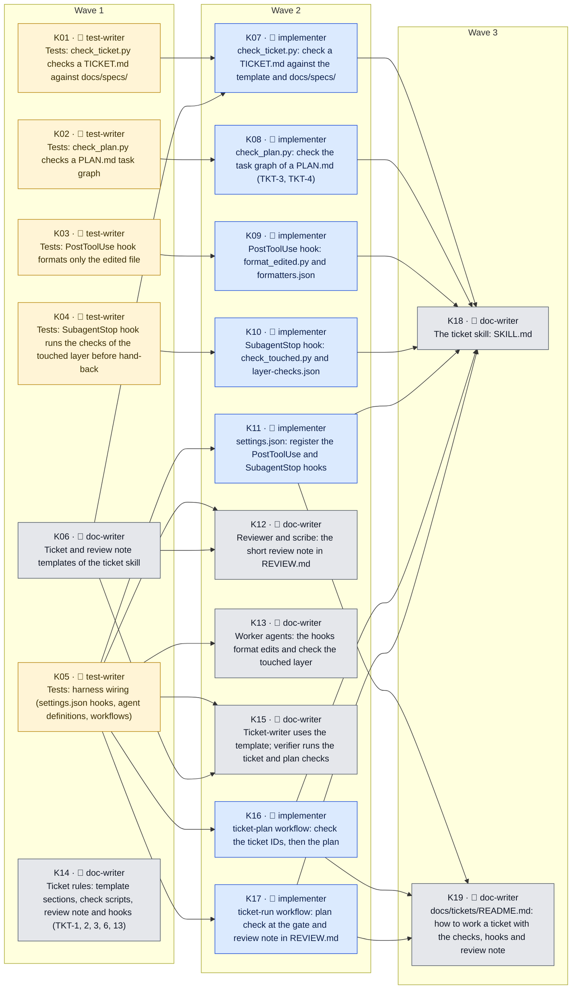

# T0.02: Plan

**Plan:** 🟢 Approved

<!-- ticket:specs -->
## 📚 Specifications

The technical pages, features, use cases and business rules of [TICKET.md](TICKET.md), copied by `python3 .claude/scripts/tickets/ticket_refs.py sync`.

- [🗂️ Architecture: mono-repo](../../specs/technical/01-architecture.md#mono-repo)
- [🧅 Architecture: layers inside each service](../../specs/technical/01-architecture.md#layers)
- [🧰 Deployment: CI/CD](../../specs/technical/09-deployment.md#ci)
<!-- /ticket:specs -->

## Summary

T0.02 extends the ticket harness that is already in `.claude/`. It already has 13 agents, the `/ticket-plan` and `/ticket-run` workflows, `checks.py`, `progress.py` and the TKT rules. The ticket adds the five missing pieces of the roadmap row:

1. a ticket template with Phase, Screens touched and Budgets touched;
2. the `ticket` skill, with deterministic check scripts: `check_ticket.py` checks the IDs and links of TICKET.md against `docs/specs/`, and `check_plan.py` checks the task graph against TKT-3 and TKT-4;
3. a short line in each worker agent definition about the hooks;
4. two hooks in `.claude/settings.json`: PostToolUse formats only the edited file (`formatters.json`), and SubagentStop runs the checks of the touched layer in a worker's worktree before hand-back (`layer-checks.json`);
5. a review note: the reviewer returns it, and the scribe writes it to `docs/tickets/<ID>/REVIEW.md`.

There are 19 tasks in 3 waves. Wave 1 (7 tasks) holds 5 test-writers under `tests/harness/`, one folder per script, plus a wiring folder for `settings.json`, the agents and the workflows. Beside them run 2 doc-writers: the TICKET.md and REVIEW.md templates, and the TKT rule update (TKT-1, TKT-2, TKT-3, TKT-6 and a new TKT-13). Wave 2 (10 tasks, at most 8 at once) holds the four scripts with their catalogues, `settings.json`, the agent definitions in three groups of separate files, and the two workflows. Each depends on its tests. Wave 3 (2 tasks) holds the SKILL.md and the `docs/tickets/README.md` update, written against the real CLI.

Acceptance criterion 1 is approached in code: `check_plan.py` has a `--min-parallel` option, and its tests run on a sample plan with 3 or more parallel tasks and on the approved T0.01 plan. The end-to-end run of a sample ticket, and the person's under-an-hour review, happen after the merge on T0.03 (see the assumptions). Every new test lives under `tests/`, so the verifier's `checks.py` runs it with ruff and pytest.

## Assumptions

- The roadmap names no feature, use case or business rule for T0.02, so none is listed.
- The roadmap names no technical page for T0.02, so only R-01 and the phase page's Goal and Work split sections are linked.
- The roadmap does not say which ticket is the sample ticket; the choice is left to the plan.
- The P0 work split says the harness is tested on T0.03 to T0.05. So the end-to-end run behind acceptance criteria 1 to 3 is done by the person after T0.02 merges, with `/ticket-plan T0.03` then `/ticket-run T0.03`, and recorded in T0.02's PROGRESS.md. Inside T0.02, criterion 1 is covered automatically: `check_plan.py` has a `--min-parallel` option, and its tests use a sample plan with 3 or more parallel tasks and the approved T0.01 plan. Criterion 3 (under an hour) is judged by the person.
- The roadmap does not say how the under-an-hour review is measured; the person judges it.
- Much of the ticket harness already exists from before T0.02: 13 agents, the `/ticket-plan` and `/ticket-run` workflows, `checks.py`, `progress.py` and the TKT rules. T0.02 extends it rather than rewriting it.
- The 'skill' of the roadmap row is `.claude/skills/ticket/`: `SKILL.md`, the templates and the scripts `check_ticket.py` and `check_plan.py`. Splitting the work and starting agents in worktrees stay in the existing workflows, which the skill documents and which now call the two check scripts.
- The reviewer stays read-only. It returns the review note in a new required `note` field of its structured result, and the scribe writes it to `docs/tickets/<ID>/REVIEW.md`. TKT-1 gains a REVIEW.md row, and TKT-6 mentions the note.
- The ticket template adds a Phase line and the sections 'Screens touched' and 'Budgets touched' before the acceptance criteria, as the roadmap row lists them, and TKT-2 is updated to match. TICKET.md files written before the template (T0.01, T0.02) are not rewritten and would not pass `check_ticket.py`.
- `check_plan.py` enforces TKT-4 as written: test-writer tasks are in wave 1, and every implementer, rust-implementer or frontend-implementer task has a test-writer among its transitive dependencies. The approved T0.01 plan passes these checks.
- The format hook formats only project files: Python under `services/`, `packages/` and `tests/`; Rust under `packages/rust/` with edition 2021 (from `packages/rust/Cargo.toml`); Terraform under `deploy/terraform/`. TypeScript gets no formatter until the pnpm workspace has one (T0.03 brings the eslint and tsc settings). Files under `.claude/` and `docs/` are never reformatted.
- The SubagentStop hook acts only in linked git worktrees, which is where the workers run. It sends failures back at most twice, the same as TKT-6's fix rounds, and then leaves them to the verifier. It skips test runs when a change touches only tests, because tests come first and fail until implemented. A missing tool is not a failure, matching `checks.py`'s environment rule. It is assumed that Claude Code passes the worktree path as `cwd` in the SubagentStop input of a worktree subagent; the sample run on T0.03 confirms this.
- Timeouts are not set by the specifications: 120 s for the format hook, 1800 s for the SubagentStop hook, and 600 s per check command.
- The hook and skill scripts are stdlib-only Python run with `python3`, in the style of `.claude/scripts/tickets/checks.py`, because AGENT.md applies to `services/` and `packages/python/`. Their tests live in `tests/harness/` and follow the AGENT.md Tests section. `tests/` is project code, so the verifier's `checks.py` lints and runs these tests.
- README.md (which has uncommitted changes by the person) and CLAUDE.md are not changed. The harness is documented in the skill's SKILL.md, in `.claude/rules/tickets.md` and in `docs/tickets/README.md`.
- The limits of the agents (what an agent may change without asking) stay as they are: only the files of its brief; never push or merge; report blocked otherwise. The P0 work split leaves any further limit to the person.
- No `settings.json` permission is added. The hooks run outside the permission system, and the check scripts are run by agents of the workflows, like `checks.py` today.

<!-- plan:graph -->

> [!NOTE]
> Generated from the json block at the end of this page by `python3 .claude/scripts/tickets/plan.py render`.
> To change a task, edit the json block, then render again: never edit this view by hand.

## Waves

| Wave | Tasks | Agents running at once |
| --- | --- | --- |
| 1 | [K01](#k01), [K02](#k02), [K03](#k03), [K04](#k04), [K05](#k05), [K06](#k06), [K14](#k14) | 7 of 7 |
| 2 | [K07](#k07), [K08](#k08), [K09](#k09), [K10](#k10), [K11](#k11), [K12](#k12), [K13](#k13), [K15](#k15), [K16](#k16), [K17](#k17) | 8 of 10 |
| 3 | [K18](#k18), [K19](#k19) | 2 of 2 |

| Wave | Task | Agent | Depends on | Unblocks |
| --- | --- | --- | --- | --- |
| 1 | [K01](#k01) Tests: check_ticket.py checks a TICKET.md against docs/specs/ | 🧪 test-writer | none | [K07](#k07) |
| 1 | [K02](#k02) Tests: check_plan.py checks a PLAN.md task graph | 🧪 test-writer | none | [K08](#k08) |
| 1 | [K03](#k03) Tests: PostToolUse hook formats only the edited file | 🧪 test-writer | none | [K09](#k09) |
| 1 | [K04](#k04) Tests: SubagentStop hook runs the checks of the touched layer before hand-back | 🧪 test-writer | none | [K10](#k10) |
| 1 | [K05](#k05) Tests: harness wiring (settings.json hooks, agent definitions, workflows) | 🧪 test-writer | none | [K11](#k11), [K12](#k12), [K13](#k13), [K15](#k15), [K16](#k16), [K17](#k17) |
| 1 | [K06](#k06) Ticket and review note templates of the ticket skill | 📝 doc-writer | none | [K07](#k07), [K12](#k12), [K15](#k15) |
| 1 | [K14](#k14) Ticket rules: template sections, check scripts, review note and hooks (TKT-1, 2, 3, 6, 13) | 📝 doc-writer | none | none |
| 2 | [K07](#k07) check_ticket.py: check a TICKET.md against the template and docs/specs/ | 🐍 implementer | [K01](#k01), [K06](#k06) | [K18](#k18) |
| 2 | [K08](#k08) check_plan.py: check the task graph of a PLAN.md (TKT-3, TKT-4) | 🐍 implementer | [K02](#k02) | [K18](#k18) |
| 2 | [K09](#k09) PostToolUse hook: format_edited.py and formatters.json | 🐍 implementer | [K03](#k03) | [K18](#k18) |
| 2 | [K10](#k10) SubagentStop hook: check_touched.py and layer-checks.json | 🐍 implementer | [K04](#k04) | [K18](#k18) |
| 2 | [K11](#k11) settings.json: register the PostToolUse and SubagentStop hooks | 🐍 implementer | [K05](#k05) | [K18](#k18), [K19](#k19) |
| 2 | [K12](#k12) Reviewer and scribe: the short review note in REVIEW.md | 📝 doc-writer | [K05](#k05), [K06](#k06) | none |
| 2 | [K13](#k13) Worker agents: the hooks format edits and check the touched layer | 📝 doc-writer | [K05](#k05) | none |
| 2 | [K15](#k15) Ticket-writer uses the template; verifier runs the ticket and plan checks | 📝 doc-writer | [K05](#k05), [K06](#k06) | none |
| 2 | [K16](#k16) ticket-plan workflow: check the ticket IDs, then the plan | 🐍 implementer | [K05](#k05) | [K18](#k18), [K19](#k19) |
| 2 | [K17](#k17) ticket-run workflow: plan check at the gate and review note in REVIEW.md | 🐍 implementer | [K05](#k05) | [K18](#k18), [K19](#k19) |
| 3 | [K18](#k18) The ticket skill: SKILL.md | 📝 doc-writer | [K07](#k07), [K08](#k08), [K09](#k09), [K10](#k10), [K11](#k11), [K16](#k16), [K17](#k17) | none |
| 3 | [K19](#k19) docs/tickets/README.md: how to work a ticket with the checks, hooks and review note | 📝 doc-writer | [K11](#k11), [K16](#k16), [K17](#k17) | none |

## Dependency graph



## Tasks

### <a id="k01"></a>K01: Tests: check_ticket.py checks a TICKET.md against docs/specs/

| Agent | Wave | Depends on | Unblocks |
| --- | --- | --- | --- |
| 🧪 test-writer | 1 | none | [K07](#k07) |

**Files** (only this task may change them in its wave):

- `tests/harness/check_ticket/test_check_ticket.py`
- `tests/harness/check_ticket/helpers.py`

**Done when:** `uv run pytest tests/harness/check_ticket -q` collects every test without a collection error. The tests fail only because .claude/skills/ticket/scripts/check_ticket.py or the template does not exist yet. `uv run ruff check tests/harness/check_ticket` and `uv run ruff format --check tests/harness/check_ticket` pass.

**Brief:**

Write the tests, before the implementation, of the script `.claude/skills/ticket/scripts/check_ticket.py`, which does not exist yet. It belongs to ticket T0.02 (docs/tickets/T0.02/TICKET.md) and to the TKT-2 rule of .claude/rules/tickets.md.

CONTRACT (the implementer gets the same text):
- Usage: `python3 .claude/skills/ticket/scripts/check_ticket.py <ID> [--root <repo root>]`. The default root is the repository that holds the script (parents[4] of the script). An ID that does not match `^T\d\.\d{2}$` gives usage on stderr and exit 2.
- The script reads `<root>/docs/tickets/<ID>/TICKET.md` and resolves its relative links from that file's folder. It prints one line per problem, `docs/tickets/<ID>/TICKET.md: <message>`, and exits 1. When all is well it prints nothing and exits 0. Each message quotes the offending value: the ID, the heading, the link target, the status or the criterion number.
- Checks:
  (a) the file exists;
  (b) the first line is `# <ID>: <non-empty title>`;
  (c) a line `**Status:** <s>`, with s one of `🟡 Planned`, `🔵 In progress`, `✅ Done`;
  (d) the `## ` headings are exactly these, in this order: `Roadmap`, `What it delivers`, `Features, use cases and business rules`, `Technical pages it builds on`, `Screens touched`, `Budgets touched`, `Acceptance criteria`, `Out of scope`, then optionally `Assumptions` last, and no other `## ` heading;
  (e) the Roadmap section has the lines `- **Ticket:**`, `- **Phase:**`, `- **Sprint:**` and `- **Epic:**`. The first link of the Ticket line targets a page under docs/specs/roadmap/, and that page contains the ticket ID;
  (f) every `FS-nnn`, `UC-nnn` and `BR-nnn` in the file is the ID of an existing page `docs/specs/functional/features/FS-nnn-*.md`, `use-cases/UC-nnn-*.md` or `business-rules/BR-nnn-*.md`;
  (g) every link to a page of those three folders shows the page's ID in its link text;
  (h) every relative Markdown link resolves: the file exists, and an anchor `#a` exists as `id="a"` in the target. http(s) and mailto links are ignored;
  (i) the Screens touched and Budgets touched sections are not empty. Every link in Screens touched targets a file under docs/specs/screens/, or a use case page with an anchor starting `screen-`. Every link in Budgets touched targets docs/specs/technical/07-scalability.md#budgets;
  (j) Acceptance criteria has at least one numbered item (`1. `), and each item contains `**Given**`, `**when**` and `**then**`;
  (k) no `{{` placeholder and no em dash is left.

TESTS: put them in one class `TestCheckTicket` in tests/harness/check_ticket/test_check_ticket.py. Run the real script with `subprocess.run([sys.executable, script, ...])` and no mocks.
- In helpers.py, write `repo_root()` (`Path(__file__).resolve().parents[3]`), the script path, and a function that builds a temporary root. In that root, `docs/specs` is a symlink to the real docs/specs, and a valid `docs/tickets/T0.03/TICKET.md` is written. That ticket uses real IDs and paths found by glob: the first FS, UC and BR pages, and the first light PNG under docs/specs/screens/UC-*/. It links the roadmap as `../../specs/roadmap/01-p0-foundations.md#s01` and the budgets as `../../specs/technical/07-scalability.md#budgets`. A second helper rewrites one part of it.
- Cover: the valid ticket passes silently with exit 0. Each refusal, parametrised, exits 1 and prints a line naming the value: an unknown FS-999, UC-999 or BR-999; a functional link without its ID; a missing file; a missing anchor; each missing heading; headings out of order; a bad status; a missing Phase line; a roadmap page that does not contain the ID (ticket T9.99 linking 01-p0-foundations.md); a screen link elsewhere; a budget link elsewhere; an empty Budgets touched; a criterion without **Given**; a `{{ID}}` placeholder; an em dash. A missing TICKET.md exits 1. A bad ID exits 2.
- One test reads `.claude/skills/ticket/templates/TICKET.md` (written by task K06 in parallel) and asserts that its `## ` headings are the nine headings of (d), in order.

RULES: follow the AGENT.md Tests section. That means `from __future__ import annotations`, one Test class, test names written as sentences, `pytest.mark.parametrize`, typing from `typing`, no Any, no nested functions and no unittest.mock. Helpers are imported as `from tests.harness.check_ticket.helpers import ...`. No `__init__.py` and no conftest.py.

### <a id="k02"></a>K02: Tests: check_plan.py checks a PLAN.md task graph

| Agent | Wave | Depends on | Unblocks |
| --- | --- | --- | --- |
| 🧪 test-writer | 1 | none | [K08](#k08) |

**Files** (only this task may change them in its wave):

- `tests/harness/check_plan/test_check_plan.py`
- `tests/harness/check_plan/helpers.py`

**Done when:** `uv run pytest tests/harness/check_plan -q` collects without error, and the tests fail only because .claude/skills/ticket/scripts/check_plan.py does not exist. `uv run ruff check tests/harness/check_plan` and `uv run ruff format --check tests/harness/check_plan` pass.

**Brief:**

Write the tests, before the implementation, of the script `.claude/skills/ticket/scripts/check_plan.py`, which does not exist yet. It belongs to ticket T0.02 and to the rules TKT-3 and TKT-4 of .claude/rules/tickets.md. It is also the automated part of acceptance criterion 1: a plan is split into at least three parallel tasks.

CONTRACT (the implementer gets the same text):
- Usage: `python3 .claude/skills/ticket/scripts/check_plan.py <ID> [--root <repo root>] [--min-parallel N]`. The default root is parents[4] of the script, and the default N is 1. A bad ID (not `^T\d\.\d{2}$`) gives usage on stderr and exit 2.
- The script reads `<root>/docs/tickets/<ID>/PLAN.md`. It prints one line per problem, `docs/tickets/<ID>/PLAN.md: <message>`, quoting the task id or the offending value, and exits 1. Otherwise it prints nothing and exits 0.
- Checks:
  (a) the file exists;
  (b) a line is exactly `**Plan:** 🟡 Awaiting approval` or `**Plan:** 🟢 Approved`;
  (c) there is exactly one &#96;&#96;&#96;json block, and it parses to a JSON array of objects;
  (d) each task has `id` (unique, `^K\d{2}$`), `title`, `brief` and `done_when` (non-empty strings), `agent` (one of test-writer, implementer, rust-implementer, frontend-implementer, mockup-writer, doc-writer), `depends_on` (a list of known task ids), `files` (a non-empty list of strings) and `wave` (an int of 1 or more);
  (e) there is no dependency cycle;
  (f) every task's wave is greater than the wave of each of its dependencies;
  (g) no file is listed by two tasks of the same wave;
  (h) every test-writer task is in wave 1;
  (i) every implementer, rust-implementer or frontend-implementer task has a test-writer task among its transitive dependencies;
  (j) the widest wave holds at least N tasks.

TESTS: put them in one class `TestCheckPlan` in tests/harness/check_plan/test_check_plan.py. Run the real script with `subprocess.run([sys.executable, ...])` and no mocks.
- helpers.py has `repo_root()` (`Path(__file__).resolve().parents[3]`), the script path, and a function that writes a PLAN.md to `<tmp>/docs/tickets/T9.99/PLAN.md` from a status line and a list of task dicts. It also has a valid sample graph: 3 test-writers in wave 1; 3 implementers in wave 2, each depending on one test-writer; 1 doc-writer in wave 1 with no dependency.
- Cover:
  - the sample passes silently, with --min-parallel 3 too, and with both status lines;
  - --min-parallel 9 fails;
  - each refusal, parametrised, exits 1 with a line naming the task or value: a bad status, no json block, two json blocks, invalid JSON, each missing key, an unknown agent such as `planner`, a duplicate id, an id like `T1`, an unknown dependency, a cycle, a wave not after its dependency, a shared file in one wave, a test-writer in wave 2, an implementer without a test-writer ancestor, an empty files list;
  - a missing PLAN.md exits 1, and a bad ID exits 2;
  - the real approved plan `docs/tickets/T0.01/PLAN.md`, run with the default root and `--min-parallel 3`, passes silently.

RULES: follow the AGENT.md Tests section: `from __future__ import annotations`, one Test class, test names written as sentences, parametrize, `typing` types, no Any, no nested functions and no mocks. Import helpers by their full path, `tests.harness.check_plan.helpers`. No `__init__.py` and no conftest.py.

### <a id="k03"></a>K03: Tests: PostToolUse hook formats only the edited file

| Agent | Wave | Depends on | Unblocks |
| --- | --- | --- | --- |
| 🧪 test-writer | 1 | none | [K09](#k09) |

**Files** (only this task may change them in its wave):

- `tests/harness/format_edited/test_format_edited.py`
- `tests/harness/format_edited/helpers.py`

**Done when:** `uv run pytest tests/harness/format_edited -q` collects without error, and the tests fail only because .claude/hooks/format_edited.py or .claude/hooks/formatters.json does not exist. `uv run ruff check tests/harness/format_edited` and `uv run ruff format --check tests/harness/format_edited` pass.

**Brief:**

Write the tests, before the implementation, of the hook script `.claude/hooks/format_edited.py` and its catalogue `.claude/hooks/formatters.json`. Neither exists yet. They belong to ticket T0.02: the hooks format only the edited files. The AGENT.md Commands rule is: format only the files you edited, never a whole folder.

CONTRACT (the implementer gets the same text):
- The hook is run as `python3 .claude/hooks/format_edited.py` with the Claude Code PostToolUse JSON on stdin: `tool_name`, `tool_input.file_path` and `cwd`.
- When tool_name is not Edit, Write or MultiEdit, when there is no file_path, when the file does not exist, or when the file is not inside a git work tree, the hook exits 0 and prints nothing. A relative file_path is resolved against cwd.
- top is `git rev-parse --show-toplevel`, run from the file's folder. The catalogue is `<top>/.claude/hooks/formatters.json` if it exists, otherwise the one beside the script. Its format is `{"formatters": [{"name": str, "match": regex, "run": [argv...]}]}`.
- `match` is searched in the file's POSIX path relative to top, and only the first matching formatter runs. In `run`, `{file}` is replaced by that relative path. The formatter runs with cwd = top and a 120 s timeout, on that one file only.
- When no formatter matches, the hook exits 0 silently. When the executable is missing (FileNotFoundError or exit 127), it exits 0 with a one-line note on stderr. When the formatter exits 0, the hook exits 0 silently. Any other exit code makes the hook exit 2 and write `<name> failed on <relative path>` plus the last 20 lines of output to stderr.
- The repository catalogue maps:
  - `^(?:services|packages|tests)/.+\.py$` to `uv run ruff format {file}`;
  - `^packages/rust/.+\.rs$` to `rustfmt --edition 2021 {file}` (the edition of packages/rust/Cargo.toml);
  - `^deploy/terraform/.+\.(?:tf|tftest\.hcl)$` to `terraform fmt {file}`;
  - nothing else. It has no TypeScript formatter yet, and it leaves .claude/ and docs/ alone.

TESTS: put them in one class `TestFormatEdited`. helpers.py builds a temporary git repo (`git init`, using `git -c user.name=Test -c user.email=test@example.com` for commits). The repo holds its own `.claude/hooks/formatters.json` whose formatters are `python3 -c` one-liners: one upper-cases the file for `\.txt$`, one exits 3 for `\.bad$`, and one calls a missing executable for `\.none$`. Run the real script with `sys.executable` and the JSON on stdin.
- Cover:
  - the edited .txt file is formatted, and a sibling .txt in the same folder is untouched;
  - Write, Edit and MultiEdit are handled (parametrised), and other tools such as Read are ignored;
  - a file outside any git repo, and a missing file, are ignored with exit 0;
  - a file matching no formatter is unchanged with exit 0;
  - a failing formatter gives exit 2 and stderr naming the file;
  - a missing executable gives exit 0;
  - a relative file_path is resolved against cwd;
  - the repository's real `.claude/hooks/formatters.json`: load it as JSON and assert which `run` the first matching formatter gives for sample paths (`services/gateway/src/gateway/x.py`, `tests/a/test_b.py`, `packages/rust/core/src/lib.rs`, `deploy/terraform/cells/dev/main.tf`), and that none matches `.claude/hooks/x.py`, `docs/specs/README.md` or `frontends/app/src/a.ts`.

RULES: follow the AGENT.md Tests section (one Test class, test names written as sentences, parametrize, typing, no Any, no nested functions, no mocks). Import helpers as `tests.harness.format_edited.helpers`, with `repo_root()` = `Path(__file__).resolve().parents[3]`. No conftest.py and no `__init__.py`.

### <a id="k04"></a>K04: Tests: SubagentStop hook runs the checks of the touched layer before hand-back

| Agent | Wave | Depends on | Unblocks |
| --- | --- | --- | --- |
| 🧪 test-writer | 1 | none | [K10](#k10) |

**Files** (only this task may change them in its wave):

- `tests/harness/check_touched/test_check_touched.py`
- `tests/harness/check_touched/helpers.py`

**Done when:** `uv run pytest tests/harness/check_touched -q` collects without error, and the tests fail only because .claude/hooks/check_touched.py or .claude/hooks/layer-checks.json does not exist. `uv run ruff check tests/harness/check_touched` and `uv run ruff format --check tests/harness/check_touched` pass.

**Brief:**

Write the tests, before the implementation, of the hook script `.claude/hooks/check_touched.py` and its catalogue `.claude/hooks/layer-checks.json`. Neither exists yet. They belong to ticket T0.02: the hooks run the checks of the touched layer before a task is handed back.

CONTRACT (the implementer gets the same text):
- The hook is run as `python3 .claude/hooks/check_touched.py [--dry-run]` with the SubagentStop JSON on stdin, keyed by `cwd`. Other keys are ignored.
- When cwd is not in a git work tree, or is the main working tree (the resolved `git rev-parse --absolute-git-dir` equals the resolved `git rev-parse --git-common-dir`), the hook exits 0 and prints nothing. Only linked worktrees, that is the workers, are checked.
- top is `git rev-parse --show-toplevel`. To find the base, take the latest commit on HEAD whose subject matches `^(T\d\.\d{2}) K\d{2}:`. If `ticket/<that ID>` exists, the base is `git merge-base HEAD ticket/<ID>`. Otherwise, if `develop` exists, it is `git merge-base HEAD develop`. Otherwise there is no base.
- Changed files are `git diff --name-only <base> HEAD`, plus the modified, added and untracked paths of `git status --porcelain`. They are relative to top, de-duplicated, sorted, and limited to files that still exist.
- The catalogue is `<top>/.claude/hooks/layer-checks.json` if it exists, otherwise the one beside the script. Its format is `{"max_blocks": int, "rules": [{"name", "match", "run": [argv], "needs"?: path, "skip_when_only_tests"?: bool}]}`. For each rule, in order:
  - the changed files on which `match` matches (re.search) are grouped by the tuple of the regex's capture groups;
  - per group, `{1}`, `{2}`... are replaced by the captures in name, run and needs, and a run item exactly `{files}` expands to the group's files;
  - the command is skipped if `needs` does not exist under top, or if skip_when_only_tests is true and every changed file matches `(^|/)tests/`;
  - identical (name, argv) pairs run once, with cwd = top and a 600 s timeout each.
- `--dry-run` prints each command that would run as `<name>: <argv joined by single spaces>`, runs nothing, and exits 0.
- A missing executable (FileNotFoundError or exit 127) is a note, not a failure. When every command passes, the hook exits 0 and deletes the counter file `<absolute git dir>/swarm-check-touched-blocks`.
- On failure, while the counter is below max_blocks, the hook increments it, writes `❌ <name>` plus the last 20 output lines per failure to stderr, then asks the agent to fix the failures within its files or report blocked, and exits 2. Once the counter reaches max_blocks, it writes a note that the verifier will report the failures, and exits 0.
- The repository catalogue's rules include these (argv shown space-joined):
  - `uv run ruff check {files}` and `uv run ruff format --check {files}` for `^(?:services|packages/python|tests)/.+\.py$`;
  - `uv run mypy services/{1}/src` for `^services/([^/]+)/src/.+\.py$`;
  - `uv run pytest services/{1}/tests/{2} -n 2` for `^services/([^/]+)/src/[^/]+/(.+)/[^/]+\.py$`, with needs `services/{1}/tests/{2}` and skip_when_only_tests;
  - `uv run pytest tests/harness/{1} -n 2` for `^\.claude/(?:hooks|scripts|skills/[^/]+/scripts)/([^/]+)\.py$`, with needs and skip_when_only_tests;
  - cargo fmt, clippy and test per crate, with `--manifest-path packages/rust/{1}/Cargo.toml` and needs that file;
  - pnpm lint, typecheck and test per `frontends` or `packages/ts` package (`pnpm --filter ./{1}/{2} run --if-present <script>`);
  - terraform fmt, init, validate and test per module folder;
  - `python3 .claude/skills/write-specs/scripts/specs.py check` for `^(?:docs/specs/|\.claude/skills/write-specs/)`;
  - `python3 .claude/skills/ticket/scripts/check_ticket.py {1}` for `^docs/tickets/(T\d\.\d{2})/TICKET\.md$`;
  - check_plan.py likewise for PLAN.md;
  - and max_blocks is 2.

TESTS: put them in one class `TestCheckTouched`. helpers.py creates a temporary repo with `git init -b develop` and one commit (use `git -c user.name=Test -c user.email=test@example.com`), plus a linked worktree (`git worktree add -b task <path> develop`), and runs the real script with `sys.executable` and the JSON on stdin. For the real-run tests, the temp repo commits its own catalogue whose rules are `python3 -c` one-liners: for example a rule on `\.txt$` that fails when a file contains FAIL.
- Cover:
  - the main working tree exits 0 with no output;
  - a worktree without changes exits 0;
  - a failing check exits 2 with `❌` and the rule name on stderr, the first and second time, and the third attempt exits 0;
  - a fixed file exits 0 and clears the counter;
  - a missing executable is not a failure;
  - a committed change (commit subject `T9.99 K01: x`, with `ticket/T9.99` created at develop) and an uncommitted one are both seen, through --dry-run with the temp catalogue, while a file committed on develop before the branch is not;
  - with the real catalogue (delete the temp one), in --dry-run: a change to `services/demo/src/demo/service/x/y.py` lists the ruff check, mypy services/demo/src and, once `services/demo/tests/service/x/` exists, the pytest lines. A change only under `services/demo/tests/` lists ruff but no pytest. A `docs/specs/x.md` change lists specs.py check.

RULES: follow the AGENT.md Tests section (one Test class, test names written as sentences, parametrize, typing, no Any, no nested functions, no mocks). Import helpers as `tests.harness.check_touched.helpers`, with `repo_root()` = `Path(__file__).resolve().parents[3]`. No conftest.py and no `__init__.py`.

### <a id="k05"></a>K05: Tests: harness wiring (settings.json hooks, agent definitions, workflows)

| Agent | Wave | Depends on | Unblocks |
| --- | --- | --- | --- |
| 🧪 test-writer | 1 | none | [K11](#k11), [K12](#k12), [K13](#k13), [K15](#k15), [K16](#k16), [K17](#k17) |

**Files** (only this task may change them in its wave):

- `tests/harness/wiring/test_harness_settings.py`
- `tests/harness/wiring/test_agent_definitions.py`
- `tests/harness/wiring/test_ticket_workflows.py`
- `tests/harness/wiring/helpers.py`

**Done when:** `uv run pytest tests/harness/wiring -q` collects without error. test_settings_keep_the_specs_permission_and_the_worktree_base, test_every_agent_names_its_file, test_every_agent_has_the_model_and_effort_of_tkt_7, test_every_kind_of_task_has_an_agent and test_ticket_run_phases_are_unchanged pass already. The other tests fail on assertions about the missing hooks, agent texts and workflow changes. `uv run ruff check tests/harness/wiring` and `uv run ruff format --check tests/harness/wiring` pass.

**Brief:**

Write static tests of the harness wiring for ticket T0.02. Each file has one Test class. helpers.py has `repo_root()` = `Path(__file__).resolve().parents[3]` and small readers: JSON, agent frontmatter between the first two `---` lines parsed as `key: value` lines, and a file's text. Use the exact test names below, because the implementation tasks select them with -k.

1. test_harness_settings.py, class `TestHarnessSettings`:
- test_settings_keep_the_specs_permission_and_the_worktree_base: `.claude/settings.json` parses, `permissions.allow` contains `Bash(python3 .claude/skills/write-specs/scripts/specs.py:*)`, and `worktree.baseRef` is `head`.
- test_post_tool_use_formats_edited_files: `hooks.PostToolUse` has an entry whose `matcher` re.fullmatch-es `Edit`, `Write` and `MultiEdit`. Its `hooks` hold a `type: command` whose command contains `$CLAUDE_PROJECT_DIR` and `.claude/hooks/format_edited.py`, with an int `timeout`.
- test_subagent_stop_checks_the_touched_layer: `hooks.SubagentStop` has a command hook containing `$CLAUDE_PROJECT_DIR` and `.claude/hooks/check_touched.py`, with an int `timeout`.

2. test_agent_definitions.py, class `TestAgentDefinitions`:
- test_every_agent_names_its_file: each `.claude/agents/*.md` has frontmatter with `name` equal to the file stem, a non-empty `description`, `tools`, `model` and `effort`.
- test_every_agent_has_the_model_and_effort_of_tkt_7: parse the table of the TKT-7 section of `.claude/rules/tickets.md`. Its first column lists agent names separated by commas, and its Model and Effort columns follow. Each listed agent's frontmatter must match.
- test_every_kind_of_task_has_an_agent: implementer, rust-implementer, frontend-implementer, test-writer, mockup-writer, doc-writer and reviewer exist.
- test_worker_agents_run_in_worktrees_and_know_the_hooks: the six workers (test-writer, implementer, rust-implementer, frontend-implementer, mockup-writer, doc-writer) have `isolation: worktree`, and their body mentions `format_edited.py` and `check_touched.py`.
- test_the_reviewer_writes_a_review_note_and_stays_read_only: reviewer.md's body contains `review note` and `.claude/skills/ticket/templates/REVIEW.md`, and its tools contain neither Write nor Edit.
- test_the_scribe_writes_the_review_note_file: scribe.md's body contains `REVIEW.md`.
- test_the_ticket_writer_uses_the_ticket_template: ticket-writer.md's body contains `.claude/skills/ticket/templates/TICKET.md`.
- test_the_verifier_runs_the_ticket_and_plan_checks: verifier.md's body contains `check_ticket.py` and `check_plan.py`.

3. test_ticket_workflows.py, class `TestTicketWorkflows`. Read the phase titles the way .claude/scripts/reports/progress.py does: take the text after `phases:` up to the first `]`, then `re.findall(r"title:\s*'([^']+)'")`.
- test_ticket_plan_phases: .claude/workflows/ticket-plan.js has the phases ['Ticket', 'Check', 'Plan', 'Write'].
- test_ticket_plan_checks_the_ticket_and_the_plan: ticket-plan.js contains `.claude/skills/ticket/scripts/check_ticket.py` and `.claude/skills/ticket/scripts/check_plan.py`.
- test_ticket_run_phases_are_unchanged: ticket-run.js has ['Gate', 'Waves', 'Verify', 'Review', 'Finish'].
- test_ticket_run_checks_the_plan_at_the_gate: ticket-run.js contains `.claude/skills/ticket/scripts/check_plan.py`.
- test_ticket_run_reviewer_returns_a_note_written_to_review_md: take the text from `const REVIEW =` to the next line starting `const `. It contains `note:` and a `required:` list that includes `'note'`. ticket-run.js also contains `REVIEW.md` and `.claude/skills/ticket/templates/REVIEW.md`.

RULES: follow the AGENT.md Tests section (from __future__ import annotations, test names written as sentences, typing from typing, no Any, no nested functions, no mocks). Import helpers as `tests.harness.wiring.helpers`. No `__init__.py` and no conftest.py. The tests read real files only.

### <a id="k06"></a>K06: Ticket and review note templates of the ticket skill

| Agent | Wave | Depends on | Unblocks |
| --- | --- | --- | --- |
| 📝 doc-writer | 1 | none | [K07](#k07), [K12](#k12), [K15](#k15) |

**Files** (only this task may change them in its wave):

- `.claude/skills/ticket/templates/TICKET.md`
- `.claude/skills/ticket/templates/REVIEW.md`

**Done when:** Both files exist. `grep -n '^## ' .claude/skills/ticket/templates/TICKET.md` prints exactly the nine headings above, in order. `grep -c '—' .claude/skills/ticket/templates/TICKET.md .claude/skills/ticket/templates/REVIEW.md` prints 0 for both. `grep -c '{{' .claude/skills/ticket/templates/TICKET.md` is at least 1.

**Brief:**

Create the two templates of the new `ticket` skill for ticket T0.02. Use plain British English with no em dash. Placeholders are written `{{NAME}}`, and guidance goes in HTML comments `<!-- ... -->`.

1. `.claude/skills/ticket/templates/TICKET.md` is the ticket template the roadmap row asks for: phase, sprint, 📘 FS, 🎬 UC and 📏 BR IDs, acceptance criteria in **Given**, **when**, **then**, screens touched and budgets touched. Base it on the shape of docs/tickets/T0.01/TICKET.md and the TKT-2 rule of .claude/rules/tickets.md.
- First line: `# {{ID}}: {{Title}}`. Then `**Status:** 🟡 Planned`.
- Then exactly these `## ` headings, in this order: `Roadmap`, `What it delivers`, `Features, use cases and business rules`, `Technical pages it builds on`, `Screens touched`, `Budgets touched`, `Acceptance criteria`, `Out of scope`, `Assumptions`.
- Roadmap has four bullets: `- **Ticket:** [{{ID}}](../../specs/roadmap/{{phase page}}#{{anchor}})`, `- **Phase:** [🛣️ {{Phase}}](...)`, `- **Sprint:** ...` and `- **Epic:** ...`.
- Features, use cases and business rules: links like `[📘 FS-nnn: Title](../../specs/functional/features/FS-nnn-slug.md)`, written in the comment as an example pattern with `{{...}}` rather than a real ID. Add a line for when the roadmap names none.
- Screens touched: links to `../../specs/screens/<UC-ID>/<node>.png` or to a use case `#screen-<node>` row, or a line saying the ticket touches no screen.
- Budgets touched: links to `../../specs/technical/07-scalability.md#budgets` naming the budget row, or a line saying none.
- Acceptance criteria: a numbered list, each item `**Given** ..., **when** ..., **then** ...`, naming the business rule and use case it verifies.
- Out of scope and Assumptions: bullets.

2. `.claude/skills/ticket/templates/REVIEW.md` is the reviewer's short note for the person (risk R-01: the person reviews design and behaviour, not style). First line: `# {{ID}}: Review note`. Then `**Verdict:** {{✅ Approved or ⚠️ Changes requested}} · **Branch:** `ticket/{{ID}}``. Then these headings: `## What changed` (at most five bullets), `## Acceptance criteria` (a table Criterion | Evidence | Result, one row per criterion of TICKET.md), `## Look at first` (the design and behaviour points the person should read, each with its files; line by line for identity, Operator isolation and Simulator isolation), `## Assumptions accepted` and `## Follow-ups`. A comment says the note is short: enough for the person to review the ticket in under an hour, never a restatement of the diff.

Do not create any other file.

### <a id="k14"></a>K14: Ticket rules: template sections, check scripts, review note and hooks (TKT-1, 2, 3, 6, 13)

| Agent | Wave | Depends on | Unblocks |
| --- | --- | --- | --- |
| 📝 doc-writer | 1 | none | none |

**Files** (only this task may change them in its wave):

- `.claude/rules/tickets.md`

**Done when:** `grep -n 'tkt-13' .claude/rules/tickets.md` shows the summary row link and the `<a id="tkt-13"></a>` heading. `grep -n 'REVIEW.md' .claude/rules/tickets.md` shows the TKT-1 row. `git diff develop -- .claude/rules/tickets.md` shows no change inside the TKT-7 table. `grep -c '—' .claude/rules/tickets.md` prints 0.

**Brief:**

Update `.claude/rules/tickets.md` for ticket T0.02. Keep its format (Rule, Why, Check per rule), the IDs, and every rule not named here. Do not change the TKT-7 table: it is parsed by the tests.
- TKT-1 table: add a row `REVIEW.md` | The reviewer's short review note for the person (TKT-6) | scribe, from the reviewer's note.
- TKT-2: TICKET.md follows the template `.claude/skills/ticket/templates/TICKET.md`. The roadmap part names the phase too, and the sections `Screens touched` and `Budgets touched` come before the acceptance criteria. Check: `/ticket-plan` runs `python3 .claude/skills/ticket/scripts/check_ticket.py <ID>`, which prints nothing when every FS, UC and BR ID and every link resolves in docs/specs/ and the sections are in order. A ticket that fails goes back to the ticket-writer once, then the run stops.
- TKT-3 Check: add that `python3 .claude/skills/ticket/scripts/check_plan.py <ID>` prints nothing (graph, waves, file ownership and tests first). `/ticket-plan` runs it after writing PLAN.md, and `/ticket-run` runs it at the gate.
- TKT-6 point 2: the reviewer also returns a short review note, written to REVIEW.md. Point 3 adds REVIEW.md.
- New rule TKT-13 at the end, with its row in the summary table: "Hooks format the edited files and check the touched layer before a task is handed back". Rule: the PostToolUse hook `.claude/hooks/format_edited.py` formats only the edited file with the formatter of its language (`.claude/hooks/formatters.json`). The SubagentStop hook `.claude/hooks/check_touched.py` runs, in a worker's worktree only, the checks of the layers the task touched (`.claude/hooks/layer-checks.json`) and sends failures back to the agent at most twice; after that the verifier decides. Changes made only of tests do not run the tests (tests first), and a missing tool is not a failure. Why: style never reaches the person's review (R-01), and a task comes back green. Check: the tests of tests/harness/.

Use plain British English with no em dash. Every reference is a relative link.

### <a id="k07"></a>K07: check_ticket.py: check a TICKET.md against the template and docs/specs/

| Agent | Wave | Depends on | Unblocks |
| --- | --- | --- | --- |
| 🐍 implementer | 2 | [K01](#k01), [K06](#k06) | [K18](#k18) |

**Files** (only this task may change them in its wave):

- `.claude/skills/ticket/scripts/check_ticket.py`

**Done when:** `uv run pytest tests/harness/check_ticket -n 2` passes. `uv run ruff check .claude/skills/ticket/scripts/check_ticket.py` and `uv run ruff format --check .claude/skills/ticket/scripts/check_ticket.py` pass.

**Brief:**

Implement `.claude/skills/ticket/scripts/check_ticket.py` so that the tests of tests/harness/check_ticket/ pass without changing them. The script reads one TICKET.md and checks it against the ticket template `.claude/skills/ticket/templates/TICKET.md` and the TKT-2 rule.

CONTRACT:
- Usage: `python3 .claude/skills/ticket/scripts/check_ticket.py <ID> [--root <repo root>]`. The default root is parents[4] of the script. An ID that does not match `^T\d\.\d{2}$` gives usage on stderr and exit 2.
- The script reads `<root>/docs/tickets/<ID>/TICKET.md` and resolves its relative links from that file's folder. It prints one line per problem, `docs/tickets/<ID>/TICKET.md: <message>`, and exits 1. When all is well it prints nothing and exits 0. Each message quotes the offending value (ID, heading, link target, status or criterion number).
- Checks:
  (a) the file exists;
  (b) the first line is `# <ID>: <non-empty title>`;
  (c) a `**Status:** <s>` line, with s one of `🟡 Planned`, `🔵 In progress`, `✅ Done`;
  (d) the `## ` headings are exactly `Roadmap`, `What it delivers`, `Features, use cases and business rules`, `Technical pages it builds on`, `Screens touched`, `Budgets touched`, `Acceptance criteria`, `Out of scope`, in order, optionally followed by `Assumptions`, and no other;
  (e) the Roadmap section has `- **Ticket:**`, `- **Phase:**`, `- **Sprint:**` and `- **Epic:**` lines. The first link of the Ticket line targets a page under docs/specs/roadmap/ that contains the ID;
  (f) every FS-nnn, UC-nnn and BR-nnn is the ID of an existing page under docs/specs/functional/features, use-cases or business-rules (`<ID>-*.md`);
  (g) a link to such a page shows its ID in the link text;
  (h) every relative link resolves: the file exists, and the anchor exists as `id="anchor"` in the target. http(s) and mailto are ignored;
  (i) Screens touched and Budgets touched are not empty. Screens links target docs/specs/screens/ files or use case `#screen-` anchors. Budgets links target docs/specs/technical/07-scalability.md#budgets;
  (j) at least one numbered acceptance criterion, each with `**Given**`, `**when**` and `**then**`;
  (k) no `{{` and no em dash.

STYLE: the script lives in .claude/ like .claude/scripts/tickets/checks.py. Use the standard library only, compatible with Python 3.12. Start with a module docstring holding the usage, then `from __future__ import annotations`. Type every signature with `typing` types and give the functions short docstrings. Write messages in British English with no em dash. Do not touch any other file. If a test seems wrong, report it instead of editing it.

### <a id="k08"></a>K08: check_plan.py: check the task graph of a PLAN.md (TKT-3, TKT-4)

| Agent | Wave | Depends on | Unblocks |
| --- | --- | --- | --- |
| 🐍 implementer | 2 | [K02](#k02) | [K18](#k18) |

**Files** (only this task may change them in its wave):

- `.claude/skills/ticket/scripts/check_plan.py`

**Done when:** `uv run pytest tests/harness/check_plan -n 2` passes. `python3 .claude/skills/ticket/scripts/check_plan.py T0.01 --min-parallel 3` prints nothing and exits 0. `uv run ruff check .claude/skills/ticket/scripts/check_plan.py` and `uv run ruff format --check .claude/skills/ticket/scripts/check_plan.py` pass.

**Brief:**

Implement `.claude/skills/ticket/scripts/check_plan.py` so that the tests of tests/harness/check_plan/ pass without changing them. That includes the test on the real approved plan docs/tickets/T0.01/PLAN.md.

CONTRACT:
- Usage: `python3 .claude/skills/ticket/scripts/check_plan.py <ID> [--root <repo root>] [--min-parallel N]`. The default root is parents[4] of the script, and the default N is 1. A bad ID (not `^T\d\.\d{2}$`) gives usage on stderr and exit 2.
- The script reads `<root>/docs/tickets/<ID>/PLAN.md`. It prints one line per problem, `docs/tickets/<ID>/PLAN.md: <message>`, quoting the task id or the value, and exits 1. Otherwise it prints nothing and exits 0.
- Checks:
  (a) the file exists;
  (b) a line is exactly `**Plan:** 🟡 Awaiting approval` or `**Plan:** 🟢 Approved`;
  (c) there is exactly one &#96;&#96;&#96;json block, and it parses to an array of objects;
  (d) each task has `id` (unique, `^K\d{2}$`), non-empty string `title`, `brief` and `done_when`, an `agent` in {test-writer, implementer, rust-implementer, frontend-implementer, mockup-writer, doc-writer}, `depends_on` (a list of known ids), `files` (a non-empty list of strings) and `wave` (an int of 1 or more, rejecting bool);
  (e) no cycle;
  (f) wave greater than every dependency's wave;
  (g) no file shared by two tasks of one wave;
  (h) test-writer tasks in wave 1;
  (i) every implementer, rust-implementer or frontend-implementer task has a test-writer among its transitive dependencies;
  (j) the widest wave holds at least N tasks.

STYLE: like .claude/scripts/tickets/checks.py. Use the standard library only, compatible with Python 3.12, with a module docstring holding the usage, `from __future__ import annotations`, typed signatures with `typing` types and short docstrings. Messages are in British English with no em dash. Do not touch any other file.

### <a id="k09"></a>K09: PostToolUse hook: format_edited.py and formatters.json

| Agent | Wave | Depends on | Unblocks |
| --- | --- | --- | --- |
| 🐍 implementer | 2 | [K03](#k03) | [K18](#k18) |

**Files** (only this task may change them in its wave):

- `.claude/hooks/format_edited.py`
- `.claude/hooks/formatters.json`

**Done when:** `uv run pytest tests/harness/format_edited -n 2` passes. `uv run ruff check .claude/hooks/format_edited.py` and `uv run ruff format --check .claude/hooks/format_edited.py` pass. `python3 -m json.tool .claude/hooks/formatters.json` exits 0.

**Brief:**

Implement the hook that formats only the edited file, so that the tests of tests/harness/format_edited/ pass without changing them. AGENT.md: format only the files you edited.

CONTRACT:
- The hook is run as `python3 .claude/hooks/format_edited.py` with the PostToolUse JSON on stdin (`tool_name`, `tool_input.file_path`, `cwd`).
- When tool_name is not Edit, Write or MultiEdit, when file_path is missing, when the file does not exist, or when the file is outside a git work tree, it exits 0 silently. A relative file_path is resolved against cwd.
- top is `git rev-parse --show-toplevel`, run from the file's folder. The catalogue is `<top>/.claude/hooks/formatters.json` if it exists, else the one beside the script: `{"formatters": [{"name", "match", "run"}]}`.
- The first formatter whose `match` re.search-es the POSIX path relative to top runs, with `{file}` replaced by that relative path, cwd = top and a 120 s timeout. Only that one file is formatted.
- With no match it exits 0 silently. A missing executable (FileNotFoundError or exit 127) gives exit 0 and a one-line note on stderr. A formatter exit of 0 gives exit 0 silently. Any other exit gives exit 2, with `<name> failed on <path>` and the last 20 output lines on stderr.
- Write `.claude/hooks/formatters.json` with exactly these three formatters:
  - `ruff format`: `^(?:services|packages|tests)/.+\.py$` runs ["uv", "run", "ruff", "format", "{file}"];
  - `rustfmt`: `^packages/rust/.+\.rs$` runs ["rustfmt", "--edition", "2021", "{file}"] (2021 is the edition of packages/rust/Cargo.toml);
  - `terraform fmt`: `^deploy/terraform/.+\.(?:tf|tftest\.hcl)$` runs ["terraform", "fmt", "{file}"].
  There is no TypeScript formatter until the pnpm workspace has one.

STYLE: like .claude/scripts/tickets/checks.py. Use the standard library only, compatible with Python 3.12, with a module docstring, `from __future__ import annotations`, typed signatures and short docstrings. Never write outside the edited file. Do not touch settings.json (task K11 registers the hook).

### <a id="k10"></a>K10: SubagentStop hook: check_touched.py and layer-checks.json

| Agent | Wave | Depends on | Unblocks |
| --- | --- | --- | --- |
| 🐍 implementer | 2 | [K04](#k04) | [K18](#k18) |

**Files** (only this task may change them in its wave):

- `.claude/hooks/check_touched.py`
- `.claude/hooks/layer-checks.json`

**Done when:** `uv run pytest tests/harness/check_touched -n 2` passes. `uv run ruff check .claude/hooks/check_touched.py` and `uv run ruff format --check .claude/hooks/check_touched.py` pass. `python3 -m json.tool .claude/hooks/layer-checks.json` exits 0.

**Brief:**

Implement the hook that runs the checks of the touched layer before a worker hands its task back, so that the tests of tests/harness/check_touched/ pass without changing them. It follows AGENT.md (Commands: run the tests one folder at a time) and TKT-6 (at most two fix rounds).

CONTRACT:
- The hook is run as `python3 .claude/hooks/check_touched.py [--dry-run]` with the SubagentStop JSON on stdin; it uses `cwd`.
- It exits 0 silently when cwd is not in a git work tree, or is the main working tree (the resolved `git rev-parse --absolute-git-dir` equals the resolved `git rev-parse --git-common-dir`).
- top is `git rev-parse --show-toplevel`. The base comes from the latest commit on HEAD whose subject matches `^(T\d\.\d{2}) K\d{2}:`: if `ticket/<ID>` exists, the base is the merge-base with it. Otherwise it is the merge-base with `develop` if that exists. Otherwise there is none.
- Changed files are `git diff --name-only <base> HEAD`, plus the modified, added and untracked paths of `git status --porcelain`, de-duplicated, sorted and still existing.
- The catalogue is `<top>/.claude/hooks/layer-checks.json`, else the one beside the script: `{"max_blocks", "rules": [{"name", "match", "run", "needs"?, "skip_when_only_tests"?}]}`. For each rule, in order:
  - the changed files matching `match` (re.search) are grouped by their capture tuple;
  - `{1}`, `{2}`... are substituted in name, run and needs, and a run item `{files}` expands to the group's files;
  - the command is skipped when `needs` is missing under top, or when skip_when_only_tests is set and every changed file matches `(^|/)tests/`;
  - duplicate (name, argv) pairs run once, with cwd = top and a 600 s timeout.
- `--dry-run` prints `<name>: <argv joined by spaces>` per command and exits 0.
- A missing executable (FileNotFoundError or exit 127) is a note, not a failure. When all pass, the hook exits 0 and deletes `<absolute git dir>/swarm-check-touched-blocks`.
- On failures, while that counter is below max_blocks, the hook increments it, writes `❌ <name>` plus the last 20 lines per failure to stderr, then asks the agent to fix them within its task's files or report blocked, and exits 2. Otherwise it writes a note that the verifier will report the failures, and exits 0.

CATALOGUE: write `.claude/hooks/layer-checks.json` with max_blocks 2 and these rules, in order:
- ruff check `{files}` and ruff format --check `{files}` (via `uv run`) for `^(?:services|packages/python|tests)/.+\.py$`;
- `uv run mypy services/{1}/src` for `^services/([^/]+)/src/.+\.py$`;
- `uv run mypy packages/python/{1}/src` for `^packages/python/([^/]+)/src/.+\.py$`;
- `uv run pytest services/{1}/tests/{2} -n 2` for `^services/([^/]+)/src/[^/]+/(.+)/[^/]+\.py$` (needs that folder, skip_when_only_tests);
- the same for `packages/python/{1}/tests/{2}`;
- `uv run pytest tests/harness/{1} -n 2` for `^\.claude/(?:hooks|scripts|skills/[^/]+/scripts)/([^/]+)\.py$` (needs, skip_when_only_tests);
- for `^packages/rust/([^/]+)/`, with needs `packages/rust/{1}/Cargo.toml`: `cargo fmt --check --manifest-path packages/rust/{1}/Cargo.toml`, then `cargo clippy --manifest-path packages/rust/{1}/Cargo.toml --all-targets -- -D warnings`, then `cargo test --manifest-path packages/rust/{1}/Cargo.toml` (skip_when_only_tests);
- for `^(frontends|packages/ts)/([^/]+)/`, with needs `{1}/{2}/package.json`: `pnpm --filter ./{1}/{2} run --if-present lint`, `typecheck` and `test` (test with skip_when_only_tests);
- for `^(deploy/terraform/.+?)(?:/tests)?/[^/]+\.(?:tf|tftest\.hcl)$`: `terraform fmt -check -recursive {1}`, then `terraform -chdir={1} init -backend=false -input=false`, `terraform -chdir={1} validate` and `terraform -chdir={1} test` (test needs `{1}/tests`; init, validate and test have skip_when_only_tests);
- `python3 .claude/skills/write-specs/scripts/specs.py check` for `^(?:docs/specs/|\.claude/skills/write-specs/)`;
- `python3 .claude/skills/ticket/scripts/check_ticket.py {1}` for `^docs/tickets/(T\d\.\d{2})/TICKET\.md$`;
- `python3 .claude/skills/ticket/scripts/check_plan.py {1}` for `^docs/tickets/(T\d\.\d{2})/PLAN\.md$`.

STYLE: like .claude/scripts/tickets/checks.py. Use the standard library only, compatible with Python 3.12, with a module docstring, `from __future__ import annotations`, typed signatures and short docstrings. Do not touch settings.json.

### <a id="k11"></a>K11: settings.json: register the PostToolUse and SubagentStop hooks

| Agent | Wave | Depends on | Unblocks |
| --- | --- | --- | --- |
| 🐍 implementer | 2 | [K05](#k05) | [K18](#k18), [K19](#k19) |

**Files** (only this task may change them in its wave):

- `.claude/settings.json`

**Done when:** `uv run pytest tests/harness/wiring/test_harness_settings.py` passes, and `python3 -m json.tool .claude/settings.json` exits 0.

**Brief:**

Add a `hooks` section to `.claude/settings.json` and keep the existing `permissions.allow` entry and `worktree.baseRef: head` unchanged. Do not add permissions.
- `PostToolUse`: one entry with `"matcher": "Edit|Write|MultiEdit"` and one hook `{"type": "command", "command": "python3 \"$CLAUDE_PROJECT_DIR\"/.claude/hooks/format_edited.py", "timeout": 120}`.
- `SubagentStop`: one entry, without a matcher, with one hook `{"type": "command", "command": "python3 \"$CLAUDE_PROJECT_DIR\"/.claude/hooks/check_touched.py", "timeout": 1800}`.

The scripts are written by K09 and K10 in parallel. Do not create them. Keep 4-space JSON indentation, as the file has now.

### <a id="k12"></a>K12: Reviewer and scribe: the short review note in REVIEW.md

| Agent | Wave | Depends on | Unblocks |
| --- | --- | --- | --- |
| 📝 doc-writer | 2 | [K05](#k05), [K06](#k06) | none |

**Files** (only this task may change them in its wave):

- `.claude/agents/reviewer.md`
- `.claude/agents/scribe.md`

**Done when:** `uv run pytest tests/harness/wiring/test_agent_definitions.py -k "reviewer or scribe or model_and_effort or names_its_file"` passes, and `grep -c '—' .claude/agents/reviewer.md .claude/agents/scribe.md` prints 0 for both.

**Brief:**

Update two agent definitions so that each reviewed ticket gets a short review note for the person (roadmap T0.02; risk R-01 in docs/specs/roadmap/12-risks.md#r-01). Keep the frontmatter model, effort, tools and maxTurns unchanged: TKT-7 is tested.
- `.claude/agents/reviewer.md`: stay read-only, with no Write and no Edit in tools. Add a paragraph: besides the verdict and findings, return in the structured field `note` a short review note in Markdown, following `.claude/skills/ticket/templates/REVIEW.md`. It covers the verdict, what changed in at most five bullets, each acceptance criterion of TICKET.md with its evidence, what to look at first (design and behaviour, with files; line by line for identity, Operator isolation and Simulator isolation), the assumptions accepted and the follow-ups. It is written so the person can review the ticket in under an hour, and never restates the diff. The body must contain the words `review note`. Mention the note in the description too.
- `.claude/agents/scribe.md`: add a bullet saying that, when given the reviewer's note, the scribe writes `docs/tickets/<ID>/REVIEW.md` exactly from it (TKT-1).

Use British English with no em dash.

### <a id="k13"></a>K13: Worker agents: the hooks format edits and check the touched layer

| Agent | Wave | Depends on | Unblocks |
| --- | --- | --- | --- |
| 📝 doc-writer | 2 | [K05](#k05) | none |

**Files** (only this task may change them in its wave):

- `.claude/agents/test-writer.md`
- `.claude/agents/implementer.md`
- `.claude/agents/rust-implementer.md`
- `.claude/agents/frontend-implementer.md`
- `.claude/agents/mockup-writer.md`
- `.claude/agents/doc-writer.md`

**Done when:** `uv run pytest tests/harness/wiring/test_agent_definitions.py -k "worker_agents or model_and_effort or names_its_file"` passes, and `grep -c '—'` on the six files prints 0 for each.

**Brief:**

In each of the six worker agent definitions, add one bullet to the list of rules, worded the same in all six files. The bullet says: the project hooks format each file you edit (`.claude/hooks/format_edited.py`, so never format a whole folder); when you stop, `.claude/hooks/check_touched.py` runs the checks of the layer you touched in your worktree and sends back what fails. Fix those failures within your files, or report the task as blocked. A change made only of tests does not run the tests, because they are written first and fail until the implementation lands.

Change nothing else. Keep the frontmatter (model, effort, isolation, tools) unchanged: TKT-7 is tested. Use British English with no em dash.

### <a id="k15"></a>K15: Ticket-writer uses the template; verifier runs the ticket and plan checks

| Agent | Wave | Depends on | Unblocks |
| --- | --- | --- | --- |
| 📝 doc-writer | 2 | [K05](#k05), [K06](#k06) | none |

**Files** (only this task may change them in its wave):

- `.claude/agents/ticket-writer.md`
- `.claude/agents/verifier.md`

**Done when:** `uv run pytest tests/harness/wiring/test_agent_definitions.py -k "ticket_writer or verifier or model_and_effort or names_its_file"` passes, and `grep -c '—' .claude/agents/ticket-writer.md .claude/agents/verifier.md` prints 0 for both.

**Brief:**

Update two agent definitions. Keep the frontmatter model, effort and tools unchanged (TKT-7 is tested).
- `.claude/agents/ticket-writer.md`: step 3 writes TICKET.md from the template `.claude/skills/ticket/templates/TICKET.md`. It fills every `{{...}}`, keeps the headings in order, and fills Phase, Screens touched (the screens of the use cases the roadmap row names, linked to docs/specs/screens/ or to the use case's `#screen-` row, or a line saying none) and Budgets touched (the rows of docs/specs/technical/07-scalability.md#budgets the row names, or a line saying none). It uses no em dash. Add that the workflow then runs `check_ticket.py`, and that when given its problems the ticket-writer fixes only TICKET.md.
- `.claude/agents/verifier.md`: add that when the prompt asks for `python3 .claude/skills/ticket/scripts/check_ticket.py <ID>` or `python3 .claude/skills/ticket/scripts/check_plan.py <ID>`, the verifier runs exactly that command from the repository root, returns passed (true only when it exits 0 and prints nothing) and returns every printed line as a problem. Otherwise it keeps its current checks.py procedure.

Use British English with no em dash.

### <a id="k16"></a>K16: ticket-plan workflow: check the ticket IDs, then the plan

| Agent | Wave | Depends on | Unblocks |
| --- | --- | --- | --- |
| 🐍 implementer | 2 | [K05](#k05) | [K18](#k18), [K19](#k19) |

**Files** (only this task may change them in its wave):

- `.claude/workflows/ticket-plan.js`

**Done when:** `uv run pytest tests/harness/wiring/test_ticket_workflows.py -k ticket_plan` passes, and `node -e "new (Object.getPrototypeOf(async function(){}).constructor)('agent','phase','log','args', require('fs').readFileSync('.claude/workflows/ticket-plan.js','utf8').replace(/^export /m,''))"` exits 0 (the body parses as an async function).

**Brief:**

Extend `.claude/workflows/ticket-plan.js` (a Claude Code workflow script with `agent`, `phase` and `log` globals, top-level await and return).
- In `meta.phases`, add `{ title: 'Check', detail: 'check_ticket.py checks the IDs, links and sections of TICKET.md' }` between Ticket and Plan. Keep single-quoted titles, because .claude/scripts/reports/progress.py parses `title: '...'`.
- Add `const CHECK = { type: 'object', properties: { passed: { type: 'boolean' }, problems: { type: 'array', items: { type: 'string' } } }, required: ['passed', 'problems'] }`.
- After the ticket-writer, call `phase('Check')`. Call `agent(...)` with agentType 'verifier', schema CHECK, and a label: run exactly `python3 .claude/skills/ticket/scripts/check_ticket.py ${ID}` from the repository root, and return passed and the printed lines. If it fails, call the ticket-writer once to fix only TICKET.md with those problems, then check again. If it still fails, `return { ticket: ID, stopped: 'TICKET.md fails check_ticket.py', problems }` before planning.
- After the Write phase's scribe call, call the verifier with `python3 .claude/skills/ticket/scripts/check_plan.py ${ID}`. When it fails, log the problems and call the scribe to append the PROGRESS.md Events row "Plan check failed: &lt;n> problems" (⚠️). Add `planCheck` (either 'passed' or the problems) to the returned object.
- Keep everything else as it is, including computeWaves and the existing prompts.

### <a id="k17"></a>K17: ticket-run workflow: plan check at the gate and review note in REVIEW.md

| Agent | Wave | Depends on | Unblocks |
| --- | --- | --- | --- |
| 🐍 implementer | 2 | [K05](#k05) | [K18](#k18), [K19](#k19) |

**Files** (only this task may change them in its wave):

- `.claude/workflows/ticket-run.js`

**Done when:** `uv run pytest tests/harness/wiring/test_ticket_workflows.py -k ticket_run` passes, and `node -e "new (Object.getPrototypeOf(async function(){}).constructor)('agent','phase','log','args', require('fs').readFileSync('.claude/workflows/ticket-run.js','utf8').replace(/^export /m,''))"` exits 0.

**Brief:**

Extend `.claude/workflows/ticket-run.js` (a Claude Code workflow script with `agent`, `phase` and `log` globals, top-level await and return). Keep the meta phases unchanged: Gate, Waves, Verify, Review, Finish.
- Add a CHECK schema `{ passed: boolean, problems: string[] }`, both required.
- Gate: after the scribe's gate has returned approved, and before the branch is prepared, call the verifier (agentType 'verifier', schema CHECK) to run exactly `python3 .claude/skills/ticket/scripts/check_plan.py ${ID}`. If it fails, return `{ ticket: ID, stopped: 'PLAN.md fails check_plan.py', problems }`.
- REVIEW schema: add `note: { type: 'string' }` and add 'note' to its `required` list. In the round-1 and confirm-fixes prompts, ask the reviewer to return in `note` the short review note following `.claude/skills/ticket/templates/REVIEW.md`.
- Finish: whenever a review ran (approved, or stopped with blocking findings), the scribe prompt also asks to write `docs/tickets/${ID}/REVIEW.md` exactly from the last review's note (JSON.stringify it). Add `reviewNote` (the path, or 'not written') to the returned object.
- Keep everything else as it is: the fix rounds, TKT-11 skipping, TKT-12 and the environment stop.

### <a id="k18"></a>K18: The ticket skill: SKILL.md

| Agent | Wave | Depends on | Unblocks |
| --- | --- | --- | --- |
| 📝 doc-writer | 3 | [K07](#k07), [K08](#k08), [K09](#k09), [K10](#k10), [K11](#k11), [K16](#k16), [K17](#k17) | none |

**Files** (only this task may change them in its wave):

- `.claude/skills/ticket/SKILL.md`

**Done when:** The file exists with the frontmatter `name: ticket` and a description. Every repository path it names exists (check each with `ls`). `grep -c '—' .claude/skills/ticket/SKILL.md` prints 0.

**Brief:**

Write `.claude/skills/ticket/SKILL.md`, the skill the T0.02 roadmap row asks for. It reads a ticket, checks its IDs against docs/specs/, writes the task split, and starts one agent per task in its own git worktree, through the existing workflows. Model the frontmatter on .claude/skills/specs-rules/SKILL.md: `name: ticket`, and a `description` saying when to use it (open, plan, run or review a roadmap ticket, fill the ticket template, check a ticket or a plan). The body is short, has tables, and uses British English with no em dash:
- the three steps: `/ticket-plan <ID>` (ticket-writer, check_ticket.py, planner, scribe, check_plan.py), approval by editing `**Plan:** 🟢 Approved`, and `/ticket-run <ID>` (gate with check_plan.py, waves in worktrees, integrator, verifier with .claude/scripts/tickets/checks.py, reviewer and REVIEW.md, local merge, never pushed);
- the templates `templates/TICKET.md` and `templates/REVIEW.md`;
- the scripts and their usage, read from their docstrings: `scripts/check_ticket.py <ID>`, `scripts/check_plan.py <ID> [--min-parallel N]`, `.claude/scripts/tickets/checks.py --ticket <ID>`, `.claude/scripts/reports/progress.py`;
- the hooks registered in .claude/settings.json and their catalogues (.claude/hooks/formatters.json, .claude/hooks/layer-checks.json);
- the agent for each kind of task (Python service: implementer; Rust core: rust-implementer; front end: frontend-implementer; tests: test-writer; mock-ups and screens: mockup-writer; specifications and documentation: doc-writer; reviewer);
- the rules: a link to .claude/rules/tickets.md, never a copy of them.

### <a id="k19"></a>K19: docs/tickets/README.md: how to work a ticket with the checks, hooks and review note

| Agent | Wave | Depends on | Unblocks |
| --- | --- | --- | --- |
| 📝 doc-writer | 3 | [K11](#k11), [K16](#k16), [K17](#k17) | none |

**Files** (only this task may change them in its wave):

- `docs/tickets/README.md`

**Done when:** `git diff develop -- docs/tickets/README.md` touches only the "How to work a ticket" section. Every relative link it adds resolves to an existing file. `grep -c '—' docs/tickets/README.md` prints 0.

**Brief:**

Update only the section "How to work a ticket" of `docs/tickets/README.md`:
- In the step table, the Plan result adds that TICKET.md is checked by check_ticket.py and PLAN.md by check_plan.py. The Run result adds hooks that format each edited file and check the touched layer before a task is handed back, and the reviewer's note in `REVIEW.md`.
- Add one sentence linking the skill `../../.claude/skills/ticket/SKILL.md` and the template `../../.claude/skills/ticket/templates/TICKET.md`.

Leave the ticket tables and their statuses unchanged. Use British English with no em dash, and relative links that resolve.

<!-- /plan:graph -->

## Task graph

<details>
<summary>🤖 Task graph as read by <code>/ticket-run</code> (json)</summary>

```json
[
  {
    "id": "K01",
    "title": "Tests: check_ticket.py checks a TICKET.md against docs/specs/",
    "agent": "test-writer",
    "depends_on": [],
    "files": [
      "tests/harness/check_ticket/test_check_ticket.py",
      "tests/harness/check_ticket/helpers.py"
    ],
    "brief": "Write the tests, before the implementation, of the script `.claude/skills/ticket/scripts/check_ticket.py`, which does not exist yet. It belongs to ticket T0.02 (docs/tickets/T0.02/TICKET.md) and to the TKT-2 rule of .claude/rules/tickets.md.\n\nCONTRACT (the implementer gets the same text):\n- Usage: `python3 .claude/skills/ticket/scripts/check_ticket.py <ID> [--root <repo root>]`. The default root is the repository that holds the script (parents[4] of the script). An ID that does not match `^T\\d\\.\\d{2}$` gives usage on stderr and exit 2.\n- The script reads `<root>/docs/tickets/<ID>/TICKET.md` and resolves its relative links from that file's folder. It prints one line per problem, `docs/tickets/<ID>/TICKET.md: <message>`, and exits 1. When all is well it prints nothing and exits 0. Each message quotes the offending value: the ID, the heading, the link target, the status or the criterion number.\n- Checks:\n  (a) the file exists;\n  (b) the first line is `# <ID>: <non-empty title>`;\n  (c) a line `**Status:** <s>`, with s one of `🟡 Planned`, `🔵 In progress`, `✅ Done`;\n  (d) the `## ` headings are exactly these, in this order: `Roadmap`, `What it delivers`, `Features, use cases and business rules`, `Technical pages it builds on`, `Screens touched`, `Budgets touched`, `Acceptance criteria`, `Out of scope`, then optionally `Assumptions` last, and no other `## ` heading;\n  (e) the Roadmap section has the lines `- **Ticket:**`, `- **Phase:**`, `- **Sprint:**` and `- **Epic:**`. The first link of the Ticket line targets a page under docs/specs/roadmap/, and that page contains the ticket ID;\n  (f) every `FS-nnn`, `UC-nnn` and `BR-nnn` in the file is the ID of an existing page `docs/specs/functional/features/FS-nnn-*.md`, `use-cases/UC-nnn-*.md` or `business-rules/BR-nnn-*.md`;\n  (g) every link to a page of those three folders shows the page's ID in its link text;\n  (h) every relative Markdown link resolves: the file exists, and an anchor `#a` exists as `id=\"a\"` in the target. http(s) and mailto links are ignored;\n  (i) the Screens touched and Budgets touched sections are not empty. Every link in Screens touched targets a file under docs/specs/screens/, or a use case page with an anchor starting `screen-`. Every link in Budgets touched targets docs/specs/technical/07-scalability.md#budgets;\n  (j) Acceptance criteria has at least one numbered item (`1. `), and each item contains `**Given**`, `**when**` and `**then**`;\n  (k) no `{{` placeholder and no em dash is left.\n\nTESTS: put them in one class `TestCheckTicket` in tests/harness/check_ticket/test_check_ticket.py. Run the real script with `subprocess.run([sys.executable, script, ...])` and no mocks.\n- In helpers.py, write `repo_root()` (`Path(__file__).resolve().parents[3]`), the script path, and a function that builds a temporary root. In that root, `docs/specs` is a symlink to the real docs/specs, and a valid `docs/tickets/T0.03/TICKET.md` is written. That ticket uses real IDs and paths found by glob: the first FS, UC and BR pages, and the first light PNG under docs/specs/screens/UC-*/. It links the roadmap as `../../specs/roadmap/01-p0-foundations.md#s01` and the budgets as `../../specs/technical/07-scalability.md#budgets`. A second helper rewrites one part of it.\n- Cover: the valid ticket passes silently with exit 0. Each refusal, parametrised, exits 1 and prints a line naming the value: an unknown FS-999, UC-999 or BR-999; a functional link without its ID; a missing file; a missing anchor; each missing heading; headings out of order; a bad status; a missing Phase line; a roadmap page that does not contain the ID (ticket T9.99 linking 01-p0-foundations.md); a screen link elsewhere; a budget link elsewhere; an empty Budgets touched; a criterion without **Given**; a `{{ID}}` placeholder; an em dash. A missing TICKET.md exits 1. A bad ID exits 2.\n- One test reads `.claude/skills/ticket/templates/TICKET.md` (written by task K06 in parallel) and asserts that its `## ` headings are the nine headings of (d), in order.\n\nRULES: follow the AGENT.md Tests section. That means `from __future__ import annotations`, one Test class, test names written as sentences, `pytest.mark.parametrize`, typing from `typing`, no Any, no nested functions and no unittest.mock. Helpers are imported as `from tests.harness.check_ticket.helpers import ...`. No `__init__.py` and no conftest.py.",
    "done_when": "`uv run pytest tests/harness/check_ticket -q` collects every test without a collection error. The tests fail only because .claude/skills/ticket/scripts/check_ticket.py or the template does not exist yet. `uv run ruff check tests/harness/check_ticket` and `uv run ruff format --check tests/harness/check_ticket` pass.",
    "wave": 1
  },
  {
    "id": "K02",
    "title": "Tests: check_plan.py checks a PLAN.md task graph",
    "agent": "test-writer",
    "depends_on": [],
    "files": [
      "tests/harness/check_plan/test_check_plan.py",
      "tests/harness/check_plan/helpers.py"
    ],
    "brief": "Write the tests, before the implementation, of the script `.claude/skills/ticket/scripts/check_plan.py`, which does not exist yet. It belongs to ticket T0.02 and to the rules TKT-3 and TKT-4 of .claude/rules/tickets.md. It is also the automated part of acceptance criterion 1: a plan is split into at least three parallel tasks.\n\nCONTRACT (the implementer gets the same text):\n- Usage: `python3 .claude/skills/ticket/scripts/check_plan.py <ID> [--root <repo root>] [--min-parallel N]`. The default root is parents[4] of the script, and the default N is 1. A bad ID (not `^T\\d\\.\\d{2}$`) gives usage on stderr and exit 2.\n- The script reads `<root>/docs/tickets/<ID>/PLAN.md`. It prints one line per problem, `docs/tickets/<ID>/PLAN.md: <message>`, quoting the task id or the offending value, and exits 1. Otherwise it prints nothing and exits 0.\n- Checks:\n  (a) the file exists;\n  (b) a line is exactly `**Plan:** 🟡 Awaiting approval` or `**Plan:** 🟢 Approved`;\n  (c) there is exactly one ```json block, and it parses to a JSON array of objects;\n  (d) each task has `id` (unique, `^K\\d{2}$`), `title`, `brief` and `done_when` (non-empty strings), `agent` (one of test-writer, implementer, rust-implementer, frontend-implementer, mockup-writer, doc-writer), `depends_on` (a list of known task ids), `files` (a non-empty list of strings) and `wave` (an int of 1 or more);\n  (e) there is no dependency cycle;\n  (f) every task's wave is greater than the wave of each of its dependencies;\n  (g) no file is listed by two tasks of the same wave;\n  (h) every test-writer task is in wave 1;\n  (i) every implementer, rust-implementer or frontend-implementer task has a test-writer task among its transitive dependencies;\n  (j) the widest wave holds at least N tasks.\n\nTESTS: put them in one class `TestCheckPlan` in tests/harness/check_plan/test_check_plan.py. Run the real script with `subprocess.run([sys.executable, ...])` and no mocks.\n- helpers.py has `repo_root()` (`Path(__file__).resolve().parents[3]`), the script path, and a function that writes a PLAN.md to `<tmp>/docs/tickets/T9.99/PLAN.md` from a status line and a list of task dicts. It also has a valid sample graph: 3 test-writers in wave 1; 3 implementers in wave 2, each depending on one test-writer; 1 doc-writer in wave 1 with no dependency.\n- Cover:\n  - the sample passes silently, with --min-parallel 3 too, and with both status lines;\n  - --min-parallel 9 fails;\n  - each refusal, parametrised, exits 1 with a line naming the task or value: a bad status, no json block, two json blocks, invalid JSON, each missing key, an unknown agent such as `planner`, a duplicate id, an id like `T1`, an unknown dependency, a cycle, a wave not after its dependency, a shared file in one wave, a test-writer in wave 2, an implementer without a test-writer ancestor, an empty files list;\n  - a missing PLAN.md exits 1, and a bad ID exits 2;\n  - the real approved plan `docs/tickets/T0.01/PLAN.md`, run with the default root and `--min-parallel 3`, passes silently.\n\nRULES: follow the AGENT.md Tests section: `from __future__ import annotations`, one Test class, test names written as sentences, parametrize, `typing` types, no Any, no nested functions and no mocks. Import helpers by their full path, `tests.harness.check_plan.helpers`. No `__init__.py` and no conftest.py.",
    "done_when": "`uv run pytest tests/harness/check_plan -q` collects without error, and the tests fail only because .claude/skills/ticket/scripts/check_plan.py does not exist. `uv run ruff check tests/harness/check_plan` and `uv run ruff format --check tests/harness/check_plan` pass.",
    "wave": 1
  },
  {
    "id": "K03",
    "title": "Tests: PostToolUse hook formats only the edited file",
    "agent": "test-writer",
    "depends_on": [],
    "files": [
      "tests/harness/format_edited/test_format_edited.py",
      "tests/harness/format_edited/helpers.py"
    ],
    "brief": "Write the tests, before the implementation, of the hook script `.claude/hooks/format_edited.py` and its catalogue `.claude/hooks/formatters.json`. Neither exists yet. They belong to ticket T0.02: the hooks format only the edited files. The AGENT.md Commands rule is: format only the files you edited, never a whole folder.\n\nCONTRACT (the implementer gets the same text):\n- The hook is run as `python3 .claude/hooks/format_edited.py` with the Claude Code PostToolUse JSON on stdin: `tool_name`, `tool_input.file_path` and `cwd`.\n- When tool_name is not Edit, Write or MultiEdit, when there is no file_path, when the file does not exist, or when the file is not inside a git work tree, the hook exits 0 and prints nothing. A relative file_path is resolved against cwd.\n- top is `git rev-parse --show-toplevel`, run from the file's folder. The catalogue is `<top>/.claude/hooks/formatters.json` if it exists, otherwise the one beside the script. Its format is `{\"formatters\": [{\"name\": str, \"match\": regex, \"run\": [argv...]}]}`.\n- `match` is searched in the file's POSIX path relative to top, and only the first matching formatter runs. In `run`, `{file}` is replaced by that relative path. The formatter runs with cwd = top and a 120 s timeout, on that one file only.\n- When no formatter matches, the hook exits 0 silently. When the executable is missing (FileNotFoundError or exit 127), it exits 0 with a one-line note on stderr. When the formatter exits 0, the hook exits 0 silently. Any other exit code makes the hook exit 2 and write `<name> failed on <relative path>` plus the last 20 lines of output to stderr.\n- The repository catalogue maps:\n  - `^(?:services|packages|tests)/.+\\.py$` to `uv run ruff format {file}`;\n  - `^packages/rust/.+\\.rs$` to `rustfmt --edition 2021 {file}` (the edition of packages/rust/Cargo.toml);\n  - `^deploy/terraform/.+\\.(?:tf|tftest\\.hcl)$` to `terraform fmt {file}`;\n  - nothing else. It has no TypeScript formatter yet, and it leaves .claude/ and docs/ alone.\n\nTESTS: put them in one class `TestFormatEdited`. helpers.py builds a temporary git repo (`git init`, using `git -c user.name=Test -c user.email=test@example.com` for commits). The repo holds its own `.claude/hooks/formatters.json` whose formatters are `python3 -c` one-liners: one upper-cases the file for `\\.txt$`, one exits 3 for `\\.bad$`, and one calls a missing executable for `\\.none$`. Run the real script with `sys.executable` and the JSON on stdin.\n- Cover:\n  - the edited .txt file is formatted, and a sibling .txt in the same folder is untouched;\n  - Write, Edit and MultiEdit are handled (parametrised), and other tools such as Read are ignored;\n  - a file outside any git repo, and a missing file, are ignored with exit 0;\n  - a file matching no formatter is unchanged with exit 0;\n  - a failing formatter gives exit 2 and stderr naming the file;\n  - a missing executable gives exit 0;\n  - a relative file_path is resolved against cwd;\n  - the repository's real `.claude/hooks/formatters.json`: load it as JSON and assert which `run` the first matching formatter gives for sample paths (`services/gateway/src/gateway/x.py`, `tests/a/test_b.py`, `packages/rust/core/src/lib.rs`, `deploy/terraform/cells/dev/main.tf`), and that none matches `.claude/hooks/x.py`, `docs/specs/README.md` or `frontends/app/src/a.ts`.\n\nRULES: follow the AGENT.md Tests section (one Test class, test names written as sentences, parametrize, typing, no Any, no nested functions, no mocks). Import helpers as `tests.harness.format_edited.helpers`, with `repo_root()` = `Path(__file__).resolve().parents[3]`. No conftest.py and no `__init__.py`.",
    "done_when": "`uv run pytest tests/harness/format_edited -q` collects without error, and the tests fail only because .claude/hooks/format_edited.py or .claude/hooks/formatters.json does not exist. `uv run ruff check tests/harness/format_edited` and `uv run ruff format --check tests/harness/format_edited` pass.",
    "wave": 1
  },
  {
    "id": "K04",
    "title": "Tests: SubagentStop hook runs the checks of the touched layer before hand-back",
    "agent": "test-writer",
    "depends_on": [],
    "files": [
      "tests/harness/check_touched/test_check_touched.py",
      "tests/harness/check_touched/helpers.py"
    ],
    "brief": "Write the tests, before the implementation, of the hook script `.claude/hooks/check_touched.py` and its catalogue `.claude/hooks/layer-checks.json`. Neither exists yet. They belong to ticket T0.02: the hooks run the checks of the touched layer before a task is handed back.\n\nCONTRACT (the implementer gets the same text):\n- The hook is run as `python3 .claude/hooks/check_touched.py [--dry-run]` with the SubagentStop JSON on stdin, keyed by `cwd`. Other keys are ignored.\n- When cwd is not in a git work tree, or is the main working tree (the resolved `git rev-parse --absolute-git-dir` equals the resolved `git rev-parse --git-common-dir`), the hook exits 0 and prints nothing. Only linked worktrees, that is the workers, are checked.\n- top is `git rev-parse --show-toplevel`. To find the base, take the latest commit on HEAD whose subject matches `^(T\\d\\.\\d{2}) K\\d{2}:`. If `ticket/<that ID>` exists, the base is `git merge-base HEAD ticket/<ID>`. Otherwise, if `develop` exists, it is `git merge-base HEAD develop`. Otherwise there is no base.\n- Changed files are `git diff --name-only <base> HEAD`, plus the modified, added and untracked paths of `git status --porcelain`. They are relative to top, de-duplicated, sorted, and limited to files that still exist.\n- The catalogue is `<top>/.claude/hooks/layer-checks.json` if it exists, otherwise the one beside the script. Its format is `{\"max_blocks\": int, \"rules\": [{\"name\", \"match\", \"run\": [argv], \"needs\"?: path, \"skip_when_only_tests\"?: bool}]}`. For each rule, in order:\n  - the changed files on which `match` matches (re.search) are grouped by the tuple of the regex's capture groups;\n  - per group, `{1}`, `{2}`... are replaced by the captures in name, run and needs, and a run item exactly `{files}` expands to the group's files;\n  - the command is skipped if `needs` does not exist under top, or if skip_when_only_tests is true and every changed file matches `(^|/)tests/`;\n  - identical (name, argv) pairs run once, with cwd = top and a 600 s timeout each.\n- `--dry-run` prints each command that would run as `<name>: <argv joined by single spaces>`, runs nothing, and exits 0.\n- A missing executable (FileNotFoundError or exit 127) is a note, not a failure. When every command passes, the hook exits 0 and deletes the counter file `<absolute git dir>/swarm-check-touched-blocks`.\n- On failure, while the counter is below max_blocks, the hook increments it, writes `❌ <name>` plus the last 20 output lines per failure to stderr, then asks the agent to fix the failures within its files or report blocked, and exits 2. Once the counter reaches max_blocks, it writes a note that the verifier will report the failures, and exits 0.\n- The repository catalogue's rules include these (argv shown space-joined):\n  - `uv run ruff check {files}` and `uv run ruff format --check {files}` for `^(?:services|packages/python|tests)/.+\\.py$`;\n  - `uv run mypy services/{1}/src` for `^services/([^/]+)/src/.+\\.py$`;\n  - `uv run pytest services/{1}/tests/{2} -n 2` for `^services/([^/]+)/src/[^/]+/(.+)/[^/]+\\.py$`, with needs `services/{1}/tests/{2}` and skip_when_only_tests;\n  - `uv run pytest tests/harness/{1} -n 2` for `^\\.claude/(?:hooks|scripts|skills/[^/]+/scripts)/([^/]+)\\.py$`, with needs and skip_when_only_tests;\n  - cargo fmt, clippy and test per crate, with `--manifest-path packages/rust/{1}/Cargo.toml` and needs that file;\n  - pnpm lint, typecheck and test per `frontends` or `packages/ts` package (`pnpm --filter ./{1}/{2} run --if-present <script>`);\n  - terraform fmt, init, validate and test per module folder;\n  - `python3 .claude/skills/write-specs/scripts/specs.py check` for `^(?:docs/specs/|\\.claude/skills/write-specs/)`;\n  - `python3 .claude/skills/ticket/scripts/check_ticket.py {1}` for `^docs/tickets/(T\\d\\.\\d{2})/TICKET\\.md$`;\n  - check_plan.py likewise for PLAN.md;\n  - and max_blocks is 2.\n\nTESTS: put them in one class `TestCheckTouched`. helpers.py creates a temporary repo with `git init -b develop` and one commit (use `git -c user.name=Test -c user.email=test@example.com`), plus a linked worktree (`git worktree add -b task <path> develop`), and runs the real script with `sys.executable` and the JSON on stdin. For the real-run tests, the temp repo commits its own catalogue whose rules are `python3 -c` one-liners: for example a rule on `\\.txt$` that fails when a file contains FAIL.\n- Cover:\n  - the main working tree exits 0 with no output;\n  - a worktree without changes exits 0;\n  - a failing check exits 2 with `❌` and the rule name on stderr, the first and second time, and the third attempt exits 0;\n  - a fixed file exits 0 and clears the counter;\n  - a missing executable is not a failure;\n  - a committed change (commit subject `T9.99 K01: x`, with `ticket/T9.99` created at develop) and an uncommitted one are both seen, through --dry-run with the temp catalogue, while a file committed on develop before the branch is not;\n  - with the real catalogue (delete the temp one), in --dry-run: a change to `services/demo/src/demo/service/x/y.py` lists the ruff check, mypy services/demo/src and, once `services/demo/tests/service/x/` exists, the pytest lines. A change only under `services/demo/tests/` lists ruff but no pytest. A `docs/specs/x.md` change lists specs.py check.\n\nRULES: follow the AGENT.md Tests section (one Test class, test names written as sentences, parametrize, typing, no Any, no nested functions, no mocks). Import helpers as `tests.harness.check_touched.helpers`, with `repo_root()` = `Path(__file__).resolve().parents[3]`. No conftest.py and no `__init__.py`.",
    "done_when": "`uv run pytest tests/harness/check_touched -q` collects without error, and the tests fail only because .claude/hooks/check_touched.py or .claude/hooks/layer-checks.json does not exist. `uv run ruff check tests/harness/check_touched` and `uv run ruff format --check tests/harness/check_touched` pass.",
    "wave": 1
  },
  {
    "id": "K05",
    "title": "Tests: harness wiring (settings.json hooks, agent definitions, workflows)",
    "agent": "test-writer",
    "depends_on": [],
    "files": [
      "tests/harness/wiring/test_harness_settings.py",
      "tests/harness/wiring/test_agent_definitions.py",
      "tests/harness/wiring/test_ticket_workflows.py",
      "tests/harness/wiring/helpers.py"
    ],
    "brief": "Write static tests of the harness wiring for ticket T0.02. Each file has one Test class. helpers.py has `repo_root()` = `Path(__file__).resolve().parents[3]` and small readers: JSON, agent frontmatter between the first two `---` lines parsed as `key: value` lines, and a file's text. Use the exact test names below, because the implementation tasks select them with -k.\n\n1. test_harness_settings.py, class `TestHarnessSettings`:\n- test_settings_keep_the_specs_permission_and_the_worktree_base: `.claude/settings.json` parses, `permissions.allow` contains `Bash(python3 .claude/skills/write-specs/scripts/specs.py:*)`, and `worktree.baseRef` is `head`.\n- test_post_tool_use_formats_edited_files: `hooks.PostToolUse` has an entry whose `matcher` re.fullmatch-es `Edit`, `Write` and `MultiEdit`. Its `hooks` hold a `type: command` whose command contains `$CLAUDE_PROJECT_DIR` and `.claude/hooks/format_edited.py`, with an int `timeout`.\n- test_subagent_stop_checks_the_touched_layer: `hooks.SubagentStop` has a command hook containing `$CLAUDE_PROJECT_DIR` and `.claude/hooks/check_touched.py`, with an int `timeout`.\n\n2. test_agent_definitions.py, class `TestAgentDefinitions`:\n- test_every_agent_names_its_file: each `.claude/agents/*.md` has frontmatter with `name` equal to the file stem, a non-empty `description`, `tools`, `model` and `effort`.\n- test_every_agent_has_the_model_and_effort_of_tkt_7: parse the table of the TKT-7 section of `.claude/rules/tickets.md`. Its first column lists agent names separated by commas, and its Model and Effort columns follow. Each listed agent's frontmatter must match.\n- test_every_kind_of_task_has_an_agent: implementer, rust-implementer, frontend-implementer, test-writer, mockup-writer, doc-writer and reviewer exist.\n- test_worker_agents_run_in_worktrees_and_know_the_hooks: the six workers (test-writer, implementer, rust-implementer, frontend-implementer, mockup-writer, doc-writer) have `isolation: worktree`, and their body mentions `format_edited.py` and `check_touched.py`.\n- test_the_reviewer_writes_a_review_note_and_stays_read_only: reviewer.md's body contains `review note` and `.claude/skills/ticket/templates/REVIEW.md`, and its tools contain neither Write nor Edit.\n- test_the_scribe_writes_the_review_note_file: scribe.md's body contains `REVIEW.md`.\n- test_the_ticket_writer_uses_the_ticket_template: ticket-writer.md's body contains `.claude/skills/ticket/templates/TICKET.md`.\n- test_the_verifier_runs_the_ticket_and_plan_checks: verifier.md's body contains `check_ticket.py` and `check_plan.py`.\n\n3. test_ticket_workflows.py, class `TestTicketWorkflows`. Read the phase titles the way .claude/scripts/reports/progress.py does: take the text after `phases:` up to the first `]`, then `re.findall(r\"title:\\s*'([^']+)'\")`.\n- test_ticket_plan_phases: .claude/workflows/ticket-plan.js has the phases ['Ticket', 'Check', 'Plan', 'Write'].\n- test_ticket_plan_checks_the_ticket_and_the_plan: ticket-plan.js contains `.claude/skills/ticket/scripts/check_ticket.py` and `.claude/skills/ticket/scripts/check_plan.py`.\n- test_ticket_run_phases_are_unchanged: ticket-run.js has ['Gate', 'Waves', 'Verify', 'Review', 'Finish'].\n- test_ticket_run_checks_the_plan_at_the_gate: ticket-run.js contains `.claude/skills/ticket/scripts/check_plan.py`.\n- test_ticket_run_reviewer_returns_a_note_written_to_review_md: take the text from `const REVIEW =` to the next line starting `const `. It contains `note:` and a `required:` list that includes `'note'`. ticket-run.js also contains `REVIEW.md` and `.claude/skills/ticket/templates/REVIEW.md`.\n\nRULES: follow the AGENT.md Tests section (from __future__ import annotations, test names written as sentences, typing from typing, no Any, no nested functions, no mocks). Import helpers as `tests.harness.wiring.helpers`. No `__init__.py` and no conftest.py. The tests read real files only.",
    "done_when": "`uv run pytest tests/harness/wiring -q` collects without error. test_settings_keep_the_specs_permission_and_the_worktree_base, test_every_agent_names_its_file, test_every_agent_has_the_model_and_effort_of_tkt_7, test_every_kind_of_task_has_an_agent and test_ticket_run_phases_are_unchanged pass already. The other tests fail on assertions about the missing hooks, agent texts and workflow changes. `uv run ruff check tests/harness/wiring` and `uv run ruff format --check tests/harness/wiring` pass.",
    "wave": 1
  },
  {
    "id": "K06",
    "title": "Ticket and review note templates of the ticket skill",
    "agent": "doc-writer",
    "depends_on": [],
    "files": [
      ".claude/skills/ticket/templates/TICKET.md",
      ".claude/skills/ticket/templates/REVIEW.md"
    ],
    "brief": "Create the two templates of the new `ticket` skill for ticket T0.02. Use plain British English with no em dash. Placeholders are written `{{NAME}}`, and guidance goes in HTML comments `<!-- ... -->`.\n\n1. `.claude/skills/ticket/templates/TICKET.md` is the ticket template the roadmap row asks for: phase, sprint, 📘 FS, 🎬 UC and 📏 BR IDs, acceptance criteria in **Given**, **when**, **then**, screens touched and budgets touched. Base it on the shape of docs/tickets/T0.01/TICKET.md and the TKT-2 rule of .claude/rules/tickets.md.\n- First line: `# {{ID}}: {{Title}}`. Then `**Status:** 🟡 Planned`.\n- Then exactly these `## ` headings, in this order: `Roadmap`, `What it delivers`, `Features, use cases and business rules`, `Technical pages it builds on`, `Screens touched`, `Budgets touched`, `Acceptance criteria`, `Out of scope`, `Assumptions`.\n- Roadmap has four bullets: `- **Ticket:** [{{ID}}](../../specs/roadmap/{{phase page}}#{{anchor}})`, `- **Phase:** [🛣️ {{Phase}}](...)`, `- **Sprint:** ...` and `- **Epic:** ...`.\n- Features, use cases and business rules: links like `[📘 FS-nnn: Title](../../specs/functional/features/FS-nnn-slug.md)`, written in the comment as an example pattern with `{{...}}` rather than a real ID. Add a line for when the roadmap names none.\n- Screens touched: links to `../../specs/screens/<UC-ID>/<node>.png` or to a use case `#screen-<node>` row, or a line saying the ticket touches no screen.\n- Budgets touched: links to `../../specs/technical/07-scalability.md#budgets` naming the budget row, or a line saying none.\n- Acceptance criteria: a numbered list, each item `**Given** ..., **when** ..., **then** ...`, naming the business rule and use case it verifies.\n- Out of scope and Assumptions: bullets.\n\n2. `.claude/skills/ticket/templates/REVIEW.md` is the reviewer's short note for the person (risk R-01: the person reviews design and behaviour, not style). First line: `# {{ID}}: Review note`. Then `**Verdict:** {{✅ Approved or ⚠️ Changes requested}} · **Branch:** `ticket/{{ID}}``. Then these headings: `## What changed` (at most five bullets), `## Acceptance criteria` (a table Criterion | Evidence | Result, one row per criterion of TICKET.md), `## Look at first` (the design and behaviour points the person should read, each with its files; line by line for identity, Operator isolation and Simulator isolation), `## Assumptions accepted` and `## Follow-ups`. A comment says the note is short: enough for the person to review the ticket in under an hour, never a restatement of the diff.\n\nDo not create any other file.",
    "done_when": "Both files exist. `grep -n '^## ' .claude/skills/ticket/templates/TICKET.md` prints exactly the nine headings above, in order. `grep -c '—' .claude/skills/ticket/templates/TICKET.md .claude/skills/ticket/templates/REVIEW.md` prints 0 for both. `grep -c '{{' .claude/skills/ticket/templates/TICKET.md` is at least 1.",
    "wave": 1
  },
  {
    "id": "K14",
    "title": "Ticket rules: template sections, check scripts, review note and hooks (TKT-1, 2, 3, 6, 13)",
    "agent": "doc-writer",
    "depends_on": [],
    "files": [
      ".claude/rules/tickets.md"
    ],
    "brief": "Update `.claude/rules/tickets.md` for ticket T0.02. Keep its format (Rule, Why, Check per rule), the IDs, and every rule not named here. Do not change the TKT-7 table: it is parsed by the tests.\n- TKT-1 table: add a row `REVIEW.md` | The reviewer's short review note for the person (TKT-6) | scribe, from the reviewer's note.\n- TKT-2: TICKET.md follows the template `.claude/skills/ticket/templates/TICKET.md`. The roadmap part names the phase too, and the sections `Screens touched` and `Budgets touched` come before the acceptance criteria. Check: `/ticket-plan` runs `python3 .claude/skills/ticket/scripts/check_ticket.py <ID>`, which prints nothing when every FS, UC and BR ID and every link resolves in docs/specs/ and the sections are in order. A ticket that fails goes back to the ticket-writer once, then the run stops.\n- TKT-3 Check: add that `python3 .claude/skills/ticket/scripts/check_plan.py <ID>` prints nothing (graph, waves, file ownership and tests first). `/ticket-plan` runs it after writing PLAN.md, and `/ticket-run` runs it at the gate.\n- TKT-6 point 2: the reviewer also returns a short review note, written to REVIEW.md. Point 3 adds REVIEW.md.\n- New rule TKT-13 at the end, with its row in the summary table: \"Hooks format the edited files and check the touched layer before a task is handed back\". Rule: the PostToolUse hook `.claude/hooks/format_edited.py` formats only the edited file with the formatter of its language (`.claude/hooks/formatters.json`). The SubagentStop hook `.claude/hooks/check_touched.py` runs, in a worker's worktree only, the checks of the layers the task touched (`.claude/hooks/layer-checks.json`) and sends failures back to the agent at most twice; after that the verifier decides. Changes made only of tests do not run the tests (tests first), and a missing tool is not a failure. Why: style never reaches the person's review (R-01), and a task comes back green. Check: the tests of tests/harness/.\n\nUse plain British English with no em dash. Every reference is a relative link.",
    "done_when": "`grep -n 'tkt-13' .claude/rules/tickets.md` shows the summary row link and the `<a id=\"tkt-13\"></a>` heading. `grep -n 'REVIEW.md' .claude/rules/tickets.md` shows the TKT-1 row. `git diff develop -- .claude/rules/tickets.md` shows no change inside the TKT-7 table. `grep -c '—' .claude/rules/tickets.md` prints 0.",
    "wave": 1
  },
  {
    "id": "K07",
    "title": "check_ticket.py: check a TICKET.md against the template and docs/specs/",
    "agent": "implementer",
    "depends_on": [
      "K01",
      "K06"
    ],
    "files": [
      ".claude/skills/ticket/scripts/check_ticket.py"
    ],
    "brief": "Implement `.claude/skills/ticket/scripts/check_ticket.py` so that the tests of tests/harness/check_ticket/ pass without changing them. The script reads one TICKET.md and checks it against the ticket template `.claude/skills/ticket/templates/TICKET.md` and the TKT-2 rule.\n\nCONTRACT:\n- Usage: `python3 .claude/skills/ticket/scripts/check_ticket.py <ID> [--root <repo root>]`. The default root is parents[4] of the script. An ID that does not match `^T\\d\\.\\d{2}$` gives usage on stderr and exit 2.\n- The script reads `<root>/docs/tickets/<ID>/TICKET.md` and resolves its relative links from that file's folder. It prints one line per problem, `docs/tickets/<ID>/TICKET.md: <message>`, and exits 1. When all is well it prints nothing and exits 0. Each message quotes the offending value (ID, heading, link target, status or criterion number).\n- Checks:\n  (a) the file exists;\n  (b) the first line is `# <ID>: <non-empty title>`;\n  (c) a `**Status:** <s>` line, with s one of `🟡 Planned`, `🔵 In progress`, `✅ Done`;\n  (d) the `## ` headings are exactly `Roadmap`, `What it delivers`, `Features, use cases and business rules`, `Technical pages it builds on`, `Screens touched`, `Budgets touched`, `Acceptance criteria`, `Out of scope`, in order, optionally followed by `Assumptions`, and no other;\n  (e) the Roadmap section has `- **Ticket:**`, `- **Phase:**`, `- **Sprint:**` and `- **Epic:**` lines. The first link of the Ticket line targets a page under docs/specs/roadmap/ that contains the ID;\n  (f) every FS-nnn, UC-nnn and BR-nnn is the ID of an existing page under docs/specs/functional/features, use-cases or business-rules (`<ID>-*.md`);\n  (g) a link to such a page shows its ID in the link text;\n  (h) every relative link resolves: the file exists, and the anchor exists as `id=\"anchor\"` in the target. http(s) and mailto are ignored;\n  (i) Screens touched and Budgets touched are not empty. Screens links target docs/specs/screens/ files or use case `#screen-` anchors. Budgets links target docs/specs/technical/07-scalability.md#budgets;\n  (j) at least one numbered acceptance criterion, each with `**Given**`, `**when**` and `**then**`;\n  (k) no `{{` and no em dash.\n\nSTYLE: the script lives in .claude/ like .claude/scripts/tickets/checks.py. Use the standard library only, compatible with Python 3.12. Start with a module docstring holding the usage, then `from __future__ import annotations`. Type every signature with `typing` types and give the functions short docstrings. Write messages in British English with no em dash. Do not touch any other file. If a test seems wrong, report it instead of editing it.",
    "done_when": "`uv run pytest tests/harness/check_ticket -n 2` passes. `uv run ruff check .claude/skills/ticket/scripts/check_ticket.py` and `uv run ruff format --check .claude/skills/ticket/scripts/check_ticket.py` pass.",
    "wave": 2
  },
  {
    "id": "K08",
    "title": "check_plan.py: check the task graph of a PLAN.md (TKT-3, TKT-4)",
    "agent": "implementer",
    "depends_on": [
      "K02"
    ],
    "files": [
      ".claude/skills/ticket/scripts/check_plan.py"
    ],
    "brief": "Implement `.claude/skills/ticket/scripts/check_plan.py` so that the tests of tests/harness/check_plan/ pass without changing them. That includes the test on the real approved plan docs/tickets/T0.01/PLAN.md.\n\nCONTRACT:\n- Usage: `python3 .claude/skills/ticket/scripts/check_plan.py <ID> [--root <repo root>] [--min-parallel N]`. The default root is parents[4] of the script, and the default N is 1. A bad ID (not `^T\\d\\.\\d{2}$`) gives usage on stderr and exit 2.\n- The script reads `<root>/docs/tickets/<ID>/PLAN.md`. It prints one line per problem, `docs/tickets/<ID>/PLAN.md: <message>`, quoting the task id or the value, and exits 1. Otherwise it prints nothing and exits 0.\n- Checks:\n  (a) the file exists;\n  (b) a line is exactly `**Plan:** 🟡 Awaiting approval` or `**Plan:** 🟢 Approved`;\n  (c) there is exactly one ```json block, and it parses to an array of objects;\n  (d) each task has `id` (unique, `^K\\d{2}$`), non-empty string `title`, `brief` and `done_when`, an `agent` in {test-writer, implementer, rust-implementer, frontend-implementer, mockup-writer, doc-writer}, `depends_on` (a list of known ids), `files` (a non-empty list of strings) and `wave` (an int of 1 or more, rejecting bool);\n  (e) no cycle;\n  (f) wave greater than every dependency's wave;\n  (g) no file shared by two tasks of one wave;\n  (h) test-writer tasks in wave 1;\n  (i) every implementer, rust-implementer or frontend-implementer task has a test-writer among its transitive dependencies;\n  (j) the widest wave holds at least N tasks.\n\nSTYLE: like .claude/scripts/tickets/checks.py. Use the standard library only, compatible with Python 3.12, with a module docstring holding the usage, `from __future__ import annotations`, typed signatures with `typing` types and short docstrings. Messages are in British English with no em dash. Do not touch any other file.",
    "done_when": "`uv run pytest tests/harness/check_plan -n 2` passes. `python3 .claude/skills/ticket/scripts/check_plan.py T0.01 --min-parallel 3` prints nothing and exits 0. `uv run ruff check .claude/skills/ticket/scripts/check_plan.py` and `uv run ruff format --check .claude/skills/ticket/scripts/check_plan.py` pass.",
    "wave": 2
  },
  {
    "id": "K09",
    "title": "PostToolUse hook: format_edited.py and formatters.json",
    "agent": "implementer",
    "depends_on": [
      "K03"
    ],
    "files": [
      ".claude/hooks/format_edited.py",
      ".claude/hooks/formatters.json"
    ],
    "brief": "Implement the hook that formats only the edited file, so that the tests of tests/harness/format_edited/ pass without changing them. AGENT.md: format only the files you edited.\n\nCONTRACT:\n- The hook is run as `python3 .claude/hooks/format_edited.py` with the PostToolUse JSON on stdin (`tool_name`, `tool_input.file_path`, `cwd`).\n- When tool_name is not Edit, Write or MultiEdit, when file_path is missing, when the file does not exist, or when the file is outside a git work tree, it exits 0 silently. A relative file_path is resolved against cwd.\n- top is `git rev-parse --show-toplevel`, run from the file's folder. The catalogue is `<top>/.claude/hooks/formatters.json` if it exists, else the one beside the script: `{\"formatters\": [{\"name\", \"match\", \"run\"}]}`.\n- The first formatter whose `match` re.search-es the POSIX path relative to top runs, with `{file}` replaced by that relative path, cwd = top and a 120 s timeout. Only that one file is formatted.\n- With no match it exits 0 silently. A missing executable (FileNotFoundError or exit 127) gives exit 0 and a one-line note on stderr. A formatter exit of 0 gives exit 0 silently. Any other exit gives exit 2, with `<name> failed on <path>` and the last 20 output lines on stderr.\n- Write `.claude/hooks/formatters.json` with exactly these three formatters:\n  - `ruff format`: `^(?:services|packages|tests)/.+\\.py$` runs [\"uv\", \"run\", \"ruff\", \"format\", \"{file}\"];\n  - `rustfmt`: `^packages/rust/.+\\.rs$` runs [\"rustfmt\", \"--edition\", \"2021\", \"{file}\"] (2021 is the edition of packages/rust/Cargo.toml);\n  - `terraform fmt`: `^deploy/terraform/.+\\.(?:tf|tftest\\.hcl)$` runs [\"terraform\", \"fmt\", \"{file}\"].\n  There is no TypeScript formatter until the pnpm workspace has one.\n\nSTYLE: like .claude/scripts/tickets/checks.py. Use the standard library only, compatible with Python 3.12, with a module docstring, `from __future__ import annotations`, typed signatures and short docstrings. Never write outside the edited file. Do not touch settings.json (task K11 registers the hook).",
    "done_when": "`uv run pytest tests/harness/format_edited -n 2` passes. `uv run ruff check .claude/hooks/format_edited.py` and `uv run ruff format --check .claude/hooks/format_edited.py` pass. `python3 -m json.tool .claude/hooks/formatters.json` exits 0.",
    "wave": 2
  },
  {
    "id": "K10",
    "title": "SubagentStop hook: check_touched.py and layer-checks.json",
    "agent": "implementer",
    "depends_on": [
      "K04"
    ],
    "files": [
      ".claude/hooks/check_touched.py",
      ".claude/hooks/layer-checks.json"
    ],
    "brief": "Implement the hook that runs the checks of the touched layer before a worker hands its task back, so that the tests of tests/harness/check_touched/ pass without changing them. It follows AGENT.md (Commands: run the tests one folder at a time) and TKT-6 (at most two fix rounds).\n\nCONTRACT:\n- The hook is run as `python3 .claude/hooks/check_touched.py [--dry-run]` with the SubagentStop JSON on stdin; it uses `cwd`.\n- It exits 0 silently when cwd is not in a git work tree, or is the main working tree (the resolved `git rev-parse --absolute-git-dir` equals the resolved `git rev-parse --git-common-dir`).\n- top is `git rev-parse --show-toplevel`. The base comes from the latest commit on HEAD whose subject matches `^(T\\d\\.\\d{2}) K\\d{2}:`: if `ticket/<ID>` exists, the base is the merge-base with it. Otherwise it is the merge-base with `develop` if that exists. Otherwise there is none.\n- Changed files are `git diff --name-only <base> HEAD`, plus the modified, added and untracked paths of `git status --porcelain`, de-duplicated, sorted and still existing.\n- The catalogue is `<top>/.claude/hooks/layer-checks.json`, else the one beside the script: `{\"max_blocks\", \"rules\": [{\"name\", \"match\", \"run\", \"needs\"?, \"skip_when_only_tests\"?}]}`. For each rule, in order:\n  - the changed files matching `match` (re.search) are grouped by their capture tuple;\n  - `{1}`, `{2}`... are substituted in name, run and needs, and a run item `{files}` expands to the group's files;\n  - the command is skipped when `needs` is missing under top, or when skip_when_only_tests is set and every changed file matches `(^|/)tests/`;\n  - duplicate (name, argv) pairs run once, with cwd = top and a 600 s timeout.\n- `--dry-run` prints `<name>: <argv joined by spaces>` per command and exits 0.\n- A missing executable (FileNotFoundError or exit 127) is a note, not a failure. When all pass, the hook exits 0 and deletes `<absolute git dir>/swarm-check-touched-blocks`.\n- On failures, while that counter is below max_blocks, the hook increments it, writes `❌ <name>` plus the last 20 lines per failure to stderr, then asks the agent to fix them within its task's files or report blocked, and exits 2. Otherwise it writes a note that the verifier will report the failures, and exits 0.\n\nCATALOGUE: write `.claude/hooks/layer-checks.json` with max_blocks 2 and these rules, in order:\n- ruff check `{files}` and ruff format --check `{files}` (via `uv run`) for `^(?:services|packages/python|tests)/.+\\.py$`;\n- `uv run mypy services/{1}/src` for `^services/([^/]+)/src/.+\\.py$`;\n- `uv run mypy packages/python/{1}/src` for `^packages/python/([^/]+)/src/.+\\.py$`;\n- `uv run pytest services/{1}/tests/{2} -n 2` for `^services/([^/]+)/src/[^/]+/(.+)/[^/]+\\.py$` (needs that folder, skip_when_only_tests);\n- the same for `packages/python/{1}/tests/{2}`;\n- `uv run pytest tests/harness/{1} -n 2` for `^\\.claude/(?:hooks|scripts|skills/[^/]+/scripts)/([^/]+)\\.py$` (needs, skip_when_only_tests);\n- for `^packages/rust/([^/]+)/`, with needs `packages/rust/{1}/Cargo.toml`: `cargo fmt --check --manifest-path packages/rust/{1}/Cargo.toml`, then `cargo clippy --manifest-path packages/rust/{1}/Cargo.toml --all-targets -- -D warnings`, then `cargo test --manifest-path packages/rust/{1}/Cargo.toml` (skip_when_only_tests);\n- for `^(frontends|packages/ts)/([^/]+)/`, with needs `{1}/{2}/package.json`: `pnpm --filter ./{1}/{2} run --if-present lint`, `typecheck` and `test` (test with skip_when_only_tests);\n- for `^(deploy/terraform/.+?)(?:/tests)?/[^/]+\\.(?:tf|tftest\\.hcl)$`: `terraform fmt -check -recursive {1}`, then `terraform -chdir={1} init -backend=false -input=false`, `terraform -chdir={1} validate` and `terraform -chdir={1} test` (test needs `{1}/tests`; init, validate and test have skip_when_only_tests);\n- `python3 .claude/skills/write-specs/scripts/specs.py check` for `^(?:docs/specs/|\\.claude/skills/write-specs/)`;\n- `python3 .claude/skills/ticket/scripts/check_ticket.py {1}` for `^docs/tickets/(T\\d\\.\\d{2})/TICKET\\.md$`;\n- `python3 .claude/skills/ticket/scripts/check_plan.py {1}` for `^docs/tickets/(T\\d\\.\\d{2})/PLAN\\.md$`.\n\nSTYLE: like .claude/scripts/tickets/checks.py. Use the standard library only, compatible with Python 3.12, with a module docstring, `from __future__ import annotations`, typed signatures and short docstrings. Do not touch settings.json.",
    "done_when": "`uv run pytest tests/harness/check_touched -n 2` passes. `uv run ruff check .claude/hooks/check_touched.py` and `uv run ruff format --check .claude/hooks/check_touched.py` pass. `python3 -m json.tool .claude/hooks/layer-checks.json` exits 0.",
    "wave": 2
  },
  {
    "id": "K11",
    "title": "settings.json: register the PostToolUse and SubagentStop hooks",
    "agent": "implementer",
    "depends_on": [
      "K05"
    ],
    "files": [
      ".claude/settings.json"
    ],
    "brief": "Add a `hooks` section to `.claude/settings.json` and keep the existing `permissions.allow` entry and `worktree.baseRef: head` unchanged. Do not add permissions.\n- `PostToolUse`: one entry with `\"matcher\": \"Edit|Write|MultiEdit\"` and one hook `{\"type\": \"command\", \"command\": \"python3 \\\"$CLAUDE_PROJECT_DIR\\\"/.claude/hooks/format_edited.py\", \"timeout\": 120}`.\n- `SubagentStop`: one entry, without a matcher, with one hook `{\"type\": \"command\", \"command\": \"python3 \\\"$CLAUDE_PROJECT_DIR\\\"/.claude/hooks/check_touched.py\", \"timeout\": 1800}`.\n\nThe scripts are written by K09 and K10 in parallel. Do not create them. Keep 4-space JSON indentation, as the file has now.",
    "done_when": "`uv run pytest tests/harness/wiring/test_harness_settings.py` passes, and `python3 -m json.tool .claude/settings.json` exits 0.",
    "wave": 2
  },
  {
    "id": "K12",
    "title": "Reviewer and scribe: the short review note in REVIEW.md",
    "agent": "doc-writer",
    "depends_on": [
      "K05",
      "K06"
    ],
    "files": [
      ".claude/agents/reviewer.md",
      ".claude/agents/scribe.md"
    ],
    "brief": "Update two agent definitions so that each reviewed ticket gets a short review note for the person (roadmap T0.02; risk R-01 in docs/specs/roadmap/12-risks.md#r-01). Keep the frontmatter model, effort, tools and maxTurns unchanged: TKT-7 is tested.\n- `.claude/agents/reviewer.md`: stay read-only, with no Write and no Edit in tools. Add a paragraph: besides the verdict and findings, return in the structured field `note` a short review note in Markdown, following `.claude/skills/ticket/templates/REVIEW.md`. It covers the verdict, what changed in at most five bullets, each acceptance criterion of TICKET.md with its evidence, what to look at first (design and behaviour, with files; line by line for identity, Operator isolation and Simulator isolation), the assumptions accepted and the follow-ups. It is written so the person can review the ticket in under an hour, and never restates the diff. The body must contain the words `review note`. Mention the note in the description too.\n- `.claude/agents/scribe.md`: add a bullet saying that, when given the reviewer's note, the scribe writes `docs/tickets/<ID>/REVIEW.md` exactly from it (TKT-1).\n\nUse British English with no em dash.",
    "done_when": "`uv run pytest tests/harness/wiring/test_agent_definitions.py -k \"reviewer or scribe or model_and_effort or names_its_file\"` passes, and `grep -c '—' .claude/agents/reviewer.md .claude/agents/scribe.md` prints 0 for both.",
    "wave": 2
  },
  {
    "id": "K13",
    "title": "Worker agents: the hooks format edits and check the touched layer",
    "agent": "doc-writer",
    "depends_on": [
      "K05"
    ],
    "files": [
      ".claude/agents/test-writer.md",
      ".claude/agents/implementer.md",
      ".claude/agents/rust-implementer.md",
      ".claude/agents/frontend-implementer.md",
      ".claude/agents/mockup-writer.md",
      ".claude/agents/doc-writer.md"
    ],
    "brief": "In each of the six worker agent definitions, add one bullet to the list of rules, worded the same in all six files. The bullet says: the project hooks format each file you edit (`.claude/hooks/format_edited.py`, so never format a whole folder); when you stop, `.claude/hooks/check_touched.py` runs the checks of the layer you touched in your worktree and sends back what fails. Fix those failures within your files, or report the task as blocked. A change made only of tests does not run the tests, because they are written first and fail until the implementation lands.\n\nChange nothing else. Keep the frontmatter (model, effort, isolation, tools) unchanged: TKT-7 is tested. Use British English with no em dash.",
    "done_when": "`uv run pytest tests/harness/wiring/test_agent_definitions.py -k \"worker_agents or model_and_effort or names_its_file\"` passes, and `grep -c '—'` on the six files prints 0 for each.",
    "wave": 2
  },
  {
    "id": "K15",
    "title": "Ticket-writer uses the template; verifier runs the ticket and plan checks",
    "agent": "doc-writer",
    "depends_on": [
      "K05",
      "K06"
    ],
    "files": [
      ".claude/agents/ticket-writer.md",
      ".claude/agents/verifier.md"
    ],
    "brief": "Update two agent definitions. Keep the frontmatter model, effort and tools unchanged (TKT-7 is tested).\n- `.claude/agents/ticket-writer.md`: step 3 writes TICKET.md from the template `.claude/skills/ticket/templates/TICKET.md`. It fills every `{{...}}`, keeps the headings in order, and fills Phase, Screens touched (the screens of the use cases the roadmap row names, linked to docs/specs/screens/ or to the use case's `#screen-` row, or a line saying none) and Budgets touched (the rows of docs/specs/technical/07-scalability.md#budgets the row names, or a line saying none). It uses no em dash. Add that the workflow then runs `check_ticket.py`, and that when given its problems the ticket-writer fixes only TICKET.md.\n- `.claude/agents/verifier.md`: add that when the prompt asks for `python3 .claude/skills/ticket/scripts/check_ticket.py <ID>` or `python3 .claude/skills/ticket/scripts/check_plan.py <ID>`, the verifier runs exactly that command from the repository root, returns passed (true only when it exits 0 and prints nothing) and returns every printed line as a problem. Otherwise it keeps its current checks.py procedure.\n\nUse British English with no em dash.",
    "done_when": "`uv run pytest tests/harness/wiring/test_agent_definitions.py -k \"ticket_writer or verifier or model_and_effort or names_its_file\"` passes, and `grep -c '—' .claude/agents/ticket-writer.md .claude/agents/verifier.md` prints 0 for both.",
    "wave": 2
  },
  {
    "id": "K16",
    "title": "ticket-plan workflow: check the ticket IDs, then the plan",
    "agent": "implementer",
    "depends_on": [
      "K05"
    ],
    "files": [
      ".claude/workflows/ticket-plan.js"
    ],
    "brief": "Extend `.claude/workflows/ticket-plan.js` (a Claude Code workflow script with `agent`, `phase` and `log` globals, top-level await and return).\n- In `meta.phases`, add `{ title: 'Check', detail: 'check_ticket.py checks the IDs, links and sections of TICKET.md' }` between Ticket and Plan. Keep single-quoted titles, because .claude/scripts/reports/progress.py parses `title: '...'`.\n- Add `const CHECK = { type: 'object', properties: { passed: { type: 'boolean' }, problems: { type: 'array', items: { type: 'string' } } }, required: ['passed', 'problems'] }`.\n- After the ticket-writer, call `phase('Check')`. Call `agent(...)` with agentType 'verifier', schema CHECK, and a label: run exactly `python3 .claude/skills/ticket/scripts/check_ticket.py ${ID}` from the repository root, and return passed and the printed lines. If it fails, call the ticket-writer once to fix only TICKET.md with those problems, then check again. If it still fails, `return { ticket: ID, stopped: 'TICKET.md fails check_ticket.py', problems }` before planning.\n- After the Write phase's scribe call, call the verifier with `python3 .claude/skills/ticket/scripts/check_plan.py ${ID}`. When it fails, log the problems and call the scribe to append the PROGRESS.md Events row \"Plan check failed: <n> problems\" (⚠️). Add `planCheck` (either 'passed' or the problems) to the returned object.\n- Keep everything else as it is, including computeWaves and the existing prompts.",
    "done_when": "`uv run pytest tests/harness/wiring/test_ticket_workflows.py -k ticket_plan` passes, and `node -e \"new (Object.getPrototypeOf(async function(){}).constructor)('agent','phase','log','args', require('fs').readFileSync('.claude/workflows/ticket-plan.js','utf8').replace(/^export /m,''))\"` exits 0 (the body parses as an async function).",
    "wave": 2
  },
  {
    "id": "K17",
    "title": "ticket-run workflow: plan check at the gate and review note in REVIEW.md",
    "agent": "implementer",
    "depends_on": [
      "K05"
    ],
    "files": [
      ".claude/workflows/ticket-run.js"
    ],
    "brief": "Extend `.claude/workflows/ticket-run.js` (a Claude Code workflow script with `agent`, `phase` and `log` globals, top-level await and return). Keep the meta phases unchanged: Gate, Waves, Verify, Review, Finish.\n- Add a CHECK schema `{ passed: boolean, problems: string[] }`, both required.\n- Gate: after the scribe's gate has returned approved, and before the branch is prepared, call the verifier (agentType 'verifier', schema CHECK) to run exactly `python3 .claude/skills/ticket/scripts/check_plan.py ${ID}`. If it fails, return `{ ticket: ID, stopped: 'PLAN.md fails check_plan.py', problems }`.\n- REVIEW schema: add `note: { type: 'string' }` and add 'note' to its `required` list. In the round-1 and confirm-fixes prompts, ask the reviewer to return in `note` the short review note following `.claude/skills/ticket/templates/REVIEW.md`.\n- Finish: whenever a review ran (approved, or stopped with blocking findings), the scribe prompt also asks to write `docs/tickets/${ID}/REVIEW.md` exactly from the last review's note (JSON.stringify it). Add `reviewNote` (the path, or 'not written') to the returned object.\n- Keep everything else as it is: the fix rounds, TKT-11 skipping, TKT-12 and the environment stop.",
    "done_when": "`uv run pytest tests/harness/wiring/test_ticket_workflows.py -k ticket_run` passes, and `node -e \"new (Object.getPrototypeOf(async function(){}).constructor)('agent','phase','log','args', require('fs').readFileSync('.claude/workflows/ticket-run.js','utf8').replace(/^export /m,''))\"` exits 0.",
    "wave": 2
  },
  {
    "id": "K18",
    "title": "The ticket skill: SKILL.md",
    "agent": "doc-writer",
    "depends_on": [
      "K07",
      "K08",
      "K09",
      "K10",
      "K11",
      "K16",
      "K17"
    ],
    "files": [
      ".claude/skills/ticket/SKILL.md"
    ],
    "brief": "Write `.claude/skills/ticket/SKILL.md`, the skill the T0.02 roadmap row asks for. It reads a ticket, checks its IDs against docs/specs/, writes the task split, and starts one agent per task in its own git worktree, through the existing workflows. Model the frontmatter on .claude/skills/specs-rules/SKILL.md: `name: ticket`, and a `description` saying when to use it (open, plan, run or review a roadmap ticket, fill the ticket template, check a ticket or a plan). The body is short, has tables, and uses British English with no em dash:\n- the three steps: `/ticket-plan <ID>` (ticket-writer, check_ticket.py, planner, scribe, check_plan.py), approval by editing `**Plan:** 🟢 Approved`, and `/ticket-run <ID>` (gate with check_plan.py, waves in worktrees, integrator, verifier with .claude/scripts/tickets/checks.py, reviewer and REVIEW.md, local merge, never pushed);\n- the templates `templates/TICKET.md` and `templates/REVIEW.md`;\n- the scripts and their usage, read from their docstrings: `scripts/check_ticket.py <ID>`, `scripts/check_plan.py <ID> [--min-parallel N]`, `.claude/scripts/tickets/checks.py --ticket <ID>`, `.claude/scripts/reports/progress.py`;\n- the hooks registered in .claude/settings.json and their catalogues (.claude/hooks/formatters.json, .claude/hooks/layer-checks.json);\n- the agent for each kind of task (Python service: implementer; Rust core: rust-implementer; front end: frontend-implementer; tests: test-writer; mock-ups and screens: mockup-writer; specifications and documentation: doc-writer; reviewer);\n- the rules: a link to .claude/rules/tickets.md, never a copy of them.",
    "done_when": "The file exists with the frontmatter `name: ticket` and a description. Every repository path it names exists (check each with `ls`). `grep -c '—' .claude/skills/ticket/SKILL.md` prints 0.",
    "wave": 3
  },
  {
    "id": "K19",
    "title": "docs/tickets/README.md: how to work a ticket with the checks, hooks and review note",
    "agent": "doc-writer",
    "depends_on": [
      "K11",
      "K16",
      "K17"
    ],
    "files": [
      "docs/tickets/README.md"
    ],
    "brief": "Update only the section \"How to work a ticket\" of `docs/tickets/README.md`:\n- In the step table, the Plan result adds that TICKET.md is checked by check_ticket.py and PLAN.md by check_plan.py. The Run result adds hooks that format each edited file and check the touched layer before a task is handed back, and the reviewer's note in `REVIEW.md`.\n- Add one sentence linking the skill `../../.claude/skills/ticket/SKILL.md` and the template `../../.claude/skills/ticket/templates/TICKET.md`.\n\nLeave the ticket tables and their statuses unchanged. Use British English with no em dash, and relative links that resolve.",
    "done_when": "`git diff develop -- docs/tickets/README.md` touches only the \"How to work a ticket\" section. Every relative link it adds resolves to an existing file. `grep -c '—' docs/tickets/README.md` prints 0.",
    "wave": 3
  }
]
```

</details>
