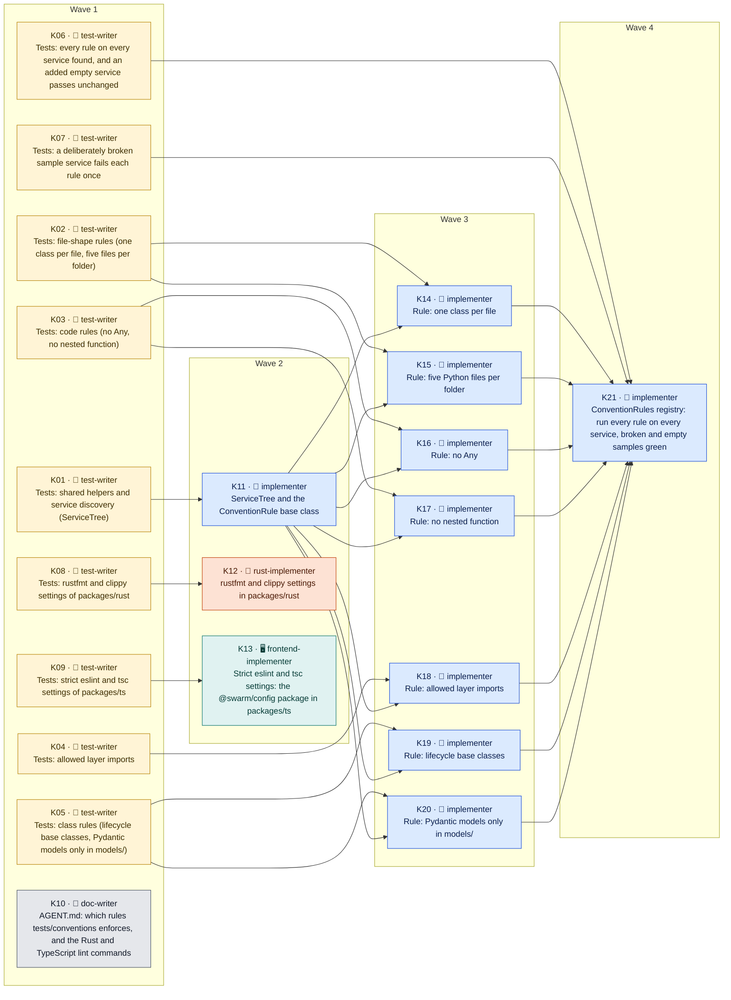

# T0.03: Plan

**Plan:** 🟢 Approved

<!-- ticket:specs -->
## 📚 Specifications

The technical pages, features, use cases and business rules of [TICKET.md](TICKET.md), copied by `python3 .claude/scripts/tickets/ticket_refs.py sync`.

- [🧅 Architecture: layers inside each service](../../specs/technical/01-architecture.md#layers)
- [🗂️ Architecture: mono-repo](../../specs/technical/01-architecture.md#mono-repo)
- [🧰 Deployment: CI/CD](../../specs/technical/09-deployment.md#ci)
<!-- /ticket:specs -->

## Summary

T0.03 has three parts. The first is convention tests under `tests/conventions/` that check seven AGENT.md rules against every service found under `services/`. The other two are the rustfmt and clippy settings in `packages/rust`, and the strict eslint and `tsc` settings in `packages/ts`.

Each rule is one checker class, a `ConventionRule` subclass with `violations(service)`, in `tests/conventions/rules/<group>/`, with its tests beside it. A `ServiceTree` class finds the services and walks their `src/` and `tests/` folders. A `ConventionRules` registry lists the seven rules. `tests/conventions/services/test_service_conventions.py` runs every rule against every service it finds. By default it reads `services/`; the environment variable `SWARM_CONVENTIONS_SERVICES_ROOT` points it at another folder.

The two acceptance criteria are tested end to end:
- `samples/test_broken_service.py` builds a deliberately broken sample service in `tmp_path`, with one violation per rule. It checks that each rule reports exactly one violation, and that a pytest child process run against it shows exactly `7 failed`.
- `samples/test_empty_service.py` adds an empty service beside a copy of the gateway. It checks that the same unchanged tests pass for it.

The plan has 21 tasks in 4 waves:
- **Wave 1, 10 tasks (8 at once):** 9 test-writers and 1 doc-writer for AGENT.md. The test-writers cover the shared helpers and service discovery, file shape, code rules, layer imports, class rules, the real-service and empty-service tests, the broken sample, the Rust settings and the TypeScript settings.
- **Wave 2, 3 tasks:** `ServiceTree` and the `ConventionRule` base; the Rust settings (rust-implementer); the `@swarm/config` TypeScript package with strict `tsconfig.base.json`, eslint flat config and lock file (frontend-implementer).
- **Wave 3, 7 tasks:** one implementer per rule.
- **Wave 4, 1 task:** the `ConventionRules` registry, which runs the whole `tests/conventions` suite.

No two tasks of the same wave share a file.

## Assumptions

- The rules to enforce are those listed in the roadmap row, as written in the 'Rules a test enforces' section of AGENT.md; the other rules of that section are not added here.
- The exact rustfmt, clippy, eslint and tsc options are not settled by the specifications; the most conservative option (strict) is taken, as the roadmap says 'strict' only for tsc.
- The tests under tests/conventions/mono_repo/ already exist from T0.01 and are left as they are.
- The roadmap row names no feature, use case, business rule, screen or budget, so TICKET.md says so for each.
- The tests-evidences folder was created with a .gitkeep file so that it exists in git.
- The convention tests run against every direct sub-folder of `services/` whose name starts with neither `.` nor `_`, as TICKET.md says. `packages/python/` is not walked, because it is empty and the ticket names only `services/`. Discovery sits in one class (`ServiceTree.discover`), so it can be widened later (for example for T0.05).
- Only the seven rules named by the roadmap row are enforced: one class per file, five files per folder, no `Any`, no nested function, allowed layer imports, lifecycle base classes, Pydantic models only in `models/`. `@staticmethod`, underscore attributes and the node rules are not added (TICKET.md assumption). Imports between services are not checked, because that rule sits in the AGENT.md Mono-repo section, not in the list.
- The layer-import rule checks only files under `src/<package>/<layer>/`. Files directly in `src/<package>/` and every file in `tests/` are not checked, because layers are defined for `src/`, and a test of one layer may build real objects of another. Relative imports are resolved. A bare top-level layer name (`from service.x import Y`, the style of AGENT.md examples) counts as that layer.
- The other rules apply to both `src/` and `tests/` of each service, as AGENT.md says ('in src/ and tests/ unless stated'). The lifecycle and Pydantic rules exempt only `src/<package>/models/`.
- The lifecycle base classes do not exist yet (T0.05), so `Runnable` and `AsyncRunnable` are recognised by name: directly, or through a class of the same service that resolves to them. Pydantic models are likewise recognised by the base names `BaseModel` and `RootModel`, directly or through a class of the same service.
- Each rule counts violations at its own grain, so that the broken sample fails each rule exactly once: one per file (one class per file), one per folder (five files), one per import or `typing.Any` attribute (no Any), one per nested def, one per import statement (layers), one per class (lifecycle, Pydantic).
- The rule checkers are classes in `tests/conventions/rules/<group>/` (`ConventionRule` base, `ServiceTree`, `ConventionRules` registry), with their tests beside them, because `tests/conventions/` is the place AGENT.md gives these rules. Test file basenames are unique across the repository, because pytest imports test files by basename (no `__init__.py`, default import mode).
- The broken and empty sample services are written into `tmp_path` from strings, not committed as `.py` files. This keeps ruff, pytest and the real `services/` folder from treating them as code. The environment variable `SWARM_CONVENTIONS_SERVICES_ROOT` lets the enforcement test run against such a folder in a pytest child process. It defaults to `services/`.
- The rustfmt and clippy options are not settled by the specifications. Taken: rustfmt with `edition = "2021"` (from `workspace.package`), `max_width = 120` (the repository line length) and stable options only; `[workspace.lints]` with clippy `all` at deny and `pedantic` at warn, both priority -1, and rust `missing_docs` at warn. CI's `-D warnings` makes warnings fail. Member crates opt in with `[lints] workspace = true`. No crate exists until T0.07, so cargo fmt and clippy are checked on a throwaway crate that is never committed.
- The strict eslint and `tsc` settings go in a private shared package `packages/ts/config` (`@swarm/config`): a strict `tsconfig.base.json` and a flat `eslint.config.js` using typescript-eslint `strictTypeChecked` and `stylisticTypeChecked`. Its own `lint` and `typecheck` scripts give the checks something real to run. The package name and the list of strict compiler options are not in the specifications. Dependency versions are those pnpm resolves at install time, pinned exactly like `turbo`. The task needs network access for `pnpm install`.
- AGENT.md gets two small factual additions (K10): which rules `tests/conventions/` now enforces, and the Rust and TypeScript lint commands. The ticket leaves this documentation implicit, and TKT-4 asks for documentation beside the code. The `tests/conventions/mono_repo/` tests stay unchanged.
- `pyproject.toml` (`testpaths`, ruff, mypy) and `.claude/scripts/tickets/checks.py` are not changed. The new tests sit under `tests/`, which `testpaths` and the verifier's pytest run already cover. Running them in CI is T0.04.

<!-- plan:graph -->

> [!NOTE]
> Generated from the json block at the end of this page by `python3 .claude/scripts/tickets/plan.py render`.
> To change a task, edit the json block, then render again: never edit this view by hand.

## Waves

| Wave | Tasks | Agents running at once |
| --- | --- | --- |
| 1 | [K01](#k01), [K02](#k02), [K03](#k03), [K04](#k04), [K05](#k05), [K06](#k06), [K07](#k07), [K08](#k08), [K09](#k09), [K10](#k10) | 8 of 10 |
| 2 | [K11](#k11), [K12](#k12), [K13](#k13) | 3 of 3 |
| 3 | [K14](#k14), [K15](#k15), [K16](#k16), [K17](#k17), [K18](#k18), [K19](#k19), [K20](#k20) | 7 of 7 |
| 4 | [K21](#k21) | 1 of 1 |

| Wave | Task | Agent | Depends on | Unblocks |
| --- | --- | --- | --- | --- |
| 1 | [K01](#k01) Tests: shared helpers and service discovery (ServiceTree) | 🧪 test-writer | none | [K11](#k11) |
| 1 | [K02](#k02) Tests: file-shape rules (one class per file, five files per folder) | 🧪 test-writer | none | [K14](#k14), [K15](#k15) |
| 1 | [K03](#k03) Tests: code rules (no Any, no nested function) | 🧪 test-writer | none | [K16](#k16), [K17](#k17) |
| 1 | [K04](#k04) Tests: allowed layer imports | 🧪 test-writer | none | [K18](#k18) |
| 1 | [K05](#k05) Tests: class rules (lifecycle base classes, Pydantic models only in models/) | 🧪 test-writer | none | [K19](#k19), [K20](#k20) |
| 1 | [K06](#k06) Tests: every rule on every service found, and an added empty service passes unchanged | 🧪 test-writer | none | [K21](#k21) |
| 1 | [K07](#k07) Tests: a deliberately broken sample service fails each rule once | 🧪 test-writer | none | [K21](#k21) |
| 1 | [K08](#k08) Tests: rustfmt and clippy settings of packages/rust | 🧪 test-writer | none | [K12](#k12) |
| 1 | [K09](#k09) Tests: strict eslint and tsc settings of packages/ts | 🧪 test-writer | none | [K13](#k13) |
| 1 | [K10](#k10) AGENT.md: which rules tests/conventions enforces, and the Rust and TypeScript lint commands | 📝 doc-writer | none | none |
| 2 | [K11](#k11) ServiceTree and the ConventionRule base class | 🐍 implementer | [K01](#k01) | [K14](#k14), [K15](#k15), [K16](#k16), [K17](#k17), [K18](#k18), [K19](#k19), [K20](#k20) |
| 2 | [K12](#k12) rustfmt and clippy settings in packages/rust | 🦀 rust-implementer | [K08](#k08) | none |
| 2 | [K13](#k13) Strict eslint and tsc settings: the @swarm/config package in packages/ts | 🖥️ frontend-implementer | [K09](#k09) | none |
| 3 | [K14](#k14) Rule: one class per file | 🐍 implementer | [K02](#k02), [K11](#k11) | [K21](#k21) |
| 3 | [K15](#k15) Rule: five Python files per folder | 🐍 implementer | [K02](#k02), [K11](#k11) | [K21](#k21) |
| 3 | [K16](#k16) Rule: no Any | 🐍 implementer | [K03](#k03), [K11](#k11) | [K21](#k21) |
| 3 | [K17](#k17) Rule: no nested function | 🐍 implementer | [K03](#k03), [K11](#k11) | [K21](#k21) |
| 3 | [K18](#k18) Rule: allowed layer imports | 🐍 implementer | [K04](#k04), [K11](#k11) | [K21](#k21) |
| 3 | [K19](#k19) Rule: lifecycle base classes | 🐍 implementer | [K05](#k05), [K11](#k11) | [K21](#k21) |
| 3 | [K20](#k20) Rule: Pydantic models only in models/ | 🐍 implementer | [K05](#k05), [K11](#k11) | [K21](#k21) |
| 4 | [K21](#k21) ConventionRules registry: run every rule on every service, broken and empty samples green | 🐍 implementer | [K06](#k06), [K07](#k07), [K14](#k14), [K15](#k15), [K16](#k16), [K17](#k17), [K18](#k18), [K19](#k19), [K20](#k20) | none |

## Dependency graph



## Tasks

### <a id="k01"></a>K01: Tests: shared helpers and service discovery (ServiceTree)

| Agent | Wave | Depends on | Unblocks |
| --- | --- | --- | --- |
| 🧪 test-writer | 1 | none | [K11](#k11) |

**Files** (only this task may change them in its wave):

- `tests/conventions/helpers.py`
- `tests/conventions/rules/test_service_tree.py`

**Done when:** `uv run ruff check tests/conventions/helpers.py tests/conventions/rules/test_service_tree.py` and `uv run ruff format --check` on the same files pass. `uv run python -c "from tests.conventions.helpers import repo_root, services_root, write_files, run_convention_tests"` succeeds. `uv run pytest tests/conventions/rules/test_service_tree.py -q` fails only with ModuleNotFoundError for tests.conventions.rules.service_tree.

**Brief:**

Ticket T0.03 (docs/tickets/T0.03/TICKET.md). Applies docs/specs/technical/01-architecture.md#mono-repo (the layout of services/ that the tests walk) and docs/specs/technical/01-architecture.md#layers (the five layers under services/&lt;service>/src/&lt;service>/), and AGENT.md#rules-a-test-enforces (the rules run against every service, so a new service needs no change).

1) Write tests/conventions/helpers.py, the shared test scaffolding. It may have module-level functions, like tests/conventions/mono_repo/helpers.py, which stays untouched:
- `repo_root() -> Path`: the repository root, `Path(__file__).resolve().parents[2]`.
- `services_root() -> Path`: `Path(os.environ["SWARM_CONVENTIONS_SERVICES_ROOT"])` when that variable is set and not empty, else `repo_root() / "services"`.
- `write_files(root: Path, files: Dict[str, str]) -> None`: write each relative POSIX path with its content (UTF-8), creating the parent folders. An empty content string creates an empty file.
- `run_convention_tests(services_root: Path) -> subprocess.CompletedProcess[str]`: run `[sys.executable, "-m", "pytest", "tests/conventions/services/test_service_conventions.py", "-q", "-p", "no:cacheprovider"]` with cwd `repo_root()`, `capture_output=True`, `text=True`, and the environment copied with `SWARM_CONVENTIONS_SERVICES_ROOT` set to `services_root`.

2) Write tests/conventions/rules/test_service_tree.py, with one class `TestServiceTree`, for the class that K11 implements in tests/conventions/rules/service_tree.py. The contract:
- `ServiceTree(root: Path)` has `LAYERS: ClassVar[Tuple[str, ...]] = ("api", "service", "storage", "clients", "models")`.
- classmethod `discover(services_root: Path) -> List[ServiceTree]` returns every direct sub-folder of `services_root` whose name starts with neither `.` nor `_`, sorted by name. Files are ignored. A missing root gives `[]`.
- Properties: `name` (the folder name), `source_root` (root/"src") and `tests_root` (root/"tests").
- `python_files() -> List[Path]` returns every `*.py` under src/ and tests/, sorted, skipping any `__pycache__` or hidden folder. A service without src/ or tests/ gives `[]`.
- `package_of(path) -> Optional[str]` returns the first folder under src/ for a file in src/, and None for a file elsewhere.
- `layer_of(path) -> Optional[str]` returns the folder right under src/&lt;package>/ when it is in LAYERS, and None otherwise, including files directly in src/&lt;package>/ and files in tests/.
- `relative(path) -> str` returns the POSIX path relative to root.

Build the services in `tmp_path` with `write_files`. Cover discovery (sorting, hidden and `_` folders skipped, files ignored, missing root), and `python_files` (src and tests included, `__pycache__` skipped). Cover `layer_of` with a parametrised case per layer plus non-layer cases, and also `package_of` and `relative`. Import `from tests.conventions.rules.service_tree import ServiceTree` and `from tests.conventions.helpers import write_files`.

Follow AGENT.md: one class per file, at most five Python files per folder (not counting `__init__.py`/`conftest.py`), no nested function, no `Any`, `from __future__ import annotations` first, `typing` generics, British English, no em dashes. Follow its Tests section: one `Test<Subject>` class, test names as sentences, parametrize, no mocks, no `__init__.py`. Test file basenames must be unique in the repository, because pytest imports them by basename. Format only your files with `uv run ruff format`.

### <a id="k02"></a>K02: Tests: file-shape rules (one class per file, five files per folder)

| Agent | Wave | Depends on | Unblocks |
| --- | --- | --- | --- |
| 🧪 test-writer | 1 | none | [K14](#k14), [K15](#k15) |

**Files** (only this task may change them in its wave):

- `tests/conventions/rules/files/test_one_class_per_file.py`
- `tests/conventions/rules/files/test_five_files_per_folder.py`

**Done when:** `uv run ruff check tests/conventions/rules/files` and `uv run ruff format --check tests/conventions/rules/files` pass. `uv run pytest tests/conventions/rules/files -q` fails only with ModuleNotFoundError for the rule, service_tree or helpers modules that do not exist yet.

**Brief:**

Ticket T0.03 (docs/tickets/T0.03/TICKET.md). Applies AGENT.md#rules-a-test-enforces and AGENT.md#file-shape, against every service of docs/specs/technical/01-architecture.md#mono-repo, with the layers of docs/specs/technical/01-architecture.md#layers.

Write the tests of two rule checkers, each in its own file with one `Test<Subject>` class.

Shared contract, implemented by other tasks:
- `ServiceTree(root)` is in tests/conventions/rules/service_tree.py. It has `name`, `python_files()` (every .py under src/ and tests/, `__pycache__` skipped), `package_of`, `layer_of` and `relative`.
- `ConventionRule` is in tests/conventions/rules/convention_rule.py. It has `NAME: ClassVar[str]`, `violations(service: ServiceTree) -> List[str]`, and violation strings formatted `"<service name>/<relative path>:<line>: <message>"` (no `:<line>` for folders).
- Each rule is built with no argument.
- Build services in `tmp_path` with `write_files(root, {relative path: content})` from tests.conventions.helpers. A service is `tmp_path/"services"/"sample"`, with code in `src/sample/<layer>/` and tests in `tests/`.

1) tests/conventions/rules/files/test_one_class_per_file.py covers `OneClassPerFile` (NAME `one_class_per_file`), from tests.conventions.rules.files.one_class_per_file. The rule reports one violation per Python file (src/ and tests/, `__init__.py` and `conftest.py` included) whose module body holds more than one top-level `class` statement, at the line of the second class. Cases:
- one class: no violation;
- two or three classes in one file: exactly one violation naming that file;
- an Enum and an exception together: one violation, whatever the kind of class;
- a nested class inside a class: no violation;
- a violating file under tests/: reported;
- a clean service and a service with no src/: [].

2) tests/conventions/rules/files/test_five_files_per_folder.py covers `FiveFilesPerFolder` (NAME `five_files_per_folder`), from tests.conventions.rules.files.five_files_per_folder. The rule reports one violation per folder under src/ or tests/ holding more than five `.py` files, not counting `__init__.py` and `conftest.py`. Cases:
- 5 files: none;
- 6 files: exactly one, naming the folder;
- 5 files plus `__init__.py` and `conftest.py`: none;
- 6 files in a sub-folder while the parent has few: one, for the sub-folder only;
- tests/ folders are checked too.

Follow AGENT.md: one class per file, at most five Python files per folder, no nested function, no `Any`, `from __future__ import annotations` first, `typing` generics, British English, no em dashes. Follow its Tests section: test names as sentences, parametrize, no mocks, no `__init__.py`. Test file basenames must be unique in the repository. Format only your files.

### <a id="k03"></a>K03: Tests: code rules (no Any, no nested function)

| Agent | Wave | Depends on | Unblocks |
| --- | --- | --- | --- |
| 🧪 test-writer | 1 | none | [K16](#k16), [K17](#k17) |

**Files** (only this task may change them in its wave):

- `tests/conventions/rules/code/test_no_any.py`
- `tests/conventions/rules/code/test_no_nested_function.py`

**Done when:** `uv run ruff check tests/conventions/rules/code` and `uv run ruff format --check tests/conventions/rules/code` pass. `uv run pytest tests/conventions/rules/code -q` fails only with ModuleNotFoundError for the rule, service_tree or helpers modules that do not exist yet.

**Brief:**

Ticket T0.03 (docs/tickets/T0.03/TICKET.md). Applies AGENT.md#rules-a-test-enforces and AGENT.md#typing, against every service of docs/specs/technical/01-architecture.md#mono-repo, with the layers of docs/specs/technical/01-architecture.md#layers.

Write the tests of two rule checkers, each in its own file with one `Test<Subject>` class.

Shared contract, implemented by other tasks:
- `ServiceTree(root)` is in tests/conventions/rules/service_tree.py.
- `ConventionRule` is in tests/conventions/rules/convention_rule.py, with `NAME` and `violations(service) -> List[str]`. Violation strings are `"<service name>/<relative path>:<line>: <message>"`.
- Rules are built with no argument.
- Build services in `tmp_path/"services"/"sample"` with `write_files` from tests.conventions.helpers, with code in `src/sample/<layer>/` and tests in `tests/`.

1) tests/conventions/rules/code/test_no_any.py covers `NoAny` (NAME `no_any`), from tests.conventions.rules.code.no_any. The rule reports, in every Python file of src/ and tests/, one violation per `from typing import ...` or `from typing_extensions import ...` statement that imports `Any` (aliased or not), and one per attribute `typing.Any` or `typing_extensions.Any`. Cases:
- `from typing import Any` used in two annotations: exactly one violation;
- `from typing import List, Any`: one;
- `import typing` then `x: typing.Any`: one;
- `from typing import List` and the word Any in a string or a comment: none;
- a file under tests/: reported;
- a clean service: [].

2) tests/conventions/rules/code/test_no_nested_function.py covers `NoNestedFunction` (NAME `no_nested_function`), from tests.conventions.rules.code.no_nested_function. The rule reports one violation per `def` or `async def` whose nearest enclosing function-or-class scope is a function. Cases:
- a function inside a function: one;
- an async function inside a method: one;
- three levels, a in b in c: two;
- methods of a module-level class: none;
- a class defined inside a function, with its methods: none;
- a lambda inside a function: none;
- a file under tests/: reported.

Follow AGENT.md: one class per file, at most five Python files per folder, no nested function in your own code, no `Any` in your own code (put the sample source in strings), `from __future__ import annotations` first, British English, no em dashes. Follow its Tests section. Test file basenames must be unique in the repository. Format only your files.

### <a id="k04"></a>K04: Tests: allowed layer imports

| Agent | Wave | Depends on | Unblocks |
| --- | --- | --- | --- |
| 🧪 test-writer | 1 | none | [K18](#k18) |

**Files** (only this task may change them in its wave):

- `tests/conventions/rules/layers/test_layer_imports.py`

**Done when:** `uv run ruff check tests/conventions/rules/layers` and `uv run ruff format --check tests/conventions/rules/layers` pass. `uv run pytest tests/conventions/rules/layers -q` fails only with ModuleNotFoundError for the rule, service_tree or helpers modules that do not exist yet.

**Brief:**

Ticket T0.03 (docs/tickets/T0.03/TICKET.md). Applies docs/specs/technical/01-architecture.md#layers (each module only calls the ones below it, and a test in tests/conventions/ fails on any other import) and AGENT.md#layout.

Write tests/conventions/rules/layers/test_layer_imports.py, with one class `TestLayerImports`, for `LayerImports` (NAME `layer_imports`) from tests.conventions.rules.layers.layer_imports.

Shared contract, implemented by other tasks:
- `ServiceTree(root)` is in tests/conventions/rules/service_tree.py, with `package_of` and `layer_of`.
- `ConventionRule` is in tests/conventions/rules/convention_rule.py, with `violations(service) -> List[str]`. Violation strings are `"<service name>/<relative path>:<line>: <message>"`.
- Build services in `tmp_path/"services"/"sample"` with `write_files` from tests.conventions.helpers. The package is `src/sample/`.

The rule:
- It checks only files under `src/<package>/<layer>/`. Files directly in `src/<package>/` and every file in tests/ are not checked.
- For every `import` and `from ... import` statement, including relative imports (resolved from the file's package) and imports under `if TYPE_CHECKING:`, the target layer is found this way:
  - `<package>.<layer>[...]` gives that layer;
  - a bare `<layer>[...]` (for example `from service.x import Y`) gives that layer;
  - `from <package> import <layer>` gives that layer.
- Allowed targets:
  - api: api, service, models;
  - service: service, storage, clients, models;
  - storage: storage, models;
  - clients: clients, models;
  - models: models.
- Every other target is one violation per import statement. Imports of other modules, stdlib or third party, are ignored.

Parametrise the allowed and refused pairs, so that all 25 (from, to) combinations are covered. Also cover:
- a relative import `from ..storage.store import Store` in api/routes.py: refused;
- `from sample import storage` in api: refused;
- a file in tests/api/ importing storage: no violation;
- `src/sample/__init__.py` importing anything: no violation;
- `import os`: no violation;
- two refused imports in one file: two violations.

Follow AGENT.md: one class per file, no nested function, no `Any`, `from __future__ import annotations` first, British English, no em dashes. Follow its Tests section. Test file basenames must be unique in the repository. Format only your file.

### <a id="k05"></a>K05: Tests: class rules (lifecycle base classes, Pydantic models only in models/)

| Agent | Wave | Depends on | Unblocks |
| --- | --- | --- | --- |
| 🧪 test-writer | 1 | none | [K19](#k19), [K20](#k20) |

**Files** (only this task may change them in its wave):

- `tests/conventions/rules/classes/test_lifecycle_base_classes.py`
- `tests/conventions/rules/classes/test_pydantic_models_in_models.py`

**Done when:** `uv run ruff check tests/conventions/rules/classes` and `uv run ruff format --check tests/conventions/rules/classes` pass. `uv run pytest tests/conventions/rules/classes -q` fails only with ModuleNotFoundError for the rule, service_tree or helpers modules that do not exist yet.

**Brief:**

Ticket T0.03 (docs/tickets/T0.03/TICKET.md). Applies AGENT.md#rules-a-test-enforces, AGENT.md#lifecycle-and-factories and AGENT.md#pydantic-models, with the models layer of docs/specs/technical/01-architecture.md#layers (Pydantic models live in models/).

Write the tests of two rule checkers, each in its own file with one `Test<Subject>` class.

Shared contract, implemented by other tasks:
- `ServiceTree(root)` is in tests/conventions/rules/service_tree.py, with `layer_of`.
- `ConventionRule` is in tests/conventions/rules/convention_rule.py, with `violations(service) -> List[str]`. Violation strings are `"<service name>/<relative path>:<line>: <message>"`.
- Build services in `tmp_path/"services"/"sample"` with `write_files` from tests.conventions.helpers. The package is `src/sample/`.

Both rules check every Python file of src/ and tests/, except files under `src/<package>/models/`. Base names are read from `ast.Name.id`, from `ast.Attribute.attr` (`pydantic.BaseModel`), and from the value of a subscript (`Generic[T]`). A base also counts when it names a class defined anywhere in the same service whose own bases resolve, transitively, to the target names. Classes from outside the service are not followed.

1) tests/conventions/rules/classes/test_lifecycle_base_classes.py covers `LifecycleBaseClasses` (NAME `lifecycle_base_classes`), from tests.conventions.rules.classes.lifecycle_base_classes. The rule reports one violation per class that defines (def or async def directly in its body) `start` or `stop`, or that defines `run` with no base resolving to `Runnable` or `AsyncRunnable`. Cases:
- `class Job` with run and no base: one;
- `class Job(Runnable)` with run: none;
- `class Job(lifecycle.AsyncRunnable)`: none;
- `class Job(BaseJob)` where BaseJob(Runnable) is in another file of the service: none;
- a class with start: one, even with a Runnable base;
- a class with start and stop: one;
- the same classes under src/sample/models/: none;
- a class with run under tests/: one;
- a class with initialize only: none.

2) tests/conventions/rules/classes/test_pydantic_models_in_models.py covers `PydanticModelsInModels` (NAME `pydantic_models_in_models`), from tests.conventions.rules.classes.pydantic_models_in_models. The rule reports one violation per class with a base resolving to `BaseModel` or `RootModel`. Cases:
- `class Customer(BaseModel)` in src/sample/service/: one;
- `pydantic.BaseModel` in api/: one;
- `RootModel[List[int]]`: one;
- a subclass of a models-layer model, defined in service/: one;
- the same models in src/sample/models/ or its sub-folders: none;
- a model in tests/: one;
- a plain class: none.

Follow AGENT.md: one class per file, no nested function, no `Any`, `from __future__ import annotations` first, British English, no em dashes. Follow its Tests section. Test file basenames must be unique in the repository. Format only your files.

### <a id="k06"></a>K06: Tests: every rule on every service found, and an added empty service passes unchanged

| Agent | Wave | Depends on | Unblocks |
| --- | --- | --- | --- |
| 🧪 test-writer | 1 | none | [K21](#k21) |

**Files** (only this task may change them in its wave):

- `tests/conventions/services/test_service_conventions.py`
- `tests/conventions/samples/test_empty_service.py`

**Done when:** `uv run ruff check tests/conventions/services tests/conventions/samples/test_empty_service.py` and `uv run ruff format --check` on the same files pass. `uv run pytest tests/conventions/services tests/conventions/samples/test_empty_service.py -q` fails only with ModuleNotFoundError for service_tree, convention_rules or helpers, which do not exist yet.

**Brief:**

Ticket T0.03 (docs/tickets/T0.03/TICKET.md), acceptance criterion 2: given an empty service added under services/, when the convention tests run, then they need no change and pass for it. Applies docs/specs/technical/01-architecture.md#mono-repo, docs/specs/technical/01-architecture.md#layers and AGENT.md#mono-repo (adding a service must not need a change to tests/conventions/).

Shared contract, implemented by other tasks:
- `ServiceTree.discover(services_root) -> List[ServiceTree]` is in tests/conventions/rules/service_tree.py. ServiceTree has `name`.
- `ConventionRules.all() -> List[ConventionRule]` is in tests/conventions/rules/convention_rules.py. It returns one instance of each of the seven rules, each with `NAME` and `violations(service) -> List[str]`.
- tests/conventions/helpers.py (K01) has `repo_root()`, `services_root()` (env `SWARM_CONVENTIONS_SERVICES_ROOT`, else repo_root()/"services"), `write_files(root, files)` and `run_convention_tests(services_root) -> CompletedProcess[str]`. The last runs this test file in a pytest child process against another services root.

1) tests/conventions/services/test_service_conventions.py, with one class `TestServiceConventions`, is the enforcement test. One test is parametrised over `itertools.product(ServiceTree.discover(services_root()), ConventionRules.all())`, with ids `"<service name>-<rule NAME>"`. It asserts that `rule.violations(service) == []`, and its assertion message lists the violations one per line. The test must hold no list of services and no service name: it finds them.

2) tests/conventions/samples/test_empty_service.py, with one class `TestEmptyService`. Build `tmp_path/"services"`, holding a copy of the real services/gateway (`shutil.copytree` ignoring `__pycache__`) and an added empty service `empty`. Parametrise two shapes of the empty service:
- a skeleton: pyproject.toml, `src/empty/__init__.py`, an empty `__init__.py` in each of api, service, storage, clients and models, and an empty tests/ folder;
- a bare folder holding only pyproject.toml.
Tests:
- discover finds both gateway and empty;
- every rule of `ConventionRules.all()` returns [] for the empty service;
- `run_convention_tests(root)` exits 0, and its output reports 14 passed (2 services x 7 rules) and no failure;
- the empty service needs no change to tests/conventions/: assert that no file under repo_root()/"tests"/"conventions" contains the string "empty" as a service name in a list. Do this simply, or leave this check out if it cannot be done robustly, and say so in your result.

Follow AGENT.md: one class per file, no nested function, no `Any`, `from __future__ import annotations` first, British English, no em dashes. Follow its Tests section. Test file basenames must be unique in the repository. Format only your files.

### <a id="k07"></a>K07: Tests: a deliberately broken sample service fails each rule once

| Agent | Wave | Depends on | Unblocks |
| --- | --- | --- | --- |
| 🧪 test-writer | 1 | none | [K21](#k21) |

**Files** (only this task may change them in its wave):

- `tests/conventions/samples/helpers.py`
- `tests/conventions/samples/test_broken_service.py`

**Done when:** `uv run ruff check tests/conventions/samples/helpers.py tests/conventions/samples/test_broken_service.py` and `uv run ruff format --check` on the same files pass. `uv run python -c "from tests.conventions.samples.helpers import write_broken_service"` fails only if tests.conventions.helpers is missing. `uv run pytest tests/conventions/samples/test_broken_service.py -q` fails only with ModuleNotFoundError for modules that do not exist yet.

**Brief:**

Ticket T0.03 (docs/tickets/T0.03/TICKET.md), acceptance criterion 1: given a deliberately broken sample service, when the convention tests run against it, then each rule of the ticket fails once. Applies AGENT.md#rules-a-test-enforces, docs/specs/technical/01-architecture.md#layers and docs/specs/technical/01-architecture.md#mono-repo.

Shared contract, implemented by other tasks:
- `ServiceTree(root)` is in tests/conventions/rules/service_tree.py.
- `ConventionRules.all()` is in tests/conventions/rules/convention_rules.py. It returns the seven rules, in this order and with these NAMEs: `one_class_per_file`, `five_files_per_folder`, `no_any`, `no_nested_function`, `layer_imports`, `lifecycle_base_classes`, `pydantic_models_in_models`. Each has `violations(service) -> List[str]`.
- tests/conventions/helpers.py (K01) has `write_files(root, files)` and `run_convention_tests(services_root) -> CompletedProcess[str]`.

The rules, in short:
- more than one top-level class in a file;
- more than five .py files in a folder, not counting `__init__.py`/`conftest.py`;
- an import of `Any` from typing;
- a def nested in a def;
- in src/&lt;pkg>/&lt;layer>/, an import outside: api to api/service/models, service to service/storage/clients/models, storage to storage/models, clients to clients/models, models to models;
- a class outside src/&lt;pkg>/models/ with start or stop, or with run but no Runnable/AsyncRunnable base;
- a BaseModel/RootModel subclass outside src/&lt;pkg>/models/.

1) tests/conventions/samples/helpers.py: a module-level function `write_broken_service(services_root: Path) -> Path`. It writes, with write_files, the service `services_root/"broken"` and returns its path. The sample breaks each rule exactly once and nothing else:
- pyproject.toml.
- `src/broken/__init__.py`, plus an `__init__.py` in each layer.
- `api/routes.py` holds `from broken.storage.store import Store` and one function using it (layer_imports).
- `storage/store.py` holds one plain class.
- `service/two_classes.py` holds two plain classes (one_class_per_file).
- `service/crowded/` holds six modules, each with one small function (five_files_per_folder).
- `service/typed.py` holds `from typing import Any` and one function annotated with it (no_any).
- `service/nested.py` holds an outer function with one inner def (no_nested_function).
- `service/job.py` holds `class Job` with a `run(self) -> None` method and no base (lifecycle_base_classes).
- `service/customer.py` holds `class Customer(BaseModel)` with one field (pydantic_models_in_models).
Keep src/broken/service/ itself at five .py files or fewer. Keep the sample source as strings, so that ruff and pytest never see it as code. Add a comment-free docstring to the function saying which file breaks which rule.

2) tests/conventions/samples/test_broken_service.py, with one class `TestBrokenService`:
- the rule NAMEs of `ConventionRules.all()` are exactly the seven above;
- parametrised by rule NAME: the rule reports exactly one violation for the broken service, naming the expected file or folder;
- `run_convention_tests(tmp_path/"services")`, with only the broken service there, exits non-zero, and its output reports 7 failed and 0 passed, one failure per rule id `broken-<NAME>`.

Follow AGENT.md: one class per file, no nested function in your own code, no `Any` in your own code, `from __future__ import annotations` first, British English, no em dashes. Follow its Tests section (helpers.py holds shared functions). Test file basenames must be unique in the repository. Format only your files.

### <a id="k08"></a>K08: Tests: rustfmt and clippy settings of packages/rust

| Agent | Wave | Depends on | Unblocks |
| --- | --- | --- | --- |
| 🧪 test-writer | 1 | none | [K12](#k12) |

**Files** (only this task may change them in its wave):

- `tests/conventions/linters/test_rust_settings.py`

**Done when:** `uv run ruff check tests/conventions/linters/test_rust_settings.py` and `uv run ruff format --check tests/conventions/linters/test_rust_settings.py` pass. `uv run pytest tests/conventions/linters/test_rust_settings.py -q` collects, and fails only because rustfmt.toml and the workspace lints do not exist yet, or because tests.conventions.helpers is missing.

**Brief:**

Ticket T0.03 (docs/tickets/T0.03/TICKET.md): rustfmt and clippy settings in packages/rust. Applies docs/specs/technical/09-deployment.md#ci (the check step runs cargo fmt and clippy) and docs/specs/technical/01-architecture.md#mono-repo (Rust is a Cargo workspace in packages/rust).

Write tests/conventions/linters/test_rust_settings.py, with one class `TestRustSettings`. It reads files with `tomllib`, and finds the repository root with `from tests.conventions.helpers import repo_root`. Do not touch tests/conventions/mono_repo/.

The contract that K12 implements:
- packages/rust/rustfmt.toml exists and parses.
- Its `edition` equals `workspace.package.edition` of packages/rust/Cargo.toml ("2021").
- Its `max_width` is 120, the line length of the repository.
- It sets no `unstable_features` and no option that needs nightly, because the toolchain is stable (packages/rust/rust-toolchain.toml).
- packages/rust/Cargo.toml has `[workspace.lints.clippy]` with `all = { level = "deny", priority = -1 }` and `pedantic = { level = "warn", priority = -1 }`.
- It has `[workspace.lints.rust]` with `missing_docs = "warn"`.
- It keeps `workspace.members` and `workspace.resolver`.

Tests:
- the file exists;
- the edition matches;
- max_width is 120;
- no unstable_features;
- the levels and priorities of clippy all and pedantic, parametrised;
- missing_docs;
- members and resolver still there.

Follow AGENT.md: one class per file, no nested function, no `Any`, `from __future__ import annotations` first, `typing` generics, British English. Follow its Tests section. Test file basenames must be unique in the repository. Format only your file.

### <a id="k09"></a>K09: Tests: strict eslint and tsc settings of packages/ts

| Agent | Wave | Depends on | Unblocks |
| --- | --- | --- | --- |
| 🧪 test-writer | 1 | none | [K13](#k13) |

**Files** (only this task may change them in its wave):

- `tests/conventions/linters/test_typescript_settings.py`

**Done when:** `uv run ruff check tests/conventions/linters/test_typescript_settings.py` and `uv run ruff format --check tests/conventions/linters/test_typescript_settings.py` pass. `uv run pytest tests/conventions/linters/test_typescript_settings.py -q` collects, and fails only because packages/ts/config does not exist yet, or because tests.conventions.helpers is missing.

**Brief:**

Ticket T0.03 (docs/tickets/T0.03/TICKET.md): eslint and `tsc` strict settings in packages/ts. Applies docs/specs/technical/09-deployment.md#ci (the check step runs eslint and tsc) and docs/specs/technical/01-architecture.md#mono-repo (packages/ts holds the shared TypeScript in a pnpm workspace).

Write tests/conventions/linters/test_typescript_settings.py, with one class `TestTypescriptSettings`. It reads JSON with `json` and finds the root with `from tests.conventions.helpers import repo_root`. Do not touch tests/conventions/mono_repo/.

The contract that K13 implements, a private shared configuration package `packages/ts/config/`:
- package.json:
  - `name` "@swarm/config", `private` true and `type` "module";
  - `exports` maps "./eslint" to "./eslint.config.js" and "./tsconfig.base.json" to "./tsconfig.base.json";
  - `scripts` has `lint` (runs eslint) and `typecheck` (runs tsc with --noEmit);
  - `devDependencies` has eslint, @eslint/js, typescript and typescript-eslint, each pinned to an exact version with no ^ or ~.
- tsconfig.base.json is plain JSON without comments. Its `compilerOptions` set to true: strict, noUncheckedIndexedAccess, exactOptionalPropertyTypes, noImplicitOverride, noImplicitReturns, noFallthroughCasesInSwitch, noUnusedLocals, noUnusedParameters, noPropertyAccessFromIndexSignature, forceConsistentCasingInFileNames, isolatedModules and verbatimModuleSyntax.
- tsconfig.json is plain JSON whose `extends` is "./tsconfig.base.json".
- eslint.config.js contains "typescript-eslint", "strictTypeChecked" and "stylisticTypeChecked".
- pnpm-lock.yaml at the root has an importer `packages/ts/config`.

Tests:
- each file exists;
- the package fields;
- the exact pins, parametrised over the four dependencies;
- each strict compiler option, parametrised;
- the extends;
- the eslint config strings, parametrised;
- the lock file importer, as a text search for `packages/ts/config:`.

Follow AGENT.md: one class per file, no nested function, no `Any`, `from __future__ import annotations` first, British English. Follow its Tests section. Test file basenames must be unique in the repository. Format only your file.

### <a id="k10"></a>K10: AGENT.md: which rules tests/conventions enforces, and the Rust and TypeScript lint commands

| Agent | Wave | Depends on | Unblocks |
| --- | --- | --- | --- |
| 📝 doc-writer | 1 | none | none |

**Files** (only this task may change them in its wave):

- `AGENT.md`

**Done when:** `git diff AGENT.md` shows only the two additions above. `grep -n SWARM_CONVENTIONS_SERVICES_ROOT AGENT.md` and `grep -n '@swarm/config' AGENT.md` each find a line. `python3 .claude/skills/write-specs/scripts/specs.py check` still prints nothing.

**Brief:**

Ticket T0.03 (docs/tickets/T0.03/TICKET.md). Applies docs/specs/technical/01-architecture.md#layers, docs/specs/technical/01-architecture.md#mono-repo and docs/specs/technical/09-deployment.md#ci. Make two small factual edits to AGENT.md, in plain British English with no em dashes. Change nothing else.

1) In the section "Rules a test enforces", add after its first line a short paragraph. It says that since T0.03, `tests/conventions/services/test_service_conventions.py` runs these rules against every service it finds under `services/`:
- more than one top-level class in a file;
- more than five Python files in a folder;
- a nested function;
- `Any`;
- an import that Layout does not allow, checked in `src/` only;
- the lifecycle rule (`start`/`stop`, or `run` without a lifecycle base class);
- a Pydantic model outside `src/models/`.
It also says that `@staticmethod`, attributes starting with an underscore and the node rules are not tested yet. Each rule is one class in `tests/conventions/rules/`, and the environment variable `SWARM_CONVENTIONS_SERVICES_ROOT` runs the tests against another folder of services.

2) In the section "Commands", add a second short code block for the other languages:
- `cargo fmt --all --check` and `cargo clippy --workspace --all-targets -- -D warnings`, run in `packages/rust` (crates opt in to the workspace lints with `[lints] workspace = true`);
- `pnpm -r --if-present lint` and `pnpm -r --if-present typecheck`, with a sentence saying that TypeScript packages and front ends extend `@swarm/config` (`packages/ts/config`), which holds the strict `tsconfig.base.json` and the eslint configuration.

Keep the existing tables and wording intact.

### <a id="k11"></a>K11: ServiceTree and the ConventionRule base class

| Agent | Wave | Depends on | Unblocks |
| --- | --- | --- | --- |
| 🐍 implementer | 2 | [K01](#k01) | [K14](#k14), [K15](#k15), [K16](#k16), [K17](#k17), [K18](#k18), [K19](#k19), [K20](#k20) |

**Files** (only this task may change them in its wave):

- `tests/conventions/rules/service_tree.py`
- `tests/conventions/rules/convention_rule.py`

**Done when:** `uv run pytest tests/conventions/rules/test_service_tree.py -q` passes. `uv run ruff check tests/conventions/rules/service_tree.py tests/conventions/rules/convention_rule.py` and `uv run ruff format --check` on the same files pass.

**Brief:**

Ticket T0.03 (docs/tickets/T0.03/TICKET.md). Applies docs/specs/technical/01-architecture.md#mono-repo (the services/ layout the tests walk), docs/specs/technical/01-architecture.md#layers (the five layers) and AGENT.md#mono-repo (a new service needs no change to tests/conventions/).

Implement the two foundation classes, so that tests/conventions/rules/test_service_tree.py (K01) passes.

1) tests/conventions/rules/service_tree.py holds `ServiceTree(root: Path)`. It has the attribute `root` and `LAYERS: ClassVar[Tuple[str, ...]] = ("api", "service", "storage", "clients", "models")`.
- classmethod `discover(services_root: Path) -> List[ServiceTree]`: every direct sub-folder whose name starts with neither `.` nor `_`, sorted by name, and [] if the root is missing.
- Properties `name`, `source_root` (root/"src") and `tests_root` (root/"tests").
- `python_files() -> List[Path]`: every `*.py` under src/ and tests/, sorted, skipping `__pycache__` and hidden folders.
- `package_of(path) -> Optional[str]`.
- `layer_of(path) -> Optional[str]`: the folder right under src/&lt;package>/ when it is in LAYERS.
- `relative(path) -> str`: a POSIX path relative to root.

2) tests/conventions/rules/convention_rule.py holds the abstract `ConventionRule(ABC)`, with `NAME: ClassVar[str]`.
- `parse(path: Path) -> ast.Module` reads UTF-8 and calls `ast.parse` with the filename.
- `violation(service: ServiceTree, path: Path, line: Optional[int], message: str) -> str` returns `"<service.name>/<service.relative(path)>:<line>: <message>"`, or without `:<line>` when line is None.
- `violations(service: ServiceTree) -> List[str]` is abstract.
- Give it a `__repr__` returning NAME, so that pytest ids read well.

Write Google-style docstrings on both classes and their methods, because they define the rules. Follow AGENT.md file shape, class order with the two banners, imports with group comments, `typing` generics, no `Any`, no nested function, no module constants, and attribute names without a leading underscore. These are test helpers, so they do not log. Do not change the test files: if a test contradicts this contract, report it.

### <a id="k12"></a>K12: rustfmt and clippy settings in packages/rust

| Agent | Wave | Depends on | Unblocks |
| --- | --- | --- | --- |
| 🦀 rust-implementer | 2 | [K08](#k08) | none |

**Files** (only this task may change them in its wave):

- `packages/rust/rustfmt.toml`
- `packages/rust/Cargo.toml`

**Done when:** `cargo metadata --no-deps --format-version 1 --locked --manifest-path packages/rust/Cargo.toml` exits 0. `uv run pytest tests/conventions/linters/test_rust_settings.py tests/conventions/mono_repo/test_rust_workspace.py -q` passes. `git status` shows no scratch crate left.

**Brief:**

Ticket T0.03 (docs/tickets/T0.03/TICKET.md): rustfmt and clippy settings in packages/rust. Applies docs/specs/technical/09-deployment.md#ci (the check step runs cargo fmt and clippy, which these settings configure) and docs/specs/technical/01-architecture.md#mono-repo (the Cargo workspace in packages/rust, with a stable toolchain that has rustfmt and clippy).

1) Create packages/rust/rustfmt.toml with stable options only:
- `edition = "2021"`, matching `workspace.package.edition`;
- `max_width = 120`, the repository line length;
- optionally `newline_style = "Unix"`, `use_field_init_shorthand = true` and `use_try_shorthand = true`;
- no `unstable_features`.

2) In packages/rust/Cargo.toml, add:
- `[workspace.lints.clippy]` with `all = { level = "deny", priority = -1 }` and `pedantic = { level = "warn", priority = -1 }`;
- `[workspace.lints.rust]` with `missing_docs = "warn"`;
- a TOML comment saying that every member crate opts in with `[lints] workspace = true`.
Keep `resolver`, `members = []` and `[workspace.package]` unchanged. The workspace has no member crate yet (T0.07 brings swarm-core), so do not add one to the commit.

To verify that cargo accepts the settings, create a throwaway member crate locally and check that `cargo fmt --all --check` and `cargo clippy --workspace --all-targets -- -D warnings` run with them, then remove it and restore `members = []`. Use the session scratch folder, or a temporary `packages/rust/scratch` folder, which you delete before committing. The tests are tests/conventions/linters/test_rust_settings.py (K08); do not change them.

### <a id="k13"></a>K13: Strict eslint and tsc settings: the @swarm/config package in packages/ts

| Agent | Wave | Depends on | Unblocks |
| --- | --- | --- | --- |
| 🖥️ frontend-implementer | 2 | [K09](#k09) | none |

**Files** (only this task may change them in its wave):

- `packages/ts/config/package.json`
- `packages/ts/config/eslint.config.js`
- `packages/ts/config/tsconfig.base.json`
- `packages/ts/config/tsconfig.json`
- `pnpm-lock.yaml`

**Done when:** From the repository root, `pnpm install --frozen-lockfile`, `pnpm -r --if-present lint` and `pnpm -r --if-present typecheck` all exit 0. `uv run pytest tests/conventions/linters/test_typescript_settings.py tests/conventions/mono_repo/test_pnpm_workspace.py -q` passes.

**Brief:**

Ticket T0.03 (docs/tickets/T0.03/TICKET.md): eslint and `tsc` strict settings in packages/ts. Applies docs/specs/technical/09-deployment.md#ci (the check step runs eslint and tsc) and docs/specs/technical/01-architecture.md#mono-repo (the pnpm workspace with Turborepo, which already lists `packages/ts/*` and the turbo tasks lint and typecheck).

Create the private shared configuration package packages/ts/config/, which every TypeScript package and front end will extend.

- package.json:
  - `name` "@swarm/config", `private` true, `type` "module";
  - `exports` with "./eslint" set to "./eslint.config.js" and "./tsconfig.base.json" set to "./tsconfig.base.json";
  - `scripts` with `lint: eslint .` and `typecheck: tsc --noEmit -p tsconfig.json`;
  - `devDependencies` eslint, @eslint/js, typescript and typescript-eslint, each pinned to the exact version pnpm resolves now, with no ^ or ~, like turbo in the root package.json.
- tsconfig.base.json, plain JSON without comments:
  - `compilerOptions` with strict, noUncheckedIndexedAccess, exactOptionalPropertyTypes, noImplicitOverride, noImplicitReturns, noFallthroughCasesInSwitch, noUnusedLocals, noUnusedParameters, noPropertyAccessFromIndexSignature, forceConsistentCasingInFileNames, isolatedModules and verbatimModuleSyntax, all true;
  - plus sensible module and target settings for ES modules (ESNext and Bundler resolution), skipLibCheck and the lib needed.
- tsconfig.json, plain JSON: `extends: "./tsconfig.base.json"`, allowJs and checkJs true, noEmit true, and include eslint.config.js, so that tsc type-checks the package's only source.
- eslint.config.js, a flat config:
  - it uses `typescript-eslint` `tseslint.config(...)` with `@eslint/js` recommended, `tseslint.configs.strictTypeChecked` and `tseslint.configs.stylisticTypeChecked`;
  - its parserOptions use `projectService` with `tsconfigRootDir: import.meta.dirname`;
  - it ignores dist/ and node_modules/;
  - it lints itself cleanly.

Run `pnpm install` at the root to update pnpm-lock.yaml. Do not edit the root package.json, pnpm-workspace.yaml or turbo.json. Keep packages/ts/.gitkeep. The tests are tests/conventions/linters/test_typescript_settings.py (K09); do not change them. If the network or pnpm is unavailable, stop and report it as an environment problem rather than writing the lock by hand.

### <a id="k14"></a>K14: Rule: one class per file

| Agent | Wave | Depends on | Unblocks |
| --- | --- | --- | --- |
| 🐍 implementer | 3 | [K02](#k02), [K11](#k11) | [K21](#k21) |

**Files** (only this task may change them in its wave):

- `tests/conventions/rules/files/one_class_per_file.py`

**Done when:** `uv run pytest tests/conventions/rules/files/test_one_class_per_file.py -q` passes. `uv run ruff check tests/conventions/rules/files/one_class_per_file.py` and `uv run ruff format --check tests/conventions/rules/files/one_class_per_file.py` pass.

**Brief:**

Ticket T0.03 (docs/tickets/T0.03/TICKET.md). Applies AGENT.md#file-shape and AGENT.md#rules-a-test-enforces (more than one top-level class in a file, whatever the kind of class, in src/ and tests/), against every service of docs/specs/technical/01-architecture.md#mono-repo.

Implement `OneClassPerFile(ConventionRule)` in tests/conventions/rules/files/one_class_per_file.py, with `NAME: ClassVar[str] = "one_class_per_file"`. `violations(service)` walks `service.python_files()` and parses each file with `self.parse`. It reports one violation per file whose module body holds more than one `ast.ClassDef`, at the line of the second class, using `self.violation(...)`. The message is a full sentence naming the number of classes.

The base class is in tests/conventions/rules/convention_rule.py and ServiceTree in tests/conventions/rules/service_tree.py (K11). Write a Google-style docstring stating the rule. Follow AGENT.md file shape, banners, imports and typing; no `Any`, no nested function. The tests are tests/conventions/rules/files/test_one_class_per_file.py (K02); do not change them, and report any contradiction.

### <a id="k15"></a>K15: Rule: five Python files per folder

| Agent | Wave | Depends on | Unblocks |
| --- | --- | --- | --- |
| 🐍 implementer | 3 | [K02](#k02), [K11](#k11) | [K21](#k21) |

**Files** (only this task may change them in its wave):

- `tests/conventions/rules/files/five_files_per_folder.py`

**Done when:** `uv run pytest tests/conventions/rules/files/test_five_files_per_folder.py -q` passes. `uv run ruff check tests/conventions/rules/files/five_files_per_folder.py` and `uv run ruff format --check tests/conventions/rules/files/five_files_per_folder.py` pass.

**Brief:**

Ticket T0.03 (docs/tickets/T0.03/TICKET.md). Applies AGENT.md#file-shape and AGENT.md#rules-a-test-enforces (more than five Python files in a folder, not counting `__init__.py` and `conftest.py`, in src/ and tests/), against every service of docs/specs/technical/01-architecture.md#mono-repo.

Implement `FiveFilesPerFolder(ConventionRule)` in tests/conventions/rules/files/five_files_per_folder.py.
- It has `NAME: ClassVar[str] = "five_files_per_folder"`, `MAX_FILES: ClassVar[int] = 5` and `IGNORED: ClassVar[Tuple[str, ...]] = ("__init__.py", "conftest.py")`.
- `violations(service)` groups `service.python_files()` by parent folder. It reports one violation per folder with more than MAX_FILES counted files, using `self.violation(service, folder, None, message)`. The message is a full sentence naming the count.

The base class and ServiceTree come from K11. Write a Google-style docstring stating the rule. Follow AGENT.md. The tests are tests/conventions/rules/files/test_five_files_per_folder.py (K02); do not change them, and report any contradiction.

### <a id="k16"></a>K16: Rule: no Any

| Agent | Wave | Depends on | Unblocks |
| --- | --- | --- | --- |
| 🐍 implementer | 3 | [K03](#k03), [K11](#k11) | [K21](#k21) |

**Files** (only this task may change them in its wave):

- `tests/conventions/rules/code/no_any.py`

**Done when:** `uv run pytest tests/conventions/rules/code/test_no_any.py -q` passes. `uv run ruff check tests/conventions/rules/code/no_any.py` and `uv run ruff format --check tests/conventions/rules/code/no_any.py` pass.

**Brief:**

Ticket T0.03 (docs/tickets/T0.03/TICKET.md). Applies AGENT.md#typing and AGENT.md#rules-a-test-enforces (`Any`, in src/ and tests/), against every service of docs/specs/technical/01-architecture.md#mono-repo.

Implement `NoAny(ConventionRule)` in tests/conventions/rules/code/no_any.py.
- It has `NAME: ClassVar[str] = "no_any"` and `MODULES: ClassVar[Tuple[str, ...]] = ("typing", "typing_extensions")`.
- `violations(service)` parses every `service.python_files()` and walks each tree. It reports:
  - one violation per `ast.ImportFrom` whose module is in MODULES and which imports the name `Any`, aliased or not;
  - one per `ast.Attribute` with attr `Any` whose value is an `ast.Name` in MODULES.
- Strings and comments never count.
- Never write the name in a way that would trip the rule itself: this file lives in tests/conventions, which is not a service, but keep `Any` only inside string constants.

The base class and ServiceTree come from K11. Write a Google-style docstring. Follow AGENT.md. The tests are tests/conventions/rules/code/test_no_any.py (K03); do not change them, and report any contradiction.

### <a id="k17"></a>K17: Rule: no nested function

| Agent | Wave | Depends on | Unblocks |
| --- | --- | --- | --- |
| 🐍 implementer | 3 | [K03](#k03), [K11](#k11) | [K21](#k21) |

**Files** (only this task may change them in its wave):

- `tests/conventions/rules/code/no_nested_function.py`

**Done when:** `uv run pytest tests/conventions/rules/code/test_no_nested_function.py -q` passes. `uv run ruff check tests/conventions/rules/code/no_nested_function.py` and `uv run ruff format --check tests/conventions/rules/code/no_nested_function.py` pass.

**Brief:**

Ticket T0.03 (docs/tickets/T0.03/TICKET.md). Applies AGENT.md#rules-a-test-enforces (a nested function, in src/ and tests/), against every service of docs/specs/technical/01-architecture.md#mono-repo.

Implement `NoNestedFunction(ConventionRule)` in tests/conventions/rules/code/no_nested_function.py, with `NAME: ClassVar[str] = "no_nested_function"`. `violations(service)` reports one violation per `ast.FunctionDef` or `ast.AsyncFunctionDef` whose nearest enclosing function-or-class scope is a function, at its line, naming the function. Several levels give one violation per nested def. A class defined in a function resets the scope for its methods, and lambdas never count.

Walk the tree with an explicit stack or a recursive private method. An `ast.NodeVisitor` subclass would be a second class, so it would need its own file; prefer a private method `_nested(...)` on the rule. Do not write a nested function yourself. The base class and ServiceTree come from K11. Write a Google-style docstring. Follow AGENT.md. The tests are tests/conventions/rules/code/test_no_nested_function.py (K03); do not change them, and report any contradiction.

### <a id="k18"></a>K18: Rule: allowed layer imports

| Agent | Wave | Depends on | Unblocks |
| --- | --- | --- | --- |
| 🐍 implementer | 3 | [K04](#k04), [K11](#k11) | [K21](#k21) |

**Files** (only this task may change them in its wave):

- `tests/conventions/rules/layers/layer_imports.py`

**Done when:** `uv run pytest tests/conventions/rules/layers/test_layer_imports.py -q` passes. `uv run ruff check tests/conventions/rules/layers/layer_imports.py` and `uv run ruff format --check tests/conventions/rules/layers/layer_imports.py` pass.

**Brief:**

Ticket T0.03 (docs/tickets/T0.03/TICKET.md). Applies docs/specs/technical/01-architecture.md#layers (each module only calls the ones below it, and a test in tests/conventions/ fails on any other import) and AGENT.md#layout (api imports service, service imports storage and clients, all import models, models imports none of them, api never imports storage or clients, storage and clients never import each other).

Implement `LayerImports(ConventionRule)` in tests/conventions/rules/layers/layer_imports.py.
- It has `NAME: ClassVar[str] = "layer_imports"` and `ALLOWED: ClassVar[Dict[str, Tuple[str, ...]]]`:
  - api: (api, service, models);
  - service: (service, storage, clients, models);
  - storage: (storage, models);
  - clients: (clients, models);
  - models: (models,).
- `violations(service)` checks only files where `service.layer_of(path)` is a layer, so files in tests/ and directly in src/&lt;package>/ are skipped.
- For every `ast.Import` and `ast.ImportFrom` in the whole tree, `TYPE_CHECKING` blocks included, it resolves the target layer:
  - first resolve relative imports (level > 0) against the file's dotted package, computed from its path under src/;
  - then the module `<package>.<layer>...` or a bare `<layer>...` gives that layer;
  - `from <package> import <layer>` gives that layer.
- It reports one violation per import statement with a refused target, at its line, naming the source and target layers.

The base class and ServiceTree come from K11. Write a Google-style docstring. Follow AGENT.md. The tests are tests/conventions/rules/layers/test_layer_imports.py (K04); do not change them, and report any contradiction.

### <a id="k19"></a>K19: Rule: lifecycle base classes

| Agent | Wave | Depends on | Unblocks |
| --- | --- | --- | --- |
| 🐍 implementer | 3 | [K05](#k05), [K11](#k11) | [K21](#k21) |

**Files** (only this task may change them in its wave):

- `tests/conventions/rules/classes/lifecycle_base_classes.py`

**Done when:** `uv run pytest tests/conventions/rules/classes/test_lifecycle_base_classes.py -q` passes. `uv run ruff check tests/conventions/rules/classes/lifecycle_base_classes.py` and `uv run ruff format --check tests/conventions/rules/classes/lifecycle_base_classes.py` pass.

**Brief:**

Ticket T0.03 (docs/tickets/T0.03/TICKET.md). Applies AGENT.md#lifecycle-and-factories and AGENT.md#rules-a-test-enforces (a class outside src/models/ with `start` or `stop`, or with `run` but no lifecycle base class), against every service of docs/specs/technical/01-architecture.md#mono-repo. The models layer is that of docs/specs/technical/01-architecture.md#layers.

Implement `LifecycleBaseClasses(ConventionRule)` in tests/conventions/rules/classes/lifecycle_base_classes.py.
- It has `NAME: ClassVar[str] = "lifecycle_base_classes"`, `BASES: ClassVar[Tuple[str, ...]] = ("Runnable", "AsyncRunnable")` and `FORBIDDEN: ClassVar[Tuple[str, ...]] = ("start", "stop")`.
- `violations(service)` first collects every class of the service (name to base names) across `service.python_files()`. A base name is read from `ast.Name.id`, from `ast.Attribute.attr`, or from the value of an `ast.Subscript`.
- Then, for each class in a file where `service.layer_of(path) != "models"`, it reports one violation per class that defines `start` or `stop` directly in its body, or that defines `run` with no base resolving, transitively through classes of the same service, to a name in BASES.
- Guard against cycles.

The lifecycle classes arrive in T0.05, so they are recognised by name. The base class and ServiceTree come from K11. Write a Google-style docstring with the reasoning in Notes. Follow AGENT.md. The tests are tests/conventions/rules/classes/test_lifecycle_base_classes.py (K05); do not change them, and report any contradiction.

### <a id="k20"></a>K20: Rule: Pydantic models only in models/

| Agent | Wave | Depends on | Unblocks |
| --- | --- | --- | --- |
| 🐍 implementer | 3 | [K05](#k05), [K11](#k11) | [K21](#k21) |

**Files** (only this task may change them in its wave):

- `tests/conventions/rules/classes/pydantic_models_in_models.py`

**Done when:** `uv run pytest tests/conventions/rules/classes/test_pydantic_models_in_models.py -q` passes. `uv run ruff check tests/conventions/rules/classes/pydantic_models_in_models.py` and `uv run ruff format --check tests/conventions/rules/classes/pydantic_models_in_models.py` pass.

**Brief:**

Ticket T0.03 (docs/tickets/T0.03/TICKET.md). Applies AGENT.md#pydantic-models and AGENT.md#rules-a-test-enforces (a Pydantic model outside src/models/), with the models layer of docs/specs/technical/01-architecture.md#layers (Pydantic models, enums, exceptions), against every service of docs/specs/technical/01-architecture.md#mono-repo.

Implement `PydanticModelsInModels(ConventionRule)` in tests/conventions/rules/classes/pydantic_models_in_models.py.
- It has `NAME: ClassVar[str] = "pydantic_models_in_models"` and `BASES: ClassVar[Tuple[str, ...]] = ("BaseModel", "RootModel")`.
- `violations(service)` collects every class of the service (name to base names) across `service.python_files()`. A base name is read from `ast.Name.id`, from `ast.Attribute.attr`, or from the value of an `ast.Subscript`, as in K19.
- It reports one violation per class, in a file where `service.layer_of(path) != "models"` (tests/ included), with a base resolving, directly or transitively through classes of the same service, to a name in BASES.
- Guard against cycles.

Do not share code with K19's file in this wave. Duplicate the small base-name helper as a private method, and the reviewer may raise a shared base later as a follow-up. The base class and ServiceTree come from K11. Write a Google-style docstring. Follow AGENT.md. The tests are tests/conventions/rules/classes/test_pydantic_models_in_models.py (K05); do not change them, and report any contradiction.

### <a id="k21"></a>K21: ConventionRules registry: run every rule on every service, broken and empty samples green

| Agent | Wave | Depends on | Unblocks |
| --- | --- | --- | --- |
| 🐍 implementer | 4 | [K06](#k06), [K07](#k07), [K14](#k14), [K15](#k15), [K16](#k16), [K17](#k17), [K18](#k18), [K19](#k19), [K20](#k20) | none |

**Files** (only this task may change them in its wave):

- `tests/conventions/rules/convention_rules.py`

**Done when:** `uv run pytest tests/conventions -n 2 -q` passes with no failure and no error. `uv run ruff check tests/conventions` and `uv run ruff format --check tests/conventions` pass. `uv run pytest tests/conventions/services -q` lists one passing test per (gateway, rule) pair, 7 in all.

**Brief:**

Ticket T0.03 (docs/tickets/T0.03/TICKET.md), both acceptance criteria. Given a deliberately broken sample service, each rule fails once. Given an empty service added under services/, the tests need no change and pass. Applies docs/specs/technical/01-architecture.md#layers, docs/specs/technical/01-architecture.md#mono-repo and AGENT.md#rules-a-test-enforces.

Implement `ConventionRules` in tests/conventions/rules/convention_rules.py. It has a classmethod `all() -> List[ConventionRule]`, which returns a new instance of each rule in this order:
- OneClassPerFile (tests.conventions.rules.files.one_class_per_file);
- FiveFilesPerFolder (tests.conventions.rules.files.five_files_per_folder);
- NoAny (tests.conventions.rules.code.no_any);
- NoNestedFunction (tests.conventions.rules.code.no_nested_function);
- LayerImports (tests.conventions.rules.layers.layer_imports);
- LifecycleBaseClasses (tests.conventions.rules.classes.lifecycle_base_classes);
- PydanticModelsInModels (tests.conventions.rules.classes.pydantic_models_in_models).

Write a Google-style docstring saying that adding a rule means adding it here, and that adding a service needs no change. This is the integration point, so then run the whole suite:
- tests/conventions/services/test_service_conventions.py (K06) must pass on the real services/gateway;
- tests/conventions/samples/test_broken_service.py (K07) must see each rule fail exactly once, and 7 failures in the child pytest run;
- tests/conventions/samples/test_empty_service.py (K06) must pass.

If a test fails because a rule or a sample is wrong, do not edit files outside your task. Report which task owns the fix and the exact failure, so that the run sends it back to that owner (TKT-6). Follow AGENT.md.

<!-- /plan:graph -->

## Task graph

<details>
<summary>🤖 Task graph as read by <code>/ticket-run</code> (json)</summary>

```json
[
  {
    "id": "K01",
    "title": "Tests: shared helpers and service discovery (ServiceTree)",
    "agent": "test-writer",
    "depends_on": [],
    "files": [
      "tests/conventions/helpers.py",
      "tests/conventions/rules/test_service_tree.py"
    ],
    "brief": "Ticket T0.03 (docs/tickets/T0.03/TICKET.md). Applies docs/specs/technical/01-architecture.md#mono-repo (the layout of services/ that the tests walk) and docs/specs/technical/01-architecture.md#layers (the five layers under services/<service>/src/<service>/), and AGENT.md#rules-a-test-enforces (the rules run against every service, so a new service needs no change).\n\n1) Write tests/conventions/helpers.py, the shared test scaffolding. It may have module-level functions, like tests/conventions/mono_repo/helpers.py, which stays untouched:\n- `repo_root() -> Path`: the repository root, `Path(__file__).resolve().parents[2]`.\n- `services_root() -> Path`: `Path(os.environ[\"SWARM_CONVENTIONS_SERVICES_ROOT\"])` when that variable is set and not empty, else `repo_root() / \"services\"`.\n- `write_files(root: Path, files: Dict[str, str]) -> None`: write each relative POSIX path with its content (UTF-8), creating the parent folders. An empty content string creates an empty file.\n- `run_convention_tests(services_root: Path) -> subprocess.CompletedProcess[str]`: run `[sys.executable, \"-m\", \"pytest\", \"tests/conventions/services/test_service_conventions.py\", \"-q\", \"-p\", \"no:cacheprovider\"]` with cwd `repo_root()`, `capture_output=True`, `text=True`, and the environment copied with `SWARM_CONVENTIONS_SERVICES_ROOT` set to `services_root`.\n\n2) Write tests/conventions/rules/test_service_tree.py, with one class `TestServiceTree`, for the class that K11 implements in tests/conventions/rules/service_tree.py. The contract:\n- `ServiceTree(root: Path)` has `LAYERS: ClassVar[Tuple[str, ...]] = (\"api\", \"service\", \"storage\", \"clients\", \"models\")`.\n- classmethod `discover(services_root: Path) -> List[ServiceTree]` returns every direct sub-folder of `services_root` whose name starts with neither `.` nor `_`, sorted by name. Files are ignored. A missing root gives `[]`.\n- Properties: `name` (the folder name), `source_root` (root/\"src\") and `tests_root` (root/\"tests\").\n- `python_files() -> List[Path]` returns every `*.py` under src/ and tests/, sorted, skipping any `__pycache__` or hidden folder. A service without src/ or tests/ gives `[]`.\n- `package_of(path) -> Optional[str]` returns the first folder under src/ for a file in src/, and None for a file elsewhere.\n- `layer_of(path) -> Optional[str]` returns the folder right under src/<package>/ when it is in LAYERS, and None otherwise, including files directly in src/<package>/ and files in tests/.\n- `relative(path) -> str` returns the POSIX path relative to root.\n\nBuild the services in `tmp_path` with `write_files`. Cover discovery (sorting, hidden and `_` folders skipped, files ignored, missing root), and `python_files` (src and tests included, `__pycache__` skipped). Cover `layer_of` with a parametrised case per layer plus non-layer cases, and also `package_of` and `relative`. Import `from tests.conventions.rules.service_tree import ServiceTree` and `from tests.conventions.helpers import write_files`.\n\nFollow AGENT.md: one class per file, at most five Python files per folder (not counting `__init__.py`/`conftest.py`), no nested function, no `Any`, `from __future__ import annotations` first, `typing` generics, British English, no em dashes. Follow its Tests section: one `Test<Subject>` class, test names as sentences, parametrize, no mocks, no `__init__.py`. Test file basenames must be unique in the repository, because pytest imports them by basename. Format only your files with `uv run ruff format`.",
    "done_when": "`uv run ruff check tests/conventions/helpers.py tests/conventions/rules/test_service_tree.py` and `uv run ruff format --check` on the same files pass. `uv run python -c \"from tests.conventions.helpers import repo_root, services_root, write_files, run_convention_tests\"` succeeds. `uv run pytest tests/conventions/rules/test_service_tree.py -q` fails only with ModuleNotFoundError for tests.conventions.rules.service_tree.",
    "wave": 1
  },
  {
    "id": "K02",
    "title": "Tests: file-shape rules (one class per file, five files per folder)",
    "agent": "test-writer",
    "depends_on": [],
    "files": [
      "tests/conventions/rules/files/test_one_class_per_file.py",
      "tests/conventions/rules/files/test_five_files_per_folder.py"
    ],
    "brief": "Ticket T0.03 (docs/tickets/T0.03/TICKET.md). Applies AGENT.md#rules-a-test-enforces and AGENT.md#file-shape, against every service of docs/specs/technical/01-architecture.md#mono-repo, with the layers of docs/specs/technical/01-architecture.md#layers.\n\nWrite the tests of two rule checkers, each in its own file with one `Test<Subject>` class.\n\nShared contract, implemented by other tasks:\n- `ServiceTree(root)` is in tests/conventions/rules/service_tree.py. It has `name`, `python_files()` (every .py under src/ and tests/, `__pycache__` skipped), `package_of`, `layer_of` and `relative`.\n- `ConventionRule` is in tests/conventions/rules/convention_rule.py. It has `NAME: ClassVar[str]`, `violations(service: ServiceTree) -> List[str]`, and violation strings formatted `\"<service name>/<relative path>:<line>: <message>\"` (no `:<line>` for folders).\n- Each rule is built with no argument.\n- Build services in `tmp_path` with `write_files(root, {relative path: content})` from tests.conventions.helpers. A service is `tmp_path/\"services\"/\"sample\"`, with code in `src/sample/<layer>/` and tests in `tests/`.\n\n1) tests/conventions/rules/files/test_one_class_per_file.py covers `OneClassPerFile` (NAME `one_class_per_file`), from tests.conventions.rules.files.one_class_per_file. The rule reports one violation per Python file (src/ and tests/, `__init__.py` and `conftest.py` included) whose module body holds more than one top-level `class` statement, at the line of the second class. Cases:\n- one class: no violation;\n- two or three classes in one file: exactly one violation naming that file;\n- an Enum and an exception together: one violation, whatever the kind of class;\n- a nested class inside a class: no violation;\n- a violating file under tests/: reported;\n- a clean service and a service with no src/: [].\n\n2) tests/conventions/rules/files/test_five_files_per_folder.py covers `FiveFilesPerFolder` (NAME `five_files_per_folder`), from tests.conventions.rules.files.five_files_per_folder. The rule reports one violation per folder under src/ or tests/ holding more than five `.py` files, not counting `__init__.py` and `conftest.py`. Cases:\n- 5 files: none;\n- 6 files: exactly one, naming the folder;\n- 5 files plus `__init__.py` and `conftest.py`: none;\n- 6 files in a sub-folder while the parent has few: one, for the sub-folder only;\n- tests/ folders are checked too.\n\nFollow AGENT.md: one class per file, at most five Python files per folder, no nested function, no `Any`, `from __future__ import annotations` first, `typing` generics, British English, no em dashes. Follow its Tests section: test names as sentences, parametrize, no mocks, no `__init__.py`. Test file basenames must be unique in the repository. Format only your files.",
    "done_when": "`uv run ruff check tests/conventions/rules/files` and `uv run ruff format --check tests/conventions/rules/files` pass. `uv run pytest tests/conventions/rules/files -q` fails only with ModuleNotFoundError for the rule, service_tree or helpers modules that do not exist yet.",
    "wave": 1
  },
  {
    "id": "K03",
    "title": "Tests: code rules (no Any, no nested function)",
    "agent": "test-writer",
    "depends_on": [],
    "files": [
      "tests/conventions/rules/code/test_no_any.py",
      "tests/conventions/rules/code/test_no_nested_function.py"
    ],
    "brief": "Ticket T0.03 (docs/tickets/T0.03/TICKET.md). Applies AGENT.md#rules-a-test-enforces and AGENT.md#typing, against every service of docs/specs/technical/01-architecture.md#mono-repo, with the layers of docs/specs/technical/01-architecture.md#layers.\n\nWrite the tests of two rule checkers, each in its own file with one `Test<Subject>` class.\n\nShared contract, implemented by other tasks:\n- `ServiceTree(root)` is in tests/conventions/rules/service_tree.py.\n- `ConventionRule` is in tests/conventions/rules/convention_rule.py, with `NAME` and `violations(service) -> List[str]`. Violation strings are `\"<service name>/<relative path>:<line>: <message>\"`.\n- Rules are built with no argument.\n- Build services in `tmp_path/\"services\"/\"sample\"` with `write_files` from tests.conventions.helpers, with code in `src/sample/<layer>/` and tests in `tests/`.\n\n1) tests/conventions/rules/code/test_no_any.py covers `NoAny` (NAME `no_any`), from tests.conventions.rules.code.no_any. The rule reports, in every Python file of src/ and tests/, one violation per `from typing import ...` or `from typing_extensions import ...` statement that imports `Any` (aliased or not), and one per attribute `typing.Any` or `typing_extensions.Any`. Cases:\n- `from typing import Any` used in two annotations: exactly one violation;\n- `from typing import List, Any`: one;\n- `import typing` then `x: typing.Any`: one;\n- `from typing import List` and the word Any in a string or a comment: none;\n- a file under tests/: reported;\n- a clean service: [].\n\n2) tests/conventions/rules/code/test_no_nested_function.py covers `NoNestedFunction` (NAME `no_nested_function`), from tests.conventions.rules.code.no_nested_function. The rule reports one violation per `def` or `async def` whose nearest enclosing function-or-class scope is a function. Cases:\n- a function inside a function: one;\n- an async function inside a method: one;\n- three levels, a in b in c: two;\n- methods of a module-level class: none;\n- a class defined inside a function, with its methods: none;\n- a lambda inside a function: none;\n- a file under tests/: reported.\n\nFollow AGENT.md: one class per file, at most five Python files per folder, no nested function in your own code, no `Any` in your own code (put the sample source in strings), `from __future__ import annotations` first, British English, no em dashes. Follow its Tests section. Test file basenames must be unique in the repository. Format only your files.",
    "done_when": "`uv run ruff check tests/conventions/rules/code` and `uv run ruff format --check tests/conventions/rules/code` pass. `uv run pytest tests/conventions/rules/code -q` fails only with ModuleNotFoundError for the rule, service_tree or helpers modules that do not exist yet.",
    "wave": 1
  },
  {
    "id": "K04",
    "title": "Tests: allowed layer imports",
    "agent": "test-writer",
    "depends_on": [],
    "files": [
      "tests/conventions/rules/layers/test_layer_imports.py"
    ],
    "brief": "Ticket T0.03 (docs/tickets/T0.03/TICKET.md). Applies docs/specs/technical/01-architecture.md#layers (each module only calls the ones below it, and a test in tests/conventions/ fails on any other import) and AGENT.md#layout.\n\nWrite tests/conventions/rules/layers/test_layer_imports.py, with one class `TestLayerImports`, for `LayerImports` (NAME `layer_imports`) from tests.conventions.rules.layers.layer_imports.\n\nShared contract, implemented by other tasks:\n- `ServiceTree(root)` is in tests/conventions/rules/service_tree.py, with `package_of` and `layer_of`.\n- `ConventionRule` is in tests/conventions/rules/convention_rule.py, with `violations(service) -> List[str]`. Violation strings are `\"<service name>/<relative path>:<line>: <message>\"`.\n- Build services in `tmp_path/\"services\"/\"sample\"` with `write_files` from tests.conventions.helpers. The package is `src/sample/`.\n\nThe rule:\n- It checks only files under `src/<package>/<layer>/`. Files directly in `src/<package>/` and every file in tests/ are not checked.\n- For every `import` and `from ... import` statement, including relative imports (resolved from the file's package) and imports under `if TYPE_CHECKING:`, the target layer is found this way:\n  - `<package>.<layer>[...]` gives that layer;\n  - a bare `<layer>[...]` (for example `from service.x import Y`) gives that layer;\n  - `from <package> import <layer>` gives that layer.\n- Allowed targets:\n  - api: api, service, models;\n  - service: service, storage, clients, models;\n  - storage: storage, models;\n  - clients: clients, models;\n  - models: models.\n- Every other target is one violation per import statement. Imports of other modules, stdlib or third party, are ignored.\n\nParametrise the allowed and refused pairs, so that all 25 (from, to) combinations are covered. Also cover:\n- a relative import `from ..storage.store import Store` in api/routes.py: refused;\n- `from sample import storage` in api: refused;\n- a file in tests/api/ importing storage: no violation;\n- `src/sample/__init__.py` importing anything: no violation;\n- `import os`: no violation;\n- two refused imports in one file: two violations.\n\nFollow AGENT.md: one class per file, no nested function, no `Any`, `from __future__ import annotations` first, British English, no em dashes. Follow its Tests section. Test file basenames must be unique in the repository. Format only your file.",
    "done_when": "`uv run ruff check tests/conventions/rules/layers` and `uv run ruff format --check tests/conventions/rules/layers` pass. `uv run pytest tests/conventions/rules/layers -q` fails only with ModuleNotFoundError for the rule, service_tree or helpers modules that do not exist yet.",
    "wave": 1
  },
  {
    "id": "K05",
    "title": "Tests: class rules (lifecycle base classes, Pydantic models only in models/)",
    "agent": "test-writer",
    "depends_on": [],
    "files": [
      "tests/conventions/rules/classes/test_lifecycle_base_classes.py",
      "tests/conventions/rules/classes/test_pydantic_models_in_models.py"
    ],
    "brief": "Ticket T0.03 (docs/tickets/T0.03/TICKET.md). Applies AGENT.md#rules-a-test-enforces, AGENT.md#lifecycle-and-factories and AGENT.md#pydantic-models, with the models layer of docs/specs/technical/01-architecture.md#layers (Pydantic models live in models/).\n\nWrite the tests of two rule checkers, each in its own file with one `Test<Subject>` class.\n\nShared contract, implemented by other tasks:\n- `ServiceTree(root)` is in tests/conventions/rules/service_tree.py, with `layer_of`.\n- `ConventionRule` is in tests/conventions/rules/convention_rule.py, with `violations(service) -> List[str]`. Violation strings are `\"<service name>/<relative path>:<line>: <message>\"`.\n- Build services in `tmp_path/\"services\"/\"sample\"` with `write_files` from tests.conventions.helpers. The package is `src/sample/`.\n\nBoth rules check every Python file of src/ and tests/, except files under `src/<package>/models/`. Base names are read from `ast.Name.id`, from `ast.Attribute.attr` (`pydantic.BaseModel`), and from the value of a subscript (`Generic[T]`). A base also counts when it names a class defined anywhere in the same service whose own bases resolve, transitively, to the target names. Classes from outside the service are not followed.\n\n1) tests/conventions/rules/classes/test_lifecycle_base_classes.py covers `LifecycleBaseClasses` (NAME `lifecycle_base_classes`), from tests.conventions.rules.classes.lifecycle_base_classes. The rule reports one violation per class that defines (def or async def directly in its body) `start` or `stop`, or that defines `run` with no base resolving to `Runnable` or `AsyncRunnable`. Cases:\n- `class Job` with run and no base: one;\n- `class Job(Runnable)` with run: none;\n- `class Job(lifecycle.AsyncRunnable)`: none;\n- `class Job(BaseJob)` where BaseJob(Runnable) is in another file of the service: none;\n- a class with start: one, even with a Runnable base;\n- a class with start and stop: one;\n- the same classes under src/sample/models/: none;\n- a class with run under tests/: one;\n- a class with initialize only: none.\n\n2) tests/conventions/rules/classes/test_pydantic_models_in_models.py covers `PydanticModelsInModels` (NAME `pydantic_models_in_models`), from tests.conventions.rules.classes.pydantic_models_in_models. The rule reports one violation per class with a base resolving to `BaseModel` or `RootModel`. Cases:\n- `class Customer(BaseModel)` in src/sample/service/: one;\n- `pydantic.BaseModel` in api/: one;\n- `RootModel[List[int]]`: one;\n- a subclass of a models-layer model, defined in service/: one;\n- the same models in src/sample/models/ or its sub-folders: none;\n- a model in tests/: one;\n- a plain class: none.\n\nFollow AGENT.md: one class per file, no nested function, no `Any`, `from __future__ import annotations` first, British English, no em dashes. Follow its Tests section. Test file basenames must be unique in the repository. Format only your files.",
    "done_when": "`uv run ruff check tests/conventions/rules/classes` and `uv run ruff format --check tests/conventions/rules/classes` pass. `uv run pytest tests/conventions/rules/classes -q` fails only with ModuleNotFoundError for the rule, service_tree or helpers modules that do not exist yet.",
    "wave": 1
  },
  {
    "id": "K06",
    "title": "Tests: every rule on every service found, and an added empty service passes unchanged",
    "agent": "test-writer",
    "depends_on": [],
    "files": [
      "tests/conventions/services/test_service_conventions.py",
      "tests/conventions/samples/test_empty_service.py"
    ],
    "brief": "Ticket T0.03 (docs/tickets/T0.03/TICKET.md), acceptance criterion 2: given an empty service added under services/, when the convention tests run, then they need no change and pass for it. Applies docs/specs/technical/01-architecture.md#mono-repo, docs/specs/technical/01-architecture.md#layers and AGENT.md#mono-repo (adding a service must not need a change to tests/conventions/).\n\nShared contract, implemented by other tasks:\n- `ServiceTree.discover(services_root) -> List[ServiceTree]` is in tests/conventions/rules/service_tree.py. ServiceTree has `name`.\n- `ConventionRules.all() -> List[ConventionRule]` is in tests/conventions/rules/convention_rules.py. It returns one instance of each of the seven rules, each with `NAME` and `violations(service) -> List[str]`.\n- tests/conventions/helpers.py (K01) has `repo_root()`, `services_root()` (env `SWARM_CONVENTIONS_SERVICES_ROOT`, else repo_root()/\"services\"), `write_files(root, files)` and `run_convention_tests(services_root) -> CompletedProcess[str]`. The last runs this test file in a pytest child process against another services root.\n\n1) tests/conventions/services/test_service_conventions.py, with one class `TestServiceConventions`, is the enforcement test. One test is parametrised over `itertools.product(ServiceTree.discover(services_root()), ConventionRules.all())`, with ids `\"<service name>-<rule NAME>\"`. It asserts that `rule.violations(service) == []`, and its assertion message lists the violations one per line. The test must hold no list of services and no service name: it finds them.\n\n2) tests/conventions/samples/test_empty_service.py, with one class `TestEmptyService`. Build `tmp_path/\"services\"`, holding a copy of the real services/gateway (`shutil.copytree` ignoring `__pycache__`) and an added empty service `empty`. Parametrise two shapes of the empty service:\n- a skeleton: pyproject.toml, `src/empty/__init__.py`, an empty `__init__.py` in each of api, service, storage, clients and models, and an empty tests/ folder;\n- a bare folder holding only pyproject.toml.\nTests:\n- discover finds both gateway and empty;\n- every rule of `ConventionRules.all()` returns [] for the empty service;\n- `run_convention_tests(root)` exits 0, and its output reports 14 passed (2 services x 7 rules) and no failure;\n- the empty service needs no change to tests/conventions/: assert that no file under repo_root()/\"tests\"/\"conventions\" contains the string \"empty\" as a service name in a list. Do this simply, or leave this check out if it cannot be done robustly, and say so in your result.\n\nFollow AGENT.md: one class per file, no nested function, no `Any`, `from __future__ import annotations` first, British English, no em dashes. Follow its Tests section. Test file basenames must be unique in the repository. Format only your files.",
    "done_when": "`uv run ruff check tests/conventions/services tests/conventions/samples/test_empty_service.py` and `uv run ruff format --check` on the same files pass. `uv run pytest tests/conventions/services tests/conventions/samples/test_empty_service.py -q` fails only with ModuleNotFoundError for service_tree, convention_rules or helpers, which do not exist yet.",
    "wave": 1
  },
  {
    "id": "K07",
    "title": "Tests: a deliberately broken sample service fails each rule once",
    "agent": "test-writer",
    "depends_on": [],
    "files": [
      "tests/conventions/samples/helpers.py",
      "tests/conventions/samples/test_broken_service.py"
    ],
    "brief": "Ticket T0.03 (docs/tickets/T0.03/TICKET.md), acceptance criterion 1: given a deliberately broken sample service, when the convention tests run against it, then each rule of the ticket fails once. Applies AGENT.md#rules-a-test-enforces, docs/specs/technical/01-architecture.md#layers and docs/specs/technical/01-architecture.md#mono-repo.\n\nShared contract, implemented by other tasks:\n- `ServiceTree(root)` is in tests/conventions/rules/service_tree.py.\n- `ConventionRules.all()` is in tests/conventions/rules/convention_rules.py. It returns the seven rules, in this order and with these NAMEs: `one_class_per_file`, `five_files_per_folder`, `no_any`, `no_nested_function`, `layer_imports`, `lifecycle_base_classes`, `pydantic_models_in_models`. Each has `violations(service) -> List[str]`.\n- tests/conventions/helpers.py (K01) has `write_files(root, files)` and `run_convention_tests(services_root) -> CompletedProcess[str]`.\n\nThe rules, in short:\n- more than one top-level class in a file;\n- more than five .py files in a folder, not counting `__init__.py`/`conftest.py`;\n- an import of `Any` from typing;\n- a def nested in a def;\n- in src/<pkg>/<layer>/, an import outside: api to api/service/models, service to service/storage/clients/models, storage to storage/models, clients to clients/models, models to models;\n- a class outside src/<pkg>/models/ with start or stop, or with run but no Runnable/AsyncRunnable base;\n- a BaseModel/RootModel subclass outside src/<pkg>/models/.\n\n1) tests/conventions/samples/helpers.py: a module-level function `write_broken_service(services_root: Path) -> Path`. It writes, with write_files, the service `services_root/\"broken\"` and returns its path. The sample breaks each rule exactly once and nothing else:\n- pyproject.toml.\n- `src/broken/__init__.py`, plus an `__init__.py` in each layer.\n- `api/routes.py` holds `from broken.storage.store import Store` and one function using it (layer_imports).\n- `storage/store.py` holds one plain class.\n- `service/two_classes.py` holds two plain classes (one_class_per_file).\n- `service/crowded/` holds six modules, each with one small function (five_files_per_folder).\n- `service/typed.py` holds `from typing import Any` and one function annotated with it (no_any).\n- `service/nested.py` holds an outer function with one inner def (no_nested_function).\n- `service/job.py` holds `class Job` with a `run(self) -> None` method and no base (lifecycle_base_classes).\n- `service/customer.py` holds `class Customer(BaseModel)` with one field (pydantic_models_in_models).\nKeep src/broken/service/ itself at five .py files or fewer. Keep the sample source as strings, so that ruff and pytest never see it as code. Add a comment-free docstring to the function saying which file breaks which rule.\n\n2) tests/conventions/samples/test_broken_service.py, with one class `TestBrokenService`:\n- the rule NAMEs of `ConventionRules.all()` are exactly the seven above;\n- parametrised by rule NAME: the rule reports exactly one violation for the broken service, naming the expected file or folder;\n- `run_convention_tests(tmp_path/\"services\")`, with only the broken service there, exits non-zero, and its output reports 7 failed and 0 passed, one failure per rule id `broken-<NAME>`.\n\nFollow AGENT.md: one class per file, no nested function in your own code, no `Any` in your own code, `from __future__ import annotations` first, British English, no em dashes. Follow its Tests section (helpers.py holds shared functions). Test file basenames must be unique in the repository. Format only your files.",
    "done_when": "`uv run ruff check tests/conventions/samples/helpers.py tests/conventions/samples/test_broken_service.py` and `uv run ruff format --check` on the same files pass. `uv run python -c \"from tests.conventions.samples.helpers import write_broken_service\"` fails only if tests.conventions.helpers is missing. `uv run pytest tests/conventions/samples/test_broken_service.py -q` fails only with ModuleNotFoundError for modules that do not exist yet.",
    "wave": 1
  },
  {
    "id": "K08",
    "title": "Tests: rustfmt and clippy settings of packages/rust",
    "agent": "test-writer",
    "depends_on": [],
    "files": [
      "tests/conventions/linters/test_rust_settings.py"
    ],
    "brief": "Ticket T0.03 (docs/tickets/T0.03/TICKET.md): rustfmt and clippy settings in packages/rust. Applies docs/specs/technical/09-deployment.md#ci (the check step runs cargo fmt and clippy) and docs/specs/technical/01-architecture.md#mono-repo (Rust is a Cargo workspace in packages/rust).\n\nWrite tests/conventions/linters/test_rust_settings.py, with one class `TestRustSettings`. It reads files with `tomllib`, and finds the repository root with `from tests.conventions.helpers import repo_root`. Do not touch tests/conventions/mono_repo/.\n\nThe contract that K12 implements:\n- packages/rust/rustfmt.toml exists and parses.\n- Its `edition` equals `workspace.package.edition` of packages/rust/Cargo.toml (\"2021\").\n- Its `max_width` is 120, the line length of the repository.\n- It sets no `unstable_features` and no option that needs nightly, because the toolchain is stable (packages/rust/rust-toolchain.toml).\n- packages/rust/Cargo.toml has `[workspace.lints.clippy]` with `all = { level = \"deny\", priority = -1 }` and `pedantic = { level = \"warn\", priority = -1 }`.\n- It has `[workspace.lints.rust]` with `missing_docs = \"warn\"`.\n- It keeps `workspace.members` and `workspace.resolver`.\n\nTests:\n- the file exists;\n- the edition matches;\n- max_width is 120;\n- no unstable_features;\n- the levels and priorities of clippy all and pedantic, parametrised;\n- missing_docs;\n- members and resolver still there.\n\nFollow AGENT.md: one class per file, no nested function, no `Any`, `from __future__ import annotations` first, `typing` generics, British English. Follow its Tests section. Test file basenames must be unique in the repository. Format only your file.",
    "done_when": "`uv run ruff check tests/conventions/linters/test_rust_settings.py` and `uv run ruff format --check tests/conventions/linters/test_rust_settings.py` pass. `uv run pytest tests/conventions/linters/test_rust_settings.py -q` collects, and fails only because rustfmt.toml and the workspace lints do not exist yet, or because tests.conventions.helpers is missing.",
    "wave": 1
  },
  {
    "id": "K09",
    "title": "Tests: strict eslint and tsc settings of packages/ts",
    "agent": "test-writer",
    "depends_on": [],
    "files": [
      "tests/conventions/linters/test_typescript_settings.py"
    ],
    "brief": "Ticket T0.03 (docs/tickets/T0.03/TICKET.md): eslint and `tsc` strict settings in packages/ts. Applies docs/specs/technical/09-deployment.md#ci (the check step runs eslint and tsc) and docs/specs/technical/01-architecture.md#mono-repo (packages/ts holds the shared TypeScript in a pnpm workspace).\n\nWrite tests/conventions/linters/test_typescript_settings.py, with one class `TestTypescriptSettings`. It reads JSON with `json` and finds the root with `from tests.conventions.helpers import repo_root`. Do not touch tests/conventions/mono_repo/.\n\nThe contract that K13 implements, a private shared configuration package `packages/ts/config/`:\n- package.json:\n  - `name` \"@swarm/config\", `private` true and `type` \"module\";\n  - `exports` maps \"./eslint\" to \"./eslint.config.js\" and \"./tsconfig.base.json\" to \"./tsconfig.base.json\";\n  - `scripts` has `lint` (runs eslint) and `typecheck` (runs tsc with --noEmit);\n  - `devDependencies` has eslint, @eslint/js, typescript and typescript-eslint, each pinned to an exact version with no ^ or ~.\n- tsconfig.base.json is plain JSON without comments. Its `compilerOptions` set to true: strict, noUncheckedIndexedAccess, exactOptionalPropertyTypes, noImplicitOverride, noImplicitReturns, noFallthroughCasesInSwitch, noUnusedLocals, noUnusedParameters, noPropertyAccessFromIndexSignature, forceConsistentCasingInFileNames, isolatedModules and verbatimModuleSyntax.\n- tsconfig.json is plain JSON whose `extends` is \"./tsconfig.base.json\".\n- eslint.config.js contains \"typescript-eslint\", \"strictTypeChecked\" and \"stylisticTypeChecked\".\n- pnpm-lock.yaml at the root has an importer `packages/ts/config`.\n\nTests:\n- each file exists;\n- the package fields;\n- the exact pins, parametrised over the four dependencies;\n- each strict compiler option, parametrised;\n- the extends;\n- the eslint config strings, parametrised;\n- the lock file importer, as a text search for `packages/ts/config:`.\n\nFollow AGENT.md: one class per file, no nested function, no `Any`, `from __future__ import annotations` first, British English. Follow its Tests section. Test file basenames must be unique in the repository. Format only your file.",
    "done_when": "`uv run ruff check tests/conventions/linters/test_typescript_settings.py` and `uv run ruff format --check tests/conventions/linters/test_typescript_settings.py` pass. `uv run pytest tests/conventions/linters/test_typescript_settings.py -q` collects, and fails only because packages/ts/config does not exist yet, or because tests.conventions.helpers is missing.",
    "wave": 1
  },
  {
    "id": "K10",
    "title": "AGENT.md: which rules tests/conventions enforces, and the Rust and TypeScript lint commands",
    "agent": "doc-writer",
    "depends_on": [],
    "files": [
      "AGENT.md"
    ],
    "brief": "Ticket T0.03 (docs/tickets/T0.03/TICKET.md). Applies docs/specs/technical/01-architecture.md#layers, docs/specs/technical/01-architecture.md#mono-repo and docs/specs/technical/09-deployment.md#ci. Make two small factual edits to AGENT.md, in plain British English with no em dashes. Change nothing else.\n\n1) In the section \"Rules a test enforces\", add after its first line a short paragraph. It says that since T0.03, `tests/conventions/services/test_service_conventions.py` runs these rules against every service it finds under `services/`:\n- more than one top-level class in a file;\n- more than five Python files in a folder;\n- a nested function;\n- `Any`;\n- an import that Layout does not allow, checked in `src/` only;\n- the lifecycle rule (`start`/`stop`, or `run` without a lifecycle base class);\n- a Pydantic model outside `src/models/`.\nIt also says that `@staticmethod`, attributes starting with an underscore and the node rules are not tested yet. Each rule is one class in `tests/conventions/rules/`, and the environment variable `SWARM_CONVENTIONS_SERVICES_ROOT` runs the tests against another folder of services.\n\n2) In the section \"Commands\", add a second short code block for the other languages:\n- `cargo fmt --all --check` and `cargo clippy --workspace --all-targets -- -D warnings`, run in `packages/rust` (crates opt in to the workspace lints with `[lints] workspace = true`);\n- `pnpm -r --if-present lint` and `pnpm -r --if-present typecheck`, with a sentence saying that TypeScript packages and front ends extend `@swarm/config` (`packages/ts/config`), which holds the strict `tsconfig.base.json` and the eslint configuration.\n\nKeep the existing tables and wording intact.",
    "done_when": "`git diff AGENT.md` shows only the two additions above. `grep -n SWARM_CONVENTIONS_SERVICES_ROOT AGENT.md` and `grep -n '@swarm/config' AGENT.md` each find a line. `python3 .claude/skills/write-specs/scripts/specs.py check` still prints nothing.",
    "wave": 1
  },
  {
    "id": "K11",
    "title": "ServiceTree and the ConventionRule base class",
    "agent": "implementer",
    "depends_on": [
      "K01"
    ],
    "files": [
      "tests/conventions/rules/service_tree.py",
      "tests/conventions/rules/convention_rule.py"
    ],
    "brief": "Ticket T0.03 (docs/tickets/T0.03/TICKET.md). Applies docs/specs/technical/01-architecture.md#mono-repo (the services/ layout the tests walk), docs/specs/technical/01-architecture.md#layers (the five layers) and AGENT.md#mono-repo (a new service needs no change to tests/conventions/).\n\nImplement the two foundation classes, so that tests/conventions/rules/test_service_tree.py (K01) passes.\n\n1) tests/conventions/rules/service_tree.py holds `ServiceTree(root: Path)`. It has the attribute `root` and `LAYERS: ClassVar[Tuple[str, ...]] = (\"api\", \"service\", \"storage\", \"clients\", \"models\")`.\n- classmethod `discover(services_root: Path) -> List[ServiceTree]`: every direct sub-folder whose name starts with neither `.` nor `_`, sorted by name, and [] if the root is missing.\n- Properties `name`, `source_root` (root/\"src\") and `tests_root` (root/\"tests\").\n- `python_files() -> List[Path]`: every `*.py` under src/ and tests/, sorted, skipping `__pycache__` and hidden folders.\n- `package_of(path) -> Optional[str]`.\n- `layer_of(path) -> Optional[str]`: the folder right under src/<package>/ when it is in LAYERS.\n- `relative(path) -> str`: a POSIX path relative to root.\n\n2) tests/conventions/rules/convention_rule.py holds the abstract `ConventionRule(ABC)`, with `NAME: ClassVar[str]`.\n- `parse(path: Path) -> ast.Module` reads UTF-8 and calls `ast.parse` with the filename.\n- `violation(service: ServiceTree, path: Path, line: Optional[int], message: str) -> str` returns `\"<service.name>/<service.relative(path)>:<line>: <message>\"`, or without `:<line>` when line is None.\n- `violations(service: ServiceTree) -> List[str]` is abstract.\n- Give it a `__repr__` returning NAME, so that pytest ids read well.\n\nWrite Google-style docstrings on both classes and their methods, because they define the rules. Follow AGENT.md file shape, class order with the two banners, imports with group comments, `typing` generics, no `Any`, no nested function, no module constants, and attribute names without a leading underscore. These are test helpers, so they do not log. Do not change the test files: if a test contradicts this contract, report it.",
    "done_when": "`uv run pytest tests/conventions/rules/test_service_tree.py -q` passes. `uv run ruff check tests/conventions/rules/service_tree.py tests/conventions/rules/convention_rule.py` and `uv run ruff format --check` on the same files pass.",
    "wave": 2
  },
  {
    "id": "K12",
    "title": "rustfmt and clippy settings in packages/rust",
    "agent": "rust-implementer",
    "depends_on": [
      "K08"
    ],
    "files": [
      "packages/rust/rustfmt.toml",
      "packages/rust/Cargo.toml"
    ],
    "brief": "Ticket T0.03 (docs/tickets/T0.03/TICKET.md): rustfmt and clippy settings in packages/rust. Applies docs/specs/technical/09-deployment.md#ci (the check step runs cargo fmt and clippy, which these settings configure) and docs/specs/technical/01-architecture.md#mono-repo (the Cargo workspace in packages/rust, with a stable toolchain that has rustfmt and clippy).\n\n1) Create packages/rust/rustfmt.toml with stable options only:\n- `edition = \"2021\"`, matching `workspace.package.edition`;\n- `max_width = 120`, the repository line length;\n- optionally `newline_style = \"Unix\"`, `use_field_init_shorthand = true` and `use_try_shorthand = true`;\n- no `unstable_features`.\n\n2) In packages/rust/Cargo.toml, add:\n- `[workspace.lints.clippy]` with `all = { level = \"deny\", priority = -1 }` and `pedantic = { level = \"warn\", priority = -1 }`;\n- `[workspace.lints.rust]` with `missing_docs = \"warn\"`;\n- a TOML comment saying that every member crate opts in with `[lints] workspace = true`.\nKeep `resolver`, `members = []` and `[workspace.package]` unchanged. The workspace has no member crate yet (T0.07 brings swarm-core), so do not add one to the commit.\n\nTo verify that cargo accepts the settings, create a throwaway member crate locally and check that `cargo fmt --all --check` and `cargo clippy --workspace --all-targets -- -D warnings` run with them, then remove it and restore `members = []`. Use the session scratch folder, or a temporary `packages/rust/scratch` folder, which you delete before committing. The tests are tests/conventions/linters/test_rust_settings.py (K08); do not change them.",
    "done_when": "`cargo metadata --no-deps --format-version 1 --locked --manifest-path packages/rust/Cargo.toml` exits 0. `uv run pytest tests/conventions/linters/test_rust_settings.py tests/conventions/mono_repo/test_rust_workspace.py -q` passes. `git status` shows no scratch crate left.",
    "wave": 2
  },
  {
    "id": "K13",
    "title": "Strict eslint and tsc settings: the @swarm/config package in packages/ts",
    "agent": "frontend-implementer",
    "depends_on": [
      "K09"
    ],
    "files": [
      "packages/ts/config/package.json",
      "packages/ts/config/eslint.config.js",
      "packages/ts/config/tsconfig.base.json",
      "packages/ts/config/tsconfig.json",
      "pnpm-lock.yaml"
    ],
    "brief": "Ticket T0.03 (docs/tickets/T0.03/TICKET.md): eslint and `tsc` strict settings in packages/ts. Applies docs/specs/technical/09-deployment.md#ci (the check step runs eslint and tsc) and docs/specs/technical/01-architecture.md#mono-repo (the pnpm workspace with Turborepo, which already lists `packages/ts/*` and the turbo tasks lint and typecheck).\n\nCreate the private shared configuration package packages/ts/config/, which every TypeScript package and front end will extend.\n\n- package.json:\n  - `name` \"@swarm/config\", `private` true, `type` \"module\";\n  - `exports` with \"./eslint\" set to \"./eslint.config.js\" and \"./tsconfig.base.json\" set to \"./tsconfig.base.json\";\n  - `scripts` with `lint: eslint .` and `typecheck: tsc --noEmit -p tsconfig.json`;\n  - `devDependencies` eslint, @eslint/js, typescript and typescript-eslint, each pinned to the exact version pnpm resolves now, with no ^ or ~, like turbo in the root package.json.\n- tsconfig.base.json, plain JSON without comments:\n  - `compilerOptions` with strict, noUncheckedIndexedAccess, exactOptionalPropertyTypes, noImplicitOverride, noImplicitReturns, noFallthroughCasesInSwitch, noUnusedLocals, noUnusedParameters, noPropertyAccessFromIndexSignature, forceConsistentCasingInFileNames, isolatedModules and verbatimModuleSyntax, all true;\n  - plus sensible module and target settings for ES modules (ESNext and Bundler resolution), skipLibCheck and the lib needed.\n- tsconfig.json, plain JSON: `extends: \"./tsconfig.base.json\"`, allowJs and checkJs true, noEmit true, and include eslint.config.js, so that tsc type-checks the package's only source.\n- eslint.config.js, a flat config:\n  - it uses `typescript-eslint` `tseslint.config(...)` with `@eslint/js` recommended, `tseslint.configs.strictTypeChecked` and `tseslint.configs.stylisticTypeChecked`;\n  - its parserOptions use `projectService` with `tsconfigRootDir: import.meta.dirname`;\n  - it ignores dist/ and node_modules/;\n  - it lints itself cleanly.\n\nRun `pnpm install` at the root to update pnpm-lock.yaml. Do not edit the root package.json, pnpm-workspace.yaml or turbo.json. Keep packages/ts/.gitkeep. The tests are tests/conventions/linters/test_typescript_settings.py (K09); do not change them. If the network or pnpm is unavailable, stop and report it as an environment problem rather than writing the lock by hand.",
    "done_when": "From the repository root, `pnpm install --frozen-lockfile`, `pnpm -r --if-present lint` and `pnpm -r --if-present typecheck` all exit 0. `uv run pytest tests/conventions/linters/test_typescript_settings.py tests/conventions/mono_repo/test_pnpm_workspace.py -q` passes.",
    "wave": 2
  },
  {
    "id": "K14",
    "title": "Rule: one class per file",
    "agent": "implementer",
    "depends_on": [
      "K02",
      "K11"
    ],
    "files": [
      "tests/conventions/rules/files/one_class_per_file.py"
    ],
    "brief": "Ticket T0.03 (docs/tickets/T0.03/TICKET.md). Applies AGENT.md#file-shape and AGENT.md#rules-a-test-enforces (more than one top-level class in a file, whatever the kind of class, in src/ and tests/), against every service of docs/specs/technical/01-architecture.md#mono-repo.\n\nImplement `OneClassPerFile(ConventionRule)` in tests/conventions/rules/files/one_class_per_file.py, with `NAME: ClassVar[str] = \"one_class_per_file\"`. `violations(service)` walks `service.python_files()` and parses each file with `self.parse`. It reports one violation per file whose module body holds more than one `ast.ClassDef`, at the line of the second class, using `self.violation(...)`. The message is a full sentence naming the number of classes.\n\nThe base class is in tests/conventions/rules/convention_rule.py and ServiceTree in tests/conventions/rules/service_tree.py (K11). Write a Google-style docstring stating the rule. Follow AGENT.md file shape, banners, imports and typing; no `Any`, no nested function. The tests are tests/conventions/rules/files/test_one_class_per_file.py (K02); do not change them, and report any contradiction.",
    "done_when": "`uv run pytest tests/conventions/rules/files/test_one_class_per_file.py -q` passes. `uv run ruff check tests/conventions/rules/files/one_class_per_file.py` and `uv run ruff format --check tests/conventions/rules/files/one_class_per_file.py` pass.",
    "wave": 3
  },
  {
    "id": "K15",
    "title": "Rule: five Python files per folder",
    "agent": "implementer",
    "depends_on": [
      "K02",
      "K11"
    ],
    "files": [
      "tests/conventions/rules/files/five_files_per_folder.py"
    ],
    "brief": "Ticket T0.03 (docs/tickets/T0.03/TICKET.md). Applies AGENT.md#file-shape and AGENT.md#rules-a-test-enforces (more than five Python files in a folder, not counting `__init__.py` and `conftest.py`, in src/ and tests/), against every service of docs/specs/technical/01-architecture.md#mono-repo.\n\nImplement `FiveFilesPerFolder(ConventionRule)` in tests/conventions/rules/files/five_files_per_folder.py.\n- It has `NAME: ClassVar[str] = \"five_files_per_folder\"`, `MAX_FILES: ClassVar[int] = 5` and `IGNORED: ClassVar[Tuple[str, ...]] = (\"__init__.py\", \"conftest.py\")`.\n- `violations(service)` groups `service.python_files()` by parent folder. It reports one violation per folder with more than MAX_FILES counted files, using `self.violation(service, folder, None, message)`. The message is a full sentence naming the count.\n\nThe base class and ServiceTree come from K11. Write a Google-style docstring stating the rule. Follow AGENT.md. The tests are tests/conventions/rules/files/test_five_files_per_folder.py (K02); do not change them, and report any contradiction.",
    "done_when": "`uv run pytest tests/conventions/rules/files/test_five_files_per_folder.py -q` passes. `uv run ruff check tests/conventions/rules/files/five_files_per_folder.py` and `uv run ruff format --check tests/conventions/rules/files/five_files_per_folder.py` pass.",
    "wave": 3
  },
  {
    "id": "K16",
    "title": "Rule: no Any",
    "agent": "implementer",
    "depends_on": [
      "K03",
      "K11"
    ],
    "files": [
      "tests/conventions/rules/code/no_any.py"
    ],
    "brief": "Ticket T0.03 (docs/tickets/T0.03/TICKET.md). Applies AGENT.md#typing and AGENT.md#rules-a-test-enforces (`Any`, in src/ and tests/), against every service of docs/specs/technical/01-architecture.md#mono-repo.\n\nImplement `NoAny(ConventionRule)` in tests/conventions/rules/code/no_any.py.\n- It has `NAME: ClassVar[str] = \"no_any\"` and `MODULES: ClassVar[Tuple[str, ...]] = (\"typing\", \"typing_extensions\")`.\n- `violations(service)` parses every `service.python_files()` and walks each tree. It reports:\n  - one violation per `ast.ImportFrom` whose module is in MODULES and which imports the name `Any`, aliased or not;\n  - one per `ast.Attribute` with attr `Any` whose value is an `ast.Name` in MODULES.\n- Strings and comments never count.\n- Never write the name in a way that would trip the rule itself: this file lives in tests/conventions, which is not a service, but keep `Any` only inside string constants.\n\nThe base class and ServiceTree come from K11. Write a Google-style docstring. Follow AGENT.md. The tests are tests/conventions/rules/code/test_no_any.py (K03); do not change them, and report any contradiction.",
    "done_when": "`uv run pytest tests/conventions/rules/code/test_no_any.py -q` passes. `uv run ruff check tests/conventions/rules/code/no_any.py` and `uv run ruff format --check tests/conventions/rules/code/no_any.py` pass.",
    "wave": 3
  },
  {
    "id": "K17",
    "title": "Rule: no nested function",
    "agent": "implementer",
    "depends_on": [
      "K03",
      "K11"
    ],
    "files": [
      "tests/conventions/rules/code/no_nested_function.py"
    ],
    "brief": "Ticket T0.03 (docs/tickets/T0.03/TICKET.md). Applies AGENT.md#rules-a-test-enforces (a nested function, in src/ and tests/), against every service of docs/specs/technical/01-architecture.md#mono-repo.\n\nImplement `NoNestedFunction(ConventionRule)` in tests/conventions/rules/code/no_nested_function.py, with `NAME: ClassVar[str] = \"no_nested_function\"`. `violations(service)` reports one violation per `ast.FunctionDef` or `ast.AsyncFunctionDef` whose nearest enclosing function-or-class scope is a function, at its line, naming the function. Several levels give one violation per nested def. A class defined in a function resets the scope for its methods, and lambdas never count.\n\nWalk the tree with an explicit stack or a recursive private method. An `ast.NodeVisitor` subclass would be a second class, so it would need its own file; prefer a private method `_nested(...)` on the rule. Do not write a nested function yourself. The base class and ServiceTree come from K11. Write a Google-style docstring. Follow AGENT.md. The tests are tests/conventions/rules/code/test_no_nested_function.py (K03); do not change them, and report any contradiction.",
    "done_when": "`uv run pytest tests/conventions/rules/code/test_no_nested_function.py -q` passes. `uv run ruff check tests/conventions/rules/code/no_nested_function.py` and `uv run ruff format --check tests/conventions/rules/code/no_nested_function.py` pass.",
    "wave": 3
  },
  {
    "id": "K18",
    "title": "Rule: allowed layer imports",
    "agent": "implementer",
    "depends_on": [
      "K04",
      "K11"
    ],
    "files": [
      "tests/conventions/rules/layers/layer_imports.py"
    ],
    "brief": "Ticket T0.03 (docs/tickets/T0.03/TICKET.md). Applies docs/specs/technical/01-architecture.md#layers (each module only calls the ones below it, and a test in tests/conventions/ fails on any other import) and AGENT.md#layout (api imports service, service imports storage and clients, all import models, models imports none of them, api never imports storage or clients, storage and clients never import each other).\n\nImplement `LayerImports(ConventionRule)` in tests/conventions/rules/layers/layer_imports.py.\n- It has `NAME: ClassVar[str] = \"layer_imports\"` and `ALLOWED: ClassVar[Dict[str, Tuple[str, ...]]]`:\n  - api: (api, service, models);\n  - service: (service, storage, clients, models);\n  - storage: (storage, models);\n  - clients: (clients, models);\n  - models: (models,).\n- `violations(service)` checks only files where `service.layer_of(path)` is a layer, so files in tests/ and directly in src/<package>/ are skipped.\n- For every `ast.Import` and `ast.ImportFrom` in the whole tree, `TYPE_CHECKING` blocks included, it resolves the target layer:\n  - first resolve relative imports (level > 0) against the file's dotted package, computed from its path under src/;\n  - then the module `<package>.<layer>...` or a bare `<layer>...` gives that layer;\n  - `from <package> import <layer>` gives that layer.\n- It reports one violation per import statement with a refused target, at its line, naming the source and target layers.\n\nThe base class and ServiceTree come from K11. Write a Google-style docstring. Follow AGENT.md. The tests are tests/conventions/rules/layers/test_layer_imports.py (K04); do not change them, and report any contradiction.",
    "done_when": "`uv run pytest tests/conventions/rules/layers/test_layer_imports.py -q` passes. `uv run ruff check tests/conventions/rules/layers/layer_imports.py` and `uv run ruff format --check tests/conventions/rules/layers/layer_imports.py` pass.",
    "wave": 3
  },
  {
    "id": "K19",
    "title": "Rule: lifecycle base classes",
    "agent": "implementer",
    "depends_on": [
      "K05",
      "K11"
    ],
    "files": [
      "tests/conventions/rules/classes/lifecycle_base_classes.py"
    ],
    "brief": "Ticket T0.03 (docs/tickets/T0.03/TICKET.md). Applies AGENT.md#lifecycle-and-factories and AGENT.md#rules-a-test-enforces (a class outside src/models/ with `start` or `stop`, or with `run` but no lifecycle base class), against every service of docs/specs/technical/01-architecture.md#mono-repo. The models layer is that of docs/specs/technical/01-architecture.md#layers.\n\nImplement `LifecycleBaseClasses(ConventionRule)` in tests/conventions/rules/classes/lifecycle_base_classes.py.\n- It has `NAME: ClassVar[str] = \"lifecycle_base_classes\"`, `BASES: ClassVar[Tuple[str, ...]] = (\"Runnable\", \"AsyncRunnable\")` and `FORBIDDEN: ClassVar[Tuple[str, ...]] = (\"start\", \"stop\")`.\n- `violations(service)` first collects every class of the service (name to base names) across `service.python_files()`. A base name is read from `ast.Name.id`, from `ast.Attribute.attr`, or from the value of an `ast.Subscript`.\n- Then, for each class in a file where `service.layer_of(path) != \"models\"`, it reports one violation per class that defines `start` or `stop` directly in its body, or that defines `run` with no base resolving, transitively through classes of the same service, to a name in BASES.\n- Guard against cycles.\n\nThe lifecycle classes arrive in T0.05, so they are recognised by name. The base class and ServiceTree come from K11. Write a Google-style docstring with the reasoning in Notes. Follow AGENT.md. The tests are tests/conventions/rules/classes/test_lifecycle_base_classes.py (K05); do not change them, and report any contradiction.",
    "done_when": "`uv run pytest tests/conventions/rules/classes/test_lifecycle_base_classes.py -q` passes. `uv run ruff check tests/conventions/rules/classes/lifecycle_base_classes.py` and `uv run ruff format --check tests/conventions/rules/classes/lifecycle_base_classes.py` pass.",
    "wave": 3
  },
  {
    "id": "K20",
    "title": "Rule: Pydantic models only in models/",
    "agent": "implementer",
    "depends_on": [
      "K05",
      "K11"
    ],
    "files": [
      "tests/conventions/rules/classes/pydantic_models_in_models.py"
    ],
    "brief": "Ticket T0.03 (docs/tickets/T0.03/TICKET.md). Applies AGENT.md#pydantic-models and AGENT.md#rules-a-test-enforces (a Pydantic model outside src/models/), with the models layer of docs/specs/technical/01-architecture.md#layers (Pydantic models, enums, exceptions), against every service of docs/specs/technical/01-architecture.md#mono-repo.\n\nImplement `PydanticModelsInModels(ConventionRule)` in tests/conventions/rules/classes/pydantic_models_in_models.py.\n- It has `NAME: ClassVar[str] = \"pydantic_models_in_models\"` and `BASES: ClassVar[Tuple[str, ...]] = (\"BaseModel\", \"RootModel\")`.\n- `violations(service)` collects every class of the service (name to base names) across `service.python_files()`. A base name is read from `ast.Name.id`, from `ast.Attribute.attr`, or from the value of an `ast.Subscript`, as in K19.\n- It reports one violation per class, in a file where `service.layer_of(path) != \"models\"` (tests/ included), with a base resolving, directly or transitively through classes of the same service, to a name in BASES.\n- Guard against cycles.\n\nDo not share code with K19's file in this wave. Duplicate the small base-name helper as a private method, and the reviewer may raise a shared base later as a follow-up. The base class and ServiceTree come from K11. Write a Google-style docstring. Follow AGENT.md. The tests are tests/conventions/rules/classes/test_pydantic_models_in_models.py (K05); do not change them, and report any contradiction.",
    "done_when": "`uv run pytest tests/conventions/rules/classes/test_pydantic_models_in_models.py -q` passes. `uv run ruff check tests/conventions/rules/classes/pydantic_models_in_models.py` and `uv run ruff format --check tests/conventions/rules/classes/pydantic_models_in_models.py` pass.",
    "wave": 3
  },
  {
    "id": "K21",
    "title": "ConventionRules registry: run every rule on every service, broken and empty samples green",
    "agent": "implementer",
    "depends_on": [
      "K06",
      "K07",
      "K14",
      "K15",
      "K16",
      "K17",
      "K18",
      "K19",
      "K20"
    ],
    "files": [
      "tests/conventions/rules/convention_rules.py"
    ],
    "brief": "Ticket T0.03 (docs/tickets/T0.03/TICKET.md), both acceptance criteria. Given a deliberately broken sample service, each rule fails once. Given an empty service added under services/, the tests need no change and pass. Applies docs/specs/technical/01-architecture.md#layers, docs/specs/technical/01-architecture.md#mono-repo and AGENT.md#rules-a-test-enforces.\n\nImplement `ConventionRules` in tests/conventions/rules/convention_rules.py. It has a classmethod `all() -> List[ConventionRule]`, which returns a new instance of each rule in this order:\n- OneClassPerFile (tests.conventions.rules.files.one_class_per_file);\n- FiveFilesPerFolder (tests.conventions.rules.files.five_files_per_folder);\n- NoAny (tests.conventions.rules.code.no_any);\n- NoNestedFunction (tests.conventions.rules.code.no_nested_function);\n- LayerImports (tests.conventions.rules.layers.layer_imports);\n- LifecycleBaseClasses (tests.conventions.rules.classes.lifecycle_base_classes);\n- PydanticModelsInModels (tests.conventions.rules.classes.pydantic_models_in_models).\n\nWrite a Google-style docstring saying that adding a rule means adding it here, and that adding a service needs no change. This is the integration point, so then run the whole suite:\n- tests/conventions/services/test_service_conventions.py (K06) must pass on the real services/gateway;\n- tests/conventions/samples/test_broken_service.py (K07) must see each rule fail exactly once, and 7 failures in the child pytest run;\n- tests/conventions/samples/test_empty_service.py (K06) must pass.\n\nIf a test fails because a rule or a sample is wrong, do not edit files outside your task. Report which task owns the fix and the exact failure, so that the run sends it back to that owner (TKT-6). Follow AGENT.md.",
    "done_when": "`uv run pytest tests/conventions -n 2 -q` passes with no failure and no error. `uv run ruff check tests/conventions` and `uv run ruff format --check tests/conventions` pass. `uv run pytest tests/conventions/services -q` lists one passing test per (gateway, rule) pair, 7 in all.",
    "wave": 4
  }
]
```

</details>
