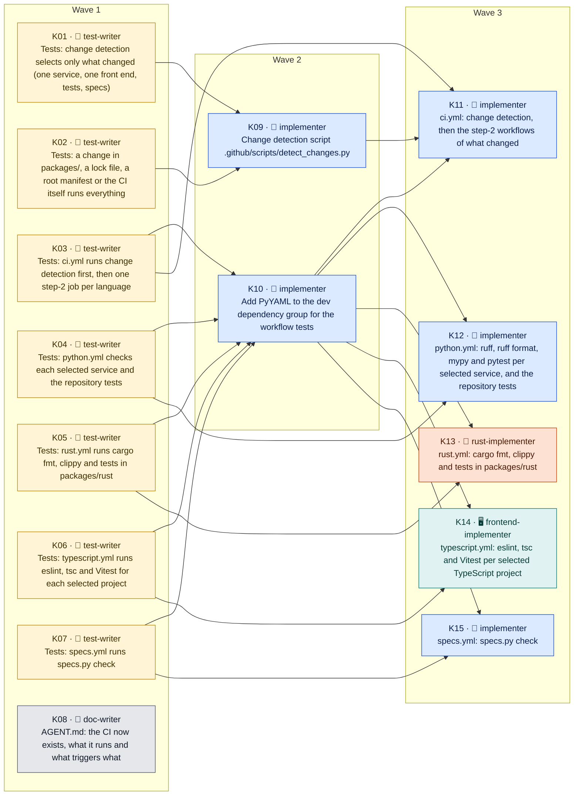

# T0.04: Plan

**Plan:** 🟢 Approved

<!-- ticket:specs -->
## 📚 Specifications

The technical pages, features, use cases and business rules of [TICKET.md](TICKET.md), copied by `python3 .claude/scripts/tickets/ticket_refs.py sync`.

- [🧰 Deployment: CI/CD](../../specs/technical/09-deployment.md#ci)
- [🗂️ Architecture: mono-repo](../../specs/technical/01-architecture.md#mono-repo)
<!-- /ticket:specs -->

## Summary

T0.04 builds steps 1 and 2 of the CI/CD (docs/specs/technical/09-deployment.md#ci) in `.github/workflows/`. The pipeline has five workflow files:

- **`ci.yml`** is the entry point. It runs on every push and every pull request, and starts with a `changes` job (step 1).
- **Four reusable workflows** (`workflow_call`) run step 2 per language, and each one needs `changes` first:
  - `python.yml` runs, for each selected service, ruff check, `ruff format --check`, mypy, pytest and that service's slice of the convention tests. A second job runs the repository-level tests in `tests/`.
  - `rust.yml` runs cargo fmt, clippy and tests in `packages/rust`.
  - `typescript.yml` runs each selected project's `lint` (eslint), `typecheck` (tsc) and `test` (Vitest) scripts through pnpm.
  - `specs.yml` runs `specs.py check`.

Change detection is a standard-library script, `.github/scripts/detect_changes.py`. It reads the changed paths and prints five GitHub outputs: `services`, `typescript`, `rust`, `repository` and `specs`. It finds the services and front ends itself, so a new one needs no change to it. A change in one service selects only that service. A change in `packages/`, in any lock file, in the root workspace manifests or in the CI's own files selects everything that applies. Rust and TypeScript count only once their workspaces hold code. Because the script stands alone, both acceptance criteria can be tested offline with pytest (`tests/ci/detect_changes/`). The workflows are checked by tests that parse them with PyYAML (`tests/ci/workflows/`), since nothing is pushed during a ticket.

The graph has 15 tasks in 3 waves:
- **Wave 1, 8 tasks:**
  - K01 and K02 test the detector, one per acceptance criterion.
  - K03 to K07 test the five workflow files, one each.
  - K08 is the doc-writer task for AGENT.md.
- **Wave 2, 2 tasks:** the detector script (K09), and PyYAML added to the dev dependency group (K10).
- **Wave 3, 5 tasks:** one per workflow file. `ci.yml`, `python.yml` and `specs.yml` go to implementer, `rust.yml` to rust-implementer and `typescript.yml` to frontend-implementer.

No two tasks of the same wave share a file.

## Assumptions

- A lock file change (uv.lock) runs all checks as AGENT.md says; other lock files are treated the same way (most conservative).
- Benchmarks and the generated-types check of step 2 are not in the roadmap row, so they are left to T0.07 and T0.06.
- Rust and TypeScript checks run only once those workspaces hold code; a missing target is not applicable, never failed.
- Change detection lives in a standard-library Python script, `.github/scripts/detect_changes.py`, called by `ci.yml`. The roadmap says only 'Where: .github/workflows/'. GitHub reads only YAML files in that folder, and a standalone script is the only way to test both acceptance criteria offline (tests/ci/detect_changes/).
- A change in `packages/`, in any lock file (`uv.lock`, `Cargo.lock`, `pnpm-lock.yaml`), in the root workspace manifests (`pyproject.toml`, `package.json`, `pnpm-workspace.yaml`, `turbo.json`) or in the CI's own files (`ci.yml`, the four reusable workflows, `.github/scripts/`) runs every applicable check, including the repository tests and `specs.py check`. AGENT.md and the roadmap say 'runs all of them'. No finer dependency graph is computed, which is the conservative option.
- Services are discovered the same way as in T0.03 (`ServiceTree`): the direct sub-folders of `services/` whose names start with neither `.` nor `_`. TypeScript projects are the `frontends/*` and `packages/ts/*` folders that hold a `package.json`. A new service or front end needs no change to the CI.
- Rust checks are selected only when `workspace.members` in `packages/rust/Cargo.toml` is non-empty, and TypeScript checks only when a project has a `package.json`. A target that does not exist yet is not applicable (TICKET.md). Today Rust is not applicable until T0.07.
- A service change runs only that service's checks: ruff check, `ruff format --check`, `mypy services/<s>/src`, `pytest services/<s>/tests`, and its own slice of `tests/conventions/services/test_service_conventions.py`, selected with `-k "<service>-"` on the T0.03 test ids `<service>-<rule>`. The repository-level tests (`tests/`, which covers the harness and conventions, and `.github/scripts`) run only when `tests/`, `.claude/` or a shared path changes.
- eslint, tsc and Vitest run through each project's `lint`, `typecheck` and `test` scripts, with `pnpm --filter ./<project> run --if-present`, as `.claude/hooks/layer-checks.json` already does. No project has a Vitest `test` script until front-end code arrives (T0.14), so that step is skipped by `--if-present` until then.
- `specs.py check` runs when `docs/specs/` or `.claude/skills/write-specs/` changes, through `uv run python`, because the script imports Pillow from the dev dependencies. The step fails if the check prints anything.
- The pipeline is one entry workflow, `ci.yml` (push and pull_request with no branch filter, as AGENT.md says 'every push and pull request'), and four reusable workflows (`workflow_call`): `python.yml`, `rust.yml`, `typescript.yml` and `specs.yml`. Every step-2 job `needs` the `changes` job. A push with no usable base (a new branch, or a force push whose old commit is gone) runs everything. `terraform.yml` stays as it is, outside change detection.
- No YAML parser is in `uv.lock`, so PyYAML (>=6.0) is added to the root dev dependency group. The workflow tests use it to parse the workflows. Running `uv lock` needs network access.
- Nothing is pushed during a ticket, so the workflows are never run on GitHub here. They are verified by structural tests in tests/ci/workflows/, and by actionlint when it is installed.
- No agent is dedicated to CI YAML. `implementer` writes `ci.yml`, `python.yml` and `specs.yml`, `rust-implementer` writes `rust.yml`, and `frontend-implementer` writes `typescript.yml`, by language knowledge.
- Action versions are not set by the specifications. They follow `terraform.yml` (`actions/checkout@v4`) and use the current major of setup-python, setup-uv, pnpm/action-setup and setup-node. The tests check only the action names.
- Event values (base and head SHAs, service and project names) reach shell scripts through `env:`, never as `${{ }}` inside `run`, to prevent script injection from pull request content. The tests enforce this.
- Benchmarks and the generated-types check of step 2 are left to T0.07 and T0.06 (TICKET.md). Steps 3 to 6 are T0.10.
- AGENT.md gets small factual updates (K08): the CI now exists, what it runs, and what triggers what. The specification pages are not changed, because they already describe the target.

<!-- plan:graph -->

> [!NOTE]
> Generated from the json block at the end of this page by `python3 .claude/scripts/tickets/plan.py render`.
> To change a task, edit the json block, then render again: never edit this view by hand.

## Waves

| Wave | Tasks | Agents running at once |
| --- | --- | --- |
| 1 | [K01](#k01), [K02](#k02), [K03](#k03), [K04](#k04), [K05](#k05), [K06](#k06), [K07](#k07), [K08](#k08) | 8 of 8 |
| 2 | [K09](#k09), [K10](#k10) | 2 of 2 |
| 3 | [K11](#k11), [K12](#k12), [K13](#k13), [K14](#k14), [K15](#k15) | 5 of 5 |

| Wave | Task | Agent | Depends on | Unblocks |
| --- | --- | --- | --- | --- |
| 1 | [K01](#k01) Tests: change detection selects only what changed (one service, one front end, tests, specs) | 🧪 test-writer | none | [K09](#k09) |
| 1 | [K02](#k02) Tests: a change in packages/, a lock file, a root manifest or the CI itself runs everything | 🧪 test-writer | none | [K09](#k09) |
| 1 | [K03](#k03) Tests: ci.yml runs change detection first, then one step-2 job per language | 🧪 test-writer | none | [K10](#k10), [K11](#k11) |
| 1 | [K04](#k04) Tests: python.yml checks each selected service and the repository tests | 🧪 test-writer | none | [K10](#k10), [K12](#k12) |
| 1 | [K05](#k05) Tests: rust.yml runs cargo fmt, clippy and tests in packages/rust | 🧪 test-writer | none | [K10](#k10), [K13](#k13) |
| 1 | [K06](#k06) Tests: typescript.yml runs eslint, tsc and Vitest for each selected project | 🧪 test-writer | none | [K10](#k10), [K14](#k14) |
| 1 | [K07](#k07) Tests: specs.yml runs specs.py check | 🧪 test-writer | none | [K10](#k10), [K15](#k15) |
| 1 | [K08](#k08) AGENT.md: the CI now exists, what it runs and what triggers what | 📝 doc-writer | none | none |
| 2 | [K09](#k09) Change detection script .github/scripts/detect_changes.py | 🐍 implementer | [K01](#k01), [K02](#k02) | [K11](#k11) |
| 2 | [K10](#k10) Add PyYAML to the dev dependency group for the workflow tests | 🐍 implementer | [K03](#k03), [K04](#k04), [K05](#k05), [K06](#k06), [K07](#k07) | [K11](#k11), [K12](#k12), [K13](#k13), [K14](#k14), [K15](#k15) |
| 3 | [K11](#k11) ci.yml: change detection, then the step-2 workflows of what changed | 🐍 implementer | [K03](#k03), [K09](#k09), [K10](#k10) | none |
| 3 | [K12](#k12) python.yml: ruff, ruff format, mypy and pytest per selected service, and the repository tests | 🐍 implementer | [K04](#k04), [K10](#k10) | none |
| 3 | [K13](#k13) rust.yml: cargo fmt, clippy and tests in packages/rust | 🦀 rust-implementer | [K05](#k05), [K10](#k10) | none |
| 3 | [K14](#k14) typescript.yml: eslint, tsc and Vitest per selected TypeScript project | 🖥️ frontend-implementer | [K06](#k06), [K10](#k10) | none |
| 3 | [K15](#k15) specs.yml: specs.py check | 🐍 implementer | [K07](#k07), [K10](#k10) | none |

## Dependency graph



## Tasks

### <a id="k01"></a>K01: Tests: change detection selects only what changed (one service, one front end, tests, specs)

| Agent | Wave | Depends on | Unblocks |
| --- | --- | --- | --- |
| 🧪 test-writer | 1 | none | [K09](#k09) |

**Files** (only this task may change them in its wave):

- `tests/ci/detect_changes/helpers.py`
- `tests/ci/detect_changes/test_detect_changes.py`

**Done when:** `uv run ruff check tests/ci/detect_changes` and `uv run ruff format --check tests/ci/detect_changes` pass. `uv run python -c "from tests.ci.detect_changes.helpers import repo_root, script_path, write_repo, run_detector, outputs, ALL_SERVICES, ALL_TYPESCRIPT"` succeeds. `uv run pytest tests/ci/detect_changes/test_detect_changes.py -q` collects, and fails only because `.github/scripts/detect_changes.py` does not exist yet.

**Brief:**

Ticket T0.04 (docs/tickets/T0.04/TICKET.md), acceptance criterion 1: given a pull request touching one service, when the CI runs, then only that service's checks run. Applies docs/specs/technical/09-deployment.md#ci (step 1: detect changes per service, front end and package), docs/specs/technical/01-architecture.md#mono-repo (the services/, frontends/ and packages/ layout that detection walks) and docs/specs/roadmap/01-p0-foundations.md#s01 (row T0.04, done when). Also AGENT.md, section Mono-repo, CI/CD step 1.

Write the tests of the change-detection script `.github/scripts/detect_changes.py`, which K09 implements. Do not create the script.

DETECTOR CONTRACT (shared with K02, K03, K09):
- The script uses the standard library only and runs on Python 3.11 or later (it uses tomllib).
- Usage: `python3 .github/scripts/detect_changes.py [--root <repo root>] [--all]`. The default root is the repository holding the script.
- It reads the changed paths from stdin: one POSIX path per line, relative to the root. Blank lines and surrounding spaces are ignored.
- With `--all`, stdin is not read and everything that applies is selected.
- An unknown argument, or `--root` without a value, prints a usage line on stderr and exits 2.
- Output: exactly five lines on stdout, in this order, then exit 0:
  - `services=<JSON array>`
  - `typescript=<JSON array>`
  - `rust=<true|false>`
  - `repository=<true|false>`
  - `specs=<true|false>`
- Arrays are sorted, hold no duplicates, and are compact JSON: `[]` and `["alpha","beta"]`.
- Discovery:
  - The services are the direct sub-folders of `<root>/services` whose names start with neither `.` nor `_`.
  - The TypeScript projects are the folders `frontends/<name>` and `packages/ts/<name>` that hold a `package.json`, written as POSIX relative paths.
  - Rust applies only when `packages/rust/Cargo.toml` exists and its `workspace.members` is a non-empty list.
- Selection, per changed path:
  - (a) **Shared paths select everything that applies:** every service, every TypeScript project, `rust=true` if Rust applies, `repository=true` and `specs=true`. The shared paths are:
    - anything under `packages/`;
    - any file named `uv.lock`, `pnpm-lock.yaml` or `Cargo.lock`;
    - the root `pyproject.toml`, `package.json`, `pnpm-workspace.yaml` and `turbo.json`;
    - `.github/workflows/ci.yml`, `python.yml`, `rust.yml`, `typescript.yml` and `specs.yml`;
    - anything under `.github/scripts/`.
  - (b) `services/<name>/...` selects `<name>` when it is a discovered service.
  - (c) `frontends/<name>/...` selects `frontends/<name>` when that folder holds a `package.json`.
  - (d) Anything under `tests/` or `.claude/` sets `repository=true`.
  - (e) Anything under `docs/specs/` or `.claude/skills/write-specs/` sets `specs=true`.
  - (f) Anything else selects nothing: `docs/tickets/`, `README.md`, `AGENT.md`, `deploy/`, `.github/workflows/terraform.yml`.

1) tests/ci/detect_changes/helpers.py holds module-level functions and constants. K02 imports them, so keep these exact names and signatures:
- `repo_root() -> Path`, which is `Path(__file__).resolve().parents[3]`.
- `script_path() -> Path`, which is `repo_root() / ".github" / "scripts" / "detect_changes.py"`.
- `write_repo(root: Path, rust_members: bool = True) -> None` writes a sample repository with UTF-8 files, creating the parent folders. It holds:
  - `services/alpha/pyproject.toml` and `services/beta/pyproject.toml`;
  - `services/_template/pyproject.toml`, `services/.hidden/pyproject.toml` and `services/README.md`;
  - `frontends/ground-control/package.json`, and `frontends/notes/README.md` with no package.json;
  - `packages/ts/config/package.json` and `packages/python/.gitkeep`;
  - `packages/rust/Cargo.toml` with `[workspace]`, `resolver = "2"` and `members = ["core"]` (or `members = []` when `rust_members` is False);
  - `packages/rust/core/Cargo.toml` when `rust_members` is True.
- `run_detector(root: Path, changed: List[str], *args: str) -> subprocess.CompletedProcess[str]` runs `[sys.executable, str(script_path()), "--root", str(root), *args]` with `input="\n".join(changed) + "\n"`, `capture_output=True`, `text=True` and `check=False`.
- `outputs(result: subprocess.CompletedProcess[str]) -> Dict[str, str]` splits each stdout line on its first `=`.
- Constants: `ALL_SERVICES = '["alpha","beta"]'` and `ALL_TYPESCRIPT = '["frontends/ground-control","packages/ts/config"]'`.

2) tests/ci/detect_changes/test_detect_changes.py holds one class, `TestDetectChanges`. Build the sample with `write_repo(tmp_path)`. Cover:
- The output is exactly five lines, with the keys in the contract order. The arrays parse as JSON lists, and the flags are `true` or `false`.
- No changed path gives `services=[]`, `typescript=[]` and the three flags false.
- **Criterion 1:** several paths in `services/alpha/` (src, tests and pyproject.toml) give `services=["alpha"]`, `typescript=[]` and every flag false.
- Paths in `services/alpha` and `services/beta` give both, sorted, once each.
- A path of a service that is not discovered (`services/gone/x.py`, `services/_template/x.py`, `services/.hidden/x.py`, `services/README.md`) selects nothing.
- `frontends/ground-control/src/main.ts` gives `typescript=["frontends/ground-control"]` and `services=[]`. `frontends/notes/x.ts` gives `[]`.
- `tests/conventions/x.py` and `.claude/hooks/x.py` set `repository=true` only.
- `docs/specs/glossary.md` sets `specs=true` only. `.claude/skills/write-specs/scripts/specs.py` sets `specs=true` and `repository=true`.
- Parametrised, these select nothing: `docs/tickets/T0.04/TICKET.md`, `README.md`, `AGENT.md`, `deploy/terraform/cells/dev/main.tf` and `.github/workflows/terraform.yml`.
- Blank lines and surrounding spaces in stdin are ignored.
- An unknown argument exits 2 with a non-empty stderr.

Follow the Tests section of AGENT.md:
- one `Test<Subject>` class per file, and test names written as sentences;
- `pytest.mark.parametrize` for cases of the same behaviour;
- no mocks: run the real script as a child process;
- no `__init__.py`.

Also:
- `from __future__ import annotations` comes first.
- Use `typing` generics (List, Dict), no `Any` and no nested function.
- Write in British English, with no em dashes.
- Test file basenames must be unique in the repository.
- Format only your files with `uv run ruff format <file>`.

### <a id="k02"></a>K02: Tests: a change in packages/, a lock file, a root manifest or the CI itself runs everything

| Agent | Wave | Depends on | Unblocks |
| --- | --- | --- | --- |
| 🧪 test-writer | 1 | none | [K09](#k09) |

**Files** (only this task may change them in its wave):

- `tests/ci/detect_changes/test_shared_changes.py`

**Done when:** `uv run ruff check tests/ci/detect_changes/test_shared_changes.py` and `uv run ruff format --check tests/ci/detect_changes/test_shared_changes.py` pass. `uv run pytest tests/ci/detect_changes/test_shared_changes.py -q` fails only because tests/ci/detect_changes/helpers.py (K01) or `.github/scripts/detect_changes.py` (K09) does not exist yet in this worktree.

**Brief:**

Ticket T0.04 (docs/tickets/T0.04/TICKET.md), acceptance criterion 2: given a pull request changing packages/, when the CI runs, then the checks of all the services and front ends that depend on it run. Applies:
- docs/specs/technical/09-deployment.md#ci: step 1, a change in `packages/` or a lock file runs everything that depends on it.
- docs/specs/technical/01-architecture.md#mono-repo: the three workspaces and their lock files, `uv.lock`, `packages/rust/Cargo.lock` and `pnpm-lock.yaml`.
- docs/specs/roadmap/01-p0-foundations.md#s01: row T0.04, "a change in packages/ runs all of them".
- AGENT.md, section Mono-repo, CI/CD step 1.
- The TICKET.md assumptions: every lock file runs everything, and a target that does not exist yet is not applicable.

Write tests/ci/detect_changes/test_shared_changes.py, with one class `TestSharedChanges`, for the script `.github/scripts/detect_changes.py` (K09 implements it).

Use the helpers that K01 writes in the same wave, in tests/ci/detect_changes/helpers.py, imported by full path:
- `from tests.ci.detect_changes.helpers import ALL_SERVICES, ALL_TYPESCRIPT, outputs, run_detector, write_repo`;
- `write_repo(root: Path, rust_members: bool = True) -> None` writes services alpha and beta (plus `_template`, `.hidden` and README.md, which are ignored), `frontends/ground-control` with a package.json, `frontends/notes` without one, `packages/ts/config` with a package.json, `packages/python/.gitkeep`, and `packages/rust/Cargo.toml` with `members = ["core"]` (or `[]`);
- `run_detector(root: Path, changed: List[str], *args: str) -> subprocess.CompletedProcess[str]` runs the script with `--root root` and the paths on stdin;
- `outputs(result) -> Dict[str, str]` parses the `key=value` lines;
- `ALL_SERVICES == '["alpha","beta"]'` and `ALL_TYPESCRIPT == '["frontends/ground-control","packages/ts/config"]'`.

The contract under test:
- The output is five lines: `services=<JSON array>`, `typescript=<JSON array>`, `rust=<true|false>`, `repository=<true|false>` and `specs=<true|false>`. Arrays are sorted, without duplicates, in compact JSON.
- A shared path selects everything that applies: every discovered service, every TypeScript project with a package.json, `rust=true` only when the `workspace.members` of `packages/rust/Cargo.toml` is non-empty, `repository=true` and `specs=true`.
- The shared paths are:
  - anything under `packages/`;
  - any file named `uv.lock`, `pnpm-lock.yaml` or `Cargo.lock`;
  - the root `pyproject.toml`, `package.json`, `pnpm-workspace.yaml` and `turbo.json`;
  - `.github/workflows/ci.yml`, `python.yml`, `rust.yml`, `typescript.yml` and `specs.yml`;
  - anything under `.github/scripts/`.
- `--all`, with empty stdin, gives the same result.

Cover:
- **Criterion 2,** parametrised over every shared path below. Each one alone gives `services=ALL_SERVICES`, `typescript=ALL_TYPESCRIPT`, `rust=true`, `repository=true` and `specs=true`:
  - `packages/python/lifecycle/src/lifecycle/runnable.py`;
  - `packages/ts/config/eslint.config.js`;
  - `packages/rust/core/src/lib.rs`;
  - `packages/rust/Cargo.lock`, `uv.lock` and `pnpm-lock.yaml`;
  - `pyproject.toml`, `package.json`, `pnpm-workspace.yaml` and `turbo.json`;
  - each of the five CI workflow files;
  - `.github/scripts/detect_changes.py`.
- `--all` gives the same five values.
- With `write_repo(tmp_path, rust_members=False)`, a change in `packages/rust/Cargo.toml` gives `rust=false` (not applicable) and still selects all services and TypeScript projects.
- A shared path together with a path of `services/alpha` still lists each service once.
- A repository without a `services/` folder gives `services=[]` for a shared path.
- `.github/workflows/terraform.yml` is not a shared path and selects nothing.

Follow the Tests section of AGENT.md:
- one `Test<Subject>` class, and test names written as sentences;
- parametrize the cases;
- no mocks;
- no `__init__.py`.

Also:
- `from __future__ import annotations` comes first.
- Use `typing` generics, no `Any` and no nested function.
- Write in British English, with no em dashes.
- Test file basenames must be unique.
- Format only your file.

### <a id="k03"></a>K03: Tests: ci.yml runs change detection first, then one step-2 job per language

| Agent | Wave | Depends on | Unblocks |
| --- | --- | --- | --- |
| 🧪 test-writer | 1 | none | [K10](#k10), [K11](#k11) |

**Files** (only this task may change them in its wave):

- `tests/ci/workflows/test_ci_workflow.py`

**Done when:** `uv run ruff check tests/ci/workflows/test_ci_workflow.py` and `uv run ruff format --check tests/ci/workflows/test_ci_workflow.py` pass. `uv run pytest tests/ci/workflows/test_ci_workflow.py -q` fails only with ModuleNotFoundError for yaml or the K01 helpers, or because `.github/workflows/ci.yml` or the detector script does not exist yet.

**Brief:**

Ticket T0.04 (docs/tickets/T0.04/TICKET.md). Applies:
- docs/specs/technical/09-deployment.md#ci: GitHub Actions, each step passing before the next. This ticket builds step 1 (detect changes) and step 2 (check). Steps 3 to 6 are out of scope.
- docs/specs/technical/01-architecture.md#mono-repo.
- docs/specs/roadmap/01-p0-foundations.md#s01: row T0.04.
- AGENT.md, section Mono-repo, CI/CD: on every push and pull request.

Write tests/ci/workflows/test_ci_workflow.py, with one class `TestCiWorkflow`, for `.github/workflows/ci.yml` (K11 implements it).

Read the file with PyYAML: `yaml.safe_load(path.read_text(encoding="utf-8"))`. Two notes:
- PyYAML is added to the dev dependencies by K10. Until then the import fails, which is expected.
- **PyYAML loads the key `on` as the boolean `True`, so read the triggers with `data.get("on", data.get(True))`.**

Get the repository root with `from tests.ci.detect_changes.helpers import repo_root` (K01 writes it in the same wave), or compute it locally as `Path(__file__).resolve().parents[3]`. Put helper methods (load the workflow, list a job's steps, join the `run` strings of a job) on the test class. No module-level functions.

The contract:
- **Triggers:** they include `push` and `pull_request`. Top-level `permissions` is exactly `{"contents": "read"}`.
- **Jobs:** exactly `changes`, `python`, `rust`, `typescript` and `specs`.
- **`changes` job:**
  - `runs-on` is `ubuntu-latest`.
  - A step uses `actions/checkout@...` with `with.fetch-depth == 0`.
  - A step uses `actions/setup-python@...` with `python-version` "3.12".
  - A step with `id: detect` has a `run` containing `.github/scripts/detect_changes.py` and `GITHUB_OUTPUT`.
  - The job `outputs` keys are exactly `services`, `typescript`, `rust`, `repository` and `specs`. Each value is `${{ steps.detect.outputs.<key> }}`.
- **Outputs match the detector:** the output keys equal, as a set, the keys printed by the real detector. Run `[sys.executable, str(repo_root()/'.github/scripts/detect_changes.py'), '--all', '--root', str(repo_root())]` and take the text before `=` on each line.
- **Every other job** has `needs` equal to, or containing, `changes`, so step 2 starts only after step 1 passes.
- **`python` job:**
  - `uses` is `./.github/workflows/python.yml`.
  - `with.services` is `${{ needs.changes.outputs.services }}`.
  - `with.repository` mentions `needs.changes.outputs.repository`.
  - `if` mentions both `needs.changes.outputs.services` and `needs.changes.outputs.repository`.
- **`rust` job:** `uses` is `./.github/workflows/rust.yml`, and `if` mentions `needs.changes.outputs.rust`.
- **`typescript` job:** `uses` is `./.github/workflows/typescript.yml`, `with.projects` is `${{ needs.changes.outputs.typescript }}`, and `if` mentions `needs.changes.outputs.typescript`.
- **`specs` job:** `uses` is `./.github/workflows/specs.yml`, and `if` mentions `needs.changes.outputs.specs`.
- **Injection safety:** no `run` string anywhere in the file contains `${{ github.event`. Event values reach the script through `env:`.
- **Steps 3 to 6 are out of scope:** no `run` contains `docker`, `cosign`, `trivy` or `playwright`, and no step `uses` an action starting with `docker/`.

Follow the Tests section of AGENT.md:
- one `Test<Subject>` class, and test names written as sentences;
- parametrize the per-job cases;
- no mocks;
- no `__init__.py`.

Also:
- `from __future__ import annotations` comes first.
- Use `typing` generics, no `Any` and no nested function.
- Write in British English, with no em dashes.
- Test file basenames must be unique.
- Format only your file.

### <a id="k04"></a>K04: Tests: python.yml checks each selected service and the repository tests

| Agent | Wave | Depends on | Unblocks |
| --- | --- | --- | --- |
| 🧪 test-writer | 1 | none | [K10](#k10), [K12](#k12) |

**Files** (only this task may change them in its wave):

- `tests/ci/workflows/test_python_workflow.py`

**Done when:** `uv run ruff check tests/ci/workflows/test_python_workflow.py` and `uv run ruff format --check tests/ci/workflows/test_python_workflow.py` pass. `uv run pytest tests/ci/workflows/test_python_workflow.py -q` fails only with ModuleNotFoundError for yaml, or because `.github/workflows/python.yml` does not exist yet.

**Brief:**

Ticket T0.04 (docs/tickets/T0.04/TICKET.md), step 2 for Python: ruff, `ruff format --check`, mypy and pytest. Applies:
- docs/specs/technical/09-deployment.md#ci: step 2 runs ruff, mypy and pytest.
- docs/specs/technical/01-architecture.md#mono-repo: Python 3.12, uv workspace, one uv.lock.
- docs/specs/roadmap/01-p0-foundations.md#s01: row T0.04.
- AGENT.md, sections Commands and Mono-repo, CI/CD step 2: `uv run ruff check`, `uv run ruff format --check`, `uv run mypy services/<service>/src`, `uv run pytest ... -n 2`.

Write tests/ci/workflows/test_python_workflow.py, with one class `TestPythonWorkflow`, for the reusable workflow `.github/workflows/python.yml` (K12 implements it).

Read it with `yaml.safe_load`. PyYAML is added by K10, and until then the import fails. **PyYAML loads the key `on` as `True`: use `data.get("on", data.get(True))`.** Compute the repository root as `Path(__file__).resolve().parents[3]` in a method. Put the helper methods on the class.

The contract:
- **Trigger:** `workflow_call` only.
  - Input `services`: `type: string`, `required: true`. It is a compact JSON array of service names.
  - Input `repository`: `type: boolean`, `required: false`, `default: false`.
- **Permissions:** top-level `permissions` is `{"contents": "read"}`.
- **Jobs:** exactly `services` and `repository`, both on `runs-on: ubuntu-latest`.
- **`services` job:**
  - `if` mentions `inputs.services` and `'[]'`.
  - `strategy.fail-fast` is false, and `strategy.matrix.service` is `${{ fromJSON(inputs.services) }}`.
  - Job-level `env.SERVICE` is `${{ matrix.service }}`.
  - Steps, in this order:
    - a step using `actions/checkout@...`;
    - a step using `astral-sh/setup-uv@...`;
    - a `run` containing `uv sync --locked`;
    - then `run` strings containing, in this order: `uv run ruff check`, `uv run ruff format --check`, `uv run mypy`, `uv run pytest`.
  - Each of the four commands references `services/$SERVICE`. The mypy one references `services/$SERVICE/src`, and the pytest one `services/$SERVICE/tests`.
  - A `run` contains `tests/conventions/services/test_service_conventions.py` and `-k`, and references `$SERVICE`. It runs only this service's slice of the convention tests, whose test ids are `<service>-<rule>`.
  - No `run` string in this job contains `${{`. Values come from env, so a folder name cannot inject shell code.
- **`repository` job:**
  - `if` mentions `inputs.repository`.
  - Steps: checkout, setup-uv, `uv sync --locked`.
  - Then `run` strings containing `uv run ruff check`, `uv run ruff format --check` and `uv run pytest`. The two ruff runs name both `tests` and `.github/scripts`, and the pytest run names `tests` and `-n 2`.

Follow the Tests section of AGENT.md:
- one `Test<Subject>` class, and test names written as sentences;
- parametrize the per-command cases;
- no mocks;
- no `__init__.py`.

Also:
- `from __future__ import annotations` comes first.
- Use `typing` generics, no `Any` and no nested function.
- Write in British English, with no em dashes.
- Test file basenames must be unique.
- Format only your file.

### <a id="k05"></a>K05: Tests: rust.yml runs cargo fmt, clippy and tests in packages/rust

| Agent | Wave | Depends on | Unblocks |
| --- | --- | --- | --- |
| 🧪 test-writer | 1 | none | [K10](#k10), [K13](#k13) |

**Files** (only this task may change them in its wave):

- `tests/ci/workflows/test_rust_workflow.py`

**Done when:** `uv run ruff check tests/ci/workflows/test_rust_workflow.py` and `uv run ruff format --check tests/ci/workflows/test_rust_workflow.py` pass. `uv run pytest tests/ci/workflows/test_rust_workflow.py -q` fails only with ModuleNotFoundError for yaml, or because `.github/workflows/rust.yml` does not exist yet.

**Brief:**

Ticket T0.04 (docs/tickets/T0.04/TICKET.md), step 2 for Rust: cargo fmt, clippy and tests. Benchmarks are left to T0.07. Applies:
- docs/specs/technical/09-deployment.md#ci: step 2 runs cargo fmt, clippy and tests.
- docs/specs/technical/01-architecture.md#mono-repo: Rust is a Cargo workspace in packages/rust, with Cargo.lock.
- docs/specs/roadmap/01-p0-foundations.md#s01: row T0.04.
- AGENT.md, section Commands: `cargo fmt --all --check` and `cargo clippy --workspace --all-targets -- -D warnings`.
- packages/rust/rust-toolchain.toml: stable, with the rustfmt and clippy components.

Write tests/ci/workflows/test_rust_workflow.py, with one class `TestRustWorkflow`, for the reusable workflow `.github/workflows/rust.yml` (K13 implements it).

Read it with `yaml.safe_load`. PyYAML is added by K10, and until then the import fails. **`on` loads as `True`: use `data.get("on", data.get(True))`.** Compute the root as `Path(__file__).resolve().parents[3]` in a method.

The contract:
- **Trigger:** `workflow_call`. Top-level `permissions` is `{"contents": "read"}`.
- **Jobs:** exactly `check`, on `runs-on: ubuntu-latest`, with `defaults.run.working-directory` equal to `packages/rust`.
- **Steps:**
  - A step uses `actions/checkout@...`.
  - A toolchain step comes before the first cargo command. It either `uses` an action whose name contains `rust-toolchain`, or has a `run` containing `rustup`.
  - Then `run` strings containing, in this order:
    - `cargo fmt --all --check`;
    - `cargo clippy --workspace --all-targets --locked -- -D warnings`;
    - `cargo test --workspace --locked`.
- **No `${{` in any `run` string.**

Follow the Tests section of AGENT.md:
- one `Test<Subject>` class, and test names written as sentences;
- parametrize;
- no mocks;
- no `__init__.py`.

Also:
- `from __future__ import annotations` comes first.
- Use `typing` generics, no `Any` and no nested function.
- Write in British English, with no em dashes.
- Test file basenames must be unique.
- Format only your file.

### <a id="k06"></a>K06: Tests: typescript.yml runs eslint, tsc and Vitest for each selected project

| Agent | Wave | Depends on | Unblocks |
| --- | --- | --- | --- |
| 🧪 test-writer | 1 | none | [K10](#k10), [K14](#k14) |

**Files** (only this task may change them in its wave):

- `tests/ci/workflows/test_typescript_workflow.py`

**Done when:** `uv run ruff check tests/ci/workflows/test_typescript_workflow.py` and `uv run ruff format --check tests/ci/workflows/test_typescript_workflow.py` pass. `uv run pytest tests/ci/workflows/test_typescript_workflow.py -q` fails only with ModuleNotFoundError for yaml, or because `.github/workflows/typescript.yml` does not exist yet.

**Brief:**

Ticket T0.04 (docs/tickets/T0.04/TICKET.md), step 2 for TypeScript: eslint, `tsc` and Vitest. Applies:
- docs/specs/technical/09-deployment.md#ci: step 2 runs eslint, tsc and Vitest.
- docs/specs/technical/01-architecture.md#mono-repo: TypeScript is a pnpm workspace over `frontends/*` and `packages/ts/*`, with pnpm-lock.yaml.
- docs/specs/roadmap/01-p0-foundations.md#s01: row T0.04.
- AGENT.md, section Commands: `pnpm -r --if-present lint` and `typecheck`. Packages extend `@swarm/config`, whose `lint` runs eslint and whose `typecheck` runs `tsc --noEmit`.
- The root `package.json`: `packageManager` pnpm, and `engines.node` >=22.

Write tests/ci/workflows/test_typescript_workflow.py, with one class `TestTypescriptWorkflow`, for the reusable workflow `.github/workflows/typescript.yml` (K14 implements it).

Read it with `yaml.safe_load`. PyYAML is added by K10, and until then the import fails. **`on` loads as `True`: use `data.get("on", data.get(True))`.** Compute the root as `Path(__file__).resolve().parents[3]` in a method.

The contract:
- **Trigger:** `workflow_call`, with input `projects`: `type: string`, `required: true`. It is a compact JSON array of project paths such as `frontends/ground-control` or `packages/ts/config`.
- **Permissions:** top-level `permissions` is `{"contents": "read"}`.
- **Jobs:** exactly `check`, on `runs-on: ubuntu-latest`.
  - `if` mentions `inputs.projects` and `'[]'`.
  - `strategy.fail-fast` is false, and `strategy.matrix.project` is `${{ fromJSON(inputs.projects) }}`.
  - Job-level `env.PROJECT` is `${{ matrix.project }}`.
- **Steps,** in this order:
  - a step using `actions/checkout@...`;
  - a step using `pnpm/action-setup@...`;
  - a step using `actions/setup-node@...`, whose `with.node-version` starts with "22" and whose `with.cache` is "pnpm";
  - a `run` containing `pnpm install --frozen-lockfile`;
  - then three `run` strings, in this order, each containing `pnpm --filter` and `$PROJECT` and `--if-present`, ending with `lint`, `typecheck` and `test` respectively.
- **No `${{` in any `run` string.**

Follow the Tests section of AGENT.md:
- one `Test<Subject>` class, and test names written as sentences;
- parametrize;
- no mocks;
- no `__init__.py`.

Also:
- `from __future__ import annotations` comes first.
- Use `typing` generics, no `Any` and no nested function.
- Write in British English, with no em dashes.
- Test file basenames must be unique.
- Format only your file.

### <a id="k07"></a>K07: Tests: specs.yml runs specs.py check

| Agent | Wave | Depends on | Unblocks |
| --- | --- | --- | --- |
| 🧪 test-writer | 1 | none | [K10](#k10), [K15](#k15) |

**Files** (only this task may change them in its wave):

- `tests/ci/workflows/test_specs_workflow.py`

**Done when:** `uv run ruff check tests/ci/workflows/test_specs_workflow.py` and `uv run ruff format --check tests/ci/workflows/test_specs_workflow.py` pass. `uv run pytest tests/ci/workflows/test_specs_workflow.py -q` fails only with ModuleNotFoundError for yaml, or because `.github/workflows/specs.yml` does not exist yet.

**Brief:**

Ticket T0.04 (docs/tickets/T0.04/TICKET.md), step 2 for the specifications: `specs.py check`. Applies:
- docs/specs/technical/09-deployment.md#ci: step 2 checks that the specifications are up to date with `specs.py check`.
- docs/specs/roadmap/01-p0-foundations.md#s01: row T0.04.
- CLAUDE.md: `python3 .claude/skills/write-specs/scripts/specs.py check` prints nothing. The script imports Pillow, which comes from the uv dev dependencies, so it runs through `uv run python`.

Write tests/ci/workflows/test_specs_workflow.py, with one class `TestSpecsWorkflow`, for the reusable workflow `.github/workflows/specs.yml` (K15 implements it).

Read it with `yaml.safe_load`. PyYAML is added by K10, and until then the import fails. **`on` loads as `True`: use `data.get("on", data.get(True))`.** Compute the root as `Path(__file__).resolve().parents[3]` in a method.

The contract:
- **Trigger:** `workflow_call`. Top-level `permissions` is `{"contents": "read"}`.
- **Jobs:** exactly `check`, on `runs-on: ubuntu-latest`.
- **Steps,** in this order:
  - a step using `actions/checkout@...`;
  - a step using `astral-sh/setup-uv@...`;
  - a `run` containing `uv sync --locked`;
  - a `run` containing `uv run python .claude/skills/write-specs/scripts/specs.py check`.
- No `run` contains `specs.py build` or `specs.py render`: the CI checks and never writes.
- **No `${{` in any `run` string.**

Follow the Tests section of AGENT.md:
- one `Test<Subject>` class, and test names written as sentences;
- no mocks;
- no `__init__.py`.

Also:
- `from __future__ import annotations` comes first.
- Use `typing` generics, no `Any` and no nested function.
- Write in British English, with no em dashes.
- Test file basenames must be unique.
- Format only your file.

### <a id="k08"></a>K08: AGENT.md: the CI now exists, what it runs and what triggers what

| Agent | Wave | Depends on | Unblocks |
| --- | --- | --- | --- |
| 📝 doc-writer | 1 | none | none |

**Files** (only this task may change them in its wave):

- `AGENT.md`

**Done when:** `grep -n 'does not exist yet: it arrives in T0.04' AGENT.md` prints nothing. `grep -n 'detect_changes.py' AGENT.md` and `grep -n '.github/scripts/' AGENT.md` each print at least one line. `grep -nP '\x{2014}' AGENT.md` prints nothing. `git diff --stat` shows only AGENT.md changed.

**Brief:**

Ticket T0.04 (docs/tickets/T0.04/TICKET.md). Applies:
- docs/specs/technical/09-deployment.md#ci: steps 1 and 2.
- docs/specs/technical/01-architecture.md#mono-repo.
- docs/specs/roadmap/01-p0-foundations.md#s01: row T0.04.

Update AGENT.md only, with small factual edits, in plain British English and with no em dashes. Keep the existing style: lines wrapped near 120 characters, and backticks around paths and commands.

1) **Commands section.** Replace the bullet that starts "The per-language CI does not exist yet: it arrives in T0.04..." with a bullet saying:
- `.github/workflows/ci.yml` runs on every push and pull request.
- Its first job runs `.github/scripts/detect_changes.py`, which selects the services, front ends and packages that changed.
- Then the reusable workflows `python.yml`, `rust.yml`, `typescript.yml` and `specs.yml` run the checks of this section for what was selected:
  - for each selected service: `ruff check`, `ruff format --check`, `mypy services/<service>/src`, `pytest services/<service>/tests` and that service's convention tests;
  - the tests under `tests/`;
  - for Rust: `cargo fmt`, `clippy` and `cargo test`;
  - for each TypeScript project: its `lint`, `typecheck` and `test` scripts;
  - `specs.py check`.
- All of them must pass.
- `.github/workflows/terraform.yml` still checks `deploy/terraform/` on its own.

2) **Mono-repo section.**
- Change the sentence "The Docker, front-end and CI/CD rules are not tested yet." to say that the CI/CD change detection and check workflows are tested by `tests/ci/`, and that the Docker and front-end rules are not tested yet.
- Add a row to the path table, right after `.github/workflows/`: `.github/scripts/` | The scripts the pipeline runs, such as change detection.

3) **Mono-repo section, the CI/CD list.**
- Step 1 becomes: detect what changed and run jobs only for those services, front ends and packages. A change in `packages/`, in a lock file (`uv.lock`, `Cargo.lock`, `pnpm-lock.yaml`), in a root workspace file or in the pipeline itself runs all of them.
- Step 2 becomes: run `ruff check`, `ruff format --check`, `mypy` and `pytest` for each changed service; `cargo fmt`, `clippy` and `cargo test` for Rust; eslint, `tsc` and Vitest for TypeScript; and `specs.py check`.
- Leave steps 3 to 5 unchanged. They are T0.10.

Do not change anything else in the file.

### <a id="k09"></a>K09: Change detection script .github/scripts/detect_changes.py

| Agent | Wave | Depends on | Unblocks |
| --- | --- | --- | --- |
| 🐍 implementer | 2 | [K01](#k01), [K02](#k02) | [K11](#k11) |

**Files** (only this task may change them in its wave):

- `.github/scripts/detect_changes.py`

**Done when:** `uv run pytest tests/ci/detect_changes -n 2` passes. `uv run ruff check .github/scripts/detect_changes.py` and `uv run ruff format --check .github/scripts/detect_changes.py` pass. `printf 'services/gateway/src/gateway/api/x.py\n' | python3 .github/scripts/detect_changes.py` prints `services=["gateway"]` followed by `typescript=[]`, `rust=false`, `repository=false` and `specs=false`.

**Brief:**

Ticket T0.04 (docs/tickets/T0.04/TICKET.md), step 1 of the CI/CD. Applies:
- docs/specs/technical/09-deployment.md#ci: detect changes per service, front end and package. A change in `packages/` or a lock file runs everything that depends on it.
- docs/specs/technical/01-architecture.md#mono-repo: services/, frontends/, packages/{python,rust,ts}, and the lock files uv.lock, packages/rust/Cargo.lock and pnpm-lock.yaml.
- docs/specs/roadmap/01-p0-foundations.md#s01: row T0.04. Done when a pull request touching one service runs only that service's checks, and a change in packages/ runs all of them.
- AGENT.md, section Mono-repo: adding a service must not need a change to the tooling, so services are discovered, never listed.

Create `.github/scripts/detect_changes.py` to pass the tests of K01 (tests/ci/detect_changes/test_detect_changes.py, with helpers.py) and K02 (tests/ci/detect_changes/test_shared_changes.py). Read those tests first. They are the contract. Do not change them.

THE CONTRACT:
- **Runtime:** standard library only, and Python 3.11 or later (`tomllib` reads `packages/rust/Cargo.toml`).
- **Usage:** `python3 .github/scripts/detect_changes.py [--root <repo root>] [--all]`. The default root is `Path(__file__).resolve().parents[2]`.
- **Input:** the changed paths come from stdin, one POSIX path per line, relative to the root. Blank lines and surrounding spaces are ignored. `--all` does not read stdin and selects everything that applies.
- **Bad arguments:** an unknown argument, or `--root` without a value, prints a usage line on stderr and returns 2.
- **Output:** exactly five lines on stdout, in this order, then return 0:
  - `services=<JSON array>`
  - `typescript=<JSON array>`
  - `rust=<true|false>`
  - `repository=<true|false>`
  - `specs=<true|false>`
- Arrays are sorted, without duplicates, written with `json.dumps(sorted(values), separators=(",", ":"))`.
- **Discovery:**
  - The services are the direct sub-folders of `<root>/services` whose names start with neither `.` nor `_`. A missing folder gives none.
  - The TypeScript projects are `frontends/<name>` and `packages/ts/<name>` folders holding a `package.json`, as POSIX relative paths.
  - Rust applies only when `packages/rust/Cargo.toml` exists and `workspace.members` is a non-empty list. Today it is empty, so Rust is not applicable until T0.07.
- **Selection,** per path:
  - (a) **Shared paths select everything that applies:** all services, all TypeScript projects, `rust` if it applies, `repository` and `specs`. The shared paths are:
    - anything under `packages/`;
    - any file named `uv.lock`, `pnpm-lock.yaml` or `Cargo.lock`;
    - the root `pyproject.toml`, `package.json`, `pnpm-workspace.yaml` and `turbo.json`;
    - `.github/workflows/ci.yml`, `python.yml`, `rust.yml`, `typescript.yml` and `specs.yml`;
    - anything under `.github/scripts/`.
  - (b) `services/<name>/...` selects `<name>` when it is discovered.
  - (c) `frontends/<name>/...` selects `frontends/<name>` when it holds a package.json.
  - (d) Anything under `tests/` or `.claude/` sets `repository`.
  - (e) Anything under `docs/specs/` or `.claude/skills/write-specs/` sets `specs`.
  - (f) Everything else selects nothing. This includes `.github/workflows/terraform.yml`, which has its own workflow.
- Keep the shared paths in one place (a tuple or frozenset near the top), so that they are easy to read and to extend.

Style:
- The script lives outside `services/` and `packages/python/`, so the AGENT.md service layout and lifecycle rules do not apply. Follow the style of `.claude/scripts/*.py` and `.claude/skills/ticket/scripts/check_plan.py`.
- Start with a module docstring giving the usage and the output format.
- Then `from __future__ import annotations`, and module-level functions with Google-style docstrings and full annotations.
- Use `typing` generics (List, Dict, Set, Optional), no `Any` and no nested function.
- End with `def main(argv: Optional[List[str]] = None) -> int` and `if __name__ == "__main__": sys.exit(main())`.
- Open files with `encoding="utf-8"`.
- Write in British English, with no em dashes.
- Format it with `uv run ruff format .github/scripts/detect_changes.py`, because the format hook does not cover `.github/`.

### <a id="k10"></a>K10: Add PyYAML to the dev dependency group for the workflow tests

| Agent | Wave | Depends on | Unblocks |
| --- | --- | --- | --- |
| 🐍 implementer | 2 | [K03](#k03), [K04](#k04), [K05](#k05), [K06](#k06), [K07](#k07) | [K11](#k11), [K12](#k12), [K13](#k13), [K14](#k14), [K15](#k15) |

**Files** (only this task may change them in its wave):

- `pyproject.toml`
- `uv.lock`

**Done when:** `uv lock --check` passes. `uv run python -c "import yaml; print(yaml.__version__)"` prints a version of 6 or more. `uv run pytest tests/conventions/mono_repo/test_python_workspace.py -q` passes. `uv run pytest tests/ci/workflows -q` fails only because the workflow files do not exist yet, never with ModuleNotFoundError.

**Brief:**

Ticket T0.04 (docs/tickets/T0.04/TICKET.md). The workflow tests of K03 to K07 (tests/ci/workflows/) parse the GitHub Actions YAML of docs/specs/technical/09-deployment.md#ci with PyYAML, which is not in uv.lock yet. Applies docs/specs/technical/01-architecture.md#mono-repo (one uv workspace with one `uv.lock` for the whole repository) and AGENT.md, section Commands (`uv sync`).

Steps:
1. In the root `pyproject.toml`, add `"pyyaml>=6.0"` to `[dependency-groups] dev`, keeping the list in alphabetical order. Change nothing else.
2. Run `uv lock`, then `uv sync`, so that `uv.lock` is updated. This needs network access.
3. Do not add PyYAML to any service. It is used only by tests.

If `uv lock` cannot reach the network, report it as an environment problem. Do not edit `uv.lock` by hand.

### <a id="k11"></a>K11: ci.yml: change detection, then the step-2 workflows of what changed

| Agent | Wave | Depends on | Unblocks |
| --- | --- | --- | --- |
| 🐍 implementer | 3 | [K03](#k03), [K09](#k09), [K10](#k10) | none |

**Files** (only this task may change them in its wave):

- `.github/workflows/ci.yml`

**Done when:** `uv run pytest tests/ci/workflows/test_ci_workflow.py -q` passes. `uv run python -c "import yaml; yaml.safe_load(open('.github/workflows/ci.yml', encoding='utf-8'))"` succeeds. If `actionlint` is on PATH, `actionlint .github/workflows/ci.yml` reports nothing other than missing local reusable workflow files.

**Brief:**

Ticket T0.04 (docs/tickets/T0.04/TICKET.md). Applies:
- docs/specs/technical/09-deployment.md#ci: GitHub Actions, each step passing before the next. Step 1 detects changes and step 2 checks. Steps 3 to 6 are T0.10.
- docs/specs/technical/01-architecture.md#mono-repo.
- docs/specs/roadmap/01-p0-foundations.md#s01: row T0.04, done when.
- AGENT.md, section Mono-repo, CI/CD: on every push and pull request.

Create `.github/workflows/ci.yml` to pass tests/ci/workflows/test_ci_workflow.py (K03). Read that test first. It is the contract. Do not change it.

What to write:
- **Header:**
  - `name: ci`;
  - `on:` with `push:` and `pull_request:`, no branch filter;
  - `permissions: contents: read`.
- **Job `changes`** (step 1), on `ubuntu-latest`:
  - `actions/checkout@v4` with `fetch-depth: 0`.
  - `actions/setup-python@v5` with `python-version: "3.12"`.
  - A step with `id: detect`. It gets `EVENT_NAME`, `PR_BASE` (`github.event.pull_request.base.sha`), `PUSH_BEFORE` (`github.event.before`) and `HEAD_SHA` (`github.sha`) through `env:`. **Never write `${{ github.event... }}` inside `run`.**
  - Its bash script picks the base: `PR_BASE` for a pull request, `PUSH_BEFORE` for a push.
  - When the base is empty, all zeros (a new branch), or not in the history (`git cat-file -e "$BASE^{commit}"` fails, for example after a force push), it runs `python .github/scripts/detect_changes.py --all >> "$GITHUB_OUTPUT"`.
  - Otherwise it runs `git diff --name-only "$BASE" "$HEAD_SHA" | python .github/scripts/detect_changes.py >> "$GITHUB_OUTPUT"`.
  - It also echoes what was selected to the log.
  - Job `outputs`: `services`, `typescript`, `rust`, `repository` and `specs`, each `${{ steps.detect.outputs.<key> }}`.
- **Job `python`:**
  - `needs: changes`;
  - `if: needs.changes.outputs.services != '[]' || needs.changes.outputs.repository == 'true'`;
  - `uses: ./.github/workflows/python.yml`;
  - `with: services: ${{ needs.changes.outputs.services }}`, `repository: ${{ needs.changes.outputs.repository == 'true' }}`.
- **Job `rust`:** `needs: changes`, `if: needs.changes.outputs.rust == 'true'`, `uses: ./.github/workflows/rust.yml`.
- **Job `typescript`:** `needs: changes`, `if: needs.changes.outputs.typescript != '[]'`, `uses: ./.github/workflows/typescript.yml`, `with: projects: ${{ needs.changes.outputs.typescript }}`.
- **Job `specs`:** `needs: changes`, `if: needs.changes.outputs.specs == 'true'`, `uses: ./.github/workflows/specs.yml`.
- **Out of scope:** no build, scan, sign, Playwright or publish job (T0.10). Leave `.github/workflows/terraform.yml` untouched.

The four reusable workflows are written by K12 to K15 in this same wave, so they are absent from your worktree. If `actionlint` is installed, its only accepted complaint is that those local reusable workflow files are missing.

Write comments sparingly, in British English, with no em dashes.

### <a id="k12"></a>K12: python.yml: ruff, ruff format, mypy and pytest per selected service, and the repository tests

| Agent | Wave | Depends on | Unblocks |
| --- | --- | --- | --- |
| 🐍 implementer | 3 | [K04](#k04), [K10](#k10) | none |

**Files** (only this task may change them in its wave):

- `.github/workflows/python.yml`

**Done when:** `uv run pytest tests/ci/workflows/test_python_workflow.py -q` passes. If `actionlint` is on PATH, `actionlint .github/workflows/python.yml` prints nothing.

**Brief:**

Ticket T0.04 (docs/tickets/T0.04/TICKET.md), step 2 for Python. Applies:
- docs/specs/technical/09-deployment.md#ci: step 2 runs ruff, mypy and pytest.
- docs/specs/technical/01-architecture.md#mono-repo: Python 3.12, uv workspace, one uv.lock.
- docs/specs/roadmap/01-p0-foundations.md#s01: row T0.04. A pull request touching one service runs only that service's checks.
- AGENT.md, section Commands: `uv sync`, `uv run ruff check`, `uv run ruff format --check`, `uv run mypy services/<service>/src`, `uv run pytest ... -n 2`.

Create the reusable workflow `.github/workflows/python.yml` to pass tests/ci/workflows/test_python_workflow.py (K04). Read that test first. It is the contract. Do not change it.

What to write:
- **Trigger:** `on: workflow_call`.
  - Input `services`: `type: string`, `required: true`. It is the compact JSON array printed by `.github/scripts/detect_changes.py`.
  - Input `repository`: `type: boolean`, `required: false`, `default: false`.
- **Permissions:** `permissions: contents: read`.
- **Job `services`:**
  - `if: inputs.services != '[]'`, on `ubuntu-latest`.
  - `strategy: fail-fast: false, matrix: service: ${{ fromJSON(inputs.services) }}`.
  - Job `env: SERVICE: ${{ matrix.service }}`.
  - Steps:
    - `actions/checkout@v4`;
    - `astral-sh/setup-uv` (current major), with `enable-cache: true` and Python 3.12;
    - `uv sync --locked`;
    - `uv run ruff check "services/$SERVICE"`;
    - `uv run ruff format --check "services/$SERVICE"`;
    - mypy: `if [ -d "services/$SERVICE/src" ]; then uv run mypy "services/$SERVICE/src"; else echo "...not applicable..."; fi`;
    - pytest, only when `services/$SERVICE/tests` holds a `test_*.py` file (otherwise echo that it is not applicable): `uv run pytest "services/$SERVICE/tests" -n 2`;
    - the service's slice of the convention tests: `uv run pytest tests/conventions/services/test_service_conventions.py -k "$SERVICE-" -n 2`. Their test ids are `<service>-<rule>`. Run it only when that file exists.
- **Job `repository`:**
  - `if: inputs.repository`, on `ubuntu-latest`.
  - Steps: checkout, setup-uv, `uv sync --locked`, then:
    - `uv run ruff check tests .github/scripts`;
    - `uv run ruff format --check tests .github/scripts`;
    - `uv run pytest tests -n 2`.
- **No `${{` inside any `run` string.** Use `$SERVICE` from env.

If you run `uv run ruff format --check tests .github/scripts` locally and it fails on files you do not own, report it in your result and do not fix them.

Write comments sparingly, in British English, with no em dashes.

### <a id="k13"></a>K13: rust.yml: cargo fmt, clippy and tests in packages/rust

| Agent | Wave | Depends on | Unblocks |
| --- | --- | --- | --- |
| 🦀 rust-implementer | 3 | [K05](#k05), [K10](#k10) | none |

**Files** (only this task may change them in its wave):

- `.github/workflows/rust.yml`

**Done when:** `uv run pytest tests/ci/workflows/test_rust_workflow.py -q` passes. If `actionlint` is on PATH, `actionlint .github/workflows/rust.yml` prints nothing.

**Brief:**

Ticket T0.04 (docs/tickets/T0.04/TICKET.md), step 2 for Rust. Applies:
- docs/specs/technical/09-deployment.md#ci: step 2 runs cargo fmt, clippy and tests. Benchmarks are left to T0.07.
- docs/specs/technical/01-architecture.md#mono-repo: a Cargo workspace in packages/rust, with Cargo.lock.
- docs/specs/roadmap/01-p0-foundations.md#s01: row T0.04.
- AGENT.md, section Commands: `cargo fmt --all --check` and `cargo clippy --workspace --all-targets -- -D warnings`.

Create the reusable workflow `.github/workflows/rust.yml` to pass tests/ci/workflows/test_rust_workflow.py (K05). Read that test first. It is the contract. Do not change it. This task writes GitHub Actions YAML only: do not touch `packages/rust/`.

What to write:
- **Trigger and permissions:** `on: workflow_call` (no inputs) and `permissions: contents: read`.
- **Job `check`,** on `ubuntu-latest`, with `defaults: run: working-directory: packages/rust`.
- **Steps:**
  - `actions/checkout@v4`.
  - A toolchain step that installs the toolchain of `packages/rust/rust-toolchain.toml` (stable, with rustfmt and clippy). For example, `run: rustup toolchain install`, which reads the toolchain file with rustup 1.28 or later. Make sure the components are present.
  - Optionally `Swatinem/rust-cache@v2` with `workspaces: packages/rust`.
  - `cargo fmt --all --check`.
  - `cargo clippy --workspace --all-targets --locked -- -D warnings`.
  - `cargo test --workspace --locked`.
- **No `${{` inside any `run` string.**

This workflow is only called when the workspace has member crates (`.github/scripts/detect_changes.py` decides that). Today `members = []`, so it is not applicable until T0.07.

Write comments sparingly, in British English, with no em dashes.

### <a id="k14"></a>K14: typescript.yml: eslint, tsc and Vitest per selected TypeScript project

| Agent | Wave | Depends on | Unblocks |
| --- | --- | --- | --- |
| 🖥️ frontend-implementer | 3 | [K06](#k06), [K10](#k10) | none |

**Files** (only this task may change them in its wave):

- `.github/workflows/typescript.yml`

**Done when:** `uv run pytest tests/ci/workflows/test_typescript_workflow.py -q` passes. If `actionlint` is on PATH, `actionlint .github/workflows/typescript.yml` prints nothing.

**Brief:**

Ticket T0.04 (docs/tickets/T0.04/TICKET.md), step 2 for TypeScript. Applies:
- docs/specs/technical/09-deployment.md#ci: step 2 runs eslint, tsc and Vitest.
- docs/specs/technical/01-architecture.md#mono-repo: a pnpm workspace over `frontends/*` and `packages/ts/*`, with pnpm-lock.yaml.
- docs/specs/roadmap/01-p0-foundations.md#s01: row T0.04.
- AGENT.md, section Commands: each package's `lint` (eslint) and `typecheck` (`tsc --noEmit`), as `@swarm/config` defines them, and a `test` script that runs Vitest.
- The root `package.json`: `packageManager` pnpm, and `engines.node` >=22.

Create the reusable workflow `.github/workflows/typescript.yml` to pass tests/ci/workflows/test_typescript_workflow.py (K06). Read that test first. It is the contract. Do not change it. This task writes GitHub Actions YAML only: do not touch `frontends/` or `packages/ts/`.

What to write:
- **Trigger:** `on: workflow_call`, with input `projects`: `type: string`, `required: true`. It is the compact JSON array of project paths printed by `.github/scripts/detect_changes.py`, such as `["packages/ts/config"]`.
- **Permissions:** `permissions: contents: read`.
- **Job `check`,** on `ubuntu-latest`:
  - `if: inputs.projects != '[]'`;
  - `strategy: fail-fast: false, matrix: project: ${{ fromJSON(inputs.projects) }}`;
  - job `env: PROJECT: ${{ matrix.project }}`.
- **Steps:**
  - `actions/checkout@v4`;
  - `pnpm/action-setup@v4` with no version, so that it reads `packageManager` from package.json;
  - `actions/setup-node@v4` with `node-version: "22"` and `cache: pnpm`;
  - `pnpm install --frozen-lockfile`;
  - `pnpm --filter "./$PROJECT" run --if-present lint`;
  - `pnpm --filter "./$PROJECT" run --if-present typecheck`;
  - `pnpm --filter "./$PROJECT" run --if-present test`.
- **No `${{` inside any `run` string.**

Write comments sparingly, in British English, with no em dashes.

### <a id="k15"></a>K15: specs.yml: specs.py check

| Agent | Wave | Depends on | Unblocks |
| --- | --- | --- | --- |
| 🐍 implementer | 3 | [K07](#k07), [K10](#k10) | none |

**Files** (only this task may change them in its wave):

- `.github/workflows/specs.yml`

**Done when:** `uv run pytest tests/ci/workflows/test_specs_workflow.py -q` passes. `uv run python .claude/skills/write-specs/scripts/specs.py check` prints nothing locally. If `actionlint` is on PATH, `actionlint .github/workflows/specs.yml` prints nothing.

**Brief:**

Ticket T0.04 (docs/tickets/T0.04/TICKET.md), step 2 for the specifications. Applies:
- docs/specs/technical/09-deployment.md#ci: step 2 checks that the specifications are up to date with `specs.py check`.
- docs/specs/roadmap/01-p0-foundations.md#s01: row T0.04.
- CLAUDE.md: `specs.py check` prints nothing before work is done. `.claude/skills/write-specs/scripts/spec_screens.py` imports Pillow, a uv dev dependency.

Create the reusable workflow `.github/workflows/specs.yml` to pass tests/ci/workflows/test_specs_workflow.py (K07). Read that test first. It is the contract. Do not change it.

What to write:
- **Trigger and permissions:** `on: workflow_call` and `permissions: contents: read`.
- **Job `check`,** on `ubuntu-latest`.
- **Steps:**
  - `actions/checkout@v4`;
  - `astral-sh/setup-uv` (current major), with `enable-cache: true` and Python 3.12;
  - `uv sync --locked`;
  - a bash step that runs `uv run python .claude/skills/write-specs/scripts/specs.py check`. It fails when the command exits non-zero or prints anything, for example by capturing the output, printing it, and failing if it is not empty.
- Never run `specs.py build` or `specs.py render`.
- **No `${{` inside any `run` string.**

Write comments sparingly, in British English, with no em dashes.

<!-- /plan:graph -->

## Task graph

<details>
<summary>🤖 Task graph as read by <code>/ticket-run</code> (json)</summary>

```json
[
  {
    "id": "K01",
    "title": "Tests: change detection selects only what changed (one service, one front end, tests, specs)",
    "agent": "test-writer",
    "depends_on": [],
    "files": [
      "tests/ci/detect_changes/helpers.py",
      "tests/ci/detect_changes/test_detect_changes.py"
    ],
    "brief": "Ticket T0.04 (docs/tickets/T0.04/TICKET.md), acceptance criterion 1: given a pull request touching one service, when the CI runs, then only that service's checks run. Applies docs/specs/technical/09-deployment.md#ci (step 1: detect changes per service, front end and package), docs/specs/technical/01-architecture.md#mono-repo (the services/, frontends/ and packages/ layout that detection walks) and docs/specs/roadmap/01-p0-foundations.md#s01 (row T0.04, done when). Also AGENT.md, section Mono-repo, CI/CD step 1.\n\nWrite the tests of the change-detection script `.github/scripts/detect_changes.py`, which K09 implements. Do not create the script.\n\nDETECTOR CONTRACT (shared with K02, K03, K09):\n- The script uses the standard library only and runs on Python 3.11 or later (it uses tomllib).\n- Usage: `python3 .github/scripts/detect_changes.py [--root <repo root>] [--all]`. The default root is the repository holding the script.\n- It reads the changed paths from stdin: one POSIX path per line, relative to the root. Blank lines and surrounding spaces are ignored.\n- With `--all`, stdin is not read and everything that applies is selected.\n- An unknown argument, or `--root` without a value, prints a usage line on stderr and exits 2.\n- Output: exactly five lines on stdout, in this order, then exit 0:\n  - `services=<JSON array>`\n  - `typescript=<JSON array>`\n  - `rust=<true|false>`\n  - `repository=<true|false>`\n  - `specs=<true|false>`\n- Arrays are sorted, hold no duplicates, and are compact JSON: `[]` and `[\"alpha\",\"beta\"]`.\n- Discovery:\n  - The services are the direct sub-folders of `<root>/services` whose names start with neither `.` nor `_`.\n  - The TypeScript projects are the folders `frontends/<name>` and `packages/ts/<name>` that hold a `package.json`, written as POSIX relative paths.\n  - Rust applies only when `packages/rust/Cargo.toml` exists and its `workspace.members` is a non-empty list.\n- Selection, per changed path:\n  - (a) **Shared paths select everything that applies:** every service, every TypeScript project, `rust=true` if Rust applies, `repository=true` and `specs=true`. The shared paths are:\n    - anything under `packages/`;\n    - any file named `uv.lock`, `pnpm-lock.yaml` or `Cargo.lock`;\n    - the root `pyproject.toml`, `package.json`, `pnpm-workspace.yaml` and `turbo.json`;\n    - `.github/workflows/ci.yml`, `python.yml`, `rust.yml`, `typescript.yml` and `specs.yml`;\n    - anything under `.github/scripts/`.\n  - (b) `services/<name>/...` selects `<name>` when it is a discovered service.\n  - (c) `frontends/<name>/...` selects `frontends/<name>` when that folder holds a `package.json`.\n  - (d) Anything under `tests/` or `.claude/` sets `repository=true`.\n  - (e) Anything under `docs/specs/` or `.claude/skills/write-specs/` sets `specs=true`.\n  - (f) Anything else selects nothing: `docs/tickets/`, `README.md`, `AGENT.md`, `deploy/`, `.github/workflows/terraform.yml`.\n\n1) tests/ci/detect_changes/helpers.py holds module-level functions and constants. K02 imports them, so keep these exact names and signatures:\n- `repo_root() -> Path`, which is `Path(__file__).resolve().parents[3]`.\n- `script_path() -> Path`, which is `repo_root() / \".github\" / \"scripts\" / \"detect_changes.py\"`.\n- `write_repo(root: Path, rust_members: bool = True) -> None` writes a sample repository with UTF-8 files, creating the parent folders. It holds:\n  - `services/alpha/pyproject.toml` and `services/beta/pyproject.toml`;\n  - `services/_template/pyproject.toml`, `services/.hidden/pyproject.toml` and `services/README.md`;\n  - `frontends/ground-control/package.json`, and `frontends/notes/README.md` with no package.json;\n  - `packages/ts/config/package.json` and `packages/python/.gitkeep`;\n  - `packages/rust/Cargo.toml` with `[workspace]`, `resolver = \"2\"` and `members = [\"core\"]` (or `members = []` when `rust_members` is False);\n  - `packages/rust/core/Cargo.toml` when `rust_members` is True.\n- `run_detector(root: Path, changed: List[str], *args: str) -> subprocess.CompletedProcess[str]` runs `[sys.executable, str(script_path()), \"--root\", str(root), *args]` with `input=\"\\n\".join(changed) + \"\\n\"`, `capture_output=True`, `text=True` and `check=False`.\n- `outputs(result: subprocess.CompletedProcess[str]) -> Dict[str, str]` splits each stdout line on its first `=`.\n- Constants: `ALL_SERVICES = '[\"alpha\",\"beta\"]'` and `ALL_TYPESCRIPT = '[\"frontends/ground-control\",\"packages/ts/config\"]'`.\n\n2) tests/ci/detect_changes/test_detect_changes.py holds one class, `TestDetectChanges`. Build the sample with `write_repo(tmp_path)`. Cover:\n- The output is exactly five lines, with the keys in the contract order. The arrays parse as JSON lists, and the flags are `true` or `false`.\n- No changed path gives `services=[]`, `typescript=[]` and the three flags false.\n- **Criterion 1:** several paths in `services/alpha/` (src, tests and pyproject.toml) give `services=[\"alpha\"]`, `typescript=[]` and every flag false.\n- Paths in `services/alpha` and `services/beta` give both, sorted, once each.\n- A path of a service that is not discovered (`services/gone/x.py`, `services/_template/x.py`, `services/.hidden/x.py`, `services/README.md`) selects nothing.\n- `frontends/ground-control/src/main.ts` gives `typescript=[\"frontends/ground-control\"]` and `services=[]`. `frontends/notes/x.ts` gives `[]`.\n- `tests/conventions/x.py` and `.claude/hooks/x.py` set `repository=true` only.\n- `docs/specs/glossary.md` sets `specs=true` only. `.claude/skills/write-specs/scripts/specs.py` sets `specs=true` and `repository=true`.\n- Parametrised, these select nothing: `docs/tickets/T0.04/TICKET.md`, `README.md`, `AGENT.md`, `deploy/terraform/cells/dev/main.tf` and `.github/workflows/terraform.yml`.\n- Blank lines and surrounding spaces in stdin are ignored.\n- An unknown argument exits 2 with a non-empty stderr.\n\nFollow the Tests section of AGENT.md:\n- one `Test<Subject>` class per file, and test names written as sentences;\n- `pytest.mark.parametrize` for cases of the same behaviour;\n- no mocks: run the real script as a child process;\n- no `__init__.py`.\n\nAlso:\n- `from __future__ import annotations` comes first.\n- Use `typing` generics (List, Dict), no `Any` and no nested function.\n- Write in British English, with no em dashes.\n- Test file basenames must be unique in the repository.\n- Format only your files with `uv run ruff format <file>`.",
    "done_when": "`uv run ruff check tests/ci/detect_changes` and `uv run ruff format --check tests/ci/detect_changes` pass. `uv run python -c \"from tests.ci.detect_changes.helpers import repo_root, script_path, write_repo, run_detector, outputs, ALL_SERVICES, ALL_TYPESCRIPT\"` succeeds. `uv run pytest tests/ci/detect_changes/test_detect_changes.py -q` collects, and fails only because `.github/scripts/detect_changes.py` does not exist yet.",
    "wave": 1
  },
  {
    "id": "K02",
    "title": "Tests: a change in packages/, a lock file, a root manifest or the CI itself runs everything",
    "agent": "test-writer",
    "depends_on": [],
    "files": [
      "tests/ci/detect_changes/test_shared_changes.py"
    ],
    "brief": "Ticket T0.04 (docs/tickets/T0.04/TICKET.md), acceptance criterion 2: given a pull request changing packages/, when the CI runs, then the checks of all the services and front ends that depend on it run. Applies:\n- docs/specs/technical/09-deployment.md#ci: step 1, a change in `packages/` or a lock file runs everything that depends on it.\n- docs/specs/technical/01-architecture.md#mono-repo: the three workspaces and their lock files, `uv.lock`, `packages/rust/Cargo.lock` and `pnpm-lock.yaml`.\n- docs/specs/roadmap/01-p0-foundations.md#s01: row T0.04, \"a change in packages/ runs all of them\".\n- AGENT.md, section Mono-repo, CI/CD step 1.\n- The TICKET.md assumptions: every lock file runs everything, and a target that does not exist yet is not applicable.\n\nWrite tests/ci/detect_changes/test_shared_changes.py, with one class `TestSharedChanges`, for the script `.github/scripts/detect_changes.py` (K09 implements it).\n\nUse the helpers that K01 writes in the same wave, in tests/ci/detect_changes/helpers.py, imported by full path:\n- `from tests.ci.detect_changes.helpers import ALL_SERVICES, ALL_TYPESCRIPT, outputs, run_detector, write_repo`;\n- `write_repo(root: Path, rust_members: bool = True) -> None` writes services alpha and beta (plus `_template`, `.hidden` and README.md, which are ignored), `frontends/ground-control` with a package.json, `frontends/notes` without one, `packages/ts/config` with a package.json, `packages/python/.gitkeep`, and `packages/rust/Cargo.toml` with `members = [\"core\"]` (or `[]`);\n- `run_detector(root: Path, changed: List[str], *args: str) -> subprocess.CompletedProcess[str]` runs the script with `--root root` and the paths on stdin;\n- `outputs(result) -> Dict[str, str]` parses the `key=value` lines;\n- `ALL_SERVICES == '[\"alpha\",\"beta\"]'` and `ALL_TYPESCRIPT == '[\"frontends/ground-control\",\"packages/ts/config\"]'`.\n\nThe contract under test:\n- The output is five lines: `services=<JSON array>`, `typescript=<JSON array>`, `rust=<true|false>`, `repository=<true|false>` and `specs=<true|false>`. Arrays are sorted, without duplicates, in compact JSON.\n- A shared path selects everything that applies: every discovered service, every TypeScript project with a package.json, `rust=true` only when the `workspace.members` of `packages/rust/Cargo.toml` is non-empty, `repository=true` and `specs=true`.\n- The shared paths are:\n  - anything under `packages/`;\n  - any file named `uv.lock`, `pnpm-lock.yaml` or `Cargo.lock`;\n  - the root `pyproject.toml`, `package.json`, `pnpm-workspace.yaml` and `turbo.json`;\n  - `.github/workflows/ci.yml`, `python.yml`, `rust.yml`, `typescript.yml` and `specs.yml`;\n  - anything under `.github/scripts/`.\n- `--all`, with empty stdin, gives the same result.\n\nCover:\n- **Criterion 2,** parametrised over every shared path below. Each one alone gives `services=ALL_SERVICES`, `typescript=ALL_TYPESCRIPT`, `rust=true`, `repository=true` and `specs=true`:\n  - `packages/python/lifecycle/src/lifecycle/runnable.py`;\n  - `packages/ts/config/eslint.config.js`;\n  - `packages/rust/core/src/lib.rs`;\n  - `packages/rust/Cargo.lock`, `uv.lock` and `pnpm-lock.yaml`;\n  - `pyproject.toml`, `package.json`, `pnpm-workspace.yaml` and `turbo.json`;\n  - each of the five CI workflow files;\n  - `.github/scripts/detect_changes.py`.\n- `--all` gives the same five values.\n- With `write_repo(tmp_path, rust_members=False)`, a change in `packages/rust/Cargo.toml` gives `rust=false` (not applicable) and still selects all services and TypeScript projects.\n- A shared path together with a path of `services/alpha` still lists each service once.\n- A repository without a `services/` folder gives `services=[]` for a shared path.\n- `.github/workflows/terraform.yml` is not a shared path and selects nothing.\n\nFollow the Tests section of AGENT.md:\n- one `Test<Subject>` class, and test names written as sentences;\n- parametrize the cases;\n- no mocks;\n- no `__init__.py`.\n\nAlso:\n- `from __future__ import annotations` comes first.\n- Use `typing` generics, no `Any` and no nested function.\n- Write in British English, with no em dashes.\n- Test file basenames must be unique.\n- Format only your file.",
    "done_when": "`uv run ruff check tests/ci/detect_changes/test_shared_changes.py` and `uv run ruff format --check tests/ci/detect_changes/test_shared_changes.py` pass. `uv run pytest tests/ci/detect_changes/test_shared_changes.py -q` fails only because tests/ci/detect_changes/helpers.py (K01) or `.github/scripts/detect_changes.py` (K09) does not exist yet in this worktree.",
    "wave": 1
  },
  {
    "id": "K03",
    "title": "Tests: ci.yml runs change detection first, then one step-2 job per language",
    "agent": "test-writer",
    "depends_on": [],
    "files": [
      "tests/ci/workflows/test_ci_workflow.py"
    ],
    "brief": "Ticket T0.04 (docs/tickets/T0.04/TICKET.md). Applies:\n- docs/specs/technical/09-deployment.md#ci: GitHub Actions, each step passing before the next. This ticket builds step 1 (detect changes) and step 2 (check). Steps 3 to 6 are out of scope.\n- docs/specs/technical/01-architecture.md#mono-repo.\n- docs/specs/roadmap/01-p0-foundations.md#s01: row T0.04.\n- AGENT.md, section Mono-repo, CI/CD: on every push and pull request.\n\nWrite tests/ci/workflows/test_ci_workflow.py, with one class `TestCiWorkflow`, for `.github/workflows/ci.yml` (K11 implements it).\n\nRead the file with PyYAML: `yaml.safe_load(path.read_text(encoding=\"utf-8\"))`. Two notes:\n- PyYAML is added to the dev dependencies by K10. Until then the import fails, which is expected.\n- **PyYAML loads the key `on` as the boolean `True`, so read the triggers with `data.get(\"on\", data.get(True))`.**\n\nGet the repository root with `from tests.ci.detect_changes.helpers import repo_root` (K01 writes it in the same wave), or compute it locally as `Path(__file__).resolve().parents[3]`. Put helper methods (load the workflow, list a job's steps, join the `run` strings of a job) on the test class. No module-level functions.\n\nThe contract:\n- **Triggers:** they include `push` and `pull_request`. Top-level `permissions` is exactly `{\"contents\": \"read\"}`.\n- **Jobs:** exactly `changes`, `python`, `rust`, `typescript` and `specs`.\n- **`changes` job:**\n  - `runs-on` is `ubuntu-latest`.\n  - A step uses `actions/checkout@...` with `with.fetch-depth == 0`.\n  - A step uses `actions/setup-python@...` with `python-version` \"3.12\".\n  - A step with `id: detect` has a `run` containing `.github/scripts/detect_changes.py` and `GITHUB_OUTPUT`.\n  - The job `outputs` keys are exactly `services`, `typescript`, `rust`, `repository` and `specs`. Each value is `${{ steps.detect.outputs.<key> }}`.\n- **Outputs match the detector:** the output keys equal, as a set, the keys printed by the real detector. Run `[sys.executable, str(repo_root()/'.github/scripts/detect_changes.py'), '--all', '--root', str(repo_root())]` and take the text before `=` on each line.\n- **Every other job** has `needs` equal to, or containing, `changes`, so step 2 starts only after step 1 passes.\n- **`python` job:**\n  - `uses` is `./.github/workflows/python.yml`.\n  - `with.services` is `${{ needs.changes.outputs.services }}`.\n  - `with.repository` mentions `needs.changes.outputs.repository`.\n  - `if` mentions both `needs.changes.outputs.services` and `needs.changes.outputs.repository`.\n- **`rust` job:** `uses` is `./.github/workflows/rust.yml`, and `if` mentions `needs.changes.outputs.rust`.\n- **`typescript` job:** `uses` is `./.github/workflows/typescript.yml`, `with.projects` is `${{ needs.changes.outputs.typescript }}`, and `if` mentions `needs.changes.outputs.typescript`.\n- **`specs` job:** `uses` is `./.github/workflows/specs.yml`, and `if` mentions `needs.changes.outputs.specs`.\n- **Injection safety:** no `run` string anywhere in the file contains `${{ github.event`. Event values reach the script through `env:`.\n- **Steps 3 to 6 are out of scope:** no `run` contains `docker`, `cosign`, `trivy` or `playwright`, and no step `uses` an action starting with `docker/`.\n\nFollow the Tests section of AGENT.md:\n- one `Test<Subject>` class, and test names written as sentences;\n- parametrize the per-job cases;\n- no mocks;\n- no `__init__.py`.\n\nAlso:\n- `from __future__ import annotations` comes first.\n- Use `typing` generics, no `Any` and no nested function.\n- Write in British English, with no em dashes.\n- Test file basenames must be unique.\n- Format only your file.",
    "done_when": "`uv run ruff check tests/ci/workflows/test_ci_workflow.py` and `uv run ruff format --check tests/ci/workflows/test_ci_workflow.py` pass. `uv run pytest tests/ci/workflows/test_ci_workflow.py -q` fails only with ModuleNotFoundError for yaml or the K01 helpers, or because `.github/workflows/ci.yml` or the detector script does not exist yet.",
    "wave": 1
  },
  {
    "id": "K04",
    "title": "Tests: python.yml checks each selected service and the repository tests",
    "agent": "test-writer",
    "depends_on": [],
    "files": [
      "tests/ci/workflows/test_python_workflow.py"
    ],
    "brief": "Ticket T0.04 (docs/tickets/T0.04/TICKET.md), step 2 for Python: ruff, `ruff format --check`, mypy and pytest. Applies:\n- docs/specs/technical/09-deployment.md#ci: step 2 runs ruff, mypy and pytest.\n- docs/specs/technical/01-architecture.md#mono-repo: Python 3.12, uv workspace, one uv.lock.\n- docs/specs/roadmap/01-p0-foundations.md#s01: row T0.04.\n- AGENT.md, sections Commands and Mono-repo, CI/CD step 2: `uv run ruff check`, `uv run ruff format --check`, `uv run mypy services/<service>/src`, `uv run pytest ... -n 2`.\n\nWrite tests/ci/workflows/test_python_workflow.py, with one class `TestPythonWorkflow`, for the reusable workflow `.github/workflows/python.yml` (K12 implements it).\n\nRead it with `yaml.safe_load`. PyYAML is added by K10, and until then the import fails. **PyYAML loads the key `on` as `True`: use `data.get(\"on\", data.get(True))`.** Compute the repository root as `Path(__file__).resolve().parents[3]` in a method. Put the helper methods on the class.\n\nThe contract:\n- **Trigger:** `workflow_call` only.\n  - Input `services`: `type: string`, `required: true`. It is a compact JSON array of service names.\n  - Input `repository`: `type: boolean`, `required: false`, `default: false`.\n- **Permissions:** top-level `permissions` is `{\"contents\": \"read\"}`.\n- **Jobs:** exactly `services` and `repository`, both on `runs-on: ubuntu-latest`.\n- **`services` job:**\n  - `if` mentions `inputs.services` and `'[]'`.\n  - `strategy.fail-fast` is false, and `strategy.matrix.service` is `${{ fromJSON(inputs.services) }}`.\n  - Job-level `env.SERVICE` is `${{ matrix.service }}`.\n  - Steps, in this order:\n    - a step using `actions/checkout@...`;\n    - a step using `astral-sh/setup-uv@...`;\n    - a `run` containing `uv sync --locked`;\n    - then `run` strings containing, in this order: `uv run ruff check`, `uv run ruff format --check`, `uv run mypy`, `uv run pytest`.\n  - Each of the four commands references `services/$SERVICE`. The mypy one references `services/$SERVICE/src`, and the pytest one `services/$SERVICE/tests`.\n  - A `run` contains `tests/conventions/services/test_service_conventions.py` and `-k`, and references `$SERVICE`. It runs only this service's slice of the convention tests, whose test ids are `<service>-<rule>`.\n  - No `run` string in this job contains `${{`. Values come from env, so a folder name cannot inject shell code.\n- **`repository` job:**\n  - `if` mentions `inputs.repository`.\n  - Steps: checkout, setup-uv, `uv sync --locked`.\n  - Then `run` strings containing `uv run ruff check`, `uv run ruff format --check` and `uv run pytest`. The two ruff runs name both `tests` and `.github/scripts`, and the pytest run names `tests` and `-n 2`.\n\nFollow the Tests section of AGENT.md:\n- one `Test<Subject>` class, and test names written as sentences;\n- parametrize the per-command cases;\n- no mocks;\n- no `__init__.py`.\n\nAlso:\n- `from __future__ import annotations` comes first.\n- Use `typing` generics, no `Any` and no nested function.\n- Write in British English, with no em dashes.\n- Test file basenames must be unique.\n- Format only your file.",
    "done_when": "`uv run ruff check tests/ci/workflows/test_python_workflow.py` and `uv run ruff format --check tests/ci/workflows/test_python_workflow.py` pass. `uv run pytest tests/ci/workflows/test_python_workflow.py -q` fails only with ModuleNotFoundError for yaml, or because `.github/workflows/python.yml` does not exist yet.",
    "wave": 1
  },
  {
    "id": "K05",
    "title": "Tests: rust.yml runs cargo fmt, clippy and tests in packages/rust",
    "agent": "test-writer",
    "depends_on": [],
    "files": [
      "tests/ci/workflows/test_rust_workflow.py"
    ],
    "brief": "Ticket T0.04 (docs/tickets/T0.04/TICKET.md), step 2 for Rust: cargo fmt, clippy and tests. Benchmarks are left to T0.07. Applies:\n- docs/specs/technical/09-deployment.md#ci: step 2 runs cargo fmt, clippy and tests.\n- docs/specs/technical/01-architecture.md#mono-repo: Rust is a Cargo workspace in packages/rust, with Cargo.lock.\n- docs/specs/roadmap/01-p0-foundations.md#s01: row T0.04.\n- AGENT.md, section Commands: `cargo fmt --all --check` and `cargo clippy --workspace --all-targets -- -D warnings`.\n- packages/rust/rust-toolchain.toml: stable, with the rustfmt and clippy components.\n\nWrite tests/ci/workflows/test_rust_workflow.py, with one class `TestRustWorkflow`, for the reusable workflow `.github/workflows/rust.yml` (K13 implements it).\n\nRead it with `yaml.safe_load`. PyYAML is added by K10, and until then the import fails. **`on` loads as `True`: use `data.get(\"on\", data.get(True))`.** Compute the root as `Path(__file__).resolve().parents[3]` in a method.\n\nThe contract:\n- **Trigger:** `workflow_call`. Top-level `permissions` is `{\"contents\": \"read\"}`.\n- **Jobs:** exactly `check`, on `runs-on: ubuntu-latest`, with `defaults.run.working-directory` equal to `packages/rust`.\n- **Steps:**\n  - A step uses `actions/checkout@...`.\n  - A toolchain step comes before the first cargo command. It either `uses` an action whose name contains `rust-toolchain`, or has a `run` containing `rustup`.\n  - Then `run` strings containing, in this order:\n    - `cargo fmt --all --check`;\n    - `cargo clippy --workspace --all-targets --locked -- -D warnings`;\n    - `cargo test --workspace --locked`.\n- **No `${{` in any `run` string.**\n\nFollow the Tests section of AGENT.md:\n- one `Test<Subject>` class, and test names written as sentences;\n- parametrize;\n- no mocks;\n- no `__init__.py`.\n\nAlso:\n- `from __future__ import annotations` comes first.\n- Use `typing` generics, no `Any` and no nested function.\n- Write in British English, with no em dashes.\n- Test file basenames must be unique.\n- Format only your file.",
    "done_when": "`uv run ruff check tests/ci/workflows/test_rust_workflow.py` and `uv run ruff format --check tests/ci/workflows/test_rust_workflow.py` pass. `uv run pytest tests/ci/workflows/test_rust_workflow.py -q` fails only with ModuleNotFoundError for yaml, or because `.github/workflows/rust.yml` does not exist yet.",
    "wave": 1
  },
  {
    "id": "K06",
    "title": "Tests: typescript.yml runs eslint, tsc and Vitest for each selected project",
    "agent": "test-writer",
    "depends_on": [],
    "files": [
      "tests/ci/workflows/test_typescript_workflow.py"
    ],
    "brief": "Ticket T0.04 (docs/tickets/T0.04/TICKET.md), step 2 for TypeScript: eslint, `tsc` and Vitest. Applies:\n- docs/specs/technical/09-deployment.md#ci: step 2 runs eslint, tsc and Vitest.\n- docs/specs/technical/01-architecture.md#mono-repo: TypeScript is a pnpm workspace over `frontends/*` and `packages/ts/*`, with pnpm-lock.yaml.\n- docs/specs/roadmap/01-p0-foundations.md#s01: row T0.04.\n- AGENT.md, section Commands: `pnpm -r --if-present lint` and `typecheck`. Packages extend `@swarm/config`, whose `lint` runs eslint and whose `typecheck` runs `tsc --noEmit`.\n- The root `package.json`: `packageManager` pnpm, and `engines.node` >=22.\n\nWrite tests/ci/workflows/test_typescript_workflow.py, with one class `TestTypescriptWorkflow`, for the reusable workflow `.github/workflows/typescript.yml` (K14 implements it).\n\nRead it with `yaml.safe_load`. PyYAML is added by K10, and until then the import fails. **`on` loads as `True`: use `data.get(\"on\", data.get(True))`.** Compute the root as `Path(__file__).resolve().parents[3]` in a method.\n\nThe contract:\n- **Trigger:** `workflow_call`, with input `projects`: `type: string`, `required: true`. It is a compact JSON array of project paths such as `frontends/ground-control` or `packages/ts/config`.\n- **Permissions:** top-level `permissions` is `{\"contents\": \"read\"}`.\n- **Jobs:** exactly `check`, on `runs-on: ubuntu-latest`.\n  - `if` mentions `inputs.projects` and `'[]'`.\n  - `strategy.fail-fast` is false, and `strategy.matrix.project` is `${{ fromJSON(inputs.projects) }}`.\n  - Job-level `env.PROJECT` is `${{ matrix.project }}`.\n- **Steps,** in this order:\n  - a step using `actions/checkout@...`;\n  - a step using `pnpm/action-setup@...`;\n  - a step using `actions/setup-node@...`, whose `with.node-version` starts with \"22\" and whose `with.cache` is \"pnpm\";\n  - a `run` containing `pnpm install --frozen-lockfile`;\n  - then three `run` strings, in this order, each containing `pnpm --filter` and `$PROJECT` and `--if-present`, ending with `lint`, `typecheck` and `test` respectively.\n- **No `${{` in any `run` string.**\n\nFollow the Tests section of AGENT.md:\n- one `Test<Subject>` class, and test names written as sentences;\n- parametrize;\n- no mocks;\n- no `__init__.py`.\n\nAlso:\n- `from __future__ import annotations` comes first.\n- Use `typing` generics, no `Any` and no nested function.\n- Write in British English, with no em dashes.\n- Test file basenames must be unique.\n- Format only your file.",
    "done_when": "`uv run ruff check tests/ci/workflows/test_typescript_workflow.py` and `uv run ruff format --check tests/ci/workflows/test_typescript_workflow.py` pass. `uv run pytest tests/ci/workflows/test_typescript_workflow.py -q` fails only with ModuleNotFoundError for yaml, or because `.github/workflows/typescript.yml` does not exist yet.",
    "wave": 1
  },
  {
    "id": "K07",
    "title": "Tests: specs.yml runs specs.py check",
    "agent": "test-writer",
    "depends_on": [],
    "files": [
      "tests/ci/workflows/test_specs_workflow.py"
    ],
    "brief": "Ticket T0.04 (docs/tickets/T0.04/TICKET.md), step 2 for the specifications: `specs.py check`. Applies:\n- docs/specs/technical/09-deployment.md#ci: step 2 checks that the specifications are up to date with `specs.py check`.\n- docs/specs/roadmap/01-p0-foundations.md#s01: row T0.04.\n- CLAUDE.md: `python3 .claude/skills/write-specs/scripts/specs.py check` prints nothing. The script imports Pillow, which comes from the uv dev dependencies, so it runs through `uv run python`.\n\nWrite tests/ci/workflows/test_specs_workflow.py, with one class `TestSpecsWorkflow`, for the reusable workflow `.github/workflows/specs.yml` (K15 implements it).\n\nRead it with `yaml.safe_load`. PyYAML is added by K10, and until then the import fails. **`on` loads as `True`: use `data.get(\"on\", data.get(True))`.** Compute the root as `Path(__file__).resolve().parents[3]` in a method.\n\nThe contract:\n- **Trigger:** `workflow_call`. Top-level `permissions` is `{\"contents\": \"read\"}`.\n- **Jobs:** exactly `check`, on `runs-on: ubuntu-latest`.\n- **Steps,** in this order:\n  - a step using `actions/checkout@...`;\n  - a step using `astral-sh/setup-uv@...`;\n  - a `run` containing `uv sync --locked`;\n  - a `run` containing `uv run python .claude/skills/write-specs/scripts/specs.py check`.\n- No `run` contains `specs.py build` or `specs.py render`: the CI checks and never writes.\n- **No `${{` in any `run` string.**\n\nFollow the Tests section of AGENT.md:\n- one `Test<Subject>` class, and test names written as sentences;\n- no mocks;\n- no `__init__.py`.\n\nAlso:\n- `from __future__ import annotations` comes first.\n- Use `typing` generics, no `Any` and no nested function.\n- Write in British English, with no em dashes.\n- Test file basenames must be unique.\n- Format only your file.",
    "done_when": "`uv run ruff check tests/ci/workflows/test_specs_workflow.py` and `uv run ruff format --check tests/ci/workflows/test_specs_workflow.py` pass. `uv run pytest tests/ci/workflows/test_specs_workflow.py -q` fails only with ModuleNotFoundError for yaml, or because `.github/workflows/specs.yml` does not exist yet.",
    "wave": 1
  },
  {
    "id": "K08",
    "title": "AGENT.md: the CI now exists, what it runs and what triggers what",
    "agent": "doc-writer",
    "depends_on": [],
    "files": [
      "AGENT.md"
    ],
    "brief": "Ticket T0.04 (docs/tickets/T0.04/TICKET.md). Applies:\n- docs/specs/technical/09-deployment.md#ci: steps 1 and 2.\n- docs/specs/technical/01-architecture.md#mono-repo.\n- docs/specs/roadmap/01-p0-foundations.md#s01: row T0.04.\n\nUpdate AGENT.md only, with small factual edits, in plain British English and with no em dashes. Keep the existing style: lines wrapped near 120 characters, and backticks around paths and commands.\n\n1) **Commands section.** Replace the bullet that starts \"The per-language CI does not exist yet: it arrives in T0.04...\" with a bullet saying:\n- `.github/workflows/ci.yml` runs on every push and pull request.\n- Its first job runs `.github/scripts/detect_changes.py`, which selects the services, front ends and packages that changed.\n- Then the reusable workflows `python.yml`, `rust.yml`, `typescript.yml` and `specs.yml` run the checks of this section for what was selected:\n  - for each selected service: `ruff check`, `ruff format --check`, `mypy services/<service>/src`, `pytest services/<service>/tests` and that service's convention tests;\n  - the tests under `tests/`;\n  - for Rust: `cargo fmt`, `clippy` and `cargo test`;\n  - for each TypeScript project: its `lint`, `typecheck` and `test` scripts;\n  - `specs.py check`.\n- All of them must pass.\n- `.github/workflows/terraform.yml` still checks `deploy/terraform/` on its own.\n\n2) **Mono-repo section.**\n- Change the sentence \"The Docker, front-end and CI/CD rules are not tested yet.\" to say that the CI/CD change detection and check workflows are tested by `tests/ci/`, and that the Docker and front-end rules are not tested yet.\n- Add a row to the path table, right after `.github/workflows/`: `.github/scripts/` | The scripts the pipeline runs, such as change detection.\n\n3) **Mono-repo section, the CI/CD list.**\n- Step 1 becomes: detect what changed and run jobs only for those services, front ends and packages. A change in `packages/`, in a lock file (`uv.lock`, `Cargo.lock`, `pnpm-lock.yaml`), in a root workspace file or in the pipeline itself runs all of them.\n- Step 2 becomes: run `ruff check`, `ruff format --check`, `mypy` and `pytest` for each changed service; `cargo fmt`, `clippy` and `cargo test` for Rust; eslint, `tsc` and Vitest for TypeScript; and `specs.py check`.\n- Leave steps 3 to 5 unchanged. They are T0.10.\n\nDo not change anything else in the file.",
    "done_when": "`grep -n 'does not exist yet: it arrives in T0.04' AGENT.md` prints nothing. `grep -n 'detect_changes.py' AGENT.md` and `grep -n '.github/scripts/' AGENT.md` each print at least one line. `grep -nP '\\x{2014}' AGENT.md` prints nothing. `git diff --stat` shows only AGENT.md changed.",
    "wave": 1
  },
  {
    "id": "K09",
    "title": "Change detection script .github/scripts/detect_changes.py",
    "agent": "implementer",
    "depends_on": [
      "K01",
      "K02"
    ],
    "files": [
      ".github/scripts/detect_changes.py"
    ],
    "brief": "Ticket T0.04 (docs/tickets/T0.04/TICKET.md), step 1 of the CI/CD. Applies:\n- docs/specs/technical/09-deployment.md#ci: detect changes per service, front end and package. A change in `packages/` or a lock file runs everything that depends on it.\n- docs/specs/technical/01-architecture.md#mono-repo: services/, frontends/, packages/{python,rust,ts}, and the lock files uv.lock, packages/rust/Cargo.lock and pnpm-lock.yaml.\n- docs/specs/roadmap/01-p0-foundations.md#s01: row T0.04. Done when a pull request touching one service runs only that service's checks, and a change in packages/ runs all of them.\n- AGENT.md, section Mono-repo: adding a service must not need a change to the tooling, so services are discovered, never listed.\n\nCreate `.github/scripts/detect_changes.py` to pass the tests of K01 (tests/ci/detect_changes/test_detect_changes.py, with helpers.py) and K02 (tests/ci/detect_changes/test_shared_changes.py). Read those tests first. They are the contract. Do not change them.\n\nTHE CONTRACT:\n- **Runtime:** standard library only, and Python 3.11 or later (`tomllib` reads `packages/rust/Cargo.toml`).\n- **Usage:** `python3 .github/scripts/detect_changes.py [--root <repo root>] [--all]`. The default root is `Path(__file__).resolve().parents[2]`.\n- **Input:** the changed paths come from stdin, one POSIX path per line, relative to the root. Blank lines and surrounding spaces are ignored. `--all` does not read stdin and selects everything that applies.\n- **Bad arguments:** an unknown argument, or `--root` without a value, prints a usage line on stderr and returns 2.\n- **Output:** exactly five lines on stdout, in this order, then return 0:\n  - `services=<JSON array>`\n  - `typescript=<JSON array>`\n  - `rust=<true|false>`\n  - `repository=<true|false>`\n  - `specs=<true|false>`\n- Arrays are sorted, without duplicates, written with `json.dumps(sorted(values), separators=(\",\", \":\"))`.\n- **Discovery:**\n  - The services are the direct sub-folders of `<root>/services` whose names start with neither `.` nor `_`. A missing folder gives none.\n  - The TypeScript projects are `frontends/<name>` and `packages/ts/<name>` folders holding a `package.json`, as POSIX relative paths.\n  - Rust applies only when `packages/rust/Cargo.toml` exists and `workspace.members` is a non-empty list. Today it is empty, so Rust is not applicable until T0.07.\n- **Selection,** per path:\n  - (a) **Shared paths select everything that applies:** all services, all TypeScript projects, `rust` if it applies, `repository` and `specs`. The shared paths are:\n    - anything under `packages/`;\n    - any file named `uv.lock`, `pnpm-lock.yaml` or `Cargo.lock`;\n    - the root `pyproject.toml`, `package.json`, `pnpm-workspace.yaml` and `turbo.json`;\n    - `.github/workflows/ci.yml`, `python.yml`, `rust.yml`, `typescript.yml` and `specs.yml`;\n    - anything under `.github/scripts/`.\n  - (b) `services/<name>/...` selects `<name>` when it is discovered.\n  - (c) `frontends/<name>/...` selects `frontends/<name>` when it holds a package.json.\n  - (d) Anything under `tests/` or `.claude/` sets `repository`.\n  - (e) Anything under `docs/specs/` or `.claude/skills/write-specs/` sets `specs`.\n  - (f) Everything else selects nothing. This includes `.github/workflows/terraform.yml`, which has its own workflow.\n- Keep the shared paths in one place (a tuple or frozenset near the top), so that they are easy to read and to extend.\n\nStyle:\n- The script lives outside `services/` and `packages/python/`, so the AGENT.md service layout and lifecycle rules do not apply. Follow the style of `.claude/scripts/*.py` and `.claude/skills/ticket/scripts/check_plan.py`.\n- Start with a module docstring giving the usage and the output format.\n- Then `from __future__ import annotations`, and module-level functions with Google-style docstrings and full annotations.\n- Use `typing` generics (List, Dict, Set, Optional), no `Any` and no nested function.\n- End with `def main(argv: Optional[List[str]] = None) -> int` and `if __name__ == \"__main__\": sys.exit(main())`.\n- Open files with `encoding=\"utf-8\"`.\n- Write in British English, with no em dashes.\n- Format it with `uv run ruff format .github/scripts/detect_changes.py`, because the format hook does not cover `.github/`.",
    "done_when": "`uv run pytest tests/ci/detect_changes -n 2` passes. `uv run ruff check .github/scripts/detect_changes.py` and `uv run ruff format --check .github/scripts/detect_changes.py` pass. `printf 'services/gateway/src/gateway/api/x.py\\n' | python3 .github/scripts/detect_changes.py` prints `services=[\"gateway\"]` followed by `typescript=[]`, `rust=false`, `repository=false` and `specs=false`.",
    "wave": 2
  },
  {
    "id": "K10",
    "title": "Add PyYAML to the dev dependency group for the workflow tests",
    "agent": "implementer",
    "depends_on": [
      "K03",
      "K04",
      "K05",
      "K06",
      "K07"
    ],
    "files": [
      "pyproject.toml",
      "uv.lock"
    ],
    "brief": "Ticket T0.04 (docs/tickets/T0.04/TICKET.md). The workflow tests of K03 to K07 (tests/ci/workflows/) parse the GitHub Actions YAML of docs/specs/technical/09-deployment.md#ci with PyYAML, which is not in uv.lock yet. Applies docs/specs/technical/01-architecture.md#mono-repo (one uv workspace with one `uv.lock` for the whole repository) and AGENT.md, section Commands (`uv sync`).\n\nSteps:\n1. In the root `pyproject.toml`, add `\"pyyaml>=6.0\"` to `[dependency-groups] dev`, keeping the list in alphabetical order. Change nothing else.\n2. Run `uv lock`, then `uv sync`, so that `uv.lock` is updated. This needs network access.\n3. Do not add PyYAML to any service. It is used only by tests.\n\nIf `uv lock` cannot reach the network, report it as an environment problem. Do not edit `uv.lock` by hand.",
    "done_when": "`uv lock --check` passes. `uv run python -c \"import yaml; print(yaml.__version__)\"` prints a version of 6 or more. `uv run pytest tests/conventions/mono_repo/test_python_workspace.py -q` passes. `uv run pytest tests/ci/workflows -q` fails only because the workflow files do not exist yet, never with ModuleNotFoundError.",
    "wave": 2
  },
  {
    "id": "K11",
    "title": "ci.yml: change detection, then the step-2 workflows of what changed",
    "agent": "implementer",
    "depends_on": [
      "K03",
      "K09",
      "K10"
    ],
    "files": [
      ".github/workflows/ci.yml"
    ],
    "brief": "Ticket T0.04 (docs/tickets/T0.04/TICKET.md). Applies:\n- docs/specs/technical/09-deployment.md#ci: GitHub Actions, each step passing before the next. Step 1 detects changes and step 2 checks. Steps 3 to 6 are T0.10.\n- docs/specs/technical/01-architecture.md#mono-repo.\n- docs/specs/roadmap/01-p0-foundations.md#s01: row T0.04, done when.\n- AGENT.md, section Mono-repo, CI/CD: on every push and pull request.\n\nCreate `.github/workflows/ci.yml` to pass tests/ci/workflows/test_ci_workflow.py (K03). Read that test first. It is the contract. Do not change it.\n\nWhat to write:\n- **Header:**\n  - `name: ci`;\n  - `on:` with `push:` and `pull_request:`, no branch filter;\n  - `permissions: contents: read`.\n- **Job `changes`** (step 1), on `ubuntu-latest`:\n  - `actions/checkout@v4` with `fetch-depth: 0`.\n  - `actions/setup-python@v5` with `python-version: \"3.12\"`.\n  - A step with `id: detect`. It gets `EVENT_NAME`, `PR_BASE` (`github.event.pull_request.base.sha`), `PUSH_BEFORE` (`github.event.before`) and `HEAD_SHA` (`github.sha`) through `env:`. **Never write `${{ github.event... }}` inside `run`.**\n  - Its bash script picks the base: `PR_BASE` for a pull request, `PUSH_BEFORE` for a push.\n  - When the base is empty, all zeros (a new branch), or not in the history (`git cat-file -e \"$BASE^{commit}\"` fails, for example after a force push), it runs `python .github/scripts/detect_changes.py --all >> \"$GITHUB_OUTPUT\"`.\n  - Otherwise it runs `git diff --name-only \"$BASE\" \"$HEAD_SHA\" | python .github/scripts/detect_changes.py >> \"$GITHUB_OUTPUT\"`.\n  - It also echoes what was selected to the log.\n  - Job `outputs`: `services`, `typescript`, `rust`, `repository` and `specs`, each `${{ steps.detect.outputs.<key> }}`.\n- **Job `python`:**\n  - `needs: changes`;\n  - `if: needs.changes.outputs.services != '[]' || needs.changes.outputs.repository == 'true'`;\n  - `uses: ./.github/workflows/python.yml`;\n  - `with: services: ${{ needs.changes.outputs.services }}`, `repository: ${{ needs.changes.outputs.repository == 'true' }}`.\n- **Job `rust`:** `needs: changes`, `if: needs.changes.outputs.rust == 'true'`, `uses: ./.github/workflows/rust.yml`.\n- **Job `typescript`:** `needs: changes`, `if: needs.changes.outputs.typescript != '[]'`, `uses: ./.github/workflows/typescript.yml`, `with: projects: ${{ needs.changes.outputs.typescript }}`.\n- **Job `specs`:** `needs: changes`, `if: needs.changes.outputs.specs == 'true'`, `uses: ./.github/workflows/specs.yml`.\n- **Out of scope:** no build, scan, sign, Playwright or publish job (T0.10). Leave `.github/workflows/terraform.yml` untouched.\n\nThe four reusable workflows are written by K12 to K15 in this same wave, so they are absent from your worktree. If `actionlint` is installed, its only accepted complaint is that those local reusable workflow files are missing.\n\nWrite comments sparingly, in British English, with no em dashes.",
    "done_when": "`uv run pytest tests/ci/workflows/test_ci_workflow.py -q` passes. `uv run python -c \"import yaml; yaml.safe_load(open('.github/workflows/ci.yml', encoding='utf-8'))\"` succeeds. If `actionlint` is on PATH, `actionlint .github/workflows/ci.yml` reports nothing other than missing local reusable workflow files.",
    "wave": 3
  },
  {
    "id": "K12",
    "title": "python.yml: ruff, ruff format, mypy and pytest per selected service, and the repository tests",
    "agent": "implementer",
    "depends_on": [
      "K04",
      "K10"
    ],
    "files": [
      ".github/workflows/python.yml"
    ],
    "brief": "Ticket T0.04 (docs/tickets/T0.04/TICKET.md), step 2 for Python. Applies:\n- docs/specs/technical/09-deployment.md#ci: step 2 runs ruff, mypy and pytest.\n- docs/specs/technical/01-architecture.md#mono-repo: Python 3.12, uv workspace, one uv.lock.\n- docs/specs/roadmap/01-p0-foundations.md#s01: row T0.04. A pull request touching one service runs only that service's checks.\n- AGENT.md, section Commands: `uv sync`, `uv run ruff check`, `uv run ruff format --check`, `uv run mypy services/<service>/src`, `uv run pytest ... -n 2`.\n\nCreate the reusable workflow `.github/workflows/python.yml` to pass tests/ci/workflows/test_python_workflow.py (K04). Read that test first. It is the contract. Do not change it.\n\nWhat to write:\n- **Trigger:** `on: workflow_call`.\n  - Input `services`: `type: string`, `required: true`. It is the compact JSON array printed by `.github/scripts/detect_changes.py`.\n  - Input `repository`: `type: boolean`, `required: false`, `default: false`.\n- **Permissions:** `permissions: contents: read`.\n- **Job `services`:**\n  - `if: inputs.services != '[]'`, on `ubuntu-latest`.\n  - `strategy: fail-fast: false, matrix: service: ${{ fromJSON(inputs.services) }}`.\n  - Job `env: SERVICE: ${{ matrix.service }}`.\n  - Steps:\n    - `actions/checkout@v4`;\n    - `astral-sh/setup-uv` (current major), with `enable-cache: true` and Python 3.12;\n    - `uv sync --locked`;\n    - `uv run ruff check \"services/$SERVICE\"`;\n    - `uv run ruff format --check \"services/$SERVICE\"`;\n    - mypy: `if [ -d \"services/$SERVICE/src\" ]; then uv run mypy \"services/$SERVICE/src\"; else echo \"...not applicable...\"; fi`;\n    - pytest, only when `services/$SERVICE/tests` holds a `test_*.py` file (otherwise echo that it is not applicable): `uv run pytest \"services/$SERVICE/tests\" -n 2`;\n    - the service's slice of the convention tests: `uv run pytest tests/conventions/services/test_service_conventions.py -k \"$SERVICE-\" -n 2`. Their test ids are `<service>-<rule>`. Run it only when that file exists.\n- **Job `repository`:**\n  - `if: inputs.repository`, on `ubuntu-latest`.\n  - Steps: checkout, setup-uv, `uv sync --locked`, then:\n    - `uv run ruff check tests .github/scripts`;\n    - `uv run ruff format --check tests .github/scripts`;\n    - `uv run pytest tests -n 2`.\n- **No `${{` inside any `run` string.** Use `$SERVICE` from env.\n\nIf you run `uv run ruff format --check tests .github/scripts` locally and it fails on files you do not own, report it in your result and do not fix them.\n\nWrite comments sparingly, in British English, with no em dashes.",
    "done_when": "`uv run pytest tests/ci/workflows/test_python_workflow.py -q` passes. If `actionlint` is on PATH, `actionlint .github/workflows/python.yml` prints nothing.",
    "wave": 3
  },
  {
    "id": "K13",
    "title": "rust.yml: cargo fmt, clippy and tests in packages/rust",
    "agent": "rust-implementer",
    "depends_on": [
      "K05",
      "K10"
    ],
    "files": [
      ".github/workflows/rust.yml"
    ],
    "brief": "Ticket T0.04 (docs/tickets/T0.04/TICKET.md), step 2 for Rust. Applies:\n- docs/specs/technical/09-deployment.md#ci: step 2 runs cargo fmt, clippy and tests. Benchmarks are left to T0.07.\n- docs/specs/technical/01-architecture.md#mono-repo: a Cargo workspace in packages/rust, with Cargo.lock.\n- docs/specs/roadmap/01-p0-foundations.md#s01: row T0.04.\n- AGENT.md, section Commands: `cargo fmt --all --check` and `cargo clippy --workspace --all-targets -- -D warnings`.\n\nCreate the reusable workflow `.github/workflows/rust.yml` to pass tests/ci/workflows/test_rust_workflow.py (K05). Read that test first. It is the contract. Do not change it. This task writes GitHub Actions YAML only: do not touch `packages/rust/`.\n\nWhat to write:\n- **Trigger and permissions:** `on: workflow_call` (no inputs) and `permissions: contents: read`.\n- **Job `check`,** on `ubuntu-latest`, with `defaults: run: working-directory: packages/rust`.\n- **Steps:**\n  - `actions/checkout@v4`.\n  - A toolchain step that installs the toolchain of `packages/rust/rust-toolchain.toml` (stable, with rustfmt and clippy). For example, `run: rustup toolchain install`, which reads the toolchain file with rustup 1.28 or later. Make sure the components are present.\n  - Optionally `Swatinem/rust-cache@v2` with `workspaces: packages/rust`.\n  - `cargo fmt --all --check`.\n  - `cargo clippy --workspace --all-targets --locked -- -D warnings`.\n  - `cargo test --workspace --locked`.\n- **No `${{` inside any `run` string.**\n\nThis workflow is only called when the workspace has member crates (`.github/scripts/detect_changes.py` decides that). Today `members = []`, so it is not applicable until T0.07.\n\nWrite comments sparingly, in British English, with no em dashes.",
    "done_when": "`uv run pytest tests/ci/workflows/test_rust_workflow.py -q` passes. If `actionlint` is on PATH, `actionlint .github/workflows/rust.yml` prints nothing.",
    "wave": 3
  },
  {
    "id": "K14",
    "title": "typescript.yml: eslint, tsc and Vitest per selected TypeScript project",
    "agent": "frontend-implementer",
    "depends_on": [
      "K06",
      "K10"
    ],
    "files": [
      ".github/workflows/typescript.yml"
    ],
    "brief": "Ticket T0.04 (docs/tickets/T0.04/TICKET.md), step 2 for TypeScript. Applies:\n- docs/specs/technical/09-deployment.md#ci: step 2 runs eslint, tsc and Vitest.\n- docs/specs/technical/01-architecture.md#mono-repo: a pnpm workspace over `frontends/*` and `packages/ts/*`, with pnpm-lock.yaml.\n- docs/specs/roadmap/01-p0-foundations.md#s01: row T0.04.\n- AGENT.md, section Commands: each package's `lint` (eslint) and `typecheck` (`tsc --noEmit`), as `@swarm/config` defines them, and a `test` script that runs Vitest.\n- The root `package.json`: `packageManager` pnpm, and `engines.node` >=22.\n\nCreate the reusable workflow `.github/workflows/typescript.yml` to pass tests/ci/workflows/test_typescript_workflow.py (K06). Read that test first. It is the contract. Do not change it. This task writes GitHub Actions YAML only: do not touch `frontends/` or `packages/ts/`.\n\nWhat to write:\n- **Trigger:** `on: workflow_call`, with input `projects`: `type: string`, `required: true`. It is the compact JSON array of project paths printed by `.github/scripts/detect_changes.py`, such as `[\"packages/ts/config\"]`.\n- **Permissions:** `permissions: contents: read`.\n- **Job `check`,** on `ubuntu-latest`:\n  - `if: inputs.projects != '[]'`;\n  - `strategy: fail-fast: false, matrix: project: ${{ fromJSON(inputs.projects) }}`;\n  - job `env: PROJECT: ${{ matrix.project }}`.\n- **Steps:**\n  - `actions/checkout@v4`;\n  - `pnpm/action-setup@v4` with no version, so that it reads `packageManager` from package.json;\n  - `actions/setup-node@v4` with `node-version: \"22\"` and `cache: pnpm`;\n  - `pnpm install --frozen-lockfile`;\n  - `pnpm --filter \"./$PROJECT\" run --if-present lint`;\n  - `pnpm --filter \"./$PROJECT\" run --if-present typecheck`;\n  - `pnpm --filter \"./$PROJECT\" run --if-present test`.\n- **No `${{` inside any `run` string.**\n\nWrite comments sparingly, in British English, with no em dashes.",
    "done_when": "`uv run pytest tests/ci/workflows/test_typescript_workflow.py -q` passes. If `actionlint` is on PATH, `actionlint .github/workflows/typescript.yml` prints nothing.",
    "wave": 3
  },
  {
    "id": "K15",
    "title": "specs.yml: specs.py check",
    "agent": "implementer",
    "depends_on": [
      "K07",
      "K10"
    ],
    "files": [
      ".github/workflows/specs.yml"
    ],
    "brief": "Ticket T0.04 (docs/tickets/T0.04/TICKET.md), step 2 for the specifications. Applies:\n- docs/specs/technical/09-deployment.md#ci: step 2 checks that the specifications are up to date with `specs.py check`.\n- docs/specs/roadmap/01-p0-foundations.md#s01: row T0.04.\n- CLAUDE.md: `specs.py check` prints nothing before work is done. `.claude/skills/write-specs/scripts/spec_screens.py` imports Pillow, a uv dev dependency.\n\nCreate the reusable workflow `.github/workflows/specs.yml` to pass tests/ci/workflows/test_specs_workflow.py (K07). Read that test first. It is the contract. Do not change it.\n\nWhat to write:\n- **Trigger and permissions:** `on: workflow_call` and `permissions: contents: read`.\n- **Job `check`,** on `ubuntu-latest`.\n- **Steps:**\n  - `actions/checkout@v4`;\n  - `astral-sh/setup-uv` (current major), with `enable-cache: true` and Python 3.12;\n  - `uv sync --locked`;\n  - a bash step that runs `uv run python .claude/skills/write-specs/scripts/specs.py check`. It fails when the command exits non-zero or prints anything, for example by capturing the output, printing it, and failing if it is not empty.\n- Never run `specs.py build` or `specs.py render`.\n- **No `${{` inside any `run` string.**\n\nWrite comments sparingly, in British English, with no em dashes.",
    "done_when": "`uv run pytest tests/ci/workflows/test_specs_workflow.py -q` passes. `uv run python .claude/skills/write-specs/scripts/specs.py check` prints nothing locally. If `actionlint` is on PATH, `actionlint .github/workflows/specs.yml` prints nothing.",
    "wave": 3
  }
]
```

</details>
